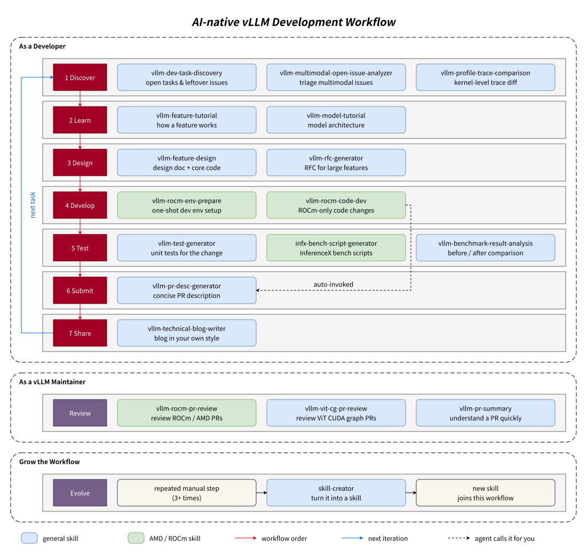

# vLLM Dev Skills

**English** | [简体中文](./README_zh.md)

<div align='left'>
  
  
  
  
  
  
  
</div align='left'>

## 📌 Overview

A curated collection of Claude Code agent skills that accelerate the entire vLLM development lifecycle — from understanding codebases and triaging issues to designing features, contributing changes, and analyzing performance. Each skill encapsulates a specific development task as a reusable, composable workflow, enabling vLLM developers and community contributors to work more efficiently with AI-assisted tooling.

## 🚀 Skills

| Name | Category | Description | Rec |
| :--- | :------- | :---------- | :-- |
| [vllm-rocm-env-prepare](./skills/vllm-rocm-env-prepare/SKILL.md) | Env Setup | Set up the vLLM ROCm dev environment inside a `vllm/vllm-openai-rocm` nightly container: clone repos, link skills, init git/node/claude config, install the GitHub CLI (`gh`, no login), build a no-compile editable vLLM `.venv` aligned to the image binaries, and optionally build MORI with UMBP. Already-done steps are skipped. | ⭐️⭐️⭐️ |
| [vllm-dev-task-discovery](./skills/vllm-dev-task-discovery/SKILL.md) | Demand Discovery | Analyze contribution opportunities in the vLLM repository for community developers. | ⭐️ |
| [vllm-feature-tutorial](./skills/vllm-feature-tutorial/SKILL.md) | Code Reading | Generate comprehensive Chinese technical tutorial documents for vLLM features and modules. | ⭐️⭐️⭐️⭐️⭐️ |
| [vllm-model-tutorial](./skills/vllm-model-tutorial/SKILL.md) | Code Reading | Generate comprehensive Chinese technical tutorial documents for vLLM models. | ⭐️⭐️⭐️⭐️⭐️ |
| [vllm-feature-design](./skills/vllm-feature-design/SKILL.md) | Change Proposing | Design and implement vLLM features according to user requirements. | ⭐️ |
| [vllm-rfc-generator](./skills/vllm-rfc-generator/SKILL.md) | Change Proposing | Generate a vLLM-style RFC document based on user input. | ⭐️ |
| [vllm-rocm-code-dev](./skills/vllm-rocm-code-dev/SKILL.md) | Code Contribution | Implement ROCm-only code changes in vLLM from a development requirement (no impact on CUDA or other backends, concise "why on ROCm" comments), and keep an English PR description in `docs/tasks/` in sync with every code update. | ⭐️⭐️⭐️⭐️⭐️ |
| [vllm-pr-desc-generator](./skills/vllm-pr-desc-generator/SKILL.md) | Code Contribution | Generate a vLLM-style PR title and description (Overview / Claims / Validation / Details, following the latest PR template) from a GitHub PR's code changes; kept short and final-state only, with the checklist ticked by default. | ⭐️⭐️ |
| [vllm-test-generator](./skills/vllm-test-generator/SKILL.md) | Code Contribution | Generate unit tests or end-to-end tests for vllm. | ⭐️ |
| [vllm-benchmark-result-analysis](./skills/vllm-benchmark-result-analysis/SKILL.md) | Performance Optimization | Compare serving benchmark outputs before and after a code change. | ⭐️⭐️ |
| [vllm-profile-trace-comparison](./skills/vllm-profile-trace-comparison/SKILL.md) | Performance Optimization | Compare decode-phase kernel implementations of vLLM vs ATOM from torch-profiler traces, with per-layer-type comparison tables and a vLLM optimization TODO list. | ⭐️⭐️ |
| [infx-bench-script-generator](./skills/infx-bench-script-generator/SKILL.md) | Performance Optimization | Generate local bash scripts (docker run / server start / AgentX client replay) to run an InferenceX srt-slurm recipe benchmark without Slurm, with optional torch profiler prefill/decode step capture. | ⭐️⭐️⭐️ |
| [vllm-pr-summary](./skills/vllm-pr-summary/SKILL.md) | Code Review | Fetch and analyze a PR from vllm, then generate a report covering PR overview, code change analysis, technical principles, discussion highlights, and risk assessment. | ⭐️⭐️⭐️⭐️ |
| [vllm-rocm-pr-review](./skills/vllm-rocm-pr-review/SKILL.md) | Code Review | Review AMD/ROCm-related PRs from vllm (aiter/mori/ROCm kernels) and generate a single combined Chinese report: a detailed PR summary (with Mermaid diagrams, technical principles, discussion highlights, and risk table) followed by severity-sorted, type-categorized ROCm review findings, a verdict, copy-paste English comments with file + diff line numbers ready for GitHub PR review, and a short (≤100-word) English overall summary to post as the PR's top-level comment. | ⭐️⭐️⭐️⭐️⭐️ |
| [vllm-vit-cg-pr-review](./skills/vllm-vit-cg-pr-review/SKILL.md) | Code Review | Review ViT (encoder) CUDA graph PRs from vllm — the model integrations, framework changes and fixes tracked by [#38175](https://github.com/vllm-project/vllm/issues/38175) — against the latest vllm main, following the review habits learned from the feature's maintainers (@shen-shanshan, @Isotr0py). Same combined Chinese report format as `vllm-rocm-pr-review` (detailed summary, severity-sorted findings with an integration checklist, verdict, copy-paste English comments, ≤100-word English summary); can batch-review all open tracker PRs. | ⭐️⭐️⭐️⭐️ |
| [vllm-multimodal-open-issue-analyzer](./skills/vllm-multimodal-open-issue-analyzer/SKILL.md) | Issue Analysis | Fetch and organize multimodal-related open issues from vllm. | ⭐️ |
| [vllm-technical-blog-writer](./skills/vllm-technical-blog-writer/SKILL.md) | Technical Writing | Write or complete Chinese vLLM technical blog posts in the author's established style (two-segment `XXX｜XXX` titles; outline headings and points are polished, and sections may be adjusted unless told otherwise), with concise architecture, flow, and sequence diagrams drawn in the author's hand-drawn draw.io style; also writes a Zhihu-ready `zhihu.md` copy of every article. | ⭐️⭐️ |

## 🧭 AI-native Workflow



These skills are not meant to be called one by one. Together they cover one development loop, from finding a problem to shipping the fix and writing about it. In daily work you rarely type `/skill-name`: describe the task in plain language and the agent picks the matching skill from its description, and skills call each other where it makes sense (for example, `vllm-rocm-code-dev` calls `vllm-pr-desc-generator` once the code is done). A slash command is only an explicit override.

### 💡 Principles

- **Automate the repetitive, keep the judgment.** If you have done the same manual step three times, it is worth turning into a skill. Environment setup, benchmark scripts, report formats and PR descriptions are good candidates; choosing what to build, design trade-offs and the final review stay with you.
- **Write a skill only where it beats a plain prompt.** For some steps (planning, unit tests, reading a benchmark log) a capable agent already does well, and the skill only adds a fixed format and conventions. Use whichever is faster.
- **Write for the reader.** Outputs that others read, such as PR descriptions and review comments, stay short and keep only the conclusions.
- **Make your work visible.** Technology that is not shared and seen is heavily undervalued. Turning each finished piece of work into a write-up makes the details of the work transparent, builds trust in you and the project, and grows a reputation that works as a credit endorsement. That is why writing is a stage of the workflow, not an afterthought.
- **Customize the skills.** Skills such as `vllm-rocm-env-prepare` and `vllm-technical-blog-writer` encode one person's setup and style; fork and edit them to fit yours.

### 👩‍💻 As a Developer

**1. Discover**

- `vllm-dev-task-discovery` — find open tasks and leftover problems in the vLLM community for a module or feature area. Example: *"What can community developers contribute to vLLM's multimodal module right now?"* → [report](./skills/vllm-dev-task-discovery/outputs/vllm_dev_task_multimodal_20260611.md).
- `vllm-multimodal-open-issue-analyzer` — collect and categorize the open multimodal issues → [report](./skills/vllm-multimodal-open-issue-analyzer/outputs/vllm_multimodal_issues_20260425_030830.md).
- `vllm-profile-trace-comparison` — after capturing profiler traces of vLLM and another engine (currently ATOM) on the same model and config, compare them kernel by kernel to find optimization opportunities such as missing fusions or multi-stream overlap. Give it the model name and the two trace paths → [report](./skills/vllm-profile-trace-comparison/outputs/minimax-m3-trace-comparison_zh_20260905_162716.md).

**2. Learn**

- `vllm-feature-tutorial` — learn how a feature involved in the task works. Example: *"Explain the EPD (Encode-Prefill-Decode) feature in vLLM."* → [tutorial](./skills/vllm-feature-tutorial/outputs/disaggregated_encoder_epd.md).
- `vllm-model-tutorial` — learn the structure and design of the model you want to optimize. Example: *"Explain DeepSeek-OCR in vLLM, especially how its ViT handles multimodal inputs."* → [tutorial](./skills/vllm-model-tutorial/outputs/deepseek_ocr.md).

**3. Design**

- `vllm-feature-design` — produce a design document and the core implementation for the task (the agent's plan mode works about as well). Example output: [Support Mooncake Based ECConnector for EPD](https://github.com/vllm-project/vllm/issues/39766).
- `vllm-rfc-generator` — for large, long-running features, draft an RFC to collect community feedback and track the PR list. Example output: [Support ViT Full CUDA Graph](https://github.com/vllm-project/vllm/issues/38175).

**4. Develop** (AMD GPUs)

- `vllm-rocm-env-prepare` — after pulling a vLLM ROCm nightly image and entering a fresh container, prepare the whole dev environment in one go: repos, skills, git / node / claude config, the GitHub CLI (`gh`, login left to you), and a no-compile editable vLLM `.venv`. Steps already done are skipped. Example: *"I just entered a vllm/vllm-openai-rocm nightly container, set up the vLLM ROCm dev environment."*
- `vllm-rocm-code-dev` — implement the change while keeping it on the ROCm path, so NVIDIA and other backends and vLLM's common modules are not affected. It saves an English PR description to `docs/tasks/<task-slug>.md` and keeps it in sync after every rebase, bugfix or review fix.

**5. Test**

- `vllm-test-generator` — generate unit tests for the change (asking the agent directly works about as well). Example output: [test_encoder_cudagraph](https://github.com/vllm-project/vllm/pull/38061/changes#diff-e8bf25855192d2972d13d0f0263a121462a181c4c297981d2395394666dc7979).
- `infx-bench-script-generator` — generate local scripts for one InferenceX recipe point (docker run / server / AgentX client, optional torch profiler capture) for the agent to run. Example: *"Run the override_dep8_c64 config of dsv4/vllm/mi355x-fp4-mtp/agentic.yaml locally and capture one prefill step."* → [scripts](./skills/infx-bench-script-generator/outputs/dsv4_vllm_mi355x-fp4-mtp_agentic_override_dep8_c64/).
- `vllm-benchmark-result-analysis` — compare the output of vLLM's own benchmark scripts before and after the change (asking the agent directly works about as well) → [report](./skills/vllm-benchmark-result-analysis/outputs/benchmark_comparison_20260323_150830.md).

**6. Submit**

- `vllm-pr-desc-generator` — write a short PR description in the vLLM template. Agents tend to write long, process-heavy descriptions that are hard to review; this skill keeps only the final design, key notes and test results. Example: *"https://github.com/vllm-project/vllm/pull/38061"* → [description](./skills/vllm-pr-desc-generator/outputs/pr-38061-desc.md).

**7. Share**

- `vllm-technical-blog-writer` — after a solid feature or optimization, write a technical blog post about it. The skill learns your writing style and diagram colors, so the post reads like yours. Give it a topic, or a Markdown draft with `[Agent TODO]` markers to fill in. New posts go to [`outputs/`](./skills/vllm-technical-blog-writer/outputs/), each with a `zhihu.md` copy ready to paste into Zhihu (no title line, headings one level up, PNG images).

### 🧑‍⚖️ As a vLLM Maintainer

- `vllm-rocm-pr-review` — review ROCm / AMD PRs. Produces a Chinese report with a detailed summary, severity-sorted findings and a verdict, plus English inline comments and a short English summary ready to post → [report](./skills/vllm-rocm-pr-review/outputs/pr-29304-review.md).
- `vllm-vit-cg-pr-review` — review ViT CUDA graph PRs tracked by [#38175](https://github.com/vllm-project/vllm/issues/38175), one PR or every open one in the tracker → [report](./skills/vllm-vit-cg-pr-review/outputs/pr-63074-review.md).
- `vllm-pr-summary` — quickly understand what a PR changes and why, without reviewing it → [summary](./skills/vllm-pr-summary/outputs/pr-35963-summary.md).

### 🌱 Grow the Workflow

When a manual, tedious step has come up three times or more, consider turning it into a skill with `skill-creator` and adding it to the workflow. Each new skill also goes into the [Skills](#-skills) table and the diagram above: add it to `docs/workflow/gen_workflow.py` and run `python3 docs/workflow/gen_workflow.py`, which regenerates both the English and the Chinese diagram.

## 🛠️ Configuration

**Option 1: install with the [`skills`](https://github.com/vercel-labs/skills) CLI** (requires Node.js).

```bash
# List the skills available in this repo.
npx skills add shen-shanshan/vllm-dev-skills --list

# Install one or more skills for Claude Code at user level (~/.claude/skills).
npx skills add shen-shanshan/vllm-dev-skills -g -a claude-code -s vllm-pr-desc-generator

# Install all skills for Claude Code at user level.
npx skills add shen-shanshan/vllm-dev-skills -g -a claude-code -s '*' -y

# Update installed skills later.
npx skills update -g
```

Drop `-g` to install into the current project (`./.claude/skills`) instead, or change `-a` to target other agents (`'*'` for all). The CLI installs a snapshot of the GitHub repo, so run `npx skills update` to pick up new changes.

**Option 2: soft-link a local clone** (edits in the clone take effect immediately).

```bash
# Manually soft-link single skill to claude-code's official skill dir.
ln -sfn /path/to/vllm-dev-skills/skills/skill-name ~/.claude/skills/skill-name

# Manually soft-link all skills to claude-code's official skill dir.
for dir in /path/to/vllm-dev-skills/skills/*/; do
  name=$(basename "$dir")
  ln -sfn "$dir" ~/.claude/skills/"$name"
done
```

## 📖 References

- [Agent Skills](https://agentskills.io/home#why-agent-skills)
- [Extend Claude with skills](https://code.claude.com/docs/en/skills)
- [Configure Claude Code in VSCode](https://api.lingyaai.cn/model_intro/Claude-Code.html)
- [Configure Claude Code CLI with Claude HUD](https://github.com/jarrodwatts/claude-hud)
- [Awesome DeepSeek Agent](https://github.com/deepseek-ai/awesome-deepseek-agent)

## ©️ Citation

```bibtex
@misc{vllm-dev-skills@2026,
  title  = {vllm-dev-skills},
  url    = {https://github.com/shen-shanshan/vllm-dev-skills},
  note   = {Open-source software available at https://github.com/shen-shanshan/vllm-dev-skills},
  author = {shen-shanshan},
  year   = {2026}
}
```

## 📜 License

Apache-2.0 License, find more details [<u>here</u>](./LICENSE).

## ⭐ Star History

[](https://www.star-history.com/#shen-shanshan/vllm-dev-skills&Timeline)
