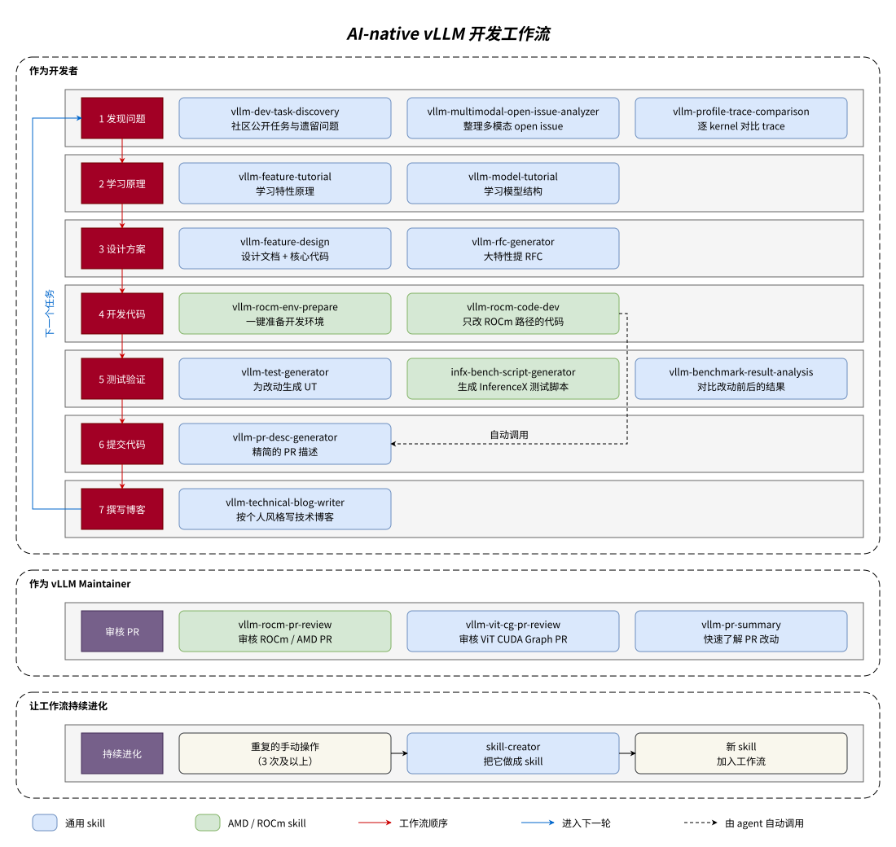

# vLLM Dev Skills

[English](./README.md) | **简体中文** | 🌐 [网站](https://shen-shanshan.github.io/vllm-dev-skills/)

<div align='left'>
  
  
  
  
  
  
  
</div align='left'>

## 📌 项目简介

一套精心整理的 Claude Code Agent Skill，覆盖 vLLM 研发的完整流程：从阅读代码、分析 Issue，到设计特性、贡献代码和分析性能。每个 Skill 都把一类具体的开发任务封装成可复用、可组合的工作流，帮助 vLLM 开发者和社区贡献者借助 AI 工具更高效地工作。

[项目网站](https://shen-shanshan.github.io/vllm-dev-skills/)提供 `vllm-feature-tutorial` 和 `vllm-model-tutorial` 生成的技术文档的在线阅读，每篇都标注了最后更新时间。

## 🚀 Skill 列表

| 名称 | 类别 | 描述 | 推荐度 |
| :--- | :--- | :--- | :----- |
| [vllm-rocm-env-prepare](./skills/vllm-rocm-env-prepare/SKILL.md) | 环境准备 | 在 `vllm/vllm-openai-rocm` nightly 容器内搭建 vLLM ROCm 开发环境：Clone 代码仓、链接 Skill、初始化 git / node / claude 配置、安装 GitHub CLI（`gh`，不代为登录）、构建与镜像二进制对齐的免编译 editable vLLM `.venv`，并可选构建带 UMBP 的 MORI。已完成的步骤会自动跳过。 | ⭐️⭐️⭐️ |
| [vllm-dev-task-discovery](./skills/vllm-dev-task-discovery/SKILL.md) | 需求发现 | 为社区开发者分析 vLLM 仓库中可以贡献的任务。 | ⭐️ |
| [vllm-feature-tutorial](./skills/vllm-feature-tutorial/SKILL.md) | 代码阅读 | 为 vLLM 的特性和模块生成详尽的中文技术教程。 | ⭐️⭐️⭐️⭐️⭐️ |
| [vllm-model-tutorial](./skills/vllm-model-tutorial/SKILL.md) | 代码阅读 | 为 vLLM 中的模型生成详尽的中文技术教程。 | ⭐️⭐️⭐️⭐️⭐️ |
| [vllm-feature-design](./skills/vllm-feature-design/SKILL.md) | 方案设计 | 根据用户需求设计并实现 vLLM 特性。 | ⭐️ |
| [vllm-rfc-generator](./skills/vllm-rfc-generator/SKILL.md) | 方案设计 | 根据用户输入生成 vLLM 风格的 RFC 文档。 | ⭐️ |
| [vllm-rocm-code-dev](./skills/vllm-rocm-code-dev/SKILL.md) | 代码贡献 | 根据开发需求在 vLLM 中实现仅限 ROCm 路径的代码改动（不影响 CUDA 等其他后端，附简洁的"为什么 ROCm 需要这样做"注释），并在每次代码更新后同步维护 `docs/tasks/` 下的英文 PR 描述。 | ⭐️⭐️⭐️⭐️⭐️ |
| [vllm-pr-desc-generator](./skills/vllm-pr-desc-generator/SKILL.md) | 代码贡献 | 根据 GitHub PR 的代码改动，按 vLLM 最新 PR 模板（Overview / Claims / Validation / Details）生成 PR 标题与描述；描述保持精简、只写最终结论，Checklist 默认全部勾选。 | ⭐️⭐️ |
| [vllm-test-generator](./skills/vllm-test-generator/SKILL.md) | 代码贡献 | 为 vLLM 生成单元测试或端到端测试。 | ⭐️ |
| [vllm-benchmark-result-analysis](./skills/vllm-benchmark-result-analysis/SKILL.md) | 性能优化 | 对比代码改动前后的 serving benchmark 结果。 | ⭐️⭐️ |
| [vllm-profile-trace-comparison](./skills/vllm-profile-trace-comparison/SKILL.md) | 性能优化 | 基于 torch profiler trace 对比 vLLM 与 ATOM 在 decode 阶段的 kernel 实现，按层类型输出对比表，并给出 vLLM 优化 TODO 列表。 | ⭐️⭐️ |
| [infx-bench-script-generator](./skills/infx-bench-script-generator/SKILL.md) | 性能优化 | 生成本地 bash 脚本（docker run / 启动 server / AgentX client 回放），无需 Slurm 即可跑 InferenceX srt-slurm recipe benchmark，可选用 torch profiler 采集 prefill / decode step。 | ⭐️⭐️⭐️ |
| [vllm-pr-summary](./skills/vllm-pr-summary/SKILL.md) | 代码检视 | 获取并分析 vLLM 的 PR，生成包含 PR 概览、代码改动分析、技术原理、讨论要点和风险评估的报告。 | ⭐️⭐️⭐️⭐️ |
| [vllm-rocm-pr-review](./skills/vllm-rocm-pr-review/SKILL.md) | 代码检视 | 检视 vLLM 中 AMD / ROCm 相关的 PR（aiter / mori / ROCm kernel），生成一份合并的中文报告：详细的 PR 总结（含 Mermaid 图、技术原理、讨论要点和风险表），按严重程度排序、按类型分类的 ROCm 检视意见和结论，可直接复制到 GitHub PR review 的英文评论（含文件与 diff 行号），以及一段 100 词以内、可作为 PR 顶层评论的英文总结。 | ⭐️⭐️⭐️⭐️⭐️ |
| [vllm-vit-cg-pr-review](./skills/vllm-vit-cg-pr-review/SKILL.md) | 代码检视 | 对照 vLLM 最新 main 分支，检视 [#38175](https://github.com/vllm-project/vllm/issues/38175) 跟踪的 ViT（encoder）CUDA graph PR（模型接入、框架改动和修复），检视习惯学习自该特性的维护者（@shen-shanshan、@Isotr0py）。报告格式与 `vllm-rocm-pr-review` 相同（详细总结、按严重程度排序并附接入检查清单的检视意见、结论、可直接复制的英文评论、100 词以内的英文总结）；支持批量检视 tracker 中所有 open 的 PR。 | ⭐️⭐️⭐️⭐️ |
| [vllm-multimodal-open-issue-analyzer](./skills/vllm-multimodal-open-issue-analyzer/SKILL.md) | Issue 分析 | 获取并整理 vLLM 中与多模态相关的 open issue。 | ⭐️ |
| [vllm-technical-blog-writer](./skills/vllm-technical-blog-writer/SKILL.md) | 技术写作 | 按作者既有风格撰写或补全中文 vLLM 技术博客（标题统一为 `XXX｜XXX` 两段式；大纲中的标题和要点会被润色，除非另有说明，章节也可能调整），并按作者手绘 draw.io 风格绘制简洁的架构图、流程图和时序图；每篇文章都会同时生成可直接发知乎的 `zhihu.md` 和发微信公众号的 `weixin.md`。 | ⭐️⭐️ |

## 🧭 AI-native 工作流



这些 skill 不是一个个单独调用的工具，而是串起了一条完整的开发闭环：从发现问题、动手实现，到提交代码、写文章分享。日常使用时很少需要手动输入 `/skill-name`：用自然语言描述任务，agent 会根据 skill 的描述自动选用合适的 skill，skill 之间也会互相调用（比如 `vllm-rocm-code-dev` 写完代码后会自动调用 `vllm-pr-desc-generator` 生成 PR 描述）。斜杠命令只是需要显式指定时的备选方式。

### 💡 理念

- **重复的交给 AI，判断留给自己。** 一件手动操作如果已经重复做了 3 次，就值得做成 skill。环境准备、测试脚本、报告格式、PR 描述都很适合自动化；而做什么、方案怎么取舍、最终把关，仍然由自己负责。
- **只在比直接提问更好时才写 skill。** 有些环节（做计划、写 UT、分析 bench 日志）agent 本身已经做得不错，skill 只是多了固定的格式和约定，哪个快用哪个。
- **为读者而写。** PR 描述、review 意见这类给别人看的内容，保持精简，只写结论。
- **让工作被看见。** 技术如果不被传播、不被看见，它的价值是被严重低估的。要把一切在做的事情牢牢锁在 IP 构建这项工程中，这个透明化的“麻烦”本身，会充分地给你回报。当一个人做事的全过程都摊开在大家面前时，其中的每一个细节都会让观者对其本人和产品产生信任与热爱，付费意愿也会更高。声誉是最高效的价值交互筹码，本质上是大家对一个人的集体认知和定价，是一种信用背书；管理自己的声誉，就是管理自己在他人那里的算法。所以写博客是工作流中的一个阶段，而不是可有可无的收尾。
- **按需定制。** `vllm-rocm-env-prepare`、`vllm-technical-blog-writer` 等 skill 记录的是个人的环境和风格，可以 fork 后改成适合自己的版本。

### 👩‍💻 作为开发者

**1. 发现问题**

- `vllm-dev-task-discovery`：寻找 vLLM 社区中某个模块或特性方向上公开的任务和遗留问题。示例：*“我想了解 vLLM 的多模态模块中最近还有哪些可以给社区开发者贡献的事情。”* → [报告](./skills/vllm-dev-task-discovery/outputs/vllm_dev_task_multimodal_20260611.md)。
- `vllm-multimodal-open-issue-analyzer`：收集并分类整理多模态相关的 open issue → [报告](./skills/vllm-multimodal-open-issue-analyzer/outputs/vllm_multimodal_issues_20260425_030830.md)。
- `vllm-profile-trace-comparison`：在相同模型和配置下分别采集 vLLM 与另一个推理引擎（目前是 ATOM）的 profiler trace 后，逐 kernel 对比两者的差异，找出 kernel fusion、多流 overlap 等性能优化机会。提供模型名和两份 trace 路径即可 → [报告](./skills/vllm-profile-trace-comparison/outputs/minimax-m3-trace-comparison_zh_20260905_162716.md)。

**2. 学习原理**

- `vllm-feature-tutorial`：学习当前任务涉及的特性的技术原理。示例：*“我想了解 vLLM 中的 EPD（Encode-Prefill-Decode）特性，请帮我总结一份技术文档。”* → [教程](./skills/vllm-feature-tutorial/outputs/disaggregated_encoder_epd.md)。
- `vllm-model-tutorial`：学习想要优化的模型的整体结构和设计特点。示例：*“我想了解 vLLM 中的 DeepSeek-OCR 模型，尤其是其 ViT 部分对多模态输入的处理流程。”* → [教程](./skills/vllm-model-tutorial/outputs/deepseek_ocr.md)。

**3. 设计方案**

- `vllm-feature-design`：为当前任务生成设计文档和核心代码（直接用 agent 的 plan mode 效果也差不多）。输出示例：[Support Mooncake Based ECConnector for EPD](https://github.com/vllm-project/vllm/issues/39766)。
- `vllm-rfc-generator`：对于较大、周期较长的特性，生成 RFC 提交给社区，收集反馈并用来跟踪 PR 列表。输出示例：[Support ViT Full CUDA Graph](https://github.com/vllm-project/vllm/issues/38175)。

**4. 开发代码**（针对 AMD GPU）

- `vllm-rocm-env-prepare`：拉取 vLLM ROCm nightly 镜像并进入新容器后，一键准备好开发环境：代码仓、skill、git / node / claude 配置、GitHub CLI（`gh`，需自行登录）以及免编译的 editable vLLM `.venv`，已完成的步骤会自动跳过。示例：*“我刚进入 vllm/vllm-openai-rocm nightly 容器，请帮我初始化 vllm rocm 开发环境。”*
- `vllm-rocm-code-dev`：开发代码，并把改动尽量限制在 ROCm 路径上，不影响 NVIDIA 等其他硬件后端和 vLLM 的公共模块。同时把英文 PR 描述保存到 `docs/tasks/<task-slug>.md`，之后每次 rebase、修复 bug 或根据 review 修改代码都会同步更新。

**5. 测试验证**

- `vllm-test-generator`：为本次改动生成 UT（直接让 agent 写效果也差不多）。输出示例：[test_encoder_cudagraph](https://github.com/vllm-project/vllm/pull/38061/changes#diff-e8bf25855192d2972d13d0f0263a121462a181c4c297981d2395394666dc7979)。
- `infx-bench-script-generator`：为 InferenceX 中的某个测试点生成本地脚本（docker run / server / AgentX client，可选 torch profiler 采集），交给 agent 执行测试。示例：*“我想在本地跑 dsv4/vllm/mi355x-fp4-mtp/agentic.yaml 的 override_dep8_c64 配置，并采集一个完整的 prefill step。”* → [脚本](./skills/infx-bench-script-generator/outputs/dsv4_vllm_mi355x-fp4-mtp_agentic_override_dep8_c64/)。
- `vllm-benchmark-result-analysis`：对比改动前后 vLLM 自带 bench 脚本的测试结果（直接让 agent 分析效果也差不多）→ [报告](./skills/vllm-benchmark-result-analysis/outputs/benchmark_comparison_20260323_150830.md)。

**6. 提交代码**

- `vllm-pr-desc-generator`：按 vLLM PR 模板生成精简的 PR 描述。agent 默认生成的描述往往冗长、像开发流水账，reviewer 读起来很吃力；这个 skill 只保留最终方案、关键说明和测试结果。示例：*“https://github.com/vllm-project/vllm/pull/38061”* → [描述](./skills/vllm-pr-desc-generator/outputs/pr-38061-desc.md)。

**7. 撰写博客**

- `vllm-technical-blog-writer`：每完成一个高质量的特性或优化后，写一篇技术博客进行分享，积累个人在业界的影响力。这个 skill 会学习你过往的写作风格和配图配色，生成有个人特色的文章。可以只给一个主题，也可以给一份带 `[Agent TODO]` 标记的 Markdown 草稿让它补全。新文章保存在 [`outputs/`](./skills/vllm-technical-blog-writer/outputs/) 下，并同时生成一份可直接粘贴到知乎的 `zhihu.md`（去掉标题行、各级标题升一级、图片改用 PNG），以及一份发微信公众号用的 `weixin.md`（图片换成占位符、正文链接改为纯文本网址列表）。

### 🧑‍⚖️ 作为 vLLM Maintainer

- `vllm-rocm-pr-review`：审核 ROCm / AMD 相关 PR。生成一份中文报告（详细总结、按严重程度排序的检视意见和结论），并附上可直接发到 PR 上的英文行内评论和英文总结 → [报告](./skills/vllm-rocm-pr-review/outputs/pr-29304-review.md)。
- `vllm-vit-cg-pr-review`：审核 [#38175](https://github.com/vllm-project/vllm/issues/38175) 跟踪的 ViT CUDA Graph PR，支持单个 PR，也支持批量审核 tracker 中所有 open 的 PR → [报告](./skills/vllm-vit-cg-pr-review/outputs/pr-63074-review.md)。
- `vllm-pr-summary`：快速了解某个 PR 改了什么、为什么改，但不做 review → [总结](./skills/vllm-pr-summary/outputs/pr-35963-summary.md)。

### 🌱 让工作流持续进化

平时工作中，如果发现某个手动、繁琐的操作已经重复出现了 3 次及以上，就可以考虑用 `skill-creator` 把它做成 skill，补充到工作流中，让工作流越来越自动化、智能化。新增的 skill 也要加到 [Skill 列表](#-skill-列表) 和上面的工作流图里：在 `docs/workflow/gen_workflow.py` 中加上这个 skill，然后运行 `python3 docs/workflow/gen_workflow.py`，中英文两张图会一起重新生成。

## 🛠️ 安装配置

**方式 1：使用 [`skills`](https://github.com/vercel-labs/skills) CLI 安装**（需要 Node.js）。

```bash
# 列出本仓库中可用的 skill
npx skills add shen-shanshan/vllm-dev-skills --list

# 为 Claude Code 安装一个或多个 skill（用户级，~/.claude/skills）
npx skills add shen-shanshan/vllm-dev-skills -g -a claude-code -s vllm-pr-desc-generator

# 为 Claude Code 安装全部 skill（用户级）
npx skills add shen-shanshan/vllm-dev-skills -g -a claude-code -s '*' -y

# 之后更新已安装的 skill
npx skills update -g
```

去掉 `-g` 则安装到当前项目（`./.claude/skills`）；修改 `-a` 可以安装给其他 agent（`'*'` 表示全部）。CLI 安装的是 GitHub 仓库的快照，仓库有更新时需要运行 `npx skills update` 才会生效。

**方式 2：软链接本地 clone**（修改 clone 中的文件后立即生效）。

```bash
# 将单个 skill 软链接到 Claude Code 的官方 skill 目录
ln -sfn /path/to/vllm-dev-skills/skills/skill-name ~/.claude/skills/skill-name

# 将全部 skill 软链接到 Claude Code 的官方 skill 目录
for dir in /path/to/vllm-dev-skills/skills/*/; do
  name=$(basename "$dir")
  ln -sfn "$dir" ~/.claude/skills/"$name"
done
```

## 📖 参考资料

- [Agent Skills](https://agentskills.io/home#why-agent-skills)
- [Extend Claude with skills](https://code.claude.com/docs/en/skills)
- [Configure Claude Code in VSCode](https://api.lingyaai.cn/model_intro/Claude-Code.html)
- [Configure Claude Code CLI with Claude HUD](https://github.com/jarrodwatts/claude-hud)
- [Awesome DeepSeek Agent](https://github.com/deepseek-ai/awesome-deepseek-agent)

## ©️ 引用

```bibtex
@misc{vllm-dev-skills@2026,
  title  = {vllm-dev-skills},
  url    = {https://github.com/shen-shanshan/vllm-dev-skills},
  note   = {Open-source software available at https://github.com/shen-shanshan/vllm-dev-skills},
  author = {shen-shanshan},
  year   = {2026}
}
```

## 📜 许可证

本项目采用 Apache-2.0 许可证，详见 [<u>LICENSE</u>](./LICENSE)。

## ⭐ Star History

[](https://www.star-history.com/#shen-shanshan/vllm-dev-skills&Timeline)
