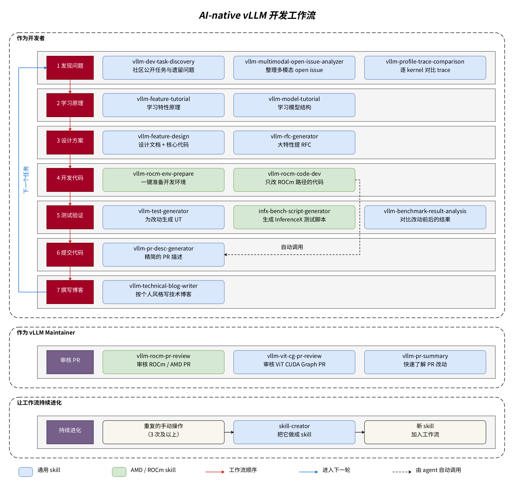
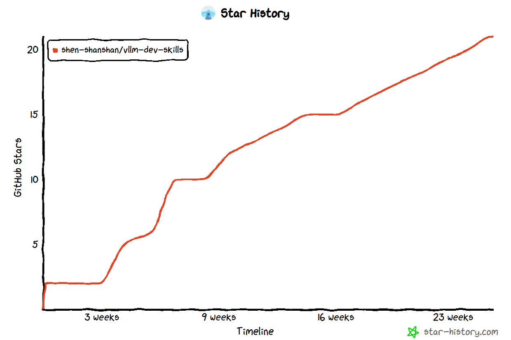

# vLLM Dev Skills｜打造 AI-Native 的开发工作流

## 一、引言

[vLLM](https://github.com/vllm-project/vllm) 是目前最流行的大模型推理框架之一。作为一个高速迭代的大型开源项目，它的代码库庞大、模块繁多：读懂一个 Feature 的实现路径往往需要好几天，而找任务、搭环境、跑 Benchmark、写 PR 描述、做 Review 这些围绕代码的工作，占用的时间并不比写代码少。

在参与 vLLM 社区开发的过程中，我把这些工作中可以沉淀的部分逐步做成了 Claude Code 的 Skill，放在 [vllm-dev-skills](https://github.com/shen-shanshan/vllm-dev-skills) 这个仓库中，并搭建了一个[项目网站](https://shen-shanshan.github.io/vllm-dev-skills/)，可以在线阅读工作流介绍和这些 Skill 生成的 vLLM 特性与模型技术文档。上一版介绍是按分类逐个讲 Skill 的；而现在仓库里已经有 17 个 vLLM 相关的 Skill，我的用法也变了：大部分 Skill 不再需要手动输入 `/Skill名称` 去触发，而是在开发过程中由 Agent 根据任务自动选用，Skill 之间也会互相调用。所以这一版换个角度，把这些 Skill 串成一条完整的工作流，介绍每个 Skill 在工作流中的位置和用法，顺带聊聊我对“什么时候该用 AI 自动化”以及“为什么要写技术博客”的一些想法。

## 二、几点理念

在介绍具体的工作流之前，先说下我搭这套 Skill 时遵循的几条原则，后面每个 Skill 的取舍基本都由它们决定。

### 2.1 什么时候该用 AI 自动化工作流

我的判断标准很简单：**同一件手动操作重复做了 3 次及以上，就值得考虑把它做成 Skill**。像进容器后搭开发环境、为某个 Benchmark 配置拼启动脚本、按模板写 PR 描述、按固定格式写 Review 报告，这些事情步骤固定、容易出错又没什么创造性，最适合交给 AI。而做什么、方案怎么取舍、最终结果是否可信，仍然需要自己判断。Skill 生成的内容是起点而不是终点，AI 辅助开发的价值在于降低认知负担，而不是替代思考。

另外，并不是每个环节都需要 Skill。做计划、写 UT、读一份 Benchmark 日志这类事情，能力足够强的 Agent 本身就做得不错，对应的 Skill 只是多了一套固定的格式和约定，效果差别不大，哪个顺手用哪个即可。反过来，越是有固定格式、需要团队或社区约定的任务（如 PR 模板、RFC 格式、ROCm 改动的隔离规则），Skill 的价值越明显。单次节省的时间也许不多，但在高频重复的流程里，积累下来的收益相当可观。

最后，给别人看的内容要为读者而写。Agent 默认生成的 PR 描述和 Review 意见往往很长，像一份开发过程的流水账，Reviewer 读起来很吃力；所以相关的 Skill 都要求只保留最终结论。

### 2.2 为什么要写技术博客

工作流的最后一个阶段是写技术博客，这是我有意加进去的，而不是可有可无的收尾。

技术如果不被传播、不被看见，它的价值是被严重低估的。我的想法是，要把一切在做的事情牢牢锁在 IP 构建这项工程中，这个透明化的“麻烦”本身，会充分地给你回报。通过写文章把工作中的细节摊开，满足大家对“工作透明”的需求：当一个人做事的全过程都摊开在大家面前时，其中的每一个细节都会让读者对其本人和作品产生信任与兴趣。声誉是最高效的价值交互筹码，其本质是大家对一个人的集体认知和定价，是一种信用背书；管理自己的声誉，就是管理自己在他人那里的算法。

因此，每做完一个高质量的 Feature 或优化，我都会写一篇技术博客。写博客同样有大量重复劳动（调研最新代码、画图、统一格式），这部分也交给了 Skill。

## 三、AI-Native 开发工作流

老规矩，先上图：



这张图按角色分为三部分：

- **作为开发者**：从发现问题到撰写博客共 7 个阶段，红色箭头表示推进顺序，左侧蓝色箭头表示一个任务结束后进入下一轮；
- **作为 vLLM Maintainer**：Review 社区 PR 时使用的 3 个 Skill；
- **让工作流持续进化**：发现新的重复操作后，用 `skill-creator` 把它做成新的 Skill 加入工作流。

图中浅绿色的是 AMD/ROCm 专用的 Skill，浅蓝色的是通用 Skill；`vllm-rocm-code-dev` 和 `vllm-pr-desc-generator` 之间的虚线表示前者会在写完代码后自动调用后者。

使用时，只需要用自然语言描述当前要做的事情，Agent 会根据每个 Skill 的描述自动选用合适的 Skill。比如说一句“我刚进入 vLLM ROCm Nightly 容器，帮我初始化开发环境”，就会触发 `vllm-rocm-env-prepare`。只有想强制指定某个 Skill 时，才需要在末尾加上 `/Skill名称`。

这张图本身也是由仓库中的 `docs/workflow/gen_workflow.py` 生成的：每个阶段有哪些 Skill、每个 Skill 的中英文用途都写在这个脚本里，新增 Skill 后重新运行一次，就会同时生成中英文两个版本。

## 四、作为开发者

### 4.1 发现问题

**`vllm-dev-task-discovery`：先看看社区需要什么。**

想给 vLLM 贡献代码，但面对几千个 Issue 和每天几十个 PR，很难判断某个模块里还有哪些事情值得做、哪些已经有人在做了。输入一个模块、特性或模型方向（如“多模态”），这个 Skill 会从 Open Issue、近期 PR、GitHub Discussion、代码中的 TODO/FIXME、Roadmap 标签以及 Maintainer 的活跃情况中收集信息，整理出一份任务清单，并为每个任务标注难度、所需的前置知识、相关的 Maintainer/Contributor，以及紧急程度和重要程度。

输出样例：[vllm_dev_task_multimodal_20260611](https://github.com/shen-shanshan/vllm-dev-skills/blob/master/skills/vllm-dev-task-discovery/outputs/vllm_dev_task_multimodal_20260611.md)。

**`vllm-multimodal-open-issue-analyzer`：多模态 Open Issue 整理。**

拉取 vLLM 仓库中与多模态相关的 Open Issue，按问题类型（Bug、Feature Request、性能、CUDA Graph、EPD、具体 VL 模型等）分组，便于快速了解社区当前的痛点。

**`vllm-profile-trace-comparison`：用 Trace 找性能优化机会。**

另一类问题来自性能对比。在 AMD GPU 上，同一个模型、同一套配置，其它推理引擎的 Decode 性能有时比 vLLM 更好，这时就需要定位差距具体出在哪些 Kernel 上。分别采集两个引擎的 Torch Profiler Trace 后，把模型名和两份 Trace 交给这个 Skill：它会先用脚本从两份 Trace 中各切出一个 Decode Step，再对每种层类型（如 Attention 层、MoE 层）各取一层作为样本，生成逐 Kernel 的对比表：各用了哪些 Kernel、是融合实现还是拆开实现、是否用了多流、量化方式有什么差异、耗时差多少。最后，它只针对其它推理引擎明显更快的算子整理出一份 vLLM 的优化 TODO 清单（如还可以做哪些 Kernel Fusion），并按预期收益排序。

输出样例：[minimax-m3-trace-comparison_zh_20260905_162716](https://github.com/shen-shanshan/vllm-dev-skills/blob/master/skills/vllm-profile-trace-comparison/outputs/minimax-m3-trace-comparison_zh_20260905_162716.md)。

### 4.2 学习原理

**`vllm-feature-tutorial`：读懂当前任务涉及的特性。**

vLLM 的模块设计复杂，看一段代码往往要在十几个文件之间跳来跳去。输入一个 Feature 名称（如 `Chunked Prefill`、`Prefix Caching`），这个 Skill 会生成一篇中文解析文档，包括背景与动机、核心数据结构（附 Mermaid 类图）、从 API 到底层实现的调用链（附 Mermaid 流程图）、关键代码走读，以及与其他模块的交互关系。这是我用得最多的 Skill 之一：接到一个 EPD 相关的任务时，用它生成文档后，20 分钟内就对整个模块有了基本认知，而之前纯手动阅读至少需要半天。

输出样例：[disaggregated_encoder_epd](https://github.com/shen-shanshan/vllm-dev-skills/blob/master/skills/vllm-feature-tutorial/outputs/disaggregated_encoder_epd.md)。

**`vllm-model-tutorial`：读懂想要优化的模型。**

和前者关注特性不同，这个 Skill 关注 vLLM 中某个具体的模型（如 Qwen3-VL、DeepSeek-V3、Llama 4 等）。它会先查阅模型的技术报告和论文，再结合 vLLM 中的实现代码，讲清楚模型整体架构、输入预处理流程（对 VLM 还会单独分析 ViT 部分）、Forward 计算过程，以及 MoE、MLA、Gated Attention 等相关技术原理。

输出样例：[deepseek_ocr](https://github.com/shen-shanshan/vllm-dev-skills/blob/master/skills/vllm-model-tutorial/outputs/deepseek_ocr.md)。

这两个 Skill 生成的文档都发布在项目的 [GitHub Pages 网站](https://shen-shanshan.github.io/vllm-dev-skills/)上，可以在线阅读。由于 vLLM 的代码一直在变化，每篇文档开头都标注了最后更新时间，距今超过 3 个月的还会额外提醒内容可能已经过期。

### 4.3 设计方案

**`vllm-feature-design`：生成设计文档和核心代码。**

输入 Feature 描述、相关 PR/Issue 链接和参考资料，这个 Skill 会输出核心代码实现（不含测试）和一份 Markdown 设计文档（架构图、数据流、模块改动说明、权衡分析）。它的定位是辅助设计：生成的代码框架准确度大约在 60%～70%，细节还需要手动调整，但起点比从零开始高很多。说实话，直接使用 Agent 的 Plan Mode 效果也差不多。社区中的 [Support Mooncake Based ECConnector for EPD](https://github.com/vllm-project/vllm/issues/39766) 就是在它生成的设计基础上，经过人工调整后提交的。

**`vllm-rfc-generator`：为大特性提交 RFC。**

对于比较大、周期比较长的 Feature 集成，vLLM 社区要求先提交 RFC。这个 Skill 会生成符合社区规范的 RFC 草稿，用于向社区收集反馈，之后也可以作为 Tracker 跟踪相关的 PR 列表。由于 RFC 内容高度依赖领域知识，它更多作为起草工具使用。例如：[Support ViT Full CUDA Graph](https://github.com/vllm-project/vllm/issues/38175)（同样经过了人工调整）。

### 4.4 开发代码

这一阶段的两个 Skill 都是针对 AMD GPU 开发的，可以根据自己的环境修改成适合自己的版本。

**`vllm-rocm-env-prepare`：进容器后一句话搭好开发环境。**

我平时在 `vllm/vllm-openai-rocm` Nightly 镜像起的容器里开发，容器经常重建，每次都要重复一遍拉代码仓、写配置、同步 `main` 分支、搭建虚拟环境等步骤。这个 Skill 把这些步骤固化成一个可重复执行的流程，已经完成的步骤会自动跳过：

- **代码仓与 Skill**：将 vLLM、vllm-dev-skills、InferenceX（直接用上游仓库）、vllm-perf-analysis-tools 等代码仓 Clone 到宿主机挂载的持久化目录中（MORI 仅在需要时 Clone），并把 vllm-dev-skills 中的 Skill 软链接到 `~/.claude/skills/`；
- **基础配置**：写入 Git 用户信息与常用 Alias、Vim 配置，安装 Node.js 和 GitHub CLI（`gh`，登录留给用户自己完成），并链接 Claude Code 可执行文件；
- **免编译的 vLLM 开发环境**：将当前分支对齐到镜像中 vLLM 的构建 Commit，拷贝镜像里预编译好的 `*.so`，再创建继承系统 site-packages 的 `.venv`，以 Editable 方式安装源码，这样修改 Python 代码后无需重新编译即可生效；
- **模型与数据集**：优先复用只读挂载的 `/shared` 中已有的权重和数据集，没有时再下载；
- **MORI + UMBP（按需）**：用 vLLM 固定的 MORI 版本、打开 `BUILD_UMBP=ON` 源码编译 MORI 并装进 `.venv`，通过检查编译日志和 Import 结果，避免装上一个悄悄关掉了 UMBP 的版本。

**`vllm-rocm-code-dev`：只改 ROCm 路径的代码开发。**

在 vLLM 上做 AMD/ROCm 相关开发时，最容易出问题的是不小心改动了通用代码，影响到 NVIDIA 等其它硬件后端或 vLLM 的公共模块。这个 Skill 把这些约束固化成了开发流程：

- **改动隔离**：优先修改 ROCm 专属代码（如 `vllm/platforms/rocm.py`、`vllm/_aiter_ops.py`、ROCm Attention Backend 等），必须改动通用代码时，通过在基类新增接口、由 ROCm 子类覆写的方式实现，并逐个文件确认其它后端的行为不变；
- **简洁注释**：新增的关键代码只用一两句注释说明“为什么在 ROCm 上要这样做”；
- **PR 描述联动**：代码完成后自动调用 `vllm-pr-desc-generator` 生成英文 PR 描述，之后每次 Rebase、修复 Bug 或根据 Review 意见修改代码，都会同步更新这份描述。

### 4.5 测试验证

**`vllm-test-generator`：为改动生成 UT。**

给定一个函数、类或场景，生成覆盖正常路径、边界条件和异常路径的单元测试或端到端测试。在 Prompt 中指定测试文件和复用要求（如“在 `tests/v1/cudagraph/test_encoder_cudagraph.py` 中生成测试，并尽可能复用 `SimpleMockViTModel`”），生成的用例会更贴近仓库已有的风格。和设计阶段类似，直接让 Agent 写 UT 效果也差不多。

**`infx-bench-script-generator`：在本地复现 InferenceX Benchmark。**

[InferenceX](https://github.com/SemiAnalysisAI/InferenceX) 的 Benchmark Recipe 默认通过 Slurm 来调度。如果只想在一台本地 GPU 服务器上测某个 Recipe + Override 配置（比如 `dsv4/vllm/mi355x-fp4-mtp/agentic.yaml` 的 `override_dep8_c64`），手动拼启动参数和环境变量很容易出错。这个 Skill 会读取 Recipe 和对应的 Override，确定性地生成三份脚本：

1. `01_docker_run.sh`：在 Host 上启动容器；
2. `02_start_server.sh`：在容器内启动 vLLM Server；
3. `03_run_client.sh`：在容器内运行 AgentX Trace Replay 客户端。

生成的脚本直接交给 Agent 执行测试即可。另外，还可以通过 `vllm serve --profiler-config` 采集一个完整的 Prefill 或 Decode Step，采集到的 Trace 正好可以交给 4.1 节的 `vllm-profile-trace-comparison` 去分析，工作流在这里形成了一个小闭环。

输出样例：[dsv4_vllm_mi355x-fp4-mtp_agentic_override_dep8_c64](https://github.com/shen-shanshan/vllm-dev-skills/tree/master/skills/infx-bench-script-generator/outputs/dsv4_vllm_mi355x-fp4-mtp_agentic_override_dep8_c64)。

**`vllm-benchmark-result-analysis`：对比改动前后的结果。**

把 vLLM 自带 Bench 脚本修改前后的两份输出交给它，它会解析吞吐、TTFT、TPOT、ITL 等指标，计算百分比变化并标注改善或退步，生成一份 Markdown 对比报告。这类分析直接让 Agent 做效果也差不多，Skill 的作用主要是统一报告格式。

### 4.6 提交代码

**`vllm-pr-desc-generator`：精简的 PR 描述。**

这个 Skill 按 vLLM 最新的 PR 模板（Overview / Claims / Validation / Details）生成 PR 标题和描述，标题遵循社区的 Tag 规范（如 `[Bugfix][Scheduler]`），缺少的测试数据用占位符标出而不会凭空编造，末尾的 Pull Request Checklist 默认全部勾选。

它最重要的约束是精简。Agent 默认生成的 PR 描述往往非常冗长，把整个开发过程都写了进去，Reviewer 阅读起来很困难；这个 Skill 要求描述只保留最终结论，包括最终方案、重要说明和测试结果，放弃的方案、中间结果和调试过程一律不写。在 `vllm-rocm-code-dev` 的流程中，它会被自动调用，不需要手动触发。

### 4.7 撰写博客

**`vllm-technical-blog-writer`：用我自己的风格写技术博客。**

这个 Skill 基于我在知乎“vLLM 学习笔记”专栏中的历史文章，总结了一份写作风格档案；同时从我过去用 draw.io 手绘的配图中提炼出一套画图规范（Comic Sans 字体、draw.io 配色、嵌套容器构图、请求链路红色 / 输出链路蓝色等），让生成的配图直接复刻我的手绘风格。它支持两种用法：

- **按主题写新文章**：给定一个主题，它会先阅读 vLLM 最新 `main` 分支的代码和相关资料，再生成一篇完整的中文技术博客，并按需画好架构图和流程图；
- **补全已有草稿**：给定一篇写了一半的 Markdown 文章和参考资料，它会保留已有的观点、例子和事实，补全缺失的章节。

无论哪种用法，它都会在文章旁边同步生成一份 `zhihu.md`：去掉标题行（知乎的标题单独填写）、各级标题升一级、图片改用由 SVG 渲染出的 PNG（知乎不支持 SVG），可以直接粘贴到知乎编辑器中发布。同时还会生成一份发微信公众号用的 `weixin.md`：内容不变，只调整格式，图片换成占位符（在公众号编辑器中手动上传），由于公众号正文中的外链无法点击，正文里的链接改为纯文本，链接地址统一列在每个小节的末尾和参考资料中。

文章标题统一采用“XXX｜XXX”两段式。如果你也想用它写博客，可以替换其中的风格档案和画图规范，改成你自己的风格。

## 五、作为 vLLM Maintainer

除了开发，我还会 Review 社区的 PR。这部分有 3 个 Skill：

**`vllm-rocm-pr-review`：Review AMD/ROCm 相关 PR。**

专门用来 Review 与 AMD/ROCm 相关的 PR（如 AITER、MORI、ROCm Kernel 等改动），生成一份中文报告：先是 PR 详细总结（背景、代码改动分析、技术原理、讨论要点和风险表），然后是按严重程度排序的 Review 意见和结论，最后是标注了文件和 Diff 行号、可以直接复制到 GitHub 的英文评论，以及一段 100 词以内的英文总结。报告开头的 YAML Front Matter 记录了 PR 编号、被 Review 的 Head Commit SHA 和结论，推送到仓库后，Pingboard Dashboard 会据此展示 AI Review 的结论，并判断 PR 在 Review 之后是否又有了新的改动。

输出样例：[pr-29304-review](https://github.com/shen-shanshan/vllm-dev-skills/blob/master/skills/vllm-rocm-pr-review/outputs/pr-29304-review.md)。

**`vllm-vit-cg-pr-review`：Review ViT CUDA Graph 相关 PR。**

我在维护 [ViT Full CUDA Graph 的 Tracker Issue（#38175）](https://github.com/vllm-project/vllm/issues/38175)，社区里给各个多模态模型接入 Encoder CUDA Graph 的 PR 很多，同类问题会反复出现：用了已经被删掉的接口、Budget 计算的取整方向弄反、Graph 路径和 Eager 路径的数值实现不一致、忘了更新文档和 CI 测试等。这个 Skill 采集了 Tracker 中全部 PR 上我和 @Isotr0py 的 Review 评论，从中提炼出规则和 Reviewer Playbook，并对照 vLLM 最新 `main` 中的 `SupportsEncoderCudaGraph` 协议和 `EncoderCudaGraphManager` 检查 PR。报告格式与 `vllm-rocm-pr-review` 相同，还支持一句话批量 Review Tracker 中所有 Open 的 PR。

输出样例：[pr-63074-review](https://github.com/shen-shanshan/vllm-dev-skills/blob/master/skills/vllm-vit-cg-pr-review/outputs/pr-63074-review.md)。

**`vllm-pr-summary`：快速了解一个 PR。**

有时只想知道某个 PR 改了什么、为什么改，并不打算 Review。这个 Skill 会生成一份 PR 分析报告，包括目的与背景、代码变更分析（含 Mermaid 图）、讨论要点和潜在风险，适合快速浏览社区 PR。

输出样例：[pr-35963-summary](https://github.com/shen-shanshan/vllm-dev-skills/blob/master/skills/vllm-pr-summary/outputs/pr-35963-summary.md)。

## 六、让工作流持续进化

这套工作流不是一次设计好的，而是在日常工作中一点点长出来的。平时工作中，当发现某个手动、繁琐的操作已经重复出现了 3 次及以上，就可以考虑用 `skill-creator` 把它做成 Skill，补充到工作流中，让工作流越来越自动化。

仓库本身的维护也遵循同样的思路。仓库的 `AGENTS.md` 中约定了 Agent 在新增或修改 Skill 之后必须完成的同步工作：创建 `~/.claude/skills/` 下的软链接，同时更新中英文两份 README，在 `gen_workflow.py` 中加上新 Skill 并重新生成中英文两张工作流图，最后更新这篇博客。这样，我只需要描述想要的 Skill，剩下的文档维护工作都由 Agent 按约定完成。

## 七、快速开始

推荐使用 [`skills`](https://github.com/vercel-labs/skills) CLI 安装（需要 Node.js）：

```bash
# 列出本仓库中可用的 Skill
npx skills add shen-shanshan/vllm-dev-skills --list

# 为 Claude Code 安装全部 Skill（用户级，~/.claude/skills）
npx skills add shen-shanshan/vllm-dev-skills -g -a claude-code -s '*' -y

# 之后更新已安装的 Skill
npx skills update -g
```

如果想在本地修改 Skill 并立即生效，也可以 Clone 仓库后把 Skill 软链接到 `~/.claude/skills/`：

```bash
for dir in /path/to/vllm-dev-skills/skills/*/; do
  name=$(basename "$dir")
  ln -sfn "$dir" ~/.claude/skills/"$name"
done
```

安装后，在 Claude Code 中用自然语言描述任务即可，如：“我想了解 vLLM 中的 EPD（Encode-Prefill-Decode）特性，请帮我总结一份技术文档。”每个 Skill 的示例 Prompt 和输出样例都可以在仓库的 [README](https://github.com/shen-shanshan/vllm-dev-skills/blob/master/README_zh.md) 中找到；如果只想看技术文档，直接访问[项目网站](https://shen-shanshan.github.io/vllm-dev-skills/)即可。

## 八、总结

本文以工作流的视角重新介绍了 vllm-dev-skills：作为开发者，从发现问题、学习原理、设计方案、开发代码、测试验证、提交代码到撰写博客，每个阶段都有对应的 Skill，并且大多在开发过程中由 Agent 自动选用；作为 Maintainer，有面向 ROCm 和 ViT CUDA Graph 的 Review Skill；而当新的重复操作出现时，再用 `skill-creator` 把它补进工作流。这套 Skill 记录的是我个人的环境和习惯，更值得参考的是背后的思路：把重复的工作交给 AI，把判断留给自己，并让自己做的事情被看见。

接下来，我会继续补充新的 Skill，并优化现有 Skill 的输出质量。

最后顺带一提，本文是先由我的 [`vllm-technical-blog-writer`](https://github.com/shen-shanshan/vllm-dev-skills/tree/master/skills/vllm-technical-blog-writer) Skill 根据我口述的要点生成初稿，再由我微调完成的，它本身就是这条工作流的最后一环。

## 九、参考资料

- [vllm-dev-skills](https://github.com/shen-shanshan/vllm-dev-skills)
- [vllm-dev-skills 项目网站](https://shen-shanshan.github.io/vllm-dev-skills/)
- [Agent Skills](https://agentskills.io/home#why-agent-skills)
- [Extend Claude with skills](https://code.claude.com/docs/en/skills)
- [vercel-labs/skills](https://github.com/vercel-labs/skills)

---

欢迎访问[项目网站](https://shen-shanshan.github.io/vllm-dev-skills/)在线阅读，也欢迎感兴趣的朋友 Star、Fork，或者提 Issue 和 PR 贡献新的 Skill！


