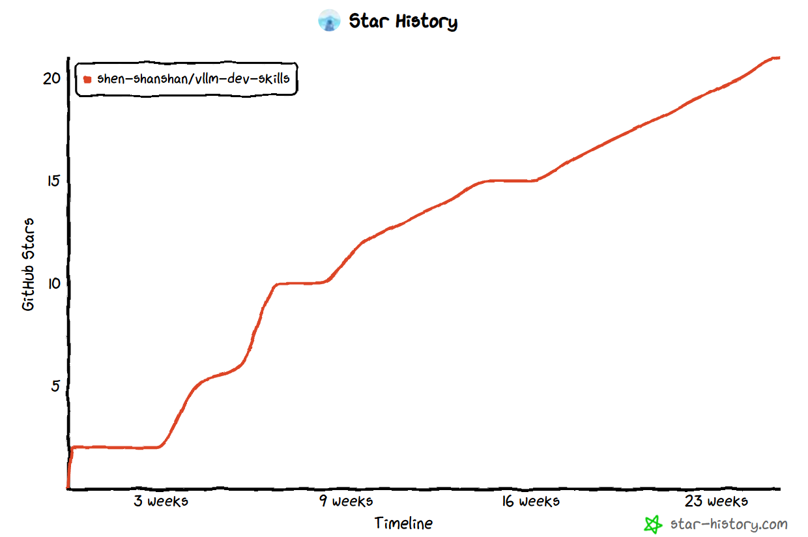

# 一、引言

[vLLM](https://github.com/vllm-project/vllm) 是目前最流行的大模型推理框架之一，凭借着 PagedAttention 等核心技术在工业界广泛落地。然而，作为一个高速迭代的大型开源项目，vLLM 的代码库庞大、模块繁多，对新贡献者来说上手成本极高——光是读懂一个 Feature 的实现路径，往往就需要数天时间。

随着 Coding Agent 越来越普及，在参与 vLLM 社区开发的过程中，我开始尝试使用 Claude Code 来辅助日常工作：读代码、写测试、做 Code Review、分析 Issue 等，发现效果还不错。相比于纯“古法编程”，我的工作效率确实提升了不少。

因此，我整理了自己平时在 vLLM 社区工作的 Workflow 以及一些常用的 Skill，放到了 [vllm-dev-skills](https://github.com/shen-shanshan/vllm-dev-skills) 这个仓库中，分享给同样想做 Or 正在做 vLLM 社区贡献的朋友。目前仓库中已经有 14 个 vLLM 相关的 Skill，覆盖了从寻找任务、读代码、设计与提交 PR，到性能分析、Code Review 和写技术博客的整个开发流程。

> NOTE：本文将会随项目演进持续更新（Last Update：2026/10/31）。

# 二、项目介绍

这个仓库按 vLLM 的开发生命周期对 Skill 进行分类，整体情况如下表所示（推荐度为我个人的使用体感，⭐️ 越多表示用得越多、效果越好）：

| Skill | 分类 | 用途 | 推荐度 |
| :--- | :--- | :--- | :--- |
| `vllm-rocm-env-prepare` | 环境准备 | 在 ROCm 容器内一键搭建 vLLM 开发环境（代码仓、配置、免编译 venv、可选 MORI+UMBP） | ⭐️⭐️⭐️ |
| `vllm-dev-task-discovery` | 需求发现 | 分析某个模块中可以给社区贡献的任务 | ⭐️ |
| `vllm-feature-tutorial` | 代码学习 | 生成 vLLM 特性/模块的中文技术解析文档 | ⭐️⭐️⭐️⭐️⭐️ |
| `vllm-model-tutorial` | 代码学习 | 生成 vLLM 中具体模型的中文技术解析文档 | ⭐️⭐️⭐️⭐️⭐️ |
| `vllm-feature-design` | 变更提案 | 根据需求生成核心代码实现与设计文档 | ⭐️ |
| `vllm-rfc-generator` | 变更提案 | 生成 vLLM 风格的 RFC 文档 | ⭐️ |
| `vllm-rocm-code-dev` | 代码贡献 | 根据开发需求实现仅影响 ROCm 路径的代码改动，并同步维护 PR 描述 | ⭐️⭐️⭐️⭐️⭐️ |
| `vllm-pr-desc-generator` | 代码贡献 | 根据 PR 代码改动，按 vLLM 最新模板生成 PR 标题与描述 | ⭐️⭐️ |
| `vllm-test-generator` | 代码贡献 | 生成单元测试与端到端测试 | ⭐️ |
| `vllm-benchmark-result-analysis` | 性能优化 | 对比修改前后的 Serving Benchmark 结果 | ⭐️⭐️ |
| `vllm-vs-atom-decode-trace-comparison` | 性能优化 | 基于 Profiler Trace 对比 vLLM 与 ATOM 的 Decode Kernel 实现 | ⭐️⭐️ |
| `infx-bench-script-generator` | 性能优化 | 生成在本地服务器上跑 InferenceX Benchmark 的脚本 | ⭐️⭐️⭐️ |
| `vllm-pr-summary` | 代码 Review | 生成 PR 分析报告 | ⭐️⭐️⭐️⭐️ |
| `vllm-rocm-pr-review` | 代码 Review | Review AMD/ROCm 相关 PR，并生成可直接贴到 GitHub 的评论 | ⭐️⭐️⭐️⭐️⭐️ |
| `vllm-multimodal-open-issue-analyzer` | Issue 分析 | 搜集并整理多模态相关的 Open Issue | ⭐️ |
| `vllm-technical-blog-writer` | 技术写作 | 按我的写作风格撰写或补全 vLLM 技术博客 | ⭐️⭐️ |

其中，我日常用得最多的是 `vllm-feature-tutorial`、`vllm-model-tutorial`、`vllm-rocm-code-dev` 和 `vllm-rocm-pr-review` 这四个。下面按分类逐一介绍，每个 Skill 的完整 Prompt 示例和输出样例都可以在仓库的 [README](https://github.com/shen-shanshan/vllm-dev-skills#-usages) 中找到。

## 2.1 环境准备

**`vllm-rocm-env-prepare`：进容器后一句话搭好开发环境。**

**痛点**：我平时在 `vllm/vllm-openai-rocm` Nightly 镜像起的容器里开发，容器经常重建，每次都要重复一遍拉代码仓、写 Git 配置、装 Node.js 与 Claude Code、同步 `main` 分支、搭建虚拟环境等步骤。其中最容易出错的是 vLLM 本身：镜像里的 vLLM 已经编译好了 C++/HIP 扩展，如果本地源码和镜像对应的 Commit 不一致，或者重新编译一遍，既慢又容易出现二进制和源码不匹配的问题。

**Skill 效果**：把这些步骤固化成一个可重复执行的流程，已经完成的步骤会自动跳过：

- **代码仓与 Skill**：将 vLLM、vllm-dev-skills、InferenceX、ATOM、MORI 等代码仓 Clone 到宿主机挂载的持久化目录中，并把 vllm-dev-skills 中的 Skill 软链接到 `~/.claude/skills/`；
- **基础配置**：写入 Git 用户信息与常用 Alias、Vim 配置，安装 claude-hud 依赖的 Node.js，并链接 Claude Code 可执行文件；
- **免编译的 vLLM 开发环境**：同步 `main` 分支后，将当前分支对齐到镜像中 vLLM 的构建 Commit，拷贝镜像里预编译好的 `*.so`，再创建继承系统 site-packages 的 `.venv`，以 Editable 方式安装源码，这样修改 Python 代码后无需重新编译即可生效；
- **模型与数据集**：优先复用只读挂载的 `/shared` 中已有的权重和数据集，没有时再下载到工作目录；
- **MORI + UMBP（按需）**：用 vLLM 固定的 MORI 版本、打开 `BUILD_UMBP=ON` 源码编译 MORI 并装进 `.venv`，并通过检查编译日志和 Import 结果，避免装上一个悄悄关掉了 UMBP 的版本。

## 2.2 需求发现

**`vllm-dev-task-discovery`：不知道该做什么？先看看社区需要什么。**

**痛点**：想给 vLLM 贡献代码，但面对几千个 Issue 和每天几十个 PR，很难判断某个模块里还有哪些事情值得做、哪些已经有人在做了。

**Skill 效果**：输入一个模块、特性或模型方向（如“多模态”），该 Skill 会从 Open Issue、近期 PR、GitHub Discussion、代码中的 TODO/FIXME、Roadmap 标签以及 Maintainer 的活跃情况中收集信息，整理出一份结构化的任务清单。每个任务都会标注难度、所需的前置知识、相关的 Maintainer/Contributor，以及紧急程度和重要程度。

输出样例：[vllm_dev_task_multimodal_20260611](https://github.com/shen-shanshan/vllm-dev-skills/blob/master/skills/vllm-dev-task-discovery/outputs/vllm_dev_task_multimodal_20260611.md)。

## 2.3 代码学习

**`vllm-feature-tutorial`：读懂一个 vLLM 模块，只需一条指令。**

**痛点**：vLLM 的模块设计复杂，看一段代码往往要在十几个文件之间跳来跳去，还要同时理解 CUDA Kernel、Python 接口、调度逻辑多个层次。

**Skill 效果**：输入一个 Feature 名称（如 `Chunked Prefill`、`Prefix Caching`），该 Skill 会生成一篇包含以下内容的中文深度解析文档：

- **背景与动机**：为什么要有这个功能？解决了什么问题；
- **核心数据结构与类**：附带 Mermaid 类图；
- **执行流程**：从 API 调用到底层实现的完整调用链，附带 Mermaid 流程图；
- **关键代码走读**：逐段解释核心实现逻辑；
- **与其他模块的交互关系**：依赖了哪些组件，被哪些模块调用。

这个 Skill 目前是我使用频率最高的一个，尤其在接手一个不熟悉的 Feature 时，能节省大量阅读时间。

输出样例：[disaggregated_encoder_epd](https://github.com/shen-shanshan/vllm-dev-skills/blob/master/skills/vllm-feature-tutorial/outputs/disaggregated_encoder_epd.md)。

**`vllm-model-tutorial`：从模型结构到 vLLM 实现，一次讲清楚。**

和 `vllm-feature-tutorial` 关注特性/模块不同，这个 Skill 关注的是 vLLM 中某一个具体的模型（如 Qwen3-VL、DeepSeek-V3、Llama 4 等）。它会先查阅模型的技术报告和论文，再结合 vLLM 中的模型实现代码，生成一篇中文解析文档，内容包括：

- 模型整体架构（附带 Mermaid 架构图）；
- 输入预处理流程，对 VLM 还会单独分析 ViT 部分对多模态输入的处理；
- Forward 计算过程；
- vLLM 中的代码实现分析；
- 相关技术原理的讲解，如 MoE、MLA、Gated Attention、ViT、DiT 等。

输出样例：[deepseek_ocr](https://github.com/shen-shanshan/vllm-dev-skills/blob/master/skills/vllm-model-tutorial/outputs/deepseek_ocr.md)。

## 2.4 变更提案

**`vllm-feature-design`：从需求到实现的全流程辅助。**

**适用场景**：你有一个新 Feature 的想法（或被分配了一个任务），但还没有清晰的实现路径。

**Skill 输入**：Feature 描述 + 相关 PR/Issue 链接 + 参考资料。

**Skill 输出**：

1. **核心代码实现**（不含测试）——包括新增文件、修改点、关键函数实现；
2. **Markdown 设计文档**——包含架构图、数据流、模块改动说明、权衡分析。

> 注意：这个 Skill 的定位是"辅助设计"而非"完全自动化"，实际 PR 还需要开发者仔细 Review 并调整。

例如，社区中的 [Support Mooncake Based ECConnector for EPD](https://github.com/vllm-project/vllm/issues/39766) 就是在该 Skill 生成的设计基础上，经过人工调整和优化后提交的。

**`vllm-rfc-generator`：生成规范的 RFC 提案。**

vLLM 社区对大型架构变更要求提交 RFC 文档。这个 Skill 能根据你的想法生成符合社区规范的 RFC 草稿，但由于 RFC 内容高度依赖深度领域知识，目前评分较低，更多作为起草辅助工具使用。

例如：[Support ViT Full CUDA Graph](https://github.com/vllm-project/vllm/issues/38175)（同样经过了人工调整）。

## 2.5 代码贡献

**`vllm-rocm-code-dev`：只改 ROCm 路径的代码开发。**

在 vLLM 上做 AMD/ROCm 相关开发时，最容易出问题的是不小心改动了通用代码，影响到 CUDA 等其它硬件后端，Review 时还要逐处解释。这个 Skill 把这些约束固化成了开发流程：

- **改动隔离**：优先修改 ROCm 专属代码（如 `vllm/platforms/rocm.py`、`vllm/_aiter_ops.py`、ROCm Attention Backend 等），必须改动通用代码时，通过在基类新增接口、由 ROCm 子类覆写的方式实现，并逐个文件确认其它后端的行为不变；
- **简洁注释**：新增的关键代码只用一两句注释说明“为什么在 ROCm 上要这样做”，不写长篇大论；
- **中文 Plan**：在 Plan Mode 下用中文输出方案，包括改动方案、对其它后端的影响分析、生效条件与回退路径以及验证方案；
- **PR 描述联动**：代码完成后调用 `vllm-pr-desc-generator` 生成英文 PR 描述并保存到 `docs/tasks/` 目录，之后每次 Rebase、修复 Bug 或根据 Review 意见修改代码，都会同步更新这份描述。

**`vllm-pr-desc-generator`：告别手写 PR 描述。**

输入一个 PR 的代码变更，自动生成 PR 标题和符合 vLLM 最新 PR 模板的规范描述。目前 vLLM 的 PR 模板已经从早期的 Purpose / Test Plan / Test Result 调整为 Overview / Claims / Validation / Details 四个部分，末尾还附带了一份 Pull Request Checklist，这个 Skill 也随之做了更新：

- **PR 标题**：按照社区的 Tag 规范（如 `[Bugfix][Scheduler]`）生成标题，已有标题不规范时给出修正建议；
- **Overview / Claims**：先用 1～2 句话概括改动并关联相关 Issue/PR，再用几条具体的 Claim 说明这个 PR 带来了什么（加速、新功能支持、Bug 修复等）；
- **Validation**：为每条 Claim 给出复现命令和测试/Benchmark 结果，缺少的数据会用占位符标出，提醒作者补充，而不会凭空编造；
- **Details**：说明动机、设计取舍、Root Cause 以及局限性，冗长的日志折叠到 `<details>` 中；
- **Checklist**：原样保留模板中的 Pull Request Checklist，由作者自己勾选。

对于修改量大、涉及多个文件的 PR 尤其实用。

**`vllm-test-generator`：自动生成测试用例。**

给定一个函数、类或场景描述，生成对应的：

- **单元测试**：覆盖正常路径、边界条件、异常路径；
- **端到端测试**：模拟真实推理请求，验证系统行为。

你也可以在 Prompt 中指定测试文件和复用要求，例如“在 `tests/v1/cudagraph/test_encoder_cudagraph.py` 中生成测试，并尽可能复用 `SimpleMockViTModel`”，这样生成的用例会更贴近仓库中已有的测试风格。

## 2.6 性能优化

**`vllm-benchmark-result-analysis`：快速对比性能数据。**

将两份 vLLM Serving Benchmark 的输出文本（修改前/后）粘贴给 Skill，它会自动：

- 解析各项指标（吞吐量、TTFT、TPOT、ITL 的 Mean/Median/P99 等）；
- 计算百分比变化，标注改善/退步；
- 生成一份 Markdown 报告，包含完整的指标对比表和关键变化摘要。

**`vllm-vs-atom-decode-trace-comparison`：vLLM 为什么比 ATOM 慢？用 Trace 说话。**

**适用场景**：在 AMD GPU 上，同一个模型、同一套配置，[ATOM](https://github.com/ROCm/ATOM) 的 Decode 性能比 vLLM 更好，需要定位差距具体出在哪些 Kernel 上。

**Skill 输入**：模型名 + 两个引擎各自导出的 Torch Profiler Trace（Chrome-Trace JSON）+ 报告语言（中文/英文/双语）。

**Skill 效果**：先用脚本从两份 Trace 中各切出一个 Decode Step，再对每种层类型（如 Attention 层、MoE 层）各取一层作为样本，最后为每种层类型生成一张对比表：两个引擎各用了哪些 Kernel、是融合实现还是拆开实现、是否用了多流、量化方式有什么差异、耗时差多少。在此基础上，它只针对 ATOM 明显更快的算子整理出一份 vLLM 的优化 TODO 清单，并按预期收益排序。

输出样例：[minimax-m3-trace-comparison_zh_20260905_162716](https://github.com/shen-shanshan/vllm-dev-skills/blob/master/skills/vllm-vs-atom-decode-trace-comparison/outputs/minimax-m3-trace-comparison_zh_20260905_162716.md)。

**`infx-bench-script-generator`：不依赖 Slurm，在本地复现 InferenceX Benchmark。**

[InferenceX](https://github.com/SemiAnalysisAI/InferenceX) 的 Benchmark Recipe 默认通过 Slurm 来调度。如果只想在一台本地 GPU 服务器上复现某个 Recipe + Override 配置（比如 `dsv4/vllm/mi355x-fp4-mtp/agentic.yaml` 的 `override_dep8_c64`），手动拼启动参数和环境变量很容易出错。

这个 Skill 会读取 Recipe 和对应的 Override，通过脚本确定性地生成三份 Bash 脚本：

1. `01_docker_run.sh`：在 Host 上启动容器；
2. `02_start_server.sh`：在容器内启动 vLLM Server；
3. `03_run_client.sh`：在容器内运行 AgentX Trace Replay 客户端。

模型权重、InferenceX 仓库、Trace 数据集和结果目录都可以指定为 Host 路径。另外，还可以通过 `vllm serve --profiler-config` 用 Torch Profiler 采集一个完整的 Prefill 或 Decode Step，采集到的 Trace 正好可以交给上面的 `vllm-vs-atom-decode-trace-comparison` 去分析。

输出样例：[dsv4_vllm_mi355x-fp4-mtp_agentic_override_dep8_c64](https://github.com/shen-shanshan/vllm-dev-skills/tree/master/skills/infx-bench-script-generator/outputs/dsv4_vllm_mi355x-fp4-mtp_agentic_override_dep8_c64)。

## 2.7 代码 Review

**`vllm-pr-summary`：PR Review 提效工具。**

输入一个 vLLM PR 的编号或链接，生成包含以下内容的分析报告：

- PR 目的与背景；
- 代码变更分析（含架构/流程 Mermaid 图）；
- 潜在风险点与 Review 建议；
- 测试覆盖评估。

适合快速了解一个 PR 做了什么，或者在 Review 时作为辅助参考。

**`vllm-rocm-pr-review`：面向 AMD/ROCm PR 的 Review 助手。**

这个 Skill 专门用来 Review 与 AMD/ROCm 相关的 PR（如 AITER、MORI、ROCm Kernel 等改动）。它会把 `vllm-pr-summary` 的 PR 总结和 ROCm 视角的 Review 意见合并成一份中文报告，报告分为三部分：

1. **PR 详细总结**：背景与动机、代码改动分析（含 Mermaid 图）、技术原理、讨论要点和风险表；
2. **ROCm Review 意见**：按严重程度排序、按类型分类的问题清单，以及最终的 Review 结论；
3. **英文 Review 评论**：标注了文件和 Diff 行号，可以直接复制到 GitHub 的 PR Review 中。

此外，报告开头会带一段 YAML Front Matter，记录 PR 编号、被 Review 的 Head Commit SHA、Review 结论（`block` / `needs-work` / `lgtm`）和 Review 时间。报告推送到仓库后，Pingboard Dashboard 会读取这些字段，在 PR 详情页展示 AI Review 的结论，并据此判断 PR 在 Review 之后是否又有了新的改动。

输出样例：[pr-29304-review](https://github.com/shen-shanshan/vllm-dev-skills/blob/master/skills/vllm-rocm-pr-review/outputs/pr-29304-review.md)。

## 2.8 Issue 分析

**`vllm-multimodal-open-issue-analyzer`：多模态相关待处理 Issue 搜集与整理。**

自动拉取并分类整理 vLLM 仓库中与多模态相关的 Open Issue，按问题类型（Bug、Feature Request、性能等）分组，便于快速了解社区当前的痛点和待解决问题。

## 2.9 技术写作

**`vllm-technical-blog-writer`：用我自己的风格写 vLLM 技术博客。**

这个 Skill 基于我在知乎“vLLM 学习笔记”专栏中的历史文章，总结了一份写作风格档案；同时从我过去用 draw.io 手绘的博客配图中提炼出一套画图规范（Comic Sans 字体、draw.io 配色、嵌套容器构图、请求链路红色下行 / 输出链路蓝色上行等），并整理成可复用的 SVG 模板，让生成的配图直接复刻我手绘的风格。它支持两种用法：

- **按主题写新文章**：给定一个主题（如“vLLM 中的 Automatic Prefix Caching”），它会先阅读 vLLM 最新 `main` 分支的代码和相关资料，再生成一篇完整的中文技术博客，并按需画好架构图和流程图；
- **补全已有草稿**：给定一篇写了一半的 Markdown 文章和参考资料，它会保留已有内容，只补全缺失的章节，新增的图片放在文章同级的 `images/` 目录中。

# 三、使用体验

以下是一些我在实际开发中的使用体验：

- **读代码阶段**：接到一个 EPD 相关的任务，用 `vllm-feature-tutorial` 生成文档后，20 分钟内完成了对整个模块的基本认知，而之前纯手动阅读需要至少半天；
- **开发阶段**：用 `vllm-feature-design` 辅助设计实现方案，生成的代码框架准确度约 60-70%，还需要手动调整细节，但起点比从零开始高很多；
- **提 PR 阶段**：`vllm-pr-desc-generator` 生成的 PR 描述基本不需要大改，节省了不少写文档的时间；
- **Review 阶段**：`vllm-pr-summary` 在快速浏览社区 PR 时很有用，特别是需要了解某个 PR 背景但不想仔细读代码的场景。

# 四、快速开始

1. 安装 Claude Code（参考 [官方文档](https://code.claude.com/docs/en/skills)）；
2. Clone 本仓库，将 `skills/` 目录中的 Skill 软链接到 Claude Code 的 Skill 目录（`~/.claude/skills/`）：

```bash
# 软链接单个 Skill
ln -sfn /path/to/vllm-dev-skills/skills/skill-name ~/.claude/skills/skill-name

# 软链接全部 Skill
for dir in /path/to/vllm-dev-skills/skills/*/; do
  name=$(basename "$dir")
  ln -sfn "$dir" ~/.claude/skills/"$name"
done
```

3. 在 Claude Code 中用自然语言描述需求，并在末尾加上 `/Skill名称` 调用对应 Skill，如：

```text
# 示例：生成 EPD 特性的技术解析文档
我想了解 vLLM 中的 EPD（Encode-Prefill-Decode）特性，请帮我总结一份技术文档。
/vllm-feature-tutorial

# 示例：分析 vLLM 某个 PR
https://github.com/vllm-project/vllm/pull/35963
/vllm-pr-summary
```

   Claude Code 会加载对应的 Skill，按其中约定的流程完成调研并生成结果。

# 五、一些思考

在使用这些 Skill 的过程中，我有几点感受：

1. **AI 辅助开发的价值在于降低认知负担，而不是替代思考**。Skill 生成的内容是起点，不是终点，开发者的判断和领域知识依然不可替代；
2. **标准化的工作流越清晰，AI 发挥越稳定**。像 PR 描述、RFC 模板这类有固定格式的任务，AI 效果最好；越开放、越需要创造性判断的任务，效果越依赖提示词质量；
3. **Skill 的复用价值随使用次数递增**。单次节省的时间可能不多，但在高频重复的开发流程中，积累效益相当可观。

最后顺带一提，本文也是先由我的 [`vllm-technical-blog-writer`](https://github.com/shen-shanshan/vllm-dev-skills/tree/master/skills/vllm-technical-blog-writer) Skill 根据我口述的要点生成初稿，再由我微调完成的。

# 六、后续计划

- 持续补充新 Skill，覆盖更多开发场景，并优化现有 Skill 的提示词，提高输出质量和稳定性；
- 支持多 Skill 联动的 AI-Native 端到端 Workflow，例如从需求发现、代码学习一路串联到 PR 提交和性能验证（见仓库的 `workflows/` 目录，目前仍在建设中）；
- 支持 GitHub Pages，提供更好的阅读体验；
- 尝试使用 [archify](https://github.com/tt-a1i/archify) 为技术博客绘制更好的架构图。

欢迎感兴趣的朋友 Star、Fork，也欢迎提 Issue 或 PR 贡献新的 Skill！



# 七、参考资料

- [vllm-dev-skills](https://github.com/shen-shanshan/vllm-dev-skills)
- [Agent Skills](https://agentskills.io/home#why-agent-skills)
- [Extend Claude with skills](https://code.claude.com/docs/en/skills)
