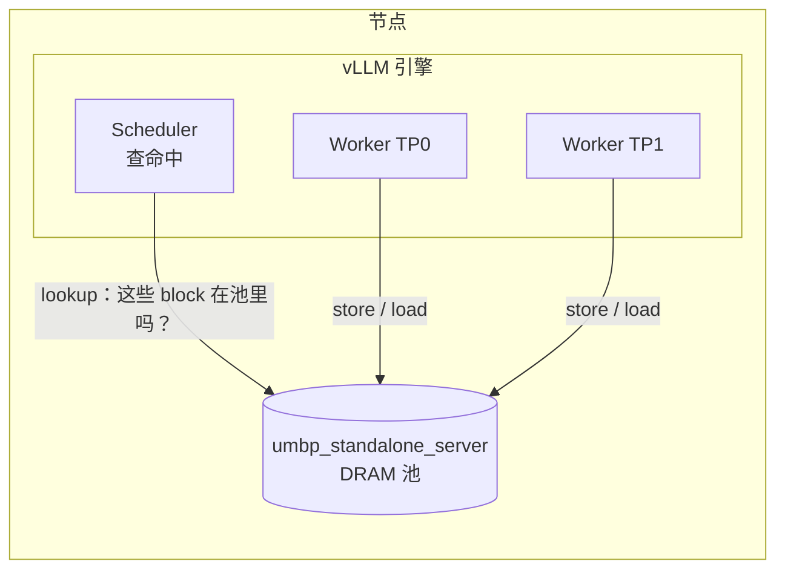
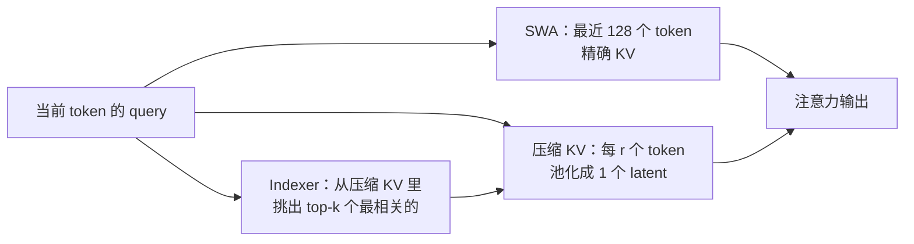
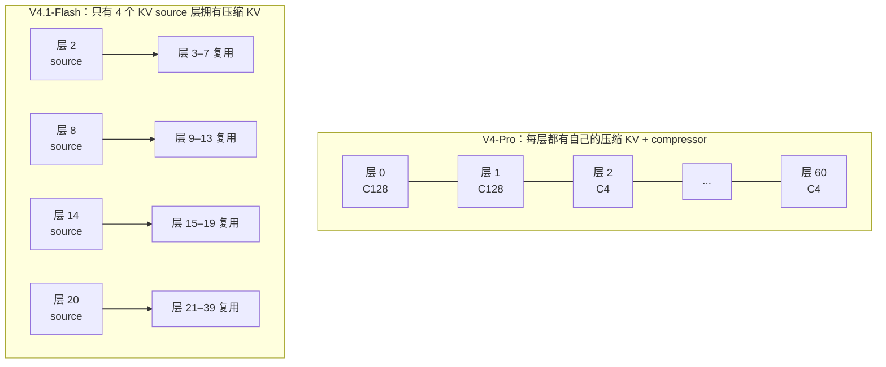
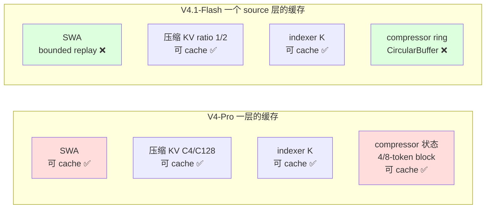
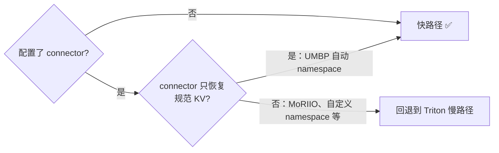
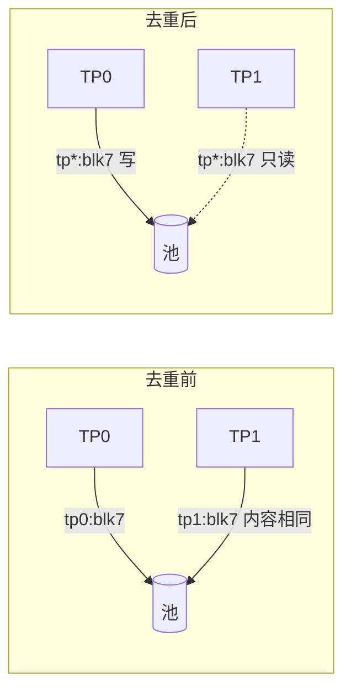
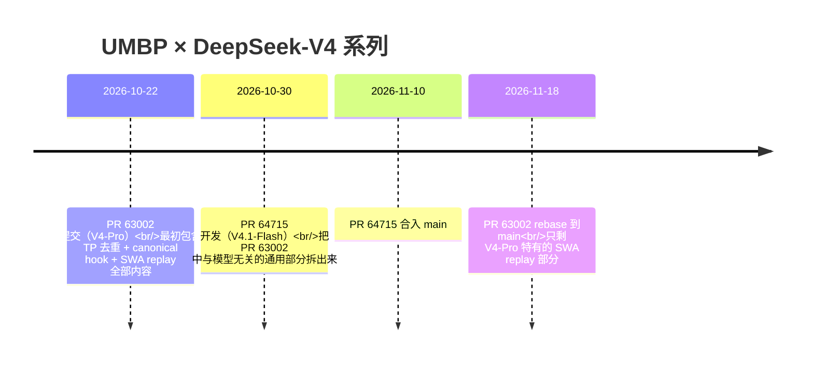
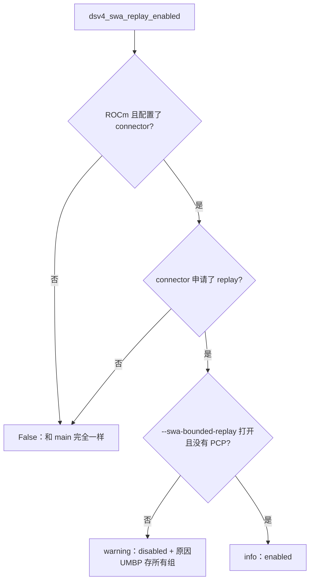
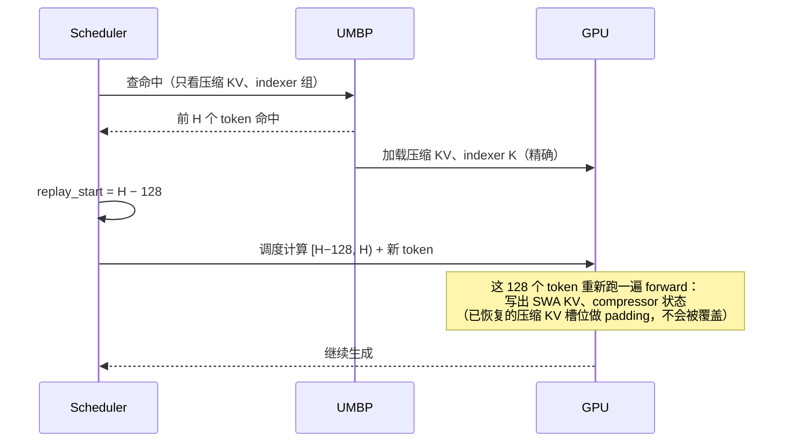
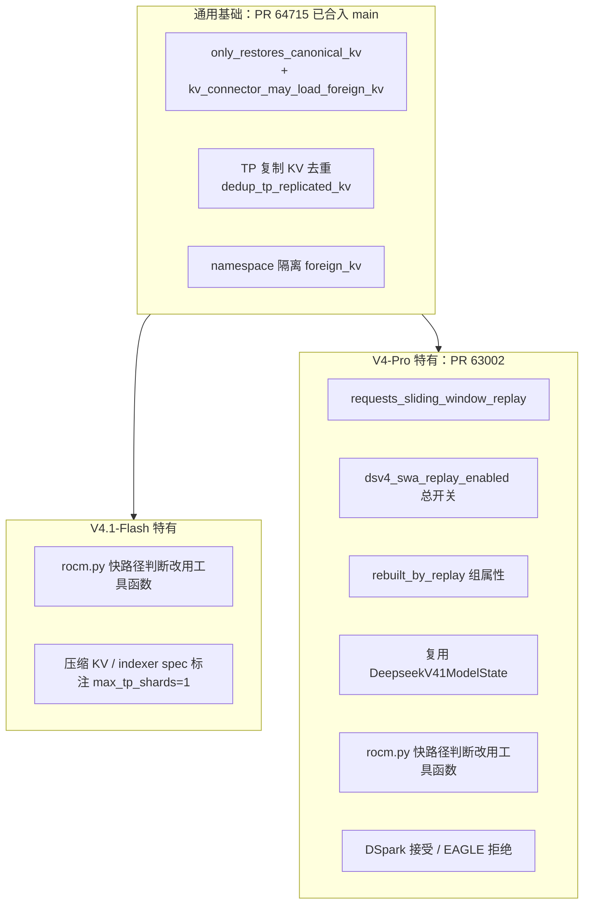

# 同样接 UMBP，为什么 DeepSeek-V4-Pro 和 V4.1-Flash 的方案不一样？

> 对比对象：
> - [#64715](https://github.com/vllm-project/vllm/pull/64715)：`[ROCm][UMBP] Support UMBP standalone mode for DeepSeek-V4.1-Flash`（已合入 main，commit `ee263bc88a`）
> - [#63002](https://github.com/vllm-project/vllm/pull/63002)：`[ROCm][UMBP] Support UMBP standalone mode for DeepSeek-V4-Pro`（open，head `6b10bdef88`）
>
> 模型配置取自本机 `/shared` 下的 HF `config.json`（DeepSeek-V4-Pro / V4-Pro-DSpark / V4.1-Flash）；代码取自 vLLM main `5e0855d305` 和 PR ref `pr/63002`。
>
> 读完你应该能回答：
> 1. UMBP 在 vLLM 里到底"存什么、不存什么"？
> 2. 两个 PR 各改了什么，哪部分是共用的？
> 3. **两个模型结构上的哪些差异**，导致 V4-Pro 需要额外的 "SWA replay" 机制，而 V4.1-Flash 不需要？

---

## 目录

- [0. 一句话结论](#0-一句话结论)
- [1. 预备知识：UMBP 和 vLLM 的 KV cache 分组](#1-预备知识umbp-和-vllm-的-kv-cache-分组)
- [2. 两个模型的 KV 结构对比](#2-两个模型的-kv-结构对比)
- [3. 关键问题：哪些 KV 组会进 UMBP 池子？](#3-关键问题哪些-kv-组会进-umbp-池子)
- [4. #64715（V4.1-Flash）做了什么](#4-64715v41-flash做了什么)
- [5. #63002（V4-Pro）做了什么](#5-63002v4-pro做了什么)
- [6. SWA replay 详解：为什么重算 128 个 token 就够了](#6-swa-replay-详解为什么重算-128-个-token-就够了)
- [7. 为什么 V4.1 默认就 replay，V4-Pro 却要 connector 来"申请"](#7-为什么-v41-默认就-replayv4-pro-却要-connector-来申请)
- [8. 两个方案的总对比](#8-两个方案的总对比)
- [9. 常见疑问](#9-常见疑问)
- [10. 代码导读](#10-代码导读)

---

## 0. 一句话结论

> **UMBP 只存"可以 prefix cache 的 KV 组"。** V4.1-Flash 在模型设计上已经让滑动窗口（SWA）和 compressor 状态都不参与 prefix cache，所以 UMBP 天然只会存体积大、粒度粗的压缩 KV，接上就能用（#64715 只需要补齐 TP 去重和 fast path 两件通用的事）。V4-Pro 的 SWA cache 和 C4/C128 compressor 状态默认都参与 prefix cache，而且 compressor 状态的 block 只有 4/8 个 token，直接接 UMBP 会碎成海量小对象。所以 #63002 必须额外引入"由 connector 申请的 SWA bounded replay"，把这些小状态挤出 prefix cache，命中后靠重算最后一个窗口来重建。

造成差异的三个结构原因：

| # | 结构差异 | V4-Pro | V4.1-Flash |
|---|---|---|---|
| ① | 压缩比 | 4 和 128 | 1 和 2 |
| ② | compressor 状态需要记住多少行 | 最多 128 行（C128 不完整组）或 8 行（C4 带 overlap），只能做成**可 prefix cache 的 SlidingWindow 组** | 不完整组最多 1 行，做成**环形缓冲区**（CircularBuffer），天生不参与 prefix cache |
| ③ | SWA 是否默认 replay | 默认不 replay，SWA 参与 prefix cache | 在 CDNA3/4 和 CUDA 上默认开启 bounded replay，SWA 不参与 prefix cache |

此外还有一个放大因素：V4-Pro 每一层都有自己的压缩 KV 和 compressor（61 层），而 V4.1-Flash 的压缩 KV 和 compressor 只在 4 个 "KV source" 层上（跨层共享），需要管理的组少得多。

---

## 1. 预备知识：UMBP 和 vLLM 的 KV cache 分组

### 1.1 UMBP 是什么

**UMBP（Unified Memory & Bandwidth Pool）** 是 AMD MORI 库中的一个 KV cache 池。它可以把 GPU 上算好的 KV 卸载到 DRAM/SSD，下次遇到相同前缀时再加载回 GPU，省掉重复的 prefill 计算。

- **standalone 模式**：节点上单独运行一个 `umbp_standalone_server` 进程，持有整块 DRAM 池；同一节点上所有 vLLM 进程（所有 TP/DP rank）通过 unix socket 连接它，**共享同一个池子**。
- 在 vLLM 里，它以 KV connector 的形式接入：`UMBPStoreConnector`。



### 1.2 vLLM 的混合 KV cache：一个模型，多个"组"

现代模型的 KV 不止一种。vLLM 的 hybrid KV cache manager 会把同类的层归成一个 **KV cache group**，每个组有自己的管理策略（manager）：

| manager | 典型用途 | 能否 prefix cache |
|---|---|---|
| `FullAttentionManager` | 普通全注意力 KV、压缩 KV、indexer K | ✅ |
| `SlidingWindowManager` | 滑动窗口 KV（SWA） | ✅（默认）；设置 `bounded_replay` 或 `rebuilt_by_replay` 后 ❌ |
| `CircularBufferManager` | 每个请求一个环形缓冲区 | ❌（每个请求只占一个固定 block） |

### 1.3 UMBP 存什么：只存可 prefix cache 的组

这是理解全文的**关键前提**：

> UMBP connector 只存取 `prefix_cacheable_group_ids` 中的组。一个组不参与 prefix cache，UMBP 就不会存它。

原因很简单：UMBP 本质上是"GPU prefix cache 的下一级存储"。一个组在 GPU 上都不能按前缀复用，存进池子也没法复用。

这就引出一个问题：**不存的那些组，命中之后它们的内容从哪来？** 答案取决于模型：要么根本不需要（命中点处状态为空），要么靠重算（replay）重建。这正是两个 PR 分道扬镳的地方。

---

## 2. 两个模型的 KV 结构对比

### 2.1 共同点：DeepSeek-V4 系列的"三件套"注意力

V4 和 V4.1 都使用 MLA 风格的压缩稀疏注意力，每个 token 的注意力由三部分拼成：



- **SWA（sliding window attention）**：最近 `sliding_window = 128` 个 token 的完整 KV，保证局部精度。
- **压缩 KV**：每 `r`（压缩比）个 token 经过一个**compressor**（带学习门控的 softmax 池化）合成一个 latent。
- **Indexer**：一个轻量的打分网络，从压缩 KV 里选出 top-k 参与稀疏注意力。

**compressor 是有状态的**：压缩比为 `r` 时，要攒满 `r` 个 token 才能输出一个 latent。还没攒满的那一组叫**不完整组（open group）**，这些 token 的中间结果（kv、score 两行）必须存在某个地方，这就是 **compressor 状态**。

### 2.2 DeepSeek-V4-Pro：每层都有，压缩比 4 / 128

来自 `config.json`：`num_hidden_layers = 61`，`hidden_size = 7168`，`sliding_window = 128`，`compress_ratios` 为 `[128, 128, 4, 128, 4, 128, …, 4, 0]`。

```
层号:          0    1    2    3    4    5   ...  59   60  (61 = MTP)
compress_ratio 128  128  4    128  4    128 ...  4    0    (0 = 纯 SWA)
```

每一层（`deepseek_v4/attention.py`、`deepseek_v4/compressor.py`）拥有：

| 缓存 | 管理器 | block 大小 | 是否可 prefix cache（默认） |
|---|---|---|---|
| SWA KV（窗口 128） | SlidingWindow | 64 token | ✅ |
| 压缩 KV（C4 或 C128 latent） | FullAttention | 256 token | ✅ |
| C4 层的 indexer K | FullAttention | 256 token | ✅ |
| **C4 compressor 状态**（窗口 8 = 当前组 4 + 前一组 4 行 overlap） | SlidingWindow | **4 token** | ✅ |
| **C128 compressor 状态**（窗口 128） | SlidingWindow | **8 token** | ✅ |
| **C4 indexer 自己的 compressor 状态**（嵌套 compressor） | SlidingWindow | 4 token | ✅ |

注意最后三行：compressor 状态被做成了 **SlidingWindow 组**，而且 block 非常小（4/8 token）。原因见 `compressor.py` 的注释：compressor 状态和 KV block 共享同一块物理显存，所以页大小必须一致；状态的一行比 KV 宽得多，算下来一个 block 只能放 4 或 8 个 token。

为什么状态必须是 "SlidingWindow" 而不能只存一点点？因为 C128 的不完整组可能已经攒了最多 127 个 token，C4 还要用前一组的 4 行做 overlap。这些都是"最近 N 行"，正是滑动窗口的语义；而且要在命中后能接着算下去，就得让它们参与 prefix cache。

### 2.3 DeepSeek-V4.1-Flash：跨层共享，压缩比 1 / 2

来自 `config.json` 的 `text_config`：`num_hidden_layers = 40`，`hidden_size = 5120`，`sliding_window = 128`，以及：

```
compress_ratios（43 项 = 40 层 + 3 个 DSpark 草稿层）:
  层 0–1   : 0   （纯 SWA）
  层 2–19  : 2   （每 2 个 token 压成 1 个）
  层 20–39 : 1   （每个 token 一个压缩 latent，"全长压缩 cache"）
  草稿 40–42: 0
kv_source_layer_ids    = [2, 8, 14, 20]
index_source_layer_ids = [2, 8, 14, 20, 24, 28, 32, 36]
```

V4.1 有一个 V4 没有的关键设计：**跨层共享**（`deepseek_v41/attention.py` 第 407–456 行）：

> Compressors and compressed-KV caches live only on `kv_source_layer_ids`; indexers only on `index_source_layer_ids`. Consumers reuse the most recently published source below them.

也就是说，只有 4 个 KV source 层（2、8、14、20）真正拥有 compressor 和压缩 KV，其他层直接读离自己最近的、编号更小的那个 source 层的压缩 KV。indexer 也只在 8 个层上。



每个 KV source 层拥有的缓存：

| 缓存 | 管理器 | 是否可 prefix cache |
|---|---|---|
| SWA KV（窗口 128，block 32；所有层都有） | SlidingWindow + **bounded_replay** | ❌（CDNA3/4 与 CUDA 上默认） |
| 压缩 KV（ratio 1 或 2） | FullAttention | ✅ |
| indexer K（只在 index source 层） | FullAttention | ✅ |
| **compressor 状态** | **CircularBuffer（环形缓冲）** | ❌（天生不参与） |

为什么 V4.1 的 compressor 状态可以做成环形缓冲区？看 `deepseek_v41/compressor.py`：

```python
class CompressorStateCache(torch.nn.Module, AttentionLayerBase):
    """Per-request ring of the open group's [kv, score] rows (ratio > 1)."""
    ...
        # Drafts + bonus token + the previous row, as a power of two >= 8.
        rows_per_step = get_current_vllm_config().num_speculative_tokens + 2
        self.block_size = max(8, 1 << (rows_per_step - 1).bit_length())
    ...
        return CircularBufferManager.layer_config(spec)
```

压缩比只有 2，不完整组**最多只有 1 行**。ring 只需要放"本步的行 + 前一行"，几行就够，每个请求一个 block 循环使用。在 256 对齐的命中点上，2 个一组恰好凑满，不存在不完整组，所以**命中后根本不需要恢复任何 compressor 状态**。

### 2.4 结构差异汇总图



红色表示"会被 UMBP 存、但不该存"的组，绿色表示"天然被排除在外"的组。

---

## 3. 关键问题：哪些 KV 组会进 UMBP 池子？

把第 1.3 节的规则（UMBP 只存可 prefix cache 的组）套到第 2 节的两张表上：

| | V4.1-Flash | V4-Pro（不做任何改动时） |
|---|---|---|
| 压缩 KV | ✅ 存 | ✅ 存 |
| indexer K | ✅ 存 | ✅ 存 |
| SWA KV | ❌ 不存（bounded replay） | ⚠️ 存 |
| compressor 状态 | ❌ 不存（CircularBuffer） | ⚠️ 存，**4/8-token 的小 block** |

V4-Pro 的问题有多严重？粗略估算一下：一个 10 万 token 的长请求，仅一个 block 为 4 token 的 compressor 状态组，就有 100000 / 4 = **2.5 万个 block**。V4-Pro 有好几个这样的组（C4 状态、C4 indexer 状态、C128 状态），再加上 SWA。#63002 的 PR 描述也写道：

> Without this, SWA cache and compressor states become tens of thousands of tiny objects per long request.

对象存储最怕"海量小对象"：每个对象都有 key、元数据和查找开销，传输也是碎片化的小拷贝，带宽利用率极低。

所以：

- **V4.1-Flash**：UMBP 接上就只存大块的压缩 KV，**不需要动 KV 分组**。#64715 要解决的是另外两个通用问题（第 4 节）。
- **V4-Pro**：必须想办法把 SWA 和 compressor 状态"踢出" prefix cache，并保证踢出后命中仍然算得对。这就是 #63002 的核心（第 5、6 节）。

---

## 4. #64715（V4.1-Flash）做了什么

改动共 14 个文件，+433/−28 行。除了 DSv4.1 的两个文件外，其余都在**通用的 connector / UMBP 代码**里。三件事：

### 4.1 让 aiter 快路径在 UMBP 下保持开启：`only_restores_canonical_kv`

**问题**：ROCm 的 DSv4.1 后端原来的逻辑是"只要配置了任何 KV connector，就关掉 aiter sparse MLA 和 NaN-free 快路径"。因为这些快路径假设 KV cache 里的字节全是 vLLM 自己写的，其他 connector（比如 P/D 分离从远端拉来的数据）可能带进未写过的槽位甚至 NaN。

**解决**：新增一个 connector 能力声明。

```python
# kv_connector/v1/base.py
@classmethod
def only_restores_canonical_kv(cls, kv_transfer_config) -> bool:
    """Whether every KV block it loads is a whole block that vLLM's own
    cache writer produced for an identical KV cache layout."""
    return False

# umbp/connector.py：派生 namespace 时返回 True
return extra.get("key_namespace", "auto") == "auto"
```

UMBP 用自动派生的 namespace 时，key 中包含了模型、KV 布局、cache 分组等完整指纹，所以恢复的一定是同一布局下 vLLM 自己写的整 block，是"规范（canonical）"的。

再配一个工具函数 `kv_connector_may_load_foreign_kv(vllm_config)`，把模型里原来的 `kv_transfer_config is not None` 替换掉：



`MultiConnector` 只有在所有子 connector 都返回 True 时才返回 True。

### 4.2 TP 复制 KV 去重：`dedup_tp_replicated_kv`

MLA 的 latent 在每个 TP rank 上**完全相同**（它不按 head 切分，`max_tp_shards=1`）。TP2 时如果每个 rank 各存一份，池子里就是两份一样的数据。

#64715 的做法：

- 给 V4.1 的压缩 KV spec 和 indexer spec 标注 `max_tp_shards=1`。
- `tp_replicated_group_ids()` 找出"组内所有层都是 `max_tp_shards=1`"的组。
- 这些组的 key 用 `tp*` 代替 `tp0/tp1`；**只有 TP rank 0 负责写**，所有 rank 都从同一个对象加载。
- 只在 standalone 模式（`shares_pool_across_ranks = True`，所有 rank 共享一个池）下启用。



### 4.3 namespace 隔离

如果引擎同时配置了 UMBP 和一个可能加载"外来" KV 的 connector（放在 `MultiConnector` 里），它写进池子的数据可能不是规范的。所以这种引擎的 namespace 会额外加上 `foreign_kv` 字段，和纯 UMBP 引擎互相隔离，防止"不干净"的字节被纯 UMBP 引擎当成规范 KV 恢复。

### 4.4 #64715 **没有**做的事

它**完全没有碰 KV 分组和 SWA replay**，因为 V4.1 本来就不需要（第 2.3、3 节）。

---

## 5. #63002（V4-Pro）做了什么

### 5.1 演进关系：#63002 是"先写的那个"

时间线上有一个容易混淆的地方：



也就是说，TP 去重和 `only_restores_canonical_kv` 最早是为 V4-Pro 写的，但 V4.1 用得上、改动又更少，就先拆出去随 #64715 合入了。现在 #63002 的 diff（+277/−14，12 个文件）**只剩下 V4-Pro 特有的部分**，并且直接复用 #64715 合入的工具函数。

### 5.2 改动一：connector 可以"申请" SWA replay

```python
# kv_connector/v1/base.py
@classmethod
def requests_sliding_window_replay(cls, kv_transfer_config) -> bool:
    """Whether models that support SWA bounded replay should enable it."""
    return False

# umbp/connector.py
return bool(extra.get("rebuild_sliding_window", True))   # UMBP 默认申请，可关闭
```

`MultiConnector` 同样要求所有子 connector 都申请才算申请。

### 5.3 改动二：DSv4 的总开关 `dsv4_swa_replay_enabled()`

位于 `deepseek_v4/compressor.py`，只有以下条件**全部**满足时才开启：



开启后有三处生效：

| 位置 | 改动 | 效果 |
|---|---|---|
| `deepseek_v4/attention.py` | SWA cache 设置 `bounded_replay=True` | SWA 不参与 prefix cache，命中后 replay 最后 128 个 token |
| `deepseek_v4/compressor.py` | compressor 状态设置 `rebuilt_by_replay=True` | 状态组不参与 prefix cache，**也不额外声明 replay 窗口** |
| `deepseek_v4/amd/model.py` | `get_model_state_cls` 换成 `DeepseekV41ModelState` | 把每个请求的 `replay_start` 传给 SWA metadata |

### 5.4 改动三：新的组属性 `rebuilt_by_replay`

```python
# v1/core/single_type_kv_cache_manager.py
class SlidingWindowManager:
    class Params:
        bounded_replay: bool = False
        """DeepSeek-V4.1: replay the window instead of prefix caching it."""
        rebuilt_by_replay: bool = False
        """Left out of prefix caching without a replay window of its own:
        another group's bounded replay recomputes enough tokens to rebuild it."""

    @classmethod
    def prefix_cacheable(cls, config):
        return not (params.bounded_replay or params.rebuilt_by_replay)

    @classmethod
    def prefix_replay_tokens(cls, config):
        return params.sliding_window if params.bounded_replay else 0
```

为什么不直接给 compressor 状态也设置 `bounded_replay`？因为**调度器只支持一个 replay 窗口**。SWA 已经声明了"重算 128 个 token"，compressor 状态只要"搭便车"就行：

- `bounded_replay`：我不参与 prefix cache，**并且**我要求重算 N 个 token。
- `rebuilt_by_replay`：我不参与 prefix cache，**别人的** replay 会顺便把我重建。

### 5.5 改动四：fast path 的判断改用 #64715 的工具函数

`deepseek_v4/amd/rocm.py` 中 aiter sparse MLA（decode / prefill）和 `extra_cache_nan_free` 的判断，从 `kv_transfer_config is not None` 改成 `kv_connector_may_load_foreign_kv()`，和 V4.1 的做法完全一样。

### 5.6 改动五：投机解码草稿层的处理

| 草稿类型 | 草稿层结构 | 能否被 replay 重建 | 处理 |
|---|---|---|---|
| DSpark（`"method": "dspark"`，V4-Pro-DSpark 的 3 个 ratio-0 层） | 只有 SWA，窗口 KV 由 target 的 hidden states 推出 | ✅ target replay 时一起重建 | 接受 |
| EAGLE 式 MTP（`"method": "mtp"`） | 草稿组标记为 `is_eagle_group`，不参与 prefix cache | ❌ | 启动时报错，提示设置 `rebuild_sliding_window: false` |

---

## 6. SWA replay 详解：为什么重算 128 个 token 就够了

### 6.1 replay 在做什么

假设一个新请求的前 H 个 token 命中了缓存（来自 UMBP 或 GPU prefix cache）：



用一条 token 轴来看：

```
token:  0 ........................................ H-128 ......... H ...... 新 token
压缩 KV: [=========== 从 UMBP 恢复（精确）==================]
SWA KV:                                            [== replay 重算 ==]
compressor 状态:                                    [== replay 重算 ==]
                                                   ↑ replay_start
```

### 6.2 为什么 128 个 token 足够重建 V4-Pro 的 compressor 状态

命中点 H 之后的计算需要哪些 compressor 状态？

- **C128**：H 所在的那个不完整组，起点是 `floor(H / 128) × 128`，一定 ≥ `H − 127`。
- **C4**：当前组加上前一组的 overlap，共 8 行，起点 ≥ `H − 8`。

而 replay 从 `H − 128` 开始，**覆盖了上面两种情况需要的所有行**。所以只要满足：

> **SWA 窗口（128） ≥ 所有 compressor 状态的窗口（C4 = 8，C128 = 128）**

compressor 状态就一定能被 SWA 的 replay 顺便重建。V4-Pro 恰好是 128 ≥ 128。这也解释了为什么 `rebuilt_by_replay` 不需要自己的 replay 窗口：SWA 的窗口已经是最长的了。

（这个不变量目前只写在 `compressor.py` 的注释里，review 时建议改成启动断言，见 `pr-63002-review.md`。）

### 6.3 replay 的代价：近似

replay 阶段的 token 只能看到从 `replay_start` 开始的窗口（更早的 SWA KV 并没有恢复），所以重建出的 SWA KV 是**近似值**：

- 压缩 KV 和 sparse top-k 选出的上下文是从缓存读的，**仍然精确**；
- 只有"最近 128 个 token 的局部注意力"在 replay 段内被截短了。

实测（#63002 PR 描述，V4-Pro-0813，8×MI355X，DP8 + DSpark）：GSM8K 0.9515 → 0.9522（第二轮有 72.6% 的 prompt token 从 UMBP 恢复），DSpark 接受长度 4.48 → 4.50，没有可见的精度损失。V4.1 做的是同样的近似取舍。

---

## 7. 为什么 V4.1 默认就 replay，V4-Pro 却要 connector 来"申请"

这是两个方案最"哲学"的区别。以下是我结合代码的理解：

| 方面 | V4.1-Flash | V4-Pro |
|---|---|---|
| replay 是否是模型默认行为 | 是。`swa_bounded_replay` 默认开启，V4.1 attention 在 CDNA3/4（#65249 加入 gfx942）和 CUDA 上直接使用 | 否。V4 的 SWA 一直是精确 prefix cache |
| 配套优化 | 有专门的 `DecoderReplayLayers`：最后一个 KV source 层（第 20 层）之后的层只对每个请求最后 `window` 行做 replay，还可以单独抓 CUDA graph | 没有（`decoder_replay_layers` 为 None），replay 时全部 61 层都要重算 128 个 token |
| 打开 replay 对不用 UMBP 的用户有什么影响 | 没有新增影响（本来就是这样） | GPU 本地前缀命中也会从"精确"变成"近似 + 额外重算 128 token" |

所以 #63002 的选择是：**不改变 V4-Pro 的默认行为**。只有当 connector（UMBP）明确申请、且确实能带来收益（避免碎片化小对象）时，才在 ROCm 上打开 replay。PR 描述里也写明了这个取舍：

> With connector configured, GPU prefix hits replay final window too.

此外，V4.1 的 replay 只在兼容的 CDNA 版本（3/4）上开启；目前 V4-Pro 的开关还没有这个架构检查，这是 #63002 review 中提出的一个待补项。

---

## 8. 两个方案的总对比



| 维度 | #64715（V4.1-Flash） | #63002（V4-Pro） |
|---|---|---|
| 状态 | 已合入（2026-11-10） | open |
| 规模 | 14 文件，+433/−28 | 12 文件，+277/−14 |
| 改动范围 | connector 通用层 + V4.1 ROCm 后端 | connector 基类 + KV cache manager + V4 模型 |
| UMBP 存什么 | 压缩 KV + indexer K | 压缩 KV（C4/C128 latent）+ C4 indexer K |
| SWA 怎么办 | 模型本来就 replay | **由 UMBP 申请**才 replay |
| compressor 状态怎么办 | 环形缓冲，本来就不参与 prefix cache | **新增 `rebuilt_by_replay`**，搭 SWA replay 的便车 |
| 是否改变不用 UMBP 时的行为 | 否 | 否（开关默认关闭；非 ROCm 直接返回 False） |
| TP 去重 | 由它引入 | 继承（V4-Pro 常跑 DP8，TP=1 时不触发） |
| 草稿模型 | DSpark | DSpark 接受，EAGLE 式 MTP 拒绝 |
| E2E 收益（各自 PR 描述 / 进度记录） | DP2 c256：吞吐 +3.8%，TTFT mean −17% | DP8 + DSpark：吞吐 +14.4%，TTFT mean −18.9%（单次 600 s，待 3600 s 复测） |

---

## 9. 常见疑问

**Q1：V4-Pro 为什么不像 V4.1 一样，把 compressor 状态也改成环形缓冲？**
因为 V4-Pro 的压缩比是 128。不完整组最多要攒 127 行，C4 还需要前一组 4 行做 overlap，"只放几行"的 ring 装不下，而且在任意命中点都可能存在不完整组。这是模型结构（压缩比）决定的，不是实现上的偷懒。

**Q2：把 SWA 和 compressor 状态踢出 prefix cache，会不会让 GPU 本地的 prefix cache 也变差？**
会有影响：开启 replay 后，GPU 本地命中也要重算最后 128 个 token，SWA 也变成近似值。但实测中，反而有一部分收益来自"SWA 组退出 prefix cache 之后，GPU 本地前缀命中变多了"。#63002 的 PR 描述说，节省的 prefill 大约一半来自 UMBP 恢复，另一半来自额外的 GPU 前缀命中。可能的原因是：SWA 组的 block 不再被缓存占用，可用于缓存的 block 变多了（这一点是推测）。

**Q3：TP 去重对 V4-Pro 有用吗？**
有，但取决于部署方式。V4-Pro 常见部署是 DP8 + EP（TP=1），这时没有 TP 复制，去重不会触发；在 TP8 等配置下，压缩 KV 和 indexer K（都是 `max_tp_shards=1`）就只存一份。#63002 的待做事项里也列了 TP8 恢复检查。

**Q4：如果我不想要近似，能不能让 V4-Pro + UMBP 存所有组？**
可以。设置 `"rebuild_sliding_window": false`，UMBP 就不申请 replay，V4-Pro 回到"所有组都参与 prefix cache，UMBP 全部存"的模式，代价就是海量小对象。使用 EAGLE 式 MTP 时也必须这样设置。

**Q5：为什么 `rebuilt_by_replay` 要做成通用属性，而不是写死在 DSv4 里？**
因为调度器（`SlidingWindowManager` / prefix replay 逻辑）是通用的。将来其他"有小状态、能被别的组的 replay 重建"的模型，也可以直接复用这个属性。

---

## 10. 代码导读

| 想看什么 | 去哪里 |
|---|---|
| UMBP 只存可 prefix cache 的组 | `vllm/distributed/kv_transfer/kv_connector/v1/umbp/connector.py`（`prefix_cacheable_group_ids`） |
| canonical KV 能力声明 | `kv_connector/v1/base.py` 的 `only_restores_canonical_kv`；`kv_connector/utils.py` 的 `kv_connector_may_load_foreign_kv` |
| TP 去重 | `umbp/data.py` 的 `tp_replicated_group_ids`、`BlockIdentityCodec`；`umbp/worker.py` 的 `_owned_store_plans` |
| V4.1 跨层共享 | `vllm/models/deepseek_v41/attention.py` 第 407–456 行（`kv_source_layer_ids`） |
| V4.1 compressor 环形缓冲 | `vllm/models/deepseek_v41/compressor.py` 的 `CompressorStateCache` |
| V4.1 replay 配套优化 | `vllm/models/deepseek_v41/decoder_replay_layers.py`；`deepseek_v41/nvidia/model_state.py` 的 `DeepseekV41ModelState` |
| V4-Pro compressor 状态 | `vllm/models/deepseek_v4/compressor.py` 的 `CompressorStateCache`（block 4/8，`SlidingWindowManager`） |
| V4-Pro replay 总开关（PR） | `pr/63002:vllm/models/deepseek_v4/compressor.py` 的 `dsv4_swa_replay_enabled` |
| `rebuilt_by_replay`（PR） | `pr/63002:vllm/v1/core/single_type_kv_cache_manager.py` 的 `SlidingWindowManager.Params` |
| 相关 review | `vllm-dev-skills/skills/vllm-rocm-pr-review/outputs/pr-63002-review.md`、`pr-64715-review.md` |
