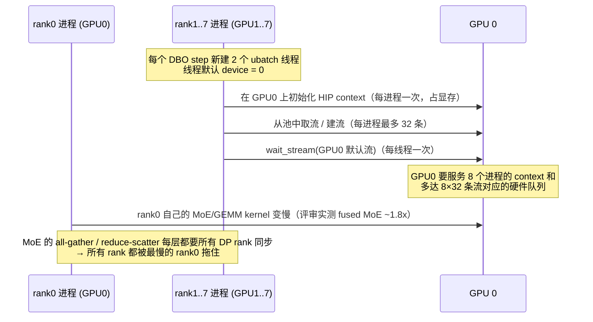

# ROCm DeepSeek-V4-Pro Prefill DBO 修复报告

> 对应 PR：[vllm-project/vllm#57773](https://github.com/vllm-project/vllm/pull/57773)
> 评审意见：[issuecomment-6090299396](https://github.com/vllm-project/vllm/pull/57773#issuecomment-6090299396)（mawong-amd）
> 本地分支：`rocm-dsv4-prefill-dbo`（基线 `bfa7e5b7af`）

## 0. 结论速览

| # | 评审意见 | 合理性 | 处理 | 影响范围 |
|---|---|---|---|---|
| 1 | `_run_ubatches` 线程没有设置 device | ✅ 合理，是 **~30% 性能劣化的主因** | 已修复（1 行） | 通用代码，但对所有平台都是正确且无副作用的 bugfix |
| 2a | 不要用 `supports_async()` 冒充 “支持 DBO” | ✅ 合理，有真实副作用 | 已修复：新增 `supports_dbo()` 接口，ROCm 子类覆写 | 基类新增接口，默认行为不变 |
| 2b | 把 comm 重叠逻辑上移到基类、所有平台生效、去掉工厂替换和 ROCm-only 配置检查 | 技术上合理 | **不采纳**（与“只影响 ROCm 路径”的约束冲突） | — |
| 2c | 建议测一下 DP+EP 路径，并评估 #46990 的 ROCm 改动 | 信息性建议 | 不改代码，列为后续工作 | — |
| 3 | 删除“ROCm 上 FULL cudagraph 禁止微批”的平台判断 | ✅ 合理 | 已删除（经你确认） | 仅删除 ROCm-only 代码 |
| 4 | 删除 ROCm 额外的 profile run | ✅ 基本合理 | 已删除（经你确认），需在验证中观察 | 仅删除 ROCm-only 代码 |
| 5 | numpy int 应在源头转换 | ✅ 合理 | 已改为源头单点 `int()`，撤销其余散落的 cast | 通用代码改动反而减少 |
| 6 | 按 ubatch 切片 `positions` | ✅ 合理 | 保留 | 通用 bugfix |
| 7 | MTP hidden buffer 写入偏移 | ✅ 合理，且**是 MTP+DBO 精度崩溃的直接原因** | 保留（仅 AMD DeepSeek-V4） | ROCm 模型文件 |

---

## 1. 详解：`_run_ubatches` 线程未设置 device（性能劣化主因）

### 1.1 三个背景知识

1. **“当前设备”是线程局部状态。** CUDA/HIP 的 current device 每个 OS 线程各有一份。主线程调用 `set_device(3)` 不会影响之后新建的线程——**新线程的 current device 总是 0**。
2. **DP 部署中每个 rank 是独立进程，只该用自己那张卡。** `--data-parallel-size 8` 时，rank N 的 worker 进程在主线程里设置好 `device = cuda:N`，原则上它不应该碰 GPU 0（rank 0 除外）。
3. **DBO 每一步都会新建线程。** `UBatchWrapper._run_ubatches` 每次执行微批 step 都会为每个 ubatch 创建一个新的 `threading.Thread`（2 个 ubatch → 2 个新线程），step 结束后线程退出。

### 1.2 出问题的调用链

`_ubatch_thread` 进入后第一件事是 `with ubatch_metadata.context:`，即 `UBatchContext.__enter__`：

```
_ubatch_thread                                   # 新线程，current device = 0（不是 N！）
└─ UBatchContext.__enter__                       # vllm/v1/worker/ubatching.py
   └─ self.update_stream(self.compute_stream)
      └─ vllm.utils.torch_utils.current_stream() # 先比较“当前流”是不是 compute_stream
         └─ 本线程的 TLS 里还没有流 → 走“首次初始化”分支：
              new_stream = torch.cuda.Stream()             # ← 建在 current device = GPU 0 上
              new_stream.wait_stream(torch.cuda.current_stream())  # ← GPU 0 默认流
              torch.cuda.set_stream(new_stream)
      └─ torch.cuda.set_stream(compute_stream)   # compute_stream 在 GPU N 上，
                                                 # PyTorch 这时才把线程 device 切到 N
```

也就是说，**在把设备切到 N 之前，已经先在 GPU 0 上建了一个 stream 并往 GPU 0 上提交了一次跨流等待**。之后的模型计算因为 `set_stream(compute_stream)` 已把 device 切回 N，所以算子本身仍跑在正确的卡上——这也是为什么它不会直接报错，而只是“慢”。

### 1.3 本机实测验证

在本机（8×GPU，torch 2.12.0+rocm10.0.0）上用最小脚本复现（主线程 device=3，模拟 rank 3）：

```
main thread device = 3
[no set_device]   thread start current device = 0
[no set_device]   current_stream() created on device cuda:0      ← 在 GPU 0 上建流
[no set_device]   after set_stream(compute on 3): current device = 3
[with set_device] thread start current device = 3
[with set_device] current_stream() created on device cuda:3      ← 修复后在本卡上
```

另外实测 `torch.cuda.Stream()` 每个进程、每张卡最多会从一个 32 条流的池子里取流（连续创建 40 次只得到 32 条不同的底层流）。

### 1.4 为什么会让所有 rank 一起变慢



- **GPU 0 被“额外租户”占用。** 8 个 rank 进程都在 GPU 0 上建立了 HIP context，并在其上持有流（在 ROCm 上对应 HSA 硬件队列）。GPU 0 的命令处理器要在大量队列之间轮转调度，这与评审观察到的“服务空闲时 GPU 0 仍然 100% 忙、其他 7 张卡空闲”一致。
- **rank 0 的计算变慢。** 评审抓 kernel trace 发现只有 rank 0 的 kernel 变慢（fused MoE 约 1.8 倍）。
- **木桶效应传染到全体。** 在 DP 部署下，每个 MoE 层都要做跨 DP 的 all-gather 和 reduce-scatter，每个 rank 都要等最慢的 rank 0，所以整体 TPOT 上升、吞吐下降——这正是 PR 描述里 “TPOT +31%、吞吐 −30%” 的来源，而不是 DBO 重叠本身的问题。
- **稳定性。** 评审在 ROCm 7.2.3 上不修复时 6 次中有 2 次 worker 崩溃（`HSA_STATUS_ERROR_EXCEPTION`），修复后 4/4 正常（样本量小，未定位到出错 kernel）。

> 说明：上面的 1.2、1.3 已在本机直接验证；“GPU 0 上大量队列导致 rank 0 变慢”是基于验证结果和评审 trace 数据的推断，具体硬件调度细节没有单独测量。

### 1.5 为什么 `_capture_ubatches` 没有这个问题

cudagraph 捕获路径的 `_capture_ubatch_thread` 第一行就有 `torch.accelerator.set_device_index(self.device)`。只有 eager 执行路径（也就是 prefill DBO 真正走的路径）漏掉了这一行。

### 1.6 修复

`vllm/v1/worker/gpu_ubatch_wrapper.py`：

```python
        def _ubatch_thread(results, model, ubatch_metadata):
            torch.accelerator.set_device_index(self.device)   # 新增
            with ubatch_metadata.context:
```

含义：让 ubatch 线程一开始就把“当前设备”设成本 worker 的卡，后续 `current_stream()` 初始化、建流、等待都发生在本卡上，GPU 0 不再被其他 rank 占用。这一行在通用文件里，但只是把线程设备设成本 worker 本来就该用的卡，在 CUDA 上同样正确、没有副作用（CUDA 上同样存在这个 bug）。

评审修复后实测：agentic 吞吐从 670–717 tok/s 回到 958 tok/s，与不开 DBO（917–977 tok/s）持平。

---

## 2. Comm-stream 重叠的实现方式

### 2a. `supports_async()` 被挪用（已修复）

**问题。** 原 PR 的 ROCm 子类让 `supports_async()` 返回 `dbo_enabled()`，目的只是绕过 `FusedMoEKernelModularImpl._prepare/_finalize` 里的 `assert not dbo_enabled()`。但 `supports_async()` 还会被 `FusedMoEKernel.can_overlap_shared_experts` 读取，而 `SharedExperts._determine_shared_experts_order` 每次 forward 都会调用它。结果是：在 ubatch 线程里 shared experts 改走 `MK_INTERNAL_OVERLAPPED` 路径（在 finalize 之后由 MK 内部执行），主线程里却走另一条路径，行为随线程变化。另外还要额外写 `prepare_async/finalize_async` 两个“假异步”包装。

**修复（基类新增接口 + ROCm 子类覆写，默认行为不变）：**

- `modular_kernel.py`：`FusedMoEPrepareAndFinalize` 新增 `supports_dbo()`，**默认返回 `self.supports_async()`**，所以 CUDA 和其他所有现有实现行为不变。同步分支的断言改为 `assert not dbo_enabled() or self.prepare_finalize.supports_dbo()`；对非 ROCm 类，这与原断言完全等价。
- `naive_dp_ep_rocm.py`：删掉 `supports_async()` 覆写和 `prepare_async/finalize_async` 包装，改为 `supports_dbo() -> True`。DBO 交接仍由 `_comm_region()` 在同步的 `prepare()/finalize()` 内部完成。`supports_async()` 恒为 False，shared experts 的调度回到和非 DBO 时一致的路径。

### 2b. “上移到基类、对所有平台生效”（不采纳）

评审建议把 `_comm_region` 的交接直接写进 `MoEPrepareAndFinalizeNaiveDPEPModular`，同时去掉工厂里的 ROCm 分支和 `vllm/config/vllm.py` 里的 ROCm-only 放行。技术上这样更简洁，但会改变 CUDA 等平台在 `allgather_reducescatter + --enable-dbo` 下的行为（从“断言报错”变成“启用重叠”），且没有 CUDA 上的验证。按本次“只影响 ROCm 路径”的约束，保留 ROCm 子类、工厂分支和 ROCm-only 配置检查。如果上游 reviewer 坚持，可以作为后续 PR 再改。

### 2c. 性能与适用面（信息性）

评审数据：prefill 全满（8192 token）时，comm stream 上的 RCCL 几乎被完全隐藏；但相比不微批仍慢约 9%（3.67 s vs 3.37 s），疑似 RCCL 与 MoE/GEMM 争用资源。微批需要所有 DP rank 都同意才会切分，在 agentic 回放里只有约 8% 的 step 被切分，所以端到端影响较小。

---

## 3. 删除“ROCm 上 FULL cudagraph 禁止微批”（已删除）

- **原代码（commit c09fc3ce “fix graph capture”）**：在 `_determine_batch_execution_and_padding` 里，ROCm 且 `cudagraph_mode == FULL` 时强制 `allow_microbatching = False`，理由是 hipBLASLt 不能在捕获流上运行。
- **评审结论**：删除后，在 ROCm 10 和 ROCm 7.2.3 上微批 FULL graph 都能正常捕获和回放。不过微批 decode 每 token 慢约 1.8 倍，所以 decode 确实不该走 DBO，但应该用已有的 `--dbo-decode-token-threshold` 来控制，而不是写死平台判断。
- **处理**：删除，`gpu_model_runner.py` 恢复为上游原样。
- ⚠️ **使用注意**：`--dbo-decode-token-threshold` 默认是 **32**。开启 MTP（`num_speculative_tokens=3`）后，64 个并发的 decode step 有 64×4 = 256 个 token，会被微批。**启动命令必须加 `--dbo-decode-token-threshold 8192`**（或任何大于最大 decode token 数的值），否则 decode 会变慢，并且启动时会捕获微批 FULL graph。

## 4. 删除 ROCm 额外的 profile run（已删除，需验证）

- **原代码（commit 168b2f95 “fix workspace oom”）**：ROCm 上开启 ubatching 时，在 profile 前额外跑一次不微批的 `max_num_tokens` dummy run，用来把 ubatch 0 的 workspace 槽撑到足够大。
- **分析**：这个担心在理论上成立——warmup 时满尺寸 step 都会被微批，所以不微批的满尺寸 step 有可能从来没有把 ubatch 0 的 workspace 撑大，加锁后再增长就会报 “Workspace is locked”。但是：(1) 评审跑了长 prompt 突发和 900 s agentic 都没有复现，而那次 agentic 中约 92% 的 8192-token step 都没被切分，说明这条路径被大量执行过；(2) 这个风险与平台无关，不应写成 ROCm-only；(3) 原问题很可能和第 1 项有关（ubatch 线程在 GPU 0 上建立 context 和流会额外占用 GPU 0 显存）。
- **处理**：删除，与上游一致。**验证时如果再次出现 “Workspace is locked” 或 OOM，请保留日志**，再以平台无关的方式（只在 `use_ubatching` 时、不限 ROCm）加回。

## 5. numpy int 在源头转换（已优化）

- **根因**：`ubatch_utils.maybe_create_ubatch_slices` 里，最后一个切分点 `cu_num_tokens[-1]` 来自 `np.cumsum`，是 `np.int32`。它进入 `token_slice.stop` 后，传播到各个 metadata builder，最终在 `build_c128a_topk_metadata` 中触发 Triton 报错 `failed to specialize argument of type: numpy.int32`。
- **修复**：`all_points = token_split_points + [int(cu_num_tokens[-1])]`，一处覆盖所有下游消费者。
- **同时撤销**：`vllm/models/deepseek_v4/sparse_mla.py`（DSV4 通用文件，CUDA 也会用到）中的 6 处 `int()` 和 `_make_metadata_with_slice` 中的 `int()`。这两个文件的这部分恢复为上游原样，通用代码改动面反而缩小；数值不变，只是类型从 numpy 标量变为 Python int。
- 新增单测 `test_ubatch_slice_bounds_are_python_ints`。
- **mypy 跟进**：加上 `int()` 后，`all_points` 不再被推断为 `list[Any]`，于是暴露了一个原有问题：`split_point` 的类型是 `list[int] | int | None`，但 `split_point * i` 对 list 做的是重复，而不是计算位置。目前所有调用方都只传 int。现在按 `isinstance(split_point, int)` 分支处理：传 int 时行为完全不变；传 list 时当作显式切分点，并断言长度等于 `num_ubatches - 1`。

## 6. 按 ubatch 切片 `positions`（保留）

不切片时，C128A metadata 构建会报 `positions is required for C128A metadata build`，或者拿到整批的 positions。PR 中在 `_make_metadata_with_slice` 里按 `token_slice` 切片是正确的修复。它只在微批时才会执行，保留。

## 7. MTP hidden buffer 偏移（保留，且是精度问题的直接原因）

**问题。** `DeepseekV4Model.forward` 会把 hc_head 之前的残差流写入 `_mtp_hidden_buffer[:num_tokens]`，供 MTP drafter 在本 step 结束后按 token 顺序读取。DBO 下两个 ubatch 线程都从第 0 行开始写，后写的会覆盖先写的，另一半行则是上一步遗留的旧数据。drafter 拿到的 hidden state 与 token 错位。

**评审说 “只影响草稿质量、不影响输出”，这在标准拒绝采样下成立，但对你的测试配置不成立：**

你的启动参数是
`"rejection_sample_method": "synthetic", "synthetic_acceptance_length": 2.49`。
`synthetic` 模式（见 `vllm/config/speculative.py`）按预设概率接受草稿 token，**不与目标模型的分布做校验**。因此草稿一旦因为 buffer 错位变成垃圾，就会被直接接受进输出。这就是 “开启 MTP+DBO 后精度严重下降” 的直接原因。不开 DBO 时草稿质量高，synthetic 接受造成的损失较小，所以看起来没问题。

**处理**：保留 PR 中 `deepseek_v4/amd/model.py` 按 `dbo_current_ubatch_token_offset()` 写入的修复（偏移通过 `UBatchContext.token_offset` 传递，非 DBO 时为 0，行为不变）。另外修复了 PR 中 `test_token_offset_per_ubatch_thread` 的竞态：原测试在两个线程里分别 `patch.object` 同一个模块属性，一个线程退出 patch 时会把另一个线程正在用的 mock 还原。现改为在主线程统一 patch。

**建议**：评测精度时请使用 `rejection_sample_method: standard`（或去掉该项）。synthetic 只适合测性能，其精度结果没有意义。

---

## 8. 改动清单（相对上一版本地提交）

| 文件 | 改动 | 是否触及非 ROCm 行为 |
|---|---|---|
| `vllm/v1/worker/gpu_ubatch_wrapper.py` | `_ubatch_thread` 加 `set_device_index` | 是，纯 bugfix，各平台都正确 |
| `vllm/model_executor/layers/fused_moe/modular_kernel.py` | 新增 `supports_dbo()`（默认 = `supports_async()`），断言改用它 | 否（默认等价） |
| `.../prepare_finalize/naive_dp_ep_rocm.py` | 删 `supports_async` 覆写和 async 包装，加 `supports_dbo() -> True` | 否（ROCm 专用） |
| `vllm/v1/worker/gpu_model_runner.py` | 删除两处 ROCm-only 代码，恢复上游原样 | 否 |
| `vllm/v1/worker/ubatch_utils.py` | 源头 `int(cu_num_tokens[-1])`；撤销散落 cast；保留 positions 切片 | 仅类型变化 |
| `vllm/models/deepseek_v4/sparse_mla.py` | 撤销 int cast，恢复上游原样 | 否 |
| `tests/kernels/moe/test_naive_dp_ep_rocm_dbo.py` | 替换 async 包装用例为 `supports_dbo` 用例（含基类默认行为） | — |
| `tests/v1/worker/test_ubatch_offsets.py` | 修复 patch 竞态；新增切片边界为 int 的用例 | — |

保持不变（沿用 PR）：`naive_dp_ep.py` 的 `_comm_region` 钩子和 ROCm 工厂分支、`vllm/config/vllm.py` 的 ROCm-only 放行、`ubatching.py` 的 token_offset、`deepseek_v4/amd/model.py` 的 MTP 偏移。

## 9. 验证情况

**已完成（本机）：**
- `pytest tests/kernels/moe/test_naive_dp_ep_rocm_dbo.py tests/v1/worker/test_ubatch_offsets.py --noconftest`：**13 passed**。环境缺少 `tblib`，所以跳过了仓库的 conftest。
- 修改的模块均能通过编译和导入检查；`MoEPrepareAndFinalizeNaiveDPEPModularROCmDBO().supports_dbo() == True`，`supports_async() == False`。
- 第 1 项的机制已用最小脚本在本机 GPU 上复现和验证（见 1.3）。
- 环境中没有安装 ruff，**未跑 lint**。

**待你在 MI355X 上执行（未做）：**
1. 原启动命令 **加上 `--dbo-decode-token-threshold 8192`**。
2. 服务空闲时运行 `rocm-smi --showuse`，确认 GPU 0 不再常驻 100%。
3. agentic 回放（conc 64），与不开 DBO 对比吞吐、TTFT、TPOT（预期持平）。
4. 精度：**改用 `rejection_sample_method: standard`** 跑 gsm8k；再在关闭 prefix caching 的情况下跑一次 ARC-challenge 等 loglikelihood 任务，确保 step 确实被切分（开启 prefix caching 时，hazard 检查会否决大部分切分）。
5. 检查日志中没有 “Workspace is locked”、hipBLASLt capture 报错或 `HSA_STATUS_ERROR_EXCEPTION`。

## 10. 遗留风险与后续建议

1. **其他后端/模型的 MTP buffer**：`deepseek_v4/{nvidia,xpu,cpu}/model.py`、`deepseek_v41/{amd,nvidia}/model.py`、`qwen4_exp/{amd,nvidia}/model.py` 都有同样的 `_mtp_hidden_buffer[:num_tokens]` 写法，在 DBO + MTP 下有同样的问题。本次按要求未改。
2. **DBO 收益有限**：即使 comm 被完全隐藏，微批 prefill 仍比不微批慢约 9%，且只有约 8% 的 step 会被切分。建议：
   - 调整 `--dbo-prefill-token-threshold`；
   - 按评审建议测量 DP+EP（`--enable-expert-parallel`，mori/DeepEP 路径）下的 DBO，并尝试回退 #46990 中的 ROCm 特化（关闭 async scheduling、`comm_sms = 0`、dispatch/combine 后的 `synchronize()`），参见 ROCm/vllm@1e708140 和 ROCm/vllm@997dce56。
3. **第 4 项**仍可能在其他负载下触发，需要更长时间、更多负载的验证。
4. **线程开销**：`_run_ubatches` 每步仍会新建线程（上游设计）。改为常驻线程池能进一步降低 CPU 开销，但不在本次范围内。
