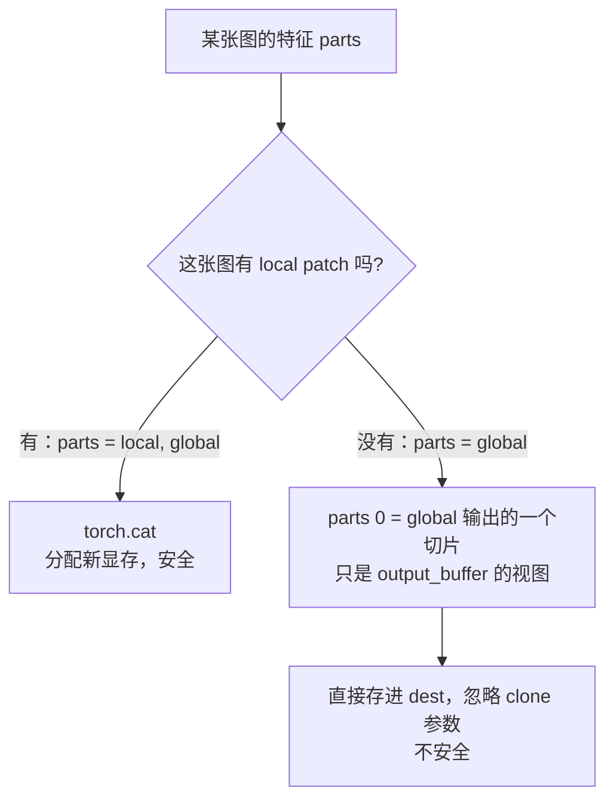
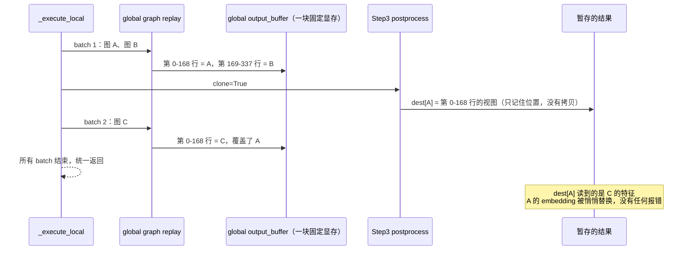

# Encoder CUDA graph 共享 buffer 的两个遗留问题：原理与修复方案

> **背景**：PR [#65084](https://github.com/vllm-project/vllm/pull/65084)（encoder CUDA graph 跨 token budget 共享 capture buffer）已合入 main（`ebc97ad8d0`），最终采用的是 @Isotr0py 的版本。本文分析 review 报告 `skills/vllm-rocm-pr-review/outputs/pr-65084-review.md` 中留下的两个正确性问题，并给出准备在 follow-up PR 中实施的修复方案。
>
> **状态**：方案待确认，尚未开始修改代码。

---

## 一、背景：共享 buffer 的前提

65084 合入后，同一条 path（以及同一组 capture axis）下所有 budget 的 graph **共用一块 buffer**：

- 最大的 budget 持有完整的 buffer，较小的 budget 只使用它的前 n 行；
- 0 维标量则被整块共享。

这样做本身是安全的，但有一个前提：**每次 replay 前，graph 要用到的数据都必须重新写一遍。** 下面两个问题，都出在这个前提不成立的地方。

相关代码（main `ebc97ad8d0`）：

| 位置 | 作用 |
|---|---|
| `vllm/v1/worker/encoder_cudagraph.py` `_share_prefix_compatible` | capture 时决定哪些输入 buffer 使用共享前缀视图；0 维标量执行 `full.copy_(buf)` 后整块共享 |
| `vllm/v1/worker/encoder_cudagraph.py` `_capture_budget_graph` | 每个 `(path, axis_keys)` 的第一次 capture（即最大 budget）登记共享 buffer；输出 buffer 同样共享 |
| `vllm/v1/worker/encoder_cudagraph.py` `_run_budget_graph` | replay 前把新值拷入输入 buffer；`replay.values` 里缺少某个 key 时直接 `continue` |
| `vllm/model_executor/models/step3_vl.py` `postprocess_encoder_output` | `merged[idx] = torch.cat(parts) if len(parts) > 1 else parts[0]` |
| `vllm/v1/worker/gpu/mm/encoder_runner.py` `execute_mm_encoder` | 把 `cg_manager.execute()` 的返回值原样放进 encoder 输出（随后进入 encoder cache），不做拷贝 |

---

## 二、问题 1：只在 capture 时写入的数据，会被其他 budget 覆盖

### 2.1 原理

**以前**：每个 budget 的 graph 有自己独立的 buffer。模型可以在 capture 时写入一个只和 budget 有关的"常量"，replay 时不再更新（`prepare_encoder_cudagraph_replay_buffers` 不返回这个 key，或者返回 `None`），manager 会直接跳过。由于没有别人会改这块 buffer，这样做完全没问题。

**现在**：buffer 共用了，而 capture 按 budget 从大到小进行，之后每个较小的 budget 在 capture 时都会把自己的值写进同一块 buffer。等所有 capture 结束，buffer 里留下的是最后一个（最小的）budget 写入的内容。大 budget 的 graph 在 replay 时如果没有人重新写这块 buffer，读到的就是别人的数据。

### 2.2 例子

**例子 A：GPU 上的 0 维标量。** 假设某模型在 GPU 上放了一个标量 `num_valid = budget`，forward 用它判断"前多少行是有效的"，只在 capture 时设置。budget 为 `[4096, 1024, 256]`：

```
capture 4096 → 共享标量 = 4096
capture 1024 → 共享标量 = 1024    （65084 对 0 维标量执行 full.copy_(buf)，整块共享）
capture  256 → 共享标量 =  256    ← 最终值
replay 4096 的 graph → 读到 256 → 只把前 256 行当作有效 → 结果静默出错，没有报错
```

**例子 B：只在 capture 时写入的多行 buffer。** 假设 buffer `row_to_image` 记录每一行属于第几张图，每个 batch 最多 4 张图：

- budget 4096：每张图占 1024 行，内容是 `[0×1024, 1×1024, 2×1024, 3×1024]`；
- capture budget 1024 时，会把自己的布局 `[0×256, 1×256, 2×256, 3×256]` 写进共享 buffer 的前 1024 行；
- 之后 budget 4096 的 graph 读到的前 1024 行已经不是它自己的布局了。

**例子 C：自定义 `padding_logic` 只写一部分。** 如果它只写 `dst` 的前 n 行，依赖尾部保留 capture 时写入的哨兵值，那么尾部可能已经被其他 budget 的 capture 改写。

### 2.3 为什么树内模型目前没出事

树内唯一一个"只在 capture 时写入"的 key 是 `max_seqlen`（MiniMax-M3 在 replay 时把它 pop 掉；Pixtral 类似），它是 **CPU** 上的标量。ViT attention wrapper（FA、`ROCM_AITER_FA`、Triton、aiter FP8）在 capture 时都会对它调用 `.item()`，把值固定进 kernel 的启动参数里。之后这个 tensor 再怎么被改写，graph 都不受影响。树内所有 `padding_logics` 也都会写满 `dst`。

### 2.4 为什么仍然要修

- 这是 65084 **隐式**加上的模型协议约束，既没有代码检查，也没有文档说明（PR 描述还写着 "No protocol changes"）。
- 将来新增模型或树外模型一旦用到例子 A、B、C 的写法，就会**静默**算错，很难排查。
- 共享 0 维标量**省不了任何显存**，却引入了例子 A 这种风险。
- 65084 的测试 `test_scalar_buffers_are_shared` 恰好就用了例子 A 的模式（GPU 0 维标量，值等于 budget），但 mock 的 forward 并不读取它，测试只断言了"共享成功"。

---

## 三、问题 2：Step3-VL 无 patch 的图返回的是输出 buffer 的视图

### 3.1 `clone` 约定

- graph 每次 replay 都写到同一块固定的输出显存；`_run_budget_graph` 返回的就是这块 buffer 本身，不是拷贝。
- `_execute_local` 会把一次 `execute()` 的图片拆成若干 batch 依次 replay，每个 item 的结果先暂存起来，**等所有 batch 跑完才统一返回**。
- 所以 manager 调用 `postprocess_encoder_output(clone=True)` 时，要求模型把每张图的结果**拷贝**出来。PyTorch 的切片、`reshape`、`view` 都不复制数据，只是指向同一块显存；`torch.cat`、高级索引、`.clone()` 才会分配新显存。

### 3.2 Step3-VL 错在哪里



小图（不切 patch）只有 global 特征一个部分，代码直接存了 `global_part[i]`。它只是输出 buffer 上的一个切片，相当于一个"指针"，`clone` 参数被忽略了。

### 3.3 例子

一次 `execute()` 带 3 张小图，被拆成两个 batch（例如 `encoder_cudagraph_max_vision_items_per_batch=2`；默认配置下 budget-cliff deferral 也可能拆分）：



这些视图还会被原样存进 encoder cache（V2 runner 的 `execute_mm_encoder` 不做拷贝）。所以在后续 step 用到这份 cache 之前（例如 chunked prefill 跨多个 step），之后任何一次 global path 的 replay 都可能把它覆盖。

### 3.4 为什么说 65084 让问题扩大了

| 场景 | 两次 replay 用的 graph | 是否写同一块输出显存 | 是否被覆盖 |
|---|---|---|---|
| main（65084 之前），两个 batch 落在同一 budget | 同一个 graph | 是 | **会** |
| main（65084 之前），两个 batch 落在不同 budget | 不同 graph | 否，各自一块 | 不会（运气好） |
| 65084 之后，任意两个 global replay | 不同 graph，但共用前缀 | **是**（169 是 338 的前缀） | **会** |
| 修复后 | 任意 | 任意 | 不会 |

**main 上本来就有这个 bug**，只是需要"恰好同一 budget"才会触发。65084 之后，同一 path 上任意 budget 的 replay 都会覆盖，触发条件从偶然变成了常见。

### 3.5 实测数据

在 MI355X 上测 Step3-VL-10B，用 3 图请求，并设置 `max_vision_items_per_batch=2`。参照方式是同一张图单独 `execute()` 的结果，单独执行不可能被后续 batch 覆盖。比较两者的相对误差 ‖a−b‖/‖b‖：

| 代码版本 | 被污染的 item（相对误差 > 0.1） | 最大相对误差 |
|---|---|---|
| main（65084 之前） | 2 / 11 | 0.62 |
| 65084 | **6 / 11** | 1.34 |
| 加上 Step3-VL 修复 | **0 / 11** | 只有 bf16 噪声（≤ 0.033） |

注意：拿共享 manager 和不共享的 manager 互相比较，**发现不了**这个 bug，因为两个 batch 落在同一 budget 时，两边会以相同方式被覆盖。必须以"单独执行"作为参照。

### 3.6 为什么在模型里修，而不是在 manager 里统一 clone

manager 不知道模型的 postprocess 有没有产生新 tensor。其他模型（默认的 `scatter_output_slices(clone=True)`、DeepSeek-OCR、DeepSeek-VL2、ERNIE-4.5-VL、DeepSeek-V4.1）都已经返回新 tensor。如果 manager 再统一 clone 一次，所有模型都要多付一次整块拷贝。约定本来就是"`clone=True` 时由模型负责拷贝"，所以只需要修复违反约定的 Step3-VL，再把约定写进文档。

---

## 四、修复方案

### 问题 1：去掉没有收益的共享，把隐式约束改成显式检查加文档

1. **`_share_prefix_compatible` 不再共享 0 维 buffer**，每个 budget 保留自己的标量。这样做没有任何显存代价，也直接消除了例子 A。
2. **加一个 replay 保护**：manager 记录每个 `(path, axis_keys)` 下哪些 key 真正发放过前缀视图。在 `_run_budget_graph` 里，如果这类 key 在 replay 时缺值（`None` 或者不存在），就直接抛 `RuntimeError`，而不是静默沿用已被改写的内容。这会把例子 B 从"静默出错"变成"立即报错"。
   - 已核对：树内唯一在 replay 时缺值的 key 是 MiniMax-M3 的 CPU 标量 `max_seqlen`，它不会被共享，所以不会误报。
3. **写进文档**：
   - `vllm/model_executor/models/interfaces.py` 的 `prepare_encoder_cudagraph_replay_buffers` docstring：必须提供每个共享 buffer 的值；
   - `vllm/v1/worker/encoder_cudagraph_defs.py` 的 `padding_logics` docstring：必须写满整个 `dst`；
   - 设计文档 `docs/design/cuda_graphs_multimodal.md` 同步补充。
   - 例子 C 只能靠文档约束，因为在运行时检查成本太高。
4. **测试**：
   - 把 65084 的 `test_scalar_buffers_are_shared` 改为断言"每个 budget 的标量各自独立"，同时更新 mock（`VarShapeMockViTModel`）的 docstring；
   - 新增一个小测试：replay 漏掉某个共享 key 时会报错。

### 问题 2：修复 Step3-VL，并写明 clone 约定

5. **`vllm/model_executor/models/step3_vl.py`**：只有一个 part 时，`clone=True` 就返回 `parts[0].clone()`，有 local patch 的分支（`torch.cat`）保持不变。
6. **写明约定**：`postprocess_encoder_output` 的 docstring 和设计文档 replay 步骤 4 写明：`clone=True` 时返回值不得是 `outputs` 的视图，因为输出 buffer 会被同一 path 上任意 budget 的 replay 覆盖。
7. **测试**：加一个 Step3-VL 的 CPU 回归测试，只检查 `clone=True` 时不再别名输出，大约 20 行。

### 验证计划

- 单元测试：`tests/v1/cudagraph/test_encoder_cudagraph.py`、`tests/v1/worker/test_encoder_runner.py`，以及 pre-commit。
- MI355X 端到端，复用 `docs/tasks/vit_cg/validation/` 下的 harness：
  - **Step3-VL**：以"单独执行"作为参照，期望修复后被污染的 item 为 0；
  - **Qwen3-VL、Gemma4**：确认新的保护逻辑不会误报，capture buffer 显存和修复前一致（去掉标量共享只多出几个字节）。
- PR 描述按之前的格式写到 `docs/tasks/vit_cg/` 下，作为新文件。

### 不在本次范围内

65084 review 里还有几条和这两个问题无关，这次先不处理，需要时另开 PR：

- ⚠️ 新的 budget 网格以 1 为锚点而不是 `min_budget`，固定粒度的 path（DeepSeek-OCR、Gemma4）在 2^k 个 item 时 padding 更多，还会产生等价的冗余 graph；
- 📝 输出 buffer 共享没有像输入那样检查 `shape[1:]` 和 dtype；
- 📝 MiniMax-M3 的 rope planes（行轴在第 1 维）会回退为按 budget 分配，PR 描述中"没有不兼容 buffer"的说法不准确。

### 待确认事项

1. **问题 1 第 2 步的 replay 保护是否要加？** 如果更倾向只改文档、不加运行时检查，就去掉这一步。
2. **PR 描述的文件名**：暂定为 `docs/tasks/vit_cg/pr-encoder-cg-shared-buffer-followups.md`。
