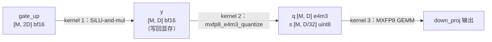
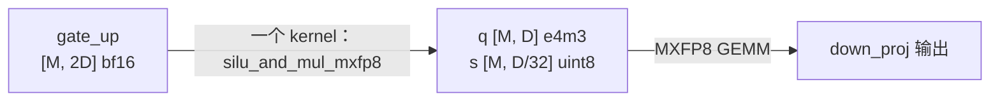

# 从零读懂 `silu_and_mul_mxfp8`：把 MXFP8 量化融合进 SiLU-and-mul 激活 kernel

> 学习对象：vLLM PR [#67906](https://github.com/vllm-project/vllm/pull/67906) 新增的 Triton kernel `_silu_and_mul_mxfp8_kernel`
>
> 代码位置（PR 分支 `rocm-dsv41-flash-kernel-fusion`，head `0230cd145d`）：
> - kernel 与 Python 封装：`vllm/models/deepseek_v4/amd/silu_and_mul_mxfp8.py`（共 103 行）
> - 调用处：`vllm/models/deepseek_v4/amd/model.py` 里的 `DeepseekV4MLP.forward`
> - 原来那个独立的量化 kernel（融合的"另一半"）：`vllm/model_executor/layers/quantization/utils/mxfp8_utils.py` 里的 `_mxfp8_quant_triton_kernel`
> - 单测：`tests/kernels/models/amd/test_dsv41_mxfp8_input_fusion.py`
>
> 适合人群：没写过 Triton、也不太了解量化的读者。读完你应该能回答三个问题：这个 kernel 在模型里的什么位置被调用？它每一行在做什么？量化操作是怎样"塞进"激活 kernel 里的？
>
> 本文的数值例子是用纯 PyTorch 在 CPU 上逐步模拟 kernel 公式算出来的，没有运行 PR 本身的代码。

---

## 目录

- [第 0 部分：一张图看懂要做什么](#第-0-部分一张图看懂要做什么)
- [第 1 部分：预备知识](#第-1-部分预备知识)
  - 1.1 SiLU-and-mul（SwiGLU）是什么
  - 1.2 MXFP8 量化是什么
  - 1.3 为什么要融合
  - 1.4 Triton 最少需要知道的几个概念
- [第 2 部分：kernel 在模型里是怎么被调用的](#第-2-部分kernel-在模型里是怎么被调用的)
- [第 3 部分：Python 封装 `silu_and_mul_mxfp8` 逐行讲解](#第-3-部分python-封装-silu_and_mul_mxfp8-逐行讲解)
- [第 4 部分：分块配置 `_config` 逐行讲解](#第-4-部分分块配置-_config-逐行讲解)
- [第 5 部分：kernel 本体逐行讲解](#第-5-部分kernel-本体逐行讲解)
- [第 6 部分：融合是怎么做到的（重点）](#第-6-部分融合是怎么做到的重点)
- [第 7 部分：怎么证明融合后结果没变](#第-7-部分怎么证明融合后结果没变)
- [第 8 部分：练习与思考题](#第-8-部分练习与思考题)

---

## 第 0 部分：一张图看懂要做什么

DeepSeek-V4/V4.1 的每个 MoE 层里都有一个 **shared expert**，结构就是一个普通 MLP：

```
x ──► gate_up_proj ──► [gate | up] ──► SiLU(gate) * up ──► down_proj ──► 输出
       (GEMM)                           (激活)               (GEMM)
```

在 MI355X（gfx950）上，`down_proj` 是一个 **MXFP8 GEMM**：它不直接吃 bf16，而是要求输入先被量化成 MXFP8（8 bit 的值 + 每 32 个数共享一个 scale）。所以原来实际上是这样的：



PR #67906 把 kernel 1 和 kernel 2 合成了一个：



中间那个 bf16 的 `y` 不再写回显存，少一次 kernel launch，也少一轮显存读写。**输出和原来两步走的结果一模一样（逐位相同）。** 这是整个 PR 的设计目标，"一模一样"在什么前提下成立，第 7 部分会细讲。

---

## 第 1 部分：预备知识

### 1.1 SiLU-and-mul（SwiGLU）是什么

`gate_up_proj` 是把两个线性层 `gate_proj` 和 `up_proj` 拼成一个 GEMM，输出形状为 `[M, 2D]`：

- `M`：token 数（这一批里有多少个 token）
- `D`：MLP 的中间维度（intermediate size，按 TP 切分后的大小）
- 前 `D` 列是 `gate`，后 `D` 列是 `up`

激活函数是：

```
SiLU(g) = g * sigmoid(g) = g / (1 + exp(-g))
y = SiLU(gate) * up
```

DeepSeek-V4 还会先对输入做 **clamp（截断）**，对应 vLLM 里的 `SiluAndMulWithClamp(swiglu_limit)`：

```
gate = min(gate, limit)              # 只截上界
up   = clamp(up, -limit, +limit)     # 上下都截
y    = SiLU(gate) * up
```

为什么 `gate` 只截上界？因为 `SiLU(g)` 在 `g → -∞` 时趋于 0，本来就不会爆，只有正方向会变大。

### 1.2 MXFP8 量化是什么

**量化**就是用更少的 bit 表示一个数，以节省显存和带宽，同时能用更快的低精度矩阵乘指令。

**FP8 E4M3**（PyTorch 里是 `torch.float8_e4m3fn`）是一种 8 bit 浮点数：1 个符号位、4 个指数位、3 个尾数位。它能表示的最大值是 **448**，精度很粗：比如在 256~512 之间，相邻两个可表示的数相差 32。

问题在于：如果一个数是 0.001 或者 10000，直接塞进 E4M3 要么下溢成 0，要么溢出。所以需要一个 **scale（缩放因子）**：先除以 scale 把数"挪"到 E4M3 舒服的范围里，用的时候再乘回来。

**MX（Microscaling）格式**的规定是：

- **每 32 个相邻元素**（沿最后一维）组成一个 block，共享一个 scale。
- scale 必须是 **2 的整数次幂**，用 **E8M0** 格式存储。E8M0 只有 8 个指数位、没有尾数，本质上就是一个 `uint8`，存的是"偏置后的指数" `sb`，真实 scale = `2^(sb - 127)`。

所以一个 `[M, D]` 的 bf16 矩阵，MXFP8 量化后变成两个 tensor：

| tensor | 形状 | dtype | 含义 |
|---|---|---|---|
| `q`（values） | `[M, D]` | `float8_e4m3fn` | 每个元素缩放后的 8 bit 值 |
| `s`（scales） | `[M, D/32]` | `uint8` | 每 32 个元素一个偏置指数 `sb` |

反量化公式：`原值 ≈ q × 2^(sb − 127)`。

**scale 怎么选？** vLLM 的 `mxfp8_e4m3_quantize` 使用如下规则（本 kernel 必须和它完全一致）：

```
amax = max(|block 里 32 个数|)                 # 这个 block 的最大绝对值
sb   = ceil(log2(amax / 448)) + 127            # 让 amax 缩放后刚好 ≤ 448
sb   = clamp(sb, 0, 254)                       # E8M0 的合法范围
q    = 数值 × 2^(127 − sb)                      # 除以 scale，等价于乘它的倒数
```

直觉：`amax / 448` 是"至少要缩小多少倍才能放进 E4M3"，取 `log2` 再向上取整，就得到最小的 2 的幂次缩放因子。这样 block 里最大的数会被缩放到接近 448（E4M3 的顶部），小的数也尽量不会掉进精度很差的 subnormal 区。

**一个具体例子**（为了好算，假设 block 只有 4 个数，真实情况是 32 个）：

| | 第 1 个 | 第 2 个 | 第 3 个 | 第 4 个 |
|---|---|---|---|---|
| gate | 3.0 | −1.5 | 0.25 | 8.0 |
| up | 2.0 | 4.0 | −3.0 | 0.5 |
| SiLU(gate) | 2.8577 | −0.2736 | 0.1405 | 7.9973 |
| y = SiLU×up（舍入到 bf16） | 5.71875 | −1.09375 | −0.421875 | 4.0 |

- `amax = 5.71875`，`amax / 448 = 0.01277`，`log2 = −6.29`，向上取整得 `−6`，所以 `sb = −6 + 127 = 121`，scale = `2^−6`。
- 缩放：`y × 2^6` = `[366, −70, −27, 256]`，再舍入到最近的 E4M3 值，得到 `q = [352, −72, −28, 256]`（E4M3 在 256~512 之间步长是 32，366 离 352 更近）。
- 反量化：`q × 2^−6` = `[5.5, −1.125, −0.4375, 4.0]`，和原值相比有量化误差，这是 FP8 的固有代价。

### 1.3 为什么要融合

比较一下两种做法各需要读写多少显存。设每行 `D` 个输出元素，bf16 占 2 字节：

| 步骤 | 原来（两个 kernel） | 融合后（一个 kernel） |
|---|---|---|
| 读 gate_up | 4D 字节 | 4D 字节 |
| 写 bf16 的 y | 2D 字节 | —（只在寄存器里） |
| 读 bf16 的 y | 2D 字节 | — |
| 写 q | D 字节 | D 字节 |
| 写 s | D/32 字节 | D/32 字节 |
| **合计** | **约 9D 字节，2 次 launch** | **约 5D 字节，1 次 launch** |

这类逐元素（elementwise）的 kernel 几乎全是在等显存，所以读写字节数基本决定了耗时。融合后显存流量少了约 44%，还省掉一次 kernel launch 的固定开销（在 decode 这种小 batch 场景下，launch 开销占比很大）。

### 1.4 Triton 最少需要知道的几个概念

如果你只读过 PyTorch 代码，下面几个概念是读懂这个 kernel 的最低要求。

**(1) 一个 kernel = 很多个"程序实例"（program）并行跑同一份代码。**
Triton 里你不用管单个线程，而是写"一个 program 处理一块数据（tile）"的代码。启动时指定一个 **grid**，比如 `(17, 9)`，就会有 17 × 9 = 153 个 program 同时运行，每个 program 用 `tl.program_id(0)`、`tl.program_id(1)` 拿到自己在 grid 里的坐标，据此算出自己负责哪一块数据。

**(2) `tl.arange` + 广播 = 一次处理一整块。**
`tl.arange(0, 4)` 得到向量 `[0, 1, 2, 3]`。`rows[:, None]` 和 `cols[None, :]` 的用法和 NumPy 一样，相加时会广播成一个二维网格。整块数据的读写和运算都是"向量化"的，看起来就像在写 NumPy。

**(3) 指针运算：显存地址 = 起始指针 + 偏移。**
`x_ptr` 是 tensor 第 0 个元素的地址。对于一个行主序（contiguous）的 `[M, N]` 矩阵，第 `(i, j)` 个元素的地址是 `x_ptr + i * N + j`。`tl.load(指针块)` 一次读一整块，`tl.store(指针块, 值块)` 一次写一整块。

**(4) `mask`：越界保护。**
grid 的分块不一定刚好整除数据大小，最后一块可能"超出"矩阵边界。`mask` 是一个布尔块，为 False 的位置读的时候用 `other` 的值代替，写的时候直接跳过。

**(5) `tl.constexpr`：编译期常量。**
标了 `tl.constexpr` 的参数，值在编译时就固定下来。Triton 会针对每组不同的取值单独编译一个版本，可以做常量折叠、删掉死分支（比如 `if HAS_LIMIT:` 为 False 时整段代码直接消失）。代价是取值一变就要重新编译，所以只适合取值种类很少的参数。

**(6) `num_warps`：每个 program 用多少组线程。**
在 AMD GPU 上，一个 warp（AMD 叫 wavefront）是 64 个线程。`num_warps=4` 表示每个 program 用 256 个线程来处理它那一块。块越大，一般需要越多线程。

---

## 第 2 部分：kernel 在模型里是怎么被调用的

调用处在 `vllm/models/deepseek_v4/amd/model.py` 的 `DeepseekV4MLP.forward`（PR 修改后的版本）：

```python
    def forward(self, x):
        if self._gateup_scale is not None and x.dim() == 2:
            # gate_up via fp8 group-quant (col-major) + B-preshuffle GEMM.
            ...  # 另一条 FP8 路径，与本文无关
        else:
            # The fused mHC seam may hand over x already quantized to MXFP8.
            qa = mxfp8_input(x)
            gate_up, _ = self.gate_up_proj(x if qa is None else qa)      # ① 得到 [M, 2D] bf16
        if self._down_takes_mxfp8 is None:                               # ② 第一次 forward 时判断一次
            self._down_takes_mxfp8 = (
                self.down_proj.input_is_parallel
                and takes_rocm_mxfp8_input(self.down_proj)
            )
        if self._down_takes_mxfp8 and gate_up.dim() == 2 and gate_up.is_contiguous():  # ③
            # One launch for the activation and down_proj's MXFP8 input quant.
            values, scales = silu_and_mul_mxfp8(                         # ④ 本文的主角
                gate_up, getattr(self.act_fn, "swiglu_limit", None)
            )
            x = QuantizedActivation(                                     # ⑤ 打包
                values, scales, gate_up.dtype, values.shape, kMxfp8Dynamic
            )
        else:
            x = self.act_fn(gate_up)                                     # 旧路径：只做激活
        x, _ = self.down_proj(x)                                         # ⑥ down_proj
        return x
```

逐步解释：

- **①** `gate_up_proj` 是一个 GEMM，输出 `gate_up`，形状 `[M, 2D]`，dtype 是 bf16。
- **②** 判断 `down_proj` 能不能直接吃预先量化好的 MXFP8 输入。`takes_rocm_mxfp8_input` 会检查三件事：
  - 这个 linear 期望的输入量化格式是 `kMxfp8Dynamic`（动态 MXFP8）；
  - 它用的 kernel 是 ROCm 的两种 MXFP8 GEMM 之一（`RocmDotScaledMxfp8LinearKernel` / `AiterFlyDSLMxfp8LinearKernel`）。这两种都要求 scale 是**行主序** `[M, D/32]` 的布局，这正是本 kernel 输出的布局；
  - `supports_quantized_input`：GEMM 能原样读入（而不是先反量化回 bf16）。

  只要有一项不满足（比如在 CUDA 上、或者权重不是 MXFP8），就退回旧路径。结果缓存在 `self._down_takes_mxfp8` 里，之后不再重复判断。
- **③** 再加两个运行时条件：`gate_up` 必须是二维、内存连续的。kernel 内部的指针运算假设行主序、没有 stride 间隔（第 5 部分会看到 `rows64 * 2 * D` 这种写法），不连续的 tensor 会算错地址，所以这种情况直接走旧路径。
- **④** 调用融合 kernel。`swiglu_limit` 从激活函数对象上取：`SiluAndMul` 没有这个属性，传 `None`，表示不 clamp；`SiluAndMulWithClamp` 有，就传具体数值。
- **⑤** 把 `values` 和 `scales` 包成 `QuantizedActivation`。这是 vLLM 用来"把已量化的激活交给下一个 linear"的统一数据结构：
  - `gate_up.dtype`（bf16）：记录原始 dtype，GEMM 输出时要用；
  - `values.shape`：记录原始形状 `[M, D]`；
  - `kMxfp8Dynamic`：注明量化格式，消费方会检查格式是否对得上。
- **⑥** `down_proj` 收到 `QuantizedActivation`，在 `RocmDotScaledMxfp8LinearKernel.apply_weights` 里被识别出来，跳过它原本要做的 `mxfp8_e4m3_quantize`，直接把 `values` 和 `scales` 送进 MXFP8 GEMM。

---

## 第 3 部分：Python 封装 `silu_and_mul_mxfp8` 逐行讲解

Triton kernel 不能被普通 Python 代码直接当函数调用，通常要包一层 Python 函数，负责检查输入、分配输出、选择分块大小、计算 grid，然后启动 kernel。

```python
74  def silu_and_mul_mxfp8(
75      x: torch.Tensor, swiglu_limit: float | None
76  ) -> tuple[torch.Tensor, torch.Tensor]:
77      """`[M, 2 * D]` gate/up -> MXFP8 `[M, D]` e4m3 values and `[M, D / 32]`
78      uint8 E8M0 scales of `silu(clamp(gate)) * clamp(up)`."""
```

- 输入 `x` 是 `gate_up`，输出两个 tensor：值和 scale。

```python
79      assert x.dim() == 2 and x.is_contiguous()
```

- **为什么**：kernel 里用 `行号 × 2D + 列号` 计算地址，只有二维且连续的 tensor 才满足这个公式。调用处已经检查过一次（第 2 部分 ③），这里再 assert 一次，防止将来别处误用。

```python
80      num_tokens, d = x.shape[0], x.shape[1] // 2
81      assert d % MXFP8_BLOCK_SIZE == 0
```

- `num_tokens` 就是 `M`，`d` 就是 `D`（输出列数，等于输入列数的一半）。
- **为什么要求 `d` 是 32 的倍数**：MXFP8 每 32 个元素一个 scale，如果 `D` 不是 32 的倍数，最后一个 block 就凑不满 32 个元素。kernel 没有处理这种情况（后面会看到它连列方向的 mask 都没有），所以直接拒绝。

```python
82      values = torch.empty((num_tokens, d), dtype=MXFP8_VALUE_DTYPE, device=x.device)
83      scales = torch.empty(
84          (num_tokens, d // MXFP8_BLOCK_SIZE), dtype=MXFP8_SCALE_DTYPE, device=x.device
85      )
```

- 预先分配输出。`MXFP8_VALUE_DTYPE = torch.float8_e4m3fn`，`MXFP8_SCALE_DTYPE = torch.uint8`，`MXFP8_BLOCK_SIZE = 32`，这三个常量都来自 `mxfp8_utils.py`。直接复用而不是自己写死，是为了保证和 vLLM 的其他 MXFP8 代码使用同一套定义。
- 用 `torch.empty` 而不是 `torch.zeros`：kernel 会写满每一个位置，不需要先清零，省一次填充。

```python
86      if num_tokens == 0:
87          return values, scales
```

- **为什么**：M = 0 时 grid 的第 0 维会是 0，启动一个空 grid 的 kernel 没有意义（有些后端还会报错），所以直接返回两个空 tensor。DP / EP 场景下，某个 rank 这一步可能一个 token 都没分到，这种情况真实存在。

```python
88      block_m, block_n, warps = _config(num_tokens, d)
```

- 根据数据大小选择分块参数（第 4 部分详细讲）。`block_m` 是每个 program 处理的行数，`block_n` 是列数。

```python
89      _silu_and_mul_mxfp8_kernel[(triton.cdiv(num_tokens, block_m), d // block_n)](
```

- `kernel[grid](参数...)` 是 Triton 启动 kernel 的语法，方括号里是 grid。
- 第 0 维 `triton.cdiv(num_tokens, block_m)`：行方向需要多少个 program。`cdiv` 是向上取整的除法，例如 M = 300、block_m = 16 时为 19 个；最后一个 program 只有 300 − 18 × 16 = 12 行有效，剩下 4 行靠 mask 跳过。
- 第 1 维 `d // block_n`：列方向需要多少个 program。这里用的是**整除**而不是 `cdiv`，因为 `_config` 保证了 `d` 一定能被 `block_n` 整除（见第 4 部分）。

```python
90          x,
91          values,
92          scales,
93          num_tokens,
```

- 传 tensor 时，Triton 会自动传入它的数据指针，所以在 kernel 里这三个参数就成了 `x_ptr`、`q_ptr`、`s_ptr`。
- `num_tokens` 是普通整数参数（不是 constexpr），所以 M 变化时**不需要重新编译**。这一点很重要：M 随 batch 大小时刻在变，如果把 M 设成 constexpr，每遇到一个新的 batch 大小就会触发一次编译。

```python
94          D=d,
95          LIMIT=0.0 if swiglu_limit is None else float(swiglu_limit),
96          HAS_LIMIT=swiglu_limit is not None,
97          BLOCK_M=block_m,
98          BLOCK_N=block_n,
```

- 这几个参数在 kernel 签名里都是 `tl.constexpr`。
- `D` 设成 constexpr：对一个模型来说 D 是固定的，只会编译一次；而且 `D` 出现在地址计算中，常量化之后编译器可以优化乘法，也能确定地址对齐方式，从而生成向量化的读写指令。
- `HAS_LIMIT` 是 constexpr 布尔值：没有 clamp 的版本在编译时就把 clamp 代码删掉了，没有任何运行时分支开销。
- `LIMIT` 在 `swiglu_limit` 为 None 时随便给个 0.0，反正对应代码已被删除，不会用到。之所以还要传值，是因为 constexpr 参数必须有值。

```python
99          FP8_MAX=float(torch.finfo(MXFP8_VALUE_DTYPE).max),
100         TINY=float(torch.finfo(torch.float32).tiny),
```

- `FP8_MAX = 448.0`：E4M3 能表示的最大值，计算 scale 时要用。
- `TINY = 1.1754943508222875e-38`：fp32 最小的正规数（normal number）。用途见第 5 部分的 `amax` 一行：防止对 0 取 log2。
- 从 `torch.finfo` 读取而不是写死：和 vLLM 原有的量化 kernel 完全相同的写法，保证两边的常量逐位一致。

```python
101         num_warps=warps,
102     )
103     return values, scales
```

- `num_warps` 是 Triton 的启动选项（不是 kernel 参数），控制每个 program 使用的线程数。

---

## 第 4 部分：分块配置 `_config` 逐行讲解

```python
61  def _config(num_tokens: int, d: int) -> tuple[int, int, int]:
62      """(BLOCK_M, BLOCK_N, num_warps), tuned on MI355X for d = 2304."""
63      if num_tokens <= 256:
64          block_m, block_n, warps = 1, 256, 1
65      elif num_tokens <= 4096:
66          block_m, block_n, warps = 16, 128, 4
67      else:
68          block_m, block_n, warps = 32, 256, 8
```

这是一张根据 token 数分三档的查表，在 MI355X 上针对 D = 2304 实测调出来的。为什么不同大小要用不同的块？

- **小 M（≤ 256，典型的 decode）**：数据量本来就小。如果每个 program 处理很多行，program 总数就会太少，GPU 上几百个计算单元（CU）大部分会闲着。所以用最小的块 `1 × 256`，每个 program 只处理 1 行 256 列。以 M = 17、D = 2304 为例，grid = `(17, 9)`，共 153 个 program。块小，所以 1 个 warp（64 个线程）就够了。
- **中 M（≤ 4096）**：`16 × 128` 的块，4 个 warp。以 M = 300 为例，grid = `(19, 18)`，共 342 个 program。
- **大 M（> 4096，大 prefill）**：program 数量已经足够多，这时用大块 `32 × 256`、8 个 warp，提高每个 program 的工作量，摊薄调度开销。以 M = 5000 为例，grid = `(157, 9)`，共 1413 个 program。

这类参数没有理论最优解，通常是"先猜几组，在目标硬件上实测，选最快的"。docstring 里写明"在什么硬件、什么 D 上调的"是个好习惯：换了硬件或者 D，读代码的人就知道可能需要重新调。

```python
69      while d % block_n:
70          block_n //= 2
71      return block_m, block_n, warps
```

- **为什么**：kernel 在列方向**没有 mask**（只按行做了越界检查），所以必须保证每个 program 的列块都完整落在 `[0, D)` 之内，也就是 `D` 必须能被 `block_n` 整除。
- 做法：不能整除就把 `block_n` 减半，直到能整除为止。例如 D = 576 时，256 不行（576 = 2 × 256 + 64），减半到 128 还是不行（576 = 4 × 128 + 64），再减半到 64 可以（576 = 9 × 64）。
- **为什么一定会停**：`block_n` 从 128 或 256 开始，一路减半都是 32 的倍数，最小会减到 32；而 `D` 已经断言是 32 的倍数，所以最晚在 32 处一定能整除。
- **为什么 `block_n` 必须是 32 的倍数**：kernel 要把每行切成若干个 32 元素的 MX block，`block_n` 不是 32 的倍数就切不整齐。这个性质由"初始值是 2 的幂且 ≥ 128，只做减半，且 D 是 32 的倍数"共同保证。

---

## 第 5 部分：kernel 本体逐行讲解

完整代码一共 38 行，我们分成 6 段来看。为了便于想象，下面统一用 `BLOCK_M = 16`、`BLOCK_N = 128`、`D = 2304` 举例，并假设我们是 grid 坐标为 `(2, 3)` 的那个 program。

### 5.1 函数签名

```python
21  @triton.jit
22  def _silu_and_mul_mxfp8_kernel(
23      x_ptr,          # 输入 gate_up 的首地址，[M, 2D] bf16
24      q_ptr,          # 输出 values 的首地址，[M, D] e4m3
25      s_ptr,          # 输出 scales 的首地址，[M, D/32] uint8
26      M,              # 运行时参数：行数
27      D: tl.constexpr,
28      LIMIT: tl.constexpr,
29      HAS_LIMIT: tl.constexpr,
30      BLOCK_M: tl.constexpr,
31      BLOCK_N: tl.constexpr,
32      FP8_MAX: tl.constexpr,
33      TINY: tl.constexpr,
34  ):
```

- `@triton.jit` 表示这是一个 GPU kernel，第一次被调用时编译。
- 注意：这里**没有传 stride**。vLLM 原来的量化 kernel 会传 `sxm, sxk` 这样的 stride 参数，以支持任意内存布局；这个 kernel 则直接假设数据是连续的，地址计算更简单，代价就是要求输入 contiguous（封装函数里的 assert）。

### 5.2 算出"我负责哪些行、哪些列"

```python
35      rows = tl.program_id(0) * BLOCK_M + tl.arange(0, BLOCK_M)
36      cols = tl.program_id(1) * BLOCK_N + tl.arange(0, BLOCK_N)
```

- `tl.program_id(0)` 是本 program 在 grid 第 0 维的坐标，在例子里是 2。
- `rows = 2 × 16 + [0, 1, ..., 15] = [32, 33, ..., 47]`，即本 program 负责第 32~47 行。
- `cols = 3 × 128 + [0, ..., 127] = [384, ..., 511]`，即负责**输出**的第 384~511 列。
- 注意 `cols` 指的是输出 `y` 的列，范围是 `[0, D)`。对应到输入时，gate 在同样的列号，up 要再加上 `D`（见 5.3）。

```python
37      mask = rows[:, None] < M
```

- `rows[:, None]` 把形状 `[16]` 变成 `[16, 1]`，和 `M` 比较后得到一个 `[16, 1]` 的布尔块。
- 只检查行有没有越界。如前所述，列方向一定不会越界，不需要检查。
- 形状 `[16, 1]` 在后面 `tl.load` 时会自动广播到 `[16, 128]`。

```python
38      rows64 = rows[:, None].to(tl.int64)
```

- 把行号转成 64 位整数再参与地址计算。
- **为什么**：Triton 中整数默认是 32 位，最大约 21 亿（2^31）。输入元素的偏移量是 `行号 × 2D + 列号`：当 D = 2304 时，一行有 4608 个元素，行数超过约 46 万时偏移就会溢出 int32，读到错误地址。超长 prefill 加上大 D 确实可能碰到这种情况，转成 int64 就能杜绝这类隐蔽 bug。这是写 Triton kernel 的常见防御性写法。

### 5.3 从显存读入 gate 和 up

```python
39      gate = tl.load(x_ptr + rows64 * 2 * D + cols[None, :], mask=mask, other=0.0)
40      up = tl.load(x_ptr + rows64 * 2 * D + D + cols[None, :], mask=mask, other=0.0)
```

这两行是理解"内存布局"的关键。输入 `gate_up` 每行有 `2D` 个元素：

```
第 r 行： [ gate_0, gate_1, ..., gate_{D-1} | up_0, up_1, ..., up_{D-1} ]
           ↑ 偏移 r*2D                         ↑ 偏移 r*2D + D
```

- `rows64 * 2 * D`：第 r 行的起始偏移，形状 `[16, 1]`。
- `cols[None, :]`：形状 `[1, 128]`。两者相加，广播成 `[16, 128]` 的偏移矩阵，第 (i, j) 个元素就是"第 rows[i] 行、第 cols[j] 列"的 gate 地址。
- 第二行多加一个 `D`，跳到同一行的后半段，读出对应的 up。
- 两个 `tl.load` 各读出一个 `[16, 128]` 的 bf16 块。同一行的 `cols` 是连续的地址，GPU 可以合并成宽向量访存（coalesced access），这是高效读取的前提。
- `mask=mask, other=0.0`：越界行不真正读显存，用 0.0 填充。这些行算出来的结果反正也不会被写回（store 时用了同一个 mask），填 0 只是为了让后续计算不出现垃圾值。

### 5.4 计算激活（含 clamp）

```python
41      gate = gate.to(tl.float32)
42      up = up.to(tl.float32)
```

- 把 bf16 转成 fp32 来计算。bf16 只有 8 位有效精度，直接在 bf16 上做 `exp`、除法会损失精度。"低精度存储、fp32 计算"是 GPU kernel 的通用做法。

```python
43      if HAS_LIMIT:
44          gate = tl.minimum(gate, LIMIT)
45          up = tl.minimum(tl.maximum(up, -LIMIT), LIMIT)
```

- 对应 `SiluAndMulWithClamp` 的语义：`gate` 只截上界，`up` 两边都截。
- `HAS_LIMIT` 是 constexpr，`if` 在**编译时**求值：为 False 时这三行根本不会出现在生成的 GPU 代码里。

```python
46      # Round to the activation's bf16 first, as the unfused path materializes it.
47      y = (gate / (1.0 + tl.exp(-gate)) * up).to(x_ptr.dtype.element_ty)
```

这一行做了两件事：

1. `gate / (1.0 + tl.exp(-gate)) * up`：就是 `SiLU(gate) × up`，全部在 fp32 中计算。
2. `.to(x_ptr.dtype.element_ty)`：把结果**舍入回输入的 dtype（bf16）**。`x_ptr.dtype.element_ty` 是"x_ptr 指向的元素类型"，这样写不用硬编码 bf16，输入是 fp16 时也能正确工作。

**为什么要先舍入到 bf16？这是能做到"逐位一致"的关键之一。**
在原来两步走的路径里，激活 kernel 的输出 `y` 会以 **bf16** 写回显存，量化 kernel 再读取这个 bf16 的 `y`，在它的基础上算 amax 和 scale。如果融合 kernel 偷懒，直接用 fp32 的 `y` 去量化，fp32 和 bf16 版本的 `y` 会有微小差异，算出来的 `amax`、`sb` 和 `q` 就可能和原来不一样。所以融合 kernel 必须**模拟原路径中"写到 bf16 再读回来"这一步的舍入**，哪怕实际上数据从未离开寄存器。

这是融合时最容易忽略的一点：**融合可以省掉显存往返，但不能省掉原路径里的精度变化**，否则结果就不一致了。

```python
48      y = tl.reshape(y.to(tl.float32), (BLOCK_M, BLOCK_N // 32, 32))
```

- 先转回 fp32：后续的量化计算按 `_mxfp8_quant_triton_kernel` 的做法在 fp32 中进行，而那个 kernel 也是把 bf16 输入 `.to(tl.float32)` 后再计算。bf16 转 fp32 是精确的，不会引入误差。
- `tl.reshape(..., (BLOCK_M, BLOCK_N // 32, 32))`：把 `[16, 128]` 变成 `[16, 4, 32]`。也就是把每一行的 128 列切成 4 段，每段 32 个，**每一段恰好是一个 MX block**。

图示（一行 128 个元素）：

```
reshape 前：[ y0 y1 ... y31 | y32 ... y63 | y64 ... y95 | y96 ... y127 ]   形状 [128]
reshape 后：[[y0 ... y31],                                                  形状 [4, 32]
             [y32 ... y63],
             [y64 ... y95],
             [y96 ... y127]]
```

为什么这样切出来的就是正确的 MX block？因为 `cols` 的起点是 `program_id(1) × BLOCK_N`，而 `BLOCK_N` 是 32 的倍数，所以每个 program 的列起点一定是 32 的倍数，切出来的每一段都和全局的 32 列分组完全对齐，不会出现"一个 block 跨在两个 program 之间"的情况。

### 5.5 计算 scale 并量化（融合进来的那一半）

这四行是从 `_mxfp8_quant_triton_kernel` 原样搬过来的量化逻辑：

```python
49      # Same arithmetic as _mxfp8_quant_triton_kernel (mxfp8_e4m3_quantize).
50      amax = tl.maximum(tl.max(tl.abs(y), axis=2), TINY)
```

- `tl.abs(y)`：取绝对值，形状仍是 `[16, 4, 32]`。
- `tl.max(..., axis=2)`：在最后一维（每个 block 的 32 个元素）上求最大值，得到 `[16, 4]`，即每行每个 block 的 amax。这一步之所以能在 kernel 内部完成，正是因为一个 block 的 32 个元素都在同一个 program 里（5.4 末尾讲过）。
- `tl.maximum(..., TINY)`：如果一个 block 全是 0，amax 就是 0，下一行的 `log2(0)` 会得到 −∞。所以给 amax 设一个下限 TINY（fp32 最小正规数）。

```python
51      sb = tl.ceil(tl.log2(amax / FP8_MAX)) + 127.0
52      sb = tl.minimum(tl.maximum(sb, 0.0), 254.0)
```

- 第 51 行就是第 1.2 节的公式：`sb = ceil(log2(amax / 448)) + 127`，形状 `[16, 4]`，每个 block 一个值。
- 第 52 行把 `sb` 截在 `[0, 254]`，这是 E8M0 的合法范围（255 在 E8M0 中表示 NaN，不能使用）。比如全 0 的 block：`log2(TINY / 448) ≈ −134.8`，向上取整后加 127 得 −7，被截成 0。
- 注意 `sb` 一直是 **fp32 类型的整数值**（如 121.0），到存储时才转成 uint8。

```python
53      q = tl.reshape(y * tl.exp2(127.0 - sb)[:, :, None], (BLOCK_M, BLOCK_N))
```

- `tl.exp2(127.0 - sb)`：即 `2^(127 − sb)`，也就是 scale 的倒数，形状 `[16, 4]`。
- `[:, :, None]`：变成 `[16, 4, 1]`，与 `y` 的 `[16, 4, 32]` 相乘时广播：同一个 block 的 32 个元素都乘以同一个缩放因子。这一行就是"一个 block 共享一个 scale"在代码中的体现。
- **为什么是"乘倒数"而不是"除以 scale"**：原量化 kernel 的注释解释过。当 `sb = 0` 时 scale = `2^−127`，这在 fp32 里是 subnormal 数，在 AMD CDNA 上会被当作 0 处理（flush to zero），于是"除以 scale"就变成 0/0 = NaN。改成乘以 `2^127`（一个正规数）就没有这个问题。而且两种写法都是精确的 2 的幂次运算，结果完全相同。
- 最后 reshape 回 `[16, 128]`，准备写回。
- 此时 `q` 仍是 fp32，但数值已经保证在 `[−448, 448]` 之内。原因：`sb` 的取法保证 `2^(sb − 127) ≥ amax / 448`，所以 `amax × 2^(127 − sb) ≤ 448`。

### 5.6 写回显存

```python
54      tl.store(
55          q_ptr + rows64 * D + cols[None, :], q.to(q_ptr.dtype.element_ty), mask=mask
56      )
```

- 输出 `values` 的形状是 `[M, D]`（只有输入的一半宽），所以行偏移是 `rows64 * D`，不是 `2 * D`。
- `q.to(q_ptr.dtype.element_ty)`：fp32 转成 `float8_e4m3fn`，这一步完成了"舍入到最近的 E4M3 值"（第 1.2 节例子中 366 → 352 就发生在这里）。
- `mask=mask`：越界行不写。

```python
57      groups = tl.program_id(1) * (BLOCK_N // 32) + tl.arange(0, BLOCK_N // 32)
58      tl.store(s_ptr + rows64 * (D // 32) + groups[None, :], sb.to(tl.uint8), mask=mask)
```

- scales 的形状是 `[M, D/32]`：每行有 `D/32` 个 scale（D = 2304 时是 72 个）。
- `groups`：本 program 负责的 scale 列号。每个 program 处理 `BLOCK_N` 列，即 `BLOCK_N / 32 = 4` 个 block，所以列号是 `3 × 4 + [0, 1, 2, 3] = [12, 13, 14, 15]`。对照一下：输出列 384~511 正好是第 12~15 个 32 列分组（384 / 32 = 12）。
- 地址 `rows64 * (D // 32) + groups[None, :]`，形状 `[16, 4]`，正好和 `sb` 的形状对应。
- `sb.to(tl.uint8)`：把 fp32 的整数值（比如 121.0）转成 uint8 的 121，这就是 E8M0 的存储格式。这种"行主序、每行连续存放"的 scale 布局，正是 ROCm MXFP8 GEMM 要求的格式。

整个 kernel 到这里结束。回顾一下：**读一次输入（gate、up），全部计算都在寄存器里完成，写一次输出（q、s）**，中间的 bf16 `y` 从未写回显存。

---

## 第 6 部分：融合是怎么做到的（重点）

### 6.1 对照原来的两个 kernel

把原来的两个 kernel 并排放在一起，就能看清融合 kernel 是怎么"拼"出来的：

| 步骤 | 原 kernel 1（SiLU-and-mul） | 原 kernel 2（`_mxfp8_quant_triton_kernel`） | 融合 kernel |
|---|---|---|---|
| 读 | 读 gate、up（bf16） | 读 y（bf16） | 读 gate、up（第 39–40 行） |
| 算 | clamp、SiLU × up | — | 同左（第 41–47 行） |
| 中间结果 | **写 y 到显存（bf16）** | — | **只在寄存器中舍入到 bf16**（第 47 行） |
| 量化 | — | `.to(fp32)` → reshape → amax → sb → 乘倒数 | 逐字照搬（第 48–53 行） |
| 写 | — | 写 q、写 s | 写 q、写 s（第 54–58 行） |

可以看出，融合 kernel 基本上就是"kernel 1 的前半段 + kernel 2 的后半段"，用寄存器里的一次 bf16 舍入代替了显存中转。

### 6.2 能融合的三个前提条件

不是任意两个 kernel 都能这样直接拼接。这个融合成立，依赖三个条件。理解了它们，就能判断其他场景能否照搬这套方法：

**条件 1：后一步需要的数据，前一步在同一个 program 内就能全部产生。**
量化需要知道每个 block 的 amax，而一个 block 是 **同一行中连续的 32 个元素**。只要每个 program 的列块大小是 32 的倍数、起点对齐到 32，一个 block 的全部元素就一定落在同一个 program 中，amax 可以在本地算出来，不需要和其他 program 通信。这是 MX 这种 **block 级 scale** 格式最适合融合的原因。

反过来，如果是 **per-tensor 量化**（整个矩阵共享一个 scale），就需要先知道全局的 amax，而全局 amax 要等所有 program 都算完才能确定，就不能这样简单地融合，通常需要两遍扫描或者使用静态 scale。

**条件 2：逐元素运算，行与行、列与列之间没有依赖。**
SiLU-and-mul 的每个输出元素只依赖同一位置的 gate 和 up，和其他元素无关。所以可以随意切块，每个 program 独立完成"激活 + 量化"。

**条件 3：严格复现原路径的每一步舍入。**
这是"逐位一致"的保证，前面已经强调过：
- 激活结果先舍入到 bf16（第 47 行），对应原路径把 `y` 写成 bf16；
- 量化的每一步公式、常量（`FP8_MAX`、`TINY`、截断范围 `[0, 254]`）、乘倒数的写法，都和 `_mxfp8_quant_triton_kernel` 完全一致。

只要有一处不同（比如用 fp32 的 y 直接量化，或者把 TINY 换成 1e-10），结果就可能在某些元素上差一个 E4M3 刻度，单测的逐位比较就会失败。

### 6.3 融合时需要额外考虑的事

- **输出布局要符合消费方的要求**：融合 kernel 的输出是给 `down_proj` 用的，scale 布局必须和 GEMM 期望的一致（这里是行主序 `[M, D/32]`）。如果 GEMM 要求的是 swizzle（重排）过的 scale 布局（比如 FlashInfer 的 MXFP8 GEMM），存储地址就得改写。这也是调用处 `takes_rocm_mxfp8_input` 要检查 kernel 类型的原因：`kMxfp8Dynamic` 这个量化格式标记本身并不区分 scale 是哪种布局。
- **要有退路**：只在条件满足时（ROCm MXFP8 GEMM、二维且连续）才走融合路径，否则回到旧的 `act_fn`，保证任何情况下结果都是正确的。
- **分块要按"形状"调优**：融合后每个 program 的工作量变了（多了量化计算），原来两个 kernel 各自的最优分块不一定适用，需要重新实测（`_config`）。

### 6.4 用伪代码总结融合模板

把这次的经验抽象出来，以后遇到"逐元素运算 + block 量化"的融合，都可以套用这个模板：

```python
@triton.jit
def fused_op_then_block_quant(in_ptr, q_ptr, s_ptr, M, N: tl.constexpr, BLOCK_M, BLOCK_N, ...):
    rows, cols = 本 program 负责的行块、列块          # BLOCK_N 必须是 量化块大小 的倍数
    x = tl.load(...)                                  # 1. 读输入
    y = 原来的逐元素运算(x.to(fp32))                   # 2. 在 fp32 中计算
    y = y.to(原路径的中间 dtype).to(fp32)               # 3. 复现原路径的中间舍入（关键！）
    y = reshape(y, (BLOCK_M, BLOCK_N // QB, QB))      # 4. 切成量化块
    amax = max(|y|, axis=2)                           # 5. 照搬量化公式：块内 amax
    scale = f(amax)                                   #    → scale
    q = y * (1 / scale)[:, :, None]                   #    → 缩放
    tl.store(q_ptr..., q.to(fp8))                     # 6. 写量化值
    tl.store(s_ptr..., scale 的编码)                   #    写 scale（布局按消费方要求）
```

---

## 第 7 部分：怎么证明融合后结果没变

### 7.1 单测思路

`tests/kernels/models/amd/test_dsv41_mxfp8_input_fusion.py` 的测试非常直接：

```python
@pytest.mark.parametrize("num_tokens", [1, 17, 300, 5000])
@pytest.mark.parametrize("d", [576, 2304])
@pytest.mark.parametrize("swiglu_limit", [None, 10.0])
def test_silu_and_mul_mxfp8_matches_act_then_quant(num_tokens, d, swiglu_limit):
    from vllm.models.deepseek_v4.amd.silu_and_mul_mxfp8 import silu_and_mul_mxfp8

    set_random_seed(0)
    x = (torch.randn(num_tokens, 2 * d, device="cuda") * 4).to(torch.bfloat16)
    with set_current_vllm_config(VllmConfig()):
        act = (
            SiluAndMul() if swiglu_limit is None else SiluAndMulWithClamp(swiglu_limit)
        )
    ref_values, ref_scales = mxfp8_e4m3_quantize(act(x))        # 原路径：激活 → 量化
    values, scales = silu_and_mul_mxfp8(x, swiglu_limit)          # 融合路径
    assert scales.shape == (num_tokens, d // 32)
    _assert_same_mxfp8(values, scales, ref_values, ref_scales)    # 逐字节比较，容差为 0
```

几个值得学习的设计：

- **参数覆盖了 `_config` 的全部分支**：
  - `num_tokens` 的 1、17 走"≤ 256"档，300 走"≤ 4096"档，5000 走"> 4096"档；
  - `d = 576` 会触发 `block_n` 减半到 64 的逻辑，`d = 2304` 是调优用的主形状；
  - `swiglu_limit` 同时覆盖了 `HAS_LIMIT` 为 True 和 False 的两种编译版本。
- **输入乘以 4**：让数值范围更大，clamp（limit = 10）真的会被触发，block 之间的 scale 也更分散。
- **比较的是字节而不是数值**：`_assert_same_mxfp8` 把 e4m3 用 `.view(torch.uint8)` 当成字节比较，并设置 `rtol=0, atol=0`。也就是说要求逐位完全相同，而不是"误差足够小"。这是验证"融合没有改变任何结果"最严格的方式。

### 7.2 "逐位一致"的前提（进阶）

测试里的参考 `act(x)` 用的是 `VllmConfig()` 默认配置。默认配置下 vLLM 会关闭 custom op，`SiluAndMul` 走 `forward_native`（`F.silu(gate) * up`），并且被 `torch.compile` 编译。Inductor 编译时会把 silu 和乘法融合在 fp32 中一起算，最后只舍入一次到 bf16，这和本 kernel 第 47 行的做法相同，所以测试能逐位一致。

如果用 `--enforce-eager` 部署，`SiluAndMul` 会改走 C++/HIP 实现的 `_C.silu_and_mul` kernel。那个 kernel 先把 `SiLU(gate)` 舍入成 bf16，再乘以 `up`，又舍入一次，一共两次舍入。这和本 kernel 的一次舍入在约四分之一的元素上相差 1 个 bf16 最小精度单位（ulp），量化后约有 2% 的 e4m3 值不同。这个差异在数值上无害（融合版少一次舍入，反而更准），但严格来说"逐位一致"只对默认的编译路径成立。

这个例子说明了 6.2 节条件 3 的微妙之处：**"原路径"本身可能不止一种实现，融合 kernel 只能和其中一种逐位对齐**。写这类 kernel 时，要先弄清楚参考路径在实际部署时走的是哪个实现。

---

## 第 8 部分：练习与思考题

1. **手算 grid**：M = 1000、D = 1536 时，`_config` 返回什么？grid 是多少？总共有多少个 program？（提示：1536 能被 128 整除吗？）
2. **列 mask**：如果把 `_config` 中的 `while d % block_n` 循环删掉，D = 576、block_n = 256 时，kernel 会发生什么？应该怎样改 kernel 才能支持任意 `block_n`？（提示：给列也加 mask，scale 的列也要 mask。）
3. **为什么 `M` 不是 constexpr 而 `D` 是**？如果把 `M` 也设成 constexpr，在线服务时会发生什么？
4. **去掉第 47 行的 `.to(bf16)`**：直接用 fp32 的 y 量化，单测会怎样？结果是更准还是更不准？为什么 PR 仍然选择先舍入？
5. **per-tensor 量化**：如果 `down_proj` 用的是 per-tensor FP8（整个矩阵一个 scale），还能用本文的方法融合吗？需要怎样改？（提示：6.2 节条件 1。）
6. **读源码**：打开 `mxfp8_utils.py` 的 `_mxfp8_quant_triton_kernel`，逐行对照本 kernel 第 48–58 行，找出两者的所有差异（提示：stride、列 mask、`BLOCK_K` 的取值），并解释每一处差异为什么在融合 kernel 中可以省略。

<details>
<summary>第 1 题答案</summary>

M = 1000 落在"≤ 4096"档，所以 `block_m = 16`、`block_n = 128`、`num_warps = 4`。1536 = 12 × 128，能整除，`block_n` 不变。grid = `(cdiv(1000, 16), 1536 / 128)` = `(63, 12)`，共 756 个 program。最后一行块中有效的行数是 1000 − 62 × 16 = 8 行，其余 8 行靠 mask 跳过。

</details>

<details>
<summary>第 3 题答案</summary>

constexpr 参数的每个不同取值都会触发一次编译。D 对一个模型来说是固定的，只编译一次；而 M 随每一步的 batch 大小变化，可能取到成百上千个不同的值，设成 constexpr 会导致在线服务中频繁编译（每次几百毫秒到几秒），造成严重的延迟抖动。所以 M 作为运行时参数传入，只用于 mask 判断。

</details>
