# MORI-UMBP 背景知识：是什么、为什么、怎么用，以及它和 Mooncake / LMCache 的区别

> 目的：为 vLLM 集成 MORI-UMBP（RFC [vllm-project/vllm#57187](https://github.com/vllm-project/vllm/issues/57187)）做背景准备。
>
> 依据：
> - 本地 mori 仓库 `/home/shashen/vllm/mori`，HEAD `e6ddd2a`（2026-10-19）。重点读了 `src/umbp/**` 源码、`src/umbp/doc/*.md` 设计文档和 `docs/*UMBP*`。
> - 本地 vLLM 仓库 `/home/shashen/vllm/vllm`，HEAD `5b5379e6ac`，里面的 `kv_connector/v1/{mooncake/store, moriio, lmcache_*, offloading}`。
> - RFC #57187 正文和评论。
>
> ⚠️ 阅读 mori 设计文档时要注意：几篇文档（`design-master-control-plane.md` §8、`design-standalone-process-mode.md` §3.1 等）还在描述已经被删除的 `StandaloneClient` / `LocalStorageManager` 本地后端。本文以**当前代码**为准，凡是和旧文档不一致的地方都会特别说明。

---

## 目录

- [0. TL;DR](#0-tldr)
- [1. 为什么需要 UMBP：KV Cache 的容量墙](#1-为什么需要-umbpkv-cache-的容量墙)
- [2. UMBP 是什么](#2-umbp-是什么)
- [3. 三种部署模式：Embedded / Standalone / Distributed](#3-三种部署模式embedded--standalone--distributed)
- [4. 核心数据流](#4-核心数据流)
- [5. Feature 全景](#5-feature-全景)
- [6. 与 Mooncake / LMCache 的对比](#6-与-mooncake--lmcache-的对比)
- [7. 站在 vLLM 集成的角度看 UMBP](#7-站在-vllm-集成的角度看-umbp)
- [8. 风险、坑与开放问题](#8-风险坑与开放问题)
- [9. 附录：术语表 / 关键文件 / 关键环境变量 / 参考资料](#9-附录)
- [10. 存储介质基础：HBM / DRAM / SSD / NVMe](#10-存储介质基础hbm--dram--ssd--nvme)
- [11. 附录：名词速查（通信 / 互连 / 存储 / 系统）](#11-附录名词速查通信--互连--存储--系统)

---

## 0. TL;DR

| 问题 | 一句话回答 |
|---|---|
| UMBP 是什么 | **U**nified **M**emory & **B**andwidth **P**ool。它是 AMD MORI 库里的一个子模块，提供分层（HBM / DRAM / SSD）、可跨节点共享的 **KV Cache 池**（key-value 对象存储）。数据面走 MORI-IO 的 RDMA、本地 memcpy/hipMemcpy 和 hipFile(GDS)，控制面是一个"顾问式"的 master。 |
| 为什么需要 | GPU HBM 装不下长上下文、多轮对话、agentic 场景下的 prefix KV。仅仅把 KV 卸载到本进程的 CPU 内存，既不能跨 TP rank、跨实例、跨节点共享，引擎重启后也就丢了。UMBP 把多个节点的 DRAM/SSD 组织成一个统一的命名空间，让 prefix 能在全局范围复用。 |
| 三种模式 | **Embedded**：进程内的私有池，不需要 master。**Standalone**：一台机器上起一个独立的 server 进程，多个推理进程通过 UDS + 共享内存共用这个池。**Distributed**：有 master，多节点组成一个池，节点间用 RDMA 传数据。三者底层是**同一个 `DistributedClient` 类**，区别只在配置。 |
| 主要 feature | 多介质（DRAM/HBM/SSD，SSD 支持 file / io_uring / SPDK / 多盘）、JSON 分层策略（offload / promote）、零拷贝内存注册（CPU 和 GPU 都支持）、ranged（子对象）I/O、批量与连续前缀查询、去重、本地优先读、远端读回填（re-cache）、多种淘汰模式、External KV 索引 + 命中计数（服务于 cache-aware 路由）、Redis/Dragonfly 无状态 master、Prometheus 指标。 |
| 和 Mooncake 比 | 两者形态最接近，standalone 模式就是照着 Mooncake 的 Real/Dummy Client 设计的。区别在于：UMBP 的 master 只做"顾问"，状态靠心跳投影，分配器在 peer 上；节点内的分层由 JSON 策略描述；它在 AMD 栈上原生支持 GPU（HBM 介质、GPU IPC、hipFile GDS）；还提供 External KV 索引来做路由。 |
| 和 LMCache 比 | LMCache 是 Python 实现的"KV Cache 中间层"，自带 chunk 化、序列化/压缩、CacheBlend 等上层能力，存储后端可以插拔（甚至可以接 Mooncake）。UMBP 位于更底层，是 C++ 实现的存储和传输引擎，不关心 token/chunk 语义，这部分要由 connector 来做。 |
| vLLM 怎么接 | RFC 提议新增一个 `UMBPStoreConnector`（基于 `KVConnectorBase_V1`，scheduler/worker 的拆分方式参照 `MooncakeStoreConnector`），下面通过 `IUMBPRuntime` 适配三种模式。 |

---

## 1. 为什么需要 UMBP：KV Cache 的容量墙

### 1.1 问题：prefix 复用率高，但 HBM 装不下

Agentic、多轮对话、RAG、长 system prompt 这几类负载有个共同点：**大量请求共享很长的前缀**。以 Kimi 的 agentic 场景为例（MORI README 2026/07 的新闻提到 UMBP 是和 Moonshot AI 共同设计的），工具调用链会让同一个会话的上下文一轮比一轮长，而每一轮都要重新 prefill 整个前缀。

- **复用就是收益**：mori `pure-ssd-mode.md` 里有实测数据（SGLang HiCache，Kimi-K2.6-MXFP4，TP8）。128K 前缀冷启动重算的 TTFT 约 **7.7s**；L2（DRAM）命中约 **0.45s**；L3（SSD）命中约 **0.84s**，比重算快约 9 倍。
- **但 GPU prefix cache 的容量受限于 HBM**：KV 一旦被淘汰就得重算。vLLM 自带的 CPU offloading 只能扩展**单个引擎**的容量。

### 1.2 vLLM 现状的几道墙

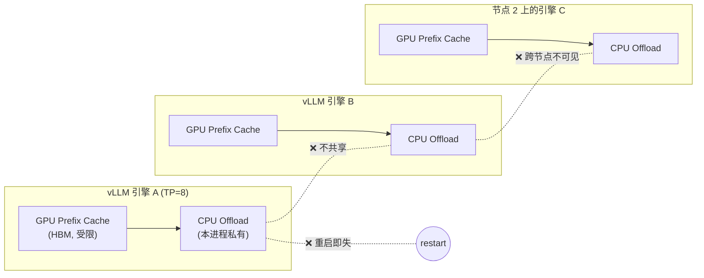

RFC #57187 列出的痛点，以及 UMBP 对应的解法：

| 痛点 | UMBP 的解法 |
|---|---|
| 每个 TP/DP rank、每个实例各存一份，DRAM 被重复占用 | 节点级共享池（standalone / distributed），**TP 下字节相同的副本只存一份**（replication-aware identity） |
| 只看得到本 rank 的 cache，无法跨引擎/跨节点复用 | master 维护全局索引（`GlobalBlockIndex`），节点间用 RDMA 拉取 |
| 引擎重启或滚动升级会丢 cache | 池放在引擎进程外（standalone server / 其他节点），生命周期和引擎解耦 |
| 搬运要经过 host 中转 | 一次性注册 vLLM 的 GPU KV buffer，之后 UMBP/MORI-IO 直接 GPU↔store（RDMA / hipMemcpy / GDS） |
| 加载阻塞 forward | layer-wise 加载：第 i 层计算的同时加载后面的层 |
| 容量只有 DRAM | DRAM → SSD（→ 未来的对象存储）分层，统一命名空间 |
| 调度器不知道 cache 在哪 | External KV 索引 + 命中计数，供 cache-aware router 使用 |

### 1.3 两条 PD 分离路径（RFC 讨论区）

RFC 评论区（@tjtanaa 与 AMD 团队）认为 UMBP 同时覆盖两类需求：

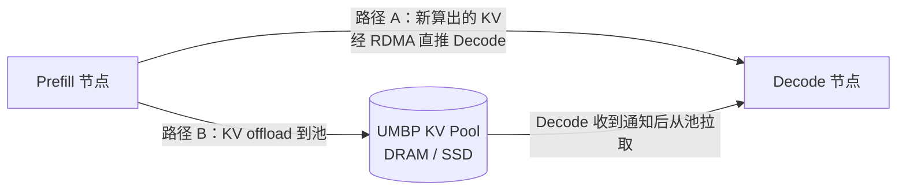

在 MI355X 这类多 NIC 机器上，两条路径可以走不同的网卡、异步并行。这也是 RFC 选择新写一个 `UMBPStoreConnector`，而不是在已有的 `MoRIIOConnector`（专注 P2P PD 传输）上扩展的原因之一。

---

## 2. UMBP 是什么

### 2.1 在 MORI 中的位置

MORI（Modular RDMA Interface）是 AMD 的 GPU 通信库，包含 MORI-EP（专家并行 dispatch/combine）、MORI-IO（点对点 RDMA 传输引擎）、MORI-SHMEM、CCO 等模块。**UMBP 构建在 MORI-IO 之上**，在它上面加了"存储 + 目录 + 分层"的语义。

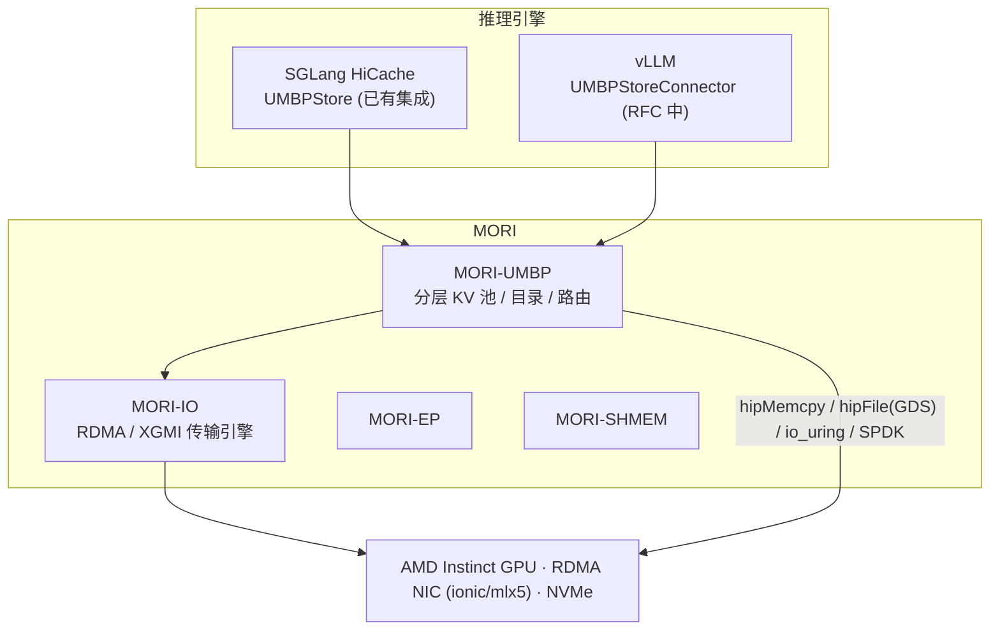

### 2.2 三层架构：控制面 / 存储后端 / 传输层

做完 backend-agnostic 重构（`design-backend-agnostic-refactor.md`）之后，UMBP 的边界很清楚，分成三个组件：

| 组件 | 负责什么 | 是否感知介质 |
|---|---|---|
| **控制面**：master、routing、heartbeat | 谁持有什么、容量、淘汰、放置 | 只通过上报的 tier/capacity 感知 |
| **存储后端** `MediumBackend`：DRAM / HBM / SSD | 字节的归属、key→slot 映射、容量、淘汰 | **是**，也只有这一层感知 |
| **传输层** `TransferEngine` | 在两个描述符（`TransferRef`）之间搬运字节 | 否，描述符自己描述介质 |

设计原则：**backend 只发布描述符，不搬运字节**。这条规则由类型系统保证：backend 的 `Init()` 只拿到 `MemoryRegistrar*`，上面没有 `Submit`。所有字节都通过同一个 planner、同一条路径搬运。

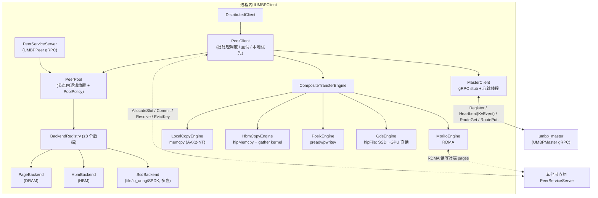

`CompositeTransferEngine` 按 `(src, dst)` 这一对端点选择引擎：

| src → dst | 选用的引擎 |
|---|---|
| host ↔ host（本进程） | `LocalCopyEngine`（memcpy，支持并行和 NT store） |
| 任一端是 GPU（本进程） | `HbmCopyEngine`（hipMemcpy；碎片多时启用 device gather kernel，约 128 KiB 以下更划算） |
| 本地 ↔ 远端 peer 的注册内存 | `MoriIoEngine`（RDMA；按 (localMR, remoteMR) 分组以减少 post/CQE；未注册的 host buffer 走 bounce 池） |
| SSD 文件 ↔ host DRAM | `PosixEngine`（O_DIRECT preadv/pwritev，用于 tier 迁移） |
| SSD 文件 → GPU | `GdsEngine`（AMD hipFile，drive→GPU DMA，不经过 host；运行时 dlopen） |

### 2.3 核心概念

| 概念 | 含义 |
|---|---|
| **key** | 字符串，**不可变**（UMBP keys are immutable）。内容寻址，同一个 key 重复 Put 等于 no-op（first-writer-wins，不比较内容）。 |
| **page** | 后端的分配粒度（`dram_page_size`，分布式默认 2 MiB；embedded 默认 64 KiB）。一个 value 占整数个 page。**做 KV 存储时应该把 page size 设成一个 KV block 的精确字节数**，否则会浪费容量。 |
| **medium / tier** | `TierType {HBM=1, DRAM=2, SSD=3}`。一个 node 可以只服务一种介质（`distributed.medium`），也可以通过 JSON 策略在节点内组合多个后端、做分层。 |
| **node / peer** | 一个 `IUMBPClient` 实例对应一个 node（通常一个 rank 一个，或者一个 standalone server 一个）。它既能当读写的发起方，也能当被读写的 peer。 |
| **master** | 路由顾问。维护 `hash(key) → [Location{node, tier, size}]` 的投影，不持有任何 page 状态。 |
| **slot 生命周期** | `AllocateSlot`（pending，带 TTL）→ 写入字节 → `CommitSlot`（变为 owned，并产生一个 `KvEvent{ADD}`）/ `AbortSlot`。**只有 Commit 才会让 key 对外可见**。 |
| **lease** | 读租约。master 侧（`RouteGet` 成功后约 2s）和 peer 侧（DRAM 500ms / SSD 3s）各有一层，保护正在被读的 key 不被淘汰。 |
| **External KV** | 由引擎自己管理的 L1/L2 块（比如 GPU 上的 prefix cache）。引擎只向 master **上报元数据**，UMBP 不搬这些字节，只用于 cache-aware 路由。 |

### 2.4 对外 API：`IUMBPClient`

`src/umbp/include/umbp/umbp_client.h`。所有接口都是**指针 + 长度**，零拷贝，Python 绑定在 `mori.cpp.UMBPClient`（pybind 时会释放 GIL）。

```text
数据面
  Put / Get / Exists
  BatchPut / BatchGet / BatchExists
  BatchExistsConsecutive(keys) -> 从 0 开始连续命中的个数（前缀匹配专用，遇到第一个 miss 就停）
  BatchPutWithDepth(keys, ..., depths)  -> 带 radix-tree 深度，供淘汰优先级参考
  BatchGetRanges / BatchPutRanges       -> 子对象 ranged I/O（scatter/gather）
  RegisterMemory(ptr, size, loc=CPU|GPU, device, mode) / DeregisterMemory
生命周期
  Clear / Flush / Close
自省
  IsDistributed / GetDeploymentMode / GetBackendMode / SupportsRangedIO
External KV（路由元数据）
  ReportExternalKvBlocks / RevokeExternalKvBlocks / RevokeAllExternalKvBlocksAtTier
  MatchExternalKv(hashes, count_as_hit) / GetExternalKvHitCounts
```

此外还有一个只走控制面的 `UMBPMasterClient`（Python），给 scheduler/router/sidecar 用，不建数据面。

---

## 3. 三种部署模式：Embedded / Standalone / Distributed

### 3.1 关键认知："模式"由配置决定，而不是由类决定

当前代码里只有**两个** `IUMBPClient` 实现：

```cpp
// umbp_client_factory.cpp
std::unique_ptr<IUMBPClient> CreateUMBPClient(const UMBPConfig& config) {
  if (config.standalone_process.has_value())
    return std::make_unique<standalone::StandaloneProcessClient>(config);   // 转发器
  return std::make_unique<DistributedClient>(WithEmbeddedDefaults(config)); // 其余所有情况
}
```

- 原来的"本地后端"`StandaloneClient` 已经**删掉了**。注释原话：*"'Local' is a property of a deployment -- no master address -- not a separate client."*
- **Embedded** = `DistributedClient`，并且 `master_address` 为空。
- **Distributed** = `DistributedClient`，并且 `master_address` 非空。
- **Standalone** = 推理进程里放一个 `StandaloneProcessClient`（只做 RPC 转发），独立的 `umbp_standalone_server` 进程里再跑一个 `DistributedClient`，这个 client 可以连 master，也可以不连。

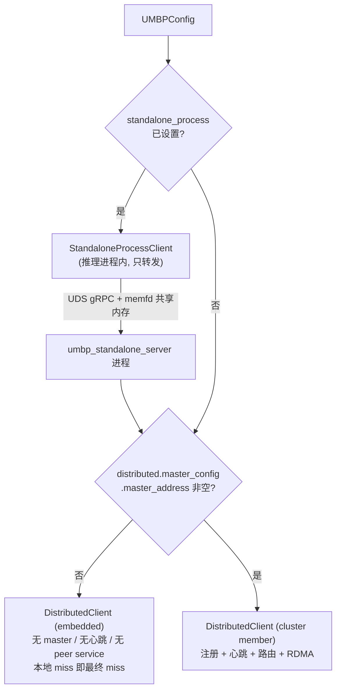

### 3.2 Embedded 模式：进程内私有池

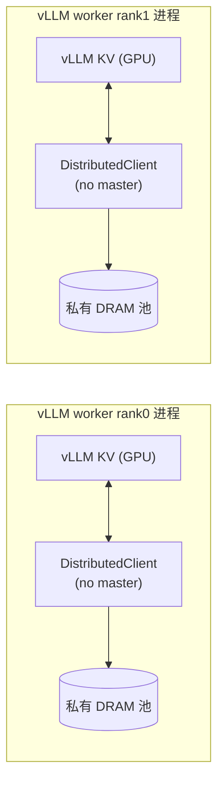

`WithEmbeddedDefaults()` 会自动做这些事：

- 生成 `node_id = embedded-<host>-<pid>-<counter>`，`node_address=127.0.0.1`，`auto_heartbeat=false`；
- **不建 RDMA IO engine，不起 peer gRPC 服务**（`io_engine.host` 清空，`peer_service_port=0`）；
- 只服务 **DRAM** 一种介质（即使 `ssd.enabled=true` 也只打一条 WARN，不会启用 SSD。要用 SSD 得显式设置 `distributed.medium=SSD`，或者给一个 backend policy）；
- `local_first=true`、`cache_remote_fetches=false`、`ranged_scratch_size=0`；
- page size 默认 64 KiB（环境变量 `UMBP_EMBEDDED_DRAM_PAGE_SIZE`），并会自动缩小，保证池里至少有 8 个 page；
- 淘汰在本地按 watermark 做 LRU。

**适合**：单机开发、CI、功能验证，以及 RFC 的第一阶段（"Embedded mode：worker-private, masterless DRAM, local ranged Put/Get, direct GPU registration"）。
**局限**：每个 rank 一份，存在重复存储；rank 之间、实例之间不共享；进程退出 cache 就没了。

### 3.3 Standalone 模式：同机多进程共享一个池

设计参照 Mooncake 的 Real Client / Dummy Client 拆分（`design-standalone-process-mode.md`）。

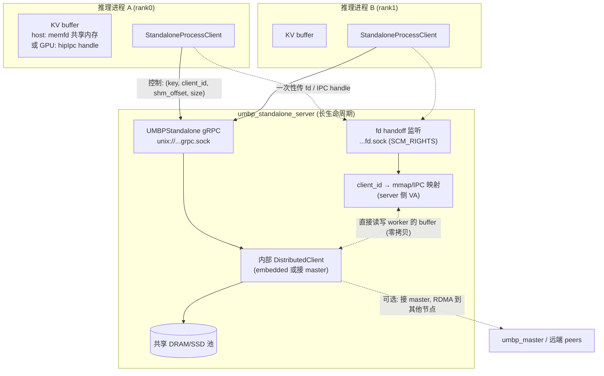

要点：

1. **控制面是 UDS 上的 gRPC**，不用 TCP：不占端口，靠文件权限做访问控制。RPC 接口和 `IUMBPClient` 一一对应，另外加一个 `Ping`（返回 readiness、`deployment_mode`、`supports_ranged_io`）。
2. **数据面走共享内存**：buffer 由 worker 进程用 `memfd_create` 分配（`HostMemAllocator::kAnonymousShm`）；`RegisterMemory` 时通过另一条 raw UDS 用 `SCM_RIGHTS` 把 fd 交给 server；server 自己再 `mmap` 一份。之后每次 RPC 只传 `(client_id, offset, size)`，**KV 字节不经过 gRPC**。也支持 GPU buffer（通过 IPC handle 映射，server 侧按 `loc=GPU` 注册）。
3. **server 的内部 client 可以接 master**（这是"Mooncake parity"形态）：在 server 进程里把自己映射到的 worker buffer 注册成 RDMA MR，远端读的数据就能直接 RDMA 写进 worker 能看到的物理页，worker 进程本身完全不接触 IB verbs。
4. **去重是天然的**：所有 worker 写的都是同一个池，同一个 key 只存一份。TP 下字节完全相同的副本（例如 MLA）可以共享一个对象。
5. **生命周期**：默认由外部启动、常驻（推荐做法）。只有 masterless 的情况下才允许 `auto_start`（由 local rank0 fork+exec）。masterless 时 server 会在 `:9092` 暴露 `/metrics`。
6. **已知限制**：server 挂掉，所有 worker 的 cache 同时失效，目前没有重连或 rehydrate 机制，worker 应该把这种情况当作 miss 处理；没有 per-tenant 配额；worker 崩溃后它的映射和 external-KV 身份不会被回收；`tcp_staging`（不走 UDS 的传输方式）还没实现。

**适合**：单机 8 卡、TP=8 或多个 DP 实例；希望 cache 的生命周期独立于引擎（重启或滚动升级时保留）；希望避免重复存储。

### 3.4 Distributed 模式：master 协调的跨节点池

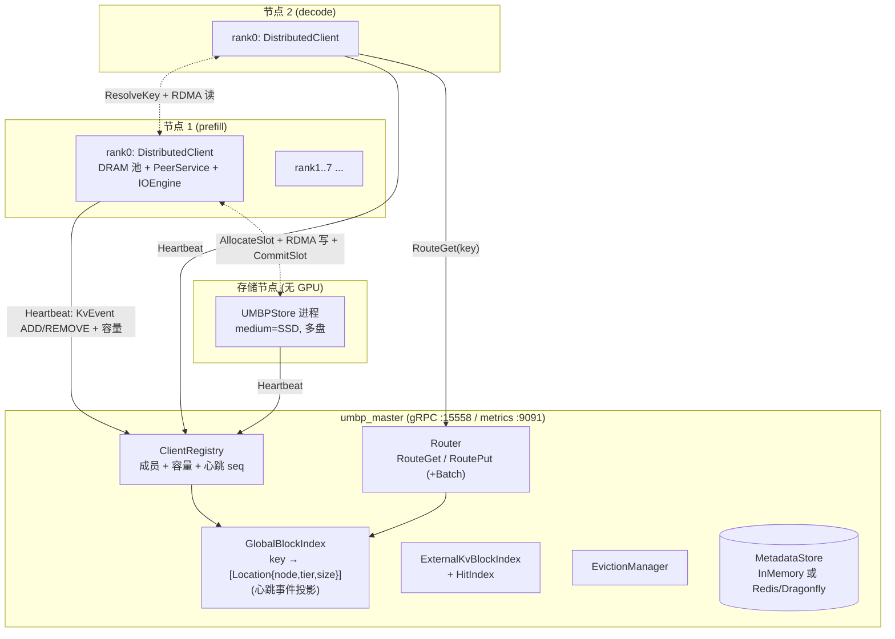

**"master 只当顾问"的设计原则**（`design-master-control-plane.md` §1）：

1. **master 不保存任何 per-Put / per-page 状态**。`RoutePut` 只给建议，真正的容量预留是写方去目标 peer 调 `AllocateSlot`。
2. **peer 是权威**。每个 page 归 peer 的后端所有；master 的索引只是投影，和实际不一致时以 peer 为准。
3. **心跳是唯一的更新通道**。`KvEvent{ADD/REMOVE}` 按 seq 打包发送；发现 seq 有缺口就触发 full-sync。
4. **淘汰**：从 #741 开始默认 `UMBP_EVICTION_MODE=local`，即节点按自己的 watermark 做 LRU，master 不介入。也可以选 `master_ranked`（由 master 给出淘汰候选）或 `master`（老行为，master 下发 `EvictKey`）。
5. **代价**：读到自己刚写的数据（read-after-write）在**远端节点**上最多要等一个心跳周期（默认约 5s）。可以通过 auto-flush（outbox 积累到 128 个事件就提前 flush）或显式 `Flush()` 缩短。持有 key 的节点自己（`local_first`）在 commit 之后马上就能看到。

与"强一致 master"（类似 HDFS NameNode / Raft）的取舍：

| 维度 | Master-as-Advisor（UMBP） | 强一致 Master |
|---|---|---|
| 热路径 | 不需要 master round trip 就能 RDMA；Put 只是建议 + peer 分配 | 每次修改都要一次 master 提交 |
| 吞吐上限 | 所有 peer 带宽之和 | master 的提交速率 |
| 写后可见 | 有一个心跳周期的延迟 | 线性一致 |
| 容量视图 | 可能过期，ENOSPC 时用 `exclude_nodes` 重试 | 精确 |
| master 宕机 | 软失败，热路径降级但还能工作 | 硬失败 |
| 适合 | **吞吐优先、能容忍 miss 的 cache**（KV cache 正是这一类） | 强一致的元数据 |

master 的 HA：`IMasterMetadataStore` 可以换成 **Redis / Dragonfly / Valkey**（RESP + Lua），这样 master 本身就是无状态的，可以起多个副本，持久化和故障切换交给存储层（`design-redis-metadata-store.md`）。

### 3.5 三种模式对比

| 维度 | Embedded | Standalone | Distributed |
|---|---|---|---|
| 推理进程里的 client | `DistributedClient`（无 master） | `StandaloneProcessClient`（转发器） | `DistributedClient`（有 master） |
| 池在哪里 | 推理进程内，每个 rank 私有 | 本机独立 server 进程，本机共享 | 每个节点（或每个 rank）各有一片，全集群组成一个池 |
| 需要 master | 否 | 可选（server 内部决定） | 是 |
| 共享范围 | 单进程 | 单机多进程 / 多实例 | 跨节点 |
| 数据面 | 本地 memcpy / hipMemcpy | 共享内存（memfd / GPU IPC），可选 RDMA 到远端 | RDMA（MORI-IO）+ 本地拷贝 |
| 控制面 | 无 | UDS gRPC | master gRPC + peer gRPC + 心跳 |
| 引擎重启后 cache 是否保留 | 否 | **是**（server 还活着就保留） | **是**（只要其他节点还在） |
| TP 副本去重 | 否（每个进程一份） | 是（同一个池） | 是（master `BatchRoutePut` 的 `already_exists` 加上 peer 侧去重） |
| SSD | 需要显式配置 medium 或 policy | 由 server 配置 | 可以按节点选择，或用 policy |
| 运维复杂度 | 最低 | 中（多一个 sidecar 进程） | 高（master、端口、RDMA、hugepages） |
| 典型用途 | 开发/CI、RFC 第一阶段 | 单机 8 卡共享、缓存跨重启保留 | 多节点 PD 分离、集群级 prefix 复用、存储节点扩容 |
| RFC 中的顺序 | PR2 | PR3 | PR4 |

> 一句话记住：**embedded 和 distributed 是"同一个类，有没有 master 地址"的区别；standalone 是在任何一种外面再套一层"进程边界 + 共享内存"。**

---

## 4. 核心数据流

### 4.1 Distributed 模式下的 Put

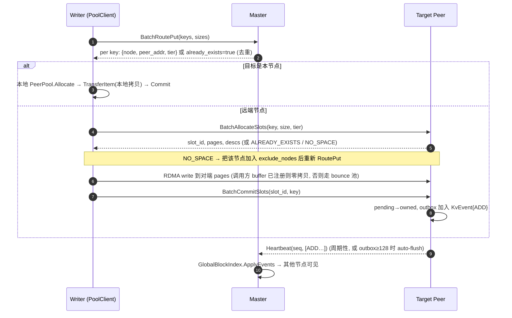

### 4.2 Distributed 模式下的 Get（local_first）

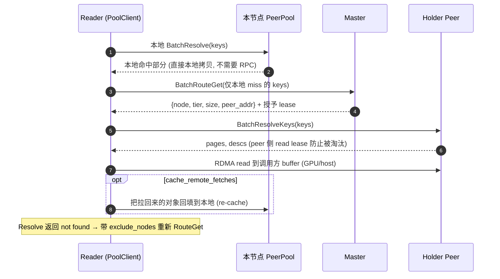

### 4.3 节点内分层：offload / promote（JSON backend policy）

`examples/umbp/multi_backend_policy.json`：

```json
{
  "entry_tier": "hot",
  "backends": {
    "hbm":   {"type": "hbm",  "capacity": "80GiB",  "devices": [0, 1]},
    "dram":  {"type": "dram", "capacity": "512GiB", "numa_node": 0},
    "ssd_a": {"type": "ssd",  "capacity": "1TiB",   "path": "/mnt/kvcache/hot"},
    "ssd_b": {"type": "ssd",  "capacity": "3TiB",   "path": "/mnt/kvcache/cold"}
  },
  "tiers": [
    {"name": "hot",  "backends": {"hbm": 100}, "offload_to": ["warm"], "offload_trigger": "on_evict"},
    {"name": "warm", "backends": {"dram": 70, "ssd_a": 30}, "offload_to": ["cold"],
     "offload_trigger": "watermark", "high_watermark": 0.9, "low_watermark": 0.7},
    {"name": "cold", "backends": {"ssd_b": 100}, "promote_trigger": "on_read", "promote_mode": "copy"}
  ]
}
```

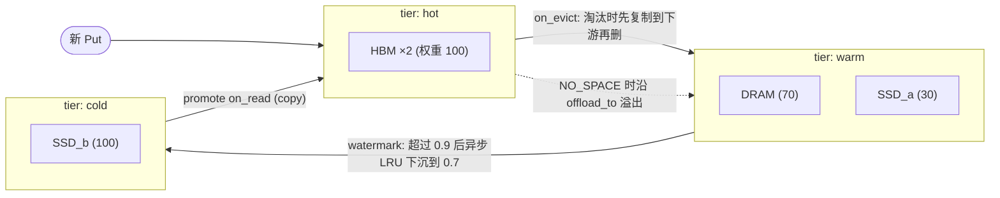

规则：tier 拓扑必须是无环的（offload 只能指向更靠后的 tier）；每个 peer 最多 8 个具体后端；`promote_trigger` 可以是 `never` / `on_read` / `on_hits(N≥2)`；`promote_mode` 可以是 `copy` / `move`。

> 没有 policy 时，一个节点**只服务一种介质**（`distributed.medium`），集群的异构性来自"不同节点选了不同介质"。这是刻意的设计：routing plane 不排 tier 的先后，所以如果一个节点同时注册两种介质，效果是"按空闲容量镜像"，而不是分层。

### 4.4 SSD 后端怎么让 RDMA 读到磁盘上的数据

SSD 上的字节没法直接被 RDMA 访问，所以 `SsdBackend` 有两条路：

- **原地访问**：发布一个 File `TransferRef`，由 `PosixEngine`（file↔DRAM，用于 tier 迁移）或 `GdsEngine`（file→GPU，用于 prefill 加载）来搬。
- **经 staging arena**：staging arena 是一块注册过的 host DRAM。Resolve 时先把对象读进 staging page 并加读租约，再把这个 page 发布出去；远端 peer 拿到的是普通的 RDMA 内存。

后果：**SSD 上的 ranged get 目前还是会把整个对象从盘上读出来**（D1 extent-scoped staging 还没落地），只是最后一次拷贝变小了。staging slot 的大小必须 ≥ 单个 value 的大小，否则就会读失败、回退到重算。

### 4.5 External KV 与 cache-aware 路由

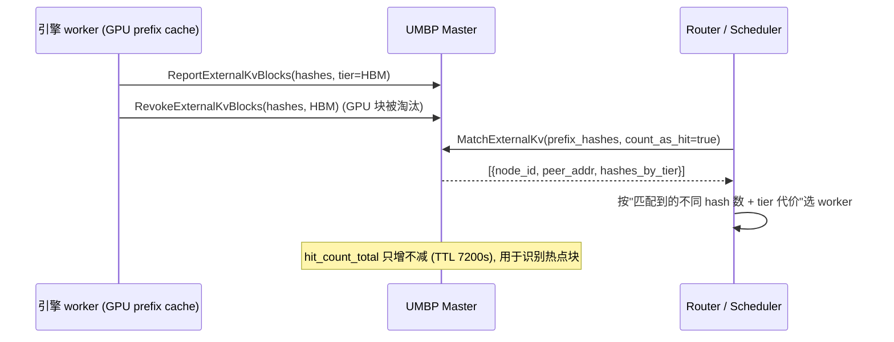

这个索引和 `GlobalBlockIndex` **完全独立**：它不搬字节，`RouteGet` 不会查它。它服务的是"把请求路由到已经持有 prefix 的 worker"这个需求，也就是 RFC 路线图第 6 步 "Cache-aware routing"。

---

## 5. Feature 全景

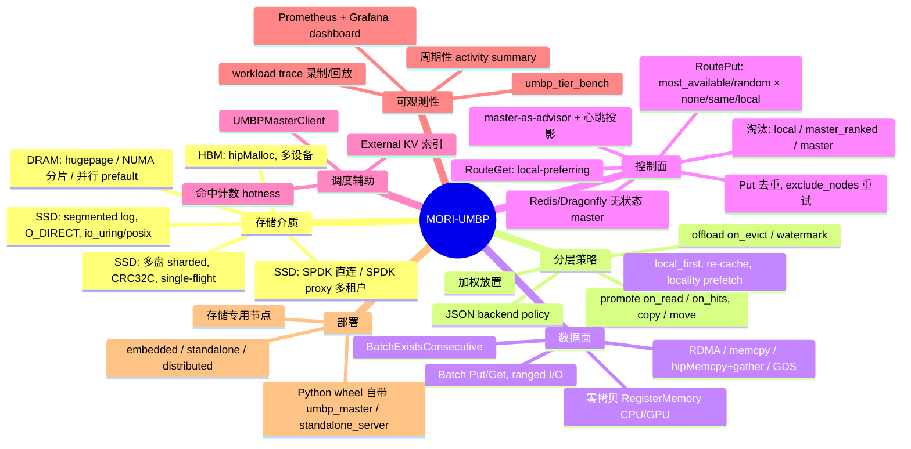

### 5.1 Feature 明细表

| 类别 | Feature | 说明 / 关键配置 | 对 vLLM 集成的意义 |
|---|---|---|---|
| 介质 | DRAM 池 | `dram.capacity_bytes`；hugepages（`UMBP_DRAM_USE_HUGEPAGES`）；NUMA 分片（`UMBP_DRAM_NUMA_NODE=0,1`，写入时优先 GPU 本地的 NUMA buffer）；多线程并行 prefault | KV DRAM 层 |
| 介质 | HBM 池 | `distributed.medium=HBM` + `hbm.{device,capacity_bytes}`，或在 policy 里声明 | RFC 中提到的 "optional UMBP-owned HBM" |
| 介质 | SSD | segmented log + O_DIRECT（默认开）；io_uring；`ssd_backend=file/spdk/spdk_proxy`；多盘（逗号分隔目录）；可关 CRC；single-flight 合并同 key 并发读（MLA+TP 场景） | RFC PR5 "SSD tier support" |
| 分层 | JSON policy | 见 §4.3；`backend_policy_path` / `UMBP_BACKEND_POLICY` | 节点内 DRAM→SSD 自动下沉 |
| 数据面 | 零拷贝注册 | `RegisterMemory(ptr,size,loc,device)`。GPU 指针也会自动探测（`DetectPointerLocation`）；GPU 端点无法零拷贝时直接拒绝，**不会**悄悄经 host 中转 | RFC 中的 "Direct GPU registration" |
| 数据面 | Ranged I/O | `BatchGetRanges/BatchPutRanges`：一个对象可以由多个不连续 buffer 拼成（put 必须完整覆盖整个对象，get 可以只取子集）。**默认关闭**，远端需要 `ranged_scratch_size>0`，并且应读取 `supports_ranged_io()` 确认 | RFC 中的 "Grouped ranged I/O"：一个 block 的 K/V × 各层是不连续的地址，可以合成一个对象 |
| 数据面 | 前缀查询 | `BatchExistsConsecutive`：遇到第一个 miss 就停 | 对应 vLLM `get_num_new_matched_tokens` |
| 数据面 | 深度感知 Put | `BatchPutWithDepth`：radix-tree 深度作为淘汰优先级 | 越靠后的块越先淘汰 |
| 数据面 | local_first | 先在本地 resolve，只有 miss 的部分才去问 master | 单机部署时完全没有 RPC |
| 数据面 | 远端回填 | `cache_remote_fetches` + admission（SIZE/NEVER/ALWAYS，默认 ≤16MB）；`ranged_locality_prefetch` | 第二次访问变成本地命中 |
| 控制面 | 放置策略 | `UMBP_ROUTE_PUT_SELECT_ALGO=most_available/random`（纯 SSD 场景强烈建议用 random）；`UMBP_ROUTE_PUT_NODE_AFFINITY=none/same/local` | 影响写带宽能否均匀分摊 |
| 控制面 | Put 去重 | master `BatchRoutePut` 返回 `already_exists`，peer `AllocateSlot` 再兜底一层 | DP-attention / TP 副本不会重复上传 |
| 控制面 | 淘汰 | `UMBP_EVICTION_MODE=local(默认)/master_ranked/master`；读租约保护 | — |
| 控制面 | 无状态 master | Redis / Dragonfly / Valkey 后端 | 生产环境 HA |
| 调度 | External KV + 命中计数 | 见 §4.5 | RFC PR6 "Cache-aware routing" |
| 观测 | Prometheus | master 在 `:9091` 汇总所有节点的指标；masterless 的 standalone server 在 `:9092`；backend/transfer 指标按组件自动打标签；Grafana dashboard 在 `examples/monitoring/` | RFC 测试计划中的性能指标 |
| 观测 | activity summary | 每 60s 打一行 INFO（offload/load/evict/promote/demote/resident） | 没有 Prometheus 时也能排查 |
| 工具 | workload trace / `umbp_tier_bench` | 录制线上 PUT/GET（`UMBP_WORKLOAD_TRACE_PATH`），离线回放，比较不同 policy | 调参用 |

### 5.2 当前支持矩阵（基于代码与 `design-ssd-ranged-io.md` §11）

| Client | 后端 | GPU buffer | Ranged I/O |
|---|---|---|---|
| `DistributedClient`（embedded 或 distributed） | — | 所有介质都支持 | opt-in（需要 scratch arena）；SSD 上 get 仍然整对象读盘 |
| `StandaloneProcessClient` | server 内部是 `DistributedClient` | 支持（GPU IPC） | 继承 server 的能力，通过 `Ping` 告知 client |

---

## 6. 与 Mooncake / LMCache 的对比

### 6.1 三者的定位

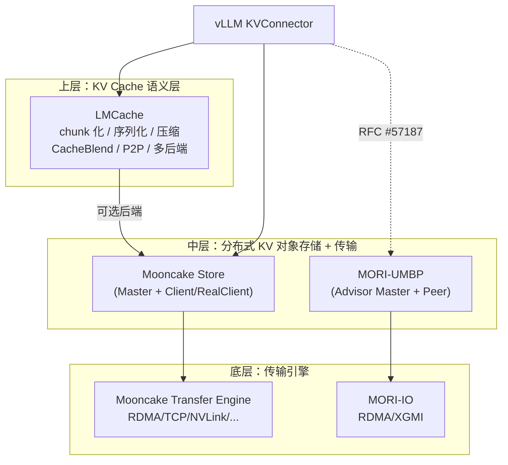

- **LMCache** 是"KV Cache 中间件"，主要用 Python 写，理解 token/chunk，存储后端可插拔。
- **Mooncake** 由两部分组成：Transfer Engine（P2P 传输）和 Mooncake Store（分布式 KV 对象存储）。
- **UMBP** 在形态上和 Mooncake Store 最接近（都是 master + client 的分布式 KV 对象存储），但在 AMD 栈上做了不同的取舍。

### 6.2 详细对比

| 维度 | MORI-UMBP | Mooncake Store | LMCache |
|---|---|---|---|
| 所属 / 实现 | AMD ROCm/mori，C++（pybind） | Moonshot/KVCache-AI，C++（pybind） | LMCache 社区，Python 为主 + CUDA kernel |
| 抽象层次 | 存储 + 目录 + 传输引擎，**不懂 token** | 存储 + 传输引擎，**不懂 token** | KV Cache 层，懂 token/chunk/layer |
| 元数据中心 | **顾问式 master**：只保存心跳事件的投影；**分配器在 peer 上**；热路径上 master 只给路由建议 | master 负责对象元数据和空间分配（Put 要经过 master 的 PutStart/PutEnd） | 本地 hot cache + 可选的 controller/lookup server |
| 写入流程 | RoutePut（建议）→ peer AllocateSlot → RDMA → peer Commit → 心跳发布 | master 分配 replica 位置 → 写 → master 确认 | 存储时序列化，再写入后端 |
| 一致性 / 可见性 | 远端最终一致（约一个心跳周期）；本地立即可见 | Put 完成即可见（以 master 为准） | 取决于后端 |
| master HA | 可换成 Redis/Dragonfly 实现无状态 master；master 短时宕机时热路径还能继续 | 支持基于 etcd 的 HA | — |
| 节点内分层 | **JSON policy**：HBM/DRAM/SSD 加权、offload/promote 规则 | 内存 segment + SSD 卸载 | 本地 CPU、本地磁盘、远端后端组成的多级 |
| SSD | segmented log、O_DIRECT、io_uring、**SPDK / SPDK proxy**、多盘、**hipFile GDS 直读到 GPU** | 支持文件存储卸载 | 本地磁盘、GDS 后端等 |
| GPU 支持 | 原生 AMD：HBM 作为介质、GPU buffer 零拷贝、GPU IPC、gather kernel | 以 NVIDIA 生态为主（部分路径支持 ROCm） | CUDA kernel 为主 |
| 同机多进程共享 | standalone server（UDS gRPC + memfd/GPU IPC），**设计时参照了 Mooncake** | RealClient / DummyClient（coro_rpc + shm） | LMCache MP 模式（独立进程，ZMQ + CUDA IPC） |
| 副本 / 去重 | 内容寻址去重；Put 前 master 判断 `already_exists`；没有可配置的副本数 | 支持配置副本数（replica_num）、soft pin | 由后端决定 |
| 路由辅助 | **External KV 索引 + 命中计数**（服务于 cache-aware router） | 没有类似的内置机制 | 有 lookup / controller 相关能力 |
| 上层高级功能 | 没有（交给 connector） | 没有 | CacheBlend、压缩（CacheGen）、layer-wise 流水线等 |
| vLLM 现有集成 | 无（RFC 进行中）；SGLang HiCache 已经集成 | `MooncakeConnector`（P2P PD）+ `MooncakeStoreConnector`（store） | `LMCacheConnectorV1`、`LMCacheMPConnector` |

> 关于 Mooncake / LMCache 的描述来自公开资料的通用认知，以及 mori 设计文档里的对比段落（`design-standalone-process-mode.md` §1 / §4 / §6.2）。如果需要精确到某个版本的行为，请再查阅对应仓库确认。

### 6.3 一句话差异

- **UMBP vs Mooncake**：同一类东西。UMBP 把 master 简化成顾问、把分配权下放到 peer，用一致性换取热路径吞吐和 master 宕机时的韧性；节点内分层用声明式 JSON 描述；整套实现原生面向 AMD GPU 和 RDMA（ionic/mlx5），并内置 External KV 路由索引。vLLM 侧的 `MooncakeStoreConnector` 是 UMBP connector 最直接的参照模板。
- **UMBP vs LMCache**：不在同一层。LMCache 解决的是"KV 怎么切块、怎么序列化、怎么跟 vLLM 的生命周期对齐"，UMBP 解决的是"字节放在哪、怎么搬、谁持有"。因此 vLLM 集成 UMBP 时，**chunk/key 规划、layout 抽取、TP 身份、prefix 匹配这些事情要由 connector 自己做**（RFC 里的 "identity planning"），不能像用 LMCache 那样直接拿来。

---

## 7. 站在 vLLM 集成的角度看 UMBP

### 7.1 vLLM 侧现有的同类 connector

`vllm/distributed/kv_transfer/kv_connector/v1/`：

| Connector | 定位 | 和 UMBP 的关系 |
|---|---|---|
| `offloading_connector.py` + `offloading/` | 单引擎 CPU offload（`OffloadingSpec` 抽象） | RFC 讨论后认为 KVConnector 比 CPU offloading 抽象更合适 |
| `mooncake/mooncake_connector.py` | Mooncake Transfer Engine 的 P2P PD 传输 | — |
| `mooncake/store/*`（约 5.4k 行） | **MooncakeStoreConnector**：`connector.py` / `scheduler.py` / `worker.py` / `data.py`（`StoreLayout`、`RankLocalStoreLayout`、`TPShardedStoreLayout`、`PoolKey`）/ `metrics.py` | **RFC 明确表示沿用它的 scheduler/worker 组织方式** |
| `moriio/*` | MoRIIOConnector：基于 MORI-IO 的 PD 分离 | 同属 MORI 家族，但只做传输，没有池化 |
| `lmcache_connector.py` / `lmcache_mp_connector.py` | LMCache | 竞品 / 参照 |
| `multi_connector.py` | 组合多个 connector | 可以和 P2P PD connector 组合使用 |

### 7.2 RFC 提议的结构

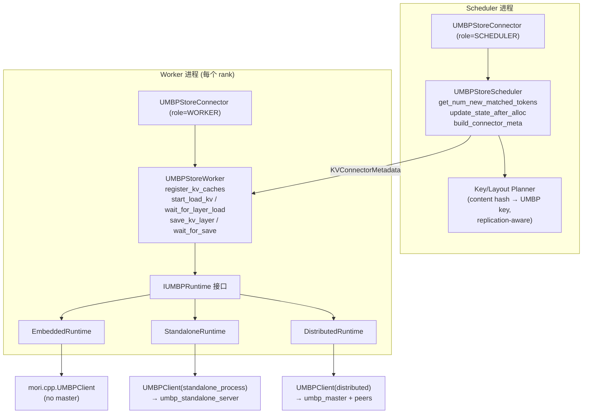

`IUMBPRuntime` 接口（RFC）：lookup、direct GPU-buffer registration、grouped load、per-layer wait、batched store、publication、shutdown。它**只处理 UMBP key 和 transfer plan，不接触 vLLM 的 request 对象**。

### 7.3 vLLM 概念与 UMBP 原语的映射

| vLLM 侧 | UMBP 原语 | 注意事项 |
|---|---|---|
| 匹配 prefix 命中（`get_num_new_matched_tokens`） | `BatchExistsConsecutive(keys)` | distributed 模式下远端写入的 key 最多晚约 5s 才可见，可能导致 miss（这是安全的，只会多重算） |
| `register_kv_caches(kv_caches)` | `RegisterMemory(ptr, size, GPU, device)` 一次性注册 | GPU 无法零拷贝的路径会被拒绝，**一定要检查返回值** |
| 一个 block 在各层的 K/V（不连续地址） | `BatchPutRanges`（拼成一个对象）/ `BatchGetRanges` | 需要开启 `ranged_scratch_size`，并检查 `supports_ranged_io()` |
| 按层加载（layer-wise） | 按层分组的 `BatchGetRanges` + 每层 wait | UMBP 目前是同步 batch API，异步和逐层 wait 需要 runtime 在线程或流里自己封装 |
| 保存（offload） | `BatchPut`/`BatchPutRanges`，可选 `WithDepth` | Put 是幂等的（first-writer-wins），重复保存很便宜 |
| block hash → key | 字符串 key，内容寻址 | **key 必须包含**模型/revision/dtype/block_size/layout/TP-PP 拓扑/layout 版本（RFC 中的 "object reusability"），否则会读到不兼容的字节 |
| TP 分片 vs 副本 | key 里是否带 rank 后缀 | MLA 等字节完全相同的副本共用一个 key（在共享池中去重，并且可以利用 SSD single-flight）；分片数据的 key 必须带分片 id |
| block size | `dram_page_size` / `page_size` | **设成一个对象的精确字节数**，否则会浪费 page；所有 peer 必须一致 |
| 前缀 cache 事件 | `ReportExternalKvBlocks` | 可选，用于 cache-aware 路由（RFC PR6） |

### 7.4 RFC 路线图

```mermaid
gantt
    dateFormat X
    axisFormat %s
    section 公共核心
    PR1 共享 core（角色分发, metadata, key/layout 规划, IUMBPRuntime, 校验, UT） :a1, 0, 2
    section 模式
    PR2 Embedded（私有 DRAM, ranged, GPU 注册） :a2, after a1, 1
    PR3 Standalone（node-local 服务, 多引擎共享, IPC） :a3, after a2, 1
    PR4 Distributed（master 路由, peer slot, MORI-IO RDMA, 心跳发布） :a4, after a3, 2
    section 增强
    PR5 SSD tier（file/io_uring, SPDK） :a5, after a4, 1
    PR6 Cache-aware routing（placement 事件, 调度可见指标） :a6, after a5, 1
    PR7 Layer-wise（逐层 submit/wait, 批量 offload, 传输重叠） :a7, after a6, 1
```

初始兼容范围：V1，decoder-only，PP=1，先做 TP=1 再做 TP≥2，只处理满的、hash 对齐的 block，支持 producer/consumer/both 三种角色，介质先用 DRAM（embedded 和 standalone）。MLA、hybrid、异构 KV group、PP>1、对象存储放在后续。

---

## 8. 风险、坑与开放问题

| # | 问题 | 来源 | 对集成的影响 / 建议 |
|---|---|---|---|
| 1 | **写后可见有延迟**：远端节点要等心跳（默认约 5s，outbox 到 128 个事件会 auto-flush） | master-as-advisor 设计 | PD 路径 B（经池中转）需要显式 `Flush()`，或者设计一个通知机制；在 decode 侧做 lookup 时要能容忍 miss |
| 2 | **Ranged I/O 默认关闭** | `ranged_scratch_size=0` | runtime 初始化时要设置它，并检查 `supports_ranged_io()`，否则回退到整对象 I/O |
| 3 | **SSD ranged get 没有节省读盘量** | D1 还没落地 | 在 SSD 上做 layer-wise 读的收益有限，要按"读出比例"做基准测试 |
| 4 | **page size 和对象大小不匹配会浪费容量** | 分页分配器 | key 粒度要和 page size 一起设计（一个 vLLM block 的所有层拼成一个对象，还是按层分别存？） |
| 5 | **standalone server 崩溃** → 所有 worker 的 cache 一起失效，没有重连机制 | §8 已知限制 | runtime 要把 RPC 失败当作 miss，不能让引擎 crash |
| 6 | **master 不会及时清理死掉的 client**（pure-ssd 文档的排障表） | ClientRegistry | 拓扑变化时要重启 master 和所有 worker；运维文档里要写清楚 |
| 7 | **GPU 端点不能零拷贝时会被拒绝**（不会悄悄经 host 中转） | tree-connector-port §4.2 | 好处是不会静默变慢；但未注册的 GPU 指针在远端路径上会失败 |
| 8 | 同步 batch API 和 vLLM 异步/逐层流水线的衔接 | — | 需要后台线程池或 CUDA/HIP stream 编排；参考 MooncakeStoreConnector 的 worker 实现 |
| 9 | **设计文档部分过时**（`StandaloneClient` 等） | 文档滞后 | 以 `umbp_client.h` / `umbp_client_factory.cpp` / `config.h` 为准 |
| 10 | 一个节点默认只服务一种介质；DRAM+SSD 分层需要 JSON policy | 设计取舍 | embedded 模式下配置的 SSD 不会生效（只有 WARN） |
| 11 | 通用 `StorageBackendConnector` 抽象（RFC 讨论） | RFC 开放议题 | 不阻塞 UMBP 交付；UMBP 和 Mooncake 在 key 长度限制、分配归属、scatter/gather、副本语义、发布机制、错误处理上差别很大 |
| 12 | 安全：UDS 和 memfd 需要设置 `0600` 权限 | standalone 设计 §8.4 | 多租户机器上需要注意 |

---

## 9. 附录

### 9.1 术语表

| 术语 | 解释 |
|---|---|
| HiCache | SGLang 的分层 KV cache（L1 GPU / L2 host / L3 storage）。UMBP 已经作为它的 L3 后端（`UMBPStore`）接入 |
| PoolClient | 节点侧的总协调者：master client、PeerPool、PeerService、TransferEngine |
| PeerPool / PoolPolicy | 节点内的逻辑放置层，负责加权放置和 offload/promote |
| MediumBackend | 存储介质接口（`PageBackend`/`HbmBackend`/`SsdBackend`/`MockBackend`） |
| TransferRef | 与介质无关的端点描述（host 指针、`mori::io::MemoryDesc`、文件句柄等合在一起的句柄） |
| KvEvent | 心跳中携带的 `{ADD/REMOVE, key, tier, size}` |
| GlobalBlockIndex | master 上 key → locations 的投影 |
| exclude_nodes | 重试时要排除的节点集合（遇到 ENOSPC 或 not found 后加入） |
| local_first | 先查本节点，再问 master |
| re-cache | 把远端拉回来的对象回填到本节点 |

### 9.2 关键源码 / 文档索引（mori）

| 路径 | 内容 |
|---|---|
| `src/umbp/include/umbp/umbp_client.h` | `IUMBPClient` 接口、部署模式枚举 |
| `src/umbp/umbp_client_factory.cpp` | 工厂函数和 embedded 默认值（**理解三种模式最好的入口**） |
| `src/umbp/include/umbp/common/config.h` | `UMBPConfig` 全部配置项 |
| `src/umbp/distributed/pool_client.cpp`（约 5.5k 行） | 数据面核心逻辑 |
| `src/umbp/distributed/pool/peer_pool.cpp`、`policy_config.cpp`、`tier_graph.cpp` | 节点内分层 |
| `src/umbp/include/umbp/distributed/peer/backend/*.h` | 存储后端 |
| `src/umbp/include/umbp/distributed/transfer/*.h` | 传输引擎 |
| `src/umbp/distributed/master/*` | master、路由、淘汰、metadata store（含 Redis） |
| `src/umbp/standalone/*`、`distributed/proto/umbp_standalone.proto` | standalone server/client |
| `src/pybind/pybind_umbp.cpp` | Python 绑定 |
| `src/umbp/doc/design-*.md` | 设计文档（注意有过时的部分） |
| `docs/MORI-UMBP-PD-BENCHMARK.md` | SGLang xP1D PD 部署步骤（可以当作 distributed 部署的模板） |
| `docs/api/umbp.rst` | `UMBPMasterClient` 与 External KV / 命中计数 API |
| `examples/umbp/multi_backend_policy.json` | 分层 policy 示例 |

### 9.3 常用环境变量速查

| 变量 | 默认值 | 读取方 | 作用 |
|---|---|---|---|
| `UMBP_MASTER_ADDRESS` | 空 | worker | 设置后成为集群成员；不设置就是 embedded |
| `UMBP_NODE_ADDRESS` / `UMBP_IO_ENGINE_HOST/PORT` / `UMBP_PEER_SERVICE_PORT` | — | worker | 有 master 时必须设置 |
| `UMBP_STANDALONE_ADDRESS` | 空 | worker | 设置后进入 standalone 模式（UDS 地址） |
| `UMBP_DRAM_CAPACITY` | 4 GiB | 池所在的进程 | DRAM 容量 |
| `UMBP_DISTRIBUTED_MEDIUM` | DRAM | standalone server | 选择单一介质 |
| `UMBP_BACKEND_POLICY` | 空 | standalone server | JSON 分层策略 |
| `UMBP_DISTRIBUTED_RANGED_SCRATCH_BYTES` | 0 | standalone server | 开启 ranged I/O |
| `UMBP_EVICTION_MODE` | local | worker | local / master_ranked / master |
| `UMBP_ROUTE_PUT_SELECT_ALGO` | most_available | **master** | 纯 SSD 场景建议用 random |
| `UMBP_HEARTBEAT_TTL_SEC` | 10 | master | 心跳间隔 = TTL / 2 |
| `UMBP_AUTO_FLUSH_EVENT_THRESHOLD` | 128 | worker | outbox 积累到这个数就提前发布 |
| `UMBP_DRAM_NUMA_NODE` | 空 | 池所在的进程 | NUMA 分片 |
| `UMBP_SSD_DIR` / `UMBP_SSD_CAPACITY` | /tmp/umbp_ssd / 32 GiB | 池所在的进程 | 多盘用逗号分隔，容量是总和 |
| `MORI_UMBP_LOG_LEVEL=DEBUG` | — | 全部 | 调试日志 |

### 9.4 参考资料

- RFC：[vllm-project/vllm#57187 — Scheduler-Aware Multi-Tier KV Caching for vLLM with MORI-UMBP](https://github.com/vllm-project/vllm/issues/57187)
- MORI 仓库：[ROCm/mori](https://github.com/ROCm/mori)（本地 `/home/shashen/vllm/mori`）
- AMD 博客（MORI README 中引用）：[Rebuilding Agentic AI for AMD GPU](https://www.amd.com/en/developer/resources/technical-articles/2026/rebuilding-agentic-ai-for-amd-gpu.html)（本次抓取超时，内容未纳入）
- vLLM `MooncakeStoreConnector`：`vllm/distributed/kv_transfer/kv_connector/v1/mooncake/store/`
- Mooncake：[kvcache-ai/Mooncake](https://github.com/kvcache-ai/Mooncake)
- LMCache：[LMCache/LMCache](https://github.com/LMCache/LMCache)
- hipFile（GDS）：[ROCm/hipFile](https://github.com/ROCm/hipFile)

---

## 10. 存储介质基础：HBM / DRAM / SSD / NVMe

> 本节回答"HBM/DRAM/SSD/NVMe 分别是什么、有何异同"。数字均为**数量级参考**（不同代际/型号差异很大），用于建立直觉，不作为 benchmark 依据。

### 10.1 先厘清：这四个词不在同一个维度上

| 名词 | 它是什么 | 类别 |
|---|---|---|
| **DRAM** | Dynamic RAM，动态随机存储器：用电容存 bit，需要周期性刷新，**断电即失** | 一种**存储芯片技术** |
| **HBM** | High Bandwidth Memory：把多层 DRAM die **垂直堆叠**（TSV 穿孔互连），通过硅中介层（interposer）和 GPU 封装在一起，接口超宽（每 stack 1024 bit+） | DRAM 的一种**封装/接口形态** |
| **SSD** | Solid State Drive，固态硬盘：用 **NAND Flash** 存数据，**断电不丢** | 一种**存储设备（介质 = 闪存）** |
| **NVMe** | Non-Volatile Memory Express：SSD 走 **PCIe 总线**的**通信协议/接口规范**（对比老的 SATA/AHCI） | 一种**协议**，不是介质 |

所以：
- **HBM 本质上也是 DRAM**，区别在于"放在哪、怎么连"——HBM 贴在 GPU 旁边，普通 DRAM（DDR 内存条）插在 CPU 主板上。
- **NVMe 修饰 SSD**：我们说的"NVMe 盘"= 通过 NVMe 协议、走 PCIe 接到 CPU 的 SSD。也有走 SATA 的 SSD（慢很多），数据中心基本都是 NVMe SSD。
- 在 UMBP / KV cache 语境里，**"DRAM" 特指 CPU 侧的主机内存（host memory / DDR）**，"HBM" 特指 **GPU 显存**，"SSD" 指本地 NVMe 盘。这正是 UMBP `TierType {HBM, DRAM, SSD}` 的含义。

### 10.2 物理位置与数据通路

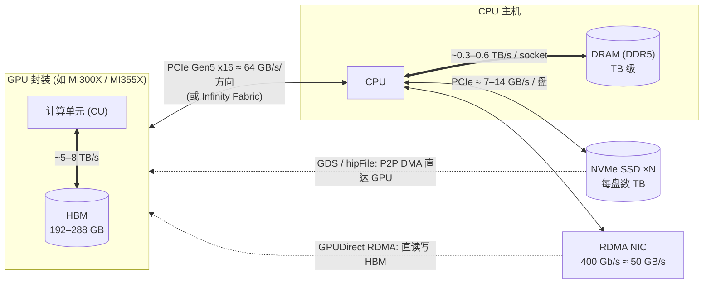

关键观察：**介质本身的带宽之外，连接它们的"管道"往往才是瓶颈**。例如 DDR 带宽有几百 GB/s，但 KV 从 host DRAM 回到 GPU 要过 PCIe（每卡单向约 64 GB/s）；SSD 单盘仅约 7–14 GB/s，所以 UMBP 要做**多盘并行**（`UMBP_SSD_DIR=a,b,c`）来叠加带宽。

### 10.3 对比

| 维度 | HBM | DRAM（主机内存） | NVMe SSD |
|---|---|---|---|
| 底层介质 | 堆叠 DRAM | DRAM（DDR4/DDR5 DIMM） | NAND Flash |
| 位置 | GPU 封装内 | CPU 主板内存插槽 | PCIe 插槽 / U.2 / E1.S 盘位 |
| 谁直接访问 | GPU | CPU（GPU 需经 PCIe/DMA） | 经 NVMe 控制器以**块**为单位读写 |
| 典型容量（每 GPU / 每节点） | 每 GPU 192 GB（MI300X）~ 288 GB（MI355X） | 每节点 1–3 TB 量级 | 每盘 数 TB，每节点可数十 TB |
| 带宽（数量级） | ~5–8 TB/s（每 GPU） | ~几百 GB/s（每 socket） | ~7 GB/s（Gen4）/ ~14 GB/s（Gen5）每盘 |
| 访问延迟（数量级） | ~数百 ns | ~100 ns | ~数十–100 µs |
| 访问粒度 | 字节/缓存行 | 字节/缓存行 | 块（通常 4 KiB 对齐） |
| 断电保持 | 否 | 否 | **是** |
| 写寿命 | 无限制 | 无限制 | **有限**（P/E 次数，需考虑写放大） |
| 每 GB 成本 | 最贵 | 中 | 最便宜 |
| 在 KV cache 层级中的角色 | **L1**：vLLM 的 GPU KV cache / prefix cache 本体 | **L2**：offload / 共享池热数据 | **L3**：大容量冷数据 |

一句话：**越往下越大、越便宜、越慢、离计算越远**——典型的存储金字塔。

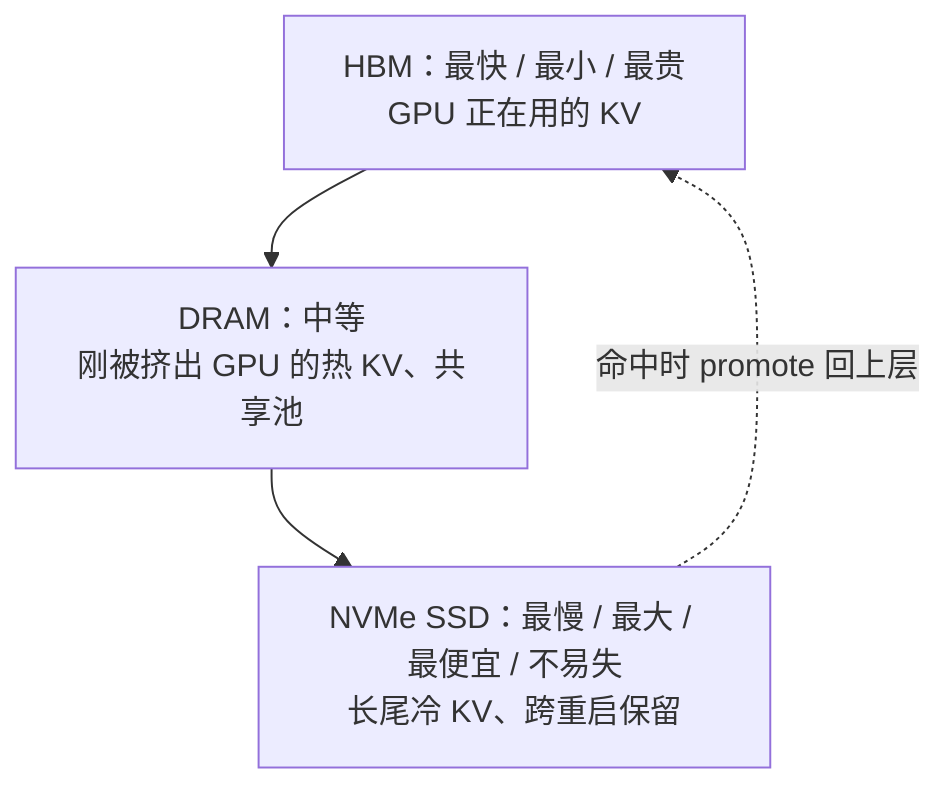

### 10.4 为什么 KV cache 要这样分层（用数字算一算）

以 128K token 前缀为例（实测见 §1.1）：重算 ~7.7s；DRAM 命中 ~0.45s；SSD 命中 ~0.84s。即使是最慢的 SSD，也比重算快约 9 倍——因为**搬运字节的成本远低于重新做 prefill 的算力成本**，只要介质带宽够、容量够大能"存得住"。这就是 HBM 装不下时往 DRAM、再往 SSD 卸载的经济学基础。

### 10.5 这些介质在 UMBP 里分别怎么落地

| 介质 | UMBP 后端 | 关键实现点 | 相关配置 |
|---|---|---|---|
| HBM | `HbmBackend` | `hipMalloc` 一块池；本地拷贝走 `HbmCopyEngine`（hipMemcpy + 碎片 gather kernel）；远端走 RDMA（GPUDirect） | `distributed.medium=HBM`、`hbm.{device,capacity_bytes}` |
| DRAM | `PageBackend` | 主机内存池；**hugepages** 减少 TLB miss；**NUMA 分片**让写入落在离 GPU 近的 socket；预先 fault 避免首次访问抖动；注册为 RDMA MR 供远端直读 | `UMBP_DRAM_CAPACITY`、`UMBP_DRAM_USE_HUGEPAGES`、`UMBP_DRAM_NUMA_NODE` |
| NVMe SSD | `SsdBackend` | segmented log 追加写；**O_DIRECT** 绕过 OS page cache（否则 page cache 会偷偷吃掉 DRAM 且测出假带宽）；**io_uring** 异步批量 I/O；**SPDK** 用户态直接驱动 NVMe（绕过内核）；多盘分片叠加带宽；**hipFile(GDS)** 让 SSD→GPU 不经过 host | `UMBP_SSD_DIR`、`UMBP_SSD_CAPACITY`、`UMBP_SSD_DIRECT_IO`、`UMBP_SSD_BACKEND=file/spdk/spdk_proxy` |

几个容易混淆的相关名词：

| 名词 | 解释 |
|---|---|
| **Page cache** | Linux 内核用空闲 DRAM 缓存文件内容。对 SSD tier 来说它是"隐形的第二层 DRAM 缓存"，UMBP 默认用 O_DIRECT 关掉它 |
| **Pinned / registered memory** | 被锁定在物理内存、不会被换出的 host 内存。GPU DMA 和 RDMA 都要求目标内存先注册（这就是 `RegisterMemory` 的意义） |
| **Hugepage** | 2 MiB / 1 GiB 大页，减少大块内存的页表开销 |
| **NUMA** | 多 socket 服务器上，每个 CPU 有"本地"内存，访问对端 socket 内存更慢 |
| **SPDK** | Storage Performance Development Kit：用户态轮询驱动 NVMe，延迟低、CPU 开销可控，但独占设备（UMBP 用 spdk_proxy 让多进程共享） |
| **GDS / hipFile** | GPU Direct Storage：NVMe 与 GPU 之间 P2P DMA，跳过 host DRAM 中转 |
| **GPUDirect RDMA** | 网卡直接读写 GPU 显存，跨节点传 KV 不经过 host |
| **CXL** | 新兴的内存扩展互连（可把额外 DRAM 挂在 PCIe/CXL 上），可视为未来介于 DRAM 和 SSD 之间的一层；UMBP 当前未涉及 |

---

## 11. 附录：名词速查（通信 / 互连 / 存储 / 系统）

> 本节收录正文中出现的底层名词，按类别分组，每个名词一句话说明它**是什么**，再补一句它**在 UMBP / KV cache 里的作用**。数字只是数量级参考。

### 11.1 全景：这些名词各在哪一层

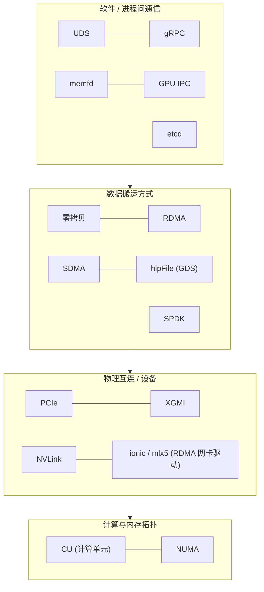

### 11.2 进程间通信与 RPC

| 名词 | 是什么 | 在 UMBP 里 |
|---|---|---|
| **UDS**（Unix Domain Socket） | 同一台机器上进程之间通信用的 socket，地址是文件路径（如 `/run/umbp/x.sock`），不经过网络协议栈，比 TCP 回环更快，可以用文件权限控制谁能连。它还有一个独特能力：通过 `SCM_RIGHTS` 把**文件描述符（fd）**传给另一个进程 | standalone 模式用两条 UDS：一条跑 gRPC 控制面（`.grpc.sock`），一条专门传 fd（`.fd.sock`） |
| **gRPC** | Google 开源的 RPC 框架：用 Protobuf 定义接口和消息（`.proto` 文件），底层基于 HTTP/2，可以跑在 TCP 或 UDS 上 | 所有控制面都用它：master 服务（`umbp.proto`）、节点间服务（`umbp_peer.proto`）、standalone 服务（`umbp_standalone.proto`）。KV 数据字节**不走** gRPC |
| **memfd**（`memfd_create`） | Linux 系统调用，创建一个**匿名的、只存在于内存中的文件**，返回一个 fd。对它 `mmap(MAP_SHARED)` 就得到一块共享内存。把 fd 传给别的进程，对方再 `mmap` 一次，两个进程就看到同一块物理内存。没有文件名，所以不会在 `/dev/shm` 里冲突或残留 | standalone 模式下，worker 的 host KV buffer 用 memfd 分配；fd 通过 UDS 交给 server，之后 server 直接读写这块内存 |
| **GPU IPC**（`hipIpcGetMemHandle` / `hipIpcOpenMemHandle`） | 让一个进程把自己的 GPU 显存分配导出成一个"句柄"，另一个进程打开这个句柄后就能直接访问同一块显存。相当于显存版的 memfd | standalone 模式下支持 GPU buffer：server 打开 worker 的显存句柄，按 `loc=GPU` 注册后直接读写 vLLM 的 KV cache |
| **etcd** | 基于 Raft 共识协议的分布式强一致 KV 存储，常用来做服务发现、配置中心和选主（Kubernetes 的元数据就存在 etcd 里） | UMBP **不用** etcd。正文提到它是因为 Mooncake 的 master HA 依赖 etcd；UMBP 选择"顾问式 master + 可选 Redis/Dragonfly"来实现无状态 master |

### 11.3 数据搬运方式

| 名词 | 是什么 | 在 UMBP 里 |
|---|---|---|
| **零拷贝（Zero-copy）** | 数据从源头直接搬到最终目的地，中间不经过额外的缓冲区拷贝（比如不先拷进内核或 staging buffer，再拷一次）。前提通常是**事先注册（pin）好内存**，让 DMA 引擎或网卡能直接访问 | `RegisterMemory` 一次性注册 vLLM 的 KV buffer，之后 RDMA、hipMemcpy、GDS 都直接读写它；没注册的 host buffer 会走 bounce 池（多一次拷贝），没注册的 GPU buffer 在远端路径上会被直接拒绝 |
| **RDMA**（Remote Direct Memory Access） | 网卡直接读写**远端机器的内存**，不经过对端 CPU 和内核，延迟低（微秒级）、CPU 开销极小。需要事先注册内存区域（MR）、建立 QP（队列对）。常见实现有 InfiniBand 和 RoCE（以太网上的 RDMA）。如果网卡能直接访问 GPU 显存，就叫 **GPUDirect RDMA** | 跨节点搬运 KV 的主力：`MoriIoEngine` 基于 MORI-IO，把对端 peer 的 page 当作远端 MR 直接读写 |
| **SDMA**（System DMA） | AMD GPU 上专门做数据拷贝的硬件引擎，和执行 kernel 的计算单元相互独立。用它做 host↔GPU、GPU↔GPU 拷贝时不占计算资源，可以和计算并行 | MORI 的节点内传输可以用 SDMA（PD benchmark 脚本里的 `MORI_ENABLE_SDMA` 开关）；`hipMemcpy` 在底层通常也由 SDMA 执行 |
| **SPDK**（Storage Performance Development Kit） | Intel 开源的用户态存储库：绕过内核，在用户态用轮询方式直接驱动 NVMe 盘，延迟和 CPU 开销都很低。代价是**独占设备**（这块盘对内核文件系统不可见），并且要占用专门的轮询 CPU 核 | SSD 后端的一个选项（`ssd_backend=spdk`）；`spdk_proxy` 守护进程让多个进程通过共享内存环形队列共用同一块盘 |
| **hipFile（GDS）** | GDS = GPU Direct Storage：让 NVMe 盘和 GPU 显存之间直接做 P2P DMA，不经过 host 内存中转。NVIDIA 的实现叫 cuFile，AMD 的实现叫 **hipFile** | `GdsEngine` 用 hipFile 把 SSD 上的 KV 直接读进 GPU（prefill 加载路径），运行时 dlopen 加载，找不到这个库就回退到经 host staging 的路径 |

### 11.4 物理互连与网卡

| 名词 | 是什么 | 在 UMBP 里 |
|---|---|---|
| **PCIe**（PCI Express） | CPU 连接外设的通用高速总线，GPU、NVMe 盘、网卡都挂在上面。带宽按代际和通道数计算：Gen5 x16 单向约 64 GB/s，Gen4 x4（一块 NVMe 盘）约 7 GB/s | host 内存 ↔ GPU、SSD ↔ CPU、网卡 ↔ 内存都要过 PCIe，**常常是 KV 卸载和加载的真正瓶颈** |
| **XGMI**（AMD Infinity Fabric 的 GPU 间链路） | AMD GPU 之间的高速直连，节点内 8 张 MI300X/MI355X 两两全连接，带宽远高于 PCIe（每张 GPU 聚合可达数百 GB/s） | MORI-IO 的后端类型之一（`XGMI`），用于节点内 GPU↔GPU 传输；MORI-EP 的 all-to-all 也依赖它 |
| **NVLink** | NVIDIA GPU 之间的高速直连（配合 NVSwitch 可以全互联），地位相当于 AMD 的 XGMI | 不属于 AMD 栈；出现在对比里，是因为 Mooncake Transfer Engine 等方案支持 NVLink 传输 |
| **ionic** | AMD Pensando（如 Pollara 400 AI NIC）RDMA 网卡的 Linux 驱动名，设备名形如 `ionic_0…ionic_7` | AMD 集群上的 RDMA 网卡，PD benchmark 里写的是 `NCCL_IB_HCA=ionic_0,...` |
| **mlx5** | NVIDIA（原 Mellanox）ConnectX 系列 RDMA 网卡的驱动名，设备名形如 `mlx5_0` | 另一种常见的 RDMA 网卡；benchmark 里 `MORI_RDMA_DEVICES=^mlx5_8` 表示排除某一张（通常是管理网口） |

### 11.5 计算与内存拓扑

| 名词 | 是什么 | 在 UMBP 里 |
|---|---|---|
| **CU**（Compute Unit，计算单元） | AMD GPU 的基本计算单元，相当于 NVIDIA 的 SM。每个 CU 有若干 SIMD 单元、寄存器堆和 LDS（片上共享内存），kernel 的线程块（workgroup）就调度在 CU 上执行。MI300X 有 304 个 CU，MI355X 有 256 个 | 模型计算在 CU 上跑；拷贝如果交给 SDMA / RDMA / GDS 这类专用引擎，就不和计算抢 CU，这是 layer-wise 加载能和计算重叠的硬件基础。UMBP 的 device gather kernel 会占用少量 CU |
| **NUMA**（Non-Uniform Memory Access） | 多 CPU 插槽的服务器上，每个 CPU 有一部分"本地"内存，访问另一个插槽的内存要跨互连，延迟更高、带宽更低。GPU 和网卡也挂在某个具体的插槽下 | `UMBP_DRAM_NUMA_NODE=0,1` 把 DRAM 池按 NUMA 节点拆成多块，写入时优先用离发起写入的 GPU 最近的那一块，减少跨插槽流量 |

### 11.6 这些名词串起来：一次 KV 加载会经过什么

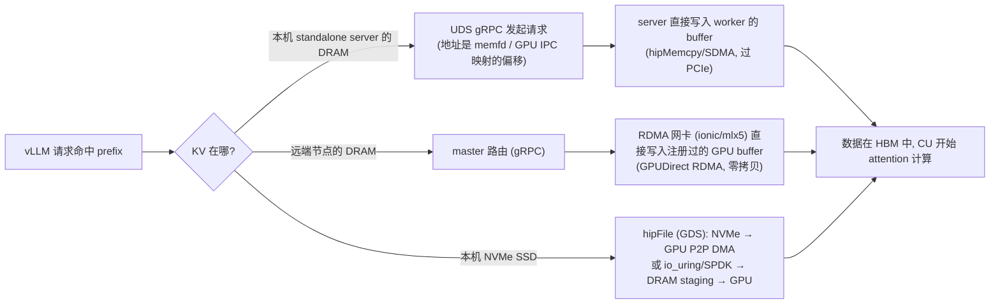
