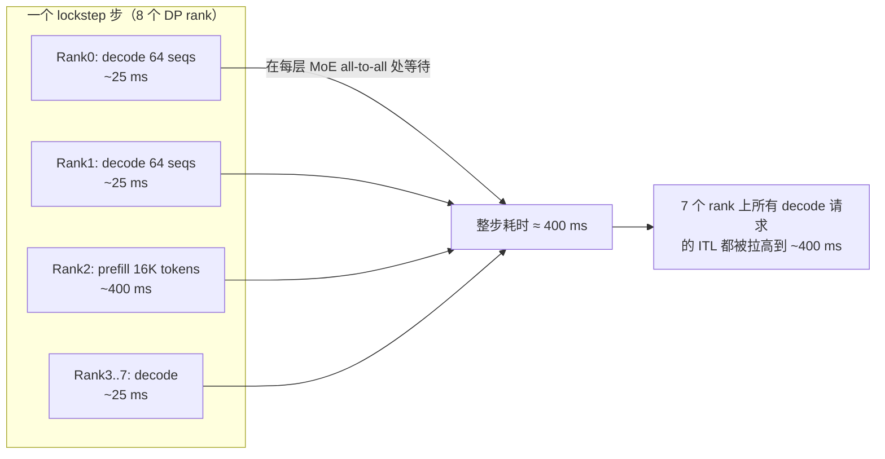
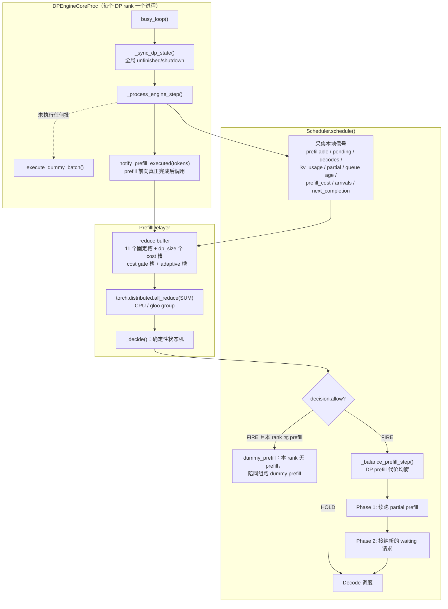
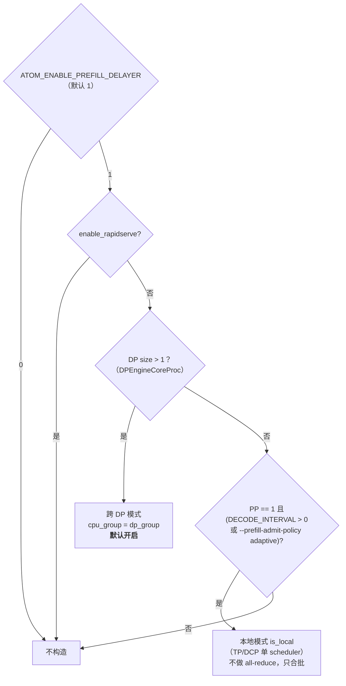
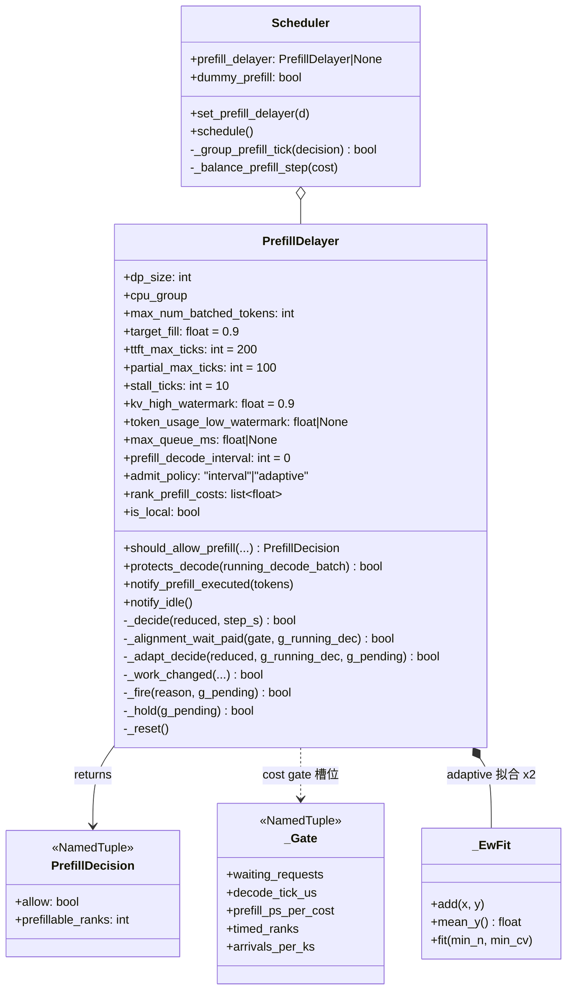
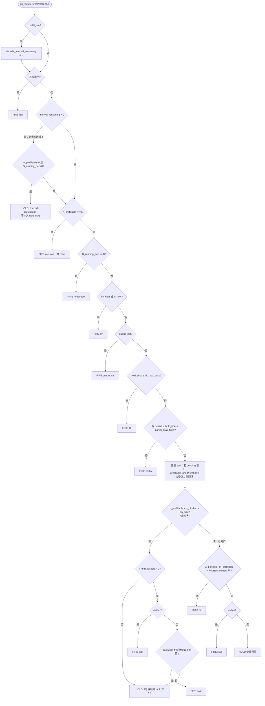
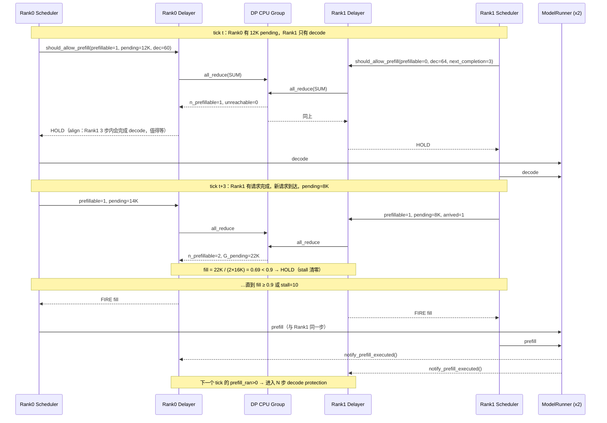
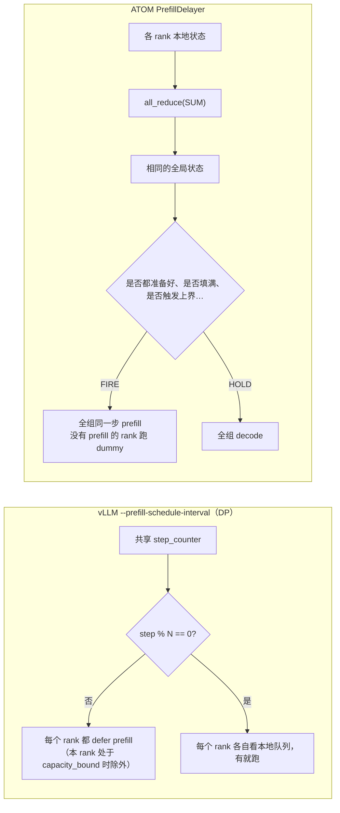
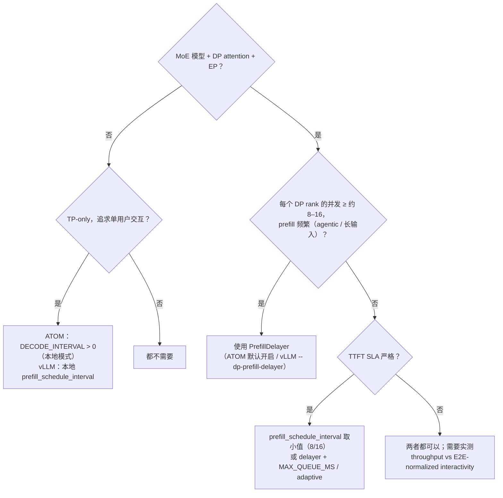

# ATOM PrefillDelayer 特性代码走读技术文档

> **文档版本**: 1.0
> **分析代码版本**: ATOM main（`16ebac2e`，2026-11-04）；对照 vLLM main（`c58e7f6d05`，2026-11-04）与 vLLM PR #61834（移植版，OPEN）
> **最后更新**: 2026-11-04

---

## 文档概述

本文分析 ATOM 推理引擎中的 **PrefillDelayer**（`atom/model_engine/prefill_delayer.py`）。它是一个**跨 DP rank 的 prefill 合批与对齐器**：在 DP-attention + EP 的 MoE 部署中，它让所有 DP rank 在每个 scheduler tick 同步交换 prefill 状态，并统一决定这一步是放行 prefill（FIRE）还是继续积攒（HOLD）。vLLM PR #61834 的 `--dp-prefill-delayer` 就是它的简化移植版。

本文重点回答三个问题：

1. **为什么需要它**：DP lockstep 下，prefill 的代价会被放大到所有 rank。（第一部分）
2. **什么场景下需要它**：哪些负载和部署形态收益大，哪些反而会吃亏。（第一部分 1.4、第五部分）
3. **它和 vLLM `--prefill-schedule-interval` 有什么区别**：固定节拍与基于全局状态的决策对比。（第四部分）

**目标读者**：熟悉 vLLM/ATOM 调度器基本概念（continuous batching、chunked prefill、DP attention、EP MoE）、想评估或移植这一特性的推理引擎开发者。

**阅读建议**：只关心结论的读者可以直接看 1.1、1.4 和第四部分；想读源码的读者按顺序阅读第二、三部分。

---

# 第一部分: PrefillDelayer 基础与架构总览

## 1.1 为什么需要 PrefillDelayer

### 1.1.1 问题根源：DP lockstep 把局部 prefill 变成全局长步

在 DeepSeek-V3/V4、Kimi 这类大 MoE 模型上，常见部署是 **Attention 用 DP、MoE 用 EP**（DEP8、DEP4 等）。每层 MoE 都要做跨 rank 的 dispatch/combine all-to-all，所以：

- 所有 DP rank **必须在同一步一起前向**。没有请求的 rank 也要跑 dummy batch 陪跑。
- 一步的耗时由**最慢的 rank** 决定。



也就是说，**任意一个 rank 跑 prefill，所有 rank 的 decode 都被拖成一个长步**。ATOM 的 token graph 让这个问题更突出：有 rank 在 prefill 时，其他 rank 不再跑自己的 decode，而是跑 **dummy prefill** 陪它（`Scheduler.dummy_prefill`）。因为所有 rank 必须 replay 同一个 token-graph bucket，否则会 hang（见 `docs/distributed_guide.md`）。

### 1.1.2 量化：不协调时 mixed step 的比例

设每个 rank 在某一步独立有 prefill 的概率为 $p$，DP size 为 $D$。不做任何协调时，一步变成 mixed（长步）的概率是：

$$P_{\text{mixed}} = 1 - (1-p)^D$$

| 单 rank prefill 概率 $p$ | D=1 | D=4 | D=8 |
|---|---:|---:|---:|
| 5% | 5% | 18.5% | 33.7% |
| 10% | 10% | 34.4% | 57.0% |
| 20% | 20% | 59.0% | 83.2% |

单 rank 上只有 10% 的步需要 prefill，到了 DEP8 却有 **57%** 的步都是长步。agentic 多轮负载里，每轮工具调用都会带来新的长 prompt，$p$ 本来就高，decode 几乎一直被打断。

如果把 prefill **对齐**到同一步执行，mixed step 的比例就会回落到接近 $p$ 本身；如果再把多个小 prefill **合批**成一次接近满 budget 的前向，mixed step 会更少。PrefillDelayer 做的就是这两件事。

### 1.1.3 第二个问题：碎片化的小 prefill

模块 docstring 开头就点出了 ATOM 引入它的最初动机：

> Left alone, ranks fire many prefill forwards that each carry only a handful of tokens (a short fresh prompt, or the small tail chunk of a chunked prefill). Every prefill forward has ~fixed cost (kernel launch, pad-to-shape, the lockstep MoE all-to-all), so a forward carrying 500 of a 16384-token budget wastes ~97% of that forward.

一次 prefill 前向的代价可以近似为：

$$P(n) = A + k \cdot n$$

其中 $A$ 是固定开销（kernel launch、pad 到 graph bucket、MoE all-to-all 延迟、所有 decode 请求一起停顿），$k \cdot n$ 是和 token 数成正比的真实计算。只带 500 个 token 的 prefill 也要付整个 $A$，同时让全组 $B$ 个 decode 请求停顿一次。这正是网络里 **Nagle 算法**要解决的"小包问题"，所以 ATOM 把它称作 *"Nagle's algorithm for prefill"*。

### 1.1.4 基本思想

PrefillDelayer 有两个相关的职责：

1. **合批（coalescing）**：先不放行 prefill，等全组积攒的待 prefill token 达到一次值得跑的前向（默认 90% budget）再放行。HOLD 期间 decode 照常运行。
2. **对齐（alignment）**：只在**所有 rank 都有 prefill 可做**（或者确实做不了）时才放行，让各 rank 在同一步一起进入 prefill，把 mixed step 合并成一次。

此外还有一个可选功能：**post-prefill decode protection**。每次 prefill 执行后，强制接下来 N 个 tick 只跑 decode（`ATOM_PREFILL_DECODE_INTERVAL`，对应 SGLang 的 `--prefill-decode-interval`）。

这三件事都要在**各 rank 结果一致**的前提下决策，否则 lockstep 会被打破，rank 之间对 prefill 步的判断不一致，就会 hang。为此 ATOM 的做法是：每个 tick 做一次 CPU `all_reduce(SUM)`，所有 rank 拿到相同的全局状态，再运行同一个确定性状态机。

## 1.2 关键指标定义

| 指标 | 含义 | 受 PrefillDelayer 的影响 |
|---|---|---|
| ITL / TPOT | 相邻输出 token 之间的间隔 | **显著改善**：mixed step 变少、变集中 |
| Interactivity (tok/s/user) | 1 / ITL，InferenceX 常用的 P50/P90 指标 | 显著改善 |
| TTFT | 首 token 延迟 | **变差**：prefill 需要等对齐、等填充、等 protection |
| E2E-normalized interactivity | 输出 token 数 / (TTFT + 生成时间) | 取决于并发：高并发改善，低并发可能变差 |
| Output throughput | 总输出 tok/s | 高并发下通常提升（prefill 更满、decode 步更多） |
| hold_rate / fire_* | delayer 日志：HOLD 比例，以及每种 FIRE 原因的计数 | 调参诊断依据 |

## 1.3 整体架构

### 1.3.1 系统架构总览图



### 1.3.2 核心组件与职责划分

| 组件 | 文件 | 职责 |
|---|---|---|
| `PrefillDelayer` | `atom/model_engine/prefill_delayer.py` | 打包状态、做 all-reduce、执行 FIRE/HOLD 状态机、统计日志 |
| `PrefillDecision` | 同上 | 决策结果：`allow` 加上 `prefillable_ranks`（有 prefill 的 rank 数） |
| `Scheduler.schedule()` | `atom/model_engine/scheduler.py:~2051` | 每 tick 采集本地信号、调用 `should_allow_prefill()`，按决策控制 Phase 1/2 |
| `Scheduler._group_prefill_tick` | `scheduler.py:~936` | 判断是否是"同组 prefill 步"，决定本 rank 是否跑 dummy prefill |
| `Scheduler._balance_prefill_step` | `scheduler.py` | 用 delayer 交换来的各 rank chunk 代价做 prefill 均衡 |
| `EngineCore._init_prefill_delayer` | `atom/model_engine/engine_core.py:244` | 读取 env/CLI 构造 delayer；DP 模式下绑定 DP CPU group |
| `EngineCore` forward 之后 | `engine_core.py:~541` | prefill 前向**真正完成**后调用 `notify_prefill_executed`，用来启动 decode protection |
| `envs.ATOM_PREFILL_DELAYER_*` | `atom/utils/envs.py:1121+` | 所有调参开关 |

### 1.3.3 启用规则



> **关键洞察**：在 ATOM 中，DP-attention 下的 PrefillDelayer **默认开启**；在 vLLM PR #61834 中它是**默认关闭**的 opt-in。ATOM 的 DSv4 recipe 已经把它当作 DP 部署的基线行为（只有 PD 分离的 `DeepSeek-V4-Agentic-PD-Max` recipe 显式关闭了它）。

## 1.4 什么场景下需要它

| 场景 | 是否需要 | 原因 |
|---|---|---|
| **MoE + DP-attention + EP（DEP4/DEP8），高并发** | **强烈需要** | lockstep 放大效应最强。ATOM #1611 A/B：DSv4-Pro dp=8，1k/1k c1024 吞吐 +16.4%，8k/1k c1024 +19.3% |
| **Agentic 多轮负载**（长上下文、频繁新一轮 prefill） | 强烈需要 | $p$ 高，不协调时大多数步都是 mixed。vLLM 移植版 DSv4-Pro c128：P90 interactivity 7.3→23.5，吞吐 +85% |
| 大量短 prompt 或 chunked prefill 的小尾巴 | 需要 | 合批可以消除碎片化 prefill 的固定开销 $A$ |
| 使用 prefill token graph（DSv4.1）的 DP 部署 | 需要 | 有 rank prefill 时其他 rank 要跑 dummy prefill，一次不对齐的 prefill 代价相当于全组一次 prefill |
| TP-only，追求极致单用户交互（Kimi-K3 agentic C1/C2） | 可选（本地模式） | 设 `DECODE_INTERVAL=1000000`，让请求基本一次只 decode 一个，P90 interactivity 177→215.6，TTFT 0.9→1.8 s |
| TP-only，中高并发 agentic（Kimi-K3/Qwen3.5 C16+） | 可选 | recipe：`DECODE_INTERVAL=4`、`MAX_QUEUE_MS=5000` |
| **低并发 DP**（并发 < dp_size，或每 rank 只有个位数请求） | **谨慎** | 对齐很难实现，只能靠 stall/TTFT 上界放行，TTFT 明显上升。vLLM 移植版 c64：TTFT mean +406% |
| PD 分离的 prefill 实例 | 不需要 | 没有 decode 可保护（`G_running_dec == 0` 时直接 FIRE） |
| PD 分离的 decode 实例 / RapidServe | 不适用 | RapidServe 有自己的 Prefill/DecodeScheduler；PD-Max recipe 显式关闭 |
| TTFT SLA 很严格的在线服务 | 谨慎 | 必须配置 `MAX_QUEUE_MS`，并且要明白它不是端到端的硬上界 |

---

# 第二部分: 核心接口分析

## 2.1 类结构



## 2.2 核心接口：`should_allow_prefill()`

```python
# 文件: atom/model_engine/prefill_delayer.py
def should_allow_prefill(
    self,
    prefillable: bool,            # 本 rank 是否有"可接纳"的 prefill（head 能分到 KV，或有可续跑的 partial）
    pending_tokens: int,          # fresh waiting + partial 剩余 token，已截断到 budget
    running_decode_batch: int = 0,  # decode seq 数（不含 chunked prefill 中的 seq）
    kv_usage: float = 0.0,
    has_partial: bool = False,
    oldest_waiting_age_ms: float = 0.0,   # TTFT SLA 保护
    prefill_cost: float = 0.0,            # DP 代价均衡用的 chunk 估计代价
    waiting_requests: int = 0,
    arrived_requests: int = 0,            # 自上个 tick 以来新到的请求数
    next_completion_steps: int | None = None,  # 最近一个 decode 完成还需要几步
    admittable_requests: int | None = None,    # adaptive 策略用
) -> PrefillDecision:
    """MUST be called every tick on every DP rank (it runs a cross-DP
    all_reduce) so ranks stay in lockstep."""
```

> **注意**：它必须在**每个 rank 的每个 tick**都调用，而且要在 `schedule()` 的 early-return 之前调用。scheduler 里专门有注释：
> ```python
> # 文件: atom/model_engine/scheduler.py
> # should_allow_prefill() runs a cross-DP all_reduce and MUST be called
> # every tick on every rank for lockstep — hence before the early-return.
> ```
> engine_core 的 idle 分支也特意不经过 `schedule()`，以免在非 lockstep 的路径上触发 all-reduce。

## 2.3 归约缓冲区编码（11 个固定槽）

| 槽 | 本地值 | SUM 后的语义 |
|---|---|---|
| 0 | prefillable (0/1) | `n_prefillable`：有可接纳 prefill 的 rank 数 |
| 1 | pending_tokens（仅 prefillable 时） | `G_pending`：全组待 prefill token |
| 2 | running_decode_batch | `G_running_dec`：全组 decode seq 数 |
| 3 | kv_high | >0 表示有 prefillable rank 的 KV ≥ 0.9 |
| 4 | kv_low | >0 表示有 prefillable rank 的 KV 低于低水位（GPU 吃不饱） |
| 5 | has_partial | >0 表示有 rank 处于 chunked prefill 中途 |
| 6 | queue_hot | >0 表示有 rank 最老的 waiting 超过 `max_queue_ms` |
| 7 | prefill_ran | >0 表示上个 tick 有 rank 真正执行完一次 prefill 前向 |
| 8 | arrived_requests | `G_arrived`：全组新到达的请求数 |
| 9 | blocked | `n_blocked`：有 waiting 但 head 无法接纳（KV 不足、远端 KV 未到） |
| 10 | unreachable | `n_unreachable`：既无 prefill 也无 waiting，且最近一次 decode 完成落在 TTFT 预算之外（或根本没有 decode） |
| 11..11+D | 本 rank 的 prefill cost（one-hot） | 每个 rank 的 chunk 代价，用于 DP 代价均衡 |
| 之后 | `_Gate`（5 个） | cost gate：waiting 数、decode 步时长、prefill 每单位代价耗时、已计时的 rank 数、到达率 |
| 之后 | adaptive（4 + D 个） | W_eff、T0、A、fitted，以及各 rank 上个 tick 的 prefill token 数 |

> **关键洞察 —— 为什么用 SUM 不用 MAX**：MAX（"最忙的 rank 准备好就放行"）会把空闲 rank 拖进来跑很小的 prefill。SUM 加聚合填充率会一直等到整组的 prefill 值得跑一次，空闲 rank 在 HOLD 期间也能继续积攒，最终跑出更大的 prefill。布尔值用 0/1 编码，`sum > 0` 就是逻辑 OR。

> **关键洞察 —— 为什么全部用 tick 计时**：`hold_ticks`、`stall_count`、`decode_interval_remaining` 都按 tick 计数，在各 rank 上演化完全一致。用 wall-clock 的话，各 rank 会在不同时刻越过超时边界，决策就会分叉。唯一用到 wall-clock 的 `max_queue_ms`，也是每个 rank 只拿**自己的**请求年龄和阈值比较，再把布尔值 OR 起来，所以仍然是 lockstep 安全的。

---

# 第三部分: 核心实现深度分析

## 3.1 决策状态机（`admit_policy="interval"`，默认）



对应源码（节选）：

```python
# 文件: atom/model_engine/prefill_delayer.py  PrefillDelayer._decide
if prefill_ran_n > 0:
    self._decode_interval_remaining = self.prefill_decode_interval
if self._first:
    self._first = False; self._reset(); return True
if self._decode_interval_remaining > 0:
    self._decode_interval_remaining -= 1
    if n_prefillable > 0 and g_running_dec > 0:
        if self._work_changed(g_pending, n_prefillable, g_arrived):
            self._stall_count = 0
        ...
        return False                       # decode protection
if n_prefillable == 0:
    self._reset(); ...; return True        # vacuous
# ---- must-fire bounds ----
if g_running_dec == 0:            return self._fire("nodecode", g_pending)
if any_kv_high or any_kv_low:     return self._fire("kv", g_pending)
if any_queue_hot:                 return self._fire("queue_ms", g_pending)
if self._hold_ticks >= self.ttft_max_ticks: return self._fire("ttft", g_pending)
if self.admit_policy == "adaptive": return self._adapt_decide(...)
if any_partial and self._hold_ticks >= self.partial_max_ticks:
    return self._fire("partial", g_pending)
# ---- stall ----
if self._work_changed(g_pending, n_prefillable, g_arrived): self._stall_count = 0
else: self._stall_count += 1
stalled = self._stall_count >= self.stall_ticks
# ---- alignment gate ----
if n_prefillable + n_blocked < self.dp_size:
    if n_unreachable > 0:
        if stalled: return self._fire("stall", g_pending)
        if self._cost_gate and self._alignment_wait_paid(...):
            return self._fire("cost", g_pending)
    return self._hold(g_pending)
# ---- fill goal ----
fill = g_pending / (n_prefillable * self.max_num_batched_tokens)
if fill >= self.target_fill: return self._fire("fill", g_pending)
if stalled: return self._fire("stall", g_pending)
return self._hold(g_pending)
```

### 3.1.1 每条规则的设计理由

| 规则 | 理由 |
|---|---|
| **first** | 第一次调用直接放行，用来建立初始 decode batch（对应 SGLang PR #19836 的 `skip_first`） |
| **decode protection** | prefill 之后强制 N 步纯 decode，给 decode 一段连续窗口。**只在 prefill 前向真正完成后才启动**（`notify_prefill_executed`），因为 FIRE 只是"允许尝试"，实际可能因 KV 不足而没跑成 prefill。这段时间**不计入** `hold_ticks`，TTFT 上界从 protection 结束后才开始计算（与 SGLang 一致） |
| **nodecode** | 没有 decode 可以掩盖等待时间，HOLD 只会让 GPU 空转 |
| **kv_high** | KV 快满了，继续积攒不会让 batch 变大 |
| **kv_low**（可选） | KV 使用率很低，说明 GPU 吃不饱，应该放行补充 decode batch |
| **queue_ms**（可选） | TTFT SLA 保护：按请求到达时间计算的真实排队时长（包含 backlog 和之前的 hold） |
| **ttft** (200) | 单次 HOLD 的硬上界，防止饿死 |
| **partial** (100) | 处于 chunked prefill 中途的请求已经占着 KV，所以上界更紧 |
| **alignment gate** | 只要有 rank "缺 prefill 但有能力接 prefill"，就等它，避免 skew |
| **blocked 视同已对齐** | head 拿不到 KV 的 rank 不会因为等待而变成可接纳，它跑 dummy prefill 陪同即可（#2727） |
| **unreachable** | 一个落后的 rank 如果在 TTFT 预算内都等不到 decode 完成来腾出 slot，等它也没用，只能靠 stall 或 cost 放行（#2727）。在闭环负载下，很快会完成 decode 的落后 rank 一定会收到下一个请求，所以值得等 |
| **fill** (0.9) | 聚合填充率达标，这次前向值得跑 |
| **stall** (10) | 全组的工作量不再变化，继续等也填不满。因为每个 rank 的 pending 被截断到 budget，pending 不变不代表没有新工作，所以 stall 计数会在 prefillable rank 数变化或有新请求到达时清零（#2727） |

### 3.1.2 cost gate（`_alignment_wait_paid`，默认开启，需要 DP 代价均衡）

处理的问题是：有一个落后 rank 无法及时对齐时，是继续等还是放行？这是一个 rent-or-buy 问题：

- **放行（buy）**：一次不对齐的 prefill 步会让全组 $B$ 个 decode 停顿，代价为
  $$\text{fire\_us} = G_{\text{running\_dec}} \times \max_r \text{cost}_r \times t_{\text{prefill/cost}}$$
- **等一个 tick（rent）**：所有 waiting 请求都晚一个 decode 步，代价为 $W \times t_{\text{decode}}$。

满足以下任一条件时放行：

1. 预期在等待期间到达落后 rank 的请求数 $\lambda \cdot \text{fire\_us} < W$（等下去大概率等不来）；
2. 已经累计的等待成本 $\ge$ fire_us（rent 的总花费已经超过 buy，属于 2-competitive 策略）。

## 3.2 adaptive 策略（`--prefill-admit-policy adaptive`，#2897）

它用**由实测步时拟合出的 EOQ（经济订货量）/ rent-or-buy 规则**，替代固定的 `DECODE_INTERVAL` 以及 fill/stall 合批规则：

$$T_d(b) = T_0 + c\,b \qquad P(n) = A + k\,n$$

- 每个 HOLD 的请求、每个 tick 损失约 $T_0$（decode 步的固定部分，即多一个 seq 带来的边际吞吐）；
- 每次 FIRE 要付出 $A \times B$（固定 prefill 开销乘以全组 decode seq 数）；
- 当 $\sum_{t} W_t \cdot T_0 \ge A \cdot B$ 时放行，这是 EOQ 的最优点。

为了防止数值发散，实际实现做了收敛性约束：$T_0 = 0.75 \times$ 平均 decode 步时长；$A$ 被钳制在 $[0.3, 1.5] \times$ 平均 prefill 步时长；每轮至少 4 个决策，最多约 600 ms 的 decode 步（冷启动时为 24，上限 200）。这些常量是在 DSv4.1 DEP4 8k/1k 上调出来的。拟合值通过同一次 all-reduce 传给所有 rank，各 rank 用相同的均值做决策。

> **注意**：adaptive 目前只在 DEP4 上测过，TP-only 场景的收益还没有验证（`docs/configuration_guide.md`）。

## 3.3 scheduler 侧如何执行决策

```python
# 文件: atom/model_engine/scheduler.py（节选）
decision = self.prefill_delayer.should_allow_prefill(...)
delayer_allows = decision.allow
# 同组 prefill 步，本 rank 自己没有 prefill → 跑 dummy prefill，而不是 decode
self.dummy_prefill = self._group_prefill_tick(decision)
if self.cost_balance and delayer_allows:
    self._balance_prefill_step(prefill_cost)   # 按估计代价均衡各 rank 的 chunk
# Phase 1：续跑 partial prefill —— 同样受 delayer_allows 控制
if delayer_allows and self._partial_prefill_count > 0: ...
# Phase 2：接纳新请求 —— 受 delayer_allows 控制
...
if self.dummy_prefill:
    return None   # 陪同组跑 dummy prefill，所有 rank replay 同一个 token graph bucket
# 否则进入 decode 调度
```

需要注意几点：

- **HOLD 同时作用于 Phase 1（partial 续跑）和 Phase 2（新请求）**，因此有 rank 处于 chunked prefill 中途时，对齐依然有效。
- **在 protection 窗口内，只检查"是否存在 prefill 工作"**，不做 prefix-cache 探测和 KV fit 检查，这样可以省 CPU。
- **pending 的估计会扣除 HBM cache 命中**；探测量以一个 batch budget 为上限，所以队列很深、cache 命中很多时，可能先触发 stall 或 TTFT 上界，而不是 fill。

## 3.4 执行时序



## 3.5 演进历史（ATOM 的设计是逐步迭代出来的）

| PR | 日期 | 变化 |
|---|---|---|
| #930 | 2026-05 | 初版：跨 DP 对齐 hook，用 MAX 语义，`max_delay_passes=30`、`max_delay_ms=5000` |
| #1611 | 2026-07 | **改写为 SUM 合批器**（Nagle）：6-int buffer，全部用 tick 计时，加入 fill/stall/TTFT/partial/KV 上界，新增 `MAX_QUEUE_MS`。DSv4-Pro dp=8 吞吐 +16~19% |
| #2016 | 2026-08 | 新增 post-prefill decode protection（`ATOM_PREFILL_DECODE_INTERVAL`）和 session-aware routing |
| #2238 | 2026-09 | 本地 TP 合批模式（`is_local`），探测量有上界 |
| #2551 | 2026-10 | DP prefill 代价均衡：各 rank 的 chunk 代价搭车同一次 all-reduce |
| #2727 | 2026-10 | 新增 blocked/unreachable/arrived 槽位；修复 stall 误放行（CI 中 218 次未对齐的 stall 放行）；cost gate 默认开启。8k/1k c128 DPA：2477→2904 tok/s |
| #2897 | 2026-11 | adaptive（EOQ）策略，改为 CLI 参数 `--prefill-admit-policy`，有意与 vLLM 的 `--prefill-schedule-interval` 对应 |

> **关键洞察**：vLLM PR #61834 移植的大致是 **#1611 + #2016 阶段**的规则（6-int、fill/stall/align/protected），**不包含** #2727 的 blocked/unreachable/arrival 修正、cost gate、代价均衡、`MAX_QUEUE_MS` 和 adaptive。ATOM 在 #2727 中修掉的 stall 问题（截断后的 pending 不变被误判为停滞），在移植版里依然存在：移植版的 stall 只看 `pending <= prev_pending`。

---

# 第四部分: 与 vLLM `--prefill-schedule-interval` 的对比

## 4.1 vLLM `--prefill-schedule-interval` 的实现

它在 vLLM #44558（2026-06）中引入，有两种作用方式：

**(a) MoE DP 模式（DP 节拍，由 engine core 驱动）**：

```python
# 文件: vllm/v1/engine/core.py  DPEngineCoreProc
def _should_throttle_prefills(self) -> bool:
    # step_counter is identical across DP ranks.
    return (
        self.prefill_schedule_interval > 1
        and self.step_counter % self.prefill_schedule_interval != 0
    )
```

```python
# 文件: vllm/v1/core/sched/scheduler.py  Scheduler.schedule
defer_prefills = (
    throttle_prefills and not self.prefill_capacity_bound
) and any(not r.is_prefill_chunk for r in self.running)
...
# 在 release 步结束时：本 rank 的 waiting 没排空 → 下一轮不再节流
if not defer_prefills:
    self.prefill_capacity_bound = num_waiting > len(self.deferred_waiting)
```

**(b) 本地模式（DP=1 或 dense DP rank）**：从上一个带 prefill 的步开始计时，满 N 步才放行（#54627），同样带 `prefill_capacity_bound` 逃逸。

## 4.2 原理对比



**一句话总结**：`prefill-schedule-interval` 只协调 prefill **在哪些步可以发生**（固定节拍），不协调**这一步要不要发生、能不能填满、各 rank 是否都准备好**；PrefillDelayer 通过每步一次的状态交换，同时协调这三件事。

## 4.3 详细对比表

| 维度 | vLLM `--prefill-schedule-interval N` | ATOM PrefillDelayer | vLLM PR #61834 `--dp-prefill-delayer` |
|---|---|---|---|
| 决策依据 | 只看全局步计数器 `step % N` | 全组聚合状态（pending、decode 数、KV、partial、到达、阻塞……） | 6 个 int 的全组状态 |
| 跨 rank 通信 | 无（依赖共享计数器） | 每 tick 一次 CPU all_reduce(SUM)，11 个以上 int64 | 每步一次 `cpu_all_reduce_`，6 个 int（约 114 µs，8 rank） |
| 对齐 "when" | 有（各 rank 节拍一致） | 有 | 有 |
| 对齐 "whether" | **没有**：cadence 步上哪怕只有一个 rank 有一个很小的 chunk，全组也要跑 mixed step | **有**：等全员有 prefill（或确实无法接纳）再放行 | 有（`num_prefillable < dp_size` 时 HOLD） |
| 合批 | 间接（N 步内积攒），没有填充目标 | `target_fill=0.9` 的聚合填充率 + stall | 0.9 填充率 + stall |
| 逃逸条件 | `prefill_capacity_bound`：本 rank release 后队列没排空就**不再节流**，单个 rank 自己决定 | 全局 must-fire 上界（nodecode/KV/queue_ms/ttft/partial）+ stall + cost gate | nodecode/KV/ttft/partial/stall；delayer 开启时忽略 `capacity_bound` |
| 局部逃逸导致的 mixed 放大 | **存在**：一个 capacity-bound 的 rank 每步都 prefill，会让 8 个 rank 全部 mixed | 不存在（逃逸本身也是全组一致决策） | 只有"没有 decode 的 rank 照常 prefill"这一例外 |
| post-prefill decode 保护 | 隐含（节拍本身就是间隔） | 可选 `DECODE_INTERVAL`，在 prefill **真正执行后**启动 | `protected_steps`（默认 10） |
| TTFT 上界 | 隐含：最多等 N-1 步 | tick 上界 + 可选 `MAX_QUEUE_MS`（ms，按到达时间） | 只有 tick 上界（200/100），**没有 ms 上界** |
| 对低并发的适应 | 好（N 小时影响有限） | 中：unreachable/stall/cost gate 会提前放行 | 差：c64 TTFT +406% |
| 对 chunked prefill 中途请求 | defer 时连 chunk 一起延后，长 prompt 最多慢 N 倍 | HOLD 同时作用于 partial，并有 `partial_max_ticks` 上界 | 同左 |
| DP 代价均衡 | 无 | 有（chunk cost 搭车同一次 all-reduce） | 无 |
| 单机 TP 模式 | 有（本地节拍，#54627） | 有（`is_local`，需要 `DECODE_INTERVAL > 0`） | 无（只用于 DP） |
| 调参难度 | 一个参数 N，但最佳 N 依赖负载 | 多个 env；adaptive 模式几乎不需要调 | 一个参数（protected steps），其他常量硬编码 |
| 默认 | 关闭（N=1） | DP 下**开启** | 关闭 |

## 4.4 为什么 `prefill-schedule-interval` 在 agentic 高并发下不够

结合 PR #61834 中作者的分析和 ATOM 的演进，原因有两点：

1. **局部逃逸会放大成全局 mixed**：release 步之后，只要某个 rank 的 waiting 队列装不下一次 budget（agentic 场景下 90–130K token 的 prompt 很常见），这个 rank 就进入 `prefill_capacity_bound`，从此每步都 prefill，直到队列排空。这个判断只看本 rank，但一个 rank prefill 就让全组都是 mixed step。在 c128 下，几乎总有某个 rank 处于这个状态。
2. **cadence 步上的 prefill 没有"值不值得"的判断**：节拍一到，即使全组只有一个 rank 上有一个 500 token 的尾巴 chunk，其他 7 个 rank 也要为它付出一次完整的 mixed step（在 token graph 下就是一次 dummy prefill）。

实测（DeepSeek-V4-Pro，8×MI355X，DP8+EP8，AgentX，同一节点，来自 PR #61834 评论区）：

| | c64 interval=32 | c64 delayer | c128 interval=32 | c128 delayer |
|---|---:|---:|---:|---:|
| Output tok/s/GPU | 158 | 145 (-8%) | 189 | **350 (+85%)** |
| E2EL mean (s) | 34.1 | 40.9 | 68.3 | **40.4** |
| TTFT mean (s) | 5.0 | 25.3 | 10.0 | 10.7 |
| Interactivity P90 (ITL) | 17.1 | 45.5 | 7.3 | 23.5 |
| E2E-normalized P90 | 9.5 | **3.3** | 4.5 | 6.9 |

> **关键洞察**：delayer 在**高并发**下几乎全面占优：队列深，填充和对齐都容易达成，fill 放行占主导。在**低并发**下，对齐和填充都难以达成，大量 HOLD 靠上界才能放行，TTFT 被拉长，E2E 指标反而更差。ATOM 用 unreachable 判定、cost gate、`MAX_QUEUE_MS` 和 adaptive 来缓解这个问题，而 vLLM 移植版目前还缺这些机制。

## 4.5 如何选择



---

# 第五部分: 配置与使用指南

## 5.1 关键参数（ATOM）

| 变量 / 参数 | 默认 | 说明 |
|---|---|---|
| `ATOM_ENABLE_PREFILL_DELAYER` | 1 | 总开关；DP>1 时默认构造 |
| `ATOM_PREFILL_DELAYER_TARGET_FILL` | 0.9 | 聚合填充目标，取值 (0,1]，越大 prefill 越少越大、TTFT 越高 |
| `ATOM_PREFILL_DELAYER_TTFT_MAX_TICKS` | 200 | 单次 HOLD 的 tick 上界 |
| `ATOM_PREFILL_DELAYER_PARTIAL_MAX_TICKS` | 100 | 有 chunked prefill 中途请求时的 tick 上界 |
| `ATOM_PREFILL_DELAYER_STALL_TICKS` | 10 | 全组工作量连续多少个 tick 不变就放行 |
| `ATOM_PREFILL_DELAYER_COST_GATE` | 1 | 落后 rank 无法及时对齐时，按 rent-or-buy 规则放行 |
| `ATOM_PREFILL_DELAYER_KV_HIGH_WATERMARK` | 0.9 | KV 高水位，达到即放行 |
| `ATOM_PREFILL_DELAYER_TOKEN_USAGE_LOW_WATERMARK` | 关 | KV 低水位，低于即放行 |
| `ATOM_PREFILL_DELAYER_MAX_QUEUE_MS` | 关 | 排队时间上界（protection 之后生效，不是端到端硬上界） |
| `ATOM_PREFILL_DECODE_INTERVAL` | 0 | prefill 后保护多少个 decode pass；在 DP=1 时，>0 还会启用本地模式 |
| `--prefill-admit-policy` | interval | `adaptive` 时启用 EOQ 规则，并忽略 DECODE_INTERVAL |
| `ATOM_PREFILL_DELAYER_LOG_EVERY` | 1000 | 每 N 次决策输出一次统计 |
| `ATOM_PREFILL_DELAYER_DEBUG` | 0 | 每 tick 输出 FIRE/HOLD 日志 |

## 5.2 典型配置示例（来自 ATOM recipes）

```bash
# Agentic Qwen3.5 / Kimi-K3（TP，本地模式），并发 ≥ 16
export ATOM_PREFILL_DECODE_INTERVAL=4
export ATOM_PREFILL_DELAYER_MAX_QUEUE_MS=5000
# 并发 ≥ 32 时（Qwen3.5）把 stall 和 TTFT 上界都收紧
export ATOM_PREFILL_DELAYER_STALL_TICKS=15
export ATOM_PREFILL_DELAYER_TTFT_MAX_TICKS=15

# Kimi-K3 TP8 极致单用户交互：几乎只在没有 decode 时才放行 prefill
export ATOM_PREFILL_DECODE_INTERVAL=1000000
# --max-num-seqs 2 --cudagraph-capture-sizes "[1,2]"

# PD 分离（DeepSeek-V4 Agentic PD-Max）：关闭
export ATOM_ENABLE_PREFILL_DELAYER=0
```

对应的 vLLM 用法（PR #61834，尚未合入）：

```bash
vllm serve deepseek-ai/DeepSeek-V4-Pro \
  --data-parallel-size 8 --enable-expert-parallel \
  --dp-prefill-delayer --dp-prefill-delayer-protected-steps 10
# 注意：不能同时设置 --prefill-schedule-interval > 1，
#       也不能和 elastic EP、--enable-fault-tolerance、自定义 scheduler 一起使用
```

## 5.3 调优建议

> **性能提示 1：先看日志**。`[PrefillDelayer stats]` 会给出 `fire_fill / fire_stall / fire_ttft / fire_cost / hold_rate`。如果 `fire_stall`、`fire_ttft` 远多于 `fire_fill`，说明队列很少能填满，合批大多以"放弃等待"告终。这时应该调低 `TARGET_FILL` 或 `STALL_TICKS`，或者确认并发是否太低。

> **性能提示 2：TTFT 敏感就设 `MAX_QUEUE_MS`**。按 TTFT SLA 设置（recipe 中常用 5000）。不要设得太小：重负载下单个请求本来就要等好几秒，阈值太小会导致每个 tick 都触发放行，合批完全失效。

> **性能提示 3：protection 步数和并发正相关**。并发越高，prefill 越频繁，protection 带来的 ITL 收益越大，但 TTFT 代价也越大。vLLM 移植版在 c128 上测过：10 步 → 20 步，P90 22.8→26.4，TTFT p50 5.4→10.0 s。

> **性能提示 4：评估时不要只看 ITL-only 的 P90 interactivity**。一定要同时看 E2E-normalized interactivity 和 TTFT 分布。delayer 天然有利于前者，而对后两者有损。

> **注意**：delayer 的 all-reduce 必须在每个 rank 的每个 tick 执行。任何让某个 rank 跳过 `schedule()`（或 vLLM 中 busy loop 的对应位置）的修改都会导致集合通信错位，引擎 hang。ATOM 的 idle 分支对此专门做了规避，vLLM 移植版也因为一个类似问题（没有 decode 的 rank 被 HOLD 后调度了空 batch）hang 过一次。

---

# 附录

## A. 关键代码位置索引

| 组件 | 路径 |
|---|---|
| PrefillDelayer 主体 | `ATOM/atom/model_engine/prefill_delayer.py` |
| 决策状态机 | `prefill_delayer.py: PrefillDelayer._decide` |
| cost gate | `prefill_delayer.py: PrefillDelayer._alignment_wait_paid` |
| adaptive EOQ | `prefill_delayer.py: _adapt_local_fits / _adapt_decide` |
| scheduler 采集信号与调用 | `ATOM/atom/model_engine/scheduler.py: schedule()`（约 2051 行） |
| dummy prefill 判定 | `scheduler.py: _group_prefill_tick` |
| DP 代价均衡 | `scheduler.py: _balance_prefill_step / _estimate_prefill_chunk_cost` |
| 构造与启用规则 | `ATOM/atom/model_engine/engine_core.py: _init_prefill_delayer`（244 行），以及 `DPEngineCoreProc.__init__` |
| prefill 执行通知 | `engine_core.py`（约 541 行） |
| idle 通知 | `engine_core.py: DPEngineCoreProc.busy_loop`（约 987 行） |
| env 定义 | `ATOM/atom/utils/envs.py`（1121 行起） |
| 文档 | `ATOM/docs/environment_variables.md#prefill-delayer-tpdcp-and-dp-attention` |
| 单测 | `ATOM/tests/test_prefill_delayer.py`、`test_prefill_cost_balance.py`、`test_prefill_admit_adaptive.py` |
| vLLM DP 节拍 | `vllm/v1/engine/core.py: DPEngineCoreProc._should_throttle_prefills` |
| vLLM 节流与 capacity_bound | `vllm/v1/core/sched/scheduler.py: schedule()`（defer_prefills、local_prefill_interval） |
| vLLM 配置 | `vllm/config/scheduler.py: prefill_schedule_interval` |
| vLLM 移植版 | PR #61834：`vllm/v1/core/sched/prefill_delayer.py` |

## B. 术语表

| 术语 | 解释 |
|---|---|
| DP attention / DEP | Attention 按数据并行切分、MoE 按专家并行切分的混合部署 |
| lockstep | 所有 DP rank 每步同步前向（受 MoE all-to-all 约束） |
| mixed step | 至少一个 rank 带 prefill 的步，耗时由 prefill 决定 |
| dummy prefill | ATOM 中没有自己 prefill 的 rank 陪同组 replay 同一个 prefill token graph bucket |
| tick | 一次 scheduler 调用（各 rank 一致），delayer 的计时单位 |
| FIRE / HOLD | 放行 prefill / 暂缓 prefill（decode 照常） |
| coalescing | 把多个小 prefill 积攒成一次接近满 budget 的前向 |
| alignment | 各 rank 在同一步进入 prefill |
| prefillable / blocked / unreachable | 有可接纳 prefill / 有 waiting 但 head 无法接纳 / 无工作且在 TTFT 预算内无法对齐 |
| stall | 全组工作量连续若干 tick 没有变化 |
| decode protection | prefill 之后强制若干步纯 decode |
| cost gate | 用实测步时和到达率判断"继续等对齐是否划算"的 rent-or-buy 规则 |
| EOQ | Economic Order Quantity，经济订货量模型，adaptive 策略的理论基础 |
| prefill_capacity_bound | vLLM 中 release 步没能排空本 rank waiting 队列的标志，置位后本 rank 停止节流 |
| E2E-normalized interactivity | 把 TTFT 计入的每用户 token 速率，比 ITL-only 指标更能反映端到端体验 |
