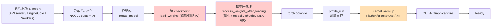
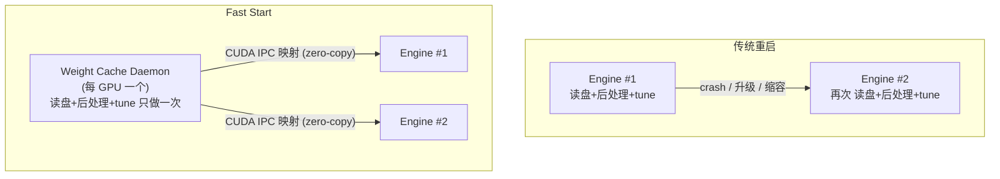
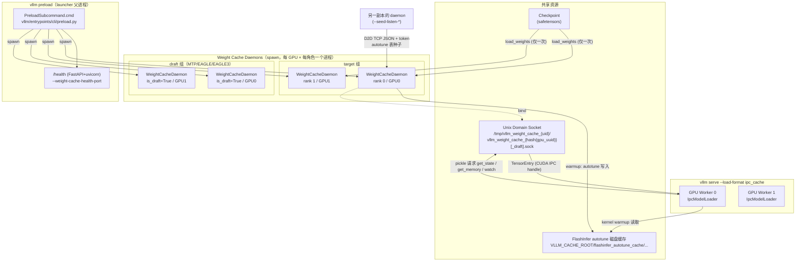
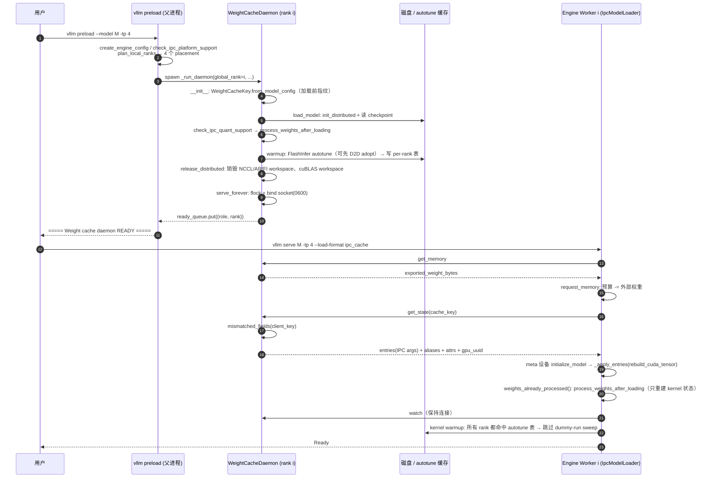
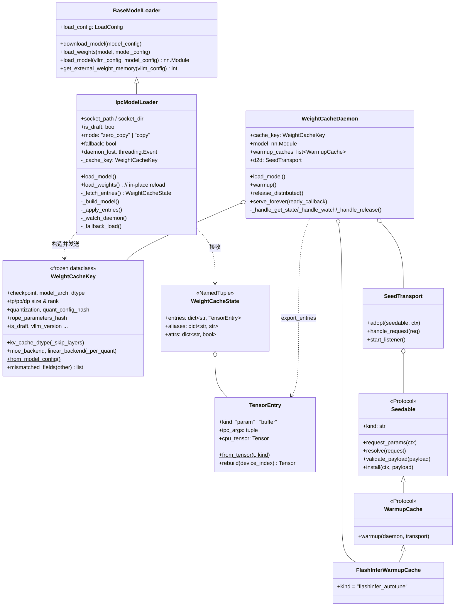
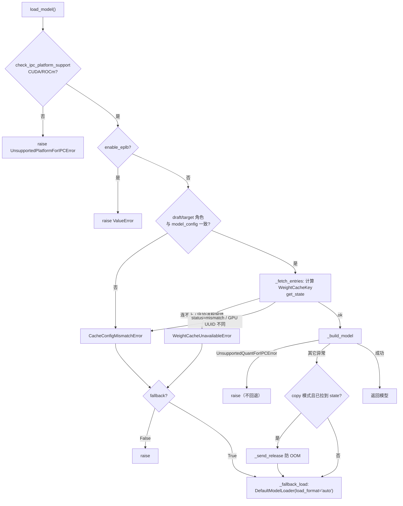
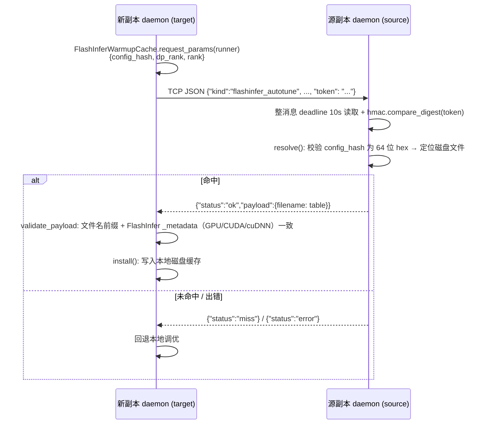
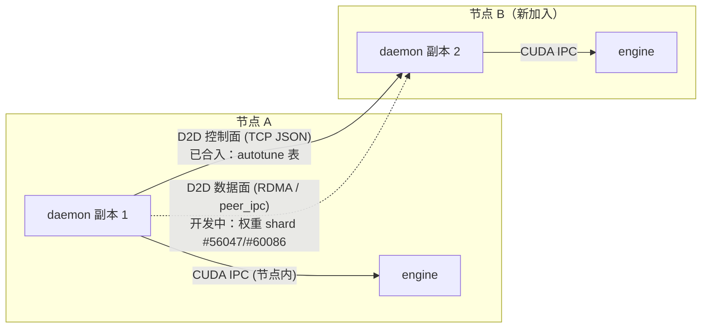

# vLLM Fast Start（Preload / Weight Cache Daemon）特性代码走读技术文档

> **文档版本**: 1.0
> **分析代码版本**: vLLM main 分支（截至 2026-10，upstream `2fb320d830`）
> **对应 RFC**: [#56049 [Feature]: Fast Start For vLLM](https://github.com/vllm-project/vllm/issues/56049)（作者 @liusy58，2026-09-09，Open）
> **最后更新**: 2026-10-26

---

## 文档概述

**Fast Start** 是 vLLM 为缩短引擎**重启 / 扩缩容**启动时间而引入的一组能力。它的核心是一个**常驻的、每 GPU 一个的权重守护进程（Weight Cache Daemon）**：守护进程只做一次「读 checkpoint → 量化后处理 → TP/EP 切分」，然后把处理好的 GPU 权重常驻显存，新的 vLLM 引擎通过 **CUDA IPC** 直接映射这些权重（zero-copy），从而跳过磁盘加载、权重后处理和 kernel autotune。

用户侧的入口非常简单：

```bash
vllm preload --model /path/to/model --tensor-parallel-size 4         # 启动守护进程
vllm serve   /path/to/model --tensor-parallel-size 4 --load-format ipc_cache   # 引擎从守护进程加载
```

**本文覆盖范围**：

| 范围 | 内容 |
|------|------|
| 已合入 main 的能力 | 权重守护进程、`ipc_cache` loader、`vllm preload` CLI、TP/PP/DP/EP/多节点、MTP/EAGLE draft 组、FP8/FP4/MXFP8 预处理权重、显存记账、守护进程退出检测、FlashInfer autotune 预热与 D2D 种子同步 |
| RFC 中尚未完成的部分 | D2D 权重传输（#56047 / #60086）、统一 autotune cache、Supervised restart、跳过 `profile_run`、import 开销优化等（见 5.5 节 Roadmap） |

**目标读者**：

- 希望理解 vLLM 启动路径、权重加载机制的开发者
- 需要在 K8s / 弹性扩缩容场景下缩短 vLLM 冷启动时间的部署工程师
- 准备为 Fast Start roadmap 贡献代码的社区开发者

**阅读指南**：只想会用 → 直接看第五部分；想理解原理 → 第一部分 + 第三部分 3.1~3.4；想贡献代码 → 第二、三部分 + 5.5 Roadmap + 附录 A。

---

# 第一部分: Fast Start 基础与架构总览

## 1.1 Fast Start 原理

### 1.1.1 问题：vLLM 启动时间都花在哪里

一个 vLLM 引擎从 `vllm serve` 到能接收请求，大致经历以下阶段：



对于大模型（如 100B+ MoE、FP8/FP4 量化），红色的 **checkpoint 读取 + 权重后处理** 往往要数分钟；橙色的 **FlashInfer autotune** 在大 MoE 模型上也是剩余启动时间的主要组成。而这些工作在**同一份模型、同一份并行配置**下每次重启都是重复的。

可以把启动时间写成：

$$
T_{\text{start}} = T_{\text{import}} + T_{\text{dist}} + \underbrace{T_{\text{load}} + T_{\text{postproc}}}_{\text{权重}} + T_{\text{compile}} + T_{\text{profile}} + \underbrace{T_{\text{autotune}}}_{\text{kernel 调优}} + T_{\text{cudagraph}}
$$

Fast Start 的思路是：**把与引擎生命周期无关、只与「模型 + 配置 + 硬件」相关的产物（artifact）缓存下来并跨引擎复用**。目前已落地两类 artifact：

$$
T_{\text{load}} + T_{\text{postproc}} \;\longrightarrow\; T_{\text{ipc\_map}} \approx \text{秒级}, \qquad T_{\text{autotune}} \;\longrightarrow\; T_{\text{cache\_load}}
$$

### 1.1.2 基本思想



三个关键设计点：

1. **缓存的是「后处理之后」的权重**：守护进程跑完 `process_weights_after_loading`（FP8 重量化、MoE shuffle/repack、NVFP4 swizzle 等），导出的就是 kernel 直接可用的 runtime layout。引擎侧进入「预处理模式」（`weights_already_processed()`），只重建 Python 侧状态（例如 MoE kernel 对象），不再改动张量。
2. **zero-copy 共享显存**：默认 `zero_copy` 模式下引擎直接映射守护进程的 CUDA allocation，每张 GPU 只有一份权重；显存账本里把这部分从 `gpu_memory_utilization` 中扣掉。
3. **严格的缓存校验 + 可靠回退**：守护进程和引擎各自计算 `WeightCacheKey` 指纹，任何字段不一致都不复用，回退到默认的磁盘加载（`fallback=True` 时）。

### 1.1.3 收益分析

设模型 shard 大小为 $S$（单卡），磁盘/网络读取带宽 $B_{\text{io}}$，后处理耗时 $T_{\text{post}}$：

$$
T_{\text{weights}}^{\text{disk}} \approx \frac{S}{B_{\text{io}}} + T_{\text{post}}, \qquad
T_{\text{weights}}^{\text{ipc}} \approx N_{\text{tensor}} \cdot t_{\text{rebuild}} + T_{\text{meta\_init}}
$$

其中 $N_{\text{tensor}}$ 为张量数量（通常数千），$t_{\text{rebuild}}$ 为一次 `rebuild_cuda_tensor`（打开 IPC handle）的开销（微秒~毫秒级），与 $S$ 无关。因此**模型越大、量化后处理越重，收益越明显**——从「分钟级」降到「秒级」（docs/features/preload.md 的说法）。

`zero_copy` 模式下的显存账：

$$
M_{\text{engine budget}} = \lceil M_{\text{total}} \times \text{gpu\_memory\_utilization} \rceil - M_{\text{daemon exported weights}}
$$

即守护进程持有的权重计入引擎预算，所以 KV cache 容量与磁盘加载**一致**（PR #62583 实测：disk 152.71 GiB vs daemon 152.73 GiB）。

### 1.1.4 关键指标与术语

| 指标/术语 | 含义 |
|----------|------|
| Cold start | 没有可用守护进程或缓存未命中，走磁盘加载 |
| Warm restart | 守护进程已就绪且指纹匹配，引擎通过 IPC 映射权重 |
| Cache hit / mismatch / fallback | 指纹完全匹配 / 至少一个字段不匹配 / 回退磁盘加载 |
| Exported weight bytes | 守护进程导出给引擎的**不同 CUDA storage 的总字节数**（不是 `memory_allocated()`） |
| Daemon loss | zero-copy 引擎运行中守护进程退出 |

---

## 1.2 vLLM Fast Start 整体架构

### 1.2.1 系统架构总览图



### 1.2.2 核心组件与职责划分

| 组件 | 文件 | 职责 |
|------|------|------|
| `PreloadSubcommand` | `vllm/entrypoints/cli/preload.py` | 解析参数、规划本机 rank、为 target/draft 组 spawn 守护进程、等待全部就绪、`/health`、信号处理 |
| `WeightCacheDaemon` | `.../weight_cache/daemon.py` | 加载并后处理一个 shard、warmup、释放通信资源、在 Unix socket 上服务 IPC handle |
| `IpcModelLoader` | `.../weight_cache/ipc_loader.py` | `load_format="ipc_cache"` 的 loader：meta 设备建模 → 拉取 entries → 注册参数 → 预处理模式后处理 → watch；失败则回退 `DefaultModelLoader` |
| `WeightCacheKey` | `.../weight_cache/protocol.py` | 缓存指纹（checkpoint 头哈希、架构、并行、量化、RoPE、KV dtype、kernel backend、vLLM 版本…） |
| `TensorEntry` / 消息协议 | `.../weight_cache/protocol.py` | 张量 → CUDA IPC reduction args；长度前缀 + pickle 的 socket 协议；socket 目录/权限安全检查 |
| `FlashInferWarmupCache` | `.../weight_cache/warmup_cache.py` | 守护进程上运行 FlashInfer autotune；作为 `Seedable` 支持 D2D 种子 |
| `SeedTransport` / `Seedable` | `.../weight_cache/seed.py` | 守护进程之间基于 token 认证的 TCP JSON 通道 |
| 工具函数 | `.../weight_cache/utils.py` | draft 是否可缓存、角色命名、构建 warmup 用的 `GPUModelRunner` |
| 引擎侧集成 | `gpu_worker.py`、`v1/worker/utils.py::request_memory`、`model_loader/utils.py`、各 quant method | 显存记账、draft load config 路由、`supports_pre_processed_weights` 契约 |

### 1.2.3 数据流与控制流

- **控制面**：Unix socket 上的 4 条命令 `get_state` / `get_memory` / `release` / `watch`（pickle，仅同用户本地进程）；D2D 通道上的 JSON 请求（token 认证）。
- **数据面**：权重本身**从不经过 socket**。socket 里传的是 `torch.multiprocessing.reductions.reduce_tensor` 产生的 IPC 参数（handle、offset、size、stride…），引擎用 `rebuild_cuda_tensor` 在本进程打开同一块显存。只有极少数非 CUDA 小张量按值传输。

---

## 1.3 执行流程详解

### 1.3.1 示例场景设定

> 4×GPU 单机，Qwen3-30B-A3B-NVFP4，TP=4，开启 FlashInfer autotune，默认 `zero_copy` + `fallback=True`。

### 1.3.2 完整时序



### 1.3.3 分步解读

| 步骤 | 位置 | 说明 |
|------|------|------|
| ① 配置 | `PreloadSubcommand.cmd` | `vllm preload` 复用 `EngineArgs.add_cli_args`，因此**参数与 `vllm serve` 完全一致**，保证两边算出的配置/指纹相同；禁止 `--load-format ipc_cache` |
| ② 规划 | `plan_local_ranks` | 按 DP→PP→TP 枚举 global rank，决定本机每张 GPU 服务哪个 `(dp, pp, tp)` |
| ③ 指纹 | `WeightCacheDaemon.__init__` | **必须在加载前计算**，因为 `process_weights_after_loading` 可能修改 `hf_config.quantization_config` |
| ④ 加载 | `get_model` | 在 create_model 后、慢速 load_weights 前做量化方法检查，不支持则快速失败 |
| ⑤ 预热 | `FlashInferWarmupCache.warmup` | 构造一个 warmup 用的 `GPUModelRunner`，复用已加载模型跑 autotune |
| ⑥ 释放 | `release_distributed` | 服务阶段只导出 IPC handle，不需要通信器；释放约 2.5 GiB/GPU（#62583） |
| ⑦ 服务 | `serve_forever` | 模型全部就绪后才 bind socket，早到的引擎会连不上 → 回退或等待 |
| ⑧ 记账 | `gpu_worker` → `get_external_weight_memory` | zero-copy 时把守护进程导出的权重计入预算 |
| ⑨ 映射 | `IpcModelLoader.load_model` | 校验指纹与 GPU UUID → meta 模型 → 注册 IPC 张量 |
| ⑩ 监视 | `_watch_daemon` | 后台线程阻塞在 `recv(1)`，守护进程退出即置位 `daemon_lost` |

---

# 第二部分: 核心接口与基类分析

## 2.1 核心类关系



## 2.2 核心接口定义

### 2.2.1 Loader 接口扩展：`get_external_weight_memory`

`BaseModelLoader` 新增了一个默认返回 0 的钩子，`IpcModelLoader` 覆写它，让 worker 在做显存快照前知道「有多少权重显存是别的进程持有的」：

```python
# 文件: vllm/v1/worker/gpu_worker.py
            # Weights from external model loader process
            external_weight_memory = get_model_loader(
                self.load_config
            ).get_external_weight_memory(self.vllm_config)

            # take current memory snapshot after external weights are ready
            self.init_snapshot = init_snapshot = MemorySnapshot(device=self.device)
            self.requested_memory = request_memory(
                init_snapshot, self.cache_config, external_weight_memory
            )
```

```python
# 文件: vllm/v1/worker/utils.py
def request_memory(init_snapshot, cache_config, external_weight_memory: int = 0) -> int:
    requested_memory = math.ceil(
        init_snapshot.total_memory * cache_config.gpu_memory_utilization
    )
    if external_weight_memory > 0:
        engine_memory = requested_memory - external_weight_memory
        if engine_memory <= 0:
            raise ValueError("Externally held weights ... exceed the desired GPU memory utilization ...")
        if init_snapshot.free_memory < engine_memory:
            raise ValueError("Free memory ... is less than the engine's budget after excluding external process's weights ...")
```

### 2.2.2 量化方法契约：`supports_pre_processed_weights`

```python
# 文件: vllm/model_executor/layers/quantization/base_config.py
class QuantizeMethodBase(ABC):
    supports_pre_processed_weights: bool = False
    """
    Whether ``process_weights_after_loading`` supports running under
    ``weights_already_processed``. Methods must skip tensor transforms in
    that mode; the loader driver rejects methods that do not declare support.
    """
```

```python
# 文件: vllm/model_executor/utils.py
@contextmanager
def weights_already_processed():
    """Mark that weights are already in post-processed (runtime) format, so
    ``process_weights_after_loading`` skips tensor transforms (used by the
    weight cache IPC loader)."""
    token = _weights_pre_processed.set(True)   # ContextVar
    try:
        yield
    finally:
        _weights_pre_processed.reset(token)
```

这是 Fast Start 对量化子系统**唯一的侵入点**：每个 quant method 在 `process_weights_after_loading` 开头判断 `is_weights_pre_processed()`，只恢复「张量导出带不过去的 Python 侧状态」。

| 已声明支持的方法（节选） | 文件 | pre-processed 下做什么 |
|------|------|------|
| `UnquantizedLinearMethod` | `layers/linear.py` | 无需处理 |
| `VocabParallelEmbedding` 方法 | `layers/vocab_parallel_embedding.py` | 无需处理 |
| `Fp8LinearMethod` | `quantization/fp8.py:358` | 补 `layer.input_scale = None`、恢复 Marlin `marlin_input_dtype` |
| `Fp8MoEMethod` | `quantization/fp8.py:713` | `_init_moe_kernel(layer)` 只重建 kernel |
| `UnquantizedFusedMoEMethod` | `fused_moe/unquantized_fused_moe_method.py` | 重建 kernel；**MoonEP backend 不支持** |
| MXFP4 / ModelOpt FP8/NVFP4/MXFP8 | `mxfp4.py` / `modelopt.py` | 跳过 swizzle/repack，重建 kernel（NVFP4 #55465，MXFP8 #57316） |
| KV cache 量化 | `quantization/kv_cache.py` | 跳过 scale 处理 |
| `compressed_tensors_moe_w4a8_mxfp4` | — | **显式 False** |

```python
# 文件: vllm/model_executor/layers/quantization/fp8.py
    def process_weights_after_loading(self, layer: RoutedExperts) -> None:
        if is_weights_pre_processed():
            # Weights are already in kernel format; rebuild the kernel only.
            self._init_moe_kernel(layer)
            return
        ...
```

检查发生在两处：守护进程 `get_model()` 与引擎 `_build_model()` 都调用 `check_ipc_quant_support(model)`；`process_weights_after_loading` 驱动层在 pre-processed 模式下再兜底抛 `RuntimeError`。

### 2.2.3 Socket 协议命令

| 命令 | 请求字段 | 成功响应 | 用途 |
|------|---------|---------|------|
| `get_state` | `cache_key: WeightCacheKey`, `is_reload: bool` | `{"status":"ok","entries","aliases","attrs","gpu_uuid"}`；不匹配时 `{"status":"mismatch","fields":[...]}` | 拉取 IPC handle |
| `get_memory` | — | `{"status":"ok","memory_bytes"}` | 显存记账 |
| `release` | — | `{"status":"ok"}` | copy 模式下引擎克隆完后让守护进程释放权重 |
| `watch` | — | `{"status":"ok"}`，之后连接保持不关 | 守护进程退出检测 |

消息格式：`!Q` 8 字节长度前缀 + `pickle` 负载，单消息上限 `1 << 34`。

### 2.2.4 异常体系

| 异常 | 触发 | `fallback=True` 时行为 |
|------|------|---------------------|
| `WeightCacheUnavailableError` | socket 不存在/连不上/权限不对/守护进程报错 | 回退磁盘 |
| `CacheConfigMismatchError` | 指纹不一致、GPU UUID 不一致、target/draft 角色不一致 | 回退磁盘 |
| 其它 `Exception`（构建过程中） | 例如注册张量失败 | 回退磁盘；copy 模式下先 `release` 防 OOM |
| `UnsupportedQuantForIPCError` | 有 quant method 不支持预处理权重 | **直接抛出**（永久性配置错误） |
| `UnsupportedPlatformForIPCError` | 非 CUDA/ROCm（如 XPU） | **直接抛出**（#56010） |
| `ValueError("... EPLB")` | 开启 EPLB | **直接抛出**（守护进程和 loader 都不支持） |

## 2.3 注册机制

`ipc_cache` 作为普通的 load format 注册进 loader 注册表，不需要改 engine 主路径：

```python
# 文件: vllm/model_executor/model_loader/__init__.py
LoadFormats = Literal[..., "ipc_cache", ...]
_LOAD_FORMAT_TO_MODEL_LOADER: dict[str, type[BaseModelLoader]] = {
    ...
    "ipc_cache": IpcModelLoader,
}
```

`vllm preload` 作为 CLI 子命令通过 `cmd_init()` 注册（#56680）：

```python
# 文件: vllm/entrypoints/cli/preload.py
def cmd_init() -> list[CLISubcommand]:
    return [PreloadSubcommand()]
```

---

# 第三部分: 核心实现深度分析

## 3.1 守护进程：加载、预热与服务

### 3.1.1 Rank 规划

global rank 按 **DP → PP → TP** 枚举：

$$
\text{global\_rank} = dp\_rank \cdot (pp \cdot tp) + pp\_rank \cdot tp + tp\_rank
$$

```python
# 文件: vllm/model_executor/model_loader/weight_cache/daemon.py
def plan_local_ranks(parallel_config) -> list[tuple[int, int, int, int]]:
    """``(local_rank, dp_rank, pp_rank, tp_rank)`` for every local daemon."""
    tp_size = parallel_config.tensor_parallel_size
    pp_size = parallel_config.pipeline_parallel_size
    world_size = parallel_config.data_parallel_size * pp_size * tp_size
    if parallel_config.nnodes > 1:
        local_world_size = world_size // parallel_config.nnodes
        base = parallel_config.node_rank * local_world_size
    else:
        local_world_size = parallel_config.data_parallel_size_local * pp_size * tp_size
        base = parallel_config.data_parallel_rank * pp_size * tp_size
    placements = []
    for local_rank in range(local_world_size):
        global_rank = base + local_rank
        rank_in_dp = global_rank % (pp_size * tp_size)
        dp_rank = global_rank // (pp_size * tp_size)
        pp_rank, tp_rank = divmod(rank_in_dp, tp_size)
        placements.append((local_rank, dp_rank, pp_rank, tp_rank))
    return placements
```

**数值示例**：TP8 × DP2 × EP，4 节点，每节点 4 卡（world=16，每节点 local_world=4）：

| node_rank | local_rank | global_rank | dp_rank | tp_rank |
|-----------|-----------|-------------|---------|---------|
| 0 | 0..3 | 0..3 | 0 | 0..3 |
| 1 | 0..3 | 4..7 | 0 | 4..7 |
| 2 | 0..3 | 8..11 | 1 | 0..3 |
| 3 | 0..3 | 12..15 | 1 | 4..7 |

这与引擎 worker 的连续 rank 分配完全一致，保证每个 engine worker 都能在**本节点**找到持有其 shard 的守护进程（CUDA IPC handle 只在节点内有效）。

`_reject_unsupported_parallelism` 会拒绝 `world_size % nnodes != 0` 以及 `data_parallel_start_rank + data_parallel_size_local > dp_size` 的配置。

### 3.1.2 自己的 rendezvous

守护进程组成**独立的 world group**（独立端口 `--weight-cache-master-port`），原因：守护进程可能在引擎启动时还在加载，不能和引擎抢同一个 `--master-port`。

```python
# 文件: vllm/model_executor/model_loader/weight_cache/daemon.py
    def load_model(self) -> None:
        torch.accelerator.set_device_index(self.local_rank)
        # Outside the config context so the daemon keeps its own rendezvous
        # instead of the engine's; model parallel groups (TP/DP/EP) are then
        # carved out of this world group like in the engine.
        init_distributed_environment(
            world_size=self.world_size, rank=self.global_rank,
            distributed_init_method=self.distributed_init_method,
            local_rank=self.local_rank, backend=current_platform.dist_backend,
        )
        with set_current_vllm_config(self.vllm_config):
            ensure_model_parallel_initialized(self.tp_size, self.pp_size)
            self.model = self.get_model()
        self.loaded_rope_parameters_hash = hash_rope_parameters(self.model_config)
        gc.collect()
        torch.accelerator.empty_cache()
```

> **关键洞察**：守护进程也要像 engine worker 一样设置 `parallel_config.rank = rank_in_dp`。#62583 之前没设，所有 rank 都用 `torch_aot_compile/<hash>/rank_0_0` 的编译产物，而 Inductor 代码里硬编码了 `set_device(0)`，导致 warm compile cache 下 TP>1 的 warmup **死锁**（MNNVL workspace 的 `cuMulticastAddDevice` 在 rank 1..N 上失败，rank 0 卡在 `cuMemMap`）。

### 3.1.3 加载与量化检查

```python
# 文件: vllm/model_executor/model_loader/weight_cache/daemon.py
    def get_model(self) -> torch.nn.Module:
        ...
        init_workspace_manager(target_device)
        with set_default_torch_dtype(model_config.dtype):
            with target_device:
                model = loader.create_model(vllm_config, model_config)
            check_ipc_quant_support(model)          # 慢加载前 fail fast
            loader.load_weights(model, model_config)
            process_weights_after_loading(model, model_config, target_device)
        return model.eval()
```

守护进程用的是普通 loader（`get_model_loader(load_config)`，默认 safetensors），所以支持所有磁盘 loader 的加速手段（如 instanttensor、runai streamer 等）。

### 3.1.4 释放启动资源

```python
# 文件: vllm/model_executor/model_loader/weight_cache/daemon.py
    def release_distributed(self) -> None:
        free_before, _ = torch.accelerator.get_memory_info()
        get_world_group().barrier()          # 不能在 peer 还在 warmup 集合通信时拆通信器
        destroy_fi_ar_workspace()            # warmup 中 all-reduce fusion 懒创建
        destroy_model_parallel()
        destroy_distributed_environment()
        gc.collect()
        if current_platform.is_cuda():
            clear_workspaces = getattr(torch._C, "_cuda_clearCublasWorkspaces", None)
            if clear_workspaces is not None:
                clear_workspaces()           # #63451
        torch.accelerator.empty_cache()
```

#62583 的实测（4×B300，Qwen3-30B-A3B-NVFP4，TP4）：

| | disk load | daemon（修复前） | daemon（修复后） |
|---|---|---|---|
| KV cache | 152.71 GiB / 13,343,600 tokens | 152.61 GiB | **152.73 GiB / 13,345,760 tokens** |
| 计入引擎的权重 | 4.29 GiB | 4.35 GiB | 4.24 GiB |
| 守护进程 GPU 显存 | - | 8,244 MiB | **5,698 MiB** |
| warm compile cache 下 warmup | - | 4/4 hang | 2/2 ready |

### 3.1.5 服务循环

```python
# 文件: vllm/model_executor/model_loader/weight_cache/daemon.py
    def serve_forever(self, ready_callback=None) -> None:
        socket_path = self._socket_path
        ensure_private_socket_dir(os.path.dirname(socket_path),
                                  strict_perms=self.socket_dir is None)
        lock_fd = self._acquire_gpu_lock(socket_path)   # flock LOCK_EX|LOCK_NB
        if os.path.exists(socket_path):
            os.unlink(socket_path)                       # 只有持锁者才删 stale socket
        server = socket.socket(socket.AF_UNIX, socket.SOCK_STREAM)
        server.bind(socket_path)
        os.chmod(socket_path, 0o600)
        server.listen()
        self.d2d.start_listener()
        if ready_callback is not None:
            ready_callback()
        try:
            while True:
                conn, _ = server.accept()
                with conn:
                    try:
                        verify_peer_is_owner(conn)       # SO_PEERCRED
                        self._handle_connection(conn)
                    except (ConnectionError, EOFError):
                        logger.warning("Client disconnected mid-request")
                    except Exception as e:
                        ...  # 回报错误但不让守护进程挂掉
                        send_msg(conn, {"status": "error", "message": str(e)})
        finally:
            ...
```

要点：

- **单线程串行 accept**：请求都很小，串行足够；
- **socket 路径用 GPU UUID 的 hash**：与 `CUDA_VISIBLE_DEVICES` 的重映射无关（#56669），且保持在 AF_UNIX ~108 字节路径限制内；
- **每 GPU 一把 `.lock` 文件锁**：第二个守护进程会 fail fast，不会把活着的 socket 偷换掉。

## 3.2 导出：`export_entries` 与 `TensorEntry`

```python
# 文件: vllm/model_executor/model_loader/weight_cache/daemon.py
def export_entries(model) -> tuple[dict[str, TensorEntry], dict[str, str]]:
    entries, aliases, canonical_by_id = {}, {}, {}

    def _add(name, tensor, kind):
        canonical = canonical_by_id.get(id(tensor))
        if canonical is not None:
            aliases[name] = canonical            # tied weight：只记别名
            return
        canonical_by_id[id(tensor)] = name
        entries[name] = TensorEntry.from_tensor(tensor, kind)

    for name, param in model.named_parameters(remove_duplicate=False):
        _add(name, param, "param")
    # named_buffers 包含 non-persistent buffer（如 rotary cache），state_dict 会漏掉
    for name, buffer in model.named_buffers(remove_duplicate=False):
        if name in entries or name in aliases:
            continue
        _add(name, buffer, "buffer")
    return entries, aliases
```

```python
# 文件: vllm/model_executor/model_loader/weight_cache/protocol.py
@dataclass
class TensorEntry:
    kind: str                       # "param" | "buffer"
    ipc_args: tuple | None = None
    cpu_tensor: torch.Tensor | None = None

    @classmethod
    def from_tensor(cls, tensor, kind):
        tensor = tensor.detach()
        if tensor.is_cuda:
            _, ipc_args = reduce_tensor(tensor)   # torch.multiprocessing 的 CUDA IPC 归约
            return cls(kind=kind, ipc_args=ipc_args)
        return cls(kind=kind, cpu_tensor=tensor.cpu())

    def rebuild(self, device_index: int) -> torch.Tensor:
        if self.ipc_args is None:
            return self.cpu_tensor
        args = list(self.ipc_args)
        # Index 6 是 device index；守护进程和引擎的 CUDA_VISIBLE_DEVICES 可能不同
        args[6] = device_index
        return rebuild_cuda_tensor(*args)
```

> **注意**：每次 `get_state` 都**重新** `export_entries`（#56472）。`reduce_tensor` 会为每次导出在 PyTorch 的 CUDA IPC 引用计数里登记一次，若多个客户端共用一次导出结果，会导致引用生命周期错乱。

## 3.3 引擎侧加载：`IpcModelLoader.load_model`

### 3.3.1 主流程与回退状态机



`fallback=False` 时还有一个**启动等待**语义：`_with_startup_wait` 以 0.5s 间隔重试，最长 `state_timeout_s`（默认 300s），用于「守护进程和引擎同时启动」的场景（#58370）。

### 3.3.2 在 meta 设备上建模 + 注册 IPC 张量

```python
# 文件: vllm/model_executor/model_loader/weight_cache/ipc_loader.py
    def _build_model(self, vllm_config, model_config, prefix, state):
        ...
        with set_default_torch_dtype(model_config.dtype):
            with torch.device("meta"):                    # 不分配任何显存
                model = initialize_model(vllm_config=vllm_config,
                                         model_config=model_config, prefix=prefix)
            check_ipc_quant_support(model)
            self._apply_entries(model, state, device_index)
            # load_weights 会设置的 Python 标志（如 EAGLE 对 embed_tokens/lm_head 的所有权）
            for name, value in state.attrs.items():
                setattr(model, name, value)
            # 预处理模式：quant method 只重建 Python 侧状态（如 MoE kernel）
            with weights_already_processed():
                process_weights_after_loading(model, model_config, target_device)
            _materialize_remaining_meta_tensors(
                model, torch.device(target_device.type, device_index))
        if self.mode == "copy":
            self._send_release()
        else:
            self._watch_daemon()
        return model.eval()
```

`_apply_entries` 用 `module.register_parameter / register_buffer` **替换**而不是 `param.data = ...`（对 meta 张量会失败），并且允许 entries 引入 meta 模型里没有的「后处理新增张量」：

```python
# 文件: vllm/model_executor/model_loader/weight_cache/ipc_loader.py
        def _register(name, tensor, is_param):
            module_name, _, leaf = name.rpartition(".")
            module = modules.get(module_name)          # named_modules(remove_duplicate=False)
            module._parameters.pop(leaf, None)
            module._buffers.pop(leaf, None)
            if is_param:
                obj = tensor if isinstance(tensor, nn.Parameter) \
                      else nn.Parameter(tensor, requires_grad=False)
                module.register_parameter(leaf, obj)
            else:
                module.register_buffer(leaf, tensor)
            registered[name] = obj

        for name, entry in state.entries.items():
            tensor = entry.rebuild(device_index)
            if self.mode == "copy":
                tensor = tensor.clone()
            _register(name, tensor, entry.kind == "param")
        # tied 权重：注册「同一个对象」，保持参数身份
        for alias_name, canonical_name in state.aliases.items():
            obj = registered.get(canonical_name)
            ...
            _register(alias_name, obj, isinstance(obj, nn.Parameter))
```

最后 `_materialize_remaining_meta_tensors` 处理「守护进程后处理时被删掉的占位参数」，用 `torch.empty_like` 分配（预期运行时不会被读）。

> **注意**：这一步是已知的风险点。RFC Robustness 中的 #62115（MoE router 留在 meta 占位上）就属于这类「导出集合与 meta 模型集合不一致」的问题；`deep_gemm_mega_moe.py` 中也有 `# meta under ipc_cache` 的特殊处理。

### 3.3.3 两种模式对比

| 维度 | `zero_copy`（默认） | `copy` |
|------|------|------|
| 引擎权重来源 | 直接映射守护进程的 CUDA allocation | `rebuild` 后 `.clone()` 到引擎自有显存 |
| 每卡权重份数 | 1 | 加载瞬间 2，随后守护进程 `release` 后为 1 |
| `get_external_weight_memory` | 返回守护进程导出字节数 | 0 |
| 守护进程是否需要常驻 | 是（引擎生命周期内） | 否，交接后即释放 |
| 后续重启能否继续命中 | 能 | 不能（守护进程已 release，`get_state` 报 "Weights were released"） |
| 与 sleep mode 兼容 | **不兼容**（权重不在 CuMemAllocator 里） | 可以 |
| 典型场景 | 频繁重启/升级引擎、弹性扩缩 | 一次性「预热交接」，之后希望守护进程释放显存 |

### 3.3.4 守护进程丢失检测（#62734）

zero-copy 下如果守护进程退出，CUDA driver 会保持已映射内存直到引擎退出，**引擎仍可继续服务**；但此时若再起一个守护进程，GPU 上就会有两份权重。实现方式非常轻量：

```python
# 文件: vllm/model_executor/model_loader/weight_cache/daemon.py
    def _handle_watch(self, conn):
        self._prune_watchers()
        self._watchers.append(conn.dup())   # serve_forever 会关 conn，保留一个 dup
        send_msg(conn, {"status": "ok"})
```

```python
# 文件: vllm/model_executor/model_loader/weight_cache/ipc_loader.py
    def _wait_for_daemon_exit(self, conn, socket_path):
        with conn, contextlib.suppress(OSError):
            while conn.recv(1):      # 守护进程永不写；退出时 recv 返回 b""
                pass
        self.daemon_lost.set()
        logger.warning("Weight cache daemon at %s exited. This engine keeps serving ...")
```

由于连接绑定在**守护进程实例**上，即使同一路径上重启了新守护进程也不会掩盖这次丢失。守护进程侧通过 `select` 检测「可读 = 引擎已关闭」来清理 watcher。

> **关键洞察**：RFC 里写的 "Daemon-loss semantics" 期望 fail fast + health check 上报；当前 main 的实现是**检测并告警、继续服务**（`daemon_lost` Event 已暴露，但尚未接入 health check），这一项在 RFC 中仍未勾选。

## 3.4 缓存校验：`WeightCacheKey`

### 3.4.1 字段全览

| 字段 | 来源 | 为什么需要 | 引入 PR |
|------|------|-----------|---------|
| `checkpoint` | `hash_checkpoint()`：各 safetensors 分片的**文件名 + header**哈希；取不到则用模型路径 | 不同目录下相同权重也能命中 | #54921 |
| `model_arch` | `hf_config.architectures` | — | #54921 |
| `tp_size/tp_rank`, `pp_size/pp_rank` | 并行组 | shard 布局 | #54921 / #55477 |
| `dp_size/dp_rank` | DP 组；**非 MoE 模型强制 (1,0)** | MoE EP 下不同 DP rank 持有不同 expert；dense 模型各 DP 副本相同 | #57386 / #60179 |
| `enable_expert_parallel`, `expert_placement_strategy` | ParallelConfig | expert 分布 | #55490 |
| `dtype`, `quantization`, `quant_config_hash` | ModelConfig + checkpoint quant config + runtime 覆盖 | 量化布局 | #54921 / #55465 |
| `rope_parameters_hash` | text config 的 `rope_parameters` + `max_position_embeddings`（整数化浮点） | RoPE cache buffer 是导出的 | #60994 |
| `kv_cache_dtype`, `kv_cache_dtype_skip_layers` | CacheConfig | KV 量化 scale 处理不同 | #61758 |
| `moe_backend`, `linear_backend`, `linear_backend_per_quant` | KernelConfig | backend 决定后处理布局（shuffle / repack） | #63506 |
| `is_draft` | 角色 | target/draft 组隔离 | #57312 |
| `revision`, `vllm_version` | — | 防跨版本误用 | #54921 |

```python
# 文件: vllm/model_executor/model_loader/weight_cache/protocol.py
    def mismatched_fields(self, other: "WeightCacheKey") -> list[str]:
        return [f.name for f in fields(self) if getattr(self, f.name) != getattr(other, f.name)]
```

守护进程比对后把不匹配字段名直接回给引擎，引擎日志里能看到类似 `WeightCacheKey mismatch on fields: ['kv_cache_dtype']`，便于排查。

### 3.4.2 checkpoint 指纹的取舍

```python
# 文件: vllm/model_executor/model_loader/weight_cache/protocol.py
def hash_checkpoint(model: str) -> str | None:
    if not os.path.isdir(model):
        return None
    files = glob.glob(os.path.join(model, "*.safetensors"))
    ...
    hasher = safe_hash(b"", usedforsecurity=False)
    for path in sorted(files, key=os.path.basename):
        hasher.update(os.path.basename(path).encode())
        hasher.update(_safetensors_header(path))    # 只读 header，不读权重字节
    return hasher.hexdigest()
```

只哈希 header（张量名/dtype/shape/offset）非常快，但**无法区分「结构相同、数值不同」的两份 checkpoint**（例如同结构的微调权重）。这正是 #59647/#59648（采样张量字节做指纹，Open）要解决的问题。

> **注意**：RFC 明确要求「缺失字段绝不能静默复用不兼容条目」（Cache-key audit）。历史上 RoPE、DP keying、KV 量化、kernel backend 都是事后补上的字段，说明新增「影响后处理布局的配置」时，**必须同步检查是否需要加入 `WeightCacheKey`**。

### 3.4.3 Reload 时的 RoPE 特例

`load_weights` 的 in-place reload（`is_reload=True`）中，模型构建可能已经规范化了 RoPE 参数，所以守护进程额外记录了 `loaded_rope_parameters_hash`，若客户端的 RoPE 哈希与之相等，则忽略该字段的不匹配：

```python
# 文件: vllm/model_executor/model_loader/weight_cache/daemon.py
        if (
            request.get("is_reload", False)
            and "rope_parameters_hash" in mismatched
            and client_key.rope_parameters_hash == self.loaded_rope_parameters_hash
        ):
            mismatched.remove("rope_parameters_hash")
```

## 3.5 推测解码：draft 守护进程组（#57312）

对 `mtp` / `eagle` / `eagle3`，`vllm preload` 额外启动一组 `is_draft=True` 的守护进程，使用独立的 socket（`*_draft.sock`）、独立的 rendezvous 端口（`--weight-cache-draft-master-port`，多节点默认 `master_port + 1`）与独立的 cache key。

引擎侧的路由在 `get_draft_load_config`：

```python
# 文件: vllm/model_executor/model_loader/utils.py
def get_draft_load_config(vllm_config: VllmConfig) -> LoadConfig:
    speculative_config = vllm_config.speculative_config
    if speculative_config is not None and speculative_config.draft_load_config is not None:
        return speculative_config.draft_load_config
    load_config = vllm_config.load_config
    if load_config is not None and load_config.load_format != "ipc_cache":
        return load_config
    kwargs = (
        # Route the draft to the daemon's draft group.
        {"model_loader_extra_config": {**load_config.model_loader_extra_config, "is_draft": True}}
        if is_draft_model_cacheable(speculative_config)
        # 无 draft 组：从磁盘加载，避免打到 target 守护进程造成指纹不匹配
        else {"load_format": "auto", "model_loader_extra_config": {}}
    )
    return replace(load_config, **kwargs)
```

`IpcModelLoader.load_model` 还会交叉校验 `model_config is spec.draft_model_config` 与 `self.is_draft` 是否一致，防止路由标志丢失。EAGLE 类 draft 的 `load_weights` 会设置诸如「是否共享 target 的 embed_tokens/lm_head」的 Python 标志，这些通过 `attrs`（`EXPORTED_MODEL_ATTRS = tuple(SupportsEagleBase.__annotations__)`）一并传给引擎。

## 3.6 Autotune 缓存预热与 D2D 种子

### 3.6.1 守护进程上的 FlashInfer autotune

```python
# 文件: vllm/model_executor/model_loader/weight_cache/warmup_cache.py
class FlashInferWarmupCache(WarmupCache):
    kind = "flashinfer_autotune"

    def warmup(self, daemon, transport) -> None:
        vllm_config = daemon.vllm_config
        if (
            vllm_config.kernel_config.enable_flashinfer_autotune is False
            or not has_flashinfer()
            or not current_platform.has_device_capability(90)
            or is_draft_model_cacheable(vllm_config.speculative_config)
        ):
            return
        from vllm.model_executor.warmup.kernel_warmup import flashinfer_autotune
        try:
            current_platform.update_block_size_for_backend(vllm_config)
            runner = build_warmup_runner(vllm_config, daemon.local_rank,
                                         is_draft=daemon.is_draft,
                                         model_config=daemon.model_config)
            runner.load_model(model=daemon.model)        # 复用已加载的 shard
            transport.adopt(self, runner)                # 先尝试从远端副本拿表
            flashinfer_autotune(runner, skip_attn=vllm_config.use_v2_model_runner)
        finally:
            gc.collect()
            torch.accelerator.empty_cache()
```

关键点：

- `vllm preload` 用 `UsageContext.OPENAI_API_SERVER` 构造配置，确保与 `vllm serve` 得到同样的默认值 → 同样的 autotune **config hash**；
- 结果写到磁盘 per-rank 文件 `VLLM_CACHE_ROOT/flashinfer_autotune_cache/<ws>/<config_hash>/autotune_configs_dp{dp}_rank{r}.json`；
- 引擎 kernel warmup 时 `_load_shared_autotune_cache` 要求**调优组内所有 rank 都有一致的文件并加载成功**才跳过 dummy-run sweep（因为 sweep 里有集合通信，必须全体一致）：

```python
# 文件: vllm/model_executor/warmup/kernel_warmup.py
def _load_shared_autotune_cache(cache_path, tuner, tune_group) -> bool:
    if not _all_ranks_have_matching_cache(cache_path, tune_group):
        return False
    loaded = tuner.load_configs(str(cache_path))
    if tune_group.world_size > 1:
        loaded_by_rank = [None] * tune_group.world_size
        torch.distributed.all_gather_object(loaded_by_rank, loaded, group=tune_group.cpu_group)
        loaded = all(loaded_by_rank)
    if not loaded:
        tuner.clear_cache()
    return loaded
```

> **注意**：#60085 的 PR 描述里提到「守护进程内的 artifact store + `--preload-autotune` 一次性 engine」，但合入 main 的最终实现是**守护进程原地调优并写磁盘缓存**，并不存在 `--preload-autotune` 参数。以代码为准。另外，开启模型类推测解码时两个守护进程组都跳过 autotune，由第一个引擎调优；单 rank 守护进程使用 FlashInfer 的 v2 managed store（`autotune_v2`），不参与 D2D 种子。

### 3.6.2 D2D（daemon-to-daemon）种子协议（#63088）

新副本（新节点加入、preload 集重启）可以从已有副本拉取「rank 对齐」的 autotune 表，跳过本地调优：



端口规则：每个守护进程监听/拨号 `base_port + group_index * world_size + global_rank`，所以一个 `host:base_port` 就能覆盖整个副本（包括 draft 组）。

`Seedable` 协议（`kind / request_params / resolve / validate_payload / install`）是通用扩展点：RFC 里的 D2D **权重传输**（#56047：同机 `peer_ipc`、跨机 `rdma` 基于 Mooncake TransferEngine）计划作为新的 kind 接入——大二进制状态不内联到 JSON，而是由 payload 描述一个 manifest，`install` 自己驱动数据面。

## 3.7 安全模型

Socket 协议使用 pickle，因此**只信任同一用户的本地进程**，层层设防：

| 防线 | 实现 |
|------|------|
| 私有目录 | 默认 `/tmp/vllm_weight_cache_{uid}`，`0700`；已存在则 chmod 并校验 |
| 私有 socket | bind 后 `chmod 0600` |
| 拒绝符号链接 / 非本人所有 | `verify_private_dir` / `verify_socket_owner`（`os.lstat`） |
| 组/其他人可访问的目录 | 自动派生目录严格拒绝；用户显式配置目录只校验属主（`strict_perms=False`） |
| 对端 UID | Linux `SO_PEERCRED` |
| 单 GPU 互斥 | `flock` 锁文件 |
| D2D 通道 | 仅 JSON、请求 64 KiB 上限、token 常数时间比较、未认证连接整消息 10s deadline；**不加密**，需可信网络 |

---

# 第四部分: 与其它启动加速方案对比

## 4.1 vLLM 中与「加速加载/重启」相关的方案

| 方案 | 原理 | 节省的阶段 | 是否跨进程复用显存 | 局限 |
|------|------|-----------|------------------|------|
| **Fast Start (`ipc_cache`)** | 常驻守护进程持有后处理权重，CUDA IPC 映射 | 读盘 + 后处理 + (autotune) | ✅ zero-copy | 同节点、同用户；仅 CUDA/ROCm；不支持 EPLB、sleep mode（zero-copy） |
| `runai_streamer` / `instanttensor` / fastsafetensors 类 | 更快的 IO（并发流式读、direct IO） | 读盘部分 | ❌ | 仍要做后处理；每次重启都读 |
| `sharded_state` | 预先保存按 TP 切好的 shard | 切分开销、部分 IO | ❌ | 仍需读盘，后处理需看格式 |
| `tensorizer` | 序列化/反序列化张量，支持 S3 流式 | 读盘 | ❌ | 需要预先序列化 |
| Sleep mode | 引擎内部 offload/丢弃权重并恢复 | 不重启进程即可释放显存 | 同进程 | 不解决进程重启；与 zero-copy 冲突 |
| torch.compile / AOT 缓存 | 磁盘缓存编译产物 | compile | — | 与 Fast Start 互补 |

> **关键洞察**：Fast Start 与其它方案不是互斥关系。守护进程本身的「首次加载」仍走普通 loader，可以叠加更快的 IO loader；Fast Start 解决的是**第二次及之后**的重启。

## 4.2 zero_copy 与 D2D 的边界



- **CUDA IPC**：节点内、引擎 ↔ 守护进程，已完善；
- **D2D autotune 种子**：跨节点、守护进程 ↔ 守护进程，已合入；
- **D2D 权重**：跨节点用 RDMA 免去新节点读盘，仍在 PR 中。

---

# 第五部分: 配置与使用指南

## 5.1 关键参数说明

### 5.1.1 `vllm preload` 专有参数

`vllm preload` 接受 **所有** `vllm serve` 的引擎参数（`EngineArgs.add_cli_args`），并额外提供：

| 参数 | 默认值 | 说明 |
|------|-------|------|
| `--weight-cache-socket-dir` | `/tmp/vllm_weight_cache_{uid}` | socket 目录；需与引擎 `socket_dir` 一致 |
| `--weight-cache-master-port` | 单机自动选空闲端口 | 守护进程自己的 rendezvous 端口；**多节点必填**，必须与引擎 `--master-port` 不同 |
| `--weight-cache-draft-master-port` | 多节点 `master_port + 1`，单机自动 | draft 组 rendezvous 端口 |
| `--weight-cache-health-port` / `--weight-cache-health-host` | 关闭 / `0.0.0.0` | 父进程 `/health`：全部 rank 就绪且无进程退出时 200，否则 503 |
| `--seed-listen-host` / `--seed-listen-port` | — | 作为 D2D 源副本对外监听 |
| `--seed-source-host` / `--seed-source-port` | — | 作为 D2D 目标从源副本拉取 |
| `--seed-token` | — | D2D 共享密钥（配置任一 seed 端点则必填） |

### 5.1.2 `ipc_cache` loader 参数（`--model-loader-extra-config`）

| Key | 默认值 | 说明 |
|-----|-------|------|
| `socket_path` | 由 GPU UUID 派生 | 显式 socket 路径（不能与 draft 角色同用） |
| `socket_dir` | 每用户私有目录 | socket 所在目录 |
| `mode` | `zero_copy` | `zero_copy` / `copy` |
| `fallback` | `true` | 不可用/不匹配时回退磁盘；`false` 时会等待守护进程就绪直到 `state_timeout_s` |
| `connect_timeout_s` | `5.0` | 连接超时 |
| `state_timeout_s` | `300.0` | 拉取 state 的超时；`fallback=false` 时也是启动等待上限 |

## 5.2 典型配置示例

### 5.2.1 单机 TP

```bash
# 终端 1：常驻
vllm preload --model /models/Qwen3-30B-A3B-NVFP4 --tensor-parallel-size 4 \
    --weight-cache-health-port 8999

# 终端 2：可以反复重启
vllm serve /models/Qwen3-30B-A3B-NVFP4 --tensor-parallel-size 4 \
    --load-format ipc_cache
```

### 5.2.2 严格模式（禁止静默回退，便于发现配置漂移）

```bash
vllm serve /models/M --tensor-parallel-size 4 --load-format ipc_cache \
    --model-loader-extra-config '{"fallback": false, "state_timeout_s": 600}'
```

### 5.2.3 多节点 TP16

```bash
# node 0
vllm preload --model /models/M --tensor-parallel-size 16 \
    --nnodes 2 --node-rank 0 --master-addr 10.0.0.1 --weight-cache-master-port 29600
# node 1
vllm preload --model /models/M --tensor-parallel-size 16 \
    --nnodes 2 --node-rank 1 --master-addr 10.0.0.1 --weight-cache-master-port 29600
```

### 5.2.4 大 EP 解码集群（TP1 × DP16 × EP，每节点 4 卡）

```bash
# node r
vllm preload --model /models/M --tensor-parallel-size 1 --enable-expert-parallel \
    --data-parallel-size 16 --data-parallel-size-local 4 \
    --data-parallel-start-rank $((4*r)) --data-parallel-address 10.0.0.1 \
    --weight-cache-master-port 29600
```

### 5.2.5 MTP 推测解码

```bash
vllm preload --model /models/DeepSeek-V3 -tp 8 \
    --speculative-config '{"method":"mtp","num_speculative_tokens":1}'
vllm serve   /models/DeepSeek-V3 -tp 8 --load-format ipc_cache \
    --speculative-config '{"method":"mtp","num_speculative_tokens":1}'
```

### 5.2.6 D2D autotune 种子

```bash
# 源副本
vllm preload --model /models/M -tp 4 \
    --seed-listen-host 0.0.0.0 --seed-listen-port 29700 --seed-token "$TOKEN"
# 新副本
vllm preload --model /models/M -tp 4 \
    --seed-source-host <src> --seed-source-port 29700 --seed-token "$TOKEN"
```

## 5.3 部署与调优建议

> **性能提示**：守护进程与引擎的参数要**一字不差**地对齐（模型路径之外的 dtype、quantization、kv-cache-dtype、TP/PP/DP/EP、`--moe-backend`/`--linear-backend`、RoPE 覆盖等），否则静默回退磁盘加载。上线前用 `fallback=false` 跑一次，确认真正命中。

1. **容器部署**：CUDA IPC 要求守护进程与引擎在同一节点、能看到同一组物理 GPU，并且以**同一用户**运行（socket 权限检查）。K8s 中通常把两者放在同一个 Pod 的两个容器，并共享 socket 目录（emptyDir）；用 `--weight-cache-health-port` 做守护进程的 readiness probe。
2. **显存规划**：zero-copy 下守护进程额外开销 ≈ 权重 + 少量运行时（#62583 后 Qwen3-30B-A3B-NVFP4 TP4 约 5.7 GiB/卡 vs 4.24 GiB 权重）；`gpu_memory_utilization` 已经包含守护进程持有的权重，**不需要手动调低**。
3. **升级 vLLM**：`vllm_version` 在 key 里，新版本引擎不会命中旧守护进程；需同步重启守护进程。#62583 之后建议清一次守护进程的 `torch_aot_compile` 缓存。
4. **守护进程重启**：zero-copy 引擎仍在用旧守护进程的显存时重启守护进程，会出现两份权重；引擎日志会有 `Weight cache daemon ... exited` 警告。正确做法是先停引擎再重启守护进程，或使用 `copy` 模式。
5. **不支持的组合**：EPLB、sleep mode（zero-copy）、XPU 等非 CUDA/ROCm 平台、未声明 `supports_pre_processed_weights` 的量化方法（如 compressed-tensors W4A8 MXFP4 MoE、MoonEP backend）。

> **注意**：`docs/features/preload.md` 开头的 note 写着 "pipeline parallelism is rejected"，但代码（#55477）与同文档 Limitations 一节都表明 **PP 已支持**，该 note 已过时。

## 5.4 常见问题排查

| 现象 | 可能原因 | 排查 |
|------|---------|------|
| 日志 `falling back to disk loading` + `mismatch on fields: [...]` | 两边参数不一致 | 看字段名对齐参数 |
| `Cannot connect to weight cache daemon` | 守护进程未就绪/目录不一致/CUDA_VISIBLE_DEVICES 看不到同一 GPU | 检查 `/health`、`socket_dir`、GPU UUID |
| `Daemon GPU ... != engine GPU ...` | 显式 `socket_path` 指错 GPU | 改用 `socket_dir` 自动派生 |
| `Another weight cache daemon already owns ...` | 同 GPU 已有守护进程 | 停掉旧的 |
| `UnsupportedQuantForIPCError` | 某层 quant method 不支持预处理权重 | 换量化方案或为该方法实现 pre-processed 分支 |
| KV cache 比磁盘加载小 | 旧版本 `get_memory` 用 `memory_allocated()` | 升级到含 #62583 的版本 |

## 5.5 RFC Roadmap 状态（截至 2026-10-26）

| 方向 | 已完成 | 进行中 / 待做 |
|------|-------|-------------|
| Weight Daemon 核心 | #54921 Fast Start | #56047 D2D 权重、#60086 D2D stacked |
| 并行 | DP #57386、PP #55477、EP #55490、多节点 #55468 | DP+EP 端到端测试 |
| 量化 | FP4 #55465、ModelOpt MXFP8 #57316 | — |
| 模型 & 显存 | MTP draft 组 #57312、MLA 吸收跳过 #57320、显存记账 #57298 | — |
| CLI | `vllm preload` #56680、`/health` #58552 | — |
| Autotune | 守护进程预调优 #60085、D2D 种子 #63088 | 统一 autotune cache（与 FlashInfer `autotune_v2` #55671 合流） |
| Robustness | #62583 显存/死锁、#62734 退出检测、#63506 backend key、#60994/#60179/#61758 key 审计 | #59648 checkpoint 字节采样指纹、#59813 EP 回退、output-equivalence CI、Supervised restart（`vllm preload --supervise -- vllm serve ...`）、daemon-loss 接入 health check |
| 启动时间 | — | 懒加载重 import、worker 用 fork、zygote 进程；缓存命中时跳过 `profile_run`；持久化 JIT cache；按角色 warmup（P/D 的 prefill 实例跳过 decode warmup）；KV connector（NIXL）注册并行化；CUDA graph capture 优化 |
| 可观测性 & 文档 | — | 分阶段启动 span、命中/回退指标、`benchmarks/` 启动基准、部署文档 |

> **贡献建议**：RFC 中未勾选项大多是边界清晰的独立工作，例如「缓存命中时持久化/跳过 `profile_run`」「Fast Start 指标」「启动基准脚本」「output-equivalence 测试」，都很适合作为切入点。

---

# 附录

## A. 关键代码位置索引

| 组件 | 文件 | 关键符号 |
|------|------|---------|
| CLI 入口 | `vllm/entrypoints/cli/preload.py` | `PreloadSubcommand.cmd`、`_HealthState`、`_validate_seed_args` |
| 守护进程 | `vllm/model_executor/model_loader/weight_cache/daemon.py` | `WeightCacheDaemon`、`export_entries`、`exported_weight_bytes`、`plan_local_ranks`、`get_engine_dp_placement`、`get_draft_daemon_config`、`_run_daemon` |
| 引擎 loader | `vllm/model_executor/model_loader/weight_cache/ipc_loader.py` | `IpcModelLoader`、`_apply_entries`、`_watch_daemon`、`_materialize_remaining_meta_tensors` |
| 协议/指纹/安全 | `vllm/model_executor/model_loader/weight_cache/protocol.py` | `WeightCacheKey`、`TensorEntry`、`hash_checkpoint`、`hash_rope_parameters`、`get_socket_path`、`verify_*`、`send_msg/recv_msg` |
| 工具 | `vllm/model_executor/model_loader/weight_cache/utils.py` | `WEIGHT_CACHE_DRAFT_METHODS`、`is_draft_model_cacheable`、`build_warmup_runner` |
| Warmup 缓存 | `vllm/model_executor/model_loader/weight_cache/warmup_cache.py` | `FlashInferWarmupCache` |
| D2D 通道 | `vllm/model_executor/model_loader/weight_cache/seed.py` | `Seedable`、`SeedConfig`、`SeedTransport` |
| Loader 注册 | `vllm/model_executor/model_loader/__init__.py` | `"ipc_cache": IpcModelLoader` |
| Loader 基类钩子 | `vllm/model_executor/model_loader/base_loader.py` | `get_external_weight_memory` |
| Draft 路由 | `vllm/model_executor/model_loader/utils.py` | `get_draft_load_config`、`process_weights_after_loading` |
| 预处理上下文 | `vllm/model_executor/utils.py` | `weights_already_processed`、`is_weights_pre_processed` |
| 量化契约 | `vllm/model_executor/layers/quantization/base_config.py` | `supports_pre_processed_weights` |
| 显存记账 | `vllm/v1/worker/gpu_worker.py`、`vllm/v1/worker/utils.py` | `request_memory` |
| Autotune 缓存 | `vllm/model_executor/warmup/kernel_warmup.py`、`flashinfer_autotune_cache.py` | `flashinfer_autotune`、`_load_shared_autotune_cache`、`resolve_rank_flashinfer_autotune_file` |
| LoadConfig 文档 | `vllm/config/load.py` | `load_format` 说明 |
| 用户文档 | `docs/features/preload.md` | — |
| 测试 | `tests/model_executor/model_loader/test_weight_cache.py` | 冷/热启动、TP2+EP、D2D、rank 规划、key 字段、显存上报、退出检测等 |

## B. 主要 PR 时间线

| PR | 标题 |
|----|------|
| #54921 | Fast Start（初版：守护进程 + `ipc_cache`） |
| #55465 / #55468 / #55477 / #55490 | FP4 / 多节点 / PP / EP |
| #56010 | 非 CUDA/ROCm 平台拒绝 IPC |
| #56472 | 每个客户端单独导出 IPC tensor |
| #56669 | 用 GPU UUID 作为 socket 标识 |
| #56680 | `vllm preload` CLI |
| #57298 / #57312 / #57316 / #57320 / #57386 | 显存记账 / MTP draft 组 / MXFP8 / MLA 吸收跳过 / DP |
| #58370 / #58552 | 等待守护进程就绪 / `/health` |
| #60085 | 守护进程预调 FlashInfer autotune |
| #60179 / #60994 / #61758 / #63506 | Key：DP / RoPE / KV 量化 / kernel backend |
| #62583 / #63451 | 守护进程显存与 warmup 死锁修复 / 释放 cuBLAS workspace |
| #62734 | zero-copy 引擎检测守护进程退出 |
| #63088 | D2D warmup cache 种子 |
| #56047 / #60086 / #59648 / #59813（Open） | D2D 权重 / 指纹采样字节 / EP 回退修复 |

## C. 术语表

| 术语 | 解释 |
|------|------|
| Fast Start | RFC #56049 提出的启动加速特性总称 |
| Preload | 用户可见的功能名与 CLI 子命令（`vllm preload`） |
| Weight Cache Daemon | 每 GPU 一个、常驻持有后处理权重的进程 |
| `ipc_cache` | 引擎使用守护进程权重的 load format |
| CUDA IPC | CUDA 跨进程共享显存机制（`cudaIpcGetMemHandle/OpenMemHandle`），PyTorch 通过 `reduce_tensor/rebuild_cuda_tensor` 封装 |
| zero_copy / copy | 直接映射守护进程显存 / 克隆到引擎后释放守护进程 |
| Pre-processed weights | 已经过 `process_weights_after_loading` 的 runtime 布局权重 |
| WeightCacheKey | 守护进程与引擎比对的缓存指纹 |
| Target / Draft 组 | 主模型守护进程组 / 推测解码 draft 模型守护进程组 |
| D2D / Seed | 守护进程之间的状态同步（当前为 autotune 表） |
| Fallback | 缓存不可用时回退到默认磁盘加载 |
| EPLB | Expert Parallel Load Balancer，当前与 Fast Start 不兼容 |
| Autotune table | FlashInfer 对每个算子选择最佳实现的调优结果（per-rank JSON） |
