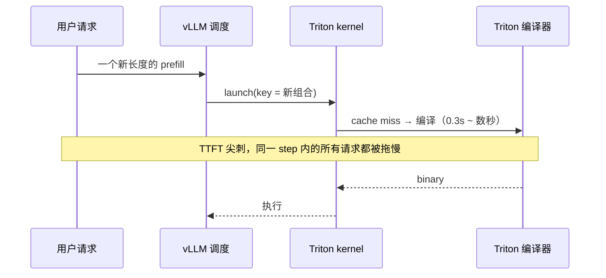
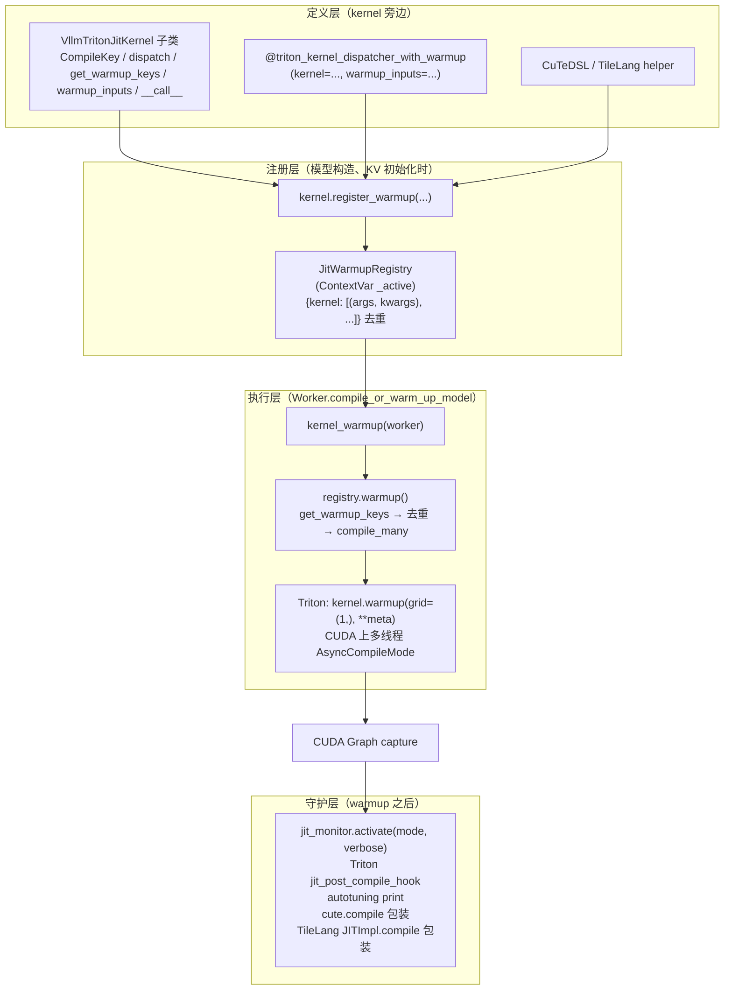
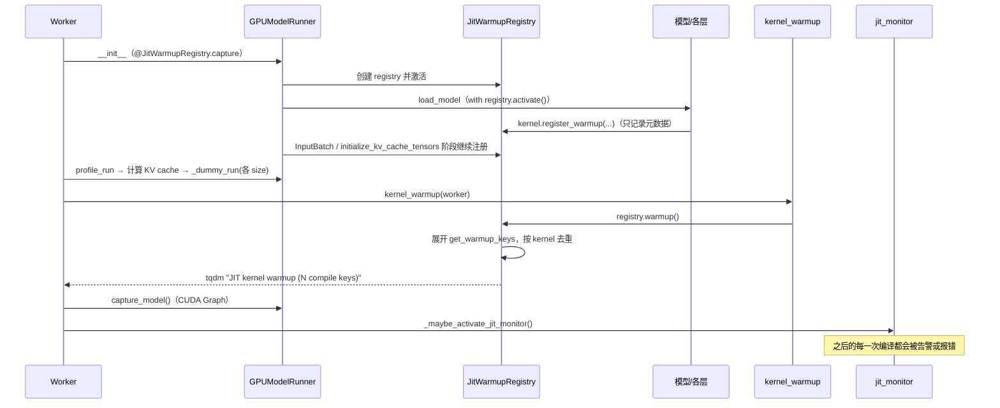
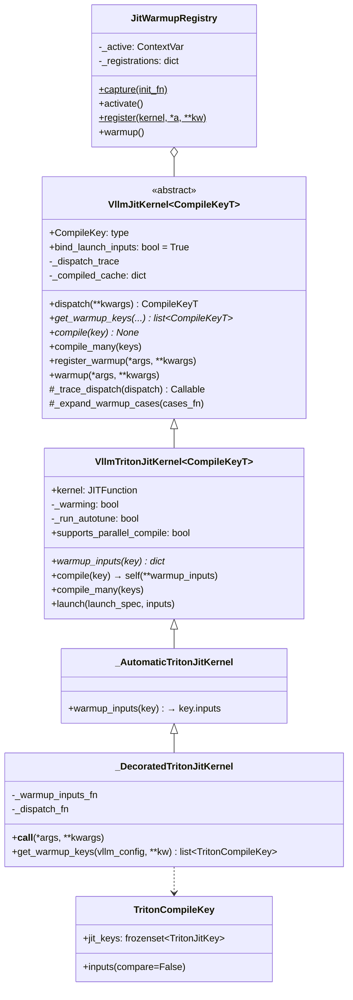
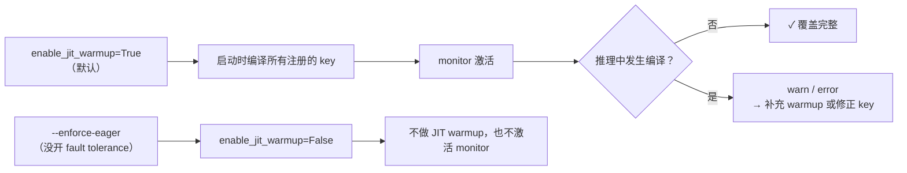
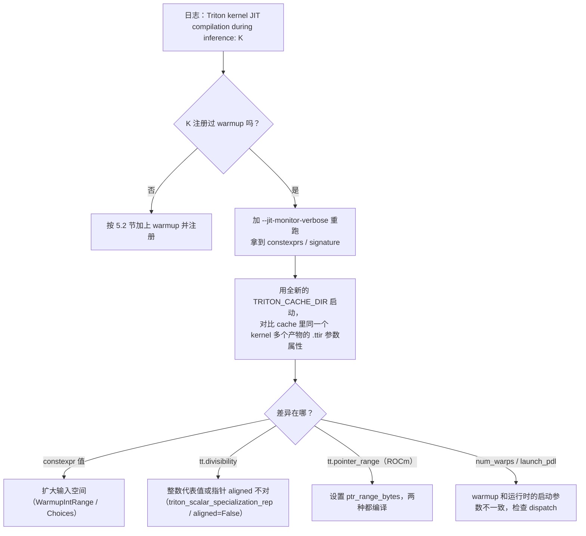

# vLLM Triton Kernel JIT Warmup 与 JIT Monitor 特性代码走读技术文档

> **文档版本**: 1.0
> **分析代码版本**: vLLM main 分支（本地 checkout `/home/shashen/vllm/vllm`，HEAD `8f51c20f74`，截至 2026-10）
> **最后更新**: 2026-10-22

---

## 文档概述

vLLM 里有大量 kernel 是**运行时 JIT 编译**的：Triton、CuTeDSL、TileLang 等。这类 kernel 有两个特点：

- **按特征分别编译**：根据参数的 dtype、constexpr、整数值、指针对齐等特征，每种组合编译出一个独立的版本。
- **第一次调用时才编译**：一次编译少则几百毫秒，多则数秒。

如果某个组合第一次出现在线上请求里，这个请求就会被卡住，出现明显的延迟尖刺。

本文介绍 vLLM 解决这个问题的两个配套机制：

| 机制 | 作用 | 核心代码 |
|---|---|---|
| **JIT Warmup** | 启动阶段**不运行真实 kernel、不分配真实 tensor**，按"编译 key 空间"提前把运行时会用到的版本都编译好 | `vllm/model_executor/warmup/jit_warmup.py`、`jit_warmup_triton_helper.py` |
| **JIT Monitor** | warmup 结束后挂上钩子，推理期间如果又发生了 JIT 编译，就告警或报错，用来发现 warmup 漏掉的版本 | `vllm/utils/jit_monitor.py` |

**目标读者**：给 vLLM 新增或移植 Triton kernel 的开发者，以及排查"服务启动后第一批请求很慢"或 `kernel JIT compilation during inference` 告警的人。

**阅读建议**：

- 只想给自己的 kernel 加上 warmup：直接看第五部分 5.2 节的三种写法。
- 想理解原理：按顺序阅读。
- 遇到 JIT monitor 告警：看第四部分和 5.4 节。

> **官方文档**：仓库内的 `docs/contributing/jit_kernel_warmup.md` 是这套机制的贡献者指南（英文），本文是对它的源码级展开和补充。

---

# 第一部分: 基础与架构总览

## 1.1 为什么需要 JIT Warmup

### 1.1.1 Triton 的编译 key

调用一个 `@triton.jit` kernel 时，Triton 会先从实参里提取"特化特征"，和源码 hash、编译选项一起组成 cache key：

| 参数类型 | 进入 key 的特征 |
|---|---|
| `tl.constexpr` | **值本身**（每个不同的值都是一个新版本） |
| 普通整数 | 类型（i32/i64/u64）；值是否等于 1；是否能被 16 整除 |
| 指针（tensor） | dtype；地址是否 16 B 对齐；ROCm 上还有底层存储是否不超过 2 GB（`tt.pointer_range=32`） |
| `do_not_specialize` 里的参数 | 只看类型 |
| 编译选项 | `num_warps`、`num_stages`、`launch_pdl` 等 |

在内存里查不到这个 key 时：先查磁盘缓存（`~/.triton/cache`），命中就加载；不命中就**完整编译**一次，走 TTIR → TTGIR → LLIR → PTX/AMDGCN → cubin/hsaco。

### 1.1.2 不做 warmup 会怎样



在启动阶段用 dummy run 预热有三个不足：

1. **覆盖不全**。dummy run 只跑几个 batch size，而 constexpr 往往和 `num_tokens` 的分桶、`max_num_reqs`、prefill/decode 的组合、spec decode 等有关。有些路径（比如 KV block 清零、只在真实调度时才会走到的分支）dummy run 根本走不到。
2. **成本高**。dummy run 要真的分配 tensor、真的跑模型，要覆盖整个组合空间是不现实的。
3. **不可审查**。哪些版本被预热了，取决于 dummy run 碰巧走了哪些路径，代码里看不出来。

### 1.1.3 JIT Warmup 的基本思想

> **关键洞察**: 不运行 kernel，而是**枚举 kernel 的"编译 key 空间"**。对每个 key 构造只有元信息（dtype/shape/stride/对齐）的假输入，调用 Triton 的 `kernel.warmup(...)`。它只编译不执行，也不需要真实显存。

设 kernel 的各个特化维度分别有 $|D_1|, |D_2|, \dots, |D_n|$ 种取值，dispatch 函数把输入映射成 key：$f: D_1 \times \dots \times D_n \to K$。warmup 编译的数量是：

$$
N_\text{compile} = \big|\{ f(d) \mid d \in D_1 \times \dots \times D_n,\ \text{when}(d) \}\big| \ \le\ \prod_i |D_i|
$$

**例子**：`num_tokens ∈ [1, 8192]`，而 key 只依赖 `next_power_of_2(num_tokens)`。输入空间有 8192 个点，去重后只剩 14 个 key。

### 1.1.4 JIT Monitor 的作用

warmup 是"尽量覆盖"，monitor 则负责**验证覆盖得对不对**。warmup 完成后，monitor 在 Triton、CuTeDSL、TileLang 的编译入口挂上钩子。推理期间只要发生一次编译，就说明 warmup 漏掉了这个版本：

- `warn` 模式（默认）：打 warning，同一个 kernel 只报一次。
- `error` 模式：直接 `raise RuntimeError`。适合在 CI 里守护。

## 1.2 整体架构

### 1.2.1 系统架构图



### 1.2.2 核心组件

| 组件 | 文件 | 职责 |
|---|---|---|
| `VllmJitKernel[CompileKeyT]` | `vllm/model_executor/warmup/jit_warmup.py:651` | 后端无关的基类：负责 dispatch、warmup key 和编译 |
| `_trace_dispatch` 及 AST 解释器 | `jit_warmup.py:561-772` | 把 `dispatch()` 的源码解析成表达式，对输入空间求笛卡尔积，生成 key |
| `WarmupIntRange` / `WarmupChoices` / `zip_inputs` / `_when` | `jit_warmup.py:57-148` | 描述输入空间：区间、离散取值、绑定的行、过滤条件 |
| `JitWarmupRegistry` | `jit_warmup.py:1008` | 收集注册信息、去重，并在 warmup 时统一编译 |
| `VllmTritonJitKernel` | `jit_warmup_triton_helper.py:245` | Triton 实现：`compile` 调用 `kernel.warmup`，`launch` 在运行时和 warmup 之间分流 |
| `kernel_launcher` | `jit_warmup.py:36` | 装饰 `__call__`，把它变成返回 `LaunchSpec` 的声明式启动描述 |
| `TritonWarmupTensor` | `jit_warmup_triton_helper.py:172` | 只编译用的假 tensor：dtype、shape、strides、aligned、ptr_range_bytes |
| `triton_kernel_dispatcher_with_warmup` | `jit_warmup_triton_helper.py:714` | 装饰器写法：利用 Triton 自己的 binder 自动推导 key |
| `compile_triton_warmup` | `jit_warmup_triton_helper.py:225` | 所有 kernel 共用一个编译线程池（只在 CUDA 上） |
| `kernel_warmup` | `vllm/model_executor/warmup/kernel_warmup.py:164` | 启动时 warmup 的总入口 |
| `jit_monitor` | `vllm/utils/jit_monitor.py` | 推理期间的编译监控 |

## 1.3 启动流程走读



注册发生在以下四个上下文中（`registry.activate()` 期间调用 `register_warmup` 才会被收集，其他时候调用是 no-op）：

| 阶段 | 位置 | 典型注册内容 |
|---|---|---|
| runner `__init__` | `gpu_model_runner.py:470` `@JitWarmupRegistry.capture` | runner 自己用的 kernel（采样、input prep） |
| 加载模型 | `gpu_model_runner.py:4987` | 各层 `__init__` 里选定的 attention、MoE、compressor kernel |
| InputBatch 初始化 | `gpu_model_runner.py:6873` | 依赖最终 KV 几何的 kernel |
| KV cache 分配 | `gpu_model_runner.py:7028` | 依赖 KV cache stride 的 kernel |

---

# 第二部分: 核心接口与基类

## 2.1 类图



## 2.2 `VllmJitKernel` 契约

```python
# 文件: vllm/model_executor/warmup/jit_warmup.py
class VllmJitKernel(Generic[CompileKeyT], ABC):
    """Kernel wrapper that owns dispatch, warmup keys, and compilation."""

    CompileKey: type[CompileKeyT]
    bind_launch_inputs = True

    def dispatch(self, **kwargs: Any) -> CompileKeyT:
        """Build one compile key from one concrete dispatch point."""

    @abstractmethod
    def get_warmup_keys(self, *args: Any, **kwargs: Any) -> list[CompileKeyT]:
        """Return compile keys that should be warmed for this kernel."""

    @abstractmethod
    def compile(self, compile_key: CompileKeyT) -> None:
        """Compile one warmup key."""

    def register_warmup(self, *args: Any, **kwargs: Any) -> None:
        JitWarmupRegistry.register(self, *args, **kwargs)

    def warmup(self, *args: Any, **kwargs: Any) -> None:
        self.compile_many(self.get_warmup_keys(*args, **kwargs))
```

| 方法 | 是否后端相关 | 职责 |
|---|---|---|
| `CompileKey` | 否 | frozen dataclass，**只包含后端会特化的字段** |
| `dispatch(...)` | 否 | 一个输入点映射到一个 key。运行时和 warmup **共用同一套映射逻辑** |
| `get_warmup_keys(...)` | 否 | 描述输入空间，一般是 `return self._trace_dispatch(self.dispatch)(...)` |
| `compile(key)` | 是 | 让这个版本"可用"：编译、加载产物或者只编译不运行 |
| `__call__` | 是 | 运行时入口 |

设计原则（来自官方指南的 Review Checklist）：

- warmup 的应该是**真正的编译 key**，而不是一些有代表性但不进 key 的输入。
- 特化逻辑只写在 `dispatch()` 里，不要在 warmup 代码里重复写一遍。
- 不能做 dummy 的运行时 launch，只能用 fake tensor 或者后端提供的只编译描述。
- 注册只记录元数据，这样模型构造依然便宜、没有副作用。
- 注册和运行时调用使用**同一个模块级单例**。

## 2.3 输入空间描述 DSL

| 写法 | 语义 | 例子 |
|---|---|---|
| 标量 | 固定值 | `head_dim=128` |
| tuple/list | 独立的离散取值，参与笛卡尔积 | `COMPRESS_RATIO=[4, 128]` |
| `WarmupChoices(a, b, c)` | 同上，可以写在 warmup_inputs 函数体内 | `dtype = WarmupChoices(torch.float32, torch.int32)` |
| `WarmupIntRange(start, stop, step)` | `range` 语义 | `num_tokens=WarmupIntRange(1, max_tokens + 1)` |
| `WarmupIntRange(..., advance=f)` | 自定义单调递增的步进，用来跳着覆盖分桶边界 | `advance=lambda v: next_power_of_2(v) + 1` |
| `zip_inputs(dict(...), dict(...))` | 多个字段按行绑定，不做笛卡尔积 | `(ratio=1, topk=0)`、`(ratio=4, topk=512)` |
| `_when=pred` | 过滤不合法的组合 | `query_len + num_reqs - 1 <= max_tokens` |

`dispatch()` 和 `_when` 的函数体只能是"若干赋值语句加一条 return"。支持的表达式包括名字、常量、属性、下标、tuple/list、三元表达式、比较、`and`/`or`/`not`、算术和函数调用，**不支持 `if` 语句和循环**（`jit_warmup.py:435` `_validate_dispatch_expr`）。被调用的 helper 函数照常执行，函数内部可以有任意控制流。

## 2.4 注册表 `JitWarmupRegistry`

```python
# 文件: vllm/model_executor/warmup/jit_warmup.py
class JitWarmupRegistry:
    _active: ContextVar[JitWarmupRegistry | None] = ContextVar(
        "active_jit_warmup_registry", default=None)

    @classmethod
    def register(cls, kernel, *args, **kwargs) -> None:
        registry = cls._active.get()
        if registry is not None:          # 不在 activate() 上下文中就静默忽略
            registry._add(kernel, args, kwargs)

    def _add(self, kernel, args, kwargs) -> None:
        registrations = self._registrations.setdefault(kernel, [])
        # Every layer of a deep model appends an identical (args, kwargs) here
        # (e.g. a 61-layer DSA model registers the same pack 61 times) ...
        if any(_same_registration(registered, (args, kwargs)) for registered in registrations):
            return
        registrations.append((args, kwargs))
```

- 注册的粒度是"kernel 单例 + 一组参数"。61 层用同样的参数注册，只保留一份。
- 如果 `get_warmup_keys` 需要 `vllm_config`，而注册时没有传任何参数，registry 会自动注入 `vllm_config`（`jit_warmup.py:1094-1100`）。
- 因为依赖 `ContextVar`，**在 activate 上下文之外**（比如单测里直接构造层）调用 `register_warmup` 不会有任何效果。

---

# 第三部分: Triton 实现深度分析

## 3.1 一份启动描述，两种用途：`kernel_launcher` 与 `LaunchSpec`

Triton 后端最重要的设计是：**运行时 launch 和 warmup 编译共用同一段"启动描述"代码**。这样两者算出的 constexpr、stride 和 `num_warps` 不可能不一致。

```python
# 文件: vllm/model_executor/warmup/jit_warmup.py
def kernel_launcher(call_fn):
    signature = inspect.signature(call_fn)
    @wraps(call_fn)
    def wrapper(self, *args, **kwargs):
        launch_spec = call_fn(self, *args, **kwargs)   # (grid, launch_kwargs[, outputs])
        bound = signature.bind(self, *args, **kwargs); bound.apply_defaults()
        inputs = {n: v for n, v in bound.arguments.items() if n != "self"}
        return self.launch(launch_spec, inputs)
    return wrapper
```

```python
# 文件: vllm/model_executor/warmup/jit_warmup_triton_helper.py（launch 节选）
def launch(self, launch_spec, inputs):
    grid, launch_kwargs = launch_spec[:2]
    kwargs = self._prepare_launch_kwargs(tuple(inputs), tuple(inputs.values()), dict(launch_kwargs))
    kernel = kwargs.pop("kernel", None) or self.kernel     # launch_kwargs 可以覆盖 kernel
    if self._warming:
        if self._run_autotune:                              # autotune 必须真的运行
            kernel[grid](**kwargs); return outputs
        kwargs = {n: _triton_metadata_arg(v) for n, v in kwargs.items()}
        kernel.warmup(grid=(1,), **kwargs)                  # 只编译，不执行
        return outputs
    kernel[grid](**kwargs)                                  # 正常运行
```

**输入绑定规则**（`_launch_binding_plan`，`jit_warmup_triton_helper.py:43`）：

| `__call__` 参数名 | 自动绑定到 kernel 参数 |
|---|---|
| `x` | `x`、`x_ptr`、`X`、`X_PTR` 中第一个存在的 |
| kernel 有 `x_stride0`、`x_stride_1`、`x_stride` 等，但 launch_kwargs 里没给 | 自动取 `x.stride(dim)` |

所以 `__call__` 和 dispatch 函数只需要返回 grid 和那些**需要计算的** kwargs（constexpr、特殊 stride、`num_warps`），tensor 会被自动传进去。

`VllmTritonJitKernel.compile(key)` 的实现就是用 `warmup_inputs(key)` 返回的假输入调用一次 `self(**inputs)`，期间 `_warming=True`，于是 launch 走到 `kernel.warmup(...)` 分支。

## 3.2 假输入 `TritonWarmupTensor`

```python
# 文件: vllm/model_executor/warmup/jit_warmup_triton_helper.py
@dataclass(frozen=True)
class TritonWarmupTensor:
    dtype: Any
    aligned: bool = True          # data_ptr() 返回 0（16B 对齐）或 1（不对齐）
    shape: tuple[int, ...] = (1,)
    strides: tuple[int, ...] | None = None   # None 表示紧凑的行主序
    init: Any = 0                 # autotune 需要真实 tensor 时的初始化值
    ptr_range_bytes: int = 0      # ROCm 上 2GB 指针特化用，见 3.5 节

    def data_ptr(self) -> int: return 0 if self.aligned else 1
    def ptr_range(self) -> int: return self.ptr_range_bytes
```

它"鸭子类型"成 tensor，只提供 Triton binder 需要读的几项：`dtype`、`data_ptr()`（判断对齐）、`stride()`、`device`、`ptr_range()`（ROCm）。

**整数参数的代表值**：如果某个整数参数会被特化，warmup 时只需要给出与真实值落在同一类别的代表值，可以用 `triton_scalar_specialization_rep`：

| 真实值 | 代表值（i32 范围） | Triton 特化结果 |
|---|---|---|
| 1 | 1 | 常量 1 |
| 16 的倍数 | 16 | `tt.divisibility=16` |
| 其他 | 2 | 不特化 |

> **注意**: `do_not_specialize` 里的整数不进入 key，随便给一个值即可。所以对**依赖部署配置的 stride 或 block size**，最好在 kernel 上声明 `do_not_specialize`，这样一份 warmup 就能覆盖所有部署（见 5.2 节的例子）。

## 3.3 自动推导 key：`_DecoratedTritonJitKernel`

手写 `CompileKey` 需要开发者自己知道 Triton 会特化什么。装饰器写法则直接**调用 Triton 自己的 binder** 来算真正的 cache key：

```python
# 文件: vllm/model_executor/warmup/jit_warmup_triton_helper.py（_triton_key_deriver 节选）
_, kernel_key_cache, _, _, binder = kernel.device_caches[device]
def derive_jit(kwargs):
    _, specialization, options = binder(**binder_kwargs)
    cache_key = compute_cache_key(kernel_key_cache, specialization, options)
    return {TritonJitKey(id(kernel), kernel.cache_key, device, cache_key)}
```

- `Heuristics` 会先算出 heuristic 的值再递归；`Autotuner` 会对 `prune_configs` 之后的每个 config 推导一次。
- `TritonCompileKey` 中参与比较的只有 `jit_keys`，`inputs` 只用来"重放"（`compare=False`）。因此**不同的输入如果推出同一个 Triton key，会自动去重**。
- 调用 dispatch 函数时，如果它读取了 `.shape`、`.stride()` 或者做了 assert，而 `TritonWarmupTensor` 不支持，就会自动回退到 `FakeTensorMode` 构造 fake tensor 后重试（`jit_warmup_triton_helper.py:644-664`）。
- autotune 的 kernel 必须真的跑 benchmark，所以会分配**真实 tensor**（按 `init` 填值）并真正运行。

## 3.4 并行编译

```python
# 文件: vllm/model_executor/warmup/jit_warmup_triton_helper.py
@property
def supports_parallel_compile(self) -> bool:
    # AMD LLVM code generation can abort under concurrent compilation.
    return (current_platform.is_cuda() and not self._run_autotune
            and getattr(triton, "AsyncCompileMode", None) is not None
            and envs.VLLM_TRITON_JIT_WARMUP_NUM_THREADS > 1)
```

- 在 CUDA 上，`JitWarmupRegistry.warmup()` 会把所有支持并行的 kernel 放进**同一个**线程池，用 `triton.AsyncCompileMode` 编译（#58582、#61422）。线程数由 `VLLM_TRITON_JIT_WARMUP_NUM_THREADS` 控制，默认 4。
- **ROCm 上始终串行**，因为 AMD LLVM 在并发编译时可能 abort。所以 ROCm 上 warmup 更慢，key 的数量更值得控制。
- dispatch 会修改 owner 的状态，所以 dispatch 留在主线程，只把编译任务交给线程池。

## 3.5 ROCm 专有坑：2 GB 指针特化

Triton 的 AMD 后端开启 buffer ops（默认开启）时，如果一个指针的 `untyped_storage().size()` 不超过 2³¹−1，就会给它加上 `tt.pointer_range=32` 特化。这个特化**进入编译 key**。`TritonWarmupTensor` 默认报告 `ptr_range()=0`，也就是"小存储"。但运行时，KV cache 的某一层只是**整个 KV 池**的一个 view，底层存储有几十 GB。结果就是 warmup 编译出来的版本，运行时永远用不上。

解决办法：对指向 KV 池的参数，设置 `ptr_range_bytes`，并且两种情况都编译一份：

```python
# 文件: vllm/models/deepseek_v4/amd/rocm.py（PR #60834）
for pool_bytes in (0, 1 << 32):
    state_cache=TritonWarmupTensor(torch.float32, shape=(1, 1, 2 * state_width),
                                   ptr_range_bytes=pool_bytes)
```

详细原理见 `vllm-dev-skills/drafts/triton/amd_pointer_range_and_jit_warmup.md`。

---

# 第四部分: JIT Monitor

## 4.1 激活时机与条件

```python
# 文件: vllm/v1/worker/gpu_worker.py
        # All warmup is done — start monitoring for unexpected JIT
        # compilations that would cause latency spikes during inference.
        self._maybe_activate_jit_monitor()

    def _maybe_activate_jit_monitor(self) -> None:
        # When JIT warmup is disabled (e.g. enforce_eager), runtime JIT
        # compilation is expected, so monitoring would only produce noise
        if not self.vllm_config.kernel_config.enable_jit_warmup:
            return
        activate_jit_monitor(mode=self.observability_config.jit_monitor_mode,
                             verbose=self.observability_config.jit_monitor_verbose)
```

monitor 在 `compile_or_warm_up_model` 的末尾激活，此时 dummy run、kernel warmup、CUDA Graph capture 和 inductor 的 lazy init 都已经完成。

## 4.2 四种钩子

| 后端 | 钩子方式 | 触发条件 |
|---|---|---|
| Triton `@triton.jit` | `triton.knobs.runtime.jit_post_compile_hook = _on_jit_compile`，并链式调用原有的 hook | 进程内首次需要某个版本（无论是真编译还是从磁盘缓存加载） |
| Triton `@triton.autotune` | `knobs.autotuning.print = True`（用户显式设了 `TRITON_PRINT_AUTOTUNING=0` 就不开） | autotune 的 cache miss，Triton 自己会打印 benchmark 信息 |
| CuTeDSL | 用 `_MonitoredCuteCompile` 包装 `cutlass.cute.compile`，同时支持 `cute.compile[opts]` | 每次调用 `cute.compile` |
| TileLang | 包装 `JITKernel.__init__` 和 `JITImpl.compile`（只在 kernel cache miss 时调用，不影响热路径） | 非 database 加载的编译。**ROCm 上不装这个钩子**（#51159） |

> **注意**: `jit_post_compile_hook` 在 Triton `JITFunction._do_compile` 中、`self.compile(...)` 返回之后调用（`triton/runtime/jit.py`），也就是在进程内存缓存 miss 之后调用，不论这次是真的从源码编译，还是从磁盘缓存加载。所以只要 monitor 报出来，就说明 warmup 没有覆盖这个 key。即使因为磁盘缓存的存在耗时不长，这仍然是一个需要修复的覆盖缺口。

告警的统一格式：

```
Triton kernel JIT compilation during inference: <kernel_name>[ (details)].
This causes a latency spike; consider extending warmup to cover this shape/config.
```

- `warn`：非 verbose 时用 `warning_once`，同一条消息只打印一次。
- `error`：`raise RuntimeError`，请求会直接失败。只在 CI 或调试中使用。
- `--jit-monitor-verbose`：打印 `constexprs={...}; signature={...}; extra_compile_info={...}; key=...`。这是定位"哪个特化维度没覆盖到"的关键信息。

另外，monitor 会把 `triton.runtime.jit.serialize_specialization_data` 包一层，让它序列化失败时不抛异常，因为有些 kernel 的 constexpr 不能 JSON 序列化。

## 4.3 Warmup 和 Monitor 的关系



`--enforce-eager` 会把 `enable_jit_warmup` 设为 False（`vllm/config/vllm.py:1763`），这样 warmup 和 monitor **都关闭**。例外是开启了 `enable_fault_tolerance` 时会保留 JIT warmup，因为推理中的编译尖刺可能让 peer 故障检测超时。

---

# 第五部分: 使用指南

## 5.1 配置参数

| 参数 | 默认 | 说明 |
|---|---|---|
| `--kernel-config '{"enable_jit_warmup": false}'` | True | 关闭 JIT warmup，同时关闭 monitor |
| `--enforce-eager` | — | 关闭 warmup 和 monitor（fault tolerance 模式下除外） |
| `--jit-monitor-mode warn\|error` | warn | 推理中发生编译时的处理方式 |
| `--jit-monitor-verbose` | False | 打印每次编译的完整特化信息 |
| `VLLM_TRITON_JIT_WARMUP_NUM_THREADS` | 4 | CUDA 上并行编译的线程数；≤1 表示串行 |
| `TRITON_PRINT_AUTOTUNING=0` | — | 不让 monitor 打开 autotune 打印 |
| `TRITON_CACHE_DIR` | `~/.triton/cache` | 验证 warmup 覆盖时，请使用一个全新的目录 |

启动日志中的关键行：

```
JIT kernel warmup starting.
JIT kernel warmup (243 compile keys): 100%|████| 15/15 [00:32<00:00, ...kernel/s]
JIT kernel warmup finished in 32.10s.
Kernel JIT monitor activated; monitored JIT compilations during inference will use mode=warn.
```

## 5.2 三种写法

### 写法 1：装饰器加 dispatch 函数（推荐，最省事）

适合大多数 Triton kernel。key 由 Triton 自动推导，开发者只需要提供"有代表性的输入"。

```python
# 文件: vllm/v1/sample/rejection_sampler.py
def _expand_warmup_inputs() -> dict[str, object]:
    dtype = WarmupChoices(torch.float32, torch.int32, torch.int64)   # 3 个版本
    data = TritonWarmupTensor(dtype)
    return dict(output=data, input=data,
                cu_num_tokens=TritonWarmupTensor(torch.int32),
                replace_from=0, replace_to=0)


@triton_kernel_dispatcher_with_warmup(
    kernel=expand_kernel, warmup_inputs=_expand_warmup_inputs
)
def _expand(output, input, cu_num_tokens, replace_from, replace_to) -> DispatchSpec:
    return (input.shape[0],), dict(MAX_NUM_TOKENS=MAX_SPEC_LEN)
```

- 运行时调用 `_expand(out, inp, cu, a, b)`。dispatch 返回 grid 和 constexpr，tensor 按名字自动绑定到 `output_ptr` 等参数。
- `warmup_inputs` 的参数名必须和 dispatch 的参数名一致。它可以返回一个 dict，也可以返回多个 dict 的列表；函数体里还可以用 `WarmupChoices`、`WarmupIntRange` 和 `_when`。
- 如果 `warmup_inputs` 声明了 `vllm_config` 参数，会被自动注入。

**ROCm 上的一个完整例子（PR #60834）**：

```python
# 文件: vllm/models/deepseek_v4/amd/rocm.py
@triton.jit(do_not_specialize=["state_cache_stride0", "state_cache_stride1",
                               "block_table_stride", "block_size", "pooled_k_stride"])
def _compress_pool_kernel(state_cache_ptr, state_cache_stride0, ..., HEAD_SIZE: tl.constexpr, ...):
    ...

def _compress_pool_warmup_inputs(*, head_dim, state_width, compress_ratio, overlap):
    return [dict(state_cache=TritonWarmupTensor(torch.float32, shape=(1, 1, 2 * state_width),
                                                ptr_range_bytes=pool_bytes),
                 ..., state_width=state_width, compress_ratio=compress_ratio, overlap=overlap)
            for pool_bytes in (0, 1 << 32)]

@triton_kernel_dispatcher_with_warmup(kernel=_compress_pool_kernel,
                                      warmup_inputs=_compress_pool_warmup_inputs)
def compress_pool(state_cache, ..., pooled_k, state_width, compress_ratio, overlap) -> DispatchSpec:
    return (pooled_k.shape[0],), dict(state_cache_stride0=state_cache.stride(0), ...,
                                      HEAD_SIZE=pooled_k.shape[1], STATE_WIDTH=state_width,
                                      COMPRESS_RATIO=compress_ratio, OVERLAP=overlap, num_warps=1)

# 在层的 __init__ 中注册
if vllm_config.kernel_config.enable_jit_warmup:
    compress_pool.register_warmup(head_dim=..., state_width=..., compress_ratio=..., overlap=...)
```

### 写法 2：手写 `VllmTritonJitKernel` 子类

适合需要按配置选择不同 kernel 变体、或者 key 和 `vllm_config` 关系复杂的场景。

```python
# 文件: vllm/models/deepseek_v4/common/ops/fused_compress_quant_cache.py（简化）
class FusedKVCompressNormRopeInsertIndexerTritonKernel(
    VllmTritonJitKernel["FusedKVCompressNormRopeInsertIndexerTritonKernel.CompileKey"]
):
    @dataclass(frozen=True)
    class CompileKey:
        dtype: torch.dtype
        use_fp4_cache: bool
        head_size: int
        ...

    kernel = staticmethod(_fused_kv_compress_norm_rope_insert_indexer_attn)

    def dispatch(self, *, dtype, use_fp4_cache, head_dim, compress_ratio, ...) -> CompileKey:
        overlap = compress_ratio == 4
        ...
        return self.CompileKey(dtype=dtype, use_fp4_cache=use_fp4_cache, ...)

    def get_warmup_keys(self, vllm_config) -> list[CompileKey]:
        use_fp4_cache = dsa_indexer_uses_fp4(vllm_config)
        if use_fp4_cache and current_platform.is_rocm():
            return []                  # 平台和模型的门控写在这里，不要写进 dispatch
        return self._trace_dispatch(self.dispatch)(dtype=..., compress_ratio=4, ...)

    def warmup_inputs(self, compile_key) -> dict[str, Any]:
        # 构造能复现这个 key 的假输入（kv_cache 的 shape 和 stride 要和真实值一致）
        ...

    @kernel_launcher
    def __call__(self, *, state_cache, num_actual, ..., use_fp4_cache, ...) -> LaunchSpec:
        return (num_actual,), dict(
            kernel=(_..._mxfp4_attn if use_fp4_cache else _..._attn),   # 按调用选择变体
            HEAD_SIZE=head_dim, ..., num_warps=1, **pdl_kwargs)

_FUSED_KV_COMPRESS_NORM_ROPE_INSERT_INDEXER_TRITON_KERNEL = (
    FusedKVCompressNormRopeInsertIndexerTritonKernel())     # 模块级单例
```

### 写法 3：装饰器，不带 dispatch

把 `@triton_kernel_dispatcher_with_warmup(warmup_inputs=...)` 直接加在 kernel 上（不传 `kernel=`）。调用方式是 `k(grid, *args)` 或 `k(grid=..., **kwargs)`，`warmup_inputs` 返回的 dict 里要包含 `"grid"`。适合没有派生参数的简单 kernel，比如 `vllm/model_executor/layers/mamba/ops/scatter_states.py`。

### 三种写法对比

| 维度 | 写法 1 装饰器 + dispatch | 写法 2 手写子类 | 写法 3 只用装饰器 |
|---|---|---|---|
| key 来源 | Triton binder 自动推导 | 手写 `CompileKey` 加 `dispatch` | Triton binder 自动推导 |
| 会不会漏掉特化维度 | 不会（与 Triton 完全一致） | 可能（字段要写全） | 不会 |
| 按调用选择 kernel 变体 | 一般不需要 | 支持（launch_kwargs 里的 `kernel=`） | 不支持 |
| 输入空间与 vllm_config 的关系 | `warmup_inputs` 里处理 | `get_warmup_keys` 里处理，支持 `_trace_dispatch` 的完整 DSL | `warmup_inputs` 里处理 |
| 代码量 | 小 | 大 | 最小 |
| 使用量（本仓库，按文件数） | 约 6 个文件 15 处 | 约 18 个文件 | 少量 |

## 5.3 新增 kernel 的 checklist

1. 先确认 kernel 的哪些参数会进入 key：constexpr、会被特化的整数、指针的 dtype 和对齐、ROCm 上的 2 GB 特化、`num_warps` 和 `launch_pdl` 等编译选项。
2. 跟部署配置有关、但对性能不关键的整数（stride、block size），尽量放进 `do_not_specialize`。
3. 选择一种写法，**让运行时和 warmup 共用同一份启动描述**。
4. 在**选定实现的地方**调用 `register_warmup(...)`，并用 `if vllm_config.kernel_config.enable_jit_warmup:` 包住。
5. 如果在 ROCm 上用了 CUDA 专有的 PTX 版本，`get_warmup_keys` 要返回 `[]`，否则 warmup 时会报 `unknown asm constraint` 之类的编译错误。
6. 用全新的 `TRITON_CACHE_DIR` 加上 `--jit-monitor-mode error`（或者 `warn` 加 `--jit-monitor-verbose`）跑一遍 E2E，确认推理期间没有编译。

## 5.4 排查 monitor 告警



另外两个判断方法：

- 用 `.hsaco` 或 `.cubin` 文件的写入时间，对比日志里 `JIT kernel warmup starting/finished` 的时间。warmup 结束之后才出现的产物，就是漏掉的版本。
- CUDA Graph capture 也会运行 kernel，可能会"顺带"把漏掉的版本编译好，从而让 monitor 看不到问题。所以验证覆盖时，不要只依赖 graph 模式下 monitor 是否安静，最好再检查一下 cache 产物。

## 5.5 测试

| 测试 | 内容 |
|---|---|
| `tests/jit_monitor/test_hooks.py`、`test_hooks_gpu.py` | 各钩子是否能正确触发 |
| `tests/jit_monitor/test_no_runtime_jit.py`、`test_no_runtime_jit_rocm.py` | 全新 cache 加 `jit_monitor_mode="error"`，跑一组 prefill、decode 和 sampler 的 shape，验证推理中没有编译 |
| 各 kernel 自己的测试 | 通常会断言 `get_warmup_keys` 的数量，或者 warmup 后再调用不会触发编译 |

---

# 附录

## A. 关键代码位置索引

| 组件 | 文件 | 行号 |
|---|---|---|
| `kernel_launcher` | `vllm/model_executor/warmup/jit_warmup.py` | 36 |
| `WarmupIntRange` / `WarmupChoices` / `zip_inputs` | `jit_warmup.py` | 57 / 67 / 128 |
| dispatch AST 解释器 | `jit_warmup.py` | 272–472 |
| `_trace_compile_key_dispatch` / `_trace_dispatch` | `jit_warmup.py` | 561 / 692 |
| `VllmJitKernel` | `jit_warmup.py` | 651 |
| `JitWarmupRegistry` | `jit_warmup.py` | 1008 |
| `triton_scalar_specialization_rep` | `vllm/model_executor/warmup/jit_warmup_triton_helper.py` | 135 |
| `TritonWarmupTensor` | `jit_warmup_triton_helper.py` | 172 |
| `compile_triton_warmup`（共享线程池） | `jit_warmup_triton_helper.py` | 225 |
| `VllmTritonJitKernel` | `jit_warmup_triton_helper.py` | 245 |
| `_triton_key_deriver` | `jit_warmup_triton_helper.py` | 380 |
| `_DecoratedTritonJitKernel` / `triton_kernel_dispatcher_with_warmup` | `jit_warmup_triton_helper.py` | 556 / 714 |
| `kernel_warmup`（总入口） | `vllm/model_executor/warmup/kernel_warmup.py` | 164 |
| registry 的 capture/activate 位置 | `vllm/v1/worker/gpu_model_runner.py` | 470、4987、6873、7028 |
| V2 runner 的 registry | `vllm/v1/worker/gpu/model_runner.py` | 214 |
| monitor 激活 | `vllm/v1/worker/gpu_worker.py` | 1101、1117 |
| `enable_jit_warmup` | `vllm/config/kernel.py` | 293 |
| `jit_monitor_mode` / `jit_monitor_verbose` | `vllm/config/observability.py` | 105 / 108 |
| enforce_eager 关闭 warmup | `vllm/config/vllm.py` | 1745–1763 |
| `VLLM_TRITON_JIT_WARMUP_NUM_THREADS` | `vllm/envs.py` | 1193 |
| JIT monitor | `vllm/utils/jit_monitor.py` | 全文 |
| 贡献者指南 | `docs/contributing/jit_kernel_warmup.md` | — |

## B. 演进历史

| PR | 日期 | 内容 |
|---|---|---|
| #46167 | 2026-06 | 新增 `jit_monitor`，监控 CuTeDSL 的运行时编译 |
| #46621 | 2026-06 | 改进 Triton JIT 诊断信息（verbose 详情） |
| #46718 | 2026-07 | monitor 支持 TileLang |
| #47451 | 2026-07 | 新的 JIT warmup 基础设施（`VllmJitKernel`、registry） |
| #49315 | 2026-08 | `_when` 谓词过滤 |
| #50174 | 2026-08 | provider registry 和统一编排 |
| #50175、#53564、#50176、#53566、#56323 | 2026-09 | DSv4 相关 kernel 分批迁移到新机制（1/N～6/N） |
| #58582 | 2026-09 | CUDA 上 Triton warmup 并行编译 |
| #58685 | 2026-10 | TileLang 钩子改为 hook `JITImpl.compile`，避开热路径 |
| #61422 | 2026-10 | 所有已注册 kernel 共享一个编译线程池 |
| #60834（进行中） | 2026-10 | `TritonWarmupTensor.ptr_range_bytes`，修正 ROCm 上 2 GB 指针特化导致的 key 不一致 |

## C. 术语表

| 术语 | 解释 |
|---|---|
| JIT | Just-In-Time，在运行时第一次调用时编译 |
| 编译 key / Compile Key | 决定是否需要重新编译的参数特征组合 |
| 特化 / Specialization | Triton 根据参数特征（值为 1、能被 16 整除、对齐、2 GB 等）生成专门的代码 |
| constexpr | Triton 的编译期常量参数，每个值都会生成一个独立的 kernel |
| `kernel.warmup(...)` | Triton 的只编译 API，不会执行 kernel |
| LaunchSpec / DispatchSpec | `(grid, launch_kwargs[, outputs])`，声明式的启动描述 |
| Registry | 在模型构造期间收集"需要预热哪些 kernel、用什么参数"的注册表 |
| JIT Monitor | warmup 之后监控运行时编译的钩子集合 |
| buffer ops / `tt.pointer_range` | AMD 用 32 位偏移访存的指令，以及 Triton 对应的指针特化 |
| AsyncCompileMode | Triton 的异步编译模式，vLLM 用它在 CUDA 上并行编译 |
