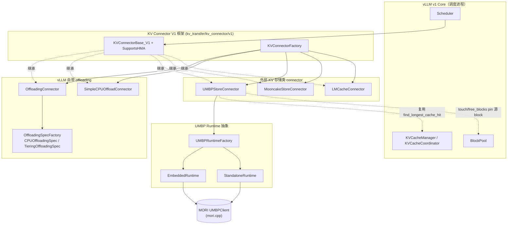
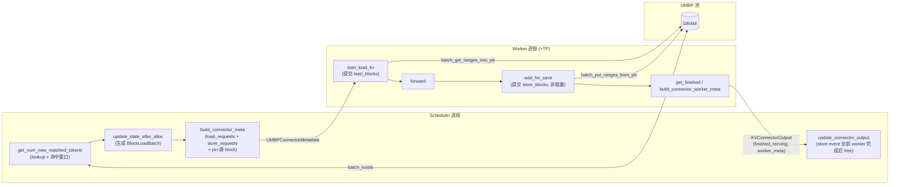
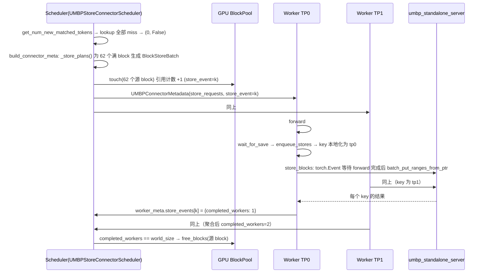
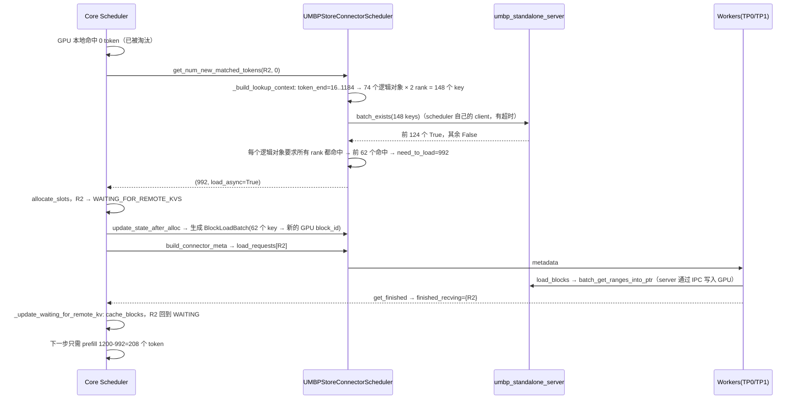
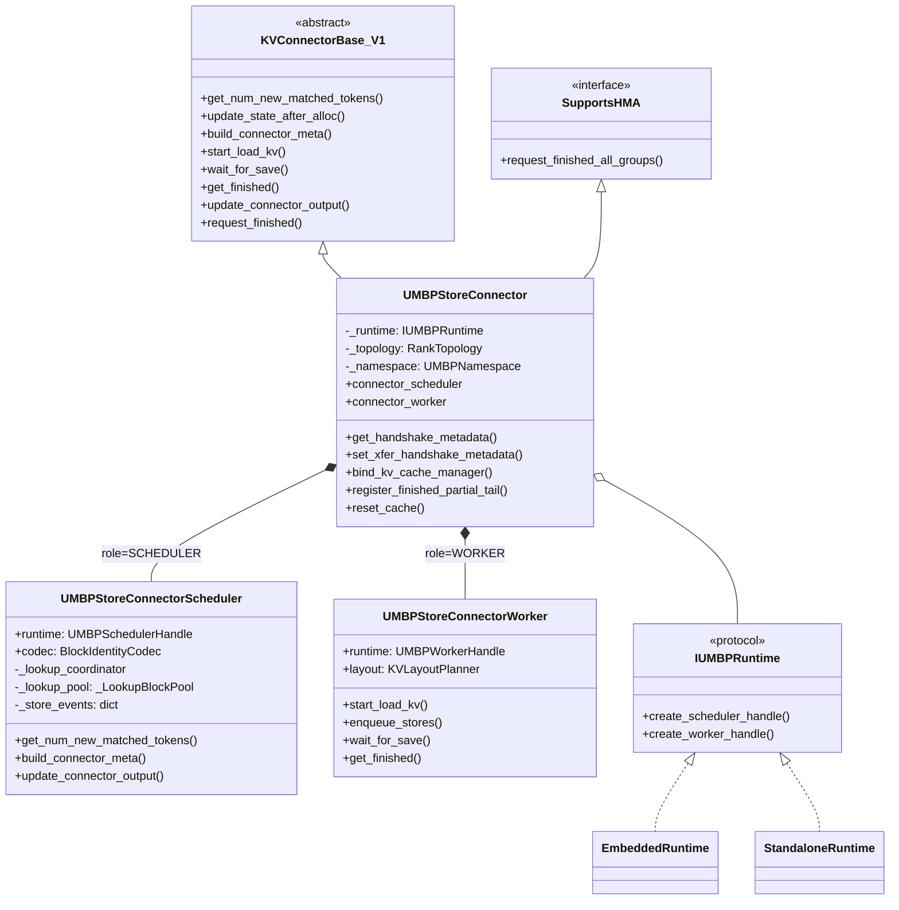
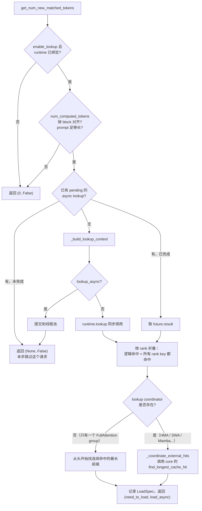
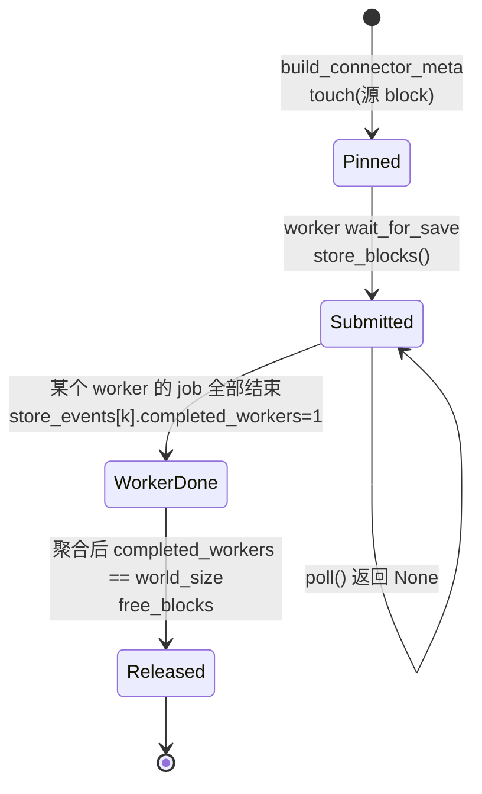
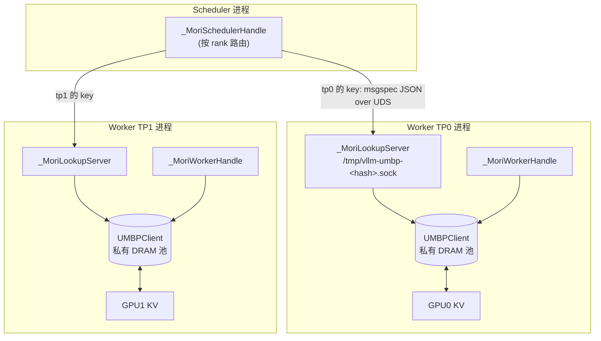
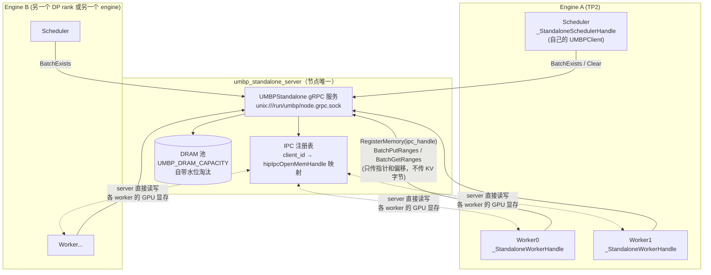

# vLLM UMBP Store Connector（含 Standalone 模式）特性代码走读技术文档

> **文档版本**: 1.0
> **分析代码版本**: vLLM main 分支 `fce61a05a7`（截至 2026-11），已合入 `[UMBP][1/10]`–`[7/10]` 及 `#64677`
> **配套源码**: MORI `09aa23b`（`src/umbp/standalone/`）
> **最后更新**: 2026-11-06

---

## 文档概述

UMBP（Unified Memory Buffer Pool）是 AMD [MORI](https://github.com/ROCm/mori) 中的分层 KV Cache 存储系统。vLLM 通过 `UMBPStoreConnector` 接入 UMBP，把 GPU 上已经算好的 KV block 卸载（offload）到主机 DRAM。之后如果新请求的前缀与之相同，而对应 block 已被 GPU prefix cache 淘汰，就可以从 DRAM 恢复，不必重新做 prefill。

本文回答三个问题：

1. **UMBP 在 vLLM 中处于什么位置？** 它与 vLLM 现有的 KV offloading 体系是什么关系：是 `OffloadingConnector` 的一个后端，还是一个独立 connector？
2. **connector 的公共骨架如何工作？** 包括 scheduler 侧的 lookup、命中计算和 store 规划，worker 侧的 load 和 store 提交，以及跨进程的 key、namespace 和 block 生命周期。
3. **standalone 模式如何实现？** 它与 embedded 模式在进程模型、lookup 路径、数据通路和故障语义上有哪些区别？

**目标读者**：熟悉 vLLM v1 调度器和 KV Cache Manager，想要理解、调试或扩展 UMBP connector 的开发者。

**阅读建议**：

| 读者 | 建议阅读 |
|---|---|
| 只想会用 | 第一部分 1.1 + 第五部分 |
| 想理解集成方式 | 第一部分 + 第二部分 |
| 要改代码 / 排查问题 | 全文，重点看第三、四部分 |

> **一句话结论**：UMBP **没有**接入 `vllm/v1/kv_offload` 的 `OffloadingSpec` / `OffloadingManager` 框架。它是一个独立的 `KVConnectorBase_V1 + SupportsHMA` 实现，与 `MooncakeStoreConnector`、`LMCacheConnector` 属于同一类。它没有自建一套前缀匹配逻辑，而是**直接复用 core 的组件**：`KVCacheCoordinator.find_longest_cache_hit` 负责命中计算，`BlockPool.touch/free_blocks` 负责在异步 store 期间 pin 住 block，`KVCacheSpecRegistry.reachable_block_mask` 负责筛选值得存的 block，此外还用到 HMA 的 boundary-state 与 partial-tail hook。存储和传输交给可插拔的 runtime（embedded / standalone），由 MORI 执行。

---

# 第一部分: UMBP 基础与架构总览

## 1.1 UMBP Offloading 原理

### 1.1.1 基本思想

vLLM 的 Automatic Prefix Caching（APC）把 KV block 按内容哈希（`block_hash`，链式哈希，包含前缀信息）缓存在 GPU 上。GPU 显存有限，block 被 LRU 淘汰后，命中率就会下降。UMBP 在 GPU 之下加了一层**主机 DRAM 池**：

- **Store（卸载）**：prefill 产生一个满 block 后，按 `(namespace, rank, group, block_hash)` 生成 key，把这个 block 在所有层的字节拷贝到 DRAM 池。
- **Lookup（查询）**：新请求到达后，scheduler 先查本地 GPU prefix cache，再用剩余 block 的 key 去查 DRAM 池中是否存在。
- **Load（恢复）**：命中的 block 从 DRAM 拷回新分配的 GPU block，请求跳过这部分 prefill。

这与 vLLM 自带的 CPU offloading 目标相同。差别在于：**DRAM 池由 MORI 管理**（容量、水位、淘汰都由 MORI 决定），而且在 standalone 模式下，**这个池可以被同一台机器上的多个 engine 共享，engine 重启后数据仍然保留**。

### 1.1.2 两种部署模式

| 维度 | Embedded 模式 | Standalone 模式 |
|---|---|---|
| DRAM 池归属 | 每个 vLLM worker 进程各自持有一个私有池 | 节点上一个独立进程 `umbp_standalone_server` 持有唯一的池 |
| 共享范围 | 只在本 engine 内；TP rank 之间互不共享 | 同一主机上所有 engine、所有 DP rank、所有 worker 共享 |
| engine 重启 | 池随进程销毁 | 池保留，新 engine 可以直接恢复 |
| scheduler lookup 路径 | scheduler → 每个 worker 的 Unix socket lookup bridge → worker 内的池 | scheduler 进程直接用自己的 UMBPClient，通过 gRPC 访问 server |
| 数据通路 | worker 进程内的 MORI 直接在 GPU 与 DRAM 之间拷贝 | worker 通过 HIP IPC 把 GPU KV 显存注册给 server，**由 server 进程执行拷贝**，KV 字节不经过 socket |
| 容量配置 | `capacity_bytes` / `total_capacity_bytes` / `dram_*` | server 端环境变量 `UMBP_DRAM_*`；connector 拒绝容量类参数 |
| 引入 PR | `[UMBP][5/10]` #61793 | `[UMBP][7/10]` #61795 |

### 1.1.3 收益模型

设一个请求的 prompt 长度为 $L$，GPU 本地命中 $H_g$ 个 token，UMBP 额外命中 $H_u$ 个 token。在 prefill 受计算瓶颈约束时：

$$T_{\text{prefill}} \approx \underbrace{c_{\text{comp}} \cdot (L - H_g - H_u)}_{\text{剩余计算}} + \underbrace{\frac{H_u}{B} \cdot S_{\text{obj}} / BW_{\text{H2D}}}_{\text{恢复传输}}$$

其中 $B$ 是 block size，$S_{\text{obj}}$ 是每个 rank 上一个 block 对象的字节数（第 3.3 节有具体数值）。UMBP 有收益的条件是：恢复一个 block 的传输时间小于重新计算这个 block 的时间。长上下文和高并发场景更容易满足这一条件，因为此时 GPU prefix cache 被挤出得更多。

如果 GPU 本地命中率已经很高（$H_g/L \to 1$），$H_u$ 会很小，UMBP 几乎没有收益。

### 1.1.4 关键指标

| 指标 | 来源 | 含义 |
|---|---|---|
| `vllm:external_prefix_cache_hits_total` | core 调度器 | 通过 connector 恢复的 token 数 |
| `vllm:umbp_transfer_submitted_total{operation=load\|store}` | `UMBPStorePromMetrics` | 提交的对象数 |
| `vllm:umbp_transfer_completed_total` | 同上 | 成功的对象数 |
| `vllm:umbp_transfer_failed_total` | 同上 | 失败的对象数 |
| `vllm:umbp_transfer_bytes_total` | 同上 | 成功传输的字节数 |

> **注意**：store 和 load 的计数单位是"对象"，即一个 rank 上一个 group 的一个 block，不是 token。TP=2 时，同一个逻辑 block 在每个 rank 上各对应一个对象。

## 1.2 vLLM UMBP 整体架构

### 1.2.1 UMBP 在 vLLM KV 传输体系中的位置



可以看到，`OffloadingConnector` 内部又有一层 `OffloadingSpec` / `OffloadingManager` 抽象，CPU、tiering 等后端插在这一层。**UMBP 不在这一层**。它直接实现 connector 接口，然后在自己内部再抽象出一层 runtime（`IUMBPRuntime`）。这样设计的原因有三点：

1. **存储由外部系统管理**：UMBP 的池、淘汰和元数据都在 MORI 中，vLLM 无法像 `OffloadingManager` 那样在本地掌握完整的驻留状态，所以必须通过 RPC 做 lookup。
2. **可以跨进程、跨 engine 共享**：standalone 池被多个 engine 共享，key 必须是**内容寻址并且能在 engine 之间复用**的（包含模型指纹、布局和拓扑），不能依赖进程内的 block ID 映射。
3. **传输由 MORI 执行**：standalone 模式下由 server 进程通过 HIP IPC 直接读写 GPU 显存，vLLM 只负责把要传的字节范围算出来。

### 1.2.2 核心组件与职责划分

| 组件 | 文件 | 运行位置 | 职责 |
|---|---|---|---|
| `UMBPStoreConnector` | `umbp/connector.py` | scheduler + 每个 worker | 实现 connector 生命周期；按 role 创建 scheduler 或 worker 子对象；处理 namespace 握手、KV 事件和指标 |
| `UMBPStoreConnectorScheduler` | `umbp/scheduler.py` | scheduler 进程 | lookup、命中窗口计算、load/store 规划、在 store 期间 pin 源 block、KV 事件对账 |
| `UMBPStoreConnectorWorker` | `umbp/worker.py` | 每个 worker | 把 metadata 转成 runtime 的 load/store job；轮询完成情况；处理 preemption |
| `data.py` 中的类型 | `umbp/data.py` | 两侧共用 | `RankTopology`、`UMBPNamespace`、`BlockIdentityCodec`（key）、`KVLayoutPlanner`（字节布局）、`BlockLoadBatch`/`BlockStoreBatch`、`TransferJobState` |
| `IUMBPRuntime` 协议 | `umbp/runtime/base.py` | 两侧共用 | 与后端无关的契约：`create_scheduler_handle` / `create_worker_handle` |
| `EmbeddedRuntime` | `umbp/runtime/embedded.py` | 两侧共用 | 每个 worker 一个私有 MORI 池，外加 Unix socket lookup bridge |
| `StandaloneRuntime` | `umbp/runtime/standalone.py` | 两侧共用 | 连接节点级 server；处理超时和降级 |
| `UMBPStoreConnectorStats` / `UMBPStorePromMetrics` | `umbp/stats.py` | worker → frontend | 传输计数器 |

### 1.2.3 数据流与控制流



**控制流**：scheduler 把决策写进 `UMBPConnectorMetadata`，随 `SchedulerOutput` 下发给每个 worker。worker 把完成情况写进 `UMBPConnectorWorkerMetadata` 和 `finished_recving`，随 `KVConnectorOutput` 返回 scheduler，所有 worker 的结果在返回途中聚合（`aggregate`）。

**数据流**：KV 字节只在 GPU 显存和 UMBP 池之间流动，不会经过 vLLM 的 scheduler 进程。

## 1.3 执行流程详解

### 1.3.1 示例场景

- 模型：Llama-3-8B（32 层，8 个 KV head，head_dim=128，bf16）
- `--tensor-parallel-size 2`，`block_size=16`，开启 prefix caching
- standalone 模式，server 已在 `unix:///run/umbp/node.grpc.sock` 运行
- 请求 R1：prompt 长度 1000 token；R1 完成后它的 GPU block 被淘汰
- 请求 R2：与 R1 共享相同的 1000 token prompt，并在后面追加 200 token

### 1.3.2 第一步：R1 的 prefill 与 store



要点如下：

- **store 粒度**：只存满 block。1000 个 token 对应 62 个满 block（992 token），最后 8 个 token 不存。
- **pin 机制**：store 是异步的，worker 在 forward 之后才提交，后台线程还要等 GPU event。为了防止源 block 在拷贝完成前被重新分配，scheduler 在下发 metadata 时调用 `BlockPool.touch` 给它们加引用计数。等**所有 worker** 都报告这个 store event 完成后，再调用 `free_blocks` 释放引用。
- **key 本地化**：scheduler 生成的 key 使用 scheduler 自己的 rank（tp0）。每个 worker 用 `_localize_key` 把 key 改写成自己的 rank，因此 TP1 写入的 key 是 `...:tp1:...`。

### 1.3.3 第二步：R2 的 lookup、load 与恢复



各步骤汇总：

| 步骤 | 位置 | 关键数值 |
|---|---|---|
| lookup 上限 | `max_external_token = num_tokens - 1 = 1199` | 至少要留 1 个 token 给模型计算，才能采样出下一个 token |
| 逻辑对象数 | `range(0+16, 1199+1, 16)` | 74 |
| key 数 | 74 × `rank_count`(2) | 148 |
| 命中判定 | 每个逻辑对象的 2 个 rank key 必须全部存在 | 前 62 个 |
| 外部命中 token | 62 × 16 | 992 |
| 本步需要计算的 token | 1200 − 992 | 208 |

---

# 第二部分: 核心接口与基类分析

## 2.1 UMBPStoreConnector：与 connector 框架的对接

### 2.1.1 类结构



### 2.1.2 构造函数：按 role 分叉

```python
# 文件: vllm/distributed/kv_transfer/kv_connector/v1/umbp/connector.py
class UMBPStoreConnector(KVConnectorBase_V1, SupportsHMA):
    def __init__(self, vllm_config, role, kv_cache_config) -> None:
        super().__init__(vllm_config, role, kv_cache_config)
        topology = RankTopology.from_vllm_config(vllm_config)
        runtime_config = UMBPRuntimeConfig.from_vllm(
            vllm_config
        ).resolve_for_rank_count(topology.rank_count)
        if topology.pp_size > 1:
            raise NotImplementedError(...)          # 不支持 PP
        # 恢复前缀时 draft model 的 prefill 也会被跳过，
        # 因此 draft 的 KV 也必须能从池中恢复
        skipped_drafts = [... if group.is_eagle_group and group_id not in cacheable]
        if skipped_drafts:
            raise NotImplementedError(...)
        runtime = UMBPRuntimeFactory.build(runtime_config)  # embedded / standalone
        if role == KVConnectorRole.SCHEDULER:
            self.connector_scheduler = UMBPStoreConnectorScheduler(
                vllm_config, kv_cache_config, None, None, topology)  # 暂时没有 runtime
            namespace = UMBPNamespace.configured(vllm_config)
            if namespace is not None:               # 显式配置了 key_namespace
                self._bind_scheduler_namespace(namespace)
        else:
            self._namespace = UMBPNamespace.from_vllm_config(vllm_config, kv_cache_config)
            layout = KVLayoutPlanner.from_kv_cache_config(kv_cache_config)
            self.connector_worker = UMBPStoreConnectorWorker(
                runtime.create_worker_handle(self._namespace.value, topology,
                                             layout.describe(topology)),
                layout, codec=self._codec(self._namespace),
                report_failed_requests=len(kv_cache_config.kv_cache_groups) > 1, ...)
```

> **关键洞察：为什么 scheduler 起初不绑定 runtime handle？** namespace 是对 KV 布局的指纹，需要用到**每一层**的 `KVCacheSpec`。scheduler 进程拿到的 `KVCacheConfig` 会把 `UniformTypeKVCacheSpecs` 展平，看不到每层的细节。因此 namespace 由 worker 计算，在启动时通过 handshake 上报给 scheduler（`get_handshake_metadata` → `set_xfer_handshake_metadata`）。scheduler 要求所有 worker 上报的 namespace 一致，然后才创建 scheduler handle。在此之前，lookup 一律返回 `(0, False)`。

### 2.1.3 connector 方法到 UMBP 实现的映射

| connector 方法 | 调用方 | UMBP 实现 |
|---|---|---|
| `get_num_new_matched_tokens` | core `Scheduler.schedule()` 中处理 waiting 请求时 | scheduler.lookup + 命中窗口计算 |
| `update_state_after_alloc` | 分配 GPU block 之后 | 把命中的对象映射到新分配的 block，生成 `BlockLoadBatch` |
| `build_connector_meta` | 每步调度结束时 | 汇总 load 和 store 计划，pin 源 block，分配 `store_event` 编号 |
| `bind_kv_cache_manager` | scheduler 初始化时 | 绑定 `BlockPool`，并注入 `local_cache_hit` 回调 |
| `register_finished_partial_tail` | 请求结束、block 释放之前 | 处理 Mamba 等 hybrid 模型的尾部 boundary 页 |
| `request_finished_all_groups` | 请求结束时 | 清理状态；**返回 `False`**，不会延迟 block 释放 |
| `update_connector_output` | 收到 worker 输出后 | 合并 store event 结果，释放源 block，对账 KV 事件 |
| `has_pending_push_work` | engine 主循环 | 还有未完成的 store 或事件检查时，让 engine 继续 step |
| `reset_cache` | `/reset_prefix_cache?reset_external=true` | 调用 `runtime.clear()`；standalone 模式下会**清空整个 server** |
| `start_load_kv` | forward 之前 | 提交 load job；同步模式下等待完成 |
| `wait_for_layer_load` | 每层 attention 之前 | 异步模式下直接返回；同步模式下等待 load |
| `save_kv_layer` | 每层 attention 之后 | **空实现**：store 按步提交，不按层提交 |
| `wait_for_save` | forward 之后 | 提交本步所有 store，**不阻塞** |
| `clear_connector_metadata` | 每步结束时 | 如果本步没有 forward，补调一次 `wait_for_save` |
| `get_transfer_results` | worker 每步 | 返回 `finished_recving` 和 `failed_recving` |
| `get_block_ids_with_load_errors` | worker 每步 | 只有一个 cache group 时，按 block 粒度报告失败 |
| `build_connector_worker_meta` | worker 每步 | 返回 `store_events` 的完成情况 |

> **注意**：`request_finished` 返回 `False`，表示 UMBP **不接管** block 的释放。store 的安全性靠 `build_connector_meta` 中的 `BlockPool.touch` 保证：源 block 的引用计数加 1 后，即使请求结束了，block 也不会被回收。这和 P/D 分离类 connector 的做法不同，后者用 `delay_free=True` 延迟释放整个请求的 block。

## 2.2 Runtime 契约

### 2.2.1 IUMBPRuntime / Handle 协议

```python
# 文件: vllm/distributed/kv_transfer/kv_connector/v1/umbp/runtime/base.py
class UMBPSchedulerHandle(Protocol):
    def lookup(self, keys: Sequence[str]) -> Sequence[bool]: ...  # 权威的存在性
    def clear(self) -> bool: ...
    def close(self) -> None: ...

class UMBPWorkerHandle(Protocol):
    def register_buffers(self, kv_caches: dict[str, torch.Tensor]) -> None: ...
    def load(self, plans) -> TransferJobState: ...            # 按 range 搬运
    def load_blocks(self, plans) -> TransferJobState | None:  # 整 block 快路径；返回 None 时回退到 load
        return None
    def store(self, plans) -> TransferJobState: ...
    def store_blocks(self, plans) -> TransferJobState | None:
        return None
    def wait(self, job) -> TransferJobState: ...   # 只有 buffer 可以安全复用时才返回
    def poll(self, job) -> TransferJobState | None: ...
    def publish(self, job) -> None: ...            # store 完成后使对象可见
    def cancel(self, job) -> TransferJobState: ...
    def take_evicted_keys(self) -> Sequence[str]: ...
    def close(self) -> None: ...

class IUMBPRuntime(Protocol):
    def create_scheduler_handle(self, namespace, topology, layout) -> UMBPSchedulerHandle: ...
    def create_worker_handle(self, namespace, topology, layout) -> UMBPWorkerHandle: ...
```

这个契约有两个设计要点：

1. **两层接口**：
   - `load` / `store` 接收已经展开好字节范围（`KVRange`）的 plan，通用但开销大。
   - `load_blocks` / `store_blocks` 接收的是 `(key, block_id, group_id)` 列向量，由 runtime 用预先注册好的 layout 直接算出地址，这是快路径。worker 优先尝试快路径，返回 `None` 时才回退。
2. **`wait` 的语义**：只有在 buffer 可以安全复用时才返回，否则必须抛异常。这条语义保证 GPU block 不会在 MORI 还在读写时被重新分配。

### 2.2.2 工厂与注册

```python
# 文件: umbp/runtime/__init__.py
UMBPRuntimeFactory.register("embedded", EmbeddedRuntime.from_config)
UMBPRuntimeFactory.register("standalone", StandaloneRuntime.from_config)

# 文件: umbp/runtime/factory.py
@dataclass(frozen=True)
class UMBPRuntimeConfig:
    mode: str                 # kv_connector_extra_config["mode"]，默认 "embedded"
    options: dict[str, Any]   # 整个 kv_connector_extra_config
    rank_count: int = 1       # 由 resolve_for_rank_count 填入 topology.rank_count
    dp_index: int = 0
```

注册与查找分为两级：

1. connector 本身在 `KVConnectorFactory` 中以 `"UMBPStoreConnector"` 名称注册，延迟导入（`kv_connector/factory.py`）。
2. runtime 在 `UMBPRuntimeFactory` 中按 `mode` 注册。

vLLM 侧的代码**不会在 import 时引入 MORI**：只有在 `_build_client` 或 `create_worker_handle` 中才会执行 `from mori.cpp import ...`。

### 2.2.3 与 core 的其他耦合点

| 位置 | 作用 |
|---|---|
| `vllm/config/kv_transfer.py` `_KV_CACHE_REGISTERING_CONNECTORS` | 把 UMBP 标记为"会自行注册 KV 显存"的 connector |
| `vllm/config/vllm.py`（extensible KV cache 判断） | 在 ROCm 上，对这类 connector 自动关闭 extensible（VMM）KV cache，因为 VMM 分配出的显存无法用 `hipIpcGetMemHandle` 或 RDMA 注册 |
| `Scheduler.schedule()` → `get_num_new_matched_tokens(request, block_aligned_local)` | core 把本地命中**向下对齐到 block 边界**后再交给 connector |
| `SchedulerOutput.kv_connector_block_state` | 提供 core 当前的 block table（SWA 窗口外的 block 已经释放），以及 Mamba 的 `boundary_state_offloads` |
| `KVCacheManager.finalize_partial_tail_offloads` | 请求结束时交出尾部 boundary 页 |

---

# 第三部分: 核心实现深度分析

## 3.1 对象身份：namespace 与 key

### 3.1.1 RankTopology

```python
# 文件: umbp/data.py
@classmethod
def from_vllm_config(cls, vllm_config) -> RankTopology:
    # 一个 engine 的 worker 按 [PP, PCP, TP] 排布，TP 在最内层
    rank = parallel.rank
    tp_rank = rank % tp_size
    return cls(tp_rank=tp_rank, tp_size=tp_size,
               pp_rank=rank // (tp_size * pcp_size) % pp_size, ...,
               pcp_rank=rank // tp_size % pcp_size, ...,
               dcp_rank=tp_rank % dcp_size, dcp_size=dcp_size)   # DCP 是对 TP 的划分

def all_namespaces(self):  # 拼 key 时要遍历的所有 rank 元组
    ...
```

`rank_count` 等于 `len(all_namespaces())`，即一个逻辑 block 在池中对应的对象数。TP=2、PCP=DCP=PP=1 时，`rank_count=2`。

### 3.1.2 UMBPNamespace：可在多个 engine 之间复用的布局指纹

```python
# 文件: umbp/data.py — UMBPNamespace.from_vllm_config
fields = {
    "model": model_config.model, "revision": ...,
    "model_config": _model_fingerprint(model_config),   # dtype + quantization + hf_config(已应用 hf_overrides)
    "block_size": cache_config.block_size,
    "cache_layout": kv_cache_config.kv_cache_layout,
    "groups": [{"layers": ..., "block_size": ..., "layer_specs": {name: _spec_fingerprint(spec)}}],
    "tp": ..., "pp": ..., "pcp": ..., "dcp": ...,
    "layout_version": 2,
}
if speculative is not None:
    fields["speculative"] = speculative   # draft model 不同时不能复用（DSpark/EAGLE 的 KV 与 target 一起存）
return cls(hashlib.sha256(json.dumps(fields, sort_keys=True, ...)).hexdigest()[:32])
```

namespace 在设计上**刻意不包含 DP rank、engine ID 和进程信息**。因此在 standalone 模式下，模型、布局和拓扑都相同的多个 engine，以及多个 DP rank，**天然共享同一批对象**。如果需要隔离（例如同一个模型路径下换了权重版本），可以显式设置 `key_namespace`。

### 3.1.3 BlockIdentityCodec：key 格式

```python
# 文件: umbp/data.py
def key_for_namespace(self, block_hash, group_id, namespace):
    tp_rank, pcp_rank, dcp_rank, pp_rank = namespace
    return (f"umbp:vllm:v1:{self.namespace.value}:"
            f"tp{tp_rank}:pcp{pcp_rank}:dcp{dcp_rank}:"
            f"pp{pp_rank}:g{group_id}:"
            f"{block_hash.hex()}")
```

示例：

```
umbp:vllm:v1:3f2a9c...e1:tp1:pcp0:dcp0:pp0:g0:9b1e...c4
             └ namespace ┘ └──── rank ────────┘ └grp┘ └ block_hash ┘
```

| key 字段 | 作用 |
|---|---|
| `namespace` | 隔离不同模型、布局和拓扑 |
| `tp/pcp/dcp/pp` | 每个 rank 持有自己那一片 KV（例如 TP 下不同的 head），所以要分开存 |
| `g{group_id}` | HMA 下每个 KV cache group 单独成为一个对象（如 full attention / SWA / Mamba / indexer） |
| `block_hash` | vLLM 链式前缀哈希，相同前缀得到相同的值 |

> **关键洞察**：key 是**内容寻址**的，与 GPU block_id 无关，所以可以跨请求、跨 engine 复用。block_id 只出现在当步的 transfer plan 中，用来指定源或目的地址。

## 3.2 Scheduler 侧实现

### 3.2.1 Lookup：从 block hash 到 key

```python
# 文件: umbp/scheduler.py — _build_lookup_context
lookup_limit = request.num_tokens - 1
for group_id, unit in self._lookup_units.items():           # 每个 prefix-cacheable group
    for token_end in range(local_tokens + unit, lookup_limit + 1, unit):
        block_hash = self._object_hash_at_token_end(hashes, token_end)
        rank_keys = _rank_keys(self.codec, self.topology, block_hash, group_id)  # 遍历全部 rank
        group_objects.append((block_hash, rank_keys))
        keys.extend(rank_keys)
```

- `_lookup_units[group]` 默认等于该 group 的 block size。打开 `enable_partial_hash_hits` 后，改为 `hash_block_size`，也就是 core 的 prefix-match 单位。
- 只查询本地命中之后的部分，即从 `local_tokens + unit` 开始。
- `_rank_keys` 带有 `lru_cache`，因为 key 是不可变的身份信息，可以安全缓存。

`get_num_new_matched_tokens` 的主流程如下：



> **性能提示**：`lookup_async=true` 会把 RPC 放到 `umbp-lookup` 线程池中执行，scheduler 本步返回 `None`，跳过这个请求。下一步再检查 future，同时校验请求的 hashes、num_tokens 和 local_tokens 是否发生变化，有变化就作废重查。这样做可以避免 lookup RPC 阻塞调度循环，代价是首次命中会多等一步。

### 3.2.2 HMA 命中计算：复用 core coordinator

对于多 group 或非 FullAttention 的模型（SWA、Mamba、DSv4 的 indexer 等），"最长可命中前缀"的语义比较复杂：

- SWA 只需要窗口内的 block。
- Mamba 只能在 boundary 处命中。
- 多个 group 之间要取交集。

UMBP 没有重写这套逻辑，而是**新建一个 core 的 `KVCacheCoordinator`**，并把它的 `BlockPool` 换成一个伪造的 `_LookupBlockPool`：

```python
# 文件: umbp/scheduler.py
class _LookupBlockPool(BlockPool):
    """供 core 的命中窗口算法使用、只在单个请求范围内有效的驻留视图。"""
    def get_cached_block(self, block_hash, kv_cache_group_ids):
        if any(block_hash not in self.hits[group] for group in kv_cache_group_ids):
            return None
        ...  # 返回一个伪造的 KVCacheBlock

# __init__ 中
self._lookup_coordinator = get_kv_cache_coordinator(
    kv_cache_config=replace(kv_cache_config, kv_cache_groups=lookup_groups, num_blocks=1),
    ..., use_eagle=use_eagle, hash_block_size=self.hash_block_size, ...)
self._lookup_coordinator.block_pool = self._lookup_pool
for manager in self._lookup_coordinator.single_type_managers:
    manager.block_pool = self._lookup_pool
```

```python
# _coordinate_external_hits
pool.hits = [ {外部命中的 hash} for group ]
if local_tokens:   # 把 GPU 本地已经命中的部分也算作命中，否则 coordinator 会从 0 开始断开
    ... if self._has_local_block(group_id, block_hash): pool.hits[i].add(block_hash)
hit_blocks, hit_length, _ = coordinator.find_longest_cache_hit(request_hashes, local + max_external)
return max(0, hit_length - local_tokens), block_hashes_by_group
```

> **关键洞察**：这是 UMBP 与 core 集成的核心手法。外部存储的"驻留集合"被伪装成 GPU `BlockPool` 的缓存查询，于是 core 中每种 `SingleTypeKVCacheManager` 的命中规则（如 sliding window、Mamba align、EAGLE 丢弃最后一个 block）**自动适用于外部命中**。core 以后新增 cache 类型时，UMBP 也不需要跟着改。`block_hashes_by_group` 记录了每个 group 中实际需要加载的 block（`None` 表示 null block，即不需要加载），供 `update_state_after_alloc` 使用。

### 3.2.3 Store 规划

`build_connector_meta` 对新请求和已在运行的请求（cached）分别调用 `_store_plans`：

```python
# 文件: umbp/scheduler.py — _store_plans（精简）
token_count = min(token_count, len(request.block_hashes) * self.hash_block_size)  # 未验证的投机 token 还没有 hash
save_to = tracker.mark_saved(token_count, self.hash_block_size)                   # 水位线只前进到完整 block
candidate_ranges = {g: range(prev_saved // bs_g, min(save_to // bs_g, len(block_ids)))
                    for g ... if g not in self._boundary_handoff_groups}       # Mamba align 走单独路径
block_ranges = {g: [idx for idx in candidates if mask[idx]]}                    # reachable_block_mask
resident_blocks = self._restored_store_blocks(...) if tracker.load_spec else {}  # 从池中恢复的 block 不再回写
for each (group, index):
    if block_id == NULL_BLOCK_ID or index in resident: continue
    key = codec.key(hash_at(token_end), group)
    if key in skip_keys: continue      # 同一步内的其他请求或仍在进行的 store event 已覆盖这个 key
    append(...)
return BlockStoreBatch(keys, source_block_ids, group_ids, block_hashes, parents, token_ids, block_sizes, request_id)
```

| 机制 | 目的 |
|---|---|
| `RequestTracker.saved_tokens` 水位线 | chunked prefill 的每个 chunk 只存新完成的 block |
| `_store_mask` → `manager_cls.reachable_block_mask` | 只存 core 之后**可能命中**的 block。例如 SWA 在窗口外的中间 block 永远不会被命中，就不存 |
| `_restored_store_blocks` | 刚从池中恢复的 block 先查询一次是否仍在池中，仍在就跳过，避免重复写 |
| `skip_keys` / `reserved_store_keys` | 同一步内多个请求共享同一前缀时，只存一份；仍在进行的 store event 涉及的 key 也跳过 |
| `save_decode_cache=false`（默认） | decode 阶段产生的 block 不存；`total_tokens` 被限制在 `num_prompt_tokens` 以内 |
| `kv_role="kv_consumer"` | `store_enabled=False`，只恢复不存储 |
| `block_state.get_block_ids(request_id)` | 使用 core 当前的 block table，避免读取已经被 SWA 释放的 block |

### 3.2.4 Store event 与 block pin

```python
# 文件: umbp/scheduler.py — build_connector_meta 末尾
event_plan_groups = tuple(meta.store_plan_groups())
if event_plan_groups:
    event = self._store_event_counter; self._store_event_counter += 1
    meta.store_event = event
    self._store_events[event] = _StoreEvent(event_plan_groups)
    self._gpu_block_pool.touch([...所有源 block, 去重...])   # ref_cnt += 1
    for plans in finished_stores.values():                    # partial-tail 的 pin 转交给这个 event
        self._gpu_block_pool.free_blocks(...)

# update_connector_output
for event_id, result in metadata.store_events.items():
    event.result.merge(result)
    if event.result.completed_workers < self._num_workers:   # 必须等所有 worker 完成
        continue
    del self._store_events[event_id]
    pool.free_blocks(pool.blocks[b] for b in reversed(block_ids))  # ref_cnt -= 1
```



> **注意**：`free_blocks` 以 `reversed` 顺序释放，这与 core 释放请求 block 的约定一致：靠后的 block 先进入空闲队列，因而先被淘汰。

### 3.2.5 Load 规划与异步加载

`update_state_after_alloc` 拿到 core 新分配的 block table 之后，把命中窗口中的每个对象映射到目的 block_id：

```python
# 文件: umbp/scheduler.py — _load_plans_for_external_tokens（HMA 分支）
for group_index, group_id in enumerate(group_ids):
    start_block = local_tokens // group_block_size
    for block_index, block_hash in enumerate(spec.block_hashes_by_group[group_index]):
        if block_index < start_block or block_hash is None:
            continue                                   # 本地已有，或者是 null block（如 SWA 窗口外）
        block_id = block_groups[group_index][block_index]
        keys.append(self.codec.key(block_hash, group_id=group_id))
        destinations.append(block_id); groups.append(group_id)
return BlockLoadBatch(keys, destinations, groups, request.request_id)
```

关于 `load_async`：

- 默认值为 `true`。以下情况会**强制**使用异步加载，即使用户配置了 `load_async=false` 也会被忽略：多个 cache group，存在 Mamba 层，或存在 sparse-attention indexer 层。原因有两个：
  - core 在多 group 情况下只接受请求级别的 load 失败；
  - Mamba 和 indexer 层会在 `wait_for_layer_load` 之前就读取恢复的状态。
- 异步时，请求进入 `WAITING_FOR_REMOTE_KVS`，本步不参与计算，所以 `wait_for_layer_load` 直接返回。worker 在 `get_finished` 中报告 `finished_recving`，core 随后在 `_update_waiting_for_remote_kv` 中执行 `cache_blocks`，并把请求放回 WAITING。
- 如果命中窗口中**所有**需要加载的 block 都已经在本地（hash 全部为 `None`，或都位于 start_block 之前），就把 `load_async` 设为 False，避免无意义的等待。

### 3.2.6 KV 事件（可选）

开启 `kv_events_config.enable_kv_cache_events` 后，UMBP 会向外发布 `BlockStored` / `BlockRemoved`（`medium="CPU"`），供 KV-aware 路由使用：

- store event 完成后，对象不会马上发布，而是先进入 `_pending_event_objects`。
- `_reconcile_kv_events` 在后台线程批量调用 `runtime.lookup`（每批 256 个），**确认所有 rank 都存在**后才发布 `BlockStored`。
- 对已发布的对象每秒抽查一次，发现已经不在池中时发布 `BlockRemoved`。
- 跟踪的对象数上限为 `kv_event_max_objects`（默认 65536），超出后不再发布新对象。

## 3.3 Worker 侧实现

### 3.3.1 KVLayoutPlanner：从 KVCacheConfig 到字节布局

一个对象等于**单个 rank 上、单个 group 中、一个 block 在所有层的字节拼接**。`KVLayoutPlanner.from_kv_cache_config` 遍历 `kv_cache_tensors`，为每一层生成一个 `KVRegion`：

```python
# 文件: umbp/data.py
@dataclass(frozen=True)
class KVRegion:
    layer_name: str
    group_id: int
    block_stride: int      # 相邻 GPU block 之间的字节步长
    block_bytes: int       # 这一层一个 block 的有效字节数 = spec.page_size_bytes
    object_offset: int     # 在对象中的偏移
    block_size: int = 1
    segments: tuple[tuple[int, int], ...] = ()   # 页内不连续时的 (offset, length) 片段
```

`segments` 来自 #64677：在 LHBNC 或 BHLNC 这类布局中，一个 block 内每个 head 的数据是分开存放的若干段。`_page_segments` 根据 `compute_layout_strides` 算出所有连续片段，使 UMBP 能正确拷贝任意 KV cache layout。

以示例场景计算对象大小（Llama-3-8B，TP=2，bf16，block=16）：

$$\text{page\_bytes} = \underbrace{2}_{K,V} \times \underbrace{16}_{\text{tokens}} \times \underbrace{4}_{\text{heads/rank}} \times \underbrace{128}_{\text{head\_dim}} \times \underbrace{2}_{\text{bytes}} = 32\ \text{KiB}$$

$$S_{\text{obj}} = 32\ \text{layers} \times 32\ \text{KiB} = 1\ \text{MiB}$$

R1 的 62 个 block 在 2 个 rank 上共写入 $62 \times 2 = 124$ 个对象，合计约 124 MiB。

### 3.3.2 快路径：预注册的 load layout

`_MoriWorkerHandle._register_load_layouts` 在 `register_kv_caches` 时，为每个 group 预先算好 `bases`、`strides`、`sizes` 和 `offsets` 四个数组，以 numpy 形式保存。之后每次 load 或 store 只需要一次向量运算：

```python
# 文件: umbp/runtime/embedded.py — _bulk_load_args
ids = np.asarray([block for _, block in group_entries], dtype=np.uint64)
addresses = (layout.bases[None, :] + ids[:, None] * layout.strides[None, :]).tolist()
# 每个对象得到: pointers=[每层地址], sizes=[每层字节数], offsets=[在对象中的偏移]
```

然后交给 MORI 的 `batch_get_ranges_into_ptr(keys, pointers, sizes, offsets)` 或 `batch_put_ranges_from_ptr(keys, object_sizes, pointers, sizes, offsets)`。这是一次 scatter/gather 调用，一个对象对应多个不连续的 GPU 地址段。

### 3.3.3 Store 提交：按步、非阻塞、等待 GPU event

```python
# 文件: umbp/connector.py
def save_kv_layer(...):  return             # 不按层存
def wait_for_save(self):
    if self._store_submitted: return
    self.connector_worker.enqueue_stores(metadata)   # 提交本步所有 store
    self.connector_worker.wait_for_save()           # 只做非阻塞 poll
    self._store_submitted = True

# 文件: umbp/runtime/embedded.py — _submit_store
for device in self._gpu_devices:
    event = torch.Event(); event.record(torch.accelerator.current_stream())
future = self._executor.submit(self._store_sync, job, plans, ready_events, range_args)

# _store_sync（在后台线程中）
for event in ready_events: event.synchronize()   # 等 forward 写完 KV
results = self.client.batch_put_ranges_from_ptr(...)
# 失败时 flush 后重试（_STORE_RETRIES=2），因为 MORI 在水位线以上异步淘汰，池满时 put 可能暂时失败
if not self.client.flush(): job.fail(...)
```

> **关键洞察**：store 在 forward 之后才提交，并在后台线程中等待 GPU event，**不阻塞模型执行**。源 block 已被 scheduler pin 住，所以即使 store 跨越多个 step 也是安全的。worker 在 `get_finished` 和下一次 `wait_for_save` 中调用 `poll`，job 完成后通过 `build_connector_worker_meta` 上报。

### 3.3.4 Preemption 与失败

| 场景 | 处理方式 |
|---|---|
| 请求被抢占（`preempted_request_ids`） | `handle_preemptions`：取消该请求的 load job；store job 能取消的取消，已在执行的继续执行（源 block 仍被 pin 住，读取是安全的） |
| load 失败，模型只有一个 group | `get_block_ids_with_load_errors` 报告失败的 block，由 core 截断 `num_computed_tokens` |
| load 失败，模型有多个 group | `failed_recving` 报告请求级失败，core 走 `kv_load_failure_policy` 处理 |
| store 部分失败 | job 不 `publish`；失败对象记入 `failed_objects`，不为它们发布 KV 事件 |

> **注意**：在 lookup 和 load 之间，对象可能被淘汰。这种情况必须配置 `kv_load_failure_policy: "recompute"`，否则默认的 `fail` 策略会直接让请求失败。

---

# 第四部分: Embedded 与 Standalone 实现对比

## 4.1 Embedded 模式实现

### 4.1.1 进程模型



- 池位于 worker 进程内部，scheduler 进程无法直接访问，因此每个 worker 会启动一个**极简的 lookup bridge**（`_MoriLookupServer`）。它用 Unix socket 加换行分隔的 msgspec JSON 通信，只支持 `batch_exists` 和 `clear` 两种操作。
- socket 路径为 `sha256(namespace:instance:rank)`，其中 instance 默认是 `":dp{dp_index}"`，用来区分不同的 DP rank 和 engine。
- `_MoriSchedulerHandle.lookup` 用正则 `_RANK_KEY_PATTERN` 从 key 中解析出 rank，再把 key 路由到对应 worker 的 socket。
- 容量配置：`capacity_bytes` 表示每个 worker 的容量；`total_capacity_bytes` 表示整个 engine 的容量，会按 `rank_count` 平均分配给每个 worker。

## 4.2 Standalone 模式实现

### 4.2.1 进程模型



### 4.2.2 Client 构造与参数校验

```python
# 文件: umbp/runtime/standalone.py
def _resolve_standalone_options(config):
    endpoint = options.get("endpoint")            # 必填
    normalize_endpoint(endpoint)                  # 只接受绝对路径或 unix://，拒绝 TCP
    ... # startup_timeout_ms / lookup_timeout_ms / timeout_ms / num_workers 必须是正整数
    server_options = [n for n in options if n in ("auto_start","capacity_bytes","total_capacity_bytes")
                      or n.startswith("dram_")]
    if server_options:
        raise ValueError("standalone UMBP attaches to a server that owns its DRAM pool; ...")
    return _resolve_embedded_options(config)

def _build_client(options):
    from mori.cpp import UMBPClient, UMBPConfig, UMBPDeploymentMode, UMBPStandaloneProcessConfig
    standalone = UMBPStandaloneProcessConfig()
    standalone.address = normalize_endpoint(options["endpoint"])
    standalone.auto_start = False                 # vLLM 从不负责拉起 server
    standalone.startup_timeout_ms = int(options.get("startup_timeout_ms", 30000))
    if hasattr(standalone, "lookup_timeout_ms"):  # 兼容旧版 MORI 绑定
        standalone.lookup_timeout_ms = int(options.get("lookup_timeout_ms", 1000))
    client = UMBPClient(client_config)            # 连接失败时报错，提示先启动 server
    assert client.get_deployment_mode() == UMBPDeploymentMode.StandaloneProcess
```

只接受 Unix socket 的原因：MORI standalone 的数据面依赖 `SCM_RIGHTS` 传递 fd 和 IPC handle，这只能通过 `AF_UNIX` 实现（见 MORI `design-standalone-process-mode.md` §4.1）。

### 4.2.3 Scheduler handle：直连 server，超时按 miss 处理

```python
# 文件: umbp/runtime/standalone.py
class _StandaloneSchedulerHandle(UMBPSchedulerHandle):
    def _call(self, method, *args):
        with self._call_lock:
            if self._unanswered is not None and not self._unanswered.done():
                raise TimeoutError("an earlier call to the server has not returned")  # 快速失败
            future = self._calls.submit(getattr(self._client, method), *args)  # 单个 daemon 线程
        try:
            return future.result(timeout=self._call_timeout_s)   # lookup_timeout_ms，默认 1s
        except TimeoutError:
            self._unanswered = future                            # 记住这个卡住的调用
            raise

    def lookup(self, keys):
        try:
            result = [bool(v) for v in self._call("batch_exists", list(keys))]
        except Exception as exc:
            self._log_failure("lookup", exc)                     # 每 30s 最多记一条日志
            return [False] * len(keys)                           # 降级为 miss，转为重新计算
```

> **关键洞察**：MORI 的 RPC 本身没有 deadline。vLLM 把调用放到一个 daemon 线程中，用 `future.result(timeout)` 自行实现超时。只要有一个调用超时且尚未返回，后续调用都会**立即失败**，不会继续排队。这样即使 server 卡住，scheduler 循环每步最多被阻塞 `lookup_timeout_ms`。

### 4.2.4 Worker handle：共享池的故障语义

`_StandaloneWorkerHandle` 继承 `_SharedPoolWorkerHandle`，后者又继承 `_MoriWorkerHandle`。所以 standalone 模式**复用了 embedded 模式的整套数据通路**，包括 `_bulk_load_args`、`_store_sync` 和 GPU event 等待，只是覆写了故障处理部分：

| 行为 | Embedded（`_MoriWorkerHandle`） | Standalone（`_SharedPoolWorkerHandle`） |
|---|---|---|
| 线程池 | `ThreadPoolExecutor` | `_DaemonTransferPool`（daemon 线程，不阻塞解释器退出） |
| `poll` 时 job 超过 `timeout_ms` | 抛出 `TimeoutError`，当前 step 失败 | **保持 pending**，不抛异常；如果还有排队中的 job，则让它们以 `TRANSFER_NOT_ATTEMPTED` 失败 |
| 有 job 卡住时提交新 job | 正常提交 | `_refuse_while_blocked`：新 job 立即失败，不访问内存 |
| 同步 `wait` 超时 | 抛异常 | 排队中的 job 置为失败；已经在执行的 job 仍然抛异常，因为它的 block 即将被读取或复用 |
| `cancel` 正在执行的 store | 等待完成 | 直接返回，因为 store 只读取已被 pin 住的 block |
| `publish` 失败 | 抛异常 | 只记 warning |
| `close` 时仍有 job 卡住 | 等待完成 | 把 storage 放入 `_ABANDONED_STORAGES`，**直到进程退出才释放**，因为 server 恢复后仍可能写入这些显存 |
| `lookup_server` | 每个 worker 启动一个 | `serve_lookups=False`，不启动 |

为什么卡住的 transfer 要保持 pending，而不是直接判为失败？因为 MORI 仍在使用这些 GPU block。如果判为失败，core 就会复用这些 block，而 server 稍后可能还会写入，造成数据损坏。

保持 pending 时：

- store 的源 block 一直被 scheduler pin 住；
- load 的请求一直停在 `WAITING_FOR_REMOTE_KVS`，它的 block 也不会被复用。

### 4.2.5 GPU 显存注册：HIP IPC

`register_buffers` 对每个唯一的 `untyped_storage` 调用 `client.register_memory(ptr, nbytes, MemoryLocationType.GPU, device)`。在 MORI 中：

- client 端 `StandaloneProcessClient` 调用 `hipIpcGetMemHandle(allocation_base)`，把 handle 通过 `RegisterMemory` RPC 发给 server（`standalone_process_client.cpp`）。
- server 端调用 `hipIpcOpenMemHandle(..., hipIpcMemLazyEnablePeerAccess)` 映射这块显存，之后由 server 直接在 GPU 与 DRAM 之间拷贝（`standalone_server.cpp`）。

部署约束（见 `docs/features/umbp_store_connector_usage.md`）：

1. server 必须能访问所有 client 使用的 GPU。不要用 `HIP_VISIBLE_DEVICES` 限制 server 可见的 GPU，否则 server 会发生 GPU memory fault，导致所有 engine 的池都不可用。
2. server 与 engine 需要共享 host IPC namespace，容器中要使用 `--ipc=host` 和相同的设备挂载。
3. KV cache 不能使用 VMM 分配，因为 `hipIpcGetMemHandle` 不接受 VMM 显存。main 在 ROCm 上会对 UMBP **自动关闭** extensible KV cache；如果用户显式开启，会直接报错。

## 4.3 两种模式的故障行为对比

| 事件 | Embedded | Standalone |
|---|---|---|
| 启动时池不可用 | MORI 初始化失败 | 连不上 server，engine 启动失败 |
| 运行中池进程退出 | 不会单独发生（池与 worker 同生共死） | lookup 返回 miss；load 和 store 失败，配合 `recompute` 改为重新计算 |
| 池卡住 | lookup bridge 1s 超时后按 miss 处理；transfer 超时会让 step 失败 | lookup 超时按 miss 处理；transfer 保持 pending，新 transfer 被拒绝 |
| server 在同一地址重启 | 不适用 | 旧 engine 的 GPU 注册失效，需要重启 engine |
| engine 重启 | 池随之丢失 | **对象保留**，新 engine 可以恢复 |
| `reset_prefix_cache?reset_external=true` | 清空本 engine 各 rank 的池 | **清空整个 server**，影响所有 engine，日志中会有 warning |
| 多 engine 之间的配额 | 不适用 | 无配额，各 engine 可能互相淘汰对方的对象 |

## 4.4 UMBP 与 vLLM 自带 Offloading 的对比

| 维度 | `OffloadingConnector`（`CPUOffloadingSpec` / Tiering） | `UMBPStoreConnector` |
|---|---|---|
| 抽象层次 | connector → `OffloadingSpec` → `OffloadingManager` + worker handler | connector → `IUMBPRuntime` → scheduler handle / worker handle |
| 存储管理者 | vLLM 进程内（scheduler 侧的 manager 维护驻留状态和淘汰策略） | MORI（池、水位、淘汰都由 MORI 负责） |
| lookup | scheduler 本地查询 manager，不需要 RPC | 每次都向池发 RPC（`batch_exists`），可选异步 |
| key | `OffloadKey = block_hash + group_idx`，只在进程内有效 | `umbp:vllm:v1:{ns}:{rank}:g{grp}:{hash}`，跨进程、跨 engine 有效 |
| 数据搬运 | vLLM worker 发起 GPU↔CPU 拷贝 | MORI 发起；standalone 下由 server 进程通过 HIP IPC 执行 |
| 跨 engine 共享 | 否 | standalone 模式支持 |
| engine 重启后保留 | 否 | standalone 模式支持 |
| HMA 命中计算 | 自有实现 | 复用 core `KVCacheCoordinator` |
| 平台 | 通用 | 依赖 MORI；目前面向 ROCm |

---

# 第五部分: 配置与使用指南

## 5.1 关键参数

### 5.1.1 通用参数（`kv_connector_extra_config`）

| 参数 | 默认值 | 说明 |
|---|---|---|
| `mode` | `embedded` | `embedded` / `standalone` |
| `load_async` | `true` | 后台加载。多 group、Mamba 或 indexer 模型强制为 true |
| `lookup_async` | `false` | 在线程池中执行 lookup，请求等到下一步 |
| `enable_lookup` | `true` | 设为 false 时只存不取 |
| `save_decode_cache` | `false` | 是否也存 decode 阶段产生的 block |
| `enable_partial_hash_hits` | `false` | 允许命中在 block 中间结束，粒度为 `prefix_match_unit` |
| `num_workers` / `timeout_ms` | `4` / `30000` | 每个 worker 的传输线程数，以及传输超时 |
| `lookup_workers` | `2` | scheduler 侧 lookup 线程数 |
| `key_namespace` | `auto` | 覆盖自动推导的 namespace |
| `kv_event_max_objects` | `65536` | KV 事件最多跟踪的对象数 |

### 5.1.2 Standalone 专用参数

| 参数 | 默认值 | 说明 |
|---|---|---|
| `endpoint` | 必填 | server socket 的绝对路径，或 `unix://` 地址 |
| `startup_timeout_ms` | `30000` | 启动时等待 server 的时间 |
| `lookup_timeout_ms` | `1000` | 每次 lookup 的截止时间，由 vLLM 自行实现 |

**会被拒绝的参数**：`capacity_bytes`、`total_capacity_bytes`、`auto_start`、`dram_*`。容量要在 server 端通过 `UMBP_DRAM_*` 环境变量配置。

### 5.1.3 `kv_transfer_config` 层面

| 参数 | 推荐值 | 原因 |
|---|---|---|
| `kv_connector` | `UMBPStoreConnector` | |
| `kv_role` | `kv_both` | 设为 `kv_consumer` 时只恢复不存储 |
| `kv_load_failure_policy` | `recompute` | lookup 与 load 之间对象可能被淘汰 |

## 5.2 典型配置示例

### 5.2.1 启动 standalone server

```bash
export UMBP_STANDALONE_ADDRESS=unix:///run/umbp/node.grpc.sock
export UMBP_DRAM_CAPACITY=$((512 * 1024**3))     # 512 GiB
# 不要设置 HIP_VISIBLE_DEVICES / ROCR_VISIBLE_DEVICES
umbp_standalone_server
```

### 5.2.2 启动 vLLM（standalone）

```bash
vllm serve <model> \
  --tensor-parallel-size 2 \
  --enable-prefix-caching \
  --kv-transfer-config '{
    "kv_connector": "UMBPStoreConnector",
    "kv_role": "kv_both",
    "kv_load_failure_policy": "recompute",
    "kv_connector_extra_config": {
      "mode": "standalone",
      "endpoint": "/run/umbp/node.grpc.sock"
    }
  }'
```

### 5.2.3 Embedded

```bash
vllm serve <model> --enable-prefix-caching \
  --kv-transfer-config '{
    "kv_connector": "UMBPStoreConnector",
    "kv_role": "kv_both",
    "kv_load_failure_policy": "recompute",
    "kv_connector_extra_config": {"mode": "embedded", "total_capacity_bytes": 68719476736}
  }'
```

### 5.2.4 快速验证

```bash
# 1. 发送一个长 prompt 请求
# 2. 清空 GPU prefix cache（不加 reset_external，UMBP 池中的数据保留）
curl -X POST localhost:8000/reset_prefix_cache
# 3. 再发送同一个 prompt
curl -s localhost:8000/metrics | grep -E 'external_prefix_cache_hits_total|umbp_transfer'
```

`external_prefix_cache_hits_total` 有增量，说明请求是从 UMBP 恢复的。

## 5.3 调优与排障建议

| 现象 | 可能原因 | 处理 |
|---|---|---|
| 启动时报 `cannot attach to the UMBP standalone server` | server 未启动，或 socket 路径不一致 | 先启动 server，再核对 `endpoint` |
| 启动时报 `hipIpcGetMemHandle failed` | KV cache 使用了 VMM 分配 | 确认 extensible KV cache 已关闭（`--no-enable-extensible-kv-cache`） |
| 日志中出现 `UMBP lookup is disabled until workers report their namespace` | handshake 尚未完成 | 启动初期属于正常现象 |
| 外部命中始终为 0 | namespace 不同（模型配置、布局或拓扑不一致），或 GPU prefix cache 已经覆盖了这些前缀 | 打开 DEBUG 日志查看 `UMBP lookup result`，必要时显式设置 `key_namespace` |
| 日志中出现 `treating as a miss` | server 卡住或 lookup 超时 | 检查 server 负载，适当调大 `lookup_timeout_ms` |
| 日志中出现 `transfers are refused while ... blocked` | 有 transfer 超过 `timeout_ms` 仍未返回 | 检查 server 状态；在 server 返回之前，新 transfer 都会失败 |
| scheduler 每步耗时上升 | 同步 lookup 的 RPC 延迟 | 开启 `lookup_async` |
| store 失败计数上升 | 池已满，淘汰跟不上写入速度 | 增大 `UMBP_DRAM_CAPACITY`，或调整水位线 |

> **性能提示**：GPU prefix cache 命中率已经很高时，UMBP 几乎没有收益。它适合工作集超出 GPU KV 容量的场景，例如高并发、长上下文、多轮 agentic 对话，以及多个 engine 共享同一前缀的场景。

## 5.4 当前限制

- 不支持 Pipeline Parallelism（构造时报 `NotImplementedError`）。
- draft model（EAGLE 等）的 group 如果不是 prefix-cacheable，会被拒绝。
- store 按步提交，不按层提交；不存 decode 阶段的 block（可通过 `save_decode_cache` 开启）。
- standalone 模式没有按 engine 划分的配额；server 重启后，已连接的 engine 需要重启。
- 在 main 中，每个 TP rank 都会存一份自己的对象。MLA 这类 TP 间完全相同的 KV 也会存 `tp_size` 份。正在评审中的 PR（#63002、#64715）为 standalone 模式加入了 TP 去重，并增加了 `only_restores_canonical_kv` hook，但目前都**尚未合入**。

---

# 附录

## A. 关键代码位置索引

| 组件 | 文件:行 |
|---|---|
| connector 注册 | `vllm/distributed/kv_transfer/kv_connector/factory.py:239` |
| `UMBPStoreConnector` | `vllm/distributed/kv_transfer/kv_connector/v1/umbp/connector.py:99` |
| namespace 握手 | `umbp/connector.py:185`（`get_handshake_metadata`）, `:190`（`set_xfer_handshake_metadata`） |
| `bind_kv_cache_manager`（本地命中回调） | `umbp/connector.py:232` |
| `wait_for_save`（按步提交 store） | `umbp/connector.py:349` |
| `RankTopology` | `umbp/data.py:113` |
| `UMBPNamespace.from_vllm_config` | `umbp/data.py:208` |
| `BlockIdentityCodec`（key 格式） | `umbp/data.py:276` |
| `KVLayoutPlanner` | `umbp/data.py:373` |
| `_page_segments`（per-head 片段） | `umbp/data.py:48` |
| `UMBPConnectorMetadata` | `umbp/data.py:875` |
| `_LookupBlockPool` | `umbp/scheduler.py:137` |
| `get_num_new_matched_tokens` | `umbp/scheduler.py:374` |
| `_coordinate_external_hits` | `umbp/scheduler.py:539` |
| `update_state_after_alloc` | `umbp/scheduler.py:598` |
| `build_connector_meta`（含 pin） | `umbp/scheduler.py:635` |
| `_store_plans` / `_store_mask` | `umbp/scheduler.py:956` / `:1118` |
| `register_finished_partial_tail` | `umbp/scheduler.py:1168` |
| `update_connector_output`（释放 pin） | `umbp/scheduler.py:1246` |
| `_reconcile_kv_events` | `umbp/scheduler.py:1309` |
| worker `start_load_kv` / `enqueue_stores` | `umbp/worker.py:108` / `:254` |
| worker `handle_preemptions` | `umbp/worker.py:275` |
| runtime 协议 | `umbp/runtime/base.py` |
| runtime 工厂和配置 | `umbp/runtime/factory.py` |
| `_MoriLookupServer` / `_MoriSchedulerHandle` | `umbp/runtime/embedded.py:106` / `:183` |
| `_MoriWorkerHandle`（数据通路） | `umbp/runtime/embedded.py:312` |
| `_store_sync`（GPU event + 重试） | `umbp/runtime/embedded.py:616` |
| `normalize_endpoint` / `_build_client` | `umbp/runtime/standalone.py:119` / `:171` |
| `_StandaloneSchedulerHandle` | `umbp/runtime/standalone.py:210` |
| `_SharedPoolWorkerHandle` | `umbp/runtime/standalone.py:328` |
| `StandaloneRuntime` | `umbp/runtime/standalone.py:533` |
| 指标 | `umbp/stats.py` |
| core 调用 lookup | `vllm/v1/core/sched/scheduler.py:1184` |
| core 异步加载状态 | `vllm/v1/core/sched/scheduler.py:1591`, `:3654` |
| core partial tail | `vllm/v1/core/sched/scheduler.py:3555` |
| ROCm 上 extensible KV cache 互斥 | `vllm/config/vllm.py:3490` |
| 使用文档 | `docs/features/umbp_store_connector_usage.md` |
| MORI server 端 IPC 注册 | `mori/src/umbp/standalone/standalone_server.cpp:1307` |
| MORI standalone 设计文档 | `mori/src/umbp/doc/design-standalone-process-mode.md` |

## B. 已合入的 UMBP PR 序列

| PR | 内容 |
|---|---|
| #61789 `[UMBP][1/10]` | 公共 connector、runtime 契约、请求生命周期 |
| #61791 `[UMBP][3/10]` | 公共 lookup、transfer、hybrid、可观测性 |
| #61793 `[UMBP][5/10]` | MORI embedded DRAM runtime |
| #61795 `[UMBP][7/10]` | standalone 模式（节点级 server） |
| #64677 | 按 KV cache layout 拷贝 per-head 片段 |
| #64512 | Rust frontend 导出 UMBP 指标 |
| #61790 / #61792 / #61794 及若干 `[Test][UMBP]` | 契约、hybrid、embedded、TP2、Mamba2 和淘汰场景的测试 |

## C. 术语表

| 术语 | 说明 |
|---|---|
| UMBP | Unified Memory Buffer Pool，MORI 中的分层 KV 存储 |
| MORI | AMD ROCm 的通信与存储库，UMBP 是其中一部分 |
| Embedded 模式 | 每个 worker 进程持有私有 DRAM 池 |
| Standalone 模式 | 节点级 `umbp_standalone_server` 持有共享池 |
| Namespace | 由模型、布局和拓扑生成的 32 位十六进制指纹，用于隔离不兼容的 KV |
| Object / 对象 | 池中的一个条目，对应单个 rank 上单个 group 中一个 block 在所有层的字节 |
| Rank key | 同一个逻辑 block 在每个 TP/PCP/DCP/PP rank 上各有一个 key |
| Store event | 一步中所有 store 的批次编号，用来在所有 worker 完成后释放 pin |
| Pin | 通过 `BlockPool.touch` 增加引用计数，防止 GPU block 在传输期间被复用 |
| HMA | Hybrid Memory Allocator，多个 KV cache group（FA/SWA/Mamba/indexer）共存 |
| Lookup coordinator | UMBP 内部的 core `KVCacheCoordinator` 实例，配合伪造的 BlockPool 计算外部命中窗口 |
| `WAITING_FOR_REMOTE_KVS` | 请求在等待异步 load 时所处的状态 |
| HIP IPC | `hipIpcGetMemHandle` / `hipIpcOpenMemHandle`，跨进程共享 GPU 显存 |
| `TRANSFER_NOT_ATTEMPTED` | 没有访问内存就被拒绝的传输的错误前缀 |
