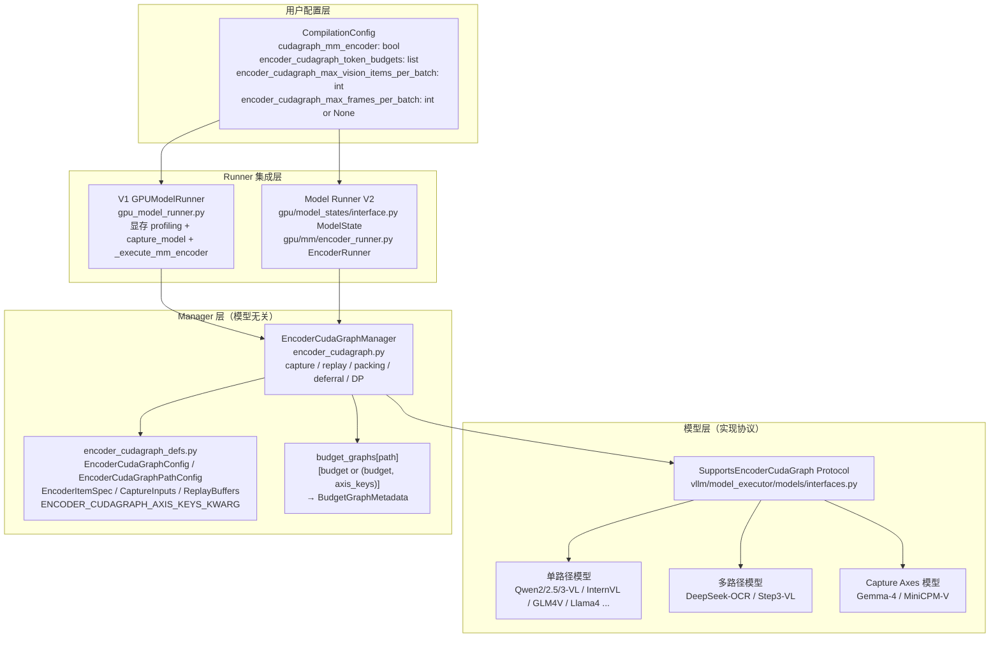
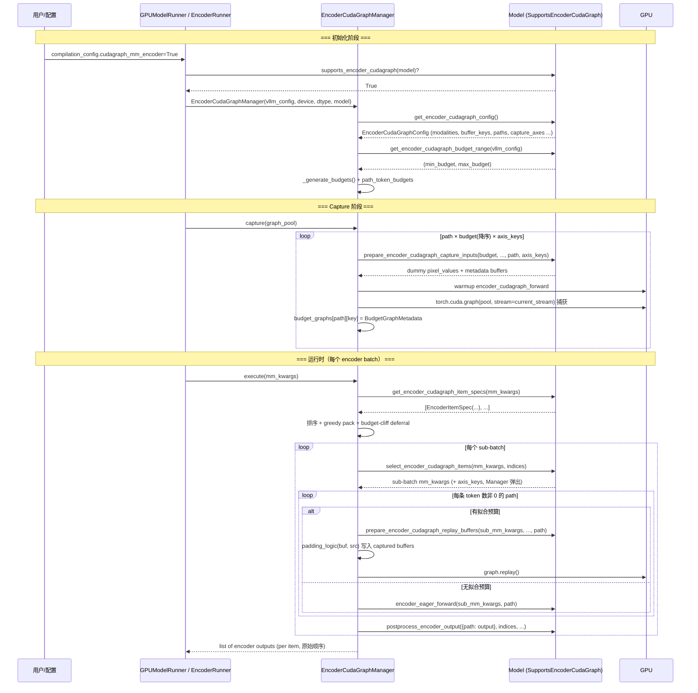
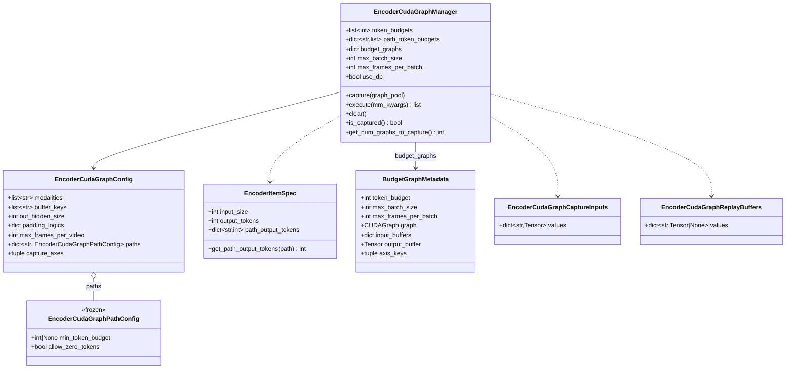
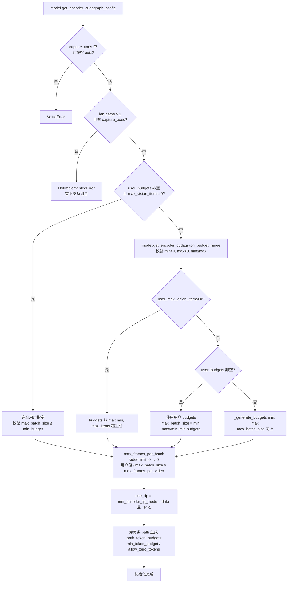
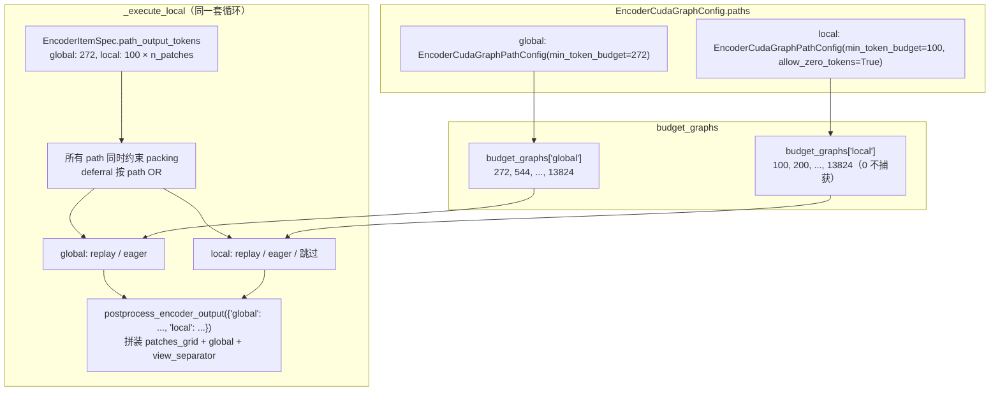
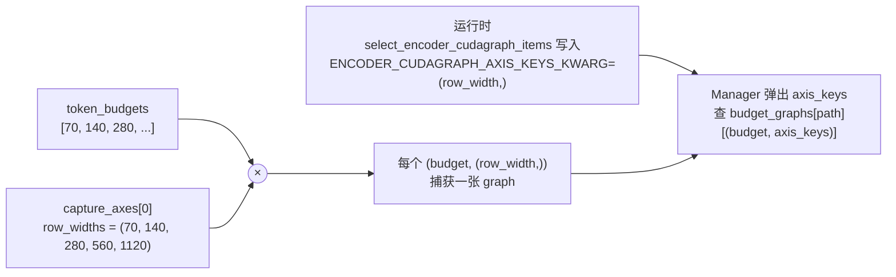
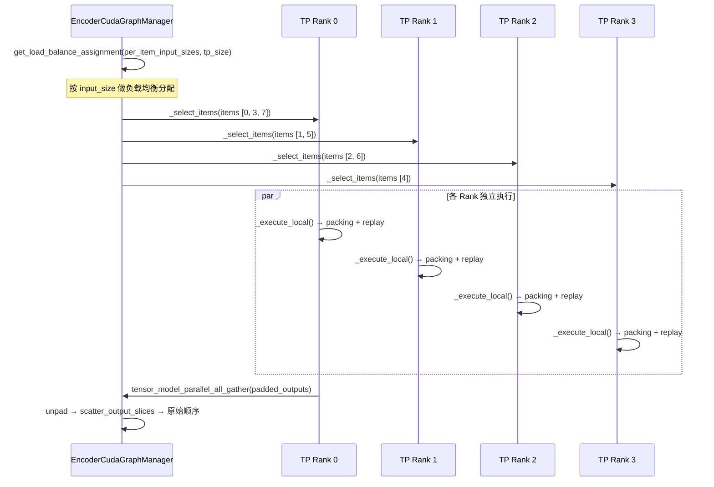
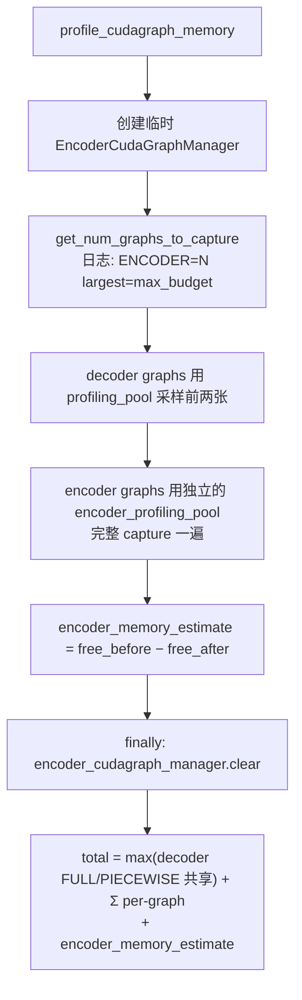

# vLLM ViT Full CUDA Graph 特性代码走读技术文档

> **文档版本**: 2.0
> **分析代码版本**: vLLM main 分支（commit `f4edf9f0f0`，2026-10-23）
> **最后更新**: 2026-10-23
> **上一版本**: 1.0（2026-06-22）

---

## 文档概述

本文档深入分析 vLLM 中 **ViT Full CUDA Graph**（Encoder CUDA Graph）特性的设计与实现。该特性将 Vision Transformer (ViT) 视觉编码器的完整前向传播过程捕获为 CUDA Graph，从而消除宿主端 CUDA kernel 启动开销，显著降低多模态模型在图像和视频推理场景下的延迟。

**目标读者**：对 vLLM 多模态推理有一定了解，希望深入理解 ViT CUDA Graph 机制的开发者。阅读前建议先了解 CUDA Graph 基本原理和 vLLM V1 引擎架构。

**阅读指南**：
- 第一部分介绍背景原理与整体架构
- 第二部分解析核心接口与协议定义（含 Multi-Path、Capture Axes 新数据结构）
- 第三部分深入 Manager 实现细节（统一的多路径 greedy packing、budget-cliff deferral、capture axes、DP）
- 第四部分分析 Runner 集成（V1 `GPUModelRunner` 与 Model Runner V2）及显存 profiling
- 第五部分展示模型侧集成方式（Qwen3-VL、DeepSeek-OCR、Gemma-4、MiniCPM-V 等）
- 第六部分提供配置与调优指南

### v2.0 主要变更（相对 2026-06 版本）

| 变更 | 相关 PR | 影响 |
|------|---------|------|
| Dual-path 统一为 **Multi-Path**：`enable_dual_path_graph` / `global_token_per_image` / `local_token_per_patch` 被 `paths: dict[str, EncoderCudaGraphPathConfig]` 取代；`_execute_local_single_path` / `_execute_local_dual_path` 合并为 `_execute_local` | #49934 | 协议 / 数据类 / Manager |
| `EncoderItemSpec` 的 `global_output_tokens` / `local_output_tokens` 合并为 `path_output_tokens: dict[str, int]` | #49934 | 数据类 |
| `postprocess_encoder_output` 的第一个参数从单个 tensor 改为 `outputs: dict[str, Tensor]`（按 path 名索引） | #49934 | 协议 |
| 新增 **Capture Axes**（`EncoderCudaGraphConfig.capture_axes`）：在 token budget 之外再加若干离散捕获维度，按笛卡尔积捕获 | #42785 | 协议 / Manager |
| `prepare_encoder_cudagraph_capture_inputs` 新增 `axis_keys` 参数；新增保留 key `ENCODER_CUDAGRAPH_AXIS_KEYS_KWARG` | #42785 | 协议 |
| Greedy packing 新增 **Budget-Cliff Deferral**（预算悬崖延迟） | #58925 | Manager |
| 预算查找改为 `round_up_to()`（`bisect_left`）；Kimi-K2.5 / DeepSeek-V4.1 的 `cu_seqlens` 改为零长度 padding | #58925 | Manager / 模型 |
| **Model Runner V2** 支持 Encoder CUDA Graph（`ModelState` + `EncoderRunner`） | #49852 | Runner |
| Encoder graph 计入 CUDA graph 显存 profiling（`profile_cudagraph_memory`），Manager 新增 `clear()` / `is_captured()` / `get_num_graphs_to_capture()` | #41714 | Runner / Manager |
| Graph capture 显式指定 `stream=current_stream()`（修复 ROCm） | #53818 | Manager |
| `_get_item_specs` / `_select_items` 包裹 `gpu_sync_allowed()`（CI 中的 GPU↔CPU 同步检查） | #43107 | Manager |
| 新支持模型：Gemma3、Gemma-4、DeepSeek-VL2、ERNIE-4.5-VL、MiniCPM-V、Kimi-K2.5/K3、DeepSeek-V4.1-Flash、Idefics3、LFM2-VL、Cohere Compass、MiniMax-M3、GLM-5-Next 等 | 多个 | 模型 |

---

# 第一部分：ViT Full CUDA Graph 基础与架构总览

## 1.1 背景与原理

### 1.1.1 基本思想

在多模态大模型的推理过程中，ViT 视觉编码器需要处理大量的图像/视频 patch。以 Qwen3-VL 为例，一张 336×336 的图像会产生 576 个 patch，spatial merge 后输出 144 个 token；多图或视频场景下 patch 数量更是成倍增长。传统 eager 模式下，每个 CUDA kernel 的启动都需要宿主端 CPU 发起，kernel launch overhead 在 batch 较小或图像较小、每个 kernel 计算量不大的场景下尤为显著。

**CUDA Graph** 是 NVIDIA 提供的一种机制，可以将一系列 CUDA 操作预先录制为一张"计算图"，后续只需一次 API 调用即可重放整张图上的所有操作，从而消除重复的 kernel launch overhead。

vLLM 的 **decoder CUDA Graph**（即 `FULL` / `PIECEWISE` 模式）早已广泛应用，但它仅覆盖语言模型部分，不涉及视觉编码器。**ViT Full CUDA Graph** 将 CUDA Graph 的覆盖范围扩展到视觉编码器的完整前向传播，两者相互独立、可以同时启用。

> **关键洞察**: ViT CUDA Graph 与 decoder CUDA Graph 解决的问题不同。Decoder CUDA Graph 主要优化 decode 阶段的 memory-bound 小 batch 场景；而 ViT CUDA Graph 优化的是视觉编码器前向传播中的 kernel launch 开销，并需要处理 patch 数量多变带来的 shape 动态性。两者协同工作可获得最大收益。

### 1.1.2 核心挑战

ViT 编码器的输入形状取决于图像分辨率：

| 图像分辨率 | patch 数（patch_size=14） | merge 后 token 数（spatial_merge=2） |
|-----------|--------------------------|-------------------------------------|
| 224×224 | 16×16 = 256 | 8×8 = 64 |
| 336×336 | 24×24 = 576 | 12×12 = 144 |
| 672×672 | 48×48 = 2304 | 24×24 = 576 |
| 1344×896 | 96×64 = 6144 | 48×32 = 1536 |

CUDA Graph 要求 **输入张量的形状在 capture 和 replay 时完全一致**。每个 batch 可能包含不同分辨率的图像，token 总数动态变化，无法直接用一张固定 shape 的 CUDA Graph 覆盖所有场景。此外：

- **双塔编码器**（如 DeepSeek-OCR 的 SAM + CLIP）的 global 图像路径与 local patch 路径 token 分布完全不同；
- **按行 padding 的编码器**（如 Gemma-4、MiniCPM-V）中，单个 graph 的 shape 不仅取决于总 token 数，还取决于"每行宽度"或"patch 网格尺寸"这类离散维度。

### 1.1.3 解决方案：Budget-Based 多图捕获策略

vLLM 采用 **Budget-Based（预算驱动）** 策略：

1. **预捕获多张图**：在不同的 token 预算级别（如 `[2048, 4096, 8192, 13824]`）分别捕获 CUDA Graph，每张图有固定的 token 容量和最大 batch 大小。多路径模型为每条 path 各自生成一组预算；配置了 capture axes 的模型在每个预算下再按 axis key 的笛卡尔积各捕获一张图。
2. **Greedy Bin-Packing + Budget-Cliff Deferral**：运行时将 item 按输出 token 数升序排列，然后贪心地装入 sub-batch（不超过各 path 的最大预算和最大 batch 数）；若合并某个"大 item"会让整个 batch 跨越预算悬崖，则先把当前 batch 结束掉。
3. **选择最小匹配预算**：对每个 sub-batch、每条 path，独立选择能容纳其 token 数的**最小**预算，重放对应 CUDA Graph。
4. **Eager Fallback**：某条 path 的 token 数超过所有预算时，仅该 path 回退到 eager 执行。

```mermaid
flowchart TB
    subgraph Capture["预捕获阶段（初始化 / capture_model 时）"]
        C1[确定每条 path 的 token 预算列表<br/>e.g. default: 64, 128, ..., 8192]
        C2[遍历 path × budget × product of capture_axes]
        C3[model.prepare_encoder_cudagraph_capture_inputs<br/>生成固定 shape 虚拟输入]
        C4[warm-up forward → torch.cuda.graph 捕获]
        C5[保存 BudgetGraphMetadata<br/>graph + input_buffers + output_buffer + axis_keys]
        C1 --> C2 --> C3 --> C4 --> C5
    end

    subgraph Runtime["运行时（每个 encoder batch）"]
        R1[get_encoder_cudagraph_item_specs<br/>每个 item 的 output tokens / path tokens]
        R2[按 output_tokens 升序排列]
        R3[Greedy Packing<br/>+ Budget-Cliff Deferral]
        R4[select_encoder_cudagraph_items<br/>弹出 axis_keys]
        R5{该 path 有<br/>拟合预算?}
        R6[replay 对应 graph]
        R7[该 path eager fallback]
        R8[postprocess_encoder_output<br/>按 path 合并 + scatter 回原序]
        R1 --> R2 --> R3 --> R4 --> R5
        R5 -->|是| R6 --> R8
        R5 -->|否| R7 --> R8
    end
```



### 1.1.4 性能收益

来自 PR #35963 在 Blackwell GB200 上的基准测试结果（`vllm bench mm-processor`）：

**单 GPU（Qwen3-VL-30B-A3B，VisionArena-Chat，3000 prompts）**：

| Attention Backend | Mean Latency 改善 | P99 Latency 改善 |
|-------------------|------------------|------------------|
| FLASH_ATTN | **+11.8%**（5.13→4.52ms） | **+31.6%**（9.16→6.26ms） |
| FLASHINFER | **+19.6%**（5.42→4.36ms） | **+40.3%**（10.87→6.49ms） |

**多 GPU DP 模式（Qwen3-VL-32B，4×GB200 TP=4 DP=4，1000 prompts，每请求 20 张 336×336 图）**：

| Attention Backend | Mean Latency 改善 | P99 Latency 改善 |
|-------------------|------------------|------------------|
| FLASH_ATTN | **+18.4%**（28.39→23.16ms） | **+14.0%**（238.78→205.28ms） |
| FLASHINFER | **+44.4%**（23.24→12.91ms） | **+84.9%**（172.41→26.05ms） |

> **关键洞察**: FLASHINFER backend 在 ViT CUDA Graph 下收益最大（单 GPU +19.6%，多 GPU +44.4%），尤其在多 GPU DP 模式下 P99 延迟改善高达 84.9%。这是因为 FLASHINFER 的 attention 路径 kernel 较细粒度，kernel launch overhead 占比更高。视频推理在 A100 上的数据可参考 PR #38061。

## 1.2 vLLM ViT CUDA Graph 整体架构

### 1.2.1 系统架构总览



### 1.2.2 核心组件与职责划分

| 组件 | 文件 | 职责 |
|------|------|------|
| `SupportsEncoderCudaGraph` | `vllm/model_executor/models/interfaces.py` | 定义模型必须实现的协议方法，封装所有模型特定逻辑 |
| `EncoderCudaGraphManager` | `vllm/v1/worker/encoder_cudagraph.py` | 核心管理器：预算生成、graph capture/replay、多路径 greedy packing、deferral、DP shard/gather |
| `BudgetGraphMetadata` | `vllm/v1/worker/encoder_cudagraph.py` | 单个 (path, budget, axis_keys) 的 CUDA Graph 元数据 |
| `EncoderCudaGraphConfig` | `vllm/v1/worker/encoder_cudagraph_defs.py` | 模型提供的静态配置（modalities、buffer_keys、padding_logics、paths、capture_axes 等） |
| `EncoderCudaGraphPathConfig` | `vllm/v1/worker/encoder_cudagraph_defs.py` | 单条 path 的捕获策略（最小预算、是否允许 0 token） |
| `EncoderItemSpec` | `vllm/v1/worker/encoder_cudagraph_defs.py` | 描述单个输入 item 的输入尺寸、总输出 token 数和每条 path 的输出 token 数 |
| `CompilationConfig` | `vllm/config/compilation.py` | 用户配置入口：`cudagraph_mm_encoder` 等 4 个字段 |
| `GPUModelRunner` | `vllm/v1/worker/gpu_model_runner.py` | V1 Runner：创建 Manager、显存 profiling、capture、运行时调度 |
| `ModelState` / `EncoderRunner` | `vllm/v1/worker/gpu/model_states/interface.py`、`vllm/v1/worker/gpu/mm/encoder_runner.py` | Model Runner V2 中的 Manager 持有与调用方 |

### 1.2.3 数据流与控制流



---

# 第二部分：核心接口与基类分析

## 2.1 SupportsEncoderCudaGraph 协议

`SupportsEncoderCudaGraph` 是一个 `runtime_checkable` 的 `Protocol` 类（结构化 Duck Typing），定义在 `vllm/model_executor/models/interfaces.py:1840`。任何模型只要实现了协议中定义的方法，即可接入 `EncoderCudaGraphManager`。

```python
# 文件: vllm/model_executor/models/interfaces.py

class SupportsEncoderCudaGraph(Protocol):
    """Interface for models whose vision encoder supports CUDA graph
    capture/replay.

    Models implement these methods to provide the
    :class:`EncoderCudaGraphManager` with all model-specific logic
    (input handling, metadata computation, forward pass) without the
    manager needing to know model internals.
    """

    supports_encoder_cudagraph: ClassVar[Literal[True]] = True
```

### 2.1.1 协议方法全景

| 方法 | 返回值 | 职责 | 调用时机 |
|------|--------|------|---------|
| `get_encoder_cudagraph_config()` | `EncoderCudaGraphConfig` | 提供静态配置 | Manager 初始化时 |
| `get_encoder_cudagraph_budget_range(vllm_config)` | `tuple[int, int]` | 提供预算范围 | Manager 自动推导预算时 |
| `get_encoder_cudagraph_item_specs(mm_kwargs)` | `list[EncoderItemSpec]` | 描述 batch 中每个 item | 每次运行时 |
| `get_input_modality(mm_kwargs)` | `str` | 识别输入模态（默认 `"image"`） | 模型内部路由 |
| `get_max_frames_per_video()` | `int` | 模型最大帧数 | 视频 buffer 大小计算 |
| `select_encoder_cudagraph_items(mm_kwargs, indices)` | `dict[str, Any]` | 按索引提取子 batch；有 capture axes 时额外写入 axis keys | Greedy packing / DP shard |
| `prepare_encoder_cudagraph_capture_inputs(..., path, axis_keys)` | `EncoderCudaGraphCaptureInputs` | 生成虚拟输入 | 每次 capture 时 |
| `prepare_encoder_cudagraph_replay_buffers(mm_kwargs, ..., path)` | `EncoderCudaGraphReplayBuffers` | 计算 replay buffer | 每次 replay 前 |
| `encoder_cudagraph_forward(inputs, path)` | `torch.Tensor` | 固定 shape 的前向传播 | Capture & replay 中 |
| `encoder_eager_forward(mm_kwargs, path)` | `torch.Tensor` | 常规 eager 前向传播 | 某条 path 无拟合预算时 |
| `postprocess_encoder_output(outputs, ...)` | `None` | 按 path 合并输出并 scatter（默认直接 scatter `outputs["default"]`） | 每个 sub-batch 之后 |

> **关键洞察**: Manager 完全不理解模型内部的 input format，所有模型特定逻辑（grid_thw 解析、pixel_values 切片、RoPE 计算、多路径特征拼接、axis key 解析）都封装在协议方法中。从 Manager 的视角看，它只需要知道"有哪些 path"、"有哪些 axis key"、"哪些 buffer 需要更新"以及"如何重放 graph"。

### 2.1.2 v2.0 中协议签名的变化

```python
# 文件: vllm/model_executor/models/interfaces.py

def postprocess_encoder_output(
    self,
    outputs: dict[str, torch.Tensor],   # v1.0: output: torch.Tensor
    indices: list[int],
    per_item_out_tokens: list[int],
    dest: dict[int, torch.Tensor] | list[torch.Tensor | None],
    clone: bool = False,
    batch_mm_kwargs: dict[str, Any] | None = None,
) -> None:
    from vllm.model_executor.models.utils import scatter_output_slices

    scatter_output_slices(
        outputs["default"], indices, per_item_out_tokens, dest, clone
    )

def prepare_encoder_cudagraph_capture_inputs(
    self,
    token_budget: int,
    max_batch_size: int,
    max_frames_per_batch: int,
    device: torch.device,
    dtype: torch.dtype,
    path: str = "default",
    axis_keys: tuple[Hashable, ...] | None = None,   # 新增
) -> "EncoderCudaGraphCaptureInputs": ...
```

- `outputs` 是 `{path_name: tensor}` 字典，单路径模型只会有 `"default"` 一项；多路径模型在这里把各 path 的特征拼装成最终 per-item embedding。
- `axis_keys` 是本次 capture 对应的各 capture axis 的取值（每个 axis 一个），未配置 capture axes 的模型可忽略。

### 2.1.3 协议类型守卫

```python
# 文件: vllm/model_executor/models/interfaces.py

@overload
def supports_encoder_cudagraph(
    model: type[object],
) -> TypeIs[type[SupportsEncoderCudaGraph]]: ...

@overload
def supports_encoder_cudagraph(
    model: object,
) -> TypeIs[SupportsEncoderCudaGraph]: ...

def supports_encoder_cudagraph(
    model: type[object] | object,
) -> TypeIs[type[SupportsEncoderCudaGraph]] | TypeIs[SupportsEncoderCudaGraph]:
    return isinstance(model, SupportsEncoderCudaGraph)
```

V1 `GPUModelRunner` 与 MRV2 `ModelState` 都用它判断当前模型是否支持 ViT CUDA Graph。注意 V1 Runner 需要先 `get_model()` 解包 `CUDAGraphWrapper` / `UBatchWrapper`，因为 `runtime_checkable` Protocol 的 `isinstance()` 无法穿透 `__getattr__` 转发。

## 2.2 EncoderCudaGraph 数据类体系



### 2.2.1 EncoderCudaGraphConfig

模型在初始化时一次性提供，Manager 在其整个生命周期中使用：

```python
# 文件: vllm/v1/worker/encoder_cudagraph_defs.py

EncoderCudaGraphPaddingLogic = Callable[[torch.Tensor, torch.Tensor], None]

@dataclass
class EncoderCudaGraphConfig:
    modalities: list[str]          # 支持的模态 ["image"] / ["image", "video"] / ["vision_chunk"]
    buffer_keys: list[str]         # 录制到 CUDA Graph 的 buffer 名称列表
    out_hidden_size: int           # 编码器输出 hidden dim（用于 DP gather 缓冲区分配）
    padding_logics: dict[str, EncoderCudaGraphPaddingLogic] = field(default_factory=dict)
                                   # 每个 buffer 的自定义 padding/copy 逻辑
    max_frames_per_video: int = 1  # 每视频最大帧数（仅视频模型需要）
    paths: dict[str, EncoderCudaGraphPathConfig] = field(
        default_factory=lambda: {"default": EncoderCudaGraphPathConfig()}
    )                              # 独立捕获的 encoder path，key 即 forward 时的 path 名
    capture_axes: tuple[tuple[Hashable, ...], ...] = ()
                                   # token budget 之外的额外捕获维度；空表示不启用
```

v1.0 中的 `enable_dual_path_graph`、`global_token_per_image`、`local_token_per_patch` 三个字段已被移除，统一由 `paths` 表达。

### 2.2.2 EncoderCudaGraphPathConfig（新增）

```python
# 文件: vllm/v1/worker/encoder_cudagraph_defs.py

@dataclass(frozen=True)
class EncoderCudaGraphPathConfig:
    """Capture policy for one independently replayable encoder path."""

    min_token_budget: int | None = None
    """Smallest capture budget, or the model default minimum when unset."""

    allow_zero_tokens: bool = False
    """Whether a batch may omit this path entirely."""
```

| 字段 | 取值 | 效果 |
|------|------|------|
| `min_token_budget=None` | 默认 | 该 path 直接复用全局 `token_budgets` |
| `min_token_budget=N` | `0 < N ≤ max_budget` | 以 N 为起点重新生成 2 的幂次预算 |
| `allow_zero_tokens=True` | — | 在预算列表首部插入 `0`，表示该 sub-batch 可以完全不走此 path（`0` 预算不会被 capture） |

### 2.2.3 EncoderItemSpec

```python
# 文件: vllm/v1/worker/encoder_cudagraph_defs.py

@dataclass
class EncoderItemSpec:
    input_size: int        # 输入 patch/行数（用于 DP 负载均衡）
    output_tokens: int     # 编码器总输出 token 数（用于排序和最终 scatter）
    path_output_tokens: dict[str, int] = field(default_factory=dict)
                           # 多路径模型：每条 path 的输出 token 数（用于 packing 与选预算）

    def get_path_output_tokens(self, path: str) -> int:
        if path == "default" and not self.path_output_tokens:
            return self.output_tokens
        return self.path_output_tokens.get(path, 0)
```

> **关键洞察**: `output_tokens` 与 `path_output_tokens` 可以不一致。Gemma-4 就利用了这一点：图像列表会被 pad 到 batch 中最宽的那张，因此它把 `path_output_tokens={"default": row_tokens}` 设成"按最宽行计算"的 token 数，用于 packing 和选预算，而 `output_tokens` 仍是该图真实输出 token 数，用于最终切片。

### 2.2.4 BudgetGraphMetadata 与 Graph Map Key

```python
# 文件: vllm/v1/worker/encoder_cudagraph.py

CaptureAxisKeys: TypeAlias = tuple[Hashable, ...]
BudgetGraphMapKey: TypeAlias = int | tuple[int, CaptureAxisKeys]

@dataclass
class BudgetGraphMetadata:
    token_budget: int
    max_batch_size: int                    # 最大图像/视频数
    max_frames_per_batch: int              # 最大总帧数（视频）
    graph: torch.cuda.CUDAGraph
    input_buffers: dict[str, torch.Tensor] # 录制到 graph 中的输入 buffer
    output_buffer: torch.Tensor            # graph 写入的输出 buffer
    axis_keys: CaptureAxisKeys = ()        # 新增：本图对应的 capture axis key
```

Manager 中的存储结构为 `budget_graphs: dict[path, dict[BudgetGraphMapKey, BudgetGraphMetadata]]`。没有 capture axes 时 key 就是 `token_budget`（与 v1.0 兼容），有 capture axes 时 key 为 `(token_budget, axis_keys)`。

> **关键洞察**: `input_buffers` 中的 tensor 对象引用在 capture 和 replay 之间保持不变（**buffer identity invariant**）。Manager 通过 in-place 修改这些 tensor 的内容来注入新数据，然后调用 `graph.replay()`。

### 2.2.5 Capture / Replay DTO 与保留 key

```python
# 文件: vllm/v1/worker/encoder_cudagraph_defs.py

# Reserved mm_kwargs key: models with ``EncoderCudaGraphConfig.capture_axes``
# put the resolved per-axis keys (one per axis, in order) into the dict
# returned by ``select_encoder_cudagraph_items()``; the manager pops it before
# the kwargs are used anywhere else.
ENCODER_CUDAGRAPH_AXIS_KEYS_KWARG = "encoder_cudagraph_axis_keys"

@dataclass
class EncoderCudaGraphCaptureInputs:
    values: dict[str, torch.Tensor]         # 虚拟 tensor（warmup + graph capture 共用）

@dataclass
class EncoderCudaGraphReplayBuffers:
    values: dict[str, torch.Tensor | None]  # 实际数据；None 表示该 buffer 保持不变
```

---

# 第三部分：Manager 核心实现深度分析

## 3.1 EncoderCudaGraphManager 初始化

```python
# 文件: vllm/v1/worker/encoder_cudagraph.py

class EncoderCudaGraphManager:
    """Budget-based CUDA graph capture/replay for vision encoders."""

    def __init__(
        self,
        vllm_config: VllmConfig,
        device: torch.device,
        dtype: torch.dtype,
        model: SupportsEncoderCudaGraph,
    ): ...
```

初始化流程：



**关键约束（Invariant）**：`max_batch_size ≤ min(token_budgets)`。这保证了 `per_item_output = budget // max_batch_size >= 1`，防止 CUDA Graph capture 时因空 tensor 导致 reshape 崩溃。

**Path 预算生成**是 v2.0 的新增步骤：

```python
# 文件: vllm/v1/worker/encoder_cudagraph.py

max_budget = self.token_budgets[-1]
if not self.config.paths:
    raise ValueError("Encoder CUDA graph config must define at least one path")
self.path_token_budgets: dict[str, list[int]] = {}
for path, path_config in self.config.paths.items():
    min_path_budget = path_config.min_token_budget
    if min_path_budget is None:
        budgets = list(self.token_budgets)
    else:
        if min_path_budget <= 0 or min_path_budget > max_budget:
            raise ValueError(...)
        budgets = self._generate_budgets(min_path_budget, max_budget)
    if path_config.allow_zero_tokens:
        budgets.insert(0, 0)
    self.path_token_budgets[path] = budgets
```

### 3.1.1 预算自动生成算法

```python
# 文件: vllm/v1/worker/encoder_cudagraph.py

@staticmethod
def _generate_budgets(min_budget: int, max_budget: int) -> list[int]:
    """Generate power-of-2 token budgets from min_budget to max_budget."""
    budgets: list[int] = []
    b = min_budget
    while b <= max_budget:
        budgets.append(b)
        b *= 2
    # Always include max_budget if it's not already a power-of-2 boundary
    if not budgets or budgets[-1] < max_budget:
        budgets.append(max_budget)
    return budgets
```

例如 `min_budget=64, max_budget=13824` 会生成：`[64, 128, 256, 512, 1024, 2048, 4096, 8192, 13824]`。DeepSeek-OCR 的两条 path 分别生成：

| Path | 配置 | 预算列表 |
|------|------|---------|
| `global` | `min_token_budget=272` | `[272, 544, 1088, 2176, 4352, 8704, 13824]` |
| `local` | `min_token_budget=100, allow_zero_tokens=True` | `[0, 100, 200, 400, 800, 1600, 3200, 6400, 12800, 13824]` |

## 3.2 CUDA Graph Capture 流程

```python
# 文件: vllm/v1/worker/encoder_cudagraph.py

def capture(self, graph_pool: Any):
    """Capture CUDA graphs for every configured path and token budget."""
    self.graph_pool = graph_pool

    num_graphs = self.get_num_graphs_to_capture()
    if num_graphs > _CAPTURE_GRAPH_COUNT_WARNING_THRESHOLD:   # 64
        logger.warning("Capturing %d encoder CUDA graphs; capture axes multiply the "
                       "per-budget graph count, consider pruning axis keys.", num_graphs)

    for path, budgets in self.path_token_budgets.items():
        for token_budget in sorted(budgets, reverse=True):     # 大预算先捕获
            if token_budget == 0:
                continue                                       # 0 预算永不捕获
            for axis_keys in itertools.product(*self._capture_axes):
                self._capture_budget_graph(token_budget, path=path, axis_keys=axis_keys)
```

捕获的 graph 总数：

$$N_{\text{graphs}} = \sum_{p \in \text{paths}} \left|\{b \in B_p : b \neq 0\}\right| \times \prod_{a \in \text{capture\_axes}} |a|$$

注意 `itertools.product()` 在没有任何 axis 时产出一个空 tuple `()`，因此单路径、无 axis 的模型每个预算恰好捕获一次。

单张图的捕获逻辑：

```python
# 文件: vllm/v1/worker/encoder_cudagraph.py

def _capture_budget_graph(self, token_budget, path="default", axis_keys=()):
    graph_set = self._get_graph_set(path)

    # Step 1: 让模型生成虚拟输入
    capture_inputs = self.model.prepare_encoder_cudagraph_capture_inputs(
        token_budget, self.max_batch_size, self.max_frames_per_batch,
        self.device, self.dtype, path, axis_keys,
    )
    values = capture_inputs.values

    # Step 2: Warmup 前向传播（非 graph 模式），确定输出 shape
    with torch.inference_mode():
        output = self.model.encoder_cudagraph_forward({**values}, path=path)
        output_buffer = torch.empty_like(output)

    # Step 3: 在当前 stream 上正式捕获（#53818：修复 ROCm 上的 stream 问题）
    graph = torch.cuda.CUDAGraph()
    with (
        torch.inference_mode(),
        torch.cuda.graph(graph, pool=self.graph_pool, stream=current_stream()),
    ):
        output = self.model.encoder_cudagraph_forward({**values}, path=path)
        output_buffer.copy_(output)

    # Step 4: 保存元数据
    graph_map_key = token_budget if not axis_keys else (token_budget, axis_keys)
    graph_set[graph_map_key] = BudgetGraphMetadata(
        token_budget=token_budget, max_batch_size=self.max_batch_size,
        max_frames_per_batch=self.max_frames_per_batch, graph=graph,
        input_buffers=values, output_buffer=output_buffer, axis_keys=axis_keys,
    )
```

> **注意**: `encoder_cudagraph_forward` 接收的是 `{**values}` 的浅拷贝，因为 Qwen 系列实现会 `values.pop("pixel_values")`，浅拷贝保证 `input_buffers` 字典本身不被修改。

Manager 还新增了与生命周期相关的方法：`clear()` 清空所有 graph 并释放 pool 引用；`is_captured()` 返回 `graph_pool is not None`，MRV2 的 `EncoderRunner` 用它判断能否走 graph 路径。

## 3.3 统一的 Greedy Bin-Packing（多路径）

v2.0 中单路径与双路径的执行逻辑合并为一个 `_execute_local()`。单路径模型只是"paths 只有 `default` 一条"的特例。

### 3.3.1 打包阶段

```python
# 文件: vllm/v1/worker/encoder_cudagraph.py

def _execute_local(self, mm_kwargs: dict[str, Any]) -> list[torch.Tensor]:
    item_specs = self._get_item_specs(mm_kwargs)
    num_items = len(item_specs)
    paths = tuple(self.path_token_budgets)
    per_item_path_tokens = {
        path: [spec.get_path_output_tokens(path) for spec in item_specs]
        for path in paths
    }
    per_item_out_tokens = [spec.output_tokens for spec in item_specs]
    max_path_budgets = {path: max(self.path_token_budgets[path]) for path in paths}

    # Step 1: 按总输出 token 数升序排列（最小优先）
    sorted_indices = sorted(range(num_items), key=lambda i: per_item_out_tokens[i])
    batches: list[tuple[list[int], dict[str, int | None]]] = []
    current_batch: list[int] = []
    current_tokens = dict.fromkeys(paths, 0)

    def append_current_batch() -> None:
        if not current_batch:
            return
        path_budgets = {
            path: self._path_fitting_budget(path, current_tokens[path])
            for path in paths
        }
        batches.append((list(current_batch), path_budgets))

    # Step 2: Greedy pack —— 所有 path 都不超过各自最大预算，且 item 数 ≤ max_batch_size
    for orig_idx in sorted_indices:
        item_tokens = {path: per_item_path_tokens[path][orig_idx] for path in paths}
        fits = len(current_batch) < self.max_batch_size and all(
            current_tokens[path] + item_tokens[path] <= max_path_budgets[path]
            for path in paths
        )
        if current_batch and (not fits or should_defer_item(item_tokens)):
            append_current_batch()
            current_batch = []
            current_tokens = dict.fromkeys(paths, 0)

        current_batch.append(orig_idx)
        for path in paths:
            current_tokens[path] += item_tokens[path]

    append_current_batch()
    ...
```

### 3.3.2 Budget-Cliff Deferral（新增，#58925）

由于预算是离散的（如 `[256, 4096, 8192]`），一个 token 的差别就可能让 batch 所需的 graph 级别翻倍，这就是"**预算悬崖**"。纯贪心打包会因为最后一个大 item 把整个 batch 拖进大预算。`should_defer_item()` 对每个"放得下"的 item 额外做一次判定：

```python
# 文件: vllm/v1/worker/encoder_cudagraph.py

def should_defer_item(item_tokens: dict[str, int]) -> bool:
    """Whether closing the batch strictly reduces summed budgets."""
    for path in paths:
        item = item_tokens[path]
        if item == 0:
            continue
        cur = current_tokens[path]
        b_cur = self._path_fitting_budget(path, cur)
        b_alone = self._path_fitting_budget(path, item)
        b_merged = self._path_fitting_budget(path, cur + item)
        # Only called when the item fits; lookups land on a budget.
        assert b_cur is not None and b_alone is not None and b_merged is not None
        # Only defer items that alone outweigh the whole current
        # batch; splitting smaller ones fragments flood packing.
        if b_cur + b_alone < b_merged and b_alone >= b_cur:
            return True
    return False
```

两个条件：

$$\underbrace{b_{\text{cur}} + b_{\text{alone}} < b_{\text{merged}}}_{\text{条件 1：拆分严格更省}} \quad\land\quad \underbrace{b_{\text{alone}} \ge b_{\text{cur}}}_{\text{条件 2：该 item 是"大鲸鱼"}}$$

| 场景（budgets） | items | 结果 | 说明 |
|----------------|-------|------|------|
| `[256, 4096, 8192]` | 200, 4000 | `[200]@256` + `[4000]@4096` | 合并需 8192；拆分 256+4096=4352，省 3840 token 的 padding |
| `[256, 4096, 8192]` | 4000, 4000 | `[4000, 4000]@8192` | 4096+4096 == 8192 平局，严格不等号 → 合并，少一次 replay |
| `[256, 2048, 4096, 8192]` | 1366 × 3 | `[全部]@8192` | 条件 1 成立（4096+2048<8192）但 2048 < 4096，条件 2 不成立 → 合并 |
| `[256, 4096]` | 100 × 4 | `[100,100]@256` × 2 | 第 3 个会让 256 跳到 4096，且 b_alone=b_cur=256 → 延迟 |
| `[1024, 4096]`, `max_batch_size=3` | 100 × 4 | `[3 个]@1024` + `[1 个]@1024` | 受 batch 数限制拆分 |

> **关键洞察**: 条件 2 区分了"鲸鱼"（单个就占满一个预算桶的大 item）和"跟随者"（中等 item）。由于 item 已升序排列，鲸鱼总在最后到来，延迟它能让前面的小 batch 以小预算 replay；而若没有条件 2，大量同尺寸中等 item 会被切成很多碎片，产生更多 replay。当 `b_alone == b_cur` 时，条件 1 等价于 $b_{\text{merged}} > 2 b_{\text{cur}}$，即只有合并会跨越至少两个预算级别时才延迟。多路径时各 path 的判定取 **OR**，token 为 0 的 path 跳过。

### 3.3.3 预算选择

```python
# 文件: vllm/v1/worker/encoder_cudagraph.py

def _find_smallest_fitting_budget_given_tokens(self, total_tokens, budgets=None):
    """Find smallest budget >= total_tokens, or None if none fits."""
    budgets = budgets if budgets is not None else self.token_budgets
    return round_up_to(budgets, total_tokens)

def _path_fitting_budget(self, path: str, tokens: int) -> int | None:
    """Smallest captured budget on a path; 0 when idle, None if oversized."""
    if tokens == 0:
        return 0
    return self._find_smallest_fitting_budget_given_tokens(
        tokens, self.path_token_budgets[path]
    )
```

```python
# 文件: vllm/utils/math_utils.py

def round_up_to(values: list[int], n: int) -> int | None:
    """Round `n` up to the smallest member of sorted `values` >= n, or None."""
    i = bisect_left(values, n)
    return values[i] if i < len(values) else None
```

线性扫描被替换为二分查找（$O(\log |B|)$），这在 deferral 判定中每个 item 要做 3 次查找时更有意义。选择**最小**的拟合预算以最大化 GPU 利用率（减少 padding waste）。

### 3.3.4 执行阶段：Partial Graph Fallback

```python
# 文件: vllm/v1/worker/encoder_cudagraph.py

outputs_by_orig_idx: dict[int, torch.Tensor] = {}
for batch_indices, path_budgets in batches:
    batch_mm_kwargs, axis_keys = self._select_items(mm_kwargs, batch_indices)
    graph_outputs: dict[str, torch.Tensor] = {}
    all_eager = True

    for path in paths:
        path_tokens = sum(per_item_path_tokens[path][i] for i in batch_indices)
        if path_tokens == 0:
            continue                              # 该 path 本 batch 无 token，直接跳过

        token_budget = path_budgets[path]
        if token_budget is None:                  # 超出该 path 所有预算 → 仅此 path eager
            with torch.inference_mode():
                output = self.model.encoder_eager_forward(batch_mm_kwargs, path=path)
        else:
            all_eager = False
            output = self._run_budget_graph(
                batch_mm_kwargs, token_budget, path=path, axis_keys=axis_keys
            )
        graph_outputs[path] = output

    if all_eager:
        self.graph_misses += len(batch_indices)

    self.model.postprocess_encoder_output(
        graph_outputs, batch_indices, per_item_out_tokens, outputs_by_orig_idx,
        clone=True, batch_mm_kwargs=batch_mm_kwargs,
    )

return [outputs_by_orig_idx[i] for i in range(num_items)]
```

| 多路径决策（以 DeepSeek-OCR 为例） | global | local | 行为 |
|-----------------------------------|--------|-------|------|
| 两条 path 都拟合 | graph | graph | 两次 replay |
| 小图（≤640×640，无 local patch） | graph | 跳过（0 token） | 一次 replay |
| local patch 超出预算 | graph | eager | 部分 graph 覆盖 |
| 两条都超出 | eager | eager | 计入 `graph_misses` |

> **注意**: `clone=True` 是必须的，因为 `output_buffer` 会被后续 replay 复用。单路径 eager fallback 现在也统一走 `postprocess_encoder_output`，而不是 v1.0 中直接调用 `scatter_output_slices`。

### 3.3.5 `_select_items` 与 GPU 同步

```python
# 文件: vllm/v1/worker/encoder_cudagraph.py

def _select_items(self, mm_kwargs, indices) -> tuple[dict[str, Any], CaptureAxisKeys]:
    # Same as `_get_item_specs`: implementations re-read the per-item
    # grid/patch counts to slice the batch, so the D2H is inherent.
    with gpu_sync_allowed():
        selected = self.model.select_encoder_cudagraph_items(mm_kwargs, indices)
    axis_keys = selected.pop(ENCODER_CUDAGRAPH_AXIS_KEYS_KWARG, ())
    if len(axis_keys) != len(self._capture_axes):
        raise ValueError(...)
    return selected, axis_keys
```

`_get_item_specs` 和 `_select_items` 都包裹在 `gpu_sync_allowed()` 中：模型实现需要从 device tensor 读取 grid / patch 数（D2H 同步），这是固有开销，因此在 CI 的 GPU↔CPU 同步检查（#43107）中被显式豁免。

## 3.4 Graph Replay 细节

```python
# 文件: vllm/v1/worker/encoder_cudagraph.py

def _run_budget_graph(self, mm_kwargs, token_budget, path="default", axis_keys=()):
    graph_set = self._get_graph_set(path)
    num_items = len(self._get_item_specs(mm_kwargs))

    graph_map_key = token_budget if not axis_keys else (token_budget, axis_keys)
    if graph_map_key not in graph_set:
        self.graph_misses += num_items
        return None

    graph_meta = graph_set[graph_map_key]

    # Step 1: 模型计算实际 batch 的 replay buffer 值
    replay = self.model.prepare_encoder_cudagraph_replay_buffers(
        mm_kwargs, self.max_batch_size, self.max_frames_per_batch, path,
    )

    # Step 2: 将 replay 值写入本图自己的 input_buffers
    for key, buf in graph_meta.input_buffers.items():
        src = replay.values.get(key)
        if src is None:
            continue
        if src.ndim == 0:
            buf.copy_(src)                         # 标量直接拷贝
        else:
            padding_logic = self.config.padding_logics.get(key, self._copy_padded_buffer)
            padding_logic(buf, src)                # 张量：默认 zero + slice-copy

    # Step 3: 重放
    graph_meta.graph.replay()
    self.graph_hits += num_items
    return graph_meta.output_buffer
```

Manager 遍历的是**每张图自己的** `input_buffers.keys()` 而不是共享的 `buffer_keys`，因此不同 path 可以使用不同的 buffer（如 DeepSeek-OCR 的 global 用 `pixel_values`，local 用 `images_crop`）。

**默认 padding 逻辑**：

```python
@staticmethod
def _copy_padded_buffer(dst: torch.Tensor, src: torch.Tensor) -> None:
    dst.zero_()
    dst[: src.shape[0]].copy_(src)
```

### 3.4.1 `cu_seqlens` 的零长度 padding

对 varlen attention 来说，`cu_seqlens` 尾部若直接补 0 会形成负长度序列。各模型通过 `padding_logics` 采用"**零长度序列**"padding：把尾部填为最后一个真实 offset，使 padding 槽位对应长度为 0 的序列，FlashAttention 不会为其调度任何工作。

```python
# 文件: vllm/model_executor/models/qwen2_5_vl.py

def _pad_cumulative_seqlens_buffer(dst: torch.Tensor, src: torch.Tensor) -> None:
    n = src.shape[0]
    dst.zero_()
    dst[:n].copy_(src)
    if n < dst.shape[0]:
        dst[n:] = src[-1]
```

FlashInfer 使用指向展平后 Q/K/O 与 V buffer 的 backend 专属 offset，`cu_seqlens` 由前后两段拼成，需要分段 padding（`_pad_flashinfer_cu_seqlens_buffer`），Qwen2.5-VL 根据 `self.visual.attn_backend` 选择对应函数。

#58925 中，Kimi-K2.5 与 DeepSeek-V4.1 原先"追加一个覆盖全部剩余行的 padding 序列"的做法被替换为同样的零长度 padding，不再需要以 `data_ptr()` 记录每个 capture buffer 的总行数：

```python
# 文件: vllm/model_executor/models/kimi_k25.py

def pad_cu_seqlens(dst: torch.Tensor, src: torch.Tensor) -> None:
    # Zero-length padding (same as Qwen): tail slots repeat the last
    # real offset, so FlashAttn schedules no work for padding rows.
    n = min(src.shape[0], dst.shape[0])
    dst[:n].copy_(src[:n])
    if n < dst.shape[0]:
        dst[n:] = src[-1] if n else 0
```

## 3.5 Multi-Path 模式（原 Dual-Path）

对于使用双塔视觉编码器（SAM + CLIP + 动态 tiling）的 DeepSeek-OCR 和 Step3-VL，global 图像路径与 local patch 路径 token 分布独立（DeepSeek-OCR 每张 global 图 272 token，每个 local patch 100 token）。若合并为一张单体 graph，会显著降低 packing 效率，且可变的 `crop_shape` 会让 graph 失效。



v1.0 → v2.0 的迁移对照：

| v1.0 | v2.0 |
|------|------|
| `enable_dual_path_graph=True` | `paths={"global": ..., "local": ...}` |
| `global_token_per_image` | `paths["global"].min_token_budget` |
| `local_token_per_patch` + 硬编码的 local 预算含 `0` | `paths["local"].min_token_budget` + `allow_zero_tokens=True` |
| `EncoderItemSpec.global_output_tokens / local_output_tokens` | `EncoderItemSpec.path_output_tokens["global" / "local"]` |
| `_execute_local_dual_path()` | `_execute_local()`（与单路径共用） |
| `postprocess_encoder_output(output, ...)` | `postprocess_encoder_output({"global": g, "local": l}, ...)` |

> **注意**: 目前 Multi-Path 与 Capture Axes 不能同时使用，`__init__` 中会抛出 `NotImplementedError`。

## 3.6 Capture Axes（新增，#42785）

有些编码器的 graph shape 除了总 token 数，还取决于一个离散的"形状"维度：

- **MiniCPM-V**：每个 slice 的 patch 网格 `(nb_h, nb_w)` 决定了 resampler 的位置编码与 attention mask 形状；
- **Gemma-4**：一个 batch 的图像会 pad 到最宽的那张，单行 soft token 数（70/140/280/560/1120）决定了每行宽度。

若只按 token 预算捕获，就必须把所有行 pad 到最大宽度，浪费严重。`capture_axes` 允许模型声明额外的离散维度：



协议约定：

1. `get_encoder_cudagraph_config()` 返回 `capture_axes=(axis0_keys, axis1_keys, ...)`，每个 axis 是有序的、非空的 key 元组；
2. `prepare_encoder_cudagraph_capture_inputs(..., axis_keys=(k0, k1, ...))` 为该组合生成 dummy 输入；
3. `select_encoder_cudagraph_items()` 返回的 dict 中写入 `ENCODER_CUDAGRAPH_AXIS_KEYS_KWARG: (k0, k1, ...)`，Manager 在使用 kwargs 前将其 `pop` 掉，并校验长度等于 axis 数。

> **性能提示**: graph 数量随 axis 大小**乘法**增长。超过 `_CAPTURE_GRAPH_COUNT_WARNING_THRESHOLD = 64` 时 Manager 会打印 warning，建议裁剪 axis keys（例如 Gemma-4 只保留 `≤ default_output_length` 的行宽）。

## 3.7 Data-Parallel 支持

当 `mm_encoder_tp_mode="data"` 且 `tensor_parallel_size > 1` 时，Manager 采用数据并行模式：



**负载均衡**使用 `get_load_balance_assignment()`（`vllm/model_executor/models/vision.py`），按每个 item 的 `input_size` 分配。

**DP Gather** 遵循与 eager 路径 `run_dp_sharded_mrope_vision_model()` 相同的 pad → all_gather → unpad → reorder 算法：

```python
# 文件: vllm/v1/worker/encoder_cudagraph.py

def _dp_gather(self, local_outputs, per_item_out_tokens,
               image_rank_assignment, images_per_rank, max_output_tokens_per_rank):
    hidden_size = self.config.out_hidden_size
    tp_size = len(images_per_rank)

    # 1. 本地 concat（空 rank 用 [0, hidden] 的空 tensor）
    local_concat = torch.cat(local_outputs, dim=0) if local_outputs else torch.empty(
        (0, hidden_size), device=self.device, dtype=self.dtype)

    # 2. Pad 到 max_output_tokens_per_rank，保证各 rank 形状一致
    ...
    # 3. All-gather
    gathered = tensor_model_parallel_all_gather(local_padded, dim=0)

    # 4. 按 rank 截掉 padding，再用 scatter_output_slices 写回原始位置
    ...
    return [t for t in result if t is not None]
```

## 3.8 统计跟踪

```python
# 文件: vllm/v1/worker/encoder_cudagraph.py

def get_cumulative_stats(self) -> dict[str, Any]:
    total_requests = self.graph_hits + self.graph_misses
    hit_rate = self.graph_hits / total_requests if total_requests > 0 else 0.0
    return {
        "graph_hits": self.graph_hits,
        "graph_misses": self.graph_misses,
        "hit_rate": hit_rate,
        "num_budgets": sum(len(g) for g in self.budget_graphs.values()),
        "token_budgets": self.token_budgets,
    }
```

`execute()` 结束时，若累计 item 数是 `log_stats_interval=100` 的整数倍，则以 DEBUG 级别打印 hit/miss。计数口径：成功 replay 的 path 按 item 计 hit；只有当一个 sub-batch 的**所有** path 都走 eager 时才计 miss。

---

# 第四部分：Runner 集成分析

## 4.1 V1 GPUModelRunner

### 4.1.1 创建

```python
# 文件: vllm/v1/worker/gpu_model_runner.py

@torch.inference_mode()
def _create_encoder_cudagraph_manager(self) -> "EncoderCudaGraphManager | None":
    if not (self.compilation_config.cudagraph_mm_encoder and self.supports_mm_inputs):
        return None

    # Use get_model() to unwrap CUDAGraphWrapper/UBatchWrapper, because
    # @runtime_checkable Protocol isinstance() checks do not work through
    # __getattr__ forwarding.
    raw_model = self.get_model()
    if not supports_encoder_cudagraph(raw_model):
        return None

    return EncoderCudaGraphManager(
        vllm_config=self.vllm_config, device=self.device, dtype=self.dtype,
        model=cast(SupportsEncoderCudaGraph, raw_model),
    )
```

### 4.1.2 显存 Profiling（#41714）

Encoder graph 现在被纳入 CUDA graph 显存估算，从而正确地从 KV cache 可用显存中扣除：



> **关键洞察**: decoder 的 FULL 与 PIECEWISE graph 在运行时共享全局 pool、不会并发 replay，因此取 max 以避免重复计算；而 encoder graph 在运行时使用 **Manager 私有的 pool**（`capture_model()` 中新建 `current_platform.graph_pool_handle()`），与 decoder pool 分离，所以估算值需要**相加**。Profiling 使用的是临时 Manager，真正的持久 Manager 在 `capture_model()` 中才通过 `_maybe_init_encoder_cudagraph_manager()` 初始化，避免保留 profiling 阶段的 graph 状态。

### 4.1.3 Capture 与运行时调用

```python
# 文件: vllm/v1/worker/gpu_model_runner.py — capture_model()

self._maybe_init_encoder_cudagraph_manager()
...
with self._freeze_gc(), graph_capture(device=self.device):
    for runtime_mode, batch_descs in self.cudagraph_dispatcher.get_capture_descs():
        self._capture_cudagraphs(...)
    # Capture encoder CUDA graphs if enabled
    if self.encoder_cudagraph_manager is not None:
        encoder_graph_pool = current_platform.graph_pool_handle()
        self.encoder_cudagraph_manager.capture(graph_pool=encoder_graph_pool)
```

```python
# 文件: vllm/v1/worker/gpu_model_runner.py — _execute_mm_encoder()

cudagraph_output = None
if (
    self.encoder_cudagraph_manager is not None
    and self.encoder_cudagraph_manager.supports_modality(modality)
):
    cudagraph_output = self.encoder_cudagraph_manager.execute(mm_kwargs_batch)

if cudagraph_output is not None:
    batch_outputs = cudagraph_output
else:
    batch_outputs = model.embed_multimodal(**mm_kwargs_batch)
```

> **注意**: 由于 V1 的 `capture_model()` 在 `cudagraph_mode == NONE` 时直接返回，若关闭了 decoder CUDA graph，encoder CUDA graph 也不会被初始化。在 ROCm 上，runner 关闭时会主动把 `encoder_cudagraph_manager` 置为 `None`，以避免延迟析构 graph 引发 HSA fault。

## 4.2 Model Runner V2（#49852）

MRV2 将多模态 encoder 的执行抽到 `EncoderRunner` 中，Manager 由 `ModelState` 在构造时创建：

```python
# 文件: vllm/v1/worker/gpu/model_states/interface.py

if encoder_cache is not None:
    enable_encoder_cuda_graph = (
        not self.model_config.enforce_eager
        and vllm_config.compilation_config.cudagraph_mm_encoder
        and supports_encoder_cudagraph(model)
    )
    cudagraph_manager = (
        EncoderCudaGraphManager(vllm_config=vllm_config, device=device,
                                dtype=self.dtype, model=cast(SupportsEncoderCudaGraph, model))
        if enable_encoder_cuda_graph else None
    )
    self.encoder_runner = EncoderRunner(..., cudagraph_manager=cudagraph_manager, ...)
```

```python
# 文件: vllm/v1/worker/gpu/mm/encoder_runner.py

@torch.inference_mode()
def capture(self) -> None:
    manager = self.cudagraph_manager
    with graph_capture(device=self.device):
        manager.capture(graph_pool=current_platform.graph_pool_handle())
        torch.accelerator.synchronize()

@torch.inference_mode()
def execute_mm_encoder(self, mm_kwargs):
    # Stable-sort items by modality so each modality is encoded in as few
    # batches as possible. The returned outputs are restored to input order.
    order = sorted(range(len(mm_kwargs)), key=lambda i: mm_kwargs[i][0])
    encoder_outputs: list[torch.Tensor] = []
    for modality, num_items, mm_kwargs_batch in group_and_batch_mm_kwargs(
        [mm_kwargs[i] for i in order], device=self.device, pin_memory=PIN_MEMORY
    ):
        cg_manager = self.cudagraph_manager
        cudagraph_output = (
            cg_manager.execute(mm_kwargs_batch)
            if cg_manager is not None
            and cg_manager.is_captured()
            and cg_manager.supports_modality(modality)
            else None
        )
        batch_outputs = cudagraph_output if cudagraph_output is not None \
            else self.model.embed_multimodal(**mm_kwargs_batch)
        ...
    return [encoder_outputs[i] for i in np.argsort(order)]
```

| 对比项 | V1 `GPUModelRunner` | MRV2 `ModelState` / `EncoderRunner` |
|--------|---------------------|-------------------------------------|
| Manager 创建时机 | `capture_model()` 中惰性创建（profiling 用临时实例） | `ModelState.__init__` 中直接创建 |
| `enforce_eager` 检查 | 通过 `cudagraph_mode == NONE` 间接跳过 | 显式检查 `not enforce_eager` |
| 是否允许只捕获 encoder | 否（decoder `NONE` 时直接 return） | 是：`capture_encoder` 与 `capture_decoder` 独立判断 |
| replay 前检查 | `supports_modality()` | `is_captured()` + `supports_modality()` |
| 模态分组 | 按调度顺序分组 | 按模态稳定排序后分组（#60196），减少 batch 数 |
| 释放 | ROCm 关闭时置 None | `EncoderRunner.clear()`（profiling 后 / shutdown 时） |

---

# 第五部分：模型集成分析

## 5.1 Qwen3-VL 实现案例（单路径，image + video）

Qwen3-VL 是首个实现 `SupportsEncoderCudaGraph` 的模型，也是 Qwen2-VL、Qwen2.5-VL、Qwen3.5/3.6 等模型的参考实现。

### 5.1.1 类声明

```python
# 文件: vllm/model_executor/models/qwen3_vl.py

class Qwen3VLForConditionalGeneration(
    nn.Module,
    SupportsMultiModal,
    SupportsEncoderCudaGraph,  # <-- 混入协议
    SupportsLoRA,
    SupportsPP,
    SupportsMRoPE,
    SupportsEagle,
    SupportsEagle3,
    SupportsMultiModalPruning,
):
```

### 5.1.2 配置提供

```python
# 文件: vllm/model_executor/models/qwen3_vl.py

def get_encoder_cudagraph_config(self):
    # When video pruning is enabled, embed_multimodal post-processes both
    # image and video embeddings ... So disable CUDA graph for all
    # modalities when pruning is on.
    modalities = [] if self.is_multimodal_pruning_enabled else ["image", "video"]
    max_frames = self.get_max_frames_per_video() if "video" in modalities else 1

    return EncoderCudaGraphConfig(
        modalities=modalities,
        buffer_keys=[
            "pixel_values", "pos_embeds",
            "rotary_pos_emb_cos", "rotary_pos_emb_sin",
            "cu_seqlens", "max_seqlen", "sequence_lengths",
        ],
        out_hidden_size=self.visual.out_hidden_size,
        max_frames_per_video=max_frames,
    )
```

未指定 `paths` 时使用默认的 `{"default": EncoderCudaGraphPathConfig()}`；未指定 `capture_axes` 即不启用。

### 5.1.3 预算范围与 Item Specs

```python
# 文件: vllm/model_executor/models/qwen3_vl.py

def get_encoder_cudagraph_budget_range(self, vllm_config) -> tuple[int, int]:
    # 224x224 image → 16x16 patches → spatial_merge_size=2 → 8x8 = 64 tokens
    min_budget = 64
    max_budget = min(
        vllm_config.scheduler_config.max_num_batched_tokens,
        self.model_config.max_model_len,
    )
    return (min_budget, max_budget)

def get_encoder_cudagraph_item_specs(self, mm_kwargs):
    m = self.visual.spatial_merge_size
    grid_thw = self._get_grid_thw_by_modality(mm_kwargs)
    return [
        EncoderItemSpec(input_size=t * h * w, output_tokens=t * (h // m) * (w // m))
        for t, h, w in grid_thw
    ]
```

### 5.1.4 子 Batch 提取

```python
# 文件: vllm/model_executor/models/qwen3_vl.py

def select_encoder_cudagraph_items(self, mm_kwargs, indices):
    grid_thw = self._get_grid_thw_by_modality(mm_kwargs)
    pixel_values = self._get_pixel_values_by_modality(mm_kwargs)

    if len(indices) == 0:          # 空 batch（DP sharding 时可能发生）
        ...                        # 按模态返回 pixel_values[:0] 与空 grid

    patches_per_item = [t * h * w for t, h, w in grid_thw]
    cum_patches = [0]
    for p in patches_per_item:
        cum_patches.append(cum_patches[-1] + p)

    selected_pv = torch.cat(
        [pixel_values[cum_patches[i] : cum_patches[i + 1]] for i in indices]
    )
    selected_grid = [grid_thw[i] for i in indices]
    # image → {"pixel_values", "image_grid_thw"}
    # video → {"pixel_values_videos", "video_grid_thw"}
```

**Qwen 系列模型的特殊性**：pixel_values 是所有图像 patch 展平后拼接成的 2D tensor `[P, C·T·p·p]`，不是 batched 格式，因此选择子 batch 需要按累积 patch 偏移量切片。

### 5.1.5 Capture 输入生成

```python
# 文件: vllm/model_executor/models/qwen3_vl.py

def prepare_encoder_cudagraph_capture_inputs(
    self, token_budget, max_batch_size, max_frames_per_batch,
    device, dtype, path="default", axis_keys=None,
):
    spatial_merge_size = self.visual.spatial_merge_size
    # Ceil so the buffer fits the worst case of one item using the full budget.
    per_mm_item_output = (token_budget + max_batch_size - 1) // max_batch_size

    frames_per_item = max_frames_per_batch // max_batch_size
    if frames_per_item > 1:
        # 视频格式 grid（T=frames_per_item），使 cu_seqlens 一开始就按帧数分配
        tokens_per_frame = (per_mm_item_output + frames_per_item - 1) // frames_per_item
        grid_config = [[frames_per_item, spatial_merge_size,
                        tokens_per_frame * spatial_merge_size]
                       for _ in range(max_batch_size)]
    else:
        grid_config = [[1, spatial_merge_size, per_mm_item_output * spatial_merge_size]
                       for _ in range(max_batch_size)]

    total_patches = sum(t * h * w for t, h, w in grid_config)
    dummy_pixel_values = torch.zeros(
        total_patches, flattened_patch_size, device=device,
        dtype=self.visual.input_norm.input_dtype or dtype,
    )

    metadata = self.visual.prepare_encoder_metadata(
        grid_config,
        max_batch_size=max_batch_size,
        max_frames_per_batch=max_frames_per_batch,
        max_seqlen_override=token_budget * (spatial_merge_size**2),
        device=device,
    )
    # image 模态的 dummy buffer 同样兼容 video（形状都是 [num_patches, C*T*P*P]）
    return EncoderCudaGraphCaptureInputs(values=metadata | {"pixel_values": dummy_pixel_values})
```

> **注意**: `max_seqlen_override = token_budget × spatial_merge_size²`。`max_seqlen.item()` 的值会被 bake 到 CUDA Graph 中（replay 时不会变），所以 capture 时必须取"1 个 item 吃满整个预算"的最坏情况。dummy 输入目前使用 `torch.zeros` 并遵循 `input_norm.input_dtype`（支持设备端预处理归一化，#51289）。

### 5.1.6 前向传播

```python
# 文件: vllm/model_executor/models/qwen3_vl.py

def encoder_cudagraph_forward(self, values, path="default"):
    pixel_values = values.pop("pixel_values")
    metadata = values   # 剩余的都是 metadata（pos_embeds, cu_seqlens 等）
    return self.visual(pixel_values, None, encoder_metadata=metadata)

def encoder_eager_forward(self, mm_kwargs, path="default"):
    pixel_values = self._get_pixel_values_by_modality(mm_kwargs)
    grid_thw = self._get_grid_thw_by_modality(mm_kwargs)
    return self.visual(pixel_values, grid_thw)
```

- `encoder_cudagraph_forward`：接收**固定 shape** 的 buffer + 预计算 metadata；`grid_thw=None` 表示不在 graph 内动态计算 metadata。
- `encoder_eager_forward`：接收**真实** pixel_values + grid_thw；内部动态计算 metadata。

## 5.2 DeepSeek-OCR（Multi-Path）

```python
# 文件: vllm/model_executor/models/deepseek_ocr.py

def get_encoder_cudagraph_config(self):
    return EncoderCudaGraphConfig(
        modalities=["image"],
        buffer_keys=["pixel_values"],
        out_hidden_size=self.projector_config.n_embed,
        paths={
            "global": EncoderCudaGraphPathConfig(
                min_token_budget=self.global_image_output_token
            ),
            "local": EncoderCudaGraphPathConfig(
                min_token_budget=self.single_patch_output_token,
                allow_zero_tokens=True,
            ),
        },
    )

def get_encoder_cudagraph_item_specs(self, mm_kwargs):
    item_specs = []
    for image_spatial_crop in mm_kwargs["images_spatial_crop"]:
        (num_input_tokens, num_output_tokens,
         global_output_token, local_output_token) = \
            self._get_num_input_output_tokens(image_spatial_crop)
        item_specs.append(EncoderItemSpec(
            input_size=num_input_tokens,
            output_tokens=num_output_tokens,
            path_output_tokens={"global": global_output_token,
                                "local": local_output_token},
        ))
    return item_specs

def encoder_cudagraph_forward(self, values, path="default"):
    assert path in ("global", "local")
    if path == "global":
        return self._batched_encoder_forward_global_path(values["pixel_values"])
    else:
        return self._batched_encoder_forward_local_path(values["images_crop"])
```

- global path 的 buffer 是整图 `pixel_values`（`[B, 3, 1280, 1280]`），local path 的 buffer 是 `images_crop`（`[P, 3, 1024, 1024]`）。
- `encoder_eager_forward(path="default")` 保留原始逐图 eager 实现；`path="global" / "local"` 时只跑对应路径。
- `postprocess_encoder_output` 将 global 输出 reshape 为 `[B, 272, n_embed]`、local 输出 reshape 为 `[P, 100, n_embed]`，组装带 newline token 的 patch 网格，最后按图拼接 `[patches_grid, global, view_separator]`。

Step3-VL 采用相同的 global / local 双 path 配置（local `allow_zero_tokens=True`）。

## 5.3 Gemma-4（Capture Axes：行宽）

```python
# 文件: vllm/model_executor/models/gemma4_mm.py

_SUPPORTED_SOFT_TOKENS = (70, 140, 280, 560, 1120)

def get_encoder_cudagraph_config(self):
    def pad_pixel_values(dst, src):
        dst.zero_()
        batch_size, num_patches = src.shape[0], src.shape[1]
        dst[:batch_size, :num_patches].copy_(src)

    def pad_pixel_position_ids(dst, src):
        dst.fill_(-1)                                 # padding 位置用 -1 标记
        batch_size, num_patches = src.shape[0], src.shape[1]
        dst[:batch_size, :num_patches].copy_(src)

    configured_max_tokens = self.config.vision_config.default_output_length
    # One graph per row width (soft tokens of one image or video frame),
    # so a budget's rows are not all padded to the widest image.
    row_widths = tuple(t for t in _SUPPORTED_SOFT_TOKENS if t <= configured_max_tokens)

    return EncoderCudaGraphConfig(
        modalities=["image", "video"],
        buffer_keys=["pixel_values", "pixel_position_ids", "gather_indices"],
        out_hidden_size=self.config.text_config.hidden_size,
        max_frames_per_video=_VIDEO_MAX_FRAMES,
        padding_logics={"pixel_values": pad_pixel_values,
                        "pixel_position_ids": pad_pixel_position_ids},
        capture_axes=(row_widths,),
    )
```

运行时，`select_encoder_cudagraph_items` 计算所选图像中最宽一行的 soft token 数，作为 axis key 写回：

```python
# 文件: vllm/model_executor/models/gemma4_mm.py（image 分支，简化）

row_patches = max((pixel_values[i].shape[0] for i in indices), default=0)
axis_keys = (row_patches // pool_ratio,)
return {
    "pixel_values": [pixel_values[i] for i in indices],
    "pixel_position_ids": [pixel_position_ids[i] for i in indices],
    ENCODER_CUDAGRAPH_AXIS_KEYS_KWARG: axis_keys,
}
```

这里的 padding 是 **2D** 的（batch 维和 patch 维都要 pad），因此需要自定义 `padding_logics`，`pixel_position_ids` 用 `-1` 作为无效位置标记。

## 5.4 MiniCPM-V（Capture Axes：patch 网格）

```python
# 文件: vllm/model_executor/models/minicpmv.py

def get_encoder_cudagraph_config(self) -> EncoderCudaGraphConfig:
    buffer_keys = [
        _MINICPMV_CUDAGRAPH_BUF_KEY_PIXEL,
        _MINICPMV_CUDAGRAPH_BUF_KEY_TGT_SIZES,
        _MINICPMV_CUDAGRAPH_BUF_KEY_PATCH_MASK,
    ]
    # Video is only supported from 2.6 onward.
    modalities = ["image"]
    if self.version in {(2, 6), (4, 0)}:
        modalities.append("video")
    max_frames = self.get_max_frames_per_video() if "video" in modalities else 1
    return EncoderCudaGraphConfig(
        modalities=modalities, buffer_keys=buffer_keys,
        out_hidden_size=int(self.embed_dim), max_frames_per_video=max_frames,
        capture_axes=(self._mcpmv_patch_grid_keys(),),
    )

def select_encoder_cudagraph_items(self, mm_kwargs, indices):
    subset, patch_grid = self._mcpmv_select_items(mm_kwargs, indices)
    subset[ENCODER_CUDAGRAPH_AXIS_KEYS_KWARG] = (patch_grid,)
    return subset
```

- axis keys 是一组有序的 `(nb_h, nb_w)` patch 网格桶（`_MINICPMV_BASE_PATCH_BUCKETS` 中不超过 `image_size // patch_size` 的项，加上全尺寸网格兜底）；
- `_mcpmv_resolve_patch_grid` 为选中的 slices 找到能覆盖其最大 `(h, w)` 的最小网格桶；
- 每个 slice 恰好产出 `query_num` 个 resampler token，因此 `min_budget = query_num`，`output_tokens = slice_count × query_num`。

## 5.5 不同模型实现的参数对比

| 特性 | Qwen3-VL | Qwen2.5-VL | InternVL | DeepSeek-OCR | Gemma-4 | MiniCPM-V | Kimi-K2.5 |
|------|----------|------------|----------|-------------|---------|-----------|-----------|
| 输入格式 | flattened `[P, CTpp]` | flattened | batched `[B, C, H, W]` | batched（分 path） | list / batched | list of slices | flattened |
| buffer_keys 数量 | 7 | 11 | 1 | 1（+ local 的 `images_crop`） | 3 | 3 | 6 |
| 位置编码 | 2D RoPE (cos/sin) + pos_embeds | 2D RoPE + window attn | 无 | 无 | position_ids | tgt_sizes / patch mask | pos_embeds + `rope_freqs_cis` |
| 自定义 `padding_logics` | ❌ | `cu_seqlens` / `cu_window_seqlens`（FA / FlashInfer） | ❌ | ❌ | `pixel_values`、`pixel_position_ids` | ❌ | `cu_seqlens` |
| 视频 | ✅ | ✅ | ✅ | ❌ | ✅ | 2.6 / 4.0 ✅ | ❌（`vision_chunk` t>1 回退 eager） |
| paths | default | default | default | global + local | default | default | default |
| capture_axes | ❌ | ❌ | ❌ | ❌ | 行宽 | patch 网格 | ❌ |
| pruning 时禁用 CG | ✅（EVS / VidCom2） | ✅ | N/A | N/A | N/A | N/A | N/A |
| `postprocess_encoder_output` | 默认 scatter | 默认 | 默认 | 自定义（拼装 global+local） | 默认 | 默认 | 默认 |

## 5.6 已支持模型完整列表

| 模型架构 | 代表模型 | 文件 | Image CG | Video CG | Multi-Path | Capture Axes |
|---------|---------|------|:--------:|:--------:|:----------:|:------------:|
| `Qwen2VLForConditionalGeneration` | Qwen2-VL | `qwen2_vl.py` | ✅ | ✅ | ❌ | ❌ |
| `Qwen2_5_VLForConditionalGeneration` | Qwen2.5-VL | `qwen2_5_vl.py` | ✅ | ✅ | ❌ | ❌ |
| `Qwen3VLForConditionalGeneration` | Qwen3-VL | `qwen3_vl.py` | ✅ | ✅ | ❌ | ❌ |
| `Qwen3_5(Moe)ForConditionalGeneration` | Qwen3.5 / Qwen3.6（含 MoE） | 复用 Qwen3-VL | ✅ | ✅ | ❌ | ❌ |
| `InternVLChatModel` | InternVL2 / 2.5 / 3 / 3.5 | `internvl.py` | ✅ | ✅ | ❌ | ❌ |
| `Glm4vForConditionalGeneration` | GLM-4.1V / GLM-4.6V-Flash | `glm4_1v.py` | ✅ | ✅ | ❌ | ❌ |
| `Glm5NextForConditionalGeneration` | GLM-5-Next | `vllm/models/glm5next/`（继承 GLM4V，去掉 `pos_embeds`） | ✅ | ✅ | ❌ | ❌ |
| `Gemma3ForConditionalGeneration` | Gemma3 | `gemma3_mm.py` | ✅ | ❌ | ❌ | ❌ |
| `Gemma4ForConditionalGeneration` | Gemma-4 | `gemma4_mm.py` | ✅ | ✅ | ❌ | ✅ |
| `MiniCPMV` | MiniCPM-V 2.5 / 2.6 / 4.0 | `minicpmv.py` | ✅ | 2.6 / 4.0 ✅ | ❌ | ✅ |
| `DeepseekOCRForCausalLM` | DeepSeek-OCR | `deepseek_ocr.py` | ✅ | ❌ | ✅ | ❌ |
| `DeepseekVLV2ForCausalLM` | DeepSeek-VL2 | `deepseek_vl2.py` | ✅ | ❌ | ❌ | ❌ |
| `DeepseekV41ForCausalLM` | DeepSeek-V4.1-Flash | `vllm/models/deepseek_v41/common/vl_cudagraph.py` | ✅ | ❌ | ❌ | ❌ |
| `Step3VLForConditionalGeneration` | Step3-VL | `step3_vl.py` | ✅ | ❌ | ✅ | ❌ |
| `Ernie4_5_VLMoeForConditionalGeneration` | ERNIE-4.5-VL | `ernie45_vl.py` | ✅ | ❌ | ❌ | ❌ |
| `KimiVLForConditionalGeneration` | Kimi-VL | `kimi_vl.py` | ✅ | ❌ | ❌ | ❌ |
| `KimiK25ForConditionalGeneration` | Kimi-K2.5 / K2.6 | `kimi_k25.py` | ✅ | ❌ | ❌ | ❌ |
| `KimiK3ForConditionalGeneration` | Kimi-K3 | `vllm/models/kimi_k3/nvidia/model.py` | ✅ | ❌ | ❌ | ❌ |
| `Llama4ForConditionalGeneration` | Llama 4 | `mllama4.py` | ✅ | ❌ | ❌ | ❌ |
| `Idefics3ForConditionalGeneration` | Idefics3 | `idefics3.py` | ✅ | ❌ | ❌ | ❌ |
| `Lfm2VLForConditionalGeneration` | LFM2-VL | `lfm2_vl.py` | ✅ | ❌ | ❌ | ❌ |
| Cohere Compass | Cohere Compass | `cohere_compass.py` | ✅ | ❌ | ❌ | ❌ |
| `MiniMaxM3SparseForConditionalGeneration` | MiniMax-M3 | `vllm/models/minimax_m3/common/encoder_cudagraph.py` | ✅ | ❌ | ❌ | ❌ |

> 官方设计文档 `docs/design/cuda_graphs_multimodal.md` 中的支持列表是此表的子集，以代码中实现 `SupportsEncoderCudaGraph` 的类为准。

---

# 第六部分：配置与使用指南

## 6.1 关键配置参数

所有参数通过 `CompilationConfig` 传入（CLI 使用 `--compilation-config` JSON 字符串）：

| 参数 | 类型 | 默认值 | 说明 |
|------|------|--------|------|
| `cudagraph_mm_encoder` | `bool` | `False` | 主开关，启用 ViT CUDA Graph |
| `encoder_cudagraph_token_budgets` | `list[int]` | `[]`（自动推导） | Token 预算列表，空则按 2 的幂次自动推导；必须全为正数 |
| `encoder_cudagraph_max_vision_items_per_batch` | `int` | `0`（自动推导） | 每 batch 最大图像/视频数，自动推导为 `max_budget // min_budget`（并以最小预算为上限）；不能为负 |
| `encoder_cudagraph_max_frames_per_batch` | `int \| None` | `None`（自动推导） | 每 batch 最大视频帧数，自动推导为 `max_batch_size × max_frames_per_video`；`--limit-mm-per-prompt '{"video": 0}'` 时强制为 0 |

`paths`、`capture_axes`、`padding_logics` 属于**模型级**配置，不对用户暴露。

## 6.2 典型配置示例

### 6.2.1 最简单用法（全部自动推导）

```bash
vllm serve Qwen/Qwen3-VL-32B \
  --compilation-config '{"cudagraph_mm_encoder": true}'
```

### 6.2.2 图像推理（显式指定预算）

```bash
vllm serve Qwen/Qwen3-VL-32B \
  --compilation-config '{
    "cudagraph_mm_encoder": true,
    "encoder_cudagraph_token_budgets": [2048, 4096, 8192, 13824],
    "encoder_cudagraph_max_vision_items_per_batch": 8
  }'
```

Llama 4（仅图像）：

```bash
vllm serve meta-llama/Llama-4-Scout-17B-16E-Instruct \
  --limit-mm-per-prompt '{"image": 1}' \
  --compilation-config '{"cudagraph_mm_encoder": true}'
```

### 6.2.3 视频推理

```bash
vllm serve Qwen/Qwen3-VL-32B \
  --compilation-config '{
    "cudagraph_mm_encoder": true,
    "encoder_cudagraph_token_budgets": [2048, 4096, 8192, 13824],
    "encoder_cudagraph_max_vision_items_per_batch": 8,
    "encoder_cudagraph_max_frames_per_batch": 64
  }'
```

### 6.2.4 多 GPU 数据并行

```bash
vllm serve Qwen/Qwen3-VL-32B \
  --tensor-parallel-size 4 \
  --mm-encoder-tp-mode data \
  --compilation-config '{
    "cudagraph_mm_encoder": true,
    "encoder_cudagraph_token_budgets": [512, 1024, 1536, 2048, 2560, 3072, 3584, 4096, 4864],
    "encoder_cudagraph_max_vision_items_per_batch": 8
  }'
```

### 6.2.5 Python API

```python
import vllm

model = vllm.LLM(
    model="Qwen/Qwen3-VL-32B",
    compilation_config={
        "cudagraph_mm_encoder": True,
        # Optional: override auto-inferred budgets
        # "encoder_cudagraph_token_budgets": [2048, 4096, 8192, 13824],
        # "encoder_cudagraph_max_vision_items_per_batch": 8,
    },
)
```

### 6.2.6 Offline 示例脚本

```bash
python examples/generate/multimodal/vision_language_offline.py \
  -m qwen3_vl --modality "image" --enable-vit-cuda-graph
```

## 6.3 平台与 Backend 支持

| 平台 | 已测试的 `--mm-encoder-attn-backend` | 备注 |
|------|-------------------------------------|------|
| NVIDIA Blackwell | `FLASH_ATTN`、`FLASHINFER` | Qwen2-VL / Qwen2.5-VL 仅测试了 FA2 / FA3 |
| AMD MI350X (gfx950) | `FLASH_ATTN`（ROCm 默认） | CI 已启用 ViT CUDA graph 测试（#52256）；capture 显式绑定 current stream（#53818） |

## 6.4 性能调优建议

### 6.4.1 预算选择策略

| 场景 | 推荐预算配置 | 原因 |
|------|------------|------|
| 低分辨率（≤336px） | `[256, 512, 1024, 2048]` | 单图 token 数少，细粒度预算减少 padding waste |
| 高分辨率（≥672px） | `[2048, 4096, 8192, 13824]` | 单图 token 数大，预算间隔可以更大 |
| 混合分辨率 | `[512, 1024, 1536, 2048, 2560, 3072, 3584, 4096, 4864]` | 细粒度预算适应多样性，也让 deferral 更少触发 |
| 视频（多帧） | 预算 × 帧数 | 视频每帧独立产生 tokens |

> **性能提示**: 预算间隔越大，"预算悬崖"越陡，budget-cliff deferral 越常触发（以多一次 replay 换更少的 padding）。如果日志中看到 sub-batch 数明显多于预期，可以在悬崖处插入中间预算级别。

### 6.4.2 max_vision_items_per_batch 选择

- **较小值**（如 4）：每个 sub-batch 图像数少，per-item buffer 更紧凑，但需要更多次 replay。
- **较大值**（如 16）：每个 sub-batch 可容纳更多图像，减少 replay 次数，但 `cu_seqlens` 等 buffer 更大，且受 `max_batch_size ≤ min(budgets)` 约束。
- **推荐**：从 8 开始，根据实际 batch 中的平均图像数调整。

### 6.4.3 显存考虑

Encoder graph 的显存现在由 `profile_cudagraph_memory()` 通过**真实捕获一遍**来测量，并计入 KV cache 显存预算；启动日志中可以看到：

```
INFO: Profiling CUDA graph memory: FULL=..., PIECEWISE=..., ENCODER=9 (largest=13824)
DEBUG: Estimated encoder CUDA graph memory: xxx MiB for 9 graphs
```

粗略估算单张 graph 的输出 buffer：

$$\text{Mem}_{\text{out}} \approx \text{token\_budget} \times \text{out\_hidden\_size} \times \text{dtype\_bytes}$$

例如 out_hidden_size=5120、bf16、预算 13824：约 135 MB；再加上 attention / MLP 中间激活（由 graph pool 复用，大预算先捕获以便小预算复用）。对于 capture axes 模型，需要把 graph 数乘上各 axis 的大小。

### 6.4.4 Hit Rate 监控

```
DEBUG: Encoder CUDA graph cumulative stats: hits=2850, misses=150, hit_rate=95.0%
```

- **hit_rate > 95%**：配置合理，eager fallback 很少。
- **hit_rate < 80%**：最大预算可能偏小（单 item 超出），可增大 `max_num_batched_tokens` 或显式追加更大的预算。

### 6.4.5 与 Video Pruning 的冲突

当启用 EVS 或 VidCom2 等 video token pruning 时，Qwen2.5-VL / Qwen3-VL / GLM4V / Cohere Compass 会把 `modalities` 设为 `[]`，**图像和视频都会禁用** ViT CUDA Graph（因为 `embed_multimodal` 中的后处理会被 graph 路径绕过，导致 embedding 格式不一致）。日志中 `EncoderCudaGraphManager initialized with ...` 之后若所有请求都没有 hit，可检查是否开启了 pruning。

### 6.4.6 新模型接入 Checklist

| 步骤 | 要点 |
|------|------|
| 1. 混入协议 | 在模型类继承列表中加入 `SupportsEncoderCudaGraph` |
| 2. 配置 | `buffer_keys` 覆盖 graph 内所有动态输入；需要特殊 padding（`cu_seqlens`、2D pad、-1 填充）的 buffer 提供 `padding_logics` |
| 3. 预算范围 | `min_budget` 取最小合法输入的输出 token 数，`max_budget` 一般为 `min(max_num_batched_tokens, max_model_len)` |
| 4. 静态 shape | capture 时 `max_seqlen` 之类会被 bake 的标量取最坏情况 |
| 5. 空 batch | `select_encoder_cudagraph_items(indices=[])` 必须返回合法的空 kwargs（DP 模式会用到） |
| 6. 多路径 / 形状维度 | 用 `paths` 表达独立子编码器；用 `capture_axes` 表达离散形状维度，二者暂不能组合 |
| 7. 测试 | 单元测试 `tests/v1/cudagraph/test_encoder_cudagraph.py`，端到端 `tests/models/multimodal/generation/test_vit_cudagraph.py`，并在设计文档表格中登记 |

---

# 附录

## A. 关键代码位置索引

| 组件 | 文件路径 | 关键行号 |
|------|---------|---------|
| `ENCODER_CUDAGRAPH_AXIS_KEYS_KWARG` | `vllm/v1/worker/encoder_cudagraph_defs.py` | :16 |
| `EncoderItemSpec` | `vllm/v1/worker/encoder_cudagraph_defs.py` | :20 |
| `EncoderCudaGraphPathConfig` | `vllm/v1/worker/encoder_cudagraph_defs.py` | :49 |
| `EncoderCudaGraphConfig` | `vllm/v1/worker/encoder_cudagraph_defs.py` | :60 |
| `EncoderCudaGraphCaptureInputs` | `vllm/v1/worker/encoder_cudagraph_defs.py` | :107 |
| `EncoderCudaGraphReplayBuffers` | `vllm/v1/worker/encoder_cudagraph_defs.py` | :121 |
| `CaptureAxisKeys` / `BudgetGraphMapKey` | `vllm/v1/worker/encoder_cudagraph.py` | :36 / :38 |
| `BudgetGraphMetadata` | `vllm/v1/worker/encoder_cudagraph.py` | :45 |
| `EncoderCudaGraphManager.__init__` | `vllm/v1/worker/encoder_cudagraph.py` | :72 |
| `_generate_budgets` | `vllm/v1/worker/encoder_cudagraph.py` | :220 |
| `clear` / `is_captured` | `vllm/v1/worker/encoder_cudagraph.py` | :240 / :236 |
| `capture` | `vllm/v1/worker/encoder_cudagraph.py` | :246 |
| `get_num_graphs_to_capture` | `vllm/v1/worker/encoder_cudagraph.py` | :279 |
| `_capture_budget_graph` | `vllm/v1/worker/encoder_cudagraph.py` | :293 |
| `_path_fitting_budget` | `vllm/v1/worker/encoder_cudagraph.py` | :355 |
| `_select_items` | `vllm/v1/worker/encoder_cudagraph.py` | :370 |
| `_run_budget_graph` | `vllm/v1/worker/encoder_cudagraph.py` | :403 |
| `_execute_local`（含 `should_defer_item`） | `vllm/v1/worker/encoder_cudagraph.py` | :459 |
| `_dp_shard` | `vllm/v1/worker/encoder_cudagraph.py` | :568 |
| `_dp_gather` | `vllm/v1/worker/encoder_cudagraph.py` | :631 |
| `execute` | `vllm/v1/worker/encoder_cudagraph.py` | :698 |
| `get_cumulative_stats` | `vllm/v1/worker/encoder_cudagraph.py` | :748 |
| `round_up_to` | `vllm/utils/math_utils.py` | :42 |
| `get_load_balance_assignment` | `vllm/model_executor/models/vision.py` | :325 |
| `scatter_output_slices` | `vllm/model_executor/models/utils.py` | :1159 |
| `SupportsEncoderCudaGraph` | `vllm/model_executor/models/interfaces.py` | :1840 |
| `supports_encoder_cudagraph` | `vllm/model_executor/models/interfaces.py` | :2013 |
| `cudagraph_mm_encoder` 等配置 | `vllm/config/compilation.py` | :528 |
| V1 `_create_encoder_cudagraph_manager` | `vllm/v1/worker/gpu_model_runner.py` | :6232 |
| V1 `profile_cudagraph_memory` | `vllm/v1/worker/gpu_model_runner.py` | :6268 |
| V1 `capture_model` | `vllm/v1/worker/gpu_model_runner.py` | :6417 |
| MRV2 `ModelState`（创建 Manager） | `vllm/v1/worker/gpu/model_states/interface.py` | :65 |
| MRV2 `EncoderRunner.capture` / `execute_mm_encoder` | `vllm/v1/worker/gpu/mm/encoder_runner.py` | :66 / :150 |
| MRV2 `capture_model` | `vllm/v1/worker/gpu/model_runner.py` | :1074 |
| Qwen3-VL 协议实现 | `vllm/model_executor/models/qwen3_vl.py` | :2121 |
| Qwen2.5-VL cu_seqlens padding | `vllm/model_executor/models/qwen2_5_vl.py` | :136 / :147 |
| InternVL 协议实现 | `vllm/model_executor/models/internvl.py` | :923 |
| DeepSeek-OCR 多路径配置 | `vllm/model_executor/models/deepseek_ocr.py` | :690 |
| Step3-VL 多路径配置 | `vllm/model_executor/models/step3_vl.py` | :732 |
| Gemma-4 capture axes | `vllm/model_executor/models/gemma4_mm.py` | :1653 |
| MiniCPM-V capture axes | `vllm/model_executor/models/minicpmv.py` | :1561 / :1633 |
| Kimi-K2.5 cu_seqlens padding | `vllm/model_executor/models/kimi_k25.py` | :481 |
| 单元测试 | `tests/v1/cudagraph/test_encoder_cudagraph.py` | — |
| 端到端测试 | `tests/models/multimodal/generation/test_vit_cudagraph.py` | — |
| 离线示例脚本（`--enable-vit-cuda-graph`） | `examples/generate/multimodal/vision_language_offline.py` | :2538 |
| 设计文档 | `docs/design/cuda_graphs_multimodal.md` | — |
| 官网页面 | `https://docs.vllm.ai/en/latest/design/cuda_graphs_multimodal/` | — |

## B. 相关 PR 时间线

| PR | 标题 | 要点 |
|----|------|------|
| #35963 | ViT full CUDA graph（Qwen3-VL 图像） | 初始实现：budget-based capture、greedy packing、DP |
| #38061 | 视频推理支持 | `pixel_values_videos` / `max_frames_per_batch` |
| #41714 | Profile encoder CUDA graph pool memory | encoder graph 计入显存估算，`clear()` |
| #43586 | DeepSeek-OCR dual-path | 双路径首次实现 |
| #44484 | Simplify ViT CUDA graph interfaces | 协议精简为当前形态 |
| #49934 | Unify multiple-path encoder cuda graph support | `paths` / `EncoderCudaGraphPathConfig` / 统一 `_execute_local` |
| #49852 | Enable encoder cuda graph for model runner v2 | MRV2 集成 |
| #42785 | Enable encoder CUDA Graph for MiniCPM-V | 引入 `capture_axes` |
| #46837 | ViT CUDA Graph for Gemma-4 | Gemma-4 图像 / 视频支持 |
| #53818 | Capture CUDA graphs on the current stream | ROCm 修复 |
| #43107 | Check for GPU<->CPU syncs during CI | `gpu_sync_allowed()` |
| #58925 | Optimize encoder cudagraph padding logic | budget-cliff deferral、`round_up_to`、零长度 cu_seqlens padding |
| #60196 | Sort multimodal encoder inputs by modality | MRV2 按模态排序分组 |
| #60519 | Update ViT CUDA graph design doc | 设计文档同步 |

## C. 术语表

| 术语 | 英文 | 说明 |
|------|------|------|
| CUDA Graph | CUDA Graph | NVIDIA GPU 上用于批量录制和重放 CUDA 操作的机制 |
| Vision Transformer | ViT | 视觉 Transformer，多模态模型中的图像/视频编码器 |
| Token Budget | Token Budget | 每张 CUDA Graph 能容纳的最大输出 token 数 |
| Greedy Bin-Packing | Greedy Bin-Packing | 将 item 按 token 数升序贪心装入 sub-batch 的算法 |
| Budget Cliff | Budget Cliff | 离散预算导致少量 token 增长即跳到大得多的预算级别的现象 |
| Budget-Cliff Deferral | Budget-Cliff Deferral | 当拆分严格更省且新 item 足够大时，提前结束当前 sub-batch 的策略 |
| Budget-Based Capture | Budget-Based Capture | 在多个 token 预算级别上分别捕获 CUDA Graph 的策略 |
| Buffer Identity Invariant | Buffer Identity Invariant | Capture 和 replay 之间 buffer tensor 对象引用不变的原则 |
| Multi-Path | Multi-Path Graph | 一个编码器拆成多条可独立 capture/replay 的 path（如 global / local） |
| Capture Axes | Capture Axes | token budget 之外的离散捕获维度，按笛卡尔积捕获 |
| Axis Keys | Axis Keys | 某张 graph / 某个 sub-batch 在各 capture axis 上的取值 |
| Partial Graph Fallback | Partial Graph Fallback | 多路径中部分 path replay、部分 path eager 的执行方式 |
| Eager Fallback | Eager Fallback | 输入超出所有 CUDA Graph 预算时回退到常规 eager 执行 |
| Zero-length Padding | Zero-length Padding | `cu_seqlens` 尾部重复最后一个 offset，使 padding 槽位为长度 0 的序列 |
| Data Parallel (DP) | Data Parallel | 将图像分布到多个 TP rank 上并行处理的模式 |
| MRV2 | Model Runner V2 | vLLM 新一代 GPU model runner（`vllm/v1/worker/gpu/`） |
| EVS / VidCom2 | Video Token Pruning | 视频 token 剪枝方法，启用时禁用 encoder CUDA Graph |
| Spatial Merge | Spatial Merge | ViT 中将相邻 2×2 patch 合并以减少 token 数的操作 |
| Hit Rate | Hit Rate | CUDA Graph 成功处理的比例 = hits / (hits + misses) |
