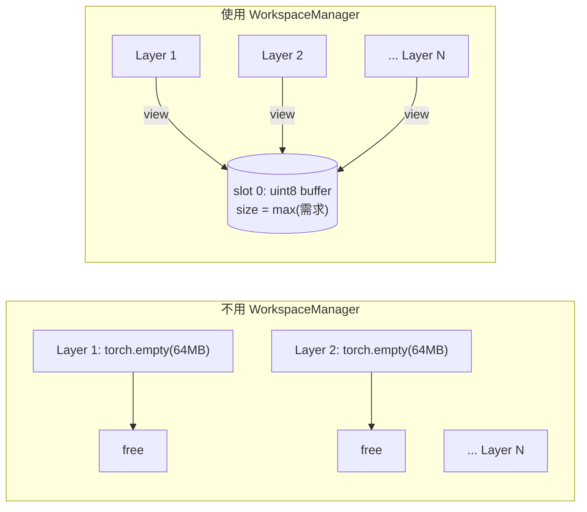
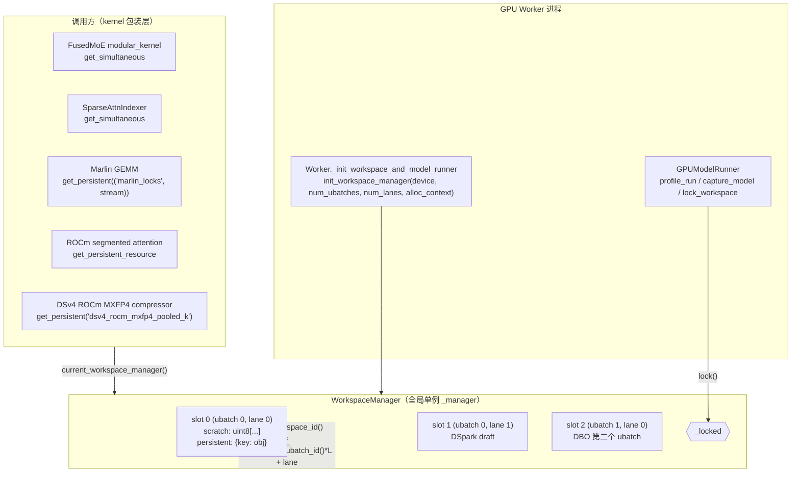
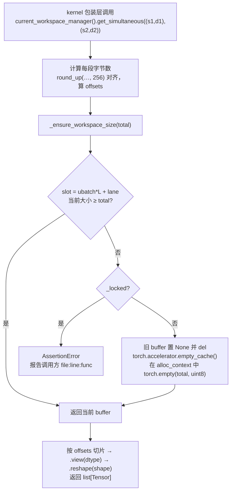
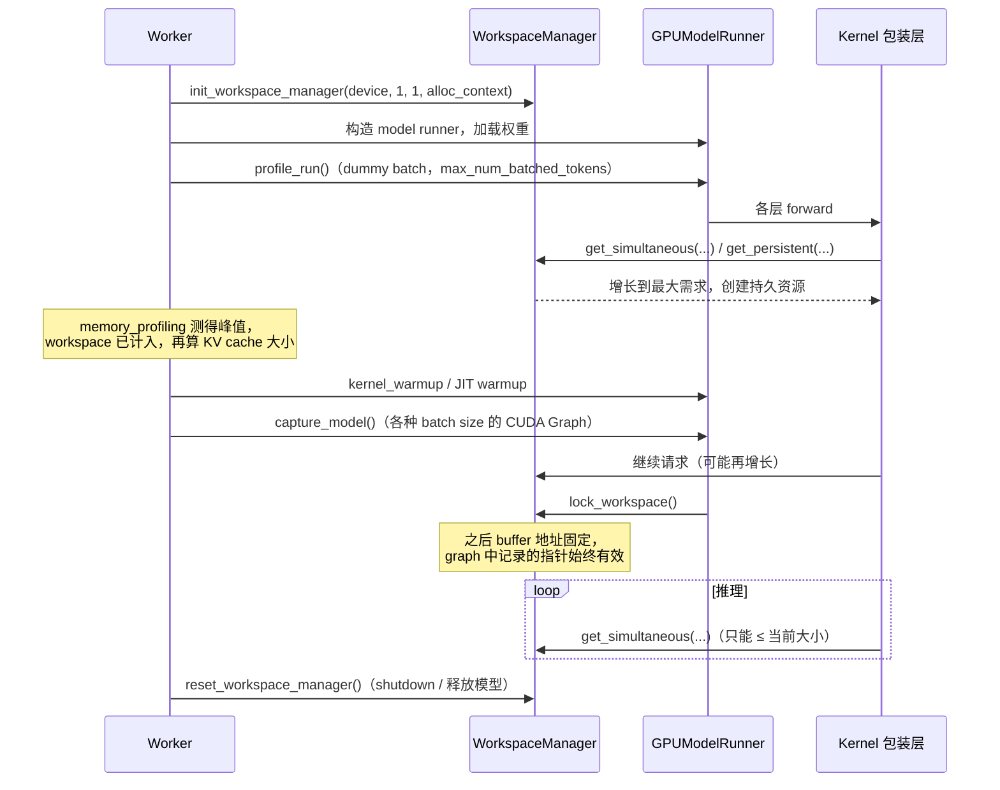
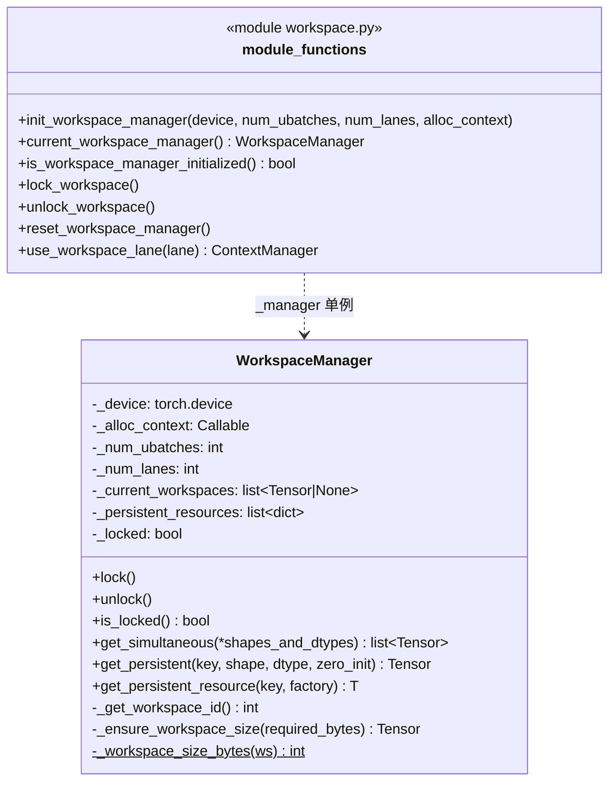
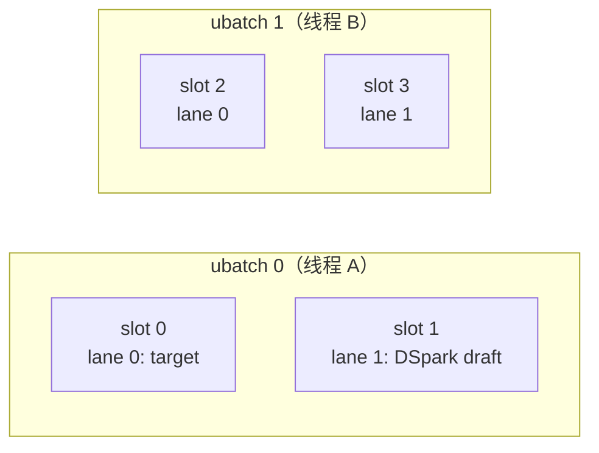
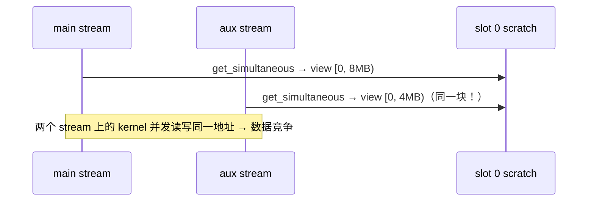
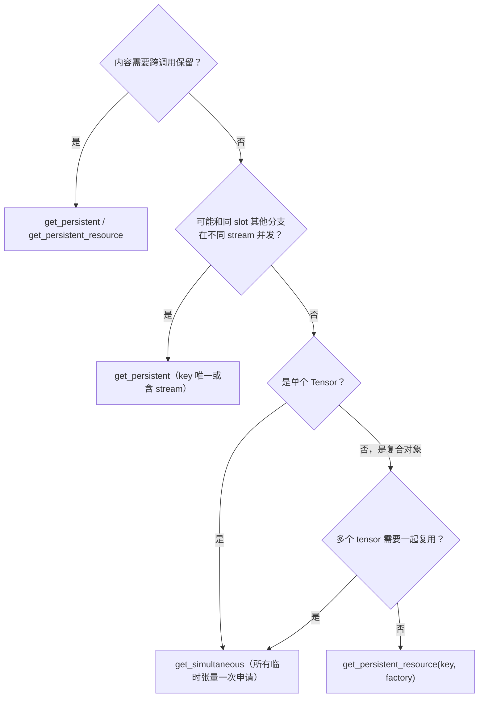

# vLLM WorkspaceManager（`current_workspace_manager`）特性代码走读技术文档

> **文档版本**: 1.0
> **分析代码版本**: vLLM main 分支（本地 checkout `/home/shashen/vllm/vllm`，HEAD `8f51c20f74`，截至 2026-10）
> **最后更新**: 2026-10-22

---

## 文档概述

`current_workspace_manager()` 返回 vLLM worker 进程里的**全局显存工作区管理器** `WorkspaceManager`。Attention、MoE、Indexer、量化 GEMM 等 kernel 需要的临时 buffer（scratch），都可以从这里取，不用每次 `torch.empty`。

本文回答四个问题：

1. **是什么**：一个进程级单例，统一管理两类显存：共享 scratch 和带 key 的持久资源。
2. **为什么需要**：多层复用临时显存、让 profile run 把 scratch 计入显存预算、保证 CUDA Graph 捕获后地址不变、隔离 DBO/DSpark 并发执行，以及支持 sleep mode 释放。
3. **设计原理**：slot =（ubatch, lane），按需增长，capture 后 lock。
4. **怎么用**：`get_simultaneous` / `get_persistent` / `get_persistent_resource` 三个 API 的用法、常见模式和坑。

**目标读者**：给 vLLM 写 kernel 包装层、attention backend、模型平台实现（如 `vllm/models/*/amd/rocm.py`）的开发者。

**阅读建议**：

- 只想会用：看第一部分 1.1 和第五部分。
- 要排查 "Workspace is locked" 报错或显存问题：看第三部分。
- 要写涉及多 stream、DBO 或 DSpark 的代码：重点看 3.4 节和 5.3 节。

---

# 第一部分: WorkspaceManager 基础与架构总览

## 1.1 WorkspaceManager 原理

### 1.1.1 基本思想

一次 forward 里，几十层 decoder 依次执行。每层的 attention 或 MoE kernel 往往需要几 MB 到几 GB 的临时 buffer，比如中间 logits、量化后的 K、MoE 的 permute 结果、gather 出来的 KV。这些 buffer 有两个特点：

- **生命周期很短**：只在当前层的 kernel 里用，这一层算完就没用了。
- **层与层之间串行**：第 i 层用完，第 i+1 层才开始，所以可以复用同一块显存。

WorkspaceManager 的基本思想就是：**每个执行槽位（slot）只保留一块"按历史最大需求分配"的 uint8 大 buffer，每次请求时从里面切出 view 返回。** 另外，有些资源需要跨调用保持内容或身份（比如 Marlin 的 lock 数组），这类资源用 key 缓存成持久资源。



### 1.1.2 两类资源

| 维度 | 共享 scratch | 持久资源（persistent） |
|---|---|---|
| API | `get_simultaneous(*(shape, dtype))` | `get_persistent(key, shape, dtype)`、`get_persistent_resource(key, factory)` |
| 存储 | 每个 slot 一块 uint8 buffer，所有调用方**共用** | 每个 slot 一个 `dict[key → 对象]`，每个 key **独占**一份 |
| 内容保留 | 不保留。下一次 `get_simultaneous` 可能覆盖 | 保留，生命周期等于 manager |
| 大小 | 自动增长到历史最大请求 | 首次创建时就确定，之后 shape/dtype 必须一致 |
| 典型用途 | 某个 kernel 调用内部的临时张量 | lock 数组、需要在 aux stream 上并发使用的 buffer、复合 scratch 对象 |
| lock 后 | 请求超过当前大小会触发 AssertionError | 请求新 key 会触发 AssertionError |

### 1.1.3 显存开销分析

设一个 slot 内第 $l$ 层第 $k$ 次请求需要 $b_{l,k}$ 字节，每段按 256 B 对齐。共享 scratch 的大小是：

$$
S_\text{scratch} = \max_{l,k} \sum_{i \in \text{一次 get\_simultaneous}} \operatorname{round\_up}(b_i, 256)
$$

整体占用是：

$$
M = \sum_{\text{slot}=0}^{U \cdot L - 1} \Big( S_\text{scratch}^{(\text{slot})} + \sum_{\text{key}} S_\text{persistent}^{(\text{slot}, \text{key})} \Big)
$$

其中 $U$ 是 ubatch 数（DBO 打开时为 2），$L$ 是 lane 数（V2 runner + DSpark 时为 2）。

**数值例子**：DeepSeek-V4 sparse indexer 的 prefill gather buffer。假设 FP8 K 每 token 132 B，单个 chunk 的 `total_seq_lens` 是 64K token，那么约 8.25 MB。61 层若各自分配，峰值虽然也只有一层，但 PyTorch caching allocator 会反复拆分、合并 block，造成碎片；更重要的是，KV cache 大小是在 profile run 之后算的，"临时分配"的峰值很难被准确计入。WorkspaceManager 让这块显存成为一个**固定、可预测**的常驻 buffer。

### 1.1.4 关键概念定义

| 术语 | 含义 |
|---|---|
| ubatch | DBO（Dual Batch Overlap）把一个 batch 拆成两个 micro-batch，在两个线程上交错执行。`dbo_current_ubatch_id()` 返回 0 或 1 |
| lane | 同一个 ubatch 里互相独立的执行者。目前只有 V2 model runner + DSpark 用 lane 1 跑 draft 模型 |
| slot / workspace_id | `ubatch_id * num_lanes + lane`，每个 slot 有独立的 scratch 和持久资源字典 |
| lock | CUDA Graph 捕获完成后锁定，禁止 scratch 增长、禁止创建新的持久资源 |
| alloc_context | 分配 scratch 时进入的上下文。sleep mode 下是 cumem 的 `"workspace"` memory pool，休眠时可直接丢弃 |

## 1.2 vLLM WorkspaceManager 整体架构

### 1.2.1 系统架构总览图



### 1.2.2 核心组件与职责划分

| 组件 | 位置 | 职责 |
|---|---|---|
| `WorkspaceManager` | `vllm/v1/worker/workspace.py:49` | 按 slot 管理 scratch 和持久资源，处理增长和锁定 |
| `_manager` | `workspace.py:33` | 模块级全局单例 |
| `_workspace_lane` | `workspace.py:34` | `ContextVar[int]`，当前执行上下文的 lane，默认 0 |
| `use_workspace_lane(lane)` | `workspace.py:37` | 上下文管理器，临时切换 lane |
| `init_workspace_manager` / `current_workspace_manager` / `is_workspace_manager_initialized` | `workspace.py:283-333` | 初始化、获取、判断是否已初始化 |
| `lock_workspace` / `unlock_workspace` / `reset_workspace_manager` | `workspace.py:336-376` | 锁定、解锁（Elastic EP）、重置（测试和 shutdown） |
| `dbo_current_ubatch_id` | `vllm/v1/worker/ubatching.py:154` | 通过线程 id 查到当前 ubatch |
| `Worker._init_workspace_and_model_runner` | `vllm/v1/worker/gpu_worker.py:551` | 创建 manager |
| `GPUModelRunner.capture_model` | `vllm/v1/worker/gpu_model_runner.py:6502`、`vllm/v1/worker/gpu/model_runner.py:1142` | capture 后锁定 |

### 1.2.3 数据流与控制流



## 1.3 执行流程详解

### 1.3.1 示例场景

DeepSeek-V4-Pro，TP8，V1 `GPUModelRunner`，没开 DBO，也没用 DSpark。所以只有 1 个 ubatch、1 个 lane，即只有 slot 0。

### 1.3.2 生命周期走读



| 阶段 | 代码位置 | 对 workspace 的影响 |
|---|---|---|
| 初始化 | `gpu_worker.py:551-561` | 创建空的 slot，还没有分配显存 |
| profile run | `gpu_worker.py:680-697` | 按最大 batch 运行一次，scratch 增长到峰值。期间临时把 allocator 的 `max_split_size_mb` 设成 20，避免增长时释放掉的大块被后续小分配"钉住" |
| warmup / capture | `gpu_worker.py:967-985` | 可能再请求，依然允许增长 |
| lock | `gpu_model_runner.py:6502` | capture 完成后锁定 |
| 推理 | — | 只能复用。超出大小或请求新 key 会直接报错 |
| sleep | `cumem` memory pool `"workspace"` | scratch 不保存跨 step 的状态，休眠时直接丢弃 |
| shutdown | `gpu/shutdown.py:20`、`gpu_model_runner.py:6183` | `reset_workspace_manager()` |

---

# 第二部分: 核心接口与基类分析

## 2.1 类图



## 2.2 核心接口定义

### 2.2.1 `get_simultaneous`：一次拿多块共享 scratch

```python
# 文件: vllm/v1/worker/workspace.py
def get_simultaneous(
    self, *shapes_and_dtypes: tuple[tuple[int, ...], torch.dtype]
) -> list[torch.Tensor]:
    actual_bytes = [_compute_bytes(s, d) for s, d in shapes_and_dtypes]
    aligned_bytes = [round_up(actual, 256) for actual in actual_bytes]
    total_bytes = sum(aligned_bytes)
    offsets = list(accumulate([0] + aligned_bytes[:-1]))
    current_workspace = self._ensure_workspace_size(total_bytes)
    return [
        current_workspace[offsets[i] : offsets[i] + actual_bytes[i]]
        .view(shapes_and_dtypes[i][1])
        .reshape(shapes_and_dtypes[i][0])
        for i in range(len(shapes_and_dtypes))
    ]
```

要点：

- **名字里的 "simultaneous" 是关键**：同一次调用返回的多个张量互不重叠，可以同时使用。但**两次调用返回的张量都从 offset 0 开始，会互相覆盖**。所以一个 kernel 需要的所有临时 buffer 必须在**同一次**调用里一起申请。
- 每段按 256 B 对齐，满足向量化访存和大多数 kernel 的对齐要求。
- 返回的是 uint8 buffer 的 view，经过 `.view(dtype)` 和 `.reshape(shape)`，内容未初始化。

### 2.2.2 `get_persistent_resource`：按 key 缓存任意对象

```python
# 文件: vllm/v1/worker/workspace.py
def get_persistent_resource(self, key: Hashable, factory: Callable[[], T]) -> T:
    resources = self._persistent_resources[self._get_workspace_id()]
    if key not in resources:
        if self._locked:
            raise AssertionError(
                f"Workspace is locked but {key!r} was not allocated during "
                "warmup for the current ubatch and lane."
            )
        resources[key] = factory()
    return cast(T, resources[key])
```

docstring 中的约定：

- key 要能唯一标识**资源类型和配置**。
- lock 后不能 resize 或替换资源里的 tensor 存储。
- **同一个资源的使用不能重叠。如果多个 stream 可能并发，要把 stream 放进 key。**
- 在 `torch.compile` 下，要在运行时的 custom op 里调用，这样资源选择发生在执行期，而不是 trace 期。

### 2.2.3 `get_persistent`：固定 shape 的持久张量

```python
# 文件: vllm/v1/worker/workspace.py
def get_persistent(self, key, shape, dtype, *, zero_init=False) -> torch.Tensor:
    factory = torch.zeros if zero_init else torch.empty
    workspace = self.get_persistent_resource(
        (torch.Tensor, key),
        lambda: factory(shape, dtype=dtype, device=self._device),
    )
    if workspace.shape != shape or workspace.dtype != dtype:
        raise ValueError(...)
    return workspace
```

- 内部 key 是 `(torch.Tensor, key)`，不会和 `get_persistent_resource` 中同名的 key 冲突。
- `zero_init=True` 只在**第一次创建**时清零，之后不会再清零。Marlin 的 lock 数组就依赖这一点：kernel 每次结束时会自己把 lock 复位。
- 同一个 key 必须用同样的 shape 和 dtype，否则报 `ValueError`。所以应该按**最大需求**申请，再切片 `[:n]` 使用。

## 2.3 初始化与注册机制

WorkspaceManager 没有注册表，是一个**进程级单例**，由 Worker 在构造 model runner 之前创建：

```python
# 文件: vllm/v1/worker/gpu_worker.py
def _num_workspace_lanes(vllm_config: VllmConfig, use_v2_model_runner: bool) -> int:
    spec_config = vllm_config.speculative_config
    return (
        2
        if use_v2_model_runner and spec_config is not None and spec_config.use_dspark()
        else 1
    )

def _init_workspace_and_model_runner(self) -> None:
    # DSpark target and draft CUDA graphs retain workspace views concurrently.
    num_ubatches = 2 if self.vllm_config.parallel_config.enable_dbo else 1
    init_workspace_manager(
        self.device,
        num_ubatches,
        _num_workspace_lanes(self.vllm_config, self.use_v2_model_runner),
        # Scratch holds no state across steps: discard it on sleep.
        alloc_context=lambda: self._maybe_get_memory_pool_context("workspace"),
    )
    self.model_runner: GPUModelRunner = self._make_model_runner()
```

| 配置 | num_ubatches | num_lanes | slot 数 |
|---|---|---|---|
| 默认 | 1 | 1 | 1 |
| `--enable-dbo` | 2 | 1 | 2 |
| V2 runner + DSpark | 1 | 2 | 2 |
| V2 runner + DSpark + DBO | 2 | 2 | 4 |

---

# 第三部分: 核心实现深度分析

## 3.1 slot 选择：ubatch × lane

```python
# 文件: vllm/v1/worker/workspace.py
def _get_workspace_id(self) -> int:
    lane = _workspace_lane.get()
    if lane >= self._num_lanes:
        raise RuntimeError(...)
    return dbo_current_ubatch_id() * self._num_lanes + lane
```

$$
\text{workspace\_id} = \text{ubatch\_id} \times L + \text{lane}
$$



- **ubatch 维度**由 DBO 驱动。DBO 用两个线程交错执行两个 micro-batch，`dbo_current_ubatch_id()` 通过 `threading.get_ident()` 查表得到当前 ubatch；没有 DBO 时返回 0。两个 ubatch 的 kernel 在 GPU 上可能重叠执行（一个算、一个通信），如果共用 scratch 就会互相覆盖。
- **lane 维度**由 `use_workspace_lane()` 设置的 `ContextVar` 决定。V2 runner 在加载、运行和捕获 DSpark draft 模型时会进入 `use_workspace_lane(self._draft_workspace_lane)`（`vllm/v1/worker/gpu/model_runner.py:423/961/1126/2270`），因为 target 和 draft 的 CUDA Graph 会**同时持有**各自 scratch 的 view。

> **注意**: slot 维度**不包括 CUDA stream**。同一个 slot 内，如果两个 stream 并发使用 `get_simultaneous`，它们拿到的是同一块内存。见 3.4 节。

## 3.2 增长策略

```python
# 文件: vllm/v1/worker/workspace.py（_ensure_workspace_size 节选）
if current_size < required_bytes:
    if self._locked:
        raise AssertionError(
            f"Workspace is locked but allocation from '{get_caller_info()}' "
            f"requires {required_bytes / _MB:.2f} MB, current size is "
            f"{current_size / _MB:.2f} MB. "
            "Workspace growth is not allowed after locking."
        )
    # Only resize the requesting ubatch/lane workspace. ...
    self._current_workspaces[workspace_id] = None
    del current_workspace
    torch.accelerator.empty_cache()
    with self._alloc_context():
        self._current_workspaces[workspace_id] = torch.empty(
            (required_bytes,), dtype=torch.uint8, device=self._device
        )
```

设计上的几处取舍：

| 设计 | 原因 | 相关 PR |
|---|---|---|
| 只增不减，直接扩到当前请求大小 | profile run 一次就能把 scratch 扩到峰值，之后不再变化 | #27532（首次引入） |
| 先 `del` 旧 buffer，再 `empty_cache()`，然后分配新 buffer | 避免新旧 buffer 同时存在造成峰值翻倍，并把旧 segment 还给驱动，让大分配能复用 | #30744、#39226 |
| 只 resize 发起请求的 slot | 如果一起 resize 所有 slot，另一个 ubatch 还持有旧 buffer 的 view，旧显存就泄漏了（DBO 场景） | #38853 |
| 报错时报告调用方 `file:line:func` | lock 后报错能直接定位是哪个 kernel 超出了 profile 时的大小 | — |
| 在 `alloc_context` 中分配 | sleep mode 下 scratch 进入 cumem 的 `"workspace"` pool，休眠时直接丢弃，不需要备份 | #59156 |
| profile run 期间 `max_split_size_mb=20` | 增长时释放的多 GB 块，不应被后续小分配切开后钉住，否则会被算作"已占用"，从 KV cache 预算里扣掉 | 见 `gpu_worker.py:687` 注释 |

## 3.3 Lock：为什么 capture 后必须锁定

CUDA Graph 记录的是**设备指针**。如果 capture 后 scratch 发生 resize，旧 buffer 被释放，graph 重放时就会写到已释放的地址，造成静默的数据损坏或者崩溃。因此：

```python
# 文件: vllm/v1/worker/gpu_model_runner.py:6500
# Lock workspace to prevent resizing during execution.
# Max workspace sizes should have been captured during warmup/profiling.
lock_workspace()
```

lock 之后：

- `get_simultaneous` 请求的大小只要 **≤** 当前大小就可以，超过则报 AssertionError。
- `get_persistent*` 只能取**已存在**的 key，新 key 会报 AssertionError，而且**按 slot 判断**：在 slot 0 创建过，不代表在 slot 1 也有。
- `unlock_workspace()` 只用于 Elastic EP 扩缩容（专家数变化，MoE scratch 要变大），之后应该再 lock。

> **关键洞察**: 锁定让"profile run 必须覆盖最坏情况"成为一个**强制约束**。如果某条代码路径只在真实请求里才会走到（比如超长 prefill 的某个分支），而 profile run 没走到，上线后就会报 lock 错误。很多 kernel 包装层因此在 profile run 里**显式预留**最大尺寸，见 5.2 节的模式 3。

## 3.4 并发与多 stream

`get_simultaneous` 是"借用"语义：拿到的 view 只在**下一次同 slot 的 `get_simultaneous` 之前**有效。在单 stream 串行执行时这是安全的，因为前一个 kernel 一定已经在 stream 上排好队，后面的 kernel 覆盖写入时，前一个已经执行完了。

但在多 stream 并发时就不安全了：



解决办法：

| 方案 | 做法 | 例子 |
|---|---|---|
| 持久资源 + stream 放进 key | 每个 stream 一份 | Marlin：`get_persistent(("marlin_locks", current_stream()), ...)` |
| 持久资源 + 唯一 key | 分支独占一个 buffer。如果同一 key 的使用者之间一定串行，就可以共享 | DSv4 ROCm MXFP4 compressor 的 `pooled_k` |
| 不用 manager | 分支自己分配 | 少见，会失去 graph 下的地址稳定性保证 |

**案例：DSv4 ROCm MXFP4 compressor（PR #60834）**

```python
# 文件: vllm/models/deepseek_v4/amd/rocm.py
def _pooled_k(self, num_tokens: int) -> torch.Tensor:
    # A persistent buffer rather than the shared scratch: in the CSA fork
    # this runs on an aux stream next to other branches. The indexer
    # layers run one after another, so they can all share it.
    scratch = current_workspace_manager().get_persistent(
        "dsv4_rocm_mxfp4_pooled_k",
        (self.max_num_batched_tokens, self.head_dim),
        torch.bfloat16,
    )
    assert num_tokens <= scratch.shape[0]
    return scratch[:num_tokens]
```

- 在 CSA fork 中，indexer 的 compressor 跑在 aux stream 上，同时主 stream 上的其他分支正在用共享 scratch。所以这里不能用 `get_simultaneous`。
- 30 个 indexer 层之间是串行的，所以**一个 key 就够了**，不需要每层一份。
- **为什么没有把 stream 放进 key**：ROCm eager 运行时不走 fork，用的是默认 stream。默认 stream 对应的 key 如果第一次出现是在 lock 之后，就会触发 AssertionError。用固定 key，并在 `forward` 里先调用一次 `self._pooled_k(0)`，可以保证 profile run 期间就创建好这个资源。

## 3.5 torch.compile 与 CPU

- `_get_workspace_id` 读取 `ContextVar` 和线程 id，**Dynamo 无法 trace**。所以在 compile 的图里，必须在 custom op（运行时执行）内部调用 manager。vLLM 的 attention、MoE 包装层本来就都在 custom op 里。
- CPU 后端的 MoE 直接绕过 manager（`modular_kernel.py:1168` 注释），因为 CPU 不需要跨 chunk 复用，同时也避开了 Dynamo 的这个问题。

---

# 第四部分: 三种获取方式对比

| 特性 | `get_simultaneous` | `get_persistent` | `get_persistent_resource` |
|---|---|---|---|
| 返回 | `list[Tensor]`（view） | `Tensor` | 任意对象 `T` |
| 共享范围 | slot 内所有调用方 | 同 slot 同 key | 同 slot 同 key |
| 内容是否保留 | 否 | 是 | 是 |
| 大小 | 可变，自动增长 | 固定，首次决定 | 由 factory 决定 |
| lock 后 | 可以，但不能超过当前大小 | 只能取已有 key | 只能取已有 key |
| 多 stream 安全 | 否 | 把 stream 放进 key 才安全 | 把 stream 放进 key 才安全 |
| 显存效率 | 最高（全部复用） | 每个 key 一份 | 每个 key 一份 |
| 适用场景 | 单 kernel 调用内的临时张量 | 需要跨调用保留内容、或并发分支独占的 buffer | 由多个 tensor 组成的 scratch 对象、需要按配置区分的资源 |
| 代表用法 | MoE `workspace13/2`、indexer gather、`rocm_paged_mxfp4_indexer` logits | Marlin locks、DSv4 ROCm `pooled_k` | `MoEPermuteScratch`、ROCm segmented attention |

**选择流程：**



---

# 第五部分: 配置与使用指南

## 5.1 相关参数与环境变量

| 名称 | 类型 | 作用 |
|---|---|---|
| `VLLM_DEBUG_WORKSPACE=1` | 环境变量 | 打印每次 resize 的调用方和大小变化，以及 lock/unlock 时各 slot 的大小。排查显存问题首选 |
| `--enable-dbo` | 引擎参数 | slot 数 ×2 |
| DSpark 投机解码 + V2 model runner | 引擎参数 | lane 数 = 2 |
| `--enable-sleep-mode` | 引擎参数 | scratch 分配在 cumem 的 `"workspace"` pool 中，休眠时丢弃 |
| `--max-num-batched-tokens` | 引擎参数 | 决定 profile run 的规模，也就决定了 scratch 的峰值 |
| `--enforce-eager` / `cudagraph_mode=NONE` | 引擎参数 | V1 runner 不会调用到 `lock_workspace()`（lock 在 `capture_model` 中 capture 之后），推理期间仍可增长。所以 "lock 报错" 只在 graph 模式下才会暴露，eager 下测试通过不代表 graph 模式也没问题 |

## 5.2 典型使用模式

### 模式 1：单次调用申请多块临时 buffer

```python
# 文件: vllm/model_executor/layers/fused_moe/modular_kernel.py
common_workspace, workspace2 = current_workspace_manager().get_simultaneous(
    ((max_shape_size,), workspace_dtype),
    (workspace2_shape, workspace_dtype),
)
workspace13 = _resize_cache(common_workspace, workspace13_shape)
```

### 模式 2：持久资源，且 manager 未初始化时回退

```python
# 文件: vllm/model_executor/layers/fused_moe/moe_permute_unpermute.py
def get_moe_permute_scratch(*, num_experts, num_local_experts, device):
    def create_scratch() -> MoEPermuteScratch:
        return MoEPermuteScratch(num_experts=num_experts,
                                 num_local_experts=num_local_experts, device=device)

    if not is_workspace_manager_initialized():
        return create_scratch()            # 单测、离线脚本里直接分配
    key = (MoEPermuteScratch, num_experts, num_local_experts, device)
    return current_workspace_manager().get_persistent_resource(key, create_scratch)
```

> **性能提示**: key 应该包含所有影响形状的配置（类型、专家数、device），这样不同配置之间不会误用同一份资源。

### 模式 3：在 profile run 中预留最大尺寸

```python
# 文件: vllm/model_executor/layers/sparse_attn_indexer.py
if not isinstance(attn_metadata, dict):
    # Reserve workspace for indexer during profiling run
    values_spec, scales_spec = _gather_workspace_shapes(
        total_seq_lens, head_dim, fp8_dtype, use_fp4_cache
    )
    profile_specs = [values_spec, scales_spec,
                     ((RADIX_TOPK_WORKSPACE_SIZE,), torch.uint8)]
    ...
    current_workspace_manager().get_simultaneous(*profile_specs)
```

profile run 中 `attn_metadata` 不是 dict，真实的 prefill 分支不会被执行。所以这里**主动按最大尺寸请求一次**，让 scratch 在 lock 之前就扩到足够大。

### 模式 4：按 stream 区分的持久张量

```python
# 文件: vllm/model_executor/layers/quantization/utils/marlin_utils.py
return current_workspace_manager().get_persistent(
    ("marlin_locks", current_stream()),
    (num_compute_units(device.index) * MARLIN_MAX_BLOCKS_PER_SM,),
    torch.int,
    zero_init=True,
)
```

### 模式 5：在单元测试中使用

```python
import pytest
from vllm.v1.worker.workspace import init_workspace_manager, reset_workspace_manager

@pytest.fixture(autouse=True)
def _workspace():
    init_workspace_manager(torch.device("cuda"))
    yield
    reset_workspace_manager()
```

`tests/kernels/attention/test_rocm_dsv4_mxfp4_indexer.py` 就是这样写的。直接测试 manager 本身的用例在 `tests/v1/worker/test_workspace.py`。

## 5.3 常见坑与排查

| 现象 | 原因 | 处理 |
|---|---|---|
| `Workspace is locked but allocation from 'x.py:123:fn' requires N MB` | 运行时请求的 scratch 比 profile run 和 capture 时的大（只在 graph 模式下出现） | 在 profile run 中按最大尺寸预留（模式 3）；或者检查形状是否依赖了 profile 没覆盖到的维度 |
| `Workspace is locked but ('...') was not allocated during warmup for the current ubatch and lane` | 新的持久 key 在 lock 后第一次出现，或者只在另一个 slot 里创建过 | key 不要依赖只在运行时才出现的值（比如 eager 模式下的默认 stream）；在 forward 开头的 profile 路径里先请求一次 |
| 结果偶发错误，eager 正常、graph 下不正常，或反过来 | 两次 `get_simultaneous` 返回的 view 互相覆盖；或者多 stream 共用了 scratch | 一个 kernel 的所有临时张量一次性申请；并发分支改用持久资源 |
| `Persistent workspace ... has shape=...; requested shape=...` | 同一 key 用了不同的 shape 或 dtype | 按最大值申请，然后切片使用；或者把形状放进 key |
| KV cache 比预期小 | scratch 峰值过大，或者 profile run 中出现了碎片 | 开 `VLLM_DEBUG_WORKSPACE=1` 看 resize 日志，定位最大的调用方 |
| `WorkspaceManager not initialized` | 单测或脚本里没有初始化 | 调 `init_workspace_manager`，或者调用方用 `is_workspace_manager_initialized()` 回退 |
| Dynamo trace 失败（ContextVar） | 在被 compile 的 Python 代码里直接调用了 manager | 放进 custom op 里调用 |

## 5.4 设计建议

1. **默认用 `get_simultaneous`**。只有需要保留内容或并发隔离时才用 persistent，否则每个 key 都会常驻一份显存。
2. **persistent 按最大需求分配一次**，比如 `max_num_batched_tokens × …`，使用时切 `[:n]`。
3. **让 profile run 覆盖最坏情况**：要么真实执行一次，要么显式预留。
4. **新增并发 stream 时**，检查这条路径上所有 `get_simultaneous` 调用。
5. 写独立 kernel 或测试工具时，用 `is_workspace_manager_initialized()` 做回退，保持可单独运行。

---

# 附录

## A. 关键代码位置索引

| 组件 | 文件 | 行号 |
|---|---|---|
| `WorkspaceManager` 类 | `vllm/v1/worker/workspace.py` | 49 |
| `use_workspace_lane` | `vllm/v1/worker/workspace.py` | 37 |
| `_get_workspace_id` | `vllm/v1/worker/workspace.py` | 123 |
| `get_persistent_resource` / `get_persistent` | `vllm/v1/worker/workspace.py` | 132 / 160 |
| `get_simultaneous` / `_ensure_workspace_size` | `vllm/v1/worker/workspace.py` | 181 / 209 |
| 模块函数（init/current/lock/unlock/reset） | `vllm/v1/worker/workspace.py` | 283–376 |
| `dbo_current_ubatch_id` | `vllm/v1/worker/ubatching.py` | 154 |
| `_num_workspace_lanes`、`_init_workspace_and_model_runner` | `vllm/v1/worker/gpu_worker.py` | 121、551 |
| profile run 的 `max_split_size_mb` 限制 | `vllm/v1/worker/gpu_worker.py` | 687 |
| V1 lock | `vllm/v1/worker/gpu_model_runner.py` | 6502 |
| V2 lock 和 DSpark lane | `vllm/v1/worker/gpu/model_runner.py` | 1142；210、423、961、1126、2270 |
| shutdown reset | `vllm/v1/worker/gpu/shutdown.py` | 20 |
| `VLLM_DEBUG_WORKSPACE` | `vllm/envs.py` | 2101 |
| MoE 模式 | `vllm/model_executor/layers/fused_moe/modular_kernel.py`、`moe_permute_unpermute.py` | 1185、142 |
| Indexer profile 预留 | `vllm/model_executor/layers/sparse_attn_indexer.py` | 480–499 |
| Marlin persistent | `vllm/model_executor/layers/quantization/utils/marlin_utils.py` | 418 |
| ROCm segmented attention | `vllm/v1/attention/ops/segmented_attention.py` | 618 |
| DSv4 ROCm MXFP4 `pooled_k` | `vllm/models/deepseek_v4/amd/rocm.py` | 1836 |
| 单元测试 | `tests/v1/worker/test_workspace.py` | — |

## B. 演进历史

| PR | 日期 | 内容 |
|---|---|---|
| #27532 | 2025-12 | 随 DeepSeek-V3.2 sparse prefill 引入 `WorkspaceManager` |
| #30744 | 2025-12 | 修复分配时的显存尖峰（先释放旧 buffer） |
| #34861 | 2026-02 | Elastic EP：新增 `unlock` |
| #38853 | 2026-04 | 修复 `_current_workspaces` 大小，只 resize 发起请求的 ubatch |
| #39226 | 2026-04 | 修复 resize 泄漏 reserved 显存（`empty_cache`） |
| #51538 | 2026-08 | 为 DSv4 DSpark 引入 lane |
| #57421 | 2026-09 | 新增 persistent 资源（Marlin、Humming 共享） |
| #59156 | 2026-10 | sleep 时释放 scratch（`alloc_context`） |
| #60447 | 2026-10 | MoE permute scratch 按输入定尺寸 |

## C. 术语表

| 术语 | 解释 |
|---|---|
| Workspace / Scratch | kernel 运行期间使用的临时显存，不保存跨调用的状态 |
| Persistent resource | 按 key 缓存、生命周期与 manager 相同的显存对象 |
| Slot | `(ubatch, lane)` 对应的独立存储单元 |
| DBO | Dual Batch Overlap，把 batch 拆成两个 ubatch，交错进行计算和通信 |
| DSpark | 一种投机解码方法。V2 runner 下 draft 模型使用独立的 lane |
| Lock | capture 之后禁止 workspace 增长或新增资源，保证 CUDA Graph 中的指针有效 |
| Profile run | 启动时用最大 dummy batch 跑一次 forward，测量峰值显存，以决定 KV cache 的大小 |
| CSA fork | DeepSeek-V4 ROCm 在 graph capture 和 profile run 中把 compressor、indexer 等分支放到 aux stream 上并发执行的机制 |
| cumem pool | sleep mode 使用的可按 tag 释放或恢复的显存池 |
