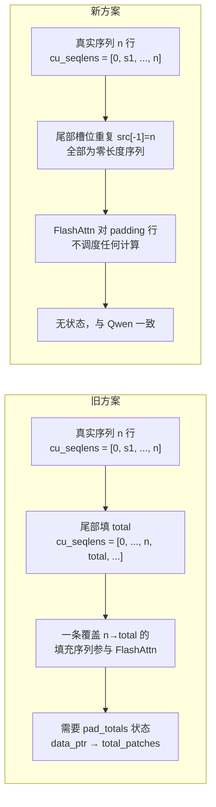
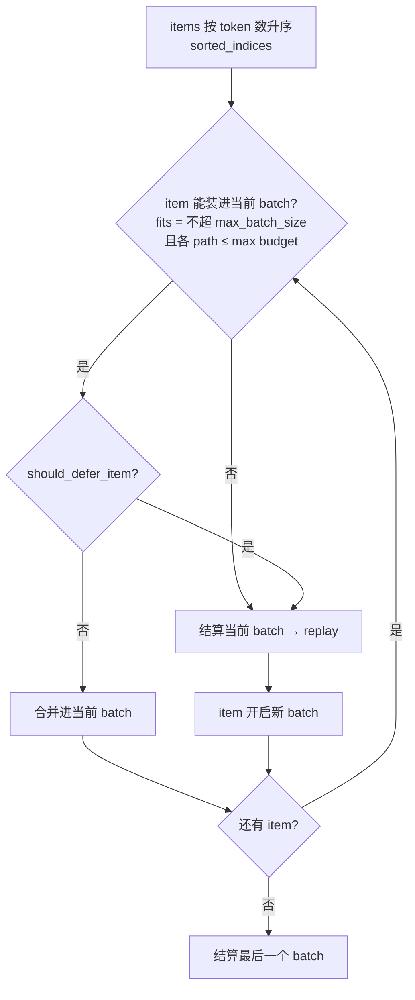
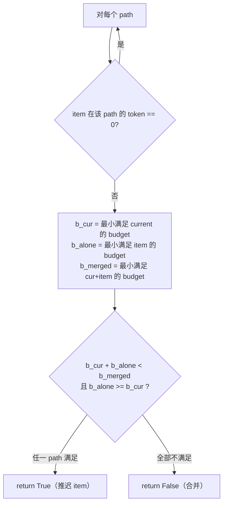

# PR #58925: [Multimodal] Optimize encoder cudagraph padding logic

> **作者**: @Isotr0py | **状态**: OPEN | **日期**: 2026-09-27（最近更新 2026-09-30）
> **Branch**: `Isotr0py:encoder-cudagraph-pad` → `vllm-project:main` | **Labels**: `deepseek`, `nvidia`, `kimi`, `DSv4.1`
> **变更规模**: +188 -66 行，涉及 5 个文件，5 个 commit
> **Reviewer**: @shen-shanshan

---

## 1. 总结 (Summary)

本 PR 对 vLLM V1 的多模态编码器 CUDA Graph 路径做两处优化：(1) 将 DeepSeek-V4.1 和 Kimi-K3 的 `cu_seqlens` 回放 padding 从「单条尾部填充序列」改为与 Qwen 一致的「零长度序列填充」，彻底移除了模型侧按 `data_ptr` 登记的 `pad_totals` 状态；(2) 在 `EncoderCudaGraphManager` 的贪心装箱中加入「budget 悬崖（cliff）」检测——当合并一个 item 会迫使整个 batch 跳到更大的 token budget、而拆开反而更省时，就推迟该 item、先结算当前 batch。实测 DeepSeek-V4.1-Flash（TP4）TTFT mean **-11%**、TTFT p99 **-7.5%**、ITL p99 **-11%**，并新增 8 个无需 GPU 的打包单元测试。

---

## 2. 背景与动机 (Background & Motivation)

`cudagraph_mm_encoder`（ViT 全 CUDA Graph，来自 PR #35963）按固定「token budget」捕获 ViT 前向图，回放时对不足 budget 的真实 batch 做 padding。DeepSeek-V4.1 与 Kimi-K3 接入该机制时采用了与 Qwen 不同的 padding 策略：

**旧策略（本 PR 移除）**：在捕获时把 `cu_seqlens` buffer 的 `data_ptr()` → `total_patches` 存入模型实例的 `_encoder_cg_pad_totals` 字典；回放时把 `cu_seqlens` 尾部全部填成 `total`，形成**一条覆盖所有剩余行的尾部填充序列**，使 `cu_seqlens[-1]` 等于 buffer 总行数（注释声称 varlen attention 要求如此，否则 FlashAttn 返回 NaN）。

**旧策略的问题**：
- **状态脆弱**：以裸指针为 key 的全局字典。torch caching allocator 复用已释放块地址时可能命中错误的 `data_ptr`，导致静默填充错值；DeepSeek 版本在查不到时直接 `RuntimeError`，Kimi 版本则静默退化为 `src[-1]` 填充。
- **浪费 attention 计算**：尾部填充序列是「真实序列」，其 padding 行会实际参与 FlashAttn 计算（虽然是零数据）。
- **贪心装箱盲区**：原装箱逻辑只要「装得下」就合并。当一个大 item（如 4000 tokens）与一个小 item（200 tokens）合并时，总 token 数 4200 被迫取 8192 的 budget 图，而拆开只需要 256 + 4096 两张小图，padding 浪费巨大——这正是 TTFT 尾部（p99）慢的根源之一。

本 PR 两个改动分别消除状态脆弱性、attention 浪费，并让装箱避开 budget 悬崖。

---

## 3. 代码修改分析 (Code Change Analysis)

### 3.1 修改的模块

| 文件 | 操作 | 说明 |
|------|------|------|
| `vllm/v1/worker/encoder_cudagraph.py` | 修改 | 新增 `_path_fitting_budget()` 与 `should_defer_item()`，贪心装箱加入 budget-cliff 推迟逻辑 |
| `vllm/utils/math_utils.py` | 修改 | 新增 `round_up_to()`（bisect 二分查找最小满足 budget，替代线性扫描） |
| `vllm/models/deepseek_v41/common/vl_cudagraph.py` | 修改 | 删除 `_encoder_cg_pad_totals` 字典与捕获时登记逻辑；`pad_cu_seqlens` 改为零长度填充 |
| `vllm/model_executor/models/kimi_k25.py` | 修改 | 同上：删除 `_encoder_cudagraph_pad_totals` property，改为零长度填充 |
| `tests/v1/cudagraph/test_encoder_cudagraph.py` | 修改 | 新增 8 个无 GPU 打包单元测试（mock graph replay） |

### 3.2 架构 / 流程图 (Architecture / Flow Diagram)

#### padding 语义变化：单条填充序列 → 零长度序列

#### 贪心装箱 + budget-cliff 推迟决策流程

#### should_defer_item 判定逻辑

### 3.3 关键实现细节 (Key Implementation Details)

**零长度填充（`pad_cu_seqlens`，DeepSeek-V4.1 / Kimi-K3）**
- 新逻辑：`dst[:n].copy_(src[:n])`，尾部 `dst[n:] = src[-1] if n else 0`——每个尾部槽位都重复最后一个真实 offset，形成零长度序列，FlashAttn 不会为其调度计算。
- 删除捕获时的 `_encoder_cg_pad_totals[cu_seqlens.data_ptr()] = total_patches` 登记，以及回放时的字典查询 / RuntimeError 分支。
- 捕获侧 `max_batch_size + 1`（Kimi）/ `+ 2`（DeepSeek）的备用槽位仍保留，注释更新为「供回放填充零长度序列」。

**budget-cliff 推迟（`should_defer_item`，encoder_cudagraph.py:486）**
- 语义：`defer` 意味着**立即结算当前 batch**（用 `b_cur` 的图 replay 一次），该 item 自己开一个新 batch。因此合并成本 ≈ `b_merged`（一张大图），推迟成本 ≈ `b_cur + b_alone`（两张小图 + 多一次 replay 启动开销）。
- 对每条 path 计算三个 budget：当前 batch（`b_cur`）、item 单独（`b_alone`）、合并后（`b_merged`）。
- 推迟条件 `b_cur + b_alone < b_merged and b_alone >= b_cur` 的两个不等式各有分工：

  **条件 1（`b_cur + b_alone < b_merged`）——推迟必须严格更省 budget。**
  - 严格 `<`：平局不推迟。例：budgets `[256, 4096, 8192]`、两个 4000-token item，4096 + 4096 = 8192，不 < 8192 → 合并。平局时总 budget 与真实计算量相同，但合并只花一次 replay 启动。
  - 成立例（悬崖）：batch 为 200-token 小 item（b_cur=256），item 为 4000-token（b_alone=4096），合并 4200 → 8192（b_merged）。256 + 4096 = 4352 < 8192 ✓ → 推迟，省下 3840 的 padding 计算。budget 序列是离散的，+1 token 就可能让所需图档位翻倍——这就是「悬崖」。

  **条件 2（`b_alone >= b_cur`）——只有 item 自己比整个 batch 还「重」才允许推迟。**
  - 反例（flood 场景）：budgets `[256, 2048, 4096, 8192]`，6 个等大 1366-token item 按升序处理。只看条件 1 时：item 2 的 b_alone=2048 < b_cur=4096，但 6144 < 8192 成立 → 推迟，随后 item 4 再次触发推迟 → 3 次 replay @4096 = 12288 budget；加条件 2 后 `[0..4]` 合并 @8192、`[5]` 单独 @2048 → 2 次 replay = 10240 budget。两个指标同时更好。
  - 直觉：items 按 token 数升序处理，鲸鱼（大 item）总是最后到。`b_alone < b_cur` 说明来的只是 flood 中的中等 item，拆出去它自己吃不饱一个 budget 桶，后面同类 item 还会不断触发同样的拆裂——应让它搭车；`b_alone >= b_cur` 说明来了条鲸鱼，把它并进小 batch 会把整批拖进大 budget 桶只为迁就它一个——推迟才对。
  - 等号放行是有意的（`>=` 而非 `>`）：`test_small_items_split_to_avoid_cliff`（budgets `[256, 4096]`、4×100-token）中第 3 个 item 的 b_alone = b_cur = 256，但合并会让 300 → 4096 跳巨悬崖，故 512 < 4096 成立即推迟、两两打包 @256。此时条件 1 隐含 `b_merged > 2*b_cur`（合并至少跳两档），平局（`b_merged = 2*b_cur`）天然被挡掉，两条件不矛盾。
  - 多 path 为 OR 语义：对每条 path 独立计算三个 budget，任一 path 满足条件即推迟整个 item；item 在某 path 上 token 为 0 时跳过该 path（`test_multi_path_deferral_skips_zero_token_paths` 覆盖）。
- 装箱主循环中 `fits or should_defer_item(...)` 任一不满足即结算当前 batch。
- `_path_fitting_budget(path, tokens)`：tokens 为 0 返回 0（该 path 空闲），否则在 `path_token_budgets[path]` 上找最小满足 budget。

**工具函数 `round_up_to`（math_utils.py）**
- `bisect_left(values, n)` 实现 O(log n) 的「向上取整到列表中最小的 ≥ n 元素」，替代原 `_find_smallest_fitting_budget_given_tokens` 的线性扫描。

**测试（test_encoder_cudagraph.py）**
- `_run_packing()` 助手 mock 掉 `_get_item_specs` / `_select_items` / `_run_budget_graph` 与 `postprocess_encoder_output`，纯 CPU 跑 `_execute_local`，记录每次 replay 的 `(batch_indices, path, token_budget)`。
- 8 个用例覆盖：悬崖推迟拆 batch、平局不推迟、中小 item 不推迟（防碎片化）、无悬崖行为不变、小 item 拆对避免悬崖、max_batch_size 拆分不变、超大 item 仍走 eager fallback（`graph_misses == 1`）、多 path 下零 token path 跳过。

---

## 4. 涉及的技术原理 (Technical Principles)

### 4.1 Varlen Attention 的 cu_seqlens 与 padding

FlashAttention varlen 模式按 `cu_seqlens`（累积序列长度数组，长度 = batch + 1）划分序列，只处理 `[0, cu_seqlens[-1])` 范围内的行。因此 padding 有两种合法语义：

- **尾部填充序列**：在 `cu_seqlens` 末尾追加一条「长度 = buffer 总行数 − 真实行数」的序列，使 `cu_seqlens[-1]` 等于 buffer 行数。padding 行会被 attention 真实调度（浪费计算），且需要回放时知道 buffer 的总行数（即旧方案的 `pad_totals` 状态）。
- **零长度序列**：尾部槽位全部重复最后一个真实 offset（`src[-1]`），使 `cu_seqlens[-1]` 等于真实 token 数。padding 行位于 `cu_seqlens[-1]` 之外，attention 完全不调度，其他 kernel（FFN、patch merge）仍会按 budget 形状处理全 buffer，但注意力层省掉了 padding 行的计算。Qwen3-VL 的 ViT 全 CG 实现（PR #35963）采用的就是这种语义。

旧注释中「cu_seqlens[-1] 少于 buffer 行数是 undefined behaviour 并返回 NaN」的说法对 varlen 路径过于保守——实际上只要 kernel 只按 cu_seqlens 读取即可；本 PR 将 DeepSeek/Kimi 对齐到 Qwen 已被验证的方案。

### 4.2 Token Budget 与装箱的「悬崖」问题

编码器 CUDA Graph 按预算级别捕获（如 256 / 4096 / 8192 tokens），回放时取「最小满足 batch 总 token 数」的图。预算序列是离散的，因此存在「悬崖」：总 token 数 +1 就可能使所需 budget 翻倍（如 4096 → 8192）。纯「装得下就装」的贪心策略对小 item 流有效（一次 replay 覆盖尽量多 item），但对「小 batch + 大 item」的组合会产生巨大 padding 浪费。本 PR 的推迟策略在装箱局部做「拆 vs 合」的成本比较，是典型的 bin-packing 启发式改进——不追求全局最优，只消除最明显的悬崖损耗。

### 4.3 CUDA Graph 回放对 buffer 地址的约束

CUDA Graph replay 要求所有被捕获 kernel 引用的张量地址不变，回放数据只能通过 `copy_` / `zero_` 原地写入捕获时的 buffer。旧方案之所以在模型实例上登记 `data_ptr → total`，就是为了在回放时把「捕获 buffer 的总行数」映射回 `pad_cu_seqlens`。一旦发生内存池地址复用（同一 `data_ptr` 被新的 buffer 占用）或重新捕获，该映射即失效。新方案不需要任何捕获期状态，从根上消除了这类失效模式。

---

## 5. 评论区讨论亮点 (Discussion Highlights)

目前讨论很少（1 条 issue comment，0 条 inline review comment）：

- **@Isotr0py**（作者）2026-09-30 留言 `@codex review`，请求 Codex 自动评审。
- **claude[bot]** 提交了一条 review：因 PR 来自 fork，自动评审被禁用，提示 maintainer 可评论 `@claude review` 触发一次性评审。
- 尚无人工 reviewer 的实质性反馈；PR 已指定 @shen-shanshan 为 reviewer。

---

## 6. 风险与潜在问题 (Risk Analysis)

| 风险 | 严重程度 | 说明 |
|------|---------|------|
| **零长度 padding 的跨后端行为** | Medium | 新语义依赖 attention kernel 严格按 `cu_seqlens[-1]` 调度、不读取其后的行。Qwen 路径在 NVIDIA/FlashAttn 上已被验证，但 DeepSeek-V4.1 / Kimi-K3 在 ROCm（aiter / Triton attention）等后端上的 ViT attention 行为需要确认，尤其涉及 `FLASHMLA_SPARSE_DSV41` 之外的 attention backend 组合。 |
| **`should_defer_item` 中的 `assert`** | Low | 注释声称「只在 item fits 时调用」，但若 `max_path_budgets[path]` 大于该 path 实际捕获的最大 budget（两者来源不同步），`_path_fitting_budget` 可能返回 `None`，assert 在 `-O` 下被剥离后会变成 `None` 比较的 TypeError 而非清晰报错。 |
| **启发式的次优性** | Low | 推迟判定是单 item 局部贪心（`b_alone >= b_cur` 的守卫会拒绝推迟中等大小 item），在某些 token 分布下仍可能产生次优装箱（如测试中 3×1366 合并为 8192）。收益已由 e2e 数据背书，但极端分布（大量中等图片）下仍有 padding 浪费空间。 |
| **`mergeable_state: unstable` / 不可 rebase** | Low | 抓取时 PR 处于 `unstable` 状态（有 status check 未通过）且 `rebaseable: false`，与 main 存在冲突风险，合入前可能需要处理。 |
| **测试均为 CPU mock** | Low | 新增单测只验证装箱决策序列，不验证零长度 padding 下 ViT 实际输出与 eager 的一致性；该类正确性依赖既有 GPU 测试与 PR 描述中的 e2e 基准数据。 |
| **Kimi 模型无 e2e 数据** | Low | PR 描述只给出了 DeepSeek-V4.1-Flash 的基准；Kimi-K3 的 padding 改动同样生效但未提供实测数据。 |

---

## 7. 结论 (Conclusion)

PR #58925 是一个小而精准的优化：用已被 Qwen 验证的零长度 padding 替代脆弱的 `pad_totals` 指针字典状态（净删除约 40 行），并在装箱层加入 budget-cliff 推迟启发式，实测 TTFT/ITL 尾部延迟下降 7.5–11%。代码结构清晰、单测覆盖了装箱决策的主要边界情况。作为 reviewer，建议重点确认两点：(1) 零长度 padding 在非 FlashAttn 后端（尤其 ROCm）上的行为；(2) `max_path_budgets` 与捕获预算列表是否恒等，以消除 `assert` 的潜在触发路径。
