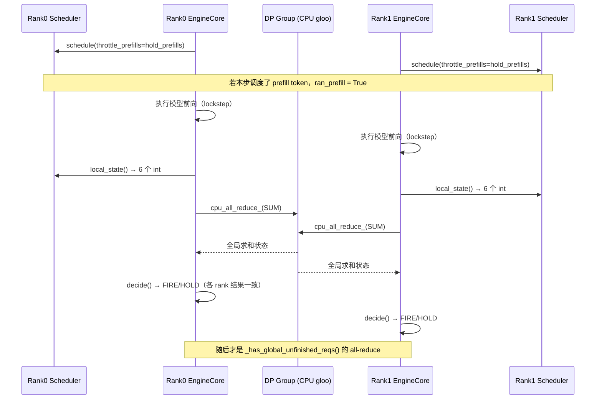
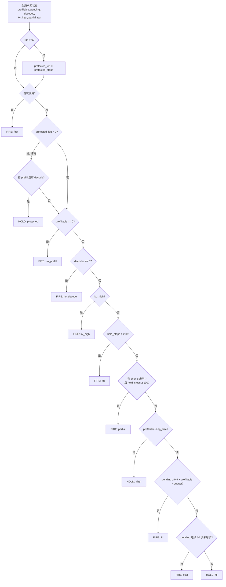
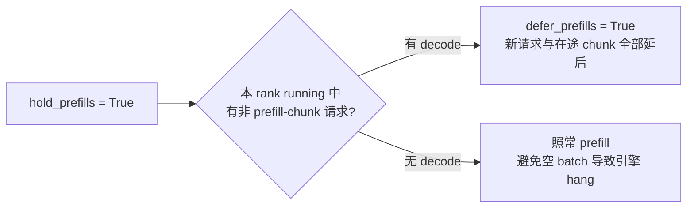

# PR #61834: [DARFT][Core][DP] Add an opt-in cross-DP prefill delayer (--dp-prefill-delayer)

> **作者**: @benenzhu | **状态**: OPEN（Draft，标题 "DARFT" 应为 "DRAFT"） | **日期**: 2026-10-15
> **Branch**: `benenzhu:dp-prefill-delayer` → `main` | **Labels**: `scheduler`
> **变更规模**: +368 -4 行，涉及 6 个文件

---

## 1. 总结 (Summary)

在 MoE 模型的 DP（attention 数据并行 + EP）部署中，所有 DP rank 按 lockstep 同步前进，只要任一 rank 在某一步跑 prefill，整步就变成一个耗时很长的 mixed step（某些后端上还会退化为 eager），所有 rank 的 decode 都被拖慢。本 PR 新增一个默认关闭的 `--dp-prefill-delayer`：每个 engine step 各 rank 通过一次 6 个 int 的 CPU all-reduce 交换 prefill 状态，所有 rank 据此做出**相同的** FIRE / HOLD 决策，从而让 prefill 在各 rank 间**对齐执行**，并在 prefill 之后保护若干个纯 decode step。规则移植自 ATOM 的 `PrefillDelayer`。作者在 DeepSeek-V4-Pro / 8×MI355X / AgentX agentic 负载上测得 c128 下 P90 interactivity 提升约 3 倍、吞吐提升约 67~85%，代价是 TTFT（尤其在 c64 下大幅上升）。

---

## 2. 背景与动机 (Background & Motivation)

- **DP lockstep 的放大效应**：MoE 的 DP rank 每步都要做 EP all-to-all，必须同步前进。只要 8 个 rank 中有 1 个在跑 prefill，其他 7 个只跑 decode 的 rank 也要等它，整步时间被 prefill 决定。
- **Agentic 多轮负载**：每轮工具调用后都会带来新的长 prompt（90–130K token），prefill 非常频繁，decode 被反复打断，ITL / interactivity 很差。
- **现有 `--prefill-schedule-interval` 的不足**（作者在评论中回答 @functionstackx 的质疑）：
  1. 它只协调了"**何时**可以 prefill"（共享 step counter，非对齐步全体延后），但没有协调"**是否**该 prefill"——每个 rank 只看自己的队列。
  2. 释放步之后，若某 rank 的等待队列装不下 token 预算（`prefill_capacity_bound`），该 rank 会停止节流、每步都 prefill，而一个 rank prefill 就让 8 个 rank 全部 mixed。
  3. cadence 步上哪怕只有一个 rank 有一个很小的 chunk，其他 rank 也要为此付出完整 mixed step 的代价。
- **相关工作**：
  - #54627（已合入）思路类似（hold prefill 让 decode 连续跑），但仅在 `data_parallel_size == 1` 时生效，对 MoE DP 是 no-op。
  - #51199 通过 DP coordinator 异步协调释放（带 ack 与 2 步提前量）；本 PR 改为引擎循环内同步的每步 all-reduce，并增加 protected decode steps 与 token 填充目标。作者 CPU 仿真结果：本 PR mixed step 少 2–4×、平均 decode 延迟约减半，而 #51199 的 TTFT 约低 3×，二者互补。

---

## 3. 代码修改分析 (Code Change Analysis)

### 3.1 修改的模块

| 文件 | 操作 | 说明 |
|------|------|------|
| `vllm/v1/core/sched/prefill_delayer.py` | 新增 (+143) | 核心：`local_state()` 采集单 rank 状态；`PrefillDelayer` 做 all-reduce 与 FIRE/HOLD 决策 |
| `vllm/v1/engine/core.py` | 修改 (+40 -1) | `DPEngineCoreProc` 中构造 delayer、做兼容性检查；在 busy loop 中每步调用 `step()`；wave 边界 `reset()`；`_should_throttle_prefills` 走 delayer 分支 |
| `vllm/v1/core/sched/scheduler.py` | 修改 (+17 -3) | 新增 `dp_prefill_delayer`、`ran_prefill` 状态；`defer_prefills` 条件改写；schedule 结束时检测本步是否跑了 prefill |
| `vllm/config/scheduler.py` | 修改 (+16) | 新增 `dp_prefill_delayer`、`dp_prefill_delayer_protected_steps`（默认 10）；与 `prefill_schedule_interval > 1` 互斥校验 |
| `vllm/engine/arg_utils.py` | 修改 (+13) | 新增 CLI 参数 `--dp-prefill-delayer`、`--dp-prefill-delayer-protected-steps` |
| `tests/v1/core/test_prefill_delayer.py` | 新增 (+139) | CPU 单测：各 FIRE/HOLD 规则与上界、`local_state`、scheduler 门控、配置互斥 |

### 3.2 架构 / 流程图 (Architecture / Flow Diagram)

#### 每步交互时序（以 2 个 DP rank 为例）

#### `PrefillDelayer.decide()` 决策逻辑

#### Scheduler 侧 HOLD 的生效范围

### 3.3 关键实现细节 (Key Implementation Details)

- **6 元组协议**（`local_state()`，每 rank 每步一次，SUM all-reduce 后得到全局值）：
  1. `prefillable`：本 rank 是否有 prefill 工作（在途 chunk 或非 deferred 的 waiting 请求）；求和后即"有 prefill 的 rank 数"。
  2. `pending`：待 prefill token 数，单 rank 截断到 `max_num_batched_tokens`。
  3. `decodes`：running 中非 prefill-chunk 的请求数。
  4. `kv_high`：有 prefill 且 KV usage ≥ 0.9。
  5. `partial`：是否有在途的 chunked prefill。
  6. `ran`：自上次采集以来是否跑过 prefill（读后清零 `scheduler.ran_prefill`，有副作用）。
- **决策规则顺序**（与 ATOM 一致）：protected → no_prefill / no_decode / kv_high 直接 FIRE → 200 步（有 chunk 时 100 步）硬上界 FIRE → 未全员有 prefill 则 HOLD（align）→ token 达到 90% 填充目标或 10 步不增长则 FIRE。常量 `FILL_TARGET / TTFT_MAX_HOLD_STEPS / PARTIAL_MAX_HOLD_STEPS / STALL_STEPS / KV_HIGH_USAGE` 硬编码在模块中，只有 protected steps 可配。
- **放置位置**：all-reduce 紧挨在 `_has_global_unfinished_reqs()` 之前。该位置是每个 rank 在每个非 idle step（真实 step、dummy step、pause step）都必经之处，现有 DP 状态同步也依赖这一点，因此新增 collective 不会被某一 rank 跳过。DP wave 结束时 `reset()` 并清除 `hold_prefills`。
- **通信实现**：使用 #61767 引入的 `cpu_all_reduce_`（p50 114 µs vs `dist.all_reduce` 695 µs，8 rank），并沿用 `cpu_distributed_timeout`（与 #63016 后的 `sync_dp_state` 一致）。
- **Scheduler 改动**：
  - `defer_prefills` 条件变为 `throttle_prefills and (dp_prefill_delayer or not prefill_capacity_bound) and 有 decode`——delayer 开启时忽略 `prefill_capacity_bound`，由 delayer 自身的上界兜底。
  - 只在本 rank 有 decode 时才 HOLD（来自 benenzhu/vllm#6）：否则一个 rank 调度空 batch、同一步再跑一个 dummy batch，而 peer 只跑一个，导致 V2 model runner + 投机解码下引擎 hang（workers 卡在 `record_confidences`）。
  - "本步跑了 prefill" 的判定：存在某请求调度 token 数 `> 1 + spec token 数`。
- **兼容性检查**：与 `prefill_schedule_interval > 1` 互斥（配置层报错）；拒绝 elastic EP 与 fault tolerance（二者会在运行时改变 DP size，#46370 的 scale-down）；要求使用内置 `Scheduler`（自定义 scheduler 类报错）。
- **开销**：关闭时零开销；开启时每步一次 6-int CPU all-reduce。

---

## 4. 涉及的技术原理 (Technical Principles)

- **MoE DP + EP 的 lockstep 执行**：Attention 按 DP 切分、专家按 EP 切分时，每层 MoE 都需要跨 rank 的 dispatch/combine all-to-all，所以所有 DP rank 必须在同一步执行前向；没有请求的 rank 也要跑 dummy batch。一步的耗时由最慢的 rank 决定，prefill 的长尾因此被放大到全体。
- **Mixed step 与 CUDA Graph**：纯 decode step 的形状规整，可以走 full CUDA graph；带 prefill 的 mixed step 往往只能 piecewise 或 eager 执行，且计算量大。减少 mixed step 的次数、并把多个 rank 的 prefill 合并到同一步，是同时提升 ITL 与吞吐的关键。
- **Prefill 批合并（fill target）**：如果一定要付出一次 mixed step 的代价，就尽量让每个 rank 的 token budget 都填满（90%），摊薄每个 prefill token 的成本；stall 规则避免在负载不再增长时无限等待。
- **Protected decode steps**：prefill 之后强制若干纯 decode step，给新进入 decode 的请求和老请求一段连续输出的窗口，直接改善 ITL 分位数，代价是 TTFT。
- **同步决策的确定性**：所有 rank 基于相同的全局求和状态运行相同的确定性状态机（各自维护计数器，但输入一致、初始一致、wave 边界一起 reset），因此无需额外广播决策即可保证各 rank 结果一致。

---

## 5. 评论区讨论亮点 (Discussion Highlights)

- **@functionstackx 的质疑**：是否有 throughput vs E2EL 的收益？`--prefill-schedule-interval` 不是已经解决了吗？并附上 DeepSeek-V4-Pro recipe 中的调度建议链接。
- **作者的回应（同节点对比）**：

  | | c64 off | c64 on | c128 off | c128 on |
  |---|---:|---:|---:|---:|
  | Output tok/s/GPU | 158 | 145 (-8%) | 189 | **350 (+85%)** |
  | E2EL mean (s) | 34.1 | 40.9 (+20%) | 68.3 | **40.4 (-41%)** |
  | TTFT mean (s) | 5.0 | 25.3 (+406%) | 10.0 | 10.7 (+7%) |
  | Interactivity p90（仅 ITL） | 17.1 | 45.5 | 7.3 | 23.5 |
  | E2E-normalized interactivity p90 | 9.5 | **3.3** | 4.5 | 6.9 |

  作者坦承：c128 下全面收益，**c64 下 E2EL 与 TTFT 明显变差**，当前 PR "过拟合" 于 throughput vs P90 interactivity（ITL-only），E2E-normalized interactivity 更重要。后续计划：基于时间（ms）的 TTFT 上界、与 interval 8/16 的系统性 sweep、放宽对齐条件（6–7/8 rank 就绪即释放，实验中 TTFT 降 28–39%、E2E-normalized p90 升 29–42%）。
- **@maslan-coop26 的生产反馈**：在 DeepSeek-V4.1-Flash DEP8（MI355X、V2 model runner、DSpark、agentic）上使用时，HOLD 让无 decode 的 rank 什么都不调度，一分钟内引擎 hang。提交修复 benenzhu/vllm#6（只 hold 有 decode 的 rank），并建议改用 `cpu_all_reduce_`（与 #61767 一起使 median step 降 1.1 ms，256 并发下 20,363 → 20,855 output tok/s）。另有两个 opt-in 扩展待提：每 2000 步打印 FIRE/HOLD 统计日志；ATOM 风格的等待时长上限与 DP 间 prefill 代价均衡。
- **作者跟进**：已 merge main（未 rebase），合入 #6、切换 `cpu_all_reduce_` 并传入 CPU 分布式超时、新增拒绝 `--enable-fault-tolerance`；邀请 maslan-coop26 以独立 PR 提交扩展，其中等待时长上限被视为本 PR 缺失的 TTFT 保障，应纳入本 PR。
- **尚无 maintainer review**：`reviews` 为空，mergify 曾提示冲突（已通过 merge main 解决）。

---

## 6. 风险与潜在问题 (Risk Analysis)

| 风险 | 严重程度 | 说明 |
|------|---------|------|
| TTFT 显著劣化且无时间上界 | High | c64 下 TTFT mean +406%、E2E-normalized p90 从 9.5 降到 3.3。HOLD 上界按**步数**（200/100）计算，且 `protected` 的 HOLD 不计入 `_hold_steps`，实际最长等待与步长相关，无法对齐 TTFT SLA。作者已承认，基于 ms 的上界尚未实现 |
| 集合通信死锁风险 | High | 新增的每步 collective 依赖"所有 rank 每步都经过此点"的不变量；任何未来对 busy loop 的改动（提前 continue、分支跳过）都可能导致某 rank 少调一次而 hang。目前仅靠注释约束，无多进程 DP 测试守护 |
| 对齐语义被部分削弱 | Medium | 为避免 hang，只有 decode 的 rank 才会被 HOLD；只有 prefill 的 rank 照常 prefill，这一步对其他 rank 依然是长步，规则中的 "align" 在此场景下无法完全实现 |
| 异步调度下的决策滞后 | Medium | 决策基于本步执行后的状态，作用于下一次 `schedule()`；在 async scheduling 下 scheduler 可能已提前一步调度，`ran_prefill` 与 `local_state` 的观察时点可能错位，未见专门分析或测试 |
| `local_state` 读后清零的副作用 | Low | `scheduler.ran_prefill` 在采集时被清零，状态在 scheduler 与 delayer 间隐式耦合，若其他代码路径也读取该字段会出错 |
| prefill 判定启发式 | Low | `n > 1 + len(spec_tokens)` 判定 prefill；对于 spec decode 被拒绝后补算、或 1-token 的 prefill chunk 等边界场景可能误判，影响 protected 窗口的触发 |
| 常量硬编码 | Low | 0.9 填充目标、200/100/10 步、0.9 KV 阈值均不可配置，不同模型/硬件/负载的最优值可能差异很大 |
| 适用范围受限 | Low | 不支持 elastic EP、fault tolerance、自定义 scheduler；与 `prefill_schedule_interval` 互斥，用户需要在两种策略间做选择 |
| 测试覆盖 | Medium | 只有 CPU 单测（状态机规则、`local_state`、单 scheduler 门控）；没有多 rank DP 端到端测试，也没有该分支本身的 GPU 验证——性能数据来自"更早版本的开发分支"，且大多是单次运行、跨节点对比 |
| 与 #51199 的方案重叠 | Low | 两个 PR 解决同一问题、机制不同，需要 maintainer 决定取舍或合并，否则可能长期悬置 |

---

## 7. 结论 (Conclusion)

本 PR 用一个很小的同步 all-reduce + 确定性状态机补上了 DP rank 间缺失的 prefill 状态交换，代码改动集中、默认关闭、开销很低，在高并发 agentic 负载下对 ITL 与吞吐的收益很可观；但它目前仍是 Draft：TTFT 缺少时间上界、低并发下 E2E 指标变差、缺乏本分支的 GPU 验证和多 rank 测试，且尚无 maintainer review，距离合入还需补齐 TTFT 保障、系统性 benchmark，以及与 #51199 的方案协调。
