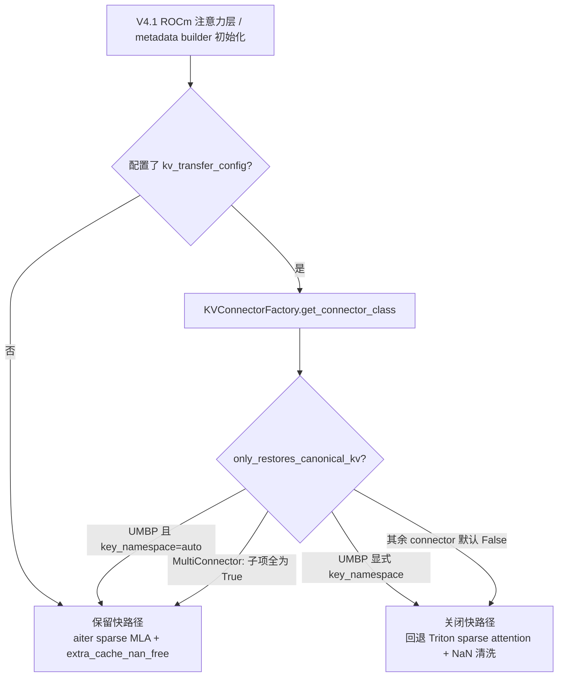
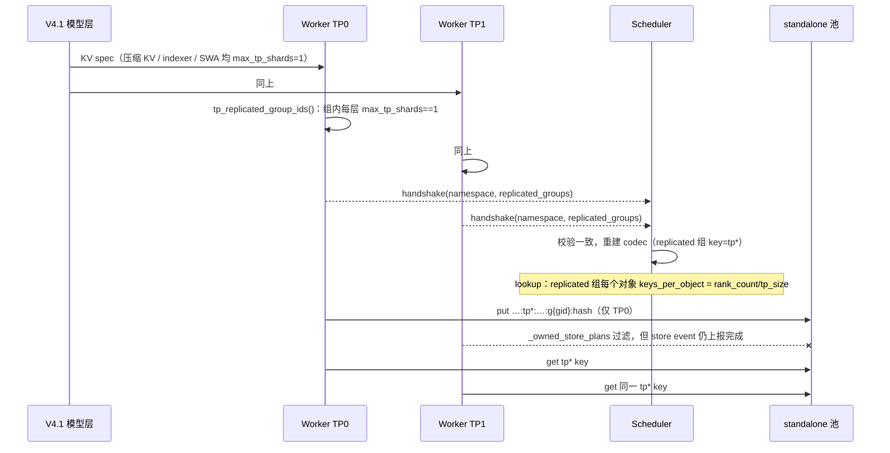

# PR #64715: [ROCm][UMBP] Support UMBP standalone mode for DeepSeek-V4.1-Flash

> **Author**: @shen-shanshan | **State**: OPEN（Draft） | **Date**: 2026-10-30（报告更新：2026-11-05）
> **Branch**: `shen-shanshan:rocm-dsv41-flash-umbp` → `main` | **Labels**: `deepseek`, `documentation`, `DSv4.1`, `kv-connector`, `needs-rebase`, `rocm`
> **Changes**: +357 -28 lines across 12 files（本地分支最新代码）
>
> **代码版本说明：** 本报告基于**本地分支的最新代码**，即 main `7dca18e206` + PR commit `e00beeac38` + 按 ROCm review 意见做的修改（尚未 commit/push）。GitHub 上的 PR 目前只有 `e00beeac38`（9 个文件，+186 -22）。本地新增的修改包括：
> - TP 复制判定改为基于 `max_tp_shards`；
> - V4.1 spec 标注 `max_tp_shards`；
> - `key_namespace` 下关闭 canonical 声明；
> - 文档；
> - 单测；
> - 命名调整。
>
> 下文中凡是相对线上版本有变化的地方，都标注为「本地新增」。

---

## 1. 总结 (Summary)

本 PR 让 DeepSeek-V4.1-Flash 在 ROCm（MI355X）上通过 `UMBPStoreConnector` 的 **standalone 模式**（节点本地的 MORI UMBP server）做 KV offloading，主要包含两项改动：

1. **保留快路径：** 新增 connector 能力声明 `only_restores_canonical_kv`。UMBP 在使用自动派生的 namespace 时声明为 True，于是 V4.1 ROCm 路径接入 UMBP 后，仍然保留 aiter sparse MLA 和 `extra_cache_nan_free` 两条快路径。原来的逻辑是只要配置了 connector 就关闭它们。
2. **TP 去重：** 在 standalone 共享池中，对 TP 复制的 KV 组（组内所有层都声明了 `max_tp_shards=1`）改用与 TP rank 无关的 `tp*` key，由 TP0 写入一份，所有 rank 共享读取。

PR 自报的结果：
- GSM8K 精度不变；
- AgentX TP2 c192（工作集超出 GPU KV）吞吐 +46%；
- DP2 c256 吞吐 +3.8%；
- TP2 c128（工作集装得下）基本没有开销。

## 2. 背景与动机 (Background & Motivation)

- **UMBP 系列的合入进度：** UMBP connector 按 `[UMBP][1/10]`～`[10/10]` 分批合入 main，目前已合到 7/10（#61795，standalone 运行时）。本 PR 只依赖 main 上已有的部分，**不包含也不依赖** 9/10（#61797，lazy offload）。
- **快路径被一刀切关闭。** `deepseek_v41/amd/rocm.py` 有 4 处判断 `kv_transfer_config is not None`，只要配置了 connector，就关闭 aiter Triton sparse MLA 和 NaN-free 快路径。
  - 这两条路径都假设 KV cache 中只有本引擎 cache writer 写出的字节。gfx950 `fp8_ds_mla` 的 kernel 在信任模式下会跳过 NaN 清洗。
  - UMBP 只按完整 block 存取，自动派生的 namespace 对模型配置和每层 spec 都做了指纹，不会混入外来字节。对 UMBP 也关闭这两条路径，只会白白损失性能。
  - InferenceX recipe 默认开启 `VLLM_ROCM_USE_AITER_TRITON_SPARSE_MLA`。
- **TP 冗余存储。** MLA latent、SWA 和 indexer K 在各个 TP rank 上逐字节相同。standalone 模式下整机只有一个池，如果不去重，就要占用 `tp_size` 倍的 DRAM 和写入带宽。
- **与 DSv4-Pro PR #63002 的关系：** 两者的通用部分相同。#63002 中针对 SWA replay 和 compressor state 的改动，V4.1 都不需要：V4.1 在 ROCm 上已经关闭了 SWA replay；compressor state 是 `CircularBufferSpec`，不参与 prefix cache。

## 3. 代码修改分析 (Code Change Analysis)

### 3.1 修改的模块

**KV connector 公共层**

| 文件 | 说明 |
|------|------|
| `kv_connector/v1/base.py` | 新增 classmethod `only_restores_canonical_kv(kv_transfer_config)`，默认返回 False |
| `kv_connector/v1/multi_connector.py` | 至少有一个子 connector 且全部子 connector 都返回 True 时，才返回 True |

**UMBP connector**

| 文件 | 说明 |
|------|------|
| `umbp/connector.py` | hook 只在 `key_namespace == "auto"` 时返回 True（「本地新增」：限定条件）。 去重开关为 `shares_pool_across_ranks` 且 `dedup_tp_replicated_kv` 为真（默认 true）。 handshake 上报 `replicated_groups`，scheduler 校验各 rank 一致后重建 codec。 |
| `umbp/data.py` | 新增 `tp_replicated_group_ids()`，按 `max_tp_shards == 1` 判定（「本地新增」：原来按 `isinstance(MLA…)` 判定）。 `UMBPHandshakeMetadata.replicated_groups`。 `BlockIdentityCodec` 新增 `replicated_groups`、`stores_group()`、`keys_per_object()`，以及 `tp*` key。 |
| `umbp/runtime/base.py`, `standalone.py` | `shares_pool_across_ranks`：默认 False，standalone 为 True |
| `umbp/scheduler.py` | 3 处 residency 校验（命中计算、resident 检查、event 回调）改为按组计算 key 宽度，不再用 `rank_count` |
| `umbp/worker.py` | 新增 `_owned_store_plans()`：TP rank 不为 0 时，从 list 或列式 `BlockStoreBatch` 中过滤掉 replicated 组 |

**DeepSeek-V4.1 模型**

| 文件 | 说明 |
|------|------|
| `models/deepseek_v41/amd/rocm.py` | 新增 `_has_foreign_kv_writer()`，替换 4 处守卫。 参数改名为 `has_foreign_kv_writer`（「本地新增」）。 warning 文案改为 "connector that may load non-canonical KV"。 |
| `models/deepseek_v41/attention.py` | 「本地新增」：压缩 KV 和 indexer 两个 `MLAAttentionSpec` 补 `max_tp_shards=1`，与 V4 一致 |

**文档与测试**

| 文件 | 说明 |
|------|------|
| `docs/features/umbp_store_connector_usage.md` | 「本地新增」： standalone 选项表增加 `dedup_tp_replicated_kv`； keying 段落说明 TP 复制的 KV 只存一份； `key_namespace` 一行说明显式设置时快路径会回退。 |
| `tests/v1/kv_connector/unit/test_umbp_core.py` | 「本地新增」：5 个测试（14 个用例），见 §3.3 |

### 3.2 架构 / 流程图

**快路径守卫判定**

**TP 复制判定与去重的数据流**

### 3.3 关键实现细节

- **能力声明 hook。**
  - 用 classmethod 实现，模型层只需要 `kv_transfer_config` 就能判断，不必实例化 connector。
  - `rocm.py` 对 factory 做延迟 import。
  - UMBP 的判定依据是 `kv_connector_extra_config.get("key_namespace", "auto") == "auto"`。显式设置 namespace 会跳过指纹，因此不再声明 canonical，快路径随之关闭。
- **TP 复制判定（复用 main 的现有约定）。**
  - `AttentionSpec.max_tp_shards` 表示该 cache 在 TP 上的分片数，`None` 表示未知、视为不复制。它就是 `KVCacheConfig.kv_tp_replicas`（#57652）的数据来源。
  - 判定条件：`tp_size > 1`、PCP 和 DCP 都为 1、组开启了 KV transfer、组非空，且组内每层都是 `AttentionSpec` 并满足 `max_tp_shards == 1`。
  - V4.1 去重的组和之前一致：压缩 KV、indexer、SWA。SWA spec 原本就有 `max_tp_shards=1`，DSpark 草稿层复用同一组注意力类。
- **key 与宽度。**
  - replicated 组的 key：`umbp:vllm:v1:<ns>:tp*:pcp..:dcp..:pp..:g<gid>:<hash>`。
  - `keys_for_topology` 只保留 tp==0 的 namespace，`keys_per_object` 为 `rank_count // tp_size`。
  - `_rank_keys` 的 lru_cache 以 frozen codec 为键，codec 重建后缓存不会串用。
  - worker 的 `_localize_key` 通过 codec 生成 key，因此 replicated 组在任何 rank 上都会得到 `tp*`。
- **scheduler 与 worker 保持一致。**
  - 只有 worker 能看到每层 spec，所以由 worker 计算 replicated 组，通过 handshake 上报。
  - 即使 namespace 已在配置中给定，scheduler 也会重建 codec。
  - 各 rank 上报不一致时抛 `ValueError`。
- **写入完成语义。** TP rank 不为 0 的 store 被过滤到空时，`wait_for_save` 仍会为该 event 上报 `completed_workers=1`，store event 不会卡住。
- **新增单测（本地新增，256 passed）：**
  - `max_tp_shards` 判定，包括 TP=1 和 DCP>1 两种情况；
  - `tp*` key 与 `keys_per_object`；
  - 非 0 rank 跳过 replicated 组的写入，且 event 仍完成；
  - handshake 校验各 rank 的 replicated 组一致，一致后由 scheduler 采纳；
  - canonical hook 在 UMBP、显式 namespace 和 MultiConnector 下的返回值。

## 4. 涉及的技术原理 (Technical Principles)

- **MLA 在 TP 下是复制的。** MLA 把 KV 压缩成所有 head 共享的 latent。TP 只切分 q/o 的 head，所以每个 rank 的 MLA KV cache 内容完全相同，SWA KV 和 sparse indexer K 也是如此。vLLM 用 `max_tp_shards=1` 表达"这块 cache 在 TP 上只有一份内容"，其余 rank 持有的都是副本。
- **NaN 清洗与 canonical 来源。**
  - gfx950 `fp8_ds_mla` 的 sparse 解码 kernel，在 `TRUST_EXTRA_CACHE_NAN_FREE=False` 时会把载入的 K 中的 NaN 置 0。原因是被 mask 掉的列在 P·V 中仍会产生 `0×NaN=NaN`。
  - 只有当 cache 中的字节全部来自本引擎的 writer（E8M0 scale 不会出现 0xFF）时，才能跳过清洗。
- **UMBP standalone 与 namespace。**
  - 节点本地的 `umbp_standalone_server` 持有 DRAM 池，各 rank 通过 gRPC 交互，并用 HIP IPC 注册 GPU 内存来传输数据。
  - 默认 namespace 由 model、revision、模型配置、block size、cache layout、每层 spec 和 TP/PP/PCP/DCP 拓扑哈希得到。因此不同布局的 key 永远不会相同，这是声明 canonical 的前提。
- **HMA 下的 residency 校验。** 一个逻辑 block 对应多个 rank key，必须全部在池中才算命中。去重后，replicated 组每个对象的 key 数变少，所有按 `rank_count` 切分 hits 数组的地方都必须改为按组计算宽度，否则偏移会错位，命中会被算到别的 block 上。

## 5. 评论区讨论亮点 (Discussion Highlights)

- **还没有 reviewer 的实质性评论。** PR 仍是 Draft，等待 code owner review（tjtanaa、dllehr-amd、hongxiayang、NickLucche、ApostaC、orozery、xuechendi、ivanium、wzhao18）。
- **`needs-rebase` 标签已过时。** Mergify 在 11-03 和 11-05 两次标记冲突，但 force-push `e00beeac38` 后，它在本地 cherry-pick 到当前 main 没有冲突。
- **CI 尚未运行。** Draft 状态下 Buildkite（包括 AMD 队列）都没有跑，pre-commit 和 DCO 处于 pending。
- **作者自查（ROCm review）的结论已在本地落实：**
  - 改为复用 `max_tp_shards`；
  - 显式 `key_namespace` 时不再声明 canonical；
  - 补文档和单测；
  - 参数改名。

  详见 `~/.claude/skills/vllm-rocm-pr-review/outputs/pr-64715-review.md`。

## 6. 风险与潜在问题 (Risk Analysis)

| 风险 | 严重程度 | 说明 |
|------|---------|------|
| 本地修改尚未推送，也没有做 E2E 验证 | Medium | 本地修改：`max_tp_shards` 判定、V4.1 spec 标注、hook 条件。 只跑了单测：UMBP 256 个，planning + offloading config 144 个。 GSM8K、AgentX 等 E2E 数据都基于线上版本。 理论上 V4.1 被去重的组没变，但建议在 MI355X 上补一次 smoke，确认 server 上仍是 `tp*` key 且有命中。 |
| `max_tp_shards=1` 是共享模型文件的改动 | Low | `deepseek_v41/attention.py` 的 CUDA 和 ROCm 路径都会用到这个文件。 改动后 V4.1 的 `kv_tp_replicas` 从 1 变为 `tp_size`，OffloadingConnector 对 V4.1 可以启用 TP 复制布局，与 V4 一致。 该字段也进入了 UMBP namespace 指纹，所以旧对象会全部 miss 一次。 |
| 显式 `key_namespace` 的用户失去快路径 | Low | 这是有意的保守选择，文档已说明。用户如需快路径，应使用自动派生的 namespace。 |
| 与 #61797（lazy offload）的接口 | Low | #61797 的 lazy 扫描仍按 `rank_count` 切分 hits，后合入的一方需要改为 `keys_per_object`。PR 的 Limitations 中已写明。 |
| 与 #63002 重复 | Low | 通用部分在两个 PR 中各有一份，后合入的需要 rebase。可以考虑把通用改动拆成独立 PR。 |
| 去重对其他 MLA 模型同样生效 | Low | standalone 且 TP>1 时，所有声明了 `max_tp_shards=1` 的模型都会生效：DeepSeek V2/V3/V4、Kimi K3、通用 MLA。 改用 `max_tp_shards` 后，未声明该字段的 spec（如 MiniMax M3、Qwen4-exp 的 indexer）不再去重，比之前更保守。 但除 V4.1 之外的模型都没有做 E2E。 |
| ROCm CI 尚未运行 | Medium | 转为 Ready 后，需要 AMD 队列覆盖 `deepseek_v41/amd/rocm.py` 和 UMBP 单测；UMBP 单测要求 ROCm + mori。 |

## 7. 结论 (Conclusion)

本地最新代码已经解决了 review 中的主要设计问题：
- 复用 main 的 `max_tp_shards` 约定；
- 显式 `key_namespace` 时不再声明 canonical，避免快路径读到外来字节；
- 补齐了文档和单测。

整体改动集中、对其他后端没有影响。下一步建议：
1. 在 MI355X 上补一次 smoke；
2. 把修改 squash 进 commit 并 push；
3. 同步 GitHub 上的 PR 描述；
4. 转为 Ready for review 并跑 AMD CI。
