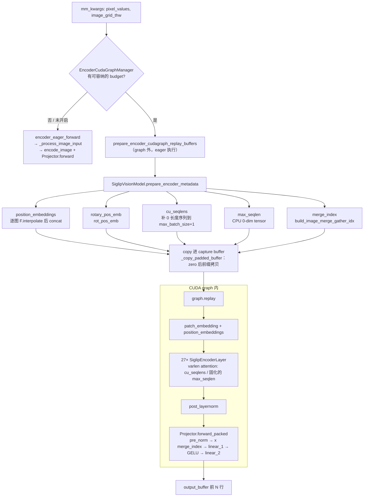
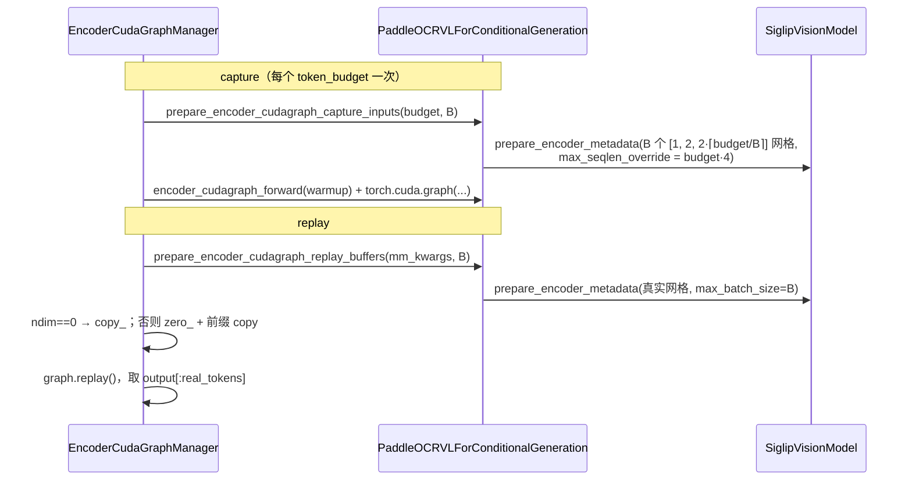

# PR #44394: [MM][Perf] Add PaddleOCR-VL encoder CUDA graph support

> **Author**: @harsha20032020 | **State**: OPEN（2026-10-14 已 rebase 到 #61458 之后） | **Date**: 2026-06-03
> **Branch**: `harsha20032020:paddleocr-vl-encoder-cudagraph` → `main`（head `94987a72cc`） | **Labels**: documentation, unstale, multi-modality, nvidia, verified
> **Changes**: +513 -62 lines across 5 files | **ROCm 相关性**: 部分相关（模型文件跨后端共用；`ROCM_AITER_FA` 被列入可 capture 的 ViT 后端；新单测在 ROCm 上同样启用，`is_cuda_alike()`）
> 本报告分两部分：§1–6 为 PR 详细总结，§7–8 为 ROCm review 意见。

---

## 1. 总结 (Summary)

本 PR 让 `PaddleOCRVLForConditionalGeneration` 实现 `SupportsEncoderCudaGraph` 协议，从而接入 #42224 引入的通用 encoder（ViT）CUDA graph 框架（`EncoderCudaGraphManager`）。实现思路与 Qwen2-VL / Kimi-K2.5 相同：先把 SigLIP 视觉塔里所有依赖输入形状的工作移出 graph，包括逐图 position embedding 双线性插值、2D RoPE、`cu_seqlens` / `max_seqlen` 和 2×2 spatial merge 的 reshape 顺序，统一在 `SiglipVisionModel.prepare_encoder_metadata` 里预计算。graph 内只保留形状固定的 patch embed、27 层 encoder、post-LN，以及基于 gather 的 `Projector.forward_packed`。eager 路径在 `encoder_metadata=None` 时行为不变。

## 2. 背景与动机 (Background & Motivation)

- 伞形 issue #38175 的目标是让主流 VLM 的视觉 encoder 都支持 CUDA graph。Qwen2-VL (#41736)、Kimi-VL (#41992)、Step3-VL (#42224) 已经完成。PaddleOCR-VL 是一个 0.9B 级的 OCR VLM，视觉塔小但层多（27 层），kernel launch 的 CPU 开销在 TTFT 中占比较高，理论上适合用 graph 消除 launch 开销。
- 原实现中有 4 处阻止 capture 的模式（见 §3.3）：逐图 `F.interpolate(size=(h,w))`、逐图 Python 循环构造 RoPE、Python list 构造 `cu_seqlens`、逐图 `rearrange` 合并 patch。
- PR 描述中的性能数据来自 A10G：bf16、FA2、batch=8、896×896、`output-len=1`，TTFT 下降约 6%。**作者在 10-14 的评论中说明 rebase 后没有重跑 benchmark。**
- 维护者 @shen-shanshan 只要求 rebase，目前还没有实质性的代码 review。

## 3. 代码修改分析 (Code Change Analysis)

### 3.1 修改的模块

| 文件 | 改动 | 说明 |
|------|------|------|
| `vllm/model_executor/models/paddleocr_vl.py` | +315 −62 | 核心改动：`_MAX_SEQLEN_ATTN_BACKENDS`；`Projector.forward_packed`；`SiglipVisionEmbeddings.get_position_embeddings`；`SiglipEncoder.rot_pos_emb` / `compute_max_seqlen`（从 `forward` 中拆出）；`SiglipVisionModel.prepare_encoder_metadata`；在 `PaddleOCRVLForConditionalGeneration` 上实现完整的 `SupportsEncoderCudaGraph` 协议（8 个方法） |
| `tests/model_executor/test_paddleocr_vl_cudagraph.py` | +172（新增） | tiny 随机权重视觉塔：①graph forward（不 capture）与 eager 的数值一致性；②真实 `torch.cuda.graph` capture 一次，再用两个不同 batch replay，并与 eager 对比（强制 `TRITON_ATTN`） |
| `tests/models/multimodal/generation/test_vit_cudagraph.py` | +24 | 新增 `paddleocr_vl` 端到端配置（dummy 权重，budget `[4096]`，`core_model` 标记） |
| `docs/design/cuda_graphs_multimodal.md` | +1 | 支持矩阵新增 PaddleOCR-VL（只支持 image） |
| `examples/.../vision_language_offline.py` | +1 | 把 `paddleocr_vl` 加入某个模型列表（用途见 §7 📝） |

### 3.2 架构 / 流程图

**eager 与 graph 两条路径的分工**



**capture 与 replay 的缓冲区约定**



### 3.3 关键实现细节

- **position embedding**：`get_position_embeddings(grids)` 对 `position_embedding.weight` 逐图插值并按 `t` repeat。`interpolate_pos_encoding` 的第一个参数只用来取 `shape[-1]`，所以把参数从 `image_embeddings` 换成 `weight` 是等价的（已核对 main 上的实现）。eager 路径同样改用这个函数，然后一次 `+` 完成相加。
- **RoPE / max_seqlen**：`SiglipEncoder.forward` 新增可选参数 `rotary_pos_emb` / `max_seqlen`。只有当 `rotary_pos_emb is None`（eager）时，才在内部计算 RoPE、把 list 转成 tensor 并计算 `max_seqlen`。`compute_max_seqlen` 对不在 `{FLASH_ATTN, ROCM_AITER_FA, TRITON_ATTN}` 中的后端返回 None。
- **cu_seqlens 补齐**：`prepare_encoder_metadata(max_batch_size=B)` 用 `seq_lens += [0]*(B-n)`，让 `cu_seqlens` 长度固定为 B+1、尾部重复最后一个 offset（即 0 长度序列），与 Kimi-K2.5 的 `pad_cu_seqlens` 语义一致。因为长度相等，manager 默认的 `_copy_padded_buffer` 会整体覆盖，所以不需要自定义 `padding_logics`。
- **max_seqlen 固化**：capture 时设为 `token_budget·merge²`（这个 budget 下单图的最坏 patch 数）。FA / Triton wrapper 在 capture 时调用 `.item()` 转成 Python int，launch bound 由此固定在 graph 里。replay 时对这个 CPU 0-dim buffer 的 `copy_` 实际不会影响 graph，只起占位作用（与 Qwen 系列相同）。
- **Projector.forward_packed**：先对所有行做 `pre_norm`，再用 `merge_index`（形状 `(N/4, 4)`）gather 并 reshape 成 `(N/4, 4·d)`。已核对：`build_image_merge_gather_idx` 中 `reshape(h/2,2,w/2,2).transpose(0,2,1,3)` 生成的顺序与原 `rearrange("(t h p1 w p2) d -> (t h w) (p1 p2 d)")` 完全一致。
- **后端门控**：`get_encoder_cudagraph_config` 在 ViT 后端不属于上述 3 种时**直接 `raise ValueError`**（不是 PR 描述中的"返回空 modalities 并透明回退"）。
- **budget**：`(64, min(max_num_batched_tokens, max_model_len))`，与 Kimi-K2.5 相同。capture 用的 dummy 网格为 `[1, 2, 2·⌈budget/B⌉]`，即一张"2 行宽图"占满 budget。

## 4. 涉及的技术原理 (Technical Principles)

**Encoder CUDA graph（budget 制）**：ViT 的输入长度随图片分辨率变化，无法像 decoder 那样按 batch size 分桶。vLLM 的方案是按"输出 token 预算"capture 若干张 graph，把所有输入 buffer 预分配为该预算的最坏形状。replay 时把真实数据前缀拷进去，其余部分清零，并且只读取输出的前缀。前提是 graph 内**没有 host sync，也没有依赖数据的形状**，所以所有逐图逻辑都要在 graph 外预计算，形状上只能体现为"补齐后的固定长度 tensor"。

**varlen attention 与 0 长度 padding 序列**：FlashAttention / AITER FA / Triton prefill 的 varlen 接口用 `cu_seqlens` 划分序列，`max_seqlen` 决定 grid 的 M 维 block 数。把尾部 padding 表示成 0 长度序列后，这些序列对应的 CTA 会直接退出。超出 `cu_seqlens[-1]` 的行不会被任何序列读写，输出内容未定义（CUDA 上有一个 zero `out` 的 workaround，ROCm 上没有，见 §7）。

**SigLIP 2D RoPE + 插值 position embedding**：PaddleOCR-VL 的 NaViT 风格视觉塔对每张图把可学习的 `√P×√P` position table 双线性插值到 `(h, w)`，再叠加按 `(row, col)` 计算的 2D 旋转位置编码。这两部分都依赖逐图的 `(h, w)`，是 capture 的主要障碍。

**2×2 spatial merge**：投影器把相邻 2×2 的 patch 拼接成 `4d` 维向量，再经过 MLP 投影到 LLM 的 hidden。用预计算的 gather index 替代 `rearrange`，就能把逐图的 reshape 变成形状固定的 `index_select`。

## 5. 评论区讨论亮点 (Discussion Highlights)

- 只有 bot、作者 ping 和维护者要求 rebase 的评论，**还没有任何实质性代码 review**（0 条 inline review comment）。
- 作者 10-14 的评论：已 rebase，并针对 #61458 调整了定义与函数。**rebase 后没有重跑 TTFT benchmark，"预计结果相同"**，因此 PR 描述中的数字对应的是旧版代码。

## 6. 风险与潜在问题 (Risk Analysis)

| 风险 | 严重程度 | 说明 |
|------|---------|------|
| 性能收益未经证实 | 中 | benchmark 命令根本没有跑到 encoder，见 §7「性能数据不能证明 encoder graph 有收益」 |
| 描述与代码不一致 | 中 | 回退语义（raise vs 透明回退）、引用了不存在的符号；见 §7 |
| ROCm 未验证 | 中 | `ROCM_AITER_FA` 被列入可 capture 的后端，但没有 ROCm 实测；ROCm 上没有 zero-`out` workaround；见 §7 |
| eager 路径回归 | 低 | 只做了等价重构（插值参数、RoPE 拆分），已核对等价，mrope 单测也覆盖到 |
| 正确性（padding 行） | 低 | padding 行在 attention 之后的计算全部按行独立，`merge_index` 的真实条目只引用真实行，NaN/垃圾值不会污染真实输出（已推导） |
| 可维护性 | 低 | 从 `kimi_k25_vit` 跨模型 import 辅助函数；replay 时仍有逐图小 kernel |

---

## 7. Review 意见 (Findings)

| 意见类型 | 数量 |
|---|---|
| 🔴 必须修复 | 0 |
| ⚠️ 建议修复 | 3（性能 / 注释文档 / 测试·兼容性） |
| 📝 建议/备注 | 3（性能 / 可维护性 / 测试） |

**⚠️【性能】性能数据不能证明 encoder graph 有收益（benchmark 没有跑到 encoder）** `[已验证]`
- **问题**: Test Plan 第 4 步使用 `vllm bench latency`。该命令只构造随机 token id 的 `TokensPrompt`（`vllm/benchmarks/latency.py:104-109`），**完全不带图片**。`--limit-mm-per-prompt` 只影响 profiling 时的内存预留，不会给请求附加图片。所以 Graph OFF/ON 两组数据中视觉 encoder 都没有执行，5.9% 的差异只能来自噪声或其他因素（例如 capture 改变了显存或 warmup 状态）。此外：①日志中的 `budgets=[1024, 4096]` 与命令里的 `encoder_cudagraph_token_budgets="[4096]"` 对不上；②日志格式 `Captured 2 budget graphs` 与当前 main 的 `Captured %d graphs across %d paths` 不一致；③作者承认 rebase 后没有重跑。这些数字应视为 `[unverified]`。
- **影响**: PR 标题带 `[Perf]`，但现有数据无法支持这个收益结论。审阅者无法判断：replay 时 graph 外的预计算（逐图插值和 RoPE），加上按最坏 `max_seqlen` 固化的 FA grid，是否抵消了节省的 launch 开销。
- **行动**: 作者应当用真正带图片的负载重新测量，例如用 `vllm bench serve` 配合 `--dataset-name random-mm`（或 VisionArena / 自定义图片集）、`--random-mm-bucket-config` 固定 896×896，或者写一个直接 `llm.generate` 带图片的离线脚本。同时报告 TTFT 和 encoder 耗时（`--enable-mm-processor-stats` 或 profiler），并给出 budget/日志的原始输出。

**⚠️【注释/文档】PR 描述与代码行为不一致（不支持的后端是报错而不是回退，且引用了不存在的符号）** `[已验证]`
- **问题**: 描述写的是 "get_encoder_cudagraph_config returns empty `modalities` … the manager falls back to eager transparently"。实际代码 `paddleocr_vl.py:1268-1279` 对不支持的后端 `raise ValueError`。描述中的 `_pad_paddleocr_cu_seqlens_buffer`（"keeps `cu_seqlens[-1]` invariant"）在代码里不存在，现在的补齐方式是在 `prepare_encoder_metadata` 中补 0 长度序列。另外，"Key new symbols" 中写的是 10 个协议方法，实际实现了 8 个。
- **影响**: 在 ROCm 上，如果没有开启 AITER MHA（`VLLM_ROCM_USE_AITER=0`，这是默认值），并且镜像中没有 `flash_attn` 包（或者在 RDNA 上不满足 Triton-FA 条件），`RocmPlatform.get_vit_attn_backend` 会回落到 `TORCH_SDPA`。这时用户如果加了 `-cc.cudagraph_mm_encoder=true`，服务会在初始化时直接报错，与描述承诺的"透明回退"相反。同类模型中，Qwen2.5-VL 在不支持时用 `modalities=[]` 静默降级，行为不统一。
- **行动**: 建议作者二选一：（a）保留 raise（显式失败对 opt-in 开关也说得通），同时更新 PR 描述和 `docs/design/cuda_graphs_multimodal.md`，写明支持的 ViT 后端；（b）改为 `logger.warning_once` 加 `modalities=[]`，与描述和 Qwen2.5-VL 对齐。无论选哪种，都要删除描述中已不存在的符号。

**⚠️【测试/兼容性】`ROCM_AITER_FA` 被列为可 capture 的后端，但没有任何 ROCm 验证** `[已验证]`（缺口已核实；对 ROCm 运行结果的判断为推测）
- **问题**: `_MAX_SEQLEN_ATTN_BACKENDS`（`paddleocr_vl.py:98-102`）包含 `ROCM_AITER_FA`，但所有测试和数据都来自 A10G。新单测虽然对 ROCm 启用（`is_cuda_alike()`），覆盖却有限：`test_cudagraph_forward_matches_eager` 使用 fp32 和默认后端，在 ROCm 上会被选成 `TORCH_SDPA`（AITER 和 FA 分支都要求 fp16/bf16），既不走 varlen `max_seqlen` 路径，也不 capture；`test_padded_capture_replay_matches_eager` 固定使用 `TRITON_ATTN`。也就是说，`ROCM_AITER_FA` 和 ROCm 上的 `FLASH_ATTN`（MI300/MI355 的默认 ViT 后端）在 graph capture 下没有被任何测试覆盖。另外，`flash_attn_maxseqlen_wrapper` 中针对 "encoder CUDA-graph replay paddings with NaNs" 的 zero `out` workaround 只在 CUDA 上生效（ROCm 上 `supports_out=False`），所以 ROCm 上 padding 行的 attention 输出是未初始化内存。
- **影响**: 按 §3.3 的推导，PaddleOCR-VL 在 attention 之后全是逐行算子，`merge_index` 的真实条目只引用真实行，所以 padding 行的 NaN 应该不会污染真实输出。但仍有两点需要在 ROCm 上实测：AITER CK varlen 对尾部大量 0 长度序列的行为，以及在 `max_seqlen = budget·4`（例如 16384）× `max_batch_size` 个序列时，空 CTA 的 launch 开销是否吃掉收益。
- **行动**: 建议作者（或 AMD reviewer）在 MI300X/MI355X 上用 bf16 跑 `test_vit_cudagraph.py::test_vit_cudagraph_image[paddleocr_vl]`，分别覆盖 `VLLM_ROCM_USE_AITER=1`（`ROCM_AITER_FA`）和默认 `FLASH_ATTN`。也可以在单测中增加一个 bf16 加显式 `ROCM_AITER_FA` / `FLASH_ATTN` 的参数化用例（在非 ROCm 上 skip）。如果暂时无法验证，建议先把 `ROCM_AITER_FA` 从 `_MAX_SEQLEN_ATTN_BACKENDS` 的 graph 支持中排除，或在文档里标注"ROCm 未验证"。

**📝【性能】replay 时 graph 外仍有逐图小 kernel**
- **问题**: 每次 replay 都会调用 `prepare_encoder_metadata`（`paddleocr_vl.py:960-1008`），对每张图执行 `F.interpolate`、`repeat`、`concat`，在 GPU 上计算 RoPE（`torch.arange`、gather），再做两次 H2D。这些正是 PR 背景中说要消除的"many small kernel launches"，只是被移到了 graph 外。
- **影响**: 对多图请求，graph 带来的收益会被这部分开销部分抵消。PaddleOCR 场景下图片分辨率往往比较集中，可以利用这一点优化。
- **行动**: 建议作者按 `(h, w)` 给插值后的 position embedding 加一个小 LRU cache（权重加载后不变），eager 路径也能一起受益。这条可以放到后续 PR 中做。

**📝【可维护性】跨模型 import `build_image_merge_gather_idx`**
- **问题**: `paddleocr_vl.py` 从 `.kimi_k25_vit` import 合并索引辅助函数。这个函数在 `t != 1` 时直接 `raise ValueError`，语义上是一个"仅限图片的 encoder graph 通用工具"。
- **影响**: 两个模型文件之间出现耦合；以后如果修改 Kimi 的实现，可能影响 PaddleOCR-VL。
- **行动**: 建议作者把它移到共享位置（例如 `vision.py` 或 `encoder_cudagraph` 相关的 utils），由两个模型共同引用。

**📝【测试】端到端用例与 example 改动**
- **问题**: `test_vit_cudagraph.py` 中的新配置带 `core_model` 标记，会进入核心模型 CI。`vision_language_offline.py` 只加了一行 `"paddleocr_vl"`，但从 diff 上下文看不出这个列表的用途（是否为"支持 encoder cudagraph 的模型"列表）。
- **影响**: CI 时间小幅增加。如果 example 列表的语义与新增条目不符，会误导用户。
- **行动**: 建议 review 时追问 example 列表的语义。如果 `core_model` 不是维护者要求的，可以考虑去掉。

## 8. 结论 (Verdict)

⚠️ **NEEDS WORK** — 实现思路正确，与 Qwen2-VL / Kimi-K2.5 同构，已核对 merge 顺序和插值的等价性，没有找到能导致错误输出的具体输入。但这个 `[Perf]` PR 的性能数据是在 encoder 根本没有执行的 benchmark 上测出来的，PR 描述与代码的回退语义也不一致。`ROCM_AITER_FA` 被列为可 capture 的后端，却没有任何 ROCm 验证。

## 9. 英文 Review 评论 (Copy-Paste English Comments)

**C1** PR description / top-level review comment (no code anchor) — ⚠️ comment

```text
I don't think the TTFT numbers in the description measure the encoder at all. `vllm bench latency` only builds random-token `TokensPrompt`s (vllm/benchmarks/latency.py), so no image is ever sent; `--limit-mm-per-prompt` only affects memory profiling. The ~6% delta is therefore noise or a side effect of graph capture, not the ViT graph. The logged budgets ([1024, 4096]) also don't match the `[4096]` passed on the command line, and the log format predates the current manager, so the numbers come from an older revision. Could you re-measure with a workload that actually carries images, e.g. `vllm bench serve --dataset-name random-mm` with a fixed 896x896 bucket, and report TTFT plus encoder time with graph on/off?
```

**C2** `vllm/model_executor/models/paddleocr_vl.py:1268-1279` — ⚠️ comment

```text
The description says unsupported ViT backends return empty `modalities` and fall back to eager transparently, but this code raises a ValueError at init instead. This matters in practice: on ROCm without AITER MHA and without the flash_attn package (or with fp32), the platform picks TORCH_SDPA, so enabling `cudagraph_mm_encoder` makes the server fail to start. Raising is a reasonable choice for an opt-in flag, but then please update the PR description and docs/design/cuda_graphs_multimodal.md to list the supported ViT backends. Alternatively, warn and return `modalities=[]` as Qwen2.5-VL does. Also, `_pad_paddleocr_cu_seqlens_buffer` in the description no longer exists in the code.
```

**C3** `vllm/model_executor/models/paddleocr_vl.py:98-102` — ⚠️ comment

```text
ROCM_AITER_FA is listed here as a capturable backend, but nothing exercises it under graph capture. On ROCm, the fp32 parity test resolves to TORCH_SDPA, and the capture test pins TRITON_ATTN, so neither ROCM_AITER_FA nor ROCm FLASH_ATTN (the MI300/MI355 default) is covered. Also, the zeroed `out` workaround for NaN padding rows in flash_attn_maxseqlen_wrapper is CUDA-only, so padding rows are uninitialized on ROCm. I believe this is harmless for PaddleOCR-VL, because everything after attention is row-wise and merge_index only references real rows, but it should be verified. Could you (or an AMD reviewer) run test_vit_cudagraph_image[paddleocr_vl] on MI300/MI355 in bf16 with VLLM_ROCM_USE_AITER=1 and with the default backend? If that isn't possible yet, please mark ROCm as unverified.
```

**C4** `vllm/model_executor/models/paddleocr_vl.py:1000-1004` — ⚠️ comment (nit, follow-up OK)

```text
`prepare_encoder_metadata` runs on every replay, so the per-image `F.interpolate`/repeat/concat and the RoPE gather still launch small kernels outside the graph. These are the launches the PR description says it wants to remove. Since the position-embedding table is fixed after weight loading, consider caching the interpolated embedding per (h, w), e.g. with a small LRU. The eager path would benefit as well. Fine to do this in a follow-up PR.
```
