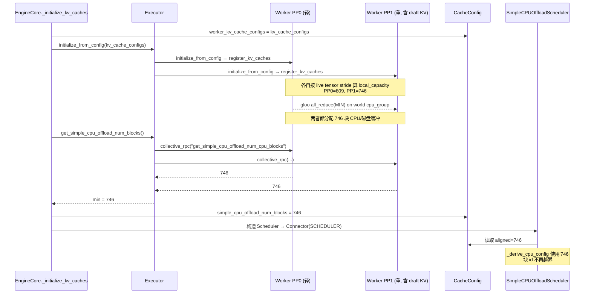
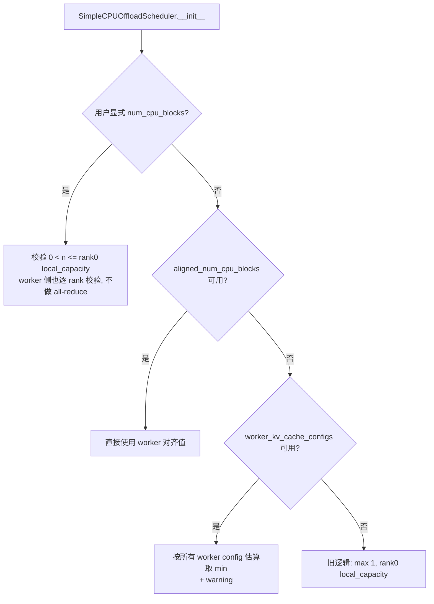

# PR #52921: [Bugfix] Align CPU offload pool size across PP/spec-decode workers

> **Author**: @charxwu | **State**: OPEN | **Date**: 2026-08-19（最后推送 2026-10-20）
> **Branch**: `charxwu:fix/simple-cpu-offload-pp-alignment` → `main` | **Labels**: bug, ready, kv-connector, verified
> **Changes**: +314 -17 lines across 11 files | **ROCm 相关性**: 部分相关（bug 在 MI355X 上以 `hipMemcpyBatchAsync` SIGSEGV 暴露，修复本身是平台无关的共享路径改动）
> 本报告分两部分：§1–6 为 PR 详细总结，§7–8 为 ROCm review 意见，§9 为可直接粘贴的英文评论。

---

## 1. 总结 (Summary)

`SimpleCPUOffloadConnector` 的 scheduler 侧和 worker 侧各自独立计算 CPU（或磁盘）offload 池的块数 `num_cpu_blocks`：scheduler 只看 worker 0 的 `KVCacheConfig`，每个 worker 则按自己实际的 GPU KV 张量 stride 计算。在 PP 层数不均或投机解码（draft KV 只在最后一个 PP stage）时，"更重"的 rank 每块字节数更大、能分到的块更少，而 scheduler 仍按较轻 rank 的估算分配 `cpu_block_id`，导致越界 DMA（MI355X TP8×PP2 上表现为 `hipMemcpyBatchAsync` 段错误）。本 PR 让 worker 在分配 CPU/磁盘缓冲前对 world group 做 **MIN all-reduce**，engine core 在 `initialize_from_config()` 之后通过新增的 collective RPC 取回对齐值，写入 `CacheConfig`，scheduler 构造时把它当作权威池大小使用（RPC 不可用时退回按所有 worker config 取 min 的估算）。

## 2. 背景与动机 (Background & Motivation)

- **问题现象**：Kimi-K3 在 MI355X TP8×PP2 上开启 SimpleCPUOffload 后，PP0 算出 809 块、PP1 算出 746 块，scheduler 用 809。scheduler 发给 PP1 的块 id 一旦 ≥746 就越界，copy kernel 直接 SIGSEGV，而不是报出清晰的错误。
- **现有绕过方案**：InferenceX 用 `patch_kv_offload_block_cap.py` 在运行时 monkey-patch，并通过 `KV_OFFLOAD_MAX_CPU_BLOCKS` 手动限定 scheduler 的块数，每种拓扑都要单独调参。
- **上游进展**：maintainer @ivanium 认为问题成立，但当前修法"对 engine core 侵入过大"，建议让用户直接指定 `num_cpu_blocks`；随后 #61674 作为临时方案合入（已在 B200 TP8 DCP8 PP2 上验证）。作者 10-19 回复认为显式参数把框架该做的事推给了用户，并提出可收敛为"connector 内部 MIN all-reduce + 不一致时启动期 fail-fast"的精简版本，正在等待 maintainer 定方向。
- PR 描述注明本改动在 AI（Cursor）辅助下完成，作者已人工 review。

## 3. 代码修改分析 (Code Change Analysis)

### 3.1 修改的模块

| 模块 | 文件 | 改动 |
|------|------|------|
| 尺寸计算（新增） | `vllm/v1/simple_kv_offload/sizing.py` (+70) | `sync_num_offload_blocks_across_workers`（基于 world group `cpu_group` 的 gloo MIN all-reduce）；`gpu_total_bytes`；`compute_num_offload_blocks_from_config(s)`（按 config 估算后取 min） |
| Worker | `vllm/v1/simple_kv_offload/worker.py` (+5 -9) | `_resolve_num_cpu_blocks` 在未显式指定时调用 MIN 同步；磁盘模式不再重复 resolve，直接复用 `self.num_cpu_blocks` |
| Scheduler | `vllm/v1/simple_kv_offload/manager.py` (+36 -7) | 构造函数新增 `worker_kv_cache_configs`、`aligned_num_cpu_blocks`；`_derive_cpu_config` 优先使用对齐值，否则退回按 config 估算 + warning |
| Connector | `simple_cpu_offload_connector.py` (+26) | `_find_simple_cpu_offload_connector`（递归穿透 MultiConnector 的 `_connectors`）；scheduler 侧从 `cache_config` 读取两个新字段；worker 侧新增 `get_aligned_num_cpu_blocks()` |
| Engine core | `vllm/v1/engine/core.py` (+6) | 把 `kv_cache_configs` 存入 `cache_config.worker_kv_cache_configs`；`initialize_from_config` 之后**无条件**调用 `get_simple_cpu_offload_num_blocks()` |
| Executor | `vllm/v1/executor/abstract.py` (+17) | `get_simple_cpu_offload_num_blocks()`：对所有 worker 发起 collective RPC，过滤 None 后取 min，不一致时打 warning |
| GPU Worker | `vllm/v1/worker/gpu_worker.py` (+12) | `get_simple_cpu_offload_num_cpu_blocks()` RPC 入口 |
| 配置 | `vllm/config/cache.py` (+10) | 新增 `worker_kv_cache_configs: Any`、`simple_cpu_offload_num_blocks: int` 两个 `init=False` 字段，并从 `compute_hash` 中排除 |
| 测试 | `tests/v1/simple_kv_offload/test_scheduler.py` (+66 -1)、`test_worker.py` (+55)、`tests/config/test_config_utils.py` (+11) | heaviest-worker 尺寸计算、scheduler 使用对齐值、all-reduce 的 mock 测试、hash 不受影响 |

### 3.2 架构 / 流程图

**启动期对齐流程（PR 之后）**：



**scheduler 侧 `num_cpu_blocks` 决策逻辑**：



### 3.3 关键实现细节

- **对齐粒度是 world group**：`sync_num_offload_blocks_across_workers` 用 `get_world_group().cpu_group` 做 gloo all-reduce。在 vLLM 中，开启 DP（非 elastic EP、非 external_launcher）时 world group 的大小是 `world_size_across_dp`，因此 MIN 会跨所有 DP engine 生效，而不只是同一 engine 内的 TP×PP rank。
- **all-reduce 的时机**：在 `register_kv_caches()` 内部，也就是 `initialize_from_config()` 期间。只有 `_num_cpu_blocks_override is None` 时才执行，显式指定时不做同步，各 rank 各自按本地容量校验。
- **磁盘模式**：之前 `_init_disk_mode` 再次调用 `_resolve_num_cpu_blocks(disk_capacity_bytes, …)`，本 PR 删除了这次重复计算，改为复用 `register_kv_caches` 中已按 `disk_capacity_bytes` 算好（并已同步）的 `self.num_cpu_blocks`，避免同一个 rank 上发生两次 all-reduce。
- **Scheduler 信任对齐值**：`_derive_cpu_config` 对 `aligned_num_cpu_blocks` 不做 `<= local_capacity` 校验（注释写明 "used as-is"）。由于对齐值是所有 worker 的 min，按理不会超过 rank0 的估算。
- **`gpu_total_bytes`** 从 manager 抽到 sizing.py 复用，并依赖"所有 `KVCacheTensor` 共享同一块 backing allocation，`tensors[0].size` 即总大小"这个不变式。CodeRabbit 曾对此提出质疑，作者答复 vLLM 只有共享 buffer。测试 helper `_make_kv_cache_config` 也随之改为 `size=total_size` 加 `offset`，以符合该不变式。
- **配置 hash**：两个新字段已加入 `compute_hash` 的排除列表，避免运行期写入导致 compile cache 失效，并有单测覆盖。

## 4. 涉及的技术原理 (Technical Principles)

**SimpleCPUOffload 的块 id 契约**：scheduler 在 CPU 侧维护一个 `BlockPool`，用 LRU 管理 CPU 块，并在 metadata 中把 `(gpu_block_id → cpu_block_id)` 发给所有 worker。worker 的 DMA backend 按 `base + cpu_block_id * stride(0)` 拷贝，**不做边界检查**，所以 scheduler 池的大小必须 ≤ 每个 worker 实际分配的块数，否则就是越界 DMA。ROCm 上表现为 `hipMemcpyBatchAsync` 段错误，CUDA 上同理会是非法地址访问。

**为什么 PP / 投机解码会让各 rank 不一致**：offload 容量按字节给定（`cpu_bytes_to_use_per_rank`），块数 = 容量 / 每块字节数，而每块字节数 = 该 rank 所有 KV 层的 page bytes 之和。PP 切分不均（如 61 层切成 31/30）或 MTP/EAGLE draft 层只在最后一个 stage 时，各 rank 的每块字节数不同，算出的块数也就不同。scheduler 只能看到 rank0 的 config。

**MIN all-reduce 对齐**：最小值是所有 rank 都能容纳的最大公共块数。用 gloo（CPU group）而不是 RCCL/NCCL，是因为这里只同步一个标量，不需要 GPU，也不影响 device stream。代价是一次额外的集合通信：所有 rank 必须到达同一调用点，否则会挂起。

**Engine core → scheduler 的信息流**：vLLM v1 中 scheduler 侧 connector 在 EngineCore 进程中构造，worker 在独立进程里。worker 的运行期信息只能通过 executor `collective_rpc` 回传。现有的类似通道是 `get_kv_connector_handshake_metadata()` → `set_xfer_handshake_metadata_pp_aware()`（NIXL 等用它），它在 scheduler 构造之后执行，并且只在 `kv_connector is not None` 时调用。

## 5. 评论区讨论亮点 (Discussion Highlights)

- **@ivanium（maintainer）**：问题成立，但当前方案对 engine core 侵入过大、难以合入，建议让用户直接指定 `num_cpu_blocks`。#61674 随后落地，@SherifWaly 报告该临时方案在 B200 TP8 DCP8 PP2 上可用。
- **@charxwu 反驳（10-19）**：(1) 显式块数把"找最重 rank"的工作推给用户，拓扑一变就要重测，而且默认路径仍会 segfault；(2) `cpu_bytes_to_use_per_rank` 之外再加一个块数旋钮，暴露了实现细节。作者主动提出精简方案：只在 connector 内做 MIN all-reduce，各 rank 不一致时启动期 fail-fast 并提示 `set num_cpu_blocks=746`，并询问 maintainer 是否接受一个"最小 hook"把对齐值传给 scheduler。**这是当前悬而未决的核心设计问题。**
- **@shen-shanshan（已 approve）**：指出 sizing.py 中三个 helper 只在测试中使用，建议移到 tests。作者回复"会删除并复用 worker 中的实现"，但当前 head（`6b92e12`）中 `compute_num_offload_blocks_from_config(s)` 仍在，并被 manager 的 fallback 路径引用。
- **CodeRabbit**：质疑 `gpu_total_bytes` 取 `kv_cache_tensors[0].size` 在"等大但不相交的分配"下会少算。作者答复只有共享 buffer，CodeRabbit 因无法访问仓库而保留该意见未关闭。
- CI 经历多轮 `/ci run` / `/ci retry`，期间多次 merge conflict 与 pre-commit 失败，当前最终 CI 状态未能从抓取数据中确认。

## 6. 风险与潜在问题 (Risk Analysis)

| 风险 | 严重程度 | 说明 |
|------|---------|------|
| 兼容性：无条件 RPC 打断非 GPU-Worker 平台启动 | High | 见 §7「engine core 无条件发起只有 GPU Worker 实现的 RPC」 |
| 正确性：集合通信挂起 | Medium | 见 §7「world group MIN all-reduce 的到达性与作用域」 |
| 可维护性：engine core / CacheConfig 被 connector 专属状态污染 | Medium | 见 §7「侵入面过大，fallback 路径实为死代码」，也是 maintainer 的主要顾虑 |
| 兼容性：依赖 MultiConnector 私有属性 | Low | 见 §7「`_connectors` 私有属性」 |
| 测试覆盖：缺少真实多 rank 集成测试 | Medium | all-reduce 全部被 mock，PP 不均衡场景只做过手工验证（仅 ROCm） |
| 性能 | Low | 启动期多一次 gloo all-reduce 和一次 RPC，运行期无影响；容量按最重 rank 收缩，与旧行为（实际会崩）相比是正确的代价 |
| 与 #61674 的关系 | Low | 两者可以共存：显式 `num_cpu_blocks` 时跳过同步。但如果最终选 fail-fast 方案，本 PR 的大部分代码会被替换 |

---

## 7. Review 意见 (Findings)

ROCm 相关性：部分相关。本 PR 不修改任何 ROCm 专属文件（aiter / mori / `rocm_*` backend 都未涉及），ROCm 暴露面只有 SimpleCPUOffload 在 ROCm 上的 DMA copy 路径（`hipMemcpyBatchAsync`），本 PR 是修复它的越界问题。因此按共享路径的跨后端回归、集合通信安全和卫生检查来审，aiter/mori/kernel 数值类规则不适用。

| 意见类型 | 数量 |
|---------|------|
| 【兼容性】 | 2 |
| 【正确性】 | 1 |
| 【设计】 | 1 |
| 【测试】 | 1 |
| 【注释/文档】 | 1 |

### 🔴 必须修复

**🔴【兼容性】engine core 无条件发起只有 GPU `Worker` 实现的 RPC，打断其他 worker 实现的启动** `[已验证]`
- **问题**：`vllm/v1/engine/core.py:380` 对**所有**部署都调用 `self.model_executor.get_simple_cpu_offload_num_blocks()`，不管是否配置了 `kv_transfer_config`。后者（`vllm/v1/executor/abstract.py:159-162`）执行 `collective_rpc("get_simple_cpu_offload_num_cpu_blocks")`，而该方法只加在 `vllm/v1/worker/gpu_worker.py:911` 的 `Worker` 上，`WorkerBase` 里没有。`run_method`（`vllm/v1/serial_utils.py:499-505`）对字符串方法名做 `getattr`，失败时抛 `NotImplementedError(f"Method {method!r} is not implemented.")`。
- **影响**：触发条件是任何 worker 直接继承 `WorkerBase` 而非 GPU `Worker` 的平台插件（如 vllm-ascend 的 `NPUWorker` 等 out-of-tree 平台），**即使完全没开 KV connector**，引擎也会在 KV cache 初始化后启动失败。in-tree 的 `CPUWorker`/`XPUWorker` 继承自 `Worker`，ROCm 走 `gpu_worker`，所以 in-tree CI 暴露不出这个问题。
- **行动**：作者应当把该调用限制在真正需要的场景，至少用 `vllm_config.kv_transfer_config is not None` 守卫，最好仅在 connector 是或包含 `SimpleCPUOffloadConnector` 时调用。也可以参照现有 `get_kv_connector_handshake_metadata` 的模式，放进 `kv_connector is not None` 分支，或者在 `WorkerBase` 上提供默认返回 `None` 的实现。

### ⚠️ 建议修复

**⚠️【正确性】world group MIN all-reduce 的到达性与作用域** `[推测]`
- **问题**：`vllm/v1/simple_kv_offload/sizing.py:31-32` 在 `register_kv_caches` 内部对 `get_world_group().cpu_group` 做阻塞式 all-reduce（入口 `worker.py:186`）。(a) 集合通信要求所有 rank 都执行到这里，但 `register_kv_caches` 在 `if not kv_caches: return` 时会提前返回，如果某个 rank 没有 KV 层而其他 rank 有，其余 rank 会一直卡在 gloo 上直到超时。elastic EP scale-up 时新加入的 worker 单独执行 `register_kv_caches`，也可能遇到同样问题。(b) 开启 DP 时 world group 的大小是 `world_size_across_dp`（`parallel_state.py:1849`），MIN 会把**所有 DP engine** 的池都压到最重的那个，并把各 DP engine 的初始化强行同步。这个行为没有文档说明，也不是修复本 bug 所必需的。
- **影响**：(a) 在特定拓扑下启动挂起，表现为无报错的 hang，比原来的 segfault 更难诊断；(b) 跨 DP 的容量收缩和启动耦合不符合预期。
- **行动**：建议作者把同步范围缩到单个 engine 内的 TP×PP rank（例如先对 TP group 取 MIN、再对 PP group 取 MIN，或使用该 engine 专属的 group），并确认所有 rank 在任何分支下都会执行到集合通信，至少把 `if not kv_caches` 的提前返回放到同步之后或显式参与同步。另外建议在 PR 描述中说明 DP 与 elastic EP 场景下的行为。

**⚠️【设计】侵入面过大，scheduler 的 fallback 路径实为死代码** `[已验证]`
- **问题**：为传递一个整数，PR 改动了 `CacheConfig`（新增 `worker_kv_cache_configs: Any`，把运行期的 `KVCacheConfig` 列表存进用户可见的配置 dataclass，`cache.py:223-229`）、`EngineCore`、`Executor` 和 `Worker` 四层。同时，`manager.py:179-193` 的 fallback 只在 `aligned_num_cpu_blocks is None` 时触发，也就是 RPC 返回 None，这意味着 worker 上根本没有 SimpleCPUOffload connector，或 `num_cpu_blocks<=0`（没有注册任何 KV cache）。这两种情况下 scheduler 侧的 SimpleCPUOffload 也没有意义，所以该路径在正常配置下不可达。`abstract.py:167-173` 的"workers reported mismatched num_cpu_blocks" warning 也不可达，因为 worker 已经做过 MIN 同步，所有返回值必然相等。`sizing.py:52-70` 的 config 估算 helper 只服务于这条 fallback 和测试，作者曾答应 @shen-shanshan 删除，但仍保留着。
- **影响**：增加了维护面，而且这正是 maintainer @ivanium 拒绝的主要原因；死代码和不可达 warning 会误导后来者以为存在多个合法的尺寸来源。
- **行动**：建议作者按 10-19 自己提出的方向收敛：(1) 删除 `worker_kv_cache_configs` 字段、`compute_num_offload_blocks_from_config(s)` 和 fallback 分支；(2) worker 侧保留 MIN 同步；(3) 如果 maintainer 接受最小 hook，复用现有的 `get_kv_connector_handshake_metadata` → `set_xfer_handshake_metadata_pp_aware` 通道，让 scheduler 在收到对齐值后再初始化 CPU 池（lazy），从而不必修改 `CacheConfig` 和 engine core；否则采用 fail-fast 方案。建议在 review 时与 @ivanium 先对齐最终方向，再继续迭代代码。

**⚠️【兼容性】`_find_simple_cpu_offload_connector` 依赖 MultiConnector 私有属性** `[已验证]`
- **问题**：`simple_cpu_offload_connector.py:71` 用 `getattr(connector, "_connectors", None)` 递归查找子 connector。而 `MultiConnector` 已经提供公共属性 `sub_connectors`（`multi_connector.py:212`）。
- **影响**：如果 MultiConnector 重构并重命名私有字段，这里会静默返回 None。在当前 PR 下，这会退化为不可达的 fallback，scheduler 用 rank0 估算，原来的越界 bug 就会无声地回来。
- **行动**：建议作者改为 `isinstance(connector, MultiConnector)` 加 `connector.sub_connectors`。

**⚠️【测试】缺少真实多 rank / 不均衡 PP 的自动化覆盖，跨后端验证不足** `[已验证]`
- **问题**：`test_worker.py` 中三个 all-reduce 测试全部 mock 了 `dist.all_reduce` 和 `get_world_group`，没有真实执行 gloo 集合通信。scheduler 测试只验证构造参数的优先级。端到端的 PP 不均衡和投机解码场景只在 ROCm（MI355X，TP4×PP2 与 TP8×PP2）上手工验证过，CUDA 侧的 PP 路径没有对应验证。PR 描述中的 809→746、50→46 数字来自作者口述的日志，PR 中没有附上原始日志 `[unverified]`。
- **影响**：本 PR 修改的是 CUDA/ROCm 共享路径，挂起类问题（见上一条）只有真实多进程测试才能发现。
- **行动**：建议作者补一个 2-GPU 的 `PP=2` 加 `SimpleCPUOffloadConnector` 测试，可以复用 `tests/v1/kv_connector` 下现有的多卡用例框架，人为制造层数不均或 draft 层；断言所有 rank 的 `num_cpu_blocks` 与 scheduler 一致，并跑两遍 generate 做一致性检查。同时建议附上手工验证时的关键日志片段。

### 📝 建议 / 备注

**📝【注释/文档】日志级别与噪声** `[已验证]`
- **问题**：`sizing.py:35-41` 在每个 rank 上都会用 `logger.info` 打印对齐信息，TP8×PP2 下会重复打印 16 次。
- **影响**：仅影响日志可读性。
- **行动**：建议作者只在 rank 0 打印，或使用 `info_once`，并在日志中列出被收缩的 rank，方便定位最重的 stage。

> 结构检查：diff 中引用的新符号（`get_world_group().cpu_group`、`dist.ReduceOp.MIN`、`has_kv_transfer_group`、`KVCacheTensor.offset`）均在当前 main 中存在，未发现幻觉符号。磁盘模式和 CPU 模式现在共用同一处 resolve 和同步，避免了两次 all-reduce。

## 8. 结论 (Verdict)

🔴 **BLOCK**（修复成本低）：bug 真实且严重（静默越界 DMA → segfault），worker 侧 MIN 同步的思路也是对的。但 engine core 无条件发起的 RPC 会让所有 worker 不继承 GPU `Worker` 的 out-of-tree 平台启动失败，必须加守卫。此外，maintainer 对侵入性的顾虑尚未解决，建议先与 @ivanium 确定"fail-fast"还是"复用 handshake 通道的最小 hook"，再收敛代码，同时缩小 all-reduce 的作用域并补真实多 rank 测试。

## 9. 英文 Review 评论 (Copy-Paste English Comments)

**C1** `vllm/v1/engine/core.py:380-384` — 🔴 blocking

```text
This RPC is now issued unconditionally for every deployment, even when no KV connector is configured. `get_simple_cpu_offload_num_cpu_blocks` is only defined on the GPU `Worker` (not on `WorkerBase`), and `run_method` raises `NotImplementedError` when `getattr` fails, so any platform plugin whose worker derives directly from `WorkerBase` (e.g. out-of-tree NPU/TPU workers) will fail at startup after this change. In-tree CPU/XPU workers subclass `Worker`, which is why CI does not catch it. Could you gate this on `vllm_config.kv_transfer_config is not None` (ideally only when the configured connector is/contains `SimpleCPUOffloadConnector`), or add a default `return None` implementation on `WorkerBase`?
```

**C2** `vllm/v1/simple_kv_offload/sizing.py:27-32` — ⚠️ comment

```text
Two concerns with doing a blocking all-reduce on the *world* group inside `register_kv_caches`:
1) With DP enabled (non-elastic), the world group spans `world_size_across_dp`, so this MIN couples every DP engine's pool size and startup, which isn't needed to fix the PP/spec-decode mismatch. Reducing over the engine's own TP and PP groups would be enough.
2) It's a collective that every rank must reach, but `register_kv_caches` early-returns on `if not kv_caches`, and elastic-EP scale-up workers call it on their own. Any rank that skips it turns a crash into a silent hang.
Could you narrow the group and make sure every rank always participates (or document why it's guaranteed)?
```

**C3** `vllm/config/cache.py:223-229` — ⚠️ comment

```text
I think this field (and the config-based fallback in `SimpleCPUOffloadScheduler.__init__`) can be dropped. The fallback only runs when the RPC returns `None`, which means no worker has a `SimpleCPUOffloadConnector` or none registered KV caches, so it is unreachable in a valid deployment. Likewise, the "mismatched num_cpu_blocks" warning in `Executor.get_simple_cpu_offload_num_blocks` can't fire once workers have already MIN-synced. Storing a list of runtime `KVCacheConfig` objects as an `Any` field on a user-facing config is also the kind of engine-core intrusion @ivanium raised. If a scheduler hook is acceptable, consider reusing the existing `get_kv_connector_handshake_metadata` -> `set_xfer_handshake_metadata_pp_aware` path with lazy CPU-pool init instead of new `CacheConfig` fields.
```

**C4** `vllm/distributed/kv_transfer/kv_connector/v1/simple_cpu_offload_connector.py:71` — ⚠️ comment

```text
This relies on MultiConnector's private `_connectors` attribute. `MultiConnector` already exposes a public `sub_connectors` property. If the private field is ever renamed, this lookup would silently return `None` and the original out-of-bounds bug would come back without any error. Could you use `isinstance(connector, MultiConnector)` + `connector.sub_connectors` instead?
```

**C5** `vllm/v1/simple_kv_offload/worker.py:186` — ⚠️ comment

```text
The new sync path is only covered by tests that mock `dist.all_reduce` and `get_world_group`, and the uneven-PP / draft-KV scenario was validated manually on ROCm only. Since this is a shared CUDA/ROCm path and the main new failure mode is a collective hang, could you add a 2-GPU PP=2 test with `SimpleCPUOffloadConnector` (uneven layers or a draft model) that asserts every rank and the scheduler agree on `num_cpu_blocks` and that two-pass generation matches? Attaching the relevant log lines from the MI355X runs (809 -> 746) would also help reviewers.
```
