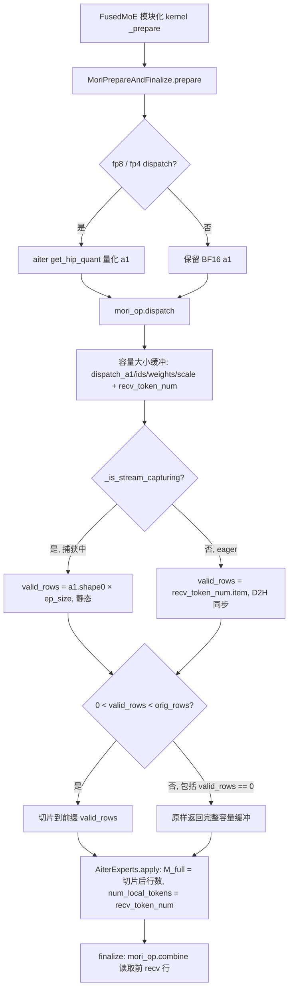

# PR #53108: [ROCm][BugFix] Trim MoE GEMM input to valid token prefix

> **Author**: @amd-weisun | **State**: OPEN | **Date**: 2026-08-20
> **Branch**: `fix/aiter-moe-trim-to-valid-tokens` → `main` | **Labels**: bug, ready, rocm
> **Changes**: +334 -0 lines across 3 files | **ROCm 相关性**: 完全相关（MoRI EPv1 prepare/finalize + AITER fused MoE 输入形状）
> 本报告分两部分：§1–6 为 PR 详细总结，§7–8 为 ROCm review 意见。

---

## 1. 总结 (Summary)

MoRI EPv1 的 `dispatch()` 返回按最坏情况分配的接收缓冲（`max_num_batched_tokens × ep_size` 行），真实有效行通常只占很小的前缀；作者报告 AITER `fused_moe` 在"缓冲行数 / 有效行数"比例很大时会把有效行算成全零，导致 EP32 多机部署输出乱码。PR 当前版本在 `MoriPrepareAndFinalize.prepare()` 中、`dispatch()` 之后把 `dispatch_a1 / dispatch_scale / dispatch_ids / dispatch_weights` 切到有效前缀：eager 步用 `dispatch_recv_token_num.item()` 的精确接收行数，CUDA graph 捕获时用静态上界 `input_num_tokens × ep_size`。另新增一个 CPU 合约测试（进 CI）和一个需要 8 卡 torchrun 的硬件回归测试（不进 CI）。

## 2. 背景与动机 (Background & Motivation)

- 作者在 Hy3-preview（192 experts，top-8，BF16）+ `--all2all-backend mori_high_throughput` 的 DP wideEP 部署中观察到 EP32（4 节点）输出乱码、GSM8K 接近 0；与已经合入 main 的 MoRI combine 修复（原 #52639，现经 #56073 合入）一起应用后恢复到约 93%。作者称两处修复缺一不可。PR 描述中的 GSM8K / probe 数字均来自作者自述，无日志或脚本可溯源，下文一律视为 `[unverified]`。
- PR 经历了较大的形态变化：最初版本在 `AiterExperts.apply()` 中 slice + scatter 到零初始化输出，捕获时用 `graph_bs × topk × dispatch_group_size` 作为上界；自 b099035 起改为只在 MoRI prepare 中 slice、无 scatter；11 月 11 日根据 @okorzh-amd 的意见把捕获上界去掉了 topk 因子。
- 本 PR 与 #63412（@basemam，同一位置用 DP metadata 的 host 侧上界，无 D2H 同步）是同一问题的两种解法，评论区已明确"只应合入一个"。同时 main 上的 MoRI EPv2（`prepare_finalize/mori_epv2.py`）已有自己的 `_recv_rows_bound` + 掩码实现。
- 本批次其余 PR（60852、58962、64154、65690、65923、63856、63855、63854、64756、64785、66008、65712）都在 MoRIIO KV connector 路径上，与本 PR 不共享文件或函数，不存在冲突。

## 3. 代码修改分析 (Code Change Analysis)

### 3.1 修改的模块

| 模块 | 改动 |
|------|------|
| `vllm/model_executor/layers/fused_moe/prepare_finalize/mori.py` (+54) | 新增 `_is_stream_capturing()`、`_trim_dispatch_output()`；在 `prepare()` 的 `mori_op.dispatch()` 之后调用 trim |
| `tests/kernels/moe/test_mori_prepare_finalize.py` (+57) | 新增 `_CapacityMoriOp` 假 op 与 `test_mori_prepare_trims_receive_buffer`（CPU，参数化 eager / capture 两条路径） |
| `tests/kernels/moe/test_rocm_mori_moe_ep.py`（新增 223 行） | 真实 MoRI InterNodeV1 dispatch + `AiterUnquantizedExperts.apply()` + MoRI combine 的硬件回归测试，需 torchrun ≥8 rank，不进 CI |

### 3.2 架构 / 流程图



### 3.3 关键实现细节

- `_trim_dispatch_output` 只改变返回张量的行数（view 切片，无拷贝、无新分配）；`expert_tokens_meta.expert_num_tokens` 仍是 MoRI 的设备侧 `recv_token_num`，AITER 继续以它作为 `num_local_tokens`。
- 模块化 kernel 用切片后的 `a1q.shape[0]` 作为 `M_full`，据此从共享 workspace 取 `fused_out`；`finalize()` 把这个较短的 `fused_expert_output` 交给 `mori_op.combine()`。查阅本地 mori 源码：combine 只通过 `input.data_ptr()` 读取，按设备侧接收计数索引，Python 包装层不检查输入行数是否等于容量，因此只要切片后行数 ≥ 实际接收行数，combine 就是安全的。
- 捕获上界 `input_num_tokens × ep_size` 的正确性依赖两条不变式：(1) MoRI 对同一目标 rank 每个源 token 最多发送一次，且接收行是紧凑前缀；(2) 捕获/回放时所有 DP rank 运行同一个 padded batch。两条都已对照代码核实，见 §4。
- eager 路径 `valid_rows == 0`（本 rank 一行也没收到）时不做切片，返回完整容量缓冲。
- 硬件测试在单节点 8 卡时把 MoRI 拆成两个逻辑 "node"（`gpu_per_node = 4`），以便单机也能触发 InterNodeV1 的流量路径。

## 4. 涉及的技术原理 (Technical Principles)

- **MoRI EP dispatch/combine 的接收缓冲**：MoRI 预先在 symmetric heap 上分配 `MaxNumTokensToRecv` 行的接收缓冲，每次 dispatch 只写入前 `totalRecvTokenNum` 行。本地 mori 源码 `internode_v1.cpp` 中，目标行号来自对 `dispTokOffset` 的 `atomicAdd`，即紧凑前缀；同一 token 发往同一 PE 的重复 (token, expert) 对会被去重。因此每个 rank 的接收行数 ≤ Σ(各源 rank 的 token 数)。
- **CUDA graph 与 DP padding**：V2 runner 中 `DPSyncState.num_tokens_across_dp` 的注释写明"除 eager 外，所有项都是协商后的 padded 数"。因此捕获和回放时各 rank 的 `a1.shape[0]` 相同，`a1.shape[0] × ep_size` 是对所有回放都成立的静态上界；eager 步各 rank 不做 padding，这个上界不成立，所以 eager 步改用精确计数。
- **torch.compile**：MoE 前向通过不透明的自定义算子 `vllm.moe_forward` / `moe_forward_shared`（`runner/moe_runner.py`）进入，fake 实现只依赖输入形状；prepare 中的 `.item()` 和数据相关的切片不会被 Dynamo 追踪，也不会造成 graph break。
- **AITER fused_moe 的 `num_local_tokens`**：AITER 用它限定 moe_sorting 的有效输入行。PR 的前提是 AITER 在"缓冲行数 ≫ num_local_tokens"时存在缺陷，而本 PR 只是在 vLLM 侧缩小缓冲来规避，没有修 AITER 本身。
- **Workspace 锁定**：V2 runner 在 profile/warmup/capture 之后调用 `lock_workspace()`，之后 workspace 不能再增长。MoE 的 `fused_out` 从这块共享 workspace 中切出，大小为 `M_full × K`。

## 5. 评论区讨论亮点 (Discussion Highlights)

- **@okorzh-amd（捕获上界）**：指出捕获上界乘 topk 是多余的。MoRI 两种 V1 dispatch kernel 都按目标 PE 去重，上界应为 `tokens × ep_size`；按原写法，Hy3 top-8 EP32 batch 64 会保留 16384 行，而实际最多只有 2048 行可能有效。作者已采纳（57aed39）。
- **@okorzh-amd / @basemam（与 #63412 重叠）**：两个 PR 在同一位置切同一缓冲。@basemam 指出 TP-only（DP=1）根本不会构建 MoRI prepare/finalize（`use_all2all_kernels` 要求 DP>1 或 SP/PCP），因此"本 PR 覆盖 DP=1"的说法不成立；两者的真正差异是"精确计数 + 每层每步一次 `.item()`"与"较松的 host 上界 + 无同步"。双方都表示愿意合并为一个 PR，等 maintainer 决定。
- **@okorzh-amd（测试）**：硬件测试从不在 CI 运行。作者回应这是有意为之（需要整节点 MoRI EP），trim 逻辑本身由 CPU 合约测试覆盖。
- **@okorzh-amd（描述过时）**：指出 PR 描述仍在描述旧的 `AiterExperts.apply()` + scatter 方案。作者回复已更新，但本次抓取到的 PR 正文仍是旧方案，见 §7。
- **@maslan-coop26**：报告 DSv4.1-Flash DEP8 / 8×MI355X 上中位 ITL 降低 1–4%，c64 输出吞吐提升 44%–52% `[unverified]`（无脚本/日志），并催促 review。
- @dllehr-amd 要求补一个能复现损坏场景的 UT，后来的硬件测试即为此而加。PR 时间线中有 21 个被折叠的条目，抓取文本里看不到，可能还有未呈现的讨论。

## 6. 风险与潜在问题 (Risk Analysis)

| 风险 | 严重程度 | 说明 |
|------|---------|------|
| 捕获路径仍留下未掩码的陈旧行，且 AITER 根因未修 | Medium | 见 §7 ⚠️【正确性】 |
| eager 路径每层每步一次 D2H 同步 | Medium | 见 §7 ⚠️【性能】 |
| `valid_rows == 0` 回退到完整容量缓冲 | Medium | 见 §7 ⚠️【健壮性】 |
| 与 #63412 / EPv2 的上界策略分叉 | Medium | 见 §7 ⚠️【设计】 |
| PR 描述与代码不一致 | Low | 见 §7 ⚠️【文档】 |
| 测试覆盖：CI 只覆盖上界选择逻辑 | Low | 见 §7 📝【测试】 |
| 兼容性：仅影响 MoRI EPv1（`mori_high_throughput` / `mori_low_latency` / `VLLM_MORI_EP_V2=0` / 跨机自动回退 EPv1） | Low | CUDA 及其他 all2all 后端不受影响 |

---

## 7. Review 意见 (Findings)

| 类型 | 🔴 | ⚠️ | 📝 |
|------|----|----|----|
| 正确性 | — | 1 | — |
| 性能 | — | 1 | — |
| 健壮性 | — | 1 | — |
| 设计 | — | 1 | — |
| 文档 | — | 1 | — |
| 测试 | — | — | 1 |
| 可维护性 | — | — | 1 |

已核实成立的部分（不作为 finding）：捕获上界 `a1.shape[0] × ep_size` 在当前 V2 runner 的 DP padding 语义下成立（`gpu/dp_utils.py` 的 `DPSyncState`）；MoRI 接收行是紧凑前缀，且同一 token 发往同一 PE 时去重（本地 mori `internode_v1.cpp` 的 `atomicAdd(dispTokOffset)`）；combine 能接受行数更少的输入；`.item()` 位于不透明的 `moe_forward` 自定义算子内部，不影响 torch.compile；fp8 per-tensor / per-token / block、fp4 dispatch 的 scale 都是逐行布局，按行切片正确。`[已验证]`

---

**⚠️【正确性】捕获路径保留了未掩码的陈旧行，仍依赖 AITER 在"缓冲 ≫ 有效行"时的正确性，且 AITER 根因未关联任何 issue** `[已验证]`（代码差异）/ `[推测]`（AITER 在该比例下是否仍出错）

- **问题**: `mori.py:36-39` 在捕获时把缓冲切到 `input_num_tokens × ep_size`，但 `[recv, bound)` 这段行里仍是上一次 dispatch 留下的 `dispatch_ids / dispatch_weights / dispatch_a1`，没有任何掩码。正确性完全依赖 AITER 严格遵守 `num_local_tokens`，而 PR 的前提恰恰是 AITER 在比例大时不遵守。对比 main 上的 EPv2 sibling（`mori_epv2.py` `prepare()`）：它在切片后对 `arange >= recv` 的行执行 `ids.masked_fill_(-1)`、`weights.masked_fill_(0)`，必要时 `a1.masked_fill_(0)`。
- **影响**: 在 decode 回放时比例仍然可能很大。例如 EP32、捕获 batch 64 时上界为 2048 行，而一个冷门 rank 实际只收到几十行，比例达数十倍。PR 没有给出 AITER 出错的比例阈值，也没有链接 AITER issue/PR，所以无法判断回放路径是否仍落在出错区间。EP32 GSM8K 恢复到约 93% 是作者自述 `[unverified]`，不能证明这一点。
- **行动**: 建议作者 (1) 在 ROCm/aiter 提 issue，写明触发条件（缓冲行数、`num_local_tokens`、量化类型），并在 PR 描述和代码注释中链接；(2) 参照 EPv2 对 `[recv, bound)` 行做 ids=-1 / weights=0 掩码，或者给出 AITER 只读前 `num_local_tokens` 行的证据。

**⚠️【性能】eager 路径每个 MoE 层每步执行一次 `.item()` D2H 同步，且没有数据** `[已验证]`（代码）/ `[推测]`（影响幅度）

- **问题**: `mori.py:40-41` 在非捕获时执行 `int(dispatch_recv_token_num.reshape(-1)[0].item())`。这一行位于 `mori_op.dispatch()`（跨 rank all-to-all）之后，CPU 必须等这次 dispatch 在 GPU 上完成才能继续下发后续 kernel。
- **影响**: 所有 eager 步都会受影响，包括超过最大捕获尺寸的 prefill/mixed batch、`--enforce-eager` 部署，以及 PIECEWISE 之外的回退步。以 DSv3 系的 58 个 MoE 层为例，每步约 58 次同步，CPU 无法提前下发 kernel，launch 延迟会暴露出来。PR 只给了 ITL/吞吐的自述数字 `[unverified]`，没有 prefill-heavy 负载（如 ISL≥4096）的 TTFT 前后对比。#63412 与 EPv2 都用 host 侧 DP metadata 上界来避免这次同步。
- **行动**: 建议作者补一组 eager prefill 负载（大 ISL、batch 超过捕获上限）的 TTFT/吞吐前后对比，并给出脚本与配置；如果同步开销可见，考虑在 eager 步改用 `num_dispatchers × max(num_tokens_across_dp_cpu)` 这类 host 上界，与 EPv2 保持一致。

**⚠️【健壮性】`valid_rows == 0` 时回退为完整容量缓冲，这正是比例最极端的情形；同时 workspace 预留现在隐式依赖这个回退** `[已验证]`

- **问题**: `mori.py:45-47` 中 `if valid_rows <= 0 or valid_rows >= orig_rows: return <未切片>`。当本 rank 一行都没收到时，AITER 会拿到完整容量（`max_num_batched_tokens × ep_size` 行，例如 8192×32）的缓冲和 `num_local_tokens=0`。而模块化 kernel 已经为 `M_full == 0` 提供了快速返回路径（`modular_kernel.py` `_fused_experts`）。另外，V2 runner 的 warmup dummy run 会把 token 标为 padding（`make_dummy(is_padding=not is_profile)`），router 把 expert id 置为 -1，各 rank 收到 0 行，于是正是这个回退让 workspace 在 `lock_workspace()` 前预留了完整容量的 `fused_out`。
- **影响**: (1) 运行时 eager 步中收到 0 行的 rank 仍要在完整容量缓冲上调用 AITER：会白白占用带宽和时间（`[推测]`），而且由于 all-to-all 是同步的，会拖慢所有 EP rank。(2) workspace 上限从"永远按容量预留"变成"取决于 dummy run 的路由结果"。今天它被这个回退间接兜住了；如果以后有人把 0 行也切成空张量（看起来是合理的"修复"），profile 时收到部分行的 rank 预留就会偏小，之后真实 prefill 收到更多行时会触发 `Workspace is locked ... growth is not allowed` 的 AssertionError（V2 runner），或在 V1 上出现未计入 profile 的显存增长。
- **行动**: 建议作者对 0 行情形明确处理：要么切到 0 行、走 `M_full == 0` 快速路径，同时显式按容量预留 MoE workspace；要么保留现状，但加注释说明这个回退同时承担 workspace 预留的作用，并补对应的 CPU 测试用例（`recv_rows=0`）。

**⚠️【设计】与 #63412、main 上 EPv2 `_recv_rows_bound` 的上界策略分叉，需要 maintainer 选定一种** `[已验证]`

- **问题**: 同一类问题（MoRI 容量缓冲过大）现在有三种实现：本 PR 的 EPv1 用 eager 精确计数（同步）+ 捕获时 `tokens × ep`；#63412 在同一函数用 DP metadata 的 host 上界；EPv2 用 host 上界、按 32 行对齐，并对多余行做掩码。三者在同步开销、掩码、形状数量上各不相同。EPv1 的 eager 精确计数让每步的 `M` 都不同，而 EPv2 特意对齐到 32 行以"限制不同的 expert 形状"。
- **影响**: 两个 PR 同时合入会在同一位置重复切片（无害但冗余）。只合入一个，另一种策略的优点（无同步，或者精确计数）就会丢失。EPv1/EPv2 两条 sibling 路径语义不同，以后维护时容易只改其中一边。
- **行动**: 建议作者与 @basemam 在 maintainer 指导下合并为一个 PR，并说明 EPv1 为什么不复用 EPv2 的 `_recv_rows_bound` + 掩码（两者 dispatch 输出语义一致：紧凑前缀加 `recv_token_num`）；若无充分理由，建议把这段逻辑抽成共享 helper。

**⚠️【文档】PR 描述仍在描述已被替换的第一版实现** `[已验证]`（以本次抓取的 PR 页面为准）

- **问题**: 抓取到的 PR 正文 Purpose 段写的是 "Fix: in AiterExperts.apply(), slice ... then scatter the result into a zero-initialized output buffer"，捕获上界写的是 `graph_bs * topk * dispatch_group_size`，并说 "trimming is skipped entirely ... (e.g. piecewise cudagraphs)"，测试说明写的是 "Requires ≥2 real nodes"。而代码中只有 `MoriPrepareAndFinalize.prepare()` 的切片、没有 scatter，捕获上界是 `tokens × ep_size`，PIECEWISE 捕获同样会切片，硬件测试 docstring 也说单节点 8 卡即可运行。作者在 11 月 11 日回复称"已更新"，但抓取到的正文没有反映出来。
- **影响**: maintainer 和后续 bisect 的人会按错误的机制理解这个改动，例如以为改的是 Tier-1 文件 `rocm_aiter_moe.py`，以为 PIECEWISE 不切片。
- **行动**: 作者应当确认 PR 正文已重写为当前方案（prepare 切片、eager/捕获两种上界、0 行回退、与 #63412/EPv2 的关系、AITER 根因 issue 链接），并给 GSM8K 数字附上复现命令与日志。

**📝【测试】CI 只覆盖上界选择逻辑，端到端回归只能在 8 卡以上手动运行** `[已验证]`

- **问题**: `test_mori_prepare_trims_receive_buffer` 用假 op 验证 eager 计数与捕获上界，但没有覆盖 `recv_rows=0`（回退路径）、`dispatch_scale` 非空时的切片，以及 `recv_rows >= capacity`。`test_rocm_mori_moe_ep.py` 需要 `WORLD_SIZE ≥ 8`，现有 AMD CI 的 MoRI 步骤是 2 卡，所以这个测试永远 skip。
- **影响**: 回退路径和 scale 切片没有任何自动化保护；真实的 AITER 回归只能靠人工跑。
- **行动**: 建议作者在 CPU 测试中补 `recv_rows=0`、`recv_rows=capacity`、带 scale（fp8 per-token 形状）三个参数化用例；硬件测试可在 PR 描述中附一次带日志的运行结果。

**📝【可维护性】`_is_stream_capturing()` 的 `try/except Exception` 与 `is_cuda_alike()` 判断多余** `[已验证]`

- **问题**: `mori.py:15-22` 在 MoRI（只在 ROCm 上可用）路径里额外判断 `is_cuda_alike()`，并吞掉所有异常后返回 False。返回 False 会走 `.item()` 分支，而如果当时实际处于捕获中，`.item()` 会直接让捕获失败，所以这个兜底没有提供任何保护。EPv2 sibling 直接调用 `torch.cuda.is_current_stream_capturing()`。
- **影响**: 无功能影响，但可能掩盖真实错误，也增加阅读负担。
- **行动**: 建议直接使用 `torch.cuda.is_current_stream_capturing()`，与 `mori_epv2.py` 保持一致。

AI 代码诊断：提交信息带有 Claude Sonnet 5 / Opus 5.5 的 Co-Authored-By 署名；PR 描述的机制说明（WHY）和最初版本一致，但与当前代码脱节；最亮眼的数字（GSM8K 92.8%、吞吐 +44%–52%）都无法溯源。幻觉符号扫描：`AiterUnquantizedExperts`、`_assert_aiter_supported`、`_shuffle_moe_weights`、`make_dummy_moe_config`、`mori.ops.EpDispatchCombineConfig/KernelType.InterNodeV1` 在 PR head 或 mori 中均存在。

CI：GitHub Actions 中 pre-run-check、pre-commit、DCO 均通过；Buildkite 结果未核实。

## 8. 结论 (Verdict)

⚠️ NEEDS WORK。捕获上界的推导和 combine 侧的安全性都经得起核对，修复方向正确。合并前还需要：在 #63412 / EPv2 之间选定一种上界策略，明确处理 0 行回退（以及它隐含承担的 workspace 预留作用），补 eager 同步的性能证据和 AITER 根因 issue，并把 PR 描述更新为当前实现。

## 9. 英文 Review 评论 (Copy-Paste English Comments)

**C1** `vllm/model_executor/layers/fused_moe/prepare_finalize/mori.py:36-39` — ⚠️ comment

```text
Under capture the buffer is cut to tokens * ep_size, but rows in [recv, bound) still hold the previous dispatch's ids/weights/activations, unmasked. Correctness there still depends on AITER honoring num_local_tokens when the buffer is several times larger than the valid rows, which is the defect this PR works around. For example, EP32 with a captured batch of 64 keeps 2048 rows, while a cold rank may receive only a few dozen. MoriEPv2PrepareAndFinalize.prepare() masks those rows (ids=-1, weights=0). Could you apply the same masking here, or point to evidence that AITER reads only the first num_local_tokens rows? Could you also link an AITER issue for the root cause?
```

**C2** `vllm/model_executor/layers/fused_moe/prepare_finalize/mori.py:40-41` — ⚠️ comment

```text
On every eager step this runs .item() once per MoE layer, right after the all-to-all dispatch. The CPU then has to wait for the dispatch to finish before it can launch the rest of the layer, which on a ~60-layer model means ~60 host syncs per prefill step. The PR has no prefill-heavy numbers, such as TTFT at large ISL with batches above the max capture size, or under --enforce-eager. Could you add a before/after for that case? If the sync is visible, consider the host-side bound MoriEPv2 already uses: num_dispatchers times the DP token counts, with no device sync.
```

**C3** `vllm/model_executor/layers/fused_moe/prepare_finalize/mori.py:45-47` — ⚠️ comment

```text
When a rank receives zero rows, this returns the full capacity buffer (max_num_batched_tokens * ep_size rows) with num_local_tokens=0. That is the most extreme buffer-to-valid ratio, and AITER still runs over the whole buffer, although the modular kernel already has an M_full == 0 fast path. It also matters for memory: warmup dummy runs mark tokens as padding, so every rank receives 0 rows, and this fallback is what makes the workspace reserve the full-capacity fused_out before lock_workspace(). Could you handle the zero case explicitly, e.g. trim to 0 and reserve the MoE workspace for capacity explicitly? Otherwise, please document this coupling and add a recv_rows=0 case to the CPU test.
```

**C4** `vllm/model_executor/layers/fused_moe/prepare_finalize/mori.py:163-173` — ⚠️ comment

```text
This slices the same receive buffer at the same point as #63412, and main's MoriEPv2PrepareAndFinalize already has its own _recv_rows_bound: a host bound aligned to 32 rows, plus masking. That makes three different policies for the same MoRI dispatch output (compact prefix plus recv_token_num). Could you coordinate with @basemam on one approach and explain why EPv1 should not reuse the EPv2 helper? Separately, the PR description still describes the old AiterExperts.apply() slice-and-scatter and the graph_bs * topk * dispatch_group_size bound. Please update it to the current prepare()-only trim.
```

## 10. 英文总结评论 (Overall Review Summary)

```text
This PR trims MoRI EPv1's capacity-sized receive buffer in prepare() before the AITER GEMM. The capture bound (tokens * ep_size) holds given DP padding and MoRI's per-PE dedup, and combine accepts the shorter input. Before merge: settle on one bound policy with #63412 and the EPv2 helper, and mask the stale rows under capture. Handle the zero-row fallback, which passes the full buffer to AITER and now implicitly sizes the MoE workspace. Please add numbers for the per-layer eager .item() sync and link an AITER issue. Update the description, which still describes the old AiterExperts scatter. Changes needed before merge.
```
