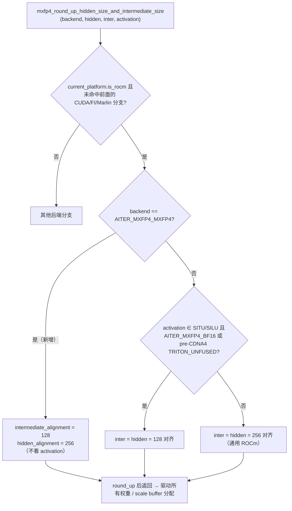
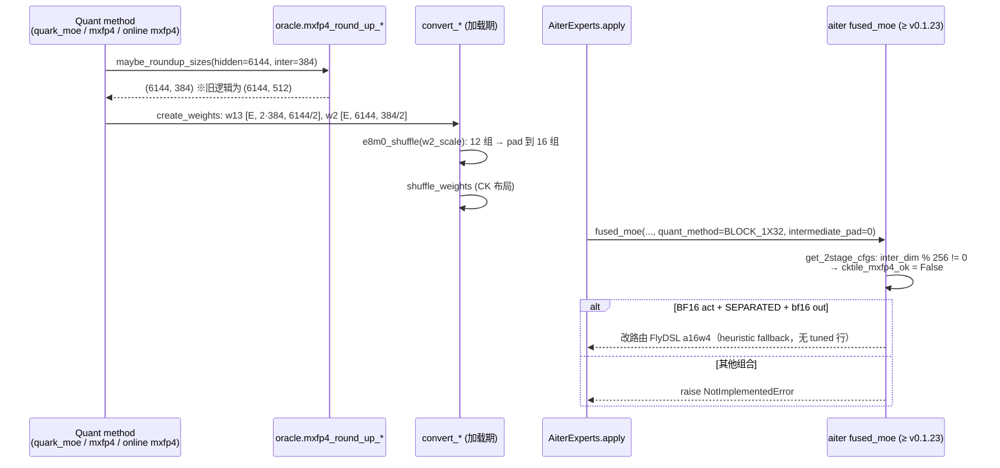

# PR #55104: [ROCm][MXFP4] Align the AITER W4A4 MoE intermediate size to 128

> **Author**: @xiaofei-zheng | **State**: OPEN | **Date**: 2026-09-03（review 于 2026-10-09，head `db8955d0`）
> **Branch**: `xiaofei-zheng:feature/xiaofei/mxfp4-w4a4-align-128` → `main` | **Labels**: rocm, verified
> **Changes**: +85 -4 lines across 2 files | **ROCm 相关性**: 完全相关（ROCm AITER MXFP4 W4A4 MoE 权重分配对齐）
> 本报告分两部分：§1–6 为 PR 详细总结，§7–8 为 ROCm review 意见。

---

## 1. 总结 (Summary)

ROCm 上 `mxfp4_round_up_hidden_size_and_intermediate_size` 对 `AITER_MXFP4_MXFP4`（W4A4）后端把每分片 MoE intermediate size 向上取整到 256 的倍数；本 PR 将其放宽为 128，同时 hidden size 仍保持 256 对齐。对 MiniMax-M3-MXFP4 @ TP8（每分片 3072/8 = 384），权重分配从 512 降到真实的 384，专家权重缩小 25%，作者实测输出吞吐 +4.26%（全部来自 decode）。改动本身只有一个 `elif` 内的对齐条件拆分，正确性依赖 aiter 侧修复 ROCm/aiter#5232（已合入，并包含在 vLLM 当前 pin 的 aiter 中）。

## 2. 背景与动机 (Background & Motivation)

- **浪费的 padding**：MiniMax-M3 的 `moe_intermediate=3072`，TP8 时每分片 384。旧逻辑的 256 对齐分配 512，即每个专家 intermediate 维度有 1/3 是零 padding——这些零依然被加载、被乘、被归约，纯粹浪费 HBM 带宽与算力，decode（带宽受限）阶段尤其明显。
- **为什么之前是 256**：通用 ROCm 分支默认 256；只有 `AITER_MXFP4_BF16`（W4A16 CK，SiTU/SILU，为 Kimi K3 加的例外）和 pre-CDNA4 的 `TRITON_UNFUSED` 用 128。作者认为 W4A4 的 aiter kernel 在 intermediate 维只需 128。
- **隐藏依赖（aiter 侧 bug）**：aiter 的 CK-Tile 2-stage MXFP4 stage-2 kernel 在 `inter_dim % 256 != 0` 时错误索引 E8M0 权重 scale（host 侧 `e8m0_shuffle` 把 scale group 维 pad 到 8 的倍数 = 256 元素，而 kernel 不感知）。stage-2 正好是 decode 尺寸的 dispatch，因此表现为「prefill 正确、decode 输出垃圾」。作者为此提交了 ROCm/aiter#5232（host 侧把这类形状改路由到 FlyDSL a16w4 kernel，2026-09-21 合入）与缺陷报告 ROCm/aiter#5233（kernel 侧根因）。
- **当前状态**：作者在评论区称 aiter#5232 已包含在 v0.1.23，vLLM main 经 #58867 pin 了该版本；本次核对 head 分支 `docker/Dockerfile.rocm_base` 中 `AITER_BRANCH="v0.1.24.post1"`，满足依赖。但 PR 描述顶部仍保留「Blocked: do not merge before ROCm/aiter#5232 lands」与「Kept as a draft」字样（已过时）。

## 3. 代码修改分析 (Code Change Analysis)

### 3.1 修改的模块

| 模块 | 改动 |
|------|------|
| `vllm/model_executor/layers/fused_moe/oracle/mxfp4.py` (+9 -4) | ROCm 分支把单一 `alignment` 拆为 `intermediate_alignment` / `hidden_alignment`；新增 `aiter_w4a4` 判断，W4A4 时 intermediate 取 128、hidden 保持 256 |
| `tests/kernels/moe/test_ocp_mx_moe.py` (+76) | 新增 12 行参数化表 `ROCM_MXFP4_ROUNDUP_CASES` 与 `test_rocm_mxfp4_round_up_hidden_and_intermediate`，钉住 ROCm 分支各后端的对齐结果（纯 Python，但 `skipif(not ROCM_AVAILABLE)`） |

### 3.2 架构 / 流程图

**ROCm 分支对齐决策（PR 后）：**



**分配尺寸如何流到 aiter kernel 路由（以 MiniMax-M3 TP8 为例）：**



### 3.3 关键实现细节

- **改动点**（`oracle/mxfp4.py:823-834`）：
  ```python
  aiter_w4a4 = backend == Mxfp4MoeBackend.AITER_MXFP4_MXFP4
  intermediate_alignment = (
      128 if aiter_w4a4 or (is_situ_or_silu and (aiter_uses_128 or triton_uses_128)) else 256
  )
  # W4A4 stage 1 still requires a 256-aligned hidden dimension.
  hidden_alignment = 256 if aiter_w4a4 else intermediate_alignment
  ```
  非 W4A4 后端行为完全不变（`hidden_alignment == intermediate_alignment`，与旧的单一 `alignment` 等价）。
- **W4A4 分支不依赖 `activation`**：这一点与调用方实际情况吻合——`quark_moe.py:1671` 和 `quantization/mxfp4.py:193` 调用时**不传** `activation`（为 `None`），只有 `quantization/mxfp4.py:614` 传了。因此对 W4A4 而言三条调用路径结果一致，避免了 `AITER_MXFP4_BF16` 分支那种「同一模型因调用方不同而得到不同对齐」的隐患。
- **下游已自适应**：`create_weights` 的权重/scale 形状、`AiterExperts.apply` 中按 `intermediate_size_per_partition - *_unpadded` 计算的 `intermediate_pad`（再 `//64*64` 取整）都从这里派生；384 时 pad=0。
- **w2 scale 的 padding**：w2 scale 最后一维为 `384/32 = 12` 组，`e8m0_shuffle` 会 pad 到 16 组后 `.view(s0, s1, -1)`；正是这个 pad 让旧版 CK-Tile stage-2 读错 scale（aiter#5233）。
- **能选到 W4A4 后端的路径**：Quark `w_mxfp4_a_mxfp4` checkpoint（MiniMax-M3、GLM-5.2 等）、GPT-OSS 的优先级列表（`_get_priority_backends_for_gpt_oss` 包含 `AITER_MXFP4_MXFP4`）、在线 MXFP4 量化（`quantization/online/mxfp4.py`，`tests/quantization/test_online_mxfp4.py` 覆盖 aiter）。gfx950 才会选中（`tests/quantization/test_gfx950_moe.py`）。

## 4. 涉及的技术原理 (Technical Principles)

- **MXFP4（OCP MX）**：每 32 个 FP4（e2m1）元素共享一个 E8M0（纯指数）scale。W4A4 = 权重和激活都量化为 MXFP4；W4A16 = 仅权重 FP4，激活保持 BF16。对 MoE 来说，w13（gate/up）沿 hidden 维归约、w2（down）沿 intermediate 维归约，因此 scale 的分组维分别是 hidden/32 和 intermediate/32。
- **2-stage fused MoE**：stage-1 计算 `act(x·W1) ⊙ (x·W3)`，K 维 = `model_dim`（hidden）；stage-2 计算 `h·W2`，K 维 = `inter_dim`。所以「hidden 需 256 对齐」源于 stage-1 kernel 的 `tile_k=256`，「inter 能否 128 对齐」取决于 stage-2 kernel 对 K 维与 scale 分组的处理——这正是 aiter#5233 的 bug 所在。
- **TP 下的 intermediate 切分**：TP 按列/行切专家权重，每分片 intermediate = `moe_intermediate / TP`。很多模型的 `moe_intermediate`（3072、1536、768、2880）在 TP4/TP8 下只有 128 对齐而非 256 对齐，256 round-up 会造成 1/3～1/2 的无效 padding。
- **为什么收益集中在 decode**：decode 的 MoE GEMM 是带宽受限（每步要扫一遍激活专家的权重），权重体积 -25% 直接转化为 TPOT 改善；prefill 是算力受限且 padding 在 tile 内被吸收，TTFT 基本不变——与作者数据（TPOT 21.10→20.15 ms，TTFT 不变）一致。
- **零 padding 的数值安全性**：padding 区域权重与 bias 都是 `torch.zeros`，`silu(0)·0 = 0`、SwiGLU-OAI `(0+1)·0·σ(0) = 0`，因此 padding 只影响性能、不影响结果——前提是 kernel 正确索引 scale。

## 5. 评论区讨论亮点 (Discussion Highlights)

- **无实质性人工 code review**：截至 review 时，评论区只有 CI 触发（@shen-shanshan `/amd-ci run`、@Fangzhou-Ai `/ci run`）、mergify 冲突/pre-commit 提示，以及作者多次请求 review（@wzhao18、@shen-shanshan）。Claude bot 因 fork PR 未执行自动 review。
- **依赖解除的说法**：作者称 aiter#5232 已在 v0.1.23、vLLM main 经 #58867 pin 了该版本，AMD CI #13365 绿、`/ci run` 后 189 checks 全绿。本次核对：aiter#5232 状态为 merged（2026-09-21），head 分支 Dockerfile pin `v0.1.24.post1` ✔；CI 明细未能从 fetch 结果中取到，「189 checks 全绿」为作者陈述 `[unverified]`。
- **aiter#5232 自述的限制**（对本 PR 风险评估很关键）：FlyDSL 接管只覆盖「BF16 输出 + BF16 激活 + SEPARATED 权重 + 128 对齐 inter + 256 对齐 model_dim」；FP16 输出与 FP4/FP8 激活族不在接管范围，无安全路由时 `raise NotImplementedError`；被改路由的形状走 heuristic fallback（`tuned_fmoe.csv` 无非 256 对齐行），因此只拿到 +4.26% 而非 CK-Tile 理论上的 +12.89%；端到端数值仅在 gfx950 验证，inter < 256 未做端到端模型验证。

## 6. 风险与潜在问题 (Risk Analysis)

| 风险 | 严重程度 | 说明 |
|------|---------|------|
| 低版本 aiter 下 decode 静默输出错误 | High | 见 §7 ⚠️【兼容性】无 aiter 版本守卫 |
| 对齐放宽覆盖了未验证的 activation / 权重布局 / 模型族 | Medium | 见 §7 ⚠️【正确性】GPT-OSS、在线 MXFP4 |
| 「W4A4」后端在部分形状上实际执行 a16w4，prefill/decode 精度路径不一致 | Low | 见 §7 📝【设计】 |
| 性能收益依赖 heuristic fallback，其他形状收益未知 | Low | 只测了 MiniMax-M3 TP8（+4.26%）与 GLM-5.2（no-op） |
| 单测只在 ROCm 上运行 | Low | 见 §7 📝【测试】 |
| PR 描述与实测环境过时 | Low | 见 §7 📝【注释/文档】 |

---

## 7. Review 意见 (Findings)

| 类型 | 🔴 | ⚠️ | 📝 |
|------|----|----|----|
| 兼容性 | — | 1 | — |
| 正确性 | — | 1 | — |
| 设计 | — | — | 1 |
| 测试 | — | — | 1 |
| 注释/文档 | — | — | 1 |

---

**⚠️【兼容性】W4A4 的 128 对齐没有任何 aiter 版本守卫，低于 v0.1.23 的 aiter 会静默输出错误的 decode 结果** `[已验证]`

- **问题**: `oracle/mxfp4.py:823-831` 无条件地对 `AITER_MXFP4_MXFP4` 使用 128 对齐。该改动的正确性完全依赖 ROCm/aiter#5232（≥ v0.1.23），但 vLLM 只在 `docker/Dockerfile.rocm_base` 里 pin 了 `AITER_BRANCH="v0.1.24.post1"`，`requirements/rocm*.txt` 中没有 aiter 版本约束，代码里也没有运行时版本检查；新分支旁的注释只解释了 hidden 为何保持 256，没有提及 intermediate 128 的前提是新版 aiter。
- **影响**: 具体触发输入：MiniMax-M3-MXFP4，TP8，MI355X，`--moe-backend aiter`，aiter 0.1.19～0.1.22（自行 pip 安装 / 自建镜像 / 旧版 `rocm/vllm-dev` 基础镜像）。每分片 inter=384，走 CK-Tile stage-2 → E8M0 scale 错位。作者本人测得的结果是 clean-corpus PPL 10.936 → 41.325、贪心生成退化。整个过程没有报错、没有 NaN，用户很难察觉；而在旧版 aiter 上，原来的 256 对齐是能正确运行的。
- **行动**: 建议作者把 128 对齐限制在 aiter ≥ 0.1.23 时生效（低版本回退到 256 并 `logger.warning_once`），或至少在启动时对低版本 aiter 显式报错；同时在代码注释中引用 aiter#5232/#5233，说明「128 对齐依赖 aiter 侧改路由，CK-Tile kernel 修复后可移除限制」。

**⚠️【正确性】对齐放宽与 activation/布局无关，但 aiter#5232 只为「BF16 激活 + SEPARATED + BF16 输出」提供安全路由，其他组合可能从「正常运行」变成 `NotImplementedError`** `[推测]`

- **问题**: 新分支对所有 activation 都生效（单测甚至钉住了 `SWIGLUOAI → 384`），但端到端只验证了 MiniMax-M3（SILU）。而 aiter#5232 的 PR 描述写明：FlyDSL 接管仅限 BF16 输出、BF16 激活、SEPARATED 权重；不满足时 `_fused_moe_impl` / `cktile_moe_stage2` 会 `raise NotImplementedError`。能选到 W4A4 后端、且分片 inter 会从 256 倍数变为非 256 倍数的配置包括：
  - GPT-OSS-120B（`moe_intermediate=2880`，SWIGLUOAI，`_get_priority_backends_for_gpt_oss` 包含 W4A4）：TP8 360→**384**（原 512），TP1 2880→**2944**（原 3072）。gate/up 权重为 interleave 布局（`activation_interleave` / gate_mode 可能不是 SEPARATED）；
  - 在线 MXFP4 量化（`quantization/online/mxfp4.py`）的 BF16 MoE 模型，例如 Qwen3-30B-A3B（768）TP2→384、TP8→**128**（原 256），Qwen3-235B-A22B（1536）TP4→384；
  - `--dtype float16` 的任意 W4A4 模型（aiter#5232 明确说 FP16 输出不在接管范围内）。
- **影响**: 上述配置在 PR 前都是 256 对齐，走 CK-Tile 能正常运行；PR 后要么进入未经数值验证的 FlyDSL 路由，要么在第一次 forward 时抛 `NotImplementedError`（启动 / profile run 即失败），对已有部署来说是回归。另外，inter=128（aiter#5232 自述「inter_dim < 256 未做端到端模型验证」）恰好是单测里标注为「most aggressive」的那一行。
- **行动**: 建议作者二选一：(a) 补充 GPT-OSS W4A4（TP1/TP8）、一个在线 MXFP4 的 Qwen3 MoE（TP2/TP8）的启动与 gsm8k/PPL 冒烟结果；(b) 把 128 对齐收窄到已验证的组合（如 `activation == SILU` 且非 interleave），其余保持 256。建议 review 时追问：vLLM 的 W4A4 调用在 aiter 内部被判定为 BF16 激活还是 FP4 激活（这决定了它是否满足 FlyDSL 接管条件）。

**📝【设计】对非 256 对齐形状，「W4A4」后端实际执行的是 a16w4 kernel，且 prefill 与 decode 可能走不同精度路径** `[推测]`

- **问题**: 按 aiter#5232 的描述，`inter_dim % 256 != 0` 时 CK-Tile MXFP4 的 dispatch 被改路由到 FlyDSL **a16w4**（BF16 激活）kernel；PR 描述称问题出在「decode 尺寸的 dispatch」，而 prefill 用 CK 是正确的。也就是说，同一个模型在 prefill 时可能是 W4A4（激活 FP4 量化），在 decode 时却是 W4A16，而日志里显示的后端仍然是 `AITER_MXFP4_MXFP4`。另外，被改路由的形状在 `tuned_fmoe.csv` 里没有对应行，只能走 heuristic fallback（作者给的 fallback 计数是 48→72）。
- **行动**: 建议作者在 PR 描述或代码注释里说明这一行为，方便以后排查精度或性能问题时定位；并建议后续给 aiter 补上非 256 对齐 inter_dim 的 tuned 行（aiter#5232 认为这能把收益从 +4.26% 提升到接近 +12.89%），或者跟进 aiter#5233 的 kernel 修复。

**📝【测试】新增单测是纯 Python，却只在 ROCm 上运行；也缺少端到端精度回归** `[已验证]`

- **问题**: `test_rocm_mxfp4_round_up_hidden_and_intermediate`（`test_ocp_mx_moe.py:2250-2251`）挂着 `skipif(not ROCM_AVAILABLE)`，PR 描述却写着「Needs no GPU and no aiter」。被测函数在 ROCm 分支里只依赖 `current_platform.is_rocm()`；`get_cdna_version()` 只在 `TRITON_UNFUSED` 时才会被短路求值调用。结果是这个本可在 CPU CI 上运行的表驱动测试只能在 AMD 队列中运行。另外，表里没有 `TRITON_UNFUSED` 行（它是该分支另一个 128 对齐的特例），端到端精度（PPL/gsm8k）也没有 CI 覆盖。
- **行动**: 建议作者 monkeypatch `current_platform.is_rocm`（`TRITON_UNFUSED` 行再 patch `get_cdna_version`），去掉 ROCm skip，让它在所有 CI 上运行；顺便补上 `TRITON_UNFUSED`（CDNA3 / CDNA4）两行。

**📝【注释/文档】PR 描述与实测环境已过时，性能数字未在 main + pin 的 aiter 上复现** `[已验证]`

- **问题**: 描述顶部仍写着「Blocked: do not merge before ROCm/aiter#5232 lands … Kept as a draft」，但依赖其实已经满足。Test Result 一节明确说明测量环境是「vLLM 0.28.0 install with the patch applied rather than a `main` checkout, against aiter 0.1.19」（即打了 aiter#5232 补丁的 0.1.19），而不是 main + `v0.1.24.post1`。+4.26% / TPOT 21.10→20.15 ms 只给了参数，没有附上命令输出或日志，就当前 main 而言属于 `[unverified]`。
- **行动**: 建议作者更新描述：删除 Blocked/draft 说明，注明最低 aiter 版本；在 main + pin 的 aiter 上至少复测一次 MiniMax-M3 TP8 的吞吐与 PPL（或 gsm8k），并附上 `vllm bench serve` 的原始输出。

## 8. 结论 (Verdict)

**⚠️ NEEDS WORK**

改动小、动机清楚、机制解释到位（作者定位到 aiter 根因并推动上游修复，质量很高），对 MiniMax-M3 TP8 的收益和正确性证据也比较充分。主要的两个问题都在「适用范围」上：一是没有 aiter 版本守卫，旧版 aiter 会出现静默的 decode 输出错误；二是 128 对齐对所有 activation、布局和模型族一律生效，但 aiter 侧的安全路由只覆盖 BF16 激活 + SEPARATED，GPT-OSS / 在线 MXFP4 / FP16 等配置可能从正常运行变成报错。建议补上版本守卫，并对适用范围做验证或收窄后再合入。

## 9. 英文 Review 评论 (Copy-Paste English Comments)

以下评论可直接复制到 GitHub PR review 中对应的文件和行（行号为 PR head `db8955d0` 新文件的行号，均为 diff 中的 `+` 行）：

**C1** `vllm/model_executor/layers/fused_moe/oracle/mxfp4.py:823-831` — ⚠️ comment

```text
This makes the 128 alignment unconditional for AITER_MXFP4_MXFP4, but its correctness depends entirely on ROCm/aiter#5232 (aiter >= 0.1.23). The only pin is AITER_BRANCH in Dockerfile.rocm_base; requirements/rocm*.txt does not constrain aiter and there is no runtime check. With aiter 0.1.19-0.1.22 (custom builds, older base images), MiniMax-M3-MXFP4 at TP8 goes back to the CK-Tile stage-2 scale mis-indexing you measured (PPL 10.9 -> 41.3) with no error or NaN, whereas the previous 256 alignment was correct on those versions. Could you gate the 128 alignment on the installed aiter version (fall back to 256 with a warning_once otherwise), and add a comment referencing aiter#5232/#5233 so the restriction can be lifted once the CK-Tile kernel is fixed?
```

**C2** `vllm/model_executor/layers/fused_moe/oracle/mxfp4.py:825-829` — ⚠️ comment

```text
The new branch applies to every activation and weight layout, but end-to-end validation covers only MiniMax-M3 (SILU). According to aiter#5232, the FlyDSL takeover only handles BF16 output + BF16 activation + SEPARATED weights; other combinations now raise NotImplementedError instead of running on CK-Tile. Configs that change from 256-aligned to non-256-aligned here include GPT-OSS-120B W4A4 (SWIGLUOAI, interleaved gate/up: TP8 360->384, TP1 2880->2944), online-MXFP4 Qwen3 MoE (e.g. 30B-A3B at TP2 -> 384, TP8 -> 128), and any W4A4 model run with --dtype float16. Could you either share a quick startup + gsm8k/PPL check for GPT-OSS W4A4 and an online-MXFP4 Qwen3 MoE, or narrow the 128 alignment to the validated combination (e.g. SILU, non-interleaved) and keep 256 for the rest?
```

**C3** `tests/kernels/moe/test_ocp_mx_moe.py:2250-2251` — ⚠️ comment

```text
This table-driven test is pure Python (the ROCm arm only needs current_platform.is_rocm(), and get_cdna_version() is only evaluated for TRITON_UNFUSED), yet the skipif means it only runs on the AMD queue, which contradicts "Needs no GPU and no aiter" in the description. Consider monkeypatching current_platform.is_rocm (and get_cdna_version for TRITON_UNFUSED rows) so it runs in CPU CI too, and adding the two TRITON_UNFUSED rows (CDNA3 -> 128, CDNA4 -> 256), since that is the other special case in this branch.
```

**C4**（PR 总评，不挂行）— ⚠️ comment

```text
Nice root-causing on the aiter side. The description still says "Blocked: do not merge before ROCm/aiter#5232 lands" and "Kept as a draft", and the numbers were measured on vLLM 0.28.0 + aiter 0.1.19 with #5232 applied rather than on main with the pinned aiter (v0.1.24.post1). Could you update the description (drop the blocked note, state the minimum aiter version) and re-run the MiniMax-M3 TP8 throughput and PPL/gsm8k check once on current main with the pinned aiter, attaching the raw `vllm bench serve` output?
```
