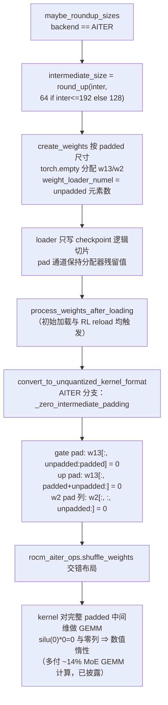
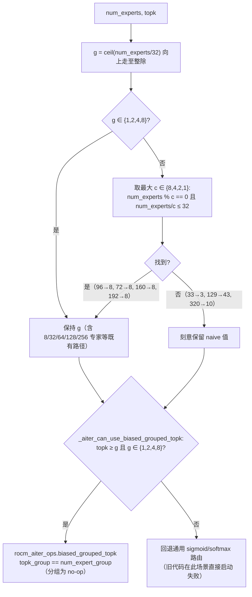

# PR #55368: [ROCm][MoE] Pad the AITER MoE intermediate size at allocation time, and round the expert-group count to a kernel that exists

> **Author**: @sshlyapn | **State**: OPEN | **Date**: 2026-09-30
> **Branch**: `sshliapn/features/k2_horizon_fixes` → `main` | **Labels**: `rocm`, `ready`, `verified`
> **Changes**: +452 -15 across 4 files | **ROCm 相关性**: 完全相关（AITER MoE 权重形状 + 路由 kernel 选择）
> 本报告分两部分：§1–6 为 PR 详细总结，§7–8 为 ROCm review 意见。

---

## 1. 总结 (Summary)

该 PR 修复了 ROCm AITER MoE 路径上的两个独立的启动失败，目标都是 IFM K2-Horizon-375B-A23B 模型支持：其一，AITER CK 2stages MoE kernel 要求 `inter_dim` 能被其 tile 宽度整除（≤192 时 64、>192 时 128），而 K2-Horizon 的 `moe_intermediate_size=1792` 在 TP=8 时每分区为 224，直接被 CK `IsSupportedArgument` 拒绝；其二，`_aiter_get_num_expert_group` 的 ceil-divide 逻辑对 96 专家算出 g=3，但 AITER 只为 `NUM_GRP ∈ {1,2,4,8}` 实例化了 `biased_grouped_topk` kernel。修复方式：在既有的 `unquantized_round_up_hidden_size_and_intermediate_size` hook 中按 AITER 的阈值规则对齐 intermediate 维（分配时 pad），并在权重转换阶段把 pad 通道清零使其数值上完全惰性；路由侧则把 group 数取整到最大可用且整除的受支持值，无法满足时显式回退通用路径。测试全部为 CPU-only 或 CDNA 真 kernel 验证，作者在 gfx950 (MI355X) 上跑过 112 passed + 1 个已确认与父 commit 相同的既有失败。

## 2. 背景与动机 (Background & Motivation)

- **问题一：非对齐的 per-partition intermediate 尺寸（仅 unquantized 路径）**。AITER 的 CK 2stages MoE kernel 以 `inter_dim <= 192` 为分界选择 64/128 宽的 tile，CK 的 `IsSupportedArgument` 会拒绝不能被该宽度整除的尺寸，报错 `device_gemm ... does not support this GEMM problem`。K2-Horizon-375B-A23B 的 `moe_intermediate_size=1792`：TP=8 → 224（128 对齐失败），TP=4 → 448（128 对齐失败）。fp8 AITER 路径有自己的对齐常量（256），不受影响。
- **问题二：AITER `biased_grouped_topk` 的 group 数无对应 kernel**。`_aiter_get_num_expert_group` 按 32 专家/组上限 ceil-divide 后向上走除数，96 专家给出 g=3，而 AITER 只实例化了 `{1,2,4,8}`，启动时直接失败。
- **为何在 vLLM 侧修**：作者与 reviewer 讨论后确认这是临时补丁——长期应在 AITER 侧放宽形状对齐要求，已开 [ROCm/aiter#5444](https://github.com/ROCm/aiter/issues/5444) 跟踪。tjtanaa 曾问 `AITER_ONLINE_TUNE=1` 能否绕过，作者确认不能：tile 宽度不是 tuned 参数，CK instance 直接从 `inter_dim` 选择，任何 tuned config 都无法让 inter_dim=224 通过 `IsSupportedArgument`。
- **与 #55251 的关系**：simondanielsson 指出与 #55251（fp8 AITER 对齐）相似；作者确认思路相同但 dtype 不同（unquantized bf16/fp16 vs fp8），且刻意把零化范围收窄到 MoE 触发所需的 intermediate 维。

## 3. 代码修改分析 (Code Change Analysis)

### 3.1 修改的模块

| 模块 | 文件 | 改动 |
|------|------|------|
| MoE 后端 oracle（形状对齐 + 权重转换） | `vllm/model_executor/layers/fused_moe/oracle/unquantized.py` | +33 -9：新增 `aiter_moe_intermediate_alignment()`（192 阈值规则）；`unquantized_round_up_hidden_size_and_intermediate_size` 增加 AITER 分支；抽出共享的 `_zero_intermediate_padding()` 并在 AITER 分支 shuffle 前调用（TRTLLM 分支重构复用） |
| MoE 路由（group 数取整 + 门控） | `vllm/model_executor/layers/fused_moe/router/fused_topk_bias_router.py` | +33 -5：`_AITER_MAX_EXPERTS_PER_GROUP` 提升为模块常量并新增 `AITER_SUPPORTED_NUM_GRP=(1,2,4,8)`；`_aiter_get_num_expert_group` 增加取整逻辑；新增 `_aiter_can_use_biased_grouped_topk()` 门控并替换调用点的 `topk >= num_expert_group` 判断 |
| 测试（权重对齐） | `tests/kernels/moe/test_rocm_aiter_moe.py` | +250 -1：4 个新测试（roundup 表格、其他后端不受影响、reload 重新零化、真 kernel 跨 block_m 验证对齐规则） |
| 测试（group 数） | `tests/kernels/moe/test_rocm_aiter_num_expert_group.py` | +136 新文件：5 个测试（不变量断言、group 计数表、fallback 语义、真 kernel 与 `grouped_topk` 参考实现数值等价） |

### 3.2 架构 / 流程图

**权重生命周期（padding 在分配时生效，零化在每次加载/重载后生效）：**



**路由 group 数取整与门控（修复无 kernel 可用的启动失败）：**



### 3.3 关键实现细节

- **对齐规则 `aiter_moe_intermediate_alignment(intermediate) = 64 if intermediate <= 192 else 128`**：镜像 AITER 自身的 dispatch 阈值。作者在 PR body 中说明：flat 128 会对实测的 19 个尺寸中 2 个（64、192）产生错误预测（它们无需 128 对齐即可通过），且会让 148 个 AITER 调优配置文件中 207 行 tuned 配置偏离到启发式回退；阈值规则 padding 后 **0** 行 tuned 配置受影响。向上取整永不跨越阈值边界（96→128、160→192、192→192 均停留 ≤192），因此选取的对齐量始终是 dispatcher 对 padded 形状实际应用的那一个。dtype 无关：CK 从 `sizeof(A0DataType)` 推导 tile 宽度，fp16 与 bf16 相同。
- **`_zero_intermediate_padding()` 的时机**：最终修订放在 `convert_to_unquantized_kernel_format` 的 AITER 分支（shuffle 之前），而非分配时——这是对 dllehr-amd 提出的 RL reload 问题的修复（见 §5）。每次 `process_weights_after_loading`（初始加载与每次 reload）都会执行，pad 通道在 shuffle 前按 [gate|up] 堆叠布局零化。TRTLLM 分支原有的零化块重构为同一 helper，语义不变。
- **已知交互（body 已披露）**：`experts/rocm_aiter_moe.py` 现在会算出非零 `intermediate_pad`，但 unquantized（`QuantType.No`）+ bf16 的 dispatch 会穿过所有 cktile/flydsl 分支（都要求 `q_type == per_1x32`）落到不带 pad 参数的 `ck_moe_stage1`/`ck_moe_stage2_fwd` partial，因此 kernel 跑完整 padded GEMM——TP=4 时 448→512、TP=8 时 224→256，MoE GEMM 多付约 14% 计算（零行保证数值正确）。
- **group 取整语义**：`topk_group == num_expert_group` 时分组是 no-op，任何满足上限的除数路由结果相同，唯一约束是 kernel 是否存在。取"最大受支持且整除 num_experts 且每组 ≤32"的值；都不满足时（33→3、129→43、257→257、320→10、384→12）刻意保留 naive 值，让调用点新门控 `_aiter_can_use_biased_grouped_topk`（`topk >= g and g in SUPPORTED`）拒绝并回退通用路径。新增了门控而非在函数内 raise，使 33 专家 + topk=64 这类"g 不受支持但 topk 满足旧判断"的输入不会到达 AITER。
- **测试设计**：`test_aiter_moe_alignment_rule_holds_across_block_m` 在 CDNA 上以 inter ∈ {192,224,256} × block_m ∈ {32,64,128} 真实运行 AITER kernel，断言"kernel 接受 ⟺ 尺寸对齐"——直接验证规则本身而非仅验证实现；`test_rounded_group_count_routes_like_the_reference` 在真 kernel 上对比 `grouped_topk` 参考实现（含 96/192 专家的取整场景），回应 ChuanLi1101 的数值等价要求。

## 4. 涉及的技术原理 (Technical Principles)

- **AITER CK 2stages MoE kernel 的 tile 约束**：CK (Composable Kernel) 的 GEMM instance 以模板化的 tile 尺寸编译，`IsSupportedArgument` 在运行时拒绝不满足整除约束的形状。2stages MoE 在 stage1（gate/up GEMM，约束 NPerBlock）与 stage2（down GEMM，约束 KPerBlock）都按 `inter_dim <= 192` 选择 64/128 宽 tile，且该 tile 宽度不是 tuned 参数——这也是 `AITER_ONLINE_TUNE=1` 无法解决的原因（已在评论区确认）。
- **vLLM 的 padded 权重加载机制**：`create_weights` 里 `weight_loader_numel` 按 **unpadded** 元素数设置（`num_experts * unpadded_up * unpadded_hidden`），sharded loader 只向参数写入 checkpoint 的逻辑切片，pad 区域保持 `torch.empty` 的分配器残留值。这正是 TRTLLM backend 既有的 padding 机制（`align_moe_weights_for_fi` + 零化），本 PR 沿用了同一机制。
- **pad 通道的数值惰性**：gate pad 行零化后 `silu(0) * up = 0`，up pad 行零化后 `silu(gate) * 0 = 0`，w2 pad 列贡献恒为零——交错（shuffled）布局下每个 gate/up 行对都独立满足。若 pad 通道是回收的设备内存残留值，会出现"无报错的偶发不合理 token"（取决于加载时的分配顺序）。
- **RL 权重重载与 CUDA graph 捕获**：`process_weights_after_loading` 在每次 reload 后触发；`replace_parameter(..., prefer_copy=is_weight_update)` 保证重载时把新数据拷入既有参数存储，不破坏已捕获的 CUDA graph 参数地址——因此零化必须放在转换路径里（每次执行），而不是一次性分配路径。
- **grouped top-k 路由**：`biased_grouped_topk` 是 AITER 的 CK/asm kernel，先在各组内取 top-1 再跨组取 top-k；当 `topk_group == num_expert_group`（所有组）时退化为全局 top-k，任何整除 group 数路由结果一致。AITER 侧同样强制每组 ≤32 专家（aiter main 的 `biased_grouped_topk` dispatch 中可见 `num_experts // num_expert_group > 32` 的分支）。

## 5. 评论区讨论亮点 (Discussion Highlights)

- **@dllehr-amd（关键设计转折）**：指出分配时零化在 RL reload 后不成立——"I don't think the pads get zeroed out now when we reload the weights"。作者确认并**把零化从分配路径移到 `convert_to_unquantized_kernel_format` 的 AITER 分支**（shuffle 前），与 TRTLLM 路径一致。这是本 PR 最重要的一次设计修正，也解释了最终 diff 与早期 body 的差异。
- **@ChuanLi1101（三点要求，均已落实）**：① group 取整需要数值等价验证（96 专家）而不只是"kernel 存在"——已加 `test_rounded_group_count_routes_like_the_reference`；② 指出 unquant CK 路径仍对 padded intermediate 做 GEMM（~14% 额外开销）——作者在 body 的"Known interaction"节披露并挂 aiter#5444；③ 注明 fp8 AITER 对齐不变——已完成。
- **@tjtanaa**：问 `AITER_ONLINE_TUNE=1` 能否解决，作者解释 tile 宽度非 tuned 参数，CK 从 `inter_dim` 直接选 instance。
- **@AndreasKaratzas**：要求减少测试（60%+ LOC 是测试）、`torch.zeros` 无性能影响就直接用并 rocm-gate、以及"这改动该在 vLLM 还是 aiter"——作者合并测试到 4+5 个、确认是临时补丁（aiter#5444）、并说明最终采用转换期零化而非分配期。
- **@simondanielsson**：与 #55251（fp8）相似，能否采用相同改动——作者确认思路一致但 dtype/范围不同，刻意不零化 hidden 维 padding。
- **@shen-shanshan**：多次触发 `/ci run` 并提示 DCO 签名问题（已修复）。

## 6. 风险与潜在问题 (Risk Analysis)

| 风险 | 严重程度 | 说明 |
|------|---------|------|
| 正确性：pad 通道未零化 → 偶发不合理 token | 低 | 转换期零化覆盖初始加载与 RL reload，且有 `test_aiter_moe_reload_zeroes_intermediate_padding` 双轮验证 |
| 性能：每步 forward 多付 ~14% MoE GEMM 计算 | 中 | 已披露并跟踪 aiter#5444；讨论区表格显示 AITER 相比默认后端仍是净收益（数字无脚本溯源，见 §7-3） |
| 兼容性：aiter 升级改变 192 阈值 / NUM_GRP 集合 | 中 | 对齐规则与 group 集合是 aiter 内部常量的镜像；CDNA 真 kernel 测试是护栏（见 §7-4） |
| 测试覆盖：CI 最终状态未知 | 低 | 最后一次已知状态 Buildkite #91202 有 2 个 job 失败后重试；gfx950 本地结果 112 passed + 1 个父 commit 验证过的既有失败 |
| 可维护性：PR body 与最终实现不一致 | 低 | "Zero-init" 段落仍描述分配期 `torch.zeros`，Test Plan 列出的测试名已合并（见 §7-2） |

---

## 7. Review 意见 (Findings)

意见类型汇总：⚠️ 建议修复 ×2，📝 建议/备注 ×4。

**⚠️【性能】padding 后每步 forward 对完整 padded 中间维做 GEMM，成本将持续到 aiter#5444 落地** `[已验证]`
- **问题**：`experts/rocm_aiter_moe.py` 会把 `intermediate_pad` 传给 `fused_moe`，但 unquantized（`QuantType.No`）路径的 dispatch 落到不带 pad 参数的 `ck_moe_stage1`/`ck_moe_stage2_fwd` partial——已在 aiter v0.1.13.post1 源码 `fused_moe.py:1115-1156` 核实，`n_pad_zeros`/`k_pad_zeros` 只存在于 `per_1x32`/fp4x2 的 cktile 路径。K2-Horizon TP=8（224→256）与 TP=4（448→512）的 MoE GEMM 每步多付约 14% FLOPs。
- **影响**：这是长期每步成本而非一次性开销；当前无 vLLM 侧缓解手段（kernel partial 无 pad 参数），只能靠 aiter 侧放宽对齐。
- **行动**：作者已在 body 披露并挂 aiter#5444，建议 review 时确认该 issue 有人跟踪；同时建议仿照 `experts/rocm_aiter_moe.py:365-370` 的既有先例（aiter v0.1.13.post1 版本 pin 注释 + TODO），在 `aiter_moe_intermediate_alignment` 处同样注明所镜像的 aiter 版本，使下次 aiter bump（0.1.15 已含 padding 修复 #3401）时该 padding 会被重新审视。

**⚠️【注释/文档】PR body 的 "Zero-init" 段落与 Test Plan 与最终实现不一致** `[已验证]`
- **问题**：body 声称 "`w13`/`w2` are allocated with `torch.zeros` when either dim is padded"，但最终修订（响应 dllehr-amd 的 RL reload 问题）后，`create_weights` 仍用 `torch.empty`，零化发生在 `convert_to_unquantized_kernel_format` 的 AITER 分支（`oracle/unquantized.py:457-458`）；Test Plan 列出的 8 个测试名中有 6 个在 head 上不存在（已合并为 4 个）。
- **影响**：零化时机是本 PR 正确性的核心机制，body 描述错误会误导 reviewer（去找分配期 `torch.zeros`）并可能让未来的重构把零化错误地"优化"回分配期，从而重新引入 RL reload 缺陷。
- **行动**：作者应当合并前更新 body 的 Zero-init 段落（改为转换期零化）与 Test Plan 测试名，与 head 代码对齐。

**📝【测试】讨论区 AITER vs Default 性能表数字无脚本溯源** `[unverified]`
- **问题**：评论区给出的 K2-Horizon TP=8 1k/1k 性能表（TTFT 最高 −23.6%、TPOT 最高 −6.4%）没有附带 benchmark 脚本/命令。
- **影响**：数字无法复现验证，按本 skill 的数字溯源纪律标注 `[unverified]`，不作为事实转述。
- **行动**：建议 review 时请作者附上 benchmark 命令/脚本（模型、TP、concurrency、数据集已在表中给出，缺工具链命令）。

**📝【兼容性】对齐阈值 192、tile 宽度 64/128、NUM_GRP 集合 {1,2,4,8} 是 AITER 内部常量的镜像** `[已验证]`
- **问题**：`aiter_moe_intermediate_alignment` 与 `AITER_SUPPORTED_NUM_GRP` 硬编码了 AITER 的 dispatch 细节（已分别与 aiter 源码的 192 阈值注释、aiter main `biased_grouped_topk` 的 `num_experts // num_expert_group > 32` 分支交叉核实）。若 AITER 升级改变这些常量，vLLM 会静默重新 pad 错或过度回退。
- **影响**：不会立即出错，但属于易腐的跨仓库耦合。
- **行动**：护栏已存在——`test_aiter_moe_alignment_rule_holds_across_block_m` 与 `test_rounded_group_count_routes_like_the_reference` 在 CDNA 上用真 kernel 验证，aiter bump 时会失败告警。建议作者在两个常量定义处注明所镜像的 aiter 版本/源码位置（沿用 `rocm_aiter_moe.py:365-370` 的注释风格）。

**📝【设计】`_aiter_get_num_expert_group` 刻意返回不受支持的 g 值，契约依赖调用方门控** `[已验证]`
- **问题**：无可用值时函数返回 3/43/257/10/12 等无效 group 数（docstring 已警告"callers must gate on _aiter_can_use_biased_grouped_topk"），当前唯一调用点（`fused_topk_bias_router.py:260`）已正确门控。
- **影响**：目前安全；但未来新增调用方若直接使用返回值会拿到无效 kernel 配置。
- **行动**：建议作者考虑返回 `Optional[int]`（None 表示不可用）或拆分"是否可用"查询，把约束放进类型系统而非文档契约。

**📝【测试】CI 最终状态无法从已获取数据确认** 
- **问题**：checks API 返回内容未能解析（仅有 "total_count"/"check_runs" 占位字符串）；从评论区可知最后一次 Buildkite #91202（2026-09-25）有 2 个失败 job 在重试，无最终结论。PR 携带 `rocm` + `verified` label，且测试在 ROCm CI 中以 CPU-only（is_rocm 门控）+ CDNA 真 kernel 两级覆盖。
- **行动**：建议 review 时确认 #91202 重试后的最终状态（尤其是 AMD CI 队列）。

---

## 8. 结论 (Verdict)

**⚠️ NEEDS WORK**

代码实现与测试质量高：两个修复都有精确的机制解释（WHY 而非 WHAT）、真 kernel 实证测试、以及完整的 review 闭环（ChuanLi1101 三点要求、dllehr-amd 的 reload 缺陷均已落实），无 🔴 级正确性问题。两条 ⚠️ 均非代码缺陷：PR body 与最终实现不一致（合并前应更新），以及性能数字缺乏复现脚本（按溯源纪律标注 `[unverified]` 并请作者补充）。这两个问题解决后可 LGTM。

---

## 9. 英文 Review 评论 (Copy-Paste English Comments)

**C1** `vllm/model_executor/layers/fused_moe/oracle/unquantized.py:392-395` — ⚠️ comment

```text
Could you add an aiter version-pin note here, matching the existing precedent in
experts/rocm_aiter_moe.py:365-370? I checked aiter v0.1.13.post1's fused_moe.py
(dispatch around lines 1064-1156): the pad-aware cktile paths require
q_type == per_1x32 or fp4x2, so for unquantized bf16/fp16 (QuantType.No) the
plain ck_moe_stage1/ck_moe_stage2_fwd partials receive no n_pad_zeros/k_pad_zeros
and the kernel GEMMs the full padded intermediate every step (~14% extra on the
MoE GEMMs at 224->256 / 448->512). That cost is disclosed and tracked in
aiter#5444, but a pin comment (like the v0.1.13.post1 / TODO-0.1.15 note at
rocm_aiter_moe.py:365-370) would make sure this padding is revisited on the next
aiter bump instead of silently becoming dead weight.
```

**C2** `vllm/model_executor/layers/fused_moe/router/fused_topk_bias_router.py:24-25` — ⚠️ comment

```text
These two constants mirror AITER internals: the {1,2,4,8} instantiation set of
biased_grouped_topk and the 32-experts-per-group limit. I cross-checked aiter
main's aiter/ops/topk.py, where biased_grouped_topk dispatches on
`num_experts // num_expert_group > 32`, which corroborates the limit, and the
CDNA test (test_rounded_group_count_routes_like_the_reference) validates the
NUM_GRP set against the real kernel. That test is a good tripwire, but if an
aiter bump ever changes the instantiated set, the rounding here would silently
pick an unsupported count again. Could you cite the aiter version/source where
the set is defined, so future aiter bumps know to re-verify?
```

**C3** `vllm/model_executor/layers/fused_moe/oracle/unquantized.py:399-413` — ⚠️ comment

```text
The PR body's "Zero-init" section still describes allocation-time torch.zeros
("w13/w2 are allocated with torch.zeros when either dim is padded"), but in this
revision zeroing happens here in convert_to_unquantized_kernel_format, on every
process_weights_after_loading call (initial load and RL reload) — create_weights
still uses torch.empty. The conversion-time design is the right call since it
fixes the RL-reload gap that dllehr-amd found, but could you update the body so
reviewers don't look for the zeros at allocation time? The Test Plan also lists
8 test names in test_rocm_aiter_moe.py while the file now has 4 (several were
consolidated after AndreasKaratzas's comment).
```

**C4** `vllm/model_executor/layers/fused_moe/router/fused_topk_bias_router.py:111-133` — ⚠️ comment

```text
Returning a deliberately unsupported group count (3, 43, 257, 10, 12, ...) and
relying on the caller to gate via _aiter_can_use_biased_grouped_topk is a
docstring-enforced contract that is easy to miss for future callers — the only
call site today is fused_topk_bias, which gates correctly, but any new caller
using this function directly would get an invalid kernel config with no error.
Consider returning Optional[int] (None when no supported count fits) or exposing
only the can-use query, so the constraint lives in the type instead of a
comment.
```
