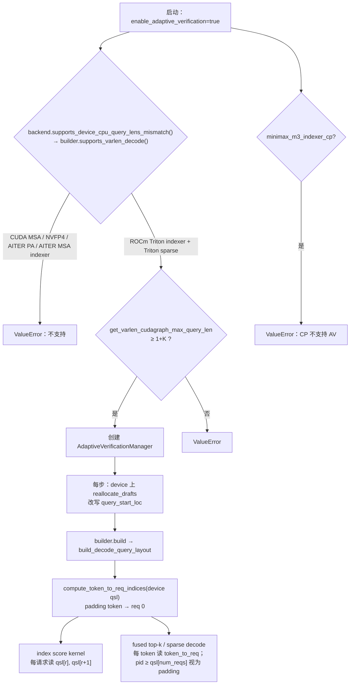
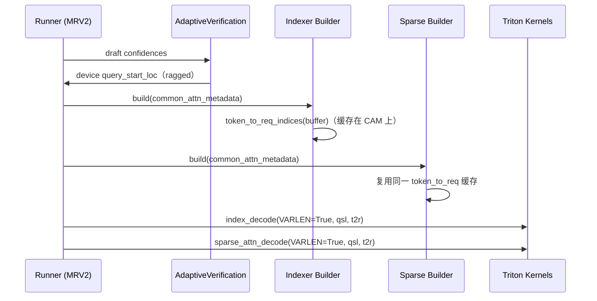

# PR #56451: [ROCm][Spec Decode] Enable adaptive DSpark verification for MiniMax M3

> **Author**: @olka-amd | **State**: OPEN | **Date**: 2026-09-11
> **Branch**: `amd/minimax-m3-dspark-varlen-main` → `main` | **Labels**: rocm, speculative-decoding, ready, needs-rebase, qwen, nvidia, mrv2, dflash, minimax
> **Changes**: +655 -53 lines across 13 files | **ROCm 相关性**: 部分相关。ROCm 专属：MiniMax M3 的 Triton indexer / sparse decode 的 varlen 支持，只在 ROCm 上开启；跨后端共享：`chunked_prefill_paged_decode.py` 的 kernel 修复，以及 `qwen3_dspark.py` 的 confidence head 配置解析（CUDA 同样生效）
> **CI**: GitHub Actions 13 项（6 success、7 skipped）；Buildkite 结果不可见（10-23 reviewer 称 "CI is green"，11-03 作者 `/ci run`、@shen-shanshan `/ci retry`）
> 本报告分两部分：§1–6 为 PR 详细总结，§7–8 为 ROCm review 意见。

---

## 1. 总结 (Summary)

Adaptive DSpark verification 会在 device 上按 confidence 重新分配每个请求的 draft 数量，所以 verify batch 里每个请求的 query 长度不同（1 到 1+K），device 上的 `query_start_loc` 与 CPU 上均匀分配的值不一致。MiniMax M3 的 indexer 和 sparse attention decode kernel 原来按"每请求固定 `decode_query_len` 行"索引 token，无法处理这种 ragged batch，因此 main 在启动时就拒绝 MiniMax M3 + adaptive verification。

本 PR 给 ROCm Triton 路径（index score 的两种 launch 策略、fused top-k selector、GQA sparse decode）加了 `VARLEN` constexpr 分支：用 device 上的 `query_start_loc` 和 main 已有的 `compute_token_to_req_indices` 映射 token 到请求；builder 在 ROCm 上通过 bounded varlen cudagraph 契约声明支持。顺带修了共享 kernel `kernel_paged_attention_2d` 对 FULL-graph 零长度 padding 行的越界读写，并让 DSpark confidence head 支持 NVIDIA 旧格式的嵌套配置。

## 2. 背景与动机 (Background & Motivation)

- 属于 adaptive DSpark 后端扩展计划（#51303）。DSv4/DSv4.1、Kimi K3、GLM-5.3、Gemma4 等已经陆续支持（main 上 #52362、#58151、#59824、#60229、#57263 等）。
- 验证平台：MI325（gfx942）；模型：`amd/MiniMax-M3-MXFP4`（TP2）、`MiniMaxAI/MiniMax-M3-MXFP8`（TP4）、BF16（TP8）；drafter：`nvidia/MiniMax-M3-DSpark`，K=7。
- 迭代过程较长（9 月开 PR，三轮 review）：
  - ChuanLi1101 要求删掉夸大的收益数字，并指出 TP 间 draft 分配可能不一致导致 hang，要求先合入 #56831 / 重跑 TP8。
  - okorzh-amd 指出几处问题：基类 builder 让所有 indexer 都声明 varlen（包括 CP indexer）、`ALWAYS` cudagraph 声明过宽、warmup cap 已无必要、rejection sampler 的分支不可达、D2H ring 对所有 AV 模型都有影响，以及 NVIDIA drafter 实际没有 confidence head 权重。
  - 作者回退了 rejection sampler / warmup / ring 等改动，并改用 bounded varlen 契约。
- 11-03 作者评论：BF16 TP8 adaptive（NVIDIA drafter）在"以前 3/3 次 hang 的配置"上通过，GSM8K 0.961 vs fixed 0.959；c512 时 3,322.8 vs 3,082.1 tok/s。之前 10-28 的截图注明 "With fix #62769"。

## 3. 代码修改分析 (Code Change Analysis)

### 3.1 修改的模块

| 文件 | 改动 |
|------|------|
| `vllm/models/minimax_m3/common/varlen_decode.py`（新） | `VarlenDecodeBuilderMixin`：`supports_varlen_decode()`（默认 False）、`_use_varlen_decode()`（支持且开启 AV）、`get_varlen_cudagraph_max_query_len()`（返回 `max_decode_query_len`）；`build_decode_query_layout()`：varlen 时返回 `(0, qsl[:nd+1], token_to_req[:nd_tokens])`，否则保留原来的 CPU 均匀长度断言 |
| `vllm/models/minimax_m3/common/indexer.py` | backend 的 `supports_device_cpu_query_lens_mismatch` 改为委托 builder；只有 Triton builder 在 ROCm 上 opt in（:286-287）；decode metadata 新增 `query_start_loc` / `token_to_req_indices`；CP indexer + AV 时报错 |
| `vllm/models/minimax_m3/common/sparse_attention.py` | 同样的 mixin 与委托；ROCm 且未请求 AITER sparse PA 时 opt in（:272-275） |
| `vllm/models/minimax_m3/amd/ops/index_topk.py` | `_decode_index_score_kernel` / balanced kernel / `_decode_topk_fused_kernel` 增加 `VARLEN` 分支；`BLOCK_SIZE_Q` 已按 `max_decode_query_len` 取值 |
| `vllm/models/minimax_m3/common/ops/sparse_attn.py` | `_gqa_sparse_decode_kernel` 增加 `VARLEN` 分支，padding token 的 `kv_len` 置 0 |
| `vllm/models/minimax_m3/amd/sparse_attention_nvfp4.py` | NVFP4 builder 显式 opt out |
| `vllm/v1/attention/ops/chunked_prefill_paged_decode.py` | `kernel_paged_attention_2d` 的 `query_len > 1` 改为 `!= 1` 时 return（:100） |
| `vllm/model_executor/models/qwen3_dspark.py` | 新增 `resolve_confidence_head_config()`（:196-212）：先读顶层字段，再读 `dflash_config` 中的 `enable_confidence_head` / `use_confidence_head`；配置要求 head 但 checkpoint 没有权重时打 warning |
| tests（5 个文件） | ragged index top-k / sparse decode 带 padding 行的参考对比；builder 的 AV gate 测试；CP + AV 报错测试；prefix prefill 增加零长度行；confidence 配置 CPU 测试 |

### 3.2 架构 / 流程图





### 3.3 关键实现细节

- **kernel 的 VARLEN 分支**：
  - 按请求并行的 kernel：`q_start = qsl[r]`，`q_len = qsl[r+1] - q_start`。
  - 按 token 并行的 kernel：`req_id = token_to_req[pid]`；`valid_token = pid < qsl[num_reqs]`；padding token 的 `query_pos` 置为 -1，或 `kv_len` 置为 0。
  - 两者的 `query_pos = seq_len - q_len + q_offset`，与均匀情况下的公式一致。
- **padding 安全**：`compute_token_to_req_indices`（`vllm/v1/attention/ops/metadata.py:32-51`）把超出 `num_mapped_tokens` 的 token 映射到请求 0，所以 padding token 读取 `qsl[req_id+1]`、`seq_lens[req_id]` 都不会越界。
- **`decode_query_len = 0` 的影响范围**：index top-k 的 `BLOCK_SIZE_Q` 用 `max_decode_query_len`，sparse decode 的 grid 用 `total_q`，均不依赖 `decode_query_len`；CP indexer（会用它做 `rows == batch * query_len` 校验）已在 `select_indexer_impl_cls` 中与 AV 互斥。
- **cudagraph**：builder 仍声明 `UNIFORM_BATCH`，通过 mixin 返回 bound `max_decode_query_len`（采纳了 okorzh-amd 的建议，不再使用 `ALWAYS`，避免 ngram + AV 时 mixed batch 走 FULL graph）。
- **零长度行修复**：`kernel_paged_attention_2d` 在 `filter_by_query_len` 下原来只跳过 `query_len > 1` 的行。FULL graph padding 的零长度请求会被当成 decode 处理，读取并写回 `cur_batch_in_all_start_index` 这一行，而这一行正是下一个请求的第一行。改成 `!= 1` 后直接 return。
- **`token_to_req_buffer`**：indexer 和 sparse builder 都按 `max_num_batched_tokens` 无条件分配 int32 buffer；实际计算只发生一次（缓存在 `CommonAttentionMetadata._token_to_req_indices_cache` 上）。

## 4. 涉及的技术原理 (Technical Principles)

- **Adaptive verification**：DSpark drafter 一次提出 K 个 draft token。AV 根据 confidence head（或 #52228 的在线接受率估计）在 device 上把总 draft 预算重新分给更可能被接受的请求，使 verify 阶段的计算花在刀刃上。CPU 侧只知道总 token 数和"均匀分配"的边界，per-request 边界只在 device 上，所以 attention 后端必须从 device 的 `query_start_loc` 读取边界。
- **MiniMax M3 稀疏注意力**：先由 indexer 对 KV block 打分并做 top-k（含 init/local block），再由 GQA block-sparse decode kernel 只读取被选中的 block。两步都需要知道每个 query token 属于哪个请求、在请求内的偏移（决定因果长度）。
- **FULL cudagraph 与 padding**：decode cudagraph 按固定的请求数 / token 数 capture，replay 时用零长度"空请求"补齐。kernel 必须让这些行什么也不做；varlen 契约（`get_varlen_cudagraph_max_query_len`）声明 graph 能 replay 每请求 1..L token 的 batch。
- **TP 一致性**：AV 的分配结果决定 `query_start_loc`，从而决定各 rank 的 kernel 形状和集合通信。如果各 TP rank 各自基于本地 confidence 排序，分配可能不同，导致集合通信不匹配甚至 GPU hang（ChuanLi1101 的分析，#62769 的修复对象）。

## 5. 评论区讨论亮点 (Discussion Highlights)

- **@ChuanLi1101**：
  - 要求删掉 "6.4–17.1%"、"40.7%" 等挑选出来的数字，并指出 300 题 GSM8K 的差异不构成质量提升。作者已改。
  - 指出 TP>1 时只广播标量预算并不能保证各 rank 的 per-request 分配一致，要求合入 / 包含 #56831 后重跑 TP8 BF16。#56831 已关闭，后续修复是 #62769（仍 open）。
- **@okorzh-amd**（第二轮，5 条）：
  - 基类 builder 让 CP / AITER / MSA indexer 都声明 varlen，CP + AV 会在首次 FULL capture 时失败。已改为只有 Triton builder opt in，并让 CP + AV 显式报错。
  - `ALWAYS` 声明过宽。已改为 bounded 契约。
  - warmup cap 已不需要，而且会和 #63421 冲突。已回退。
  - rejection sampler 分支不可达。已回退。
  - NVIDIA drafter 没有 confidence head 权重，描述中的 "default confidence head" 并未实际运行；另外嵌套 key 有两种写法。已加 warning、两种 key 和 CPU 测试，但描述未更新。
  - D2H ring 改变了所有 AV 模型的行为，需要 A/B。已从 diff 中移除。
- **@simondanielsson**（11-04，作者尚未回复）：
  - `supports_device_cpu_query_lens_mismatch` 的覆盖"会 break CUDA"，建议加 `super() or`。本报告核实：不会 break，详见 §7。
  - `token_to_req_buffer` 应只在 varlen 时分配。
  - 建议在 CDNA4 上测试，或者限制为 CDNA3。dllehr-amd 补充可能需要改基类 builder。
  - qwen3 的改动是否应拆成单独 PR。
  - 补充 GPQA / NIAH 与 main 的精度对比。
  - "PR 描述看起来相当过时"。

## 6. 风险与潜在问题 (Risk Analysis)

| 风险 | 严重程度 | 说明 |
|------|---------|------|
| 正确性：TP>1 AV 依赖未合入的 #62769 | 高 | 见 §7 "TP>1 的 hang 修复不在本 PR 中" |
| 正确性 / 验证：gfx950 未验证、精度异常未解释 | 中 | 见 §7 "验证缺口" |
| 可维护性：描述与 diff 严重不符 | 中 | 见 §7 "PR 描述过时" |
| 兼容性：confidence 配置解析在 CUDA 上同样生效 | 低 | 见 §7 "confidence head 配置解析" |
| 正确性：共享 kernel 的零长度行修复 | 低（正面） | 修复了 ROCm Triton 路径上可能覆盖相邻请求第一行输出的问题，测试已覆盖 |
| 内存：buffer 无条件分配 | 低 | 每个 builder 一个 `max_num_batched_tokens` × int32 |
| 合并：needs-rebase | 低 | 与 main 三方合并有 4 处冲突，全部在测试文件中 |

---

## 7. Review 意见 (Findings)

| 意见类型 | 数量 |
|---------|------|
| 🔴 必须修复 | 0 |
| ⚠️ 建议修复 | 3 |
| 📝 建议/备注 | 3 |

**⚠️【正确性】TP>1 的 hang 修复不在本 PR 中，合入顺序需要明确** `[已验证]`
- **问题**：本 PR 让 MiniMax M3 在 ROCm 上通过 AV 的启动检查（`varlen_decode.py:29-36`），而 PR 的主要部署都是 TP2/TP4/TP8。PR 描述的 "Known issue" 一节记录了 BF16 TP8 adaptive 在并发 ≥ 380 时 2/2 次 GPU hang。ChuanLi1101 指出根因是各 rank 独立排序本地 confidence，分配可能不一致，并要求在修复后重跑。作者 10-28 的通过截图注明 "With fix #62769"；11-03 的 TP8 通过结果没有说明用的 build。#62769 目前仍是 open，本 PR 的 diff 也不包含它。
- **影响**：触发输入：MiniMax M3 BF16、TP8、DSpark K=7、`enable_adaptive_verification=true`、并发 ≥ 380。如果本 PR 先于 #62769 合入，这个配置在 main 上会从"启动即拒绝"变成"运行中可能 GPU hang"。
- **行动**：建议作者在描述中明确依赖 #62769，并让本 PR 在 #62769 之后合入；或者在 #62769 合入前对 TP>1 + AV 保持拒绝。同时说明 11-03 的 TP8 结果是否包含 #62769。

**⚠️【注释/文档】PR 描述与当前 diff 严重不符，性能表无法对应到本 diff** `[已验证]`
- **问题**：描述的 Changes 一节仍列出 rejection sampler 分支、warmup 预算上限、non-blocking D2H ring、TP rank 0 计算并广播预算这四项，但当前 diff 不包含任何一项（均在 review 中回退或移除）。还有三处过时：
  - "drafter with its default confidence head"：okorzh-amd 已核实该 checkpoint 没有 `confidence_head.*` 权重，实际运行的是 #52228 的在线估计器。
  - Known issue 一节仍写 hang 未解决。
  - "Earlier results" 使用了另一个带 head 的 drafter。
- **影响**：E2E 表（含 TP4/TP8 的 −3.3% / +4.1% 等）是在包含 ring / broadcast 的 build 上测的，无法说明本 diff 的效果；reviewer 也无法判断哪些结论仍然成立。simondanielsson 11-04 已提醒，尚未处理。
- **行动**：作者应当按当前 diff 重写描述，删除已移除的改动，说明每张表对应的 build / commit 和 confidence 来源；性能数字最好在当前 head（或 rebase 后）重测至少一组。

**⚠️【测试】验证缺口：gfx950 未测试，精度异常未解释** `[已验证]`
- **问题**：Triton indexer / sparse builder 在 ROCm 上无条件 opt in（`indexer.py:286-287` 返回 `current_platform.is_rocm()`，`sparse_attention.py:272-275` 同理），而所有 kernel 和端到端测试都只在 MI325（gfx942）上运行。gfx950 上 bf16 index cache 也会走 Triton indexer，从而开启 AV。此外，描述中提到一次 adaptive MXFP8 GSM8K 得分 0.801（其他运行在 0.86–0.88），"still being investigated"。在 greedy 下 spec decode 应当是无损的，这样的离群值值得解释。
- **影响**：MI355X 是 MiniMax M3 在 AMD 上的主要目标平台，新增的 ragged kernel 路径在 gfx950 上没有数值验证。精度离群值如果来自 ragged kernel 的竞态或映射错误，在 GSM8K 的均值里不容易看出来。
- **行动**：建议作者在 MI355X 上至少跑一遍 `test_minimax_m3.py` 中新增的 varlen 测试和一组 GSM8K，或者暂时用 `on_gfx942()` 限制 opt in（simondanielsson 的建议）；补充 reviewer 要求的 GPQA / NIAH 对比，并说明 0.801 离群值的排查结论。

**📝【设计】confidence head 配置解析的优先级与现有 helper 相反，且只支持 dict** `[已验证]`
- **问题**：`qwen3_dspark.py:196-212` 先读顶层 `enable_confidence_head`，再读 `dflash_config`；而 `vllm/config/speculative.py:193-201` 的 `_get_qwen3_dspark_value` 注释为 "Match DFlashQwen3Model's precedence: dflash_config overrides eagle_config, and top-level values are the modern fallback"，并且通过 `_get_nested_config_value` 同时支持 Mapping 和对象。新函数直接调用 `dflash_config.get(...)`。另外，这个改动对 CUDA 同样生效：例如 `Nanbeige/Nanbeige4.2-3B-DSpark`（`dflash_config.enable_confidence_head` 并带有 head 权重）合入后会在所有平台上加载并使用 head，属于跨平台行为变化。
- **影响**：顶层和嵌套字段同时存在且取值不同时，模型侧与配置侧的判断会相反；`dflash_config` 若是对象而不是 dict 会抛 `AttributeError`。目前已知的 checkpoint 都是 dict，概率低。
- **行动**：建议复用 `_get_qwen3_dspark_value`（同时额外处理 `use_confidence_head` 别名），保持全仓一致的优先级；也可以按 simondanielsson 的建议拆成独立 PR，并在描述里说明对 CUDA 的影响。

**📝【设计】`supports_device_cpu_query_lens_mismatch` 覆盖不会 break CUDA（可回复 reviewer）** `[已验证]`
- **问题**：simondanielsson 担心 `sparse_attention.py:178-179` 和 `indexer.py` 的覆盖会 break CUDA。核实：基类默认返回 `not cls.is_ssm()`（`vllm/v1/attention/backend.py:222-234`），所以 main 上 MiniMax 后端确实在这一步"声明支持"；但 `maybe_create_adaptive_verification_manager`（`adaptive_verification.py:603-638`）的第二道检查 `get_varlen_cudagraph_unsupported_backend` 会因为 MiniMax builder 是 `UNIFORM_BATCH` 且基类 bound 为 `None` 而拒绝。所以 main 上 CUDA MiniMax + AV 本来就在启动时报错；本 PR 之后在第一道检查报错，行为不变。
- **影响**：无回归；改用 `super() or ...` 反而会让 NVFP4 / AITER PA 的 opt out 失效，只能依靠第二道检查兜底。
- **行动**：建议作者在 thread 中回复这一分析，保持当前写法。

**📝【可维护性】`token_to_req_buffer` 无条件分配** `[已验证]`
- **问题**：`indexer.py` 和 `sparse_attention.py:306-310` 在 `varlen_decode=False` 时也分配 `max_num_batched_tokens` 长度的 int32 buffer。
- **影响**：每个 builder 实例几十 KB，影响很小，但 CUDA 等不会使用 varlen 的平台也会分配。
- **行动**：建议改为 `if self.varlen_decode:` 时才分配（simondanielsson 的建议）。

## 8. 结论 (Verdict)

⚠️ **NEEDS WORK**：kernel 的 varlen 改造本身是正确的。我核对了 padding token 的映射、`decode_query_len=0` 的影响范围，以及 CP / NVFP4 / AITER 的 opt out；零长度行的修复也是对共享 kernel 的真实 bug 修复。但 TP>1 的正确性依赖仍未合入的 #62769，PR 描述和性能数据与当前 diff 对不上，gfx950 也没有验证。建议明确合入顺序、重写描述并在 MI355X 上补测后再合入。

## 9. 英文 Review 评论 (Copy-Paste English Comments)

**C1** `vllm/models/minimax_m3/common/varlen_decode.py:29-36` — ⚠️ comment

```text
This hook is what lets MiniMax M3 pass the adaptive-verification startup gate on ROCm, and the deployments in the description are all TP2/TP4/TP8. The TP8 BF16 hang at concurrency >= 380 was traced to ranks ranking their local confidences independently, and your 10-28 screenshots say "With fix #62769", which is still open and not part of this diff. If this PR lands first, that config moves from a clean startup ValueError to a possible GPU hang at runtime. Could you state the dependency on #62769 explicitly (and whether the 11-03 TP8 run included it), and either land this after #62769 or keep TP > 1 + adaptive verification rejected until it is in?
```

**C2** `vllm/models/minimax_m3/common/indexer.py:286-287` — ⚠️ comment

```text
This opts in on every ROCm arch, but all kernel tests and E2E runs in the description are on MI325 (gfx942). On gfx950 a bf16 index cache also takes this Triton indexer, so MI355X users get the new ragged paths without any validation there. Could you run the new varlen tests in test_minimax_m3.py plus one GSM8K pass on MI355X, or restrict the opt-in to gfx942 for now? Related: the description mentions one adaptive MXFP8 GSM8K run at 0.801 vs 0.86-0.88 otherwise. Since greedy spec decode should be lossless, could you share what that investigation found before this is enabled?
```

**C3** `vllm/model_executor/models/qwen3_dspark.py:196-212` — ⚠️ comment

```text
The description no longer matches the diff. The Changes section still lists the rejection-sampler branch, the warmup budget cap, the non-blocking D2H ring and the TP-rank-0 broadcast, which were all removed during review. The E2E tables were measured on builds that included them, and "drafter with its default confidence head" isn't what ran, since nvidia/MiniMax-M3-DSpark ships no confidence_head weights. Could you rewrite the description against the current head and say which build and confidence source each table used? Separately, this helper gives top-level fields precedence over dflash_config and assumes a dict, while _get_qwen3_dspark_value in vllm/config/speculative.py does the opposite precedence and also handles non-Mapping configs. Reusing it (plus the use_confidence_head alias) would keep the two consistent; since this also changes behavior on CUDA (e.g. Nanbeige4.2-3B-DSpark now loads its head), it might be cleaner as a separate PR.
```

## 10. 英文总结评论 (Overall Review Summary)

```text
The varlen kernel changes look correct to me, including the padding-token mapping, the CP/NVFP4/AITER opt-outs, and the genuine zero-length-row fix in the shared paged-decode kernel. Before merging, though: TP > 1 correctness depends on the still-open #62769, so please land it first or keep TP > 1 rejected; the description still lists removed changes and its E2E tables don't reflect this diff; and the opt-in covers all ROCm while only MI325 was tested, so MI355X validation (and an explanation of the 0.801 GSM8K run) is needed. Changes requested.
```
