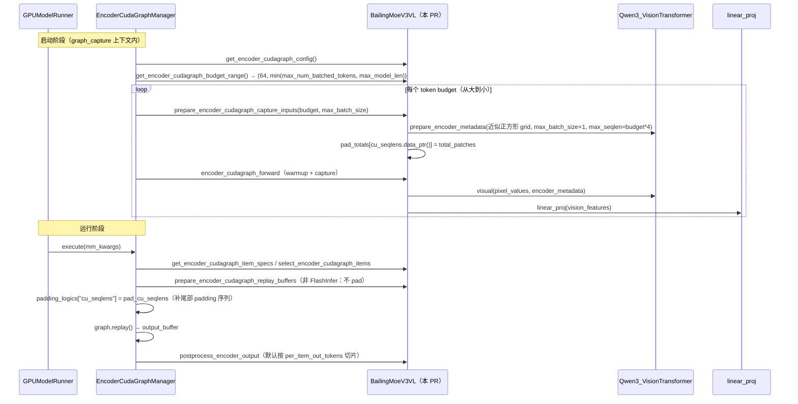
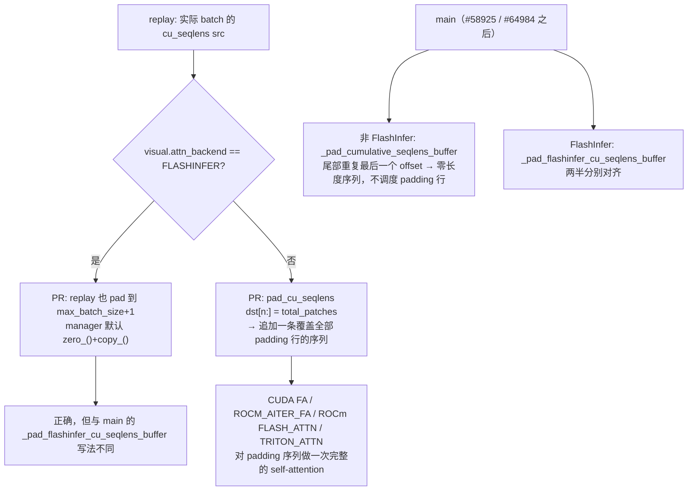

# PR #56820: [MM][CG] Support ViT full CUDA graph for Ling-3.0-flash-VL

> **Author**: @BruceLoveDecimal | **State**: OPEN | **Date**: 2026-09-14
> **Branch**: `feat/bailing_moe_v3_vl_encoder_cudagraph` → `main` | **Labels**: documentation, needs-rebase, multi-modality, nvidia
> **Changes**: +367 -1 lines across 4 files | **ROCm 相关性**: 部分相关（改动全部在 CUDA/ROCm 共享的模型代码与测试中，PR 内没有 ROCm 专属分支；但在 ROCm 上 encoder CUDA graph 以 HIP graph 运行，ViT 注意力会选 `ROCM_AITER_FA` / `FLASH_ATTN`(CK) / `TRITON_ATTN`，这几个后端都走 PR 新增的“尾部 padding 序列”分支；e2e 测试也会在 ROCm 上执行）
> 本报告分两部分：§1–6 为 PR 详细总结，§7–8 为 ROCm review 意见。

---

## 1. 总结 (Summary)

本 PR 为 Ling-3.0-flash-VL（`BailingMoeV3VLForConditionalGeneration`）实现 `SupportsEncoderCudaGraph` 协议，使其视觉编码器可以通过 `--compilation-config '{"cudagraph_mm_encoder": true}'` 按 token budget 捕获和回放 CUDA graph。Ling 的视觉塔继承自 `Qwen3_VisionTransformer`，所以实现基本照搬 Qwen3-VL 的图像路径，并复用 `prepare_encoder_metadata` 生成 capture/replay buffer。和 Qwen3-VL 的主要区别有三点：只支持图像；图内包含 `linear_proj` 投影层，因此输出宽度是文本 hidden size；dummy grid 改用“尽量接近正方形”的 h×w，避免 1×N 条带超出 ViT rotary cache。cu_seqlens 的 padding 照搬了 Kimi-K2.5 当时的“尾部 padding 序列”方案。PR 同时补了 CPU 协议单测、e2e 测试条目和文档兼容性表。

## 2. 背景与动机 (Background & Motivation)

- 属于 ViT full CUDA graph 跟踪 issue #38175 的一部分。Ling-3.0-flash-VL 在 #55921 中加入 vLLM，此前没有 encoder CUDA graph 支持。
- ViT 推理在 batch 小、图片小时以 kernel launch 开销为主。encoder CUDA graph 在启动时按多个 token budget 预捕获整段编码器，运行时把输入打包进最小的可容纳 budget 后回放。
- 作者在描述中说明 Ling 的 vLLM 实现目前只支持图像，所以 `modalities=["image"]`，跳过了视频 buffer 的尺寸计算。
- 测试计划列出了 CPU 单测、dummy 权重 e2e 测试、H20 TP=4 下的 `vllm bench mm-processor` 对比，以及 eager 与 CUDA graph 的贪心输出对比，但 **Test Result 仍为 “WIP”**，没有任何结果或性能数字。
- PR 基于 2026-09-13 的 main（merge-base `58d45fd767`），之后 main 上的 encoder CUDA graph 相关代码改了多处，mergify 已在 09-29 标记 `needs-rebase`（详见 §7）。

## 3. 代码修改分析 (Code Change Analysis)

### 3.1 修改的模块

| 模块 | 改动 |
|------|------|
| `vllm/model_executor/models/bailing_moe_v3_vl.py` (+191 -1) | 主类加入 `SupportsEncoderCudaGraph`，新增 9 个协议方法和 2 个私有 property（`_encoder_cudagraph_pad_totals`、`_encoder_cudagraph_tail_sequence`） |
| `tests/v1/cudagraph/test_encoder_cudagraph.py` (+138) | 文件末尾追加 `TestBailingMoeV3VLEncoderCudaGraph`：用不加载权重的模型骨架和 `_FakeLingViT` 测 4 个点（配置/budget、capture grid、cu_seqlens 尾部 padding、graph 与 eager 一致）。只新增，不修改已有用例 |
| `tests/models/multimodal/generation/test_vit_cudagraph.py` (+36) | 新增 `ling_vl_chat_template` 和 `bailing_moe_v3_vl` 条目（`core_model`、dummy 权重、6 层混合注意力 override） |
| `docs/design/cuda_graphs_multimodal.md` (+2) | 模型兼容表新增一行；硬件矩阵新增一行，所有列均为 ❔ |

### 3.2 架构 / 流程图

协议方法在 capture/replay 中的调用关系（PR head 版本）：



cu_seqlens 的 padding 分支（PR 与当前 main 的对比）：



### 3.3 关键实现细节

- **配置**：`modalities=["image"]`，buffer_keys 与 Qwen3-VL 相同（`pixel_values`、`pos_embeds`、rotary cos/sin、`cu_seqlens`、`max_seqlen`、`sequence_lengths`）。`out_hidden_size=text_config.hidden_size`，因为图内包含 `linear_proj`。不过模型没有设置 `supports_encoder_tp_data`，DP-ViT 不会启用，这个值实际只在 DP gather 中使用。
- **budget 范围**：最小 64、最大 `min(max_num_batched_tokens, max_model_len)`，与 Qwen3-VL 完全相同。**PR 描述**说最小 budget 按 `(224 // (patch_size * spatial_merge_size)) ** 2`（=49）计算，但代码里写死了 64。
- **capture grid**：`per_item_output = ceil(budget / max_batch_size)`，再从 `isqrt(per_item_output)` 往下找第一个能整除它的因子 `h_tokens`，得到 `[1, h*2, (n/h)*2]`。Qwen3-VL 用的是 `[1, 2, n*2]` 的 1×N 条带。
- **cu_seqlens 尾部序列**：capture 时用 `max_batch_size + 1` 多留一个槽位，并以 `cu_seqlens.data_ptr()` 为 key 记录 `total_patches`。replay 时非 FlashInfer 后端不做 padding，由 `pad_cu_seqlens` 把 `dst[n:]` 全部填成 `total_patches`，相当于追加一条覆盖全部 padding 行的序列。FlashInfer 后端则把 replay 也 pad 到 `max_batch_size + 1`，使 bucket 后的长度与 capture 一致，然后走 manager 默认的 `zero_()+copy_()`。
- **forward**：`encoder_cudagraph_forward` / `encoder_eager_forward` 都执行 `visual → linear_proj`。`linear_proj` 的 Column/RowParallel 会在图内做 TP all-reduce；manager 的 capture 位于 `graph_capture()` 上下文内，Qwen3 ViT 在 TP 下本来也在图内做 all-reduce，所以这里没有引入新类型的风险。
- **输出切片**：使用协议默认的 `postprocess_encoder_output` → `scatter_output_slices`，按 `t*h*w // 4` 切出真实 token，padding 行被丢弃。真实图片位于 buffer 前部，2×2 merger 按 4 行一组合并，因此真实行与 padding 行不会被合并到同一个 token 中。

## 4. 涉及的技术原理 (Technical Principles)

- **Budget-based encoder CUDA graph**：`EncoderCudaGraphManager` 按一组 token budget（默认从 min 开始的 2 的幂，加上 max）各捕获一张图，所有 budget 共享同一个 `max_batch_size`（图片数上限）。运行时贪心打包，选最小的可容纳 budget 回放，输入 buffer 中未使用的部分由 `padding_logics` 或默认的“清零 + 拷贝”处理。`max_seqlen` 在 capture 时就固定进图（按“一张图占满整个 budget”的最坏情况）。
- **varlen attention 与 cu_seqlens**：ViT 的多张图片拼在同一个 token 维上，用 `cu_seqlens` 划分 attention 序列。padding 行有两种处理方式：(a) 让多出来的槽位重复最后一个 offset，即零长度序列，kernel 不为 padding 行调度任何工作，这些行的输出未定义但会被丢弃；(b) 追加一条覆盖全部 padding 行的“尾部序列”，padding 行会真的做一次 self-attention。main 在 #58925（10-08）中已把 Kimi-K2.5 和 DeepSeek-V4.1 统一为 (a)。Qwen3-VL 一直用 (a)，在 #64984 后改为显式的 `_pad_cumulative_seqlens_buffer` / `_pad_flashinfer_cu_seqlens_buffer`。
- **FlashInfer 的 cu_seqlens 布局**：FlashInfer（cuDNN）后端把 q/k/o 和 v 两组 offset 拼成一个 tensor，从中点切开，并按 `FLASHINFER_BATCH_BUCKETS` 对 batch 维做 bucket。replay 的 batch 比 capture 小时，两半需要分别对齐，所以不能直接用默认的前缀拷贝。
- **Qwen3 ViT 2D RoPE**：`rotary_pos_emb = get_rope(max_position=8192)`。`rot_pos_emb` 用 `get_cos_sin(max(h, w))` 切 cache，再用 patch 级的行/列坐标做索引，所以单边 patch 数超过 8192 就会越界。
- **ROCm 上的执行**：`torch.cuda.CUDAGraph` 在 ROCm 上对应 HIP graph。ROCm 的 ViT 注意力后端按优先级选择：aiter MHA 开启时用 `ROCM_AITER_FA`，CDNA 上有 `flash_attn` 时用 `FLASH_ATTN`，否则用 `TRITON_ATTN` / `TORCH_SDPA`。前三者在 PR 中都走非 FlashInfer 的尾部序列分支。`TORCH_SDPA` 的 wrapper 内部调用 `.tolist()`，本身无法被捕获；这是所有 Qwen 系模型共有的问题，与本 PR 无关。

## 5. 评论区讨论亮点 (Discussion Highlights)

- 目前没有任何人工 review 或 inline 评论，只有 mergify bot 的两条消息：文档预览链接，以及 09-29 提示存在合并冲突、需要 rebase。
- PR 描述中做了重复工作检查（按 AGENTS.md 要求），确认没有其他 PR 在做 Ling-VL 的 encoder CUDA graph。

## 6. 风险与潜在问题 (Risk Analysis)

| 风险 | 严重程度 | 说明 |
|------|---------|------|
| padding 行参与真实注意力计算 | Medium | 见 §7 ⚠️【性能】尾部 padding 序列 |
| 与 main 冲突，且 padding 方案已被 main 废弃 | Medium | 见 §7 ⚠️【兼容性】PR 已落后 main |
| capture grid 在 budget 为大素数时退化为 1×N 条带 | Medium | 见 §7 ⚠️【正确性】rotary 越界 |
| 测试无法发现数值错误；没有真实 checkpoint 或 ROCm 结果 | Medium | 见 §7 ⚠️【测试】 |
| 与 Qwen3-VL 约 170 行近重复代码已开始分歧 | Low | 见 §7 📝【可维护性】 |
| PR 描述 / 注释与代码不一致 | Low | 见 §7 📝【注释/文档】 |

---

## 7. Review 意见 (Findings)

PR 不涉及 aiter / mori / ROCm 专属 dispatch，因此按“部分相关”处理：只对共享路径检查跨后端（CUDA FA / FlashInfer 与 ROCm AITER FA / CK FA / Triton）的行为，以及在 ROCm 上是否得到过验证。没有发现幻觉符号：`AttentionBackendEnum.FLASHINFER`、`encoder_cudagraph_defs` 中的 4 个类型、`prepare_encoder_metadata(max_seqlen_override=..., device=...)` 在 PR head 和 main 上都存在且签名一致。`SupportsEncoderCudaGraph` 协议本身在 merge-base 之后没有变化；`encoder_cudagraph.py` 的改动只涉及 manager 内部（`should_defer_item` 延迟打包、空 modalities 跳过 capture、`round_up_to`），不影响本 PR 的方法签名。

| 类型 | 🔴 | ⚠️ | 📝 |
|------|----|----|----|
| 性能 | — | 1 | — |
| 兼容性 | — | 1 | 1 |
| 正确性 | — | 1 | — |
| 测试 | — | 1 | — |
| 可维护性 | — | — | 1 |
| 注释/文档 | — | — | 1 |

---

**⚠️【性能】非 FlashInfer 后端的“尾部 padding 序列”让 padding 行做一次完整的 self-attention（ROCm 的 AITER FA / CK FA / Triton 全部受影响）** `[已验证]`

- **问题**: `bailing_moe_v3_vl.py:414-420` 的 `pad_cu_seqlens` 把 `dst[n:]` 填成 capture 时登记的 `total_patches`（`:528-530`），等于在真实图片之后追加了一条覆盖所有 padding 行的 attention 序列。`_encoder_cudagraph_tail_sequence`（`:405-409`）对 FlashInfer 以外的所有后端都返回 True，包括 CUDA 的 `FLASH_ATTN`，以及 ROCm 的 `ROCM_AITER_FA`、`FLASH_ATTN`(CK) 和 `TRITON_ATTN`。注释（`:415-417`）给出的理由是“FlashAttention 在 cu_seqlens 只部分声明时会对真实行返回 NaN（see Kimi-K2.5）”。但 main 在 #58925 中已经把 Kimi-K2.5 和 DeepSeek-V4.1 的同一实现改回零长度 padding（注释改为 “Zero-length padding (same as Qwen): tail slots repeat the last real offset, so FlashAttn schedules no work for padding rows”），Qwen3-VL 也一直使用零长度 padding。main 的文档还写明 encoder CUDA graph 已在 MI350X 上用 `FLASH_ATTN` 测过。所以这条理由在当前 main 上已不成立。
- **影响**: padding 行的注意力开销与 padding 长度的平方成正比，而且 padding 是一整条序列，真实图片则按图切成多条短序列。以默认配置（`max_batch_size=64`）为例，一张 1056×1056 的图得到 33×33=1089 个 token、4356 个 patch，会选 2048 budget（8192 个 patch 行），padding 序列长 3836。注意力 FLOPs 约为 3836² / 4356² ≈ 真实工作量的 78%。多张小图的情况更糟：33 张 64-token 的图在 PR head 上被打包进 4096 budget，padding 序列为 7936 行，注意力开销约为真实工作量（33×256²）的 29 倍。MLP 等逐行算子无论哪种 padding 方式都要处理全部行，所以这部分只是注意力上的额外开销，但它直接抵消了 CUDA graph 想节省的时间。
- **行动**: 建议作者 rebase 后与 main 的 Qwen3-VL 保持一致：从 `qwen2_5_vl` 导入 `_pad_cumulative_seqlens_buffer` / `_pad_flashinfer_cu_seqlens_buffer`，按 `attn_backend` 选择；删除 `_encoder_cudagraph_pad_totals`、`data_ptr` 登记以及 `max_batch_size + 1` 的特殊处理。如果作者确实在某个后端复现过 NaN，作者应当在 PR 中给出复现配置，因为那会是影响 Qwen3-VL 和 Kimi 的共性 bug，而不应只在 Ling 中绕开。

**⚠️【兼容性】PR 已落后 main 约 7 周，3 个文件冲突，padding 方案和文档结构均已被 main 替换** `[已验证]`

- **问题**: `git merge-tree` 显示 `docs/design/cuda_graphs_multimodal.md`、`tests/v1/cudagraph/test_encoder_cudagraph.py`、`tests/models/multimodal/generation/test_vit_cudagraph.py` 有冲突；`bailing_moe_v3_vl.py` 可以自动合并（main 只改了 `MultiModalDummyOptions`、`_get_hf_mm_text`、`get_mm_lora_token_counts`）。除了文本冲突，还有语义上的过时：(1) main 的 #60519 删除了文档中的硬件矩阵表（NV Blackwell / Ampere / AMD MI300X / MI350X 列），改为一段说明，PR 新增的 `docs/design/cuda_graphs_multimodal.md:46` 一行在 rebase 后没有地方可放；(2) #58925 / #64984 改变了 cu_seqlens padding 的推荐写法（见上一条）；(3) 新增的单测 `test_replay_cu_seqlens_covers_padded_rows`（`test_encoder_cudagraph.py:1075-1093`）断言的正是已被废弃的尾部序列行为（`[0, 196, 256, 256]`），rebase 后需要改写。
- **影响**: 直接解决文本冲突后合入，Ling 会成为 main 上唯一仍使用尾部序列 padding 的模型，同一份 `cuda_graphs_multimodal.md` 中的说明也会与代码不一致。
- **行动**: 作者应当 rebase 到当前 main，按 main 的 Qwen3-VL 写法重做 cu_seqlens padding，改写对应单测，删除硬件矩阵那一行（只保留模型兼容表那一行），然后重新跑 CI。

**⚠️【正确性】“近似正方形” capture grid 在 per-item budget 为素数时退化为 1×N 条带，> 4096 时 rotary cache 越界，启动时崩溃** `[已验证]`

- **问题**: `bailing_moe_v3_vl.py:496-507` 从 `isqrt(n)` 往下找 `n` 的因子。当 `n` 为素数时只能找到 1，grid 变成 `[1, 2, 2n]`。这正是注释（`:497-498`）声称要避免的 1×N 条带。Qwen3 ViT 的 rotary cache 只有 8192 个位置（`max_position=8192`），`rot_pos_emb` 用 `get_cos_sin(max(h, w))` 切片后再用列坐标索引，所以 `2n > 8192` 就会越界。
- **影响**: 具体触发输入：`max_model_len=4099`（素数），`max_num_batched_tokens ≥ 4099`，`compilation_config={"cudagraph_mm_encoder": true, "encoder_cudagraph_max_vision_items_per_batch": 1}`（e2e 测试就是这样设置的）。此时 max budget 为 4099、`per_item_output=4099`，grid 为 `[1, 2, 8198]`，列坐标最大到 8197，capture 前的 warmup forward 会触发索引越界（CUDA/HIP device-side assert），引擎无法启动。`6143` 等其他素数同理；`4099` 以下的素数不会越界，只是退化成条带。这个问题在 Qwen3-VL 的 1×N 实现中也存在（范围更广），但本 PR 明确声称修复了它，新增单测只覆盖了 8192 这个 2 的幂。
- **行动**: 建议作者改为 `h = isqrt(n)`、`w = ceil(n / h)`（若 `h*w < n` 再把 h 加 1）。grid 只需要至少容纳 `per_item_output` 个 token，buffer 稍大不影响正确性；同时让 `max_seqlen_override` 取 `max(token_budget, h*w) * merge²`。另外在单测中加一个素数 budget 的用例。

**⚠️【测试】现有测试都无法发现 encoder graph 的数值错误；没有真实 checkpoint 结果，也没有 ROCm 验证** `[已验证]`

- **问题**: (1) e2e 用例（`test_vit_cudagraph.py:393-419`）使用 `load_format="dummy"`，`test_vit_cudagraph_image` 只断言输出非空，不比较 eager 与 graph 的结果，即使 ViT 输出 NaN 也能通过。(2) CPU 单测的 `_FakeLingViT.forward` 根本不读取 `cu_seqlens` / rotary，所以 `test_graph_and_eager_paths_apply_projector_and_agree`（`test_encoder_cudagraph.py:1095-1108`）在任何 cu_seqlens padding 策略下都会通过，只能验证 `linear_proj` 是否被调用。(3) `_FakeLingViT.attn_backend` 固定为 `FLASH_ATTN`（`:994`），FlashInfer 分支（replay pad 到 `max_batch_size + 1` 后依赖默认拷贝）完全没有被覆盖。(4) PR 描述中的 Test Result 仍为 “WIP”，没有真实 checkpoint 的贪心对比或 `bench mm-processor` 结果。文档硬件矩阵的 AMD 列也都是 ❔，说明没有在 MI300X / MI355X 上跑过。
- **影响**: 本 PR 的核心风险（padding、capture grid、FlashInfer 两半对齐）全部没有被能产生数值差异的测试覆盖。在 ROCm 上，`ROCM_AITER_FA` / CK `FLASH_ATTN` / `TRITON_ATTN` 对尾部序列或零长度序列的处理（以及固定的 `max_seqlen`）都没有经过验证。
- **行动**: 建议作者在描述中补上真实 checkpoint 下 eager 与 `cudagraph_mm_encoder` 的贪心输出对比，以及至少一个 GPU 上的 `bench mm-processor` 数据；单测中让 fake ViT 按 `cu_seqlens` 分段计算（例如逐段求均值），这样 padding 写错时测试会失败。建议 review 时追问作者或 AMD 同学能否在 MI355X 上用默认的 ViT 后端（`FLASH_ATTN`，开启 aiter 时为 `ROCM_AITER_FA`）跑一次 e2e 用例。

**📝【兼容性】ROCm 侧：本 PR 在 ROCm 上会自动启用，但只能沿用其他 Qwen 系模型的验证结论** `[已验证]`

- **问题**: e2e 用例的 skip 条件是 `not current_platform.is_cuda_alike()`，所以会在 AMD CI 上运行。PR 没有任何 ROCm 专属分支，ROCm 用户开启 `cudagraph_mm_encoder` 后直接走 HIP graph + 尾部序列分支。main 文档说明 encoder CUDA graph 在 MI350X 上用 `FLASH_ATTN` 验证过，但对象是其他模型，且这些模型使用零长度 padding。
- **行动**: 建议作者 rebase 并改用零长度 padding 后，与已验证的 Qwen3-VL 路径完全一致，ROCm 侧的风险会随之明显降低。在此之前，不建议在文档中给 AMD 列标 ✅。

**📝【可维护性】约 170 行协议实现基本复制自 Qwen3-VL，且已开始分歧** `[已验证]`

- **问题**: `get_encoder_cudagraph_item_specs`、`select_encoder_cudagraph_items`、`prepare_encoder_cudagraph_*`、`encoder_*_forward`（`bailing_moe_v3_vl.py:454-567`）与 Qwen3-VL 的图像分支几乎逐行相同，区别只有 `linear_proj` 和 grid 形状。分歧已经出现：Qwen3-VL 在 #64984 中修复了 FlashInfer 两半对齐问题，用的是 `_pad_flashinfer_cu_seqlens_buffer`；本 PR 则用“replay 也 pad 到 `max_batch_size + 1`”的另一种方式解决同一问题。
- **行动**: 建议作者考虑把 Qwen3-VL 图像路径的协议方法抽成可复用的 helper 或 mixin，Ling 只覆写 `out_hidden_size`、forward 中的 `linear_proj` 和 capture grid。这样 Qwen3-VL 后续的修复可以自动覆盖到 Ling。

**📝【注释/文档】PR 描述和代码注释与实现不一致** `[已验证]`

- **问题**: (1) PR 描述写的是 “min budget computed as `(224 // (patch_size * spatial_merge_size)) ** 2` instead of the hard-coded 64”，但 `bailing_moe_v3_vl.py:447` 仍写死 `min_budget = 64`，单测也断言 `(64, 2048)`。按代码逻辑，49-token 的 224px 图片会落到 64 budget，功能上没有问题，只是描述过时了。(2) `:415-417` 中关于 NaN 的注释引用的 Kimi-K2.5 行为在 main 上已被移除（见第一条）。
- **行动**: 建议作者同步更新 PR 描述，并在 rebase 时删除或改写这段注释。

> AI 代码诊断：描述对“为什么这样做”解释得比较充分（为什么包含 `linear_proj`、为什么改 grid 形状），但 Test Result 还是 WIP 占位；单测中的 fake ViT 忽略了被测的关键输入（cu_seqlens），属于“为通过而校准”的测试；`pad_totals` / `data_ptr` 方案与当时的 Kimi-K2.5 逐字相同，是从孪生实现复制过来的，而那个孪生实现在 main 上已经改掉。没有发现幻觉符号。

## 8. 结论 (Verdict)

**⚠️ NEEDS WORK**

功能思路正确：复用 Qwen3 ViT metadata、把 `linear_proj` 纳入图内、默认按切片取输出，这些都与协议一致，也没有找到会产生错误输出的阻塞性缺陷。但 PR 需要 rebase 到当前 main，并改用 main 的零长度 cu_seqlens padding；当前的尾部序列方案会让 padding 行做真实的注意力计算，影响包括 ROCm 在内的所有非 FlashInfer 后端。capture grid 在素数 budget 下会越界，需要修复。还需要补上能发现数值错误的测试和真实 checkpoint 的结果。

## 9. 英文 Review 评论 (Copy-Paste English Comments)

**C1** `vllm/model_executor/models/bailing_moe_v3_vl.py:405-437` — ⚠️ comment

```text
The trailing padding sequence makes the padded rows run a real self-attention on every non-FlashInfer backend (CUDA FA, and on ROCm also ROCM_AITER_FA / CK FLASH_ATTN / TRITON_ATTN). Example with the default max_batch_size=64: a single 1056x1056 image (1089 tokens, 4356 patches) is replayed in the 2048 budget, so the padding sequence has 3836 rows and costs about 78% extra attention FLOPs. This pattern was copied from Kimi-K2.5, but #58925 has since switched Kimi-K2.5 and DeepSeek-V4.1 back to zero-length padding ("FlashAttn schedules no work for padding rows"), and Qwen3-VL now uses `_pad_cumulative_seqlens_buffer` / `_pad_flashinfer_cu_seqlens_buffer` (#64984). After rebasing, could you reuse those helpers and drop `_encoder_cudagraph_pad_totals`, the data_ptr registration, and the `max_batch_size + 1` special case? If you actually reproduced NaNs with zero-length padding on some backend, please share the setup, since that would also affect Qwen3-VL.
```

**C2** `vllm/model_executor/models/bailing_moe_v3_vl.py:496-507` — ⚠️ comment

```text
When `per_item_output` is prime, the divisor search returns h_tokens=1, so the grid falls back to the 1 x N strip that the comment says it avoids. Concrete case: max_model_len=4099 with encoder_cudagraph_max_vision_items_per_batch=1 (as in the e2e test) gives a 4099 budget and a grid of [1, 2, 8198]. The column ids then reach 8197, which is past the ViT rotary cache (max_position=8192), so the warmup forward before capture hits an out-of-bounds index. Consider h = isqrt(n), w = ceil(n / h) instead: the dummy grid only needs to hold at least n tokens. Raise max_seqlen_override to cover h*w if needed, and add a prime budget to the unit test.
```

**C3** `tests/v1/cudagraph/test_encoder_cudagraph.py:1075-1108` — ⚠️ comment

```text
These tests cannot catch a cu_seqlens or padding bug. `_FakeLingViT.forward` never reads `cu_seqlens` or the rotary buffers, so `test_graph_and_eager_paths_apply_projector_and_agree` passes under any padding policy. `test_replay_cu_seqlens_covers_padded_rows` pins the trailing-sequence behavior that main has moved away from. The FlashInfer branch (replay padded to max_batch_size + 1, then the default copy) is not covered at all, and the e2e entry uses dummy weights and only checks for non-empty output. Could you make the fake ViT compute per segment based on cu_seqlens (e.g. a per-segment mean), add a FLASHINFER case, and post the real-checkpoint eager vs. CUDA graph greedy comparison that is still marked WIP in the description?
```

**C4** `docs/design/cuda_graphs_multimodal.md:46` — ⚠️ comment

```text
This branch is about 7 weeks behind main and conflicts in this doc and both test files. The hardware matrix table this row goes into was removed from main in #60519, so after the rebase only the model compatibility row should stay. Since this path is enabled on ROCm as well (the e2e test runs on cuda_alike platforms), it would be good to get one MI300X/MI355X run with the default ViT backend before marking any AMD support in the docs.
```
