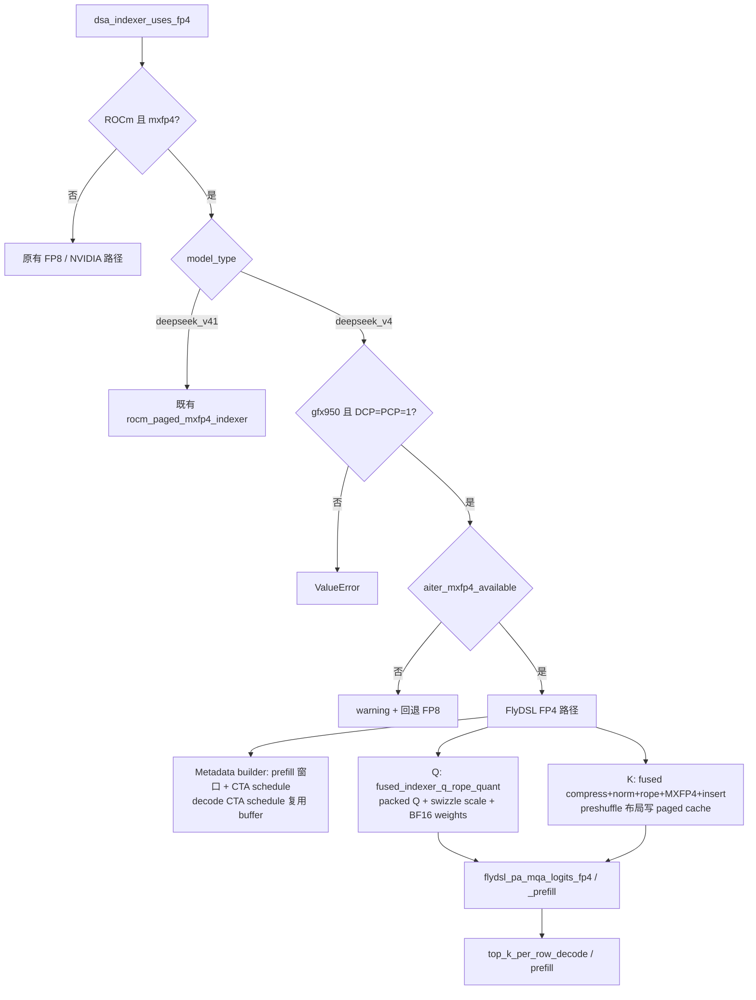
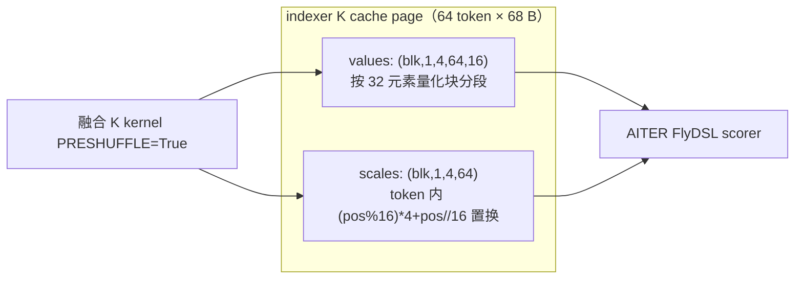

# PR #56834: [ROCm][Perf] Fuse DeepSeek V4 MXFP4 indexer K production and cache insertion (gfx950)

> **Author**: @LiuYinfeng01 | **State**: OPEN（bot 提示有 merge conflict，需 rebase） | **Date**: 2026-09-14（首个 commit）
> **Branch**: `LiuYinfeng01:*` → `main` | **Labels**: rocm, deepseek（未能从页面完整确认）
> **Changes**: 13 个 commit，13 个文件（vllm/ 下 7 个源文件 + 3 个测试 + docs + 2 个 CI yaml），源码约 +900 行 | **ROCm 相关性**: 完全相关
> 本报告分两部分：§1–6 为 PR 详细总结，§7–8 为 ROCm review 意见，§9 为可直接粘贴的英文评论。
>
> **数据来源说明**：审查时 GitHub REST API 限流（未认证、gh 未安装），diff / patch / PR 页面通过 github.com 网页获取；CI checks 状态未获取，以下 CI 相关内容为 `[unverified]`。本机 aiter checkout 中没有 `ops/flydsl/kernels/mqa_logits`，因此 aiter 符号只能依据 PR 描述（ROCm/aiter#5518、#5603）核对，没有做源码级确认。

---

## 1. 总结 (Summary)

为 DeepSeek-V4 在 ROCm gfx950（MI355X）上新增 opt-in 的 MXFP4 sparse indexer：通过 `--attention-config '{"indexer_kv_dtype":"mxfp4"}'` 启用后，indexer 的 K cache 以 AITER preshuffle 布局存放 E2M1 + UE8M0，Q 由 Triton kernel 融合 RoPE+量化并输出 AITER swizzle 的 scale，打分直接调用 AITER FlyDSL 的 paged FP4 scorer（prefill/decode 各一个）。与 #60834 的区别是 K 侧把 pooling→RMSNorm→RoPE→MXFP4 量化→写 cache 融合成一个 kernel，省掉 BF16 中间 buffer 和一次 launch。AITER 缺少所需 ABI 时 warning 并回退 FP8。

## 2. 背景与动机 (Background & Motivation)

- DeepSeek-V4 长上下文 agentic 场景下 indexer（MQA logits + top-k）占比很高，FP8 indexer K cache 同时占用 KV pool。
- 主线已有 NVIDIA SM100 的 MXFP4 indexer 与 DeepSeek-V4.1 的 ROCm `rocm_paged_mxfp4_indexer`，但 DeepSeek-V4 在 ROCm 上 `forward_hip` 直接 `assert not use_fp4_cache`。
- PR 声称：AgentX 回放（TP1/DP8、c128、MTP3、8×MI355X）总吞吐 +9.65%，p95 ITL −24.7%，GPU KV 使用率 64.12%→50.47%（均为作者自报，`[unverified]`，未复现）。
- 依赖 ROCm/aiter#5518（共享 pool 的 page stride + 64-bit 寻址）与 #5603（FP8 split-k logits，仅作 baseline 对齐）。
- 评论区：有人问是否与 #60834 重复；作者答复区别在于 K 融合，并按要求在标题和描述中澄清。

## 3. 代码修改分析 (Code Change Analysis)

### 3.1 修改的模块

| 模块 | 文件 | 说明 |
|---|---|---|
| 调度/门控 | `v1/attention/backends/mla/indexer.py` | `aiter_mxfp4_available()` 通过 `inspect.signature` 探测 AITER ABI；`dsa_indexer_uses_fp4` 区分 v4 / v4.1；新增 `rocm_flydsl_indexer_uses_fp4`；prefill 窗口 Triton kernel、FP4 专用 chunk 规划、decode CTA schedule 缓冲 |
| 打分路径 | `models/deepseek_v4/amd/ops/sparse_attn_indexer.py`（新） | cache 的 zero-copy strided view、prefill/decode 调 FlyDSL scorer + `top_k_per_row_*` |
| 公共层 | `model_executor/layers/sparse_attn_indexer.py` | ROCm+FP4 时分流到 `_rocm_fp4_sparse_attn_indexer`；`forward_hip` 在 fp4 时转 `forward_cuda`；init 校验 |
| Q 量化 | `deepseek_v4/common/ops/fused_indexer_q.py` | 重写共享 Triton kernel（向量化 pair、RoPE+量化合一）；新增 `_fp32x2_to_fp4x2_rocm`（`v_cvt_scalef32_pk_fp4_f32` 内联汇编）；ROCm 输出 (T,1,4,16,4) swizzled scale |
| K 量化+写 cache | `common/ops/fused_compress_quant_cache.py` | `PRESHUFFLE` constexpr：改变 value/scale 写入偏移 |
| 模型 | `deepseek_v4/attention.py` | ROCm+FP4 时 weights 输出 BF16 |
| 测试/CI/文档 | 3 个测试文件、`test-amd.yaml`、`test_areas/kernels.yaml`、`docs/design/attention_backends.md` | 主要是 host 侧 dispatch/layout mock 测试 |

### 3.2 架构 / 流程图





### 3.3 关键实现细节

- K cache 视图：`torch.as_strided` 以 `page_stride` 切出 values/scales，不拷贝，要求 `block_size=64, head_dim=128, 68 B/token`。
- 我核对了 preshuffle 偏移（diff 中的 value_offset / scale_offset 与 view stride）：K 侧 `scale_idx*64 + (pos%16)*4 + pos//16` 与 Q 侧 `block*64 + (head%16)*4 + head//16` 在 64 元素范围内是双射，且与 `(T,1,4,16,4)` / `(blk,1,4,64)` 视图一致，未发现越界。
- decode：speculative 行在 C4 换算前先展平（`_use_flattening` 在 ROCm+FP4 时恒为 True），`next_n=1`，每行一个精确上下文界；CTA schedule 由 builder 每步写入稳定的 `fp4_cta_info_buffer`，各层复用，兼容 CUDA graph。
- prefill：按"行数 × 最大请求宽度"切 chunk，窗口 kernel 在设备上二分求 `row_to_batch`；`logits_width <= topk` 时跳过打分，直接填 `[0..end)`。
- weights 由 FP32 改为 BF16（`weights_out_dtype`），符合 AITER scorer 约定。
- 共享的 `fused_indexer_q` Triton kernel 被整体重写（见 §7）。

## 4. 涉及的技术原理 (Technical Principles)

- **DSA/Indexer 与 C4 压缩**：DeepSeek-V4 indexer 对 4:1 压缩后的 K 打分选 top-k，所以上下文长度需 `//4`，MTP 的 causal 边界必须在压缩前逐行展开，否则会出现错位 1–3 个 token 的 off-by-one。
- **MXFP4**：E2M1 值每 32 元素共享一个 UE8M0 scale（2^(e−127)）；本 PR 的 scale 取 `ceil(log2(amax/6))`。K/Q 的 scale 都需要按 AITER 的 MFMA 友好布局 swizzle，因此叫 preshuffle。
- **gfx950 专有指令**：`v_cvt_scalef32_pk_fp4_f32` 只在 gfx950 存在，Triton 通过 `inline_asm_elementwise` 调用，gfx942 上编译会失败，故必须由 host 门控兜底。
- **CUDA graph 稳定性**：schedule buffer 必须地址稳定、内容每步刷新；decode logits 作为 graph pool 内的临时张量。
- **FlyDSL**：AITER 用 Python DSL 生成 kernel，ABI 随版本变化快，所以这里用 `inspect.signature` 探测。

## 5. 评论区讨论亮点 (Discussion Highlights)

- 重复性：被问到是否与 #60834 重复 → 作者说明 K 融合的差异，并在标题/描述中澄清（reviewer 认可）。
- 测试：reviewer 要求补"FP4 Q 值与 scale 对照参考实现"的测试 → 作者在 `ee8d74b5d0` 中增加 byte 级对照（1/17/257 tokens，FP32/BF16 RoPE cache，零 head）；作者自述仅 CPU 验证（68 passed，6 个 GPU case 本地被 skip）。
- 机器人多次提示 merge conflict，需要 rebase；另有一条评论提到 "Superseded by … #57517"（来自页面抓取，上下文不明，疑似指向同作者另一个 PR，建议作者确认本 PR 与 #57517/#60834 的关系）。

## 6. 风险与潜在问题 (Risk Analysis)

| 风险 | 严重程度 | 说明 |
|---|---|---|
| 正确性/兼容性 | Medium | 共享的 `fused_indexer_q` Triton kernel 被重写，CUDA 路径也会走新代码，无 NVIDIA GPU 数值验证（见 §7 的 CUDA 回归风险） |
| 性能/资源 | Medium | decode logits 宽度为 `max_model_len`（未压缩），显存放大 ~4×（见 §7） |
| 正确性 | Medium | 精度证据仅 GSM8K，没有长上下文/检索类评测，而 indexer 的 top-k 误差恰在长上下文放大 |
| 兼容性 | Medium | 依赖未合入的 ROCm/aiter#5518；用 `inspect` 探测私有符号（`_i32_buffer`），易随 AITER 变动失效 |
| 测试覆盖 | Medium | 主要是 mock 的 host 测试；GPU 数值测试被 `skipif(not rocm)`，CI 上 AMD 只加入了 dispatch 测试 |
| 可维护性 | Low | 多处 `assert` 作为运行期门控；多个 ROCm 魔数（256 block_k、64/128 形状）硬编码 |
| 合入状态 | Low | 有 merge conflict，13 个 commit 需 squash |

---

## 7. Review 意见 (Findings)

| 类型 | 🔴 | ⚠️ | 📝 |
|---|---|---|---|
| 正确性 | 0 | 2 | 0 |
| 性能 | 0 | 1 | 1 |
| 测试 | 0 | 1 | 0 |
| 可维护性 | 0 | 1 | 1 |

**⚠️【性能】decode logits 按 `max_model_len`（未压缩）分配，实际只需压缩后长度** `[已验证]`
- **问题**: `vllm/models/deepseek_v4/amd/ops/sparse_attn_indexer.py` 新文件约 147–149 行：`torch.empty((rows, max_model_len), dtype=torch.float32)`，并把 `max_model_len` 作为 scorer 的 `max_seq_len` 传入（约 158 行）。而 builder 中 CTA schedule 用的是 `fp4_max_seq_len = max_model_len // compress_ratio`。scorer 看到的 K 长度是 C4 压缩后的，宽度多算了 4 倍。
- **影响**: 例如 `max_model_len=1,048,576`、decode 256 行时，logits 为 256×1M×4B ≈ 1 GiB，按压缩宽度只需 ≈ 256 MiB；full cudagraph 会为每个捕获尺寸在 graph pool 内保留该张量，直接压缩 KV pool。此外 schedule 用 `max_model_len//4`，scorer 用 `max_model_len`，两者不一致是否安全取决于 AITER 对 `max_seq_len` 的用法，我无法在本地核对 aiter 源码（`[推测]`：若 scorer 用该值计算 grid/stride，则存在语义不一致）。
- **行动**: 建议作者改用 `fp4_max_seq_len`（压缩后宽度）分配 logits 并同时传给 scorer 与 `top_k_per_row_decode`，或解释为什么必须是 `max_model_len`。

**⚠️【正确性】共享 Triton kernel `fused_indexer_q` 被重写，CUDA 路径无 GPU 数值验证** `[已验证 diff / 影响为推测]`
- **问题**: `fused_indexer_q.py` 约 373–444 行：旧实现对 NoPE 块直接加载量化、只对 RoPE 块做 RoPE 并做 bf16 往返；新实现对全部 pair 统一做 `x*cos − x_odd*sin`（NoPE 以 cos=1/sin=0 填充）并**对 NoPE 部分也做了 bf16 往返**；同时删除了 `_quantize_mxfp4_pair`。`USE_EXPLICIT_FMA`/`PRESHUFFLE_FP4` 在 CUDA 上为 False，所以 CUDA 走的是改写后的同一份公共代码。
- **影响**: (1) 若 `index_q` 不是 bf16（例如 fp16/fp32），NoPE 的量化输入与旧版不同；(2) NoPE 的 `x*1 − x_odd*0`，当 `x_odd` 为 Inf/NaN 时会把 NaN 扩散给 `x_even`，旧代码不会。PR 描述写"CUDA FP4 packing and scale layout are unchanged"，但测试只有 CPU 的 dispatch 测试，并明确"not NVIDIA GPU numerical validation"。另外需确认 `_quantize_mxfp4_pair` 没有被仓库其他位置（如 cutedsl 相关代码、tests）import（我没有主线 checkout，`[推测]`）。
- **行动**: 建议作者要么把 ROCm 改写拆成独立 kernel/分支以保持 CUDA 代码路径字节不变，要么提供 NVIDIA 上的 bit-exact 对照（新旧 kernel 输出的 packed/scale 逐字节一致）。

**⚠️【测试】精度验证只有 GSM8K，缺少长上下文/检索评测；GPU 数值测试在 CI 上未必运行** `[已验证]`
- **问题**: PR 描述的 Accuracy 小节只给出 GSM8K（短上下文，三次运行）。indexer 的 top-k 对长上下文（平均 ISL p50≈57K, p90≈200K）才敏感，而吞吐收益恰来自长上下文。`test_rocm_mxfp4_fused_indexer_q_matches_reference` 带 `skipif(not rocm)`，`.buildkite/test-amd.yaml` 里只加了 `test_fused_indexer_q_dispatch.py`，需要确认 `test_fused_indexer_q_rope_quant.py` 的 ROCm GPU 用例和新增的 `tests/v1/attention/test_indexer_fp4_dispatch.py` 是否也被 AMD CI 的某个 step 收录。作者自述 "6 GPU cases skipped locally"。
- **影响**: top-k 命中退化在 GSM8K 上看不出来，回归会在长上下文任务（RULER/needle/代码仓库检索）上静默出现；GPU 用例未进 CI 则后续 AITER 升级无人兜底。
- **行动**: 建议作者补充一个长上下文精度指标（如 needle/RULER 或 top-k 与 FP8 indexer 的重叠率），并确认两个测试文件的 GPU 用例进入 AMD CI。CI 实际状态本次未获取（`[unverified]`）。

**⚠️【可维护性】AITER 能力探测依赖私有符号，且回退只在日志里提示，每次调用重复告警** `[已验证]`
- **问题**: `indexer.py` 约 62–115 行用 `inspect.signature` 检查 `common._i32_buffer` 的 `byte_offset`、`build_*`/`compile_*_module` 的形参等私有 API；`dsa_indexer_uses_fp4` 在 builder、layer init、`rocm_flydsl_indexer_uses_fp4` 中被多次调用，而 `logger.warning(...)`（约 156–162 行）在回退分支每次都打印（只有 `aiter_mxfp4_available` 被 `lru_cache`）。
- **影响**: 用户显式要求 `mxfp4` 却被降级到 FP8，只靠一条（可能重复的）警告提示，容易被忽略，且 benchmark 结果会被误归因；AITER 一旦重命名私有函数，会在无报错的情况下永久回退。
- **行动**: 建议作者改用 `logger.warning_once`（或在 `lru_cache` 内告警），并在 AITER 侧提供一个明确的版本/特性常量（例如 `aiter.ops.flydsl.FP4_INDEXER_ABI_VERSION`）供探测。

**⚠️【正确性】运行期门控依赖 `assert`，`python -O` 下失效** `[已验证]`
- **问题**: 新文件 `_rocm_fp4_cache_views` 与 `_rocm_fp4_sparse_attn_indexer` 对 `kv_cache` 形状/stride、`q_scale` 布局、`decode.requires_padding`、`not use_pcp and dcp_world_size == 1` 全用 `assert`。
- **影响**: 在 `-O` 下被剥离后，错误布局会导致 FlyDSL kernel 越界读而不是报错；构造期的 `ValueError` 门控已覆盖大部分情形，所以这是纵深防御问题。
- **行动**: 建议作者把 cache layout 的校验放到 init 期统一用 `ValueError`，运行期仅保留廉价 assert。

**📝【性能】prefill logits buffer 在 `build()` 中惰性增长且从不释放** `[推测]`
- **问题**: `fp4_prefill_logits_buffer` 在需要更大时重新 `torch.empty`，不会在 memory profiling 阶段预留。
- **影响**: 上界由 `max_logits_bytes` 限制，但首次遇到大 prefill 时才分配，可能在 KV pool 已吃满显存后 OOM。
- **行动**: 建议 review 时追问是否在 profile/warmup 阶段按最大 chunk 预分配，或计入 workspace 预算。

**📝【可维护性】硬编码常量与 PR 结构** `[已验证]`
- `block_k=256`、`(64, 64)`、`68`、`next_n=1` 等分散在三个文件中；建议集中成常量并写明来源（AITER 的约束）。
- 13 个 commit 且存在 merge conflict，合入前需要 rebase + squash，并确认与 #57517、#60834 的关系，避免重复实现 indexer FP4。

非 ROCm 规则项（环境变量注册等）：本 PR 无新增 env var，无需处理。

## 8. 结论 (Verdict)

⚠️ NEEDS WORK：设计思路清晰、门控完整、preshuffle 偏移经我核对自洽，性能收益（自报）可观。但 (1) decode logits 宽度与压缩长度不一致带来的显存放大，(2) 共享 Triton kernel 的 CUDA 回归缺少 GPU 验证，(3) 精度证据不足以覆盖长上下文，这三点需要作者解决或解释。没有找到能给出具体触发输入的阻塞性正确性错误，所以不判 BLOCK。注意：未能获取 CI 状态与 aiter 源码，相关结论带 `[推测]`/`[unverified]` 标注。

## 9. 英文 Review 评论 (Copy-Paste English Comments)

**C1** `vllm/models/deepseek_v4/amd/ops/sparse_attn_indexer.py:147-158` — ⚠️ comment

```text
The decode logits buffer is allocated as (rows, max_model_len) and max_model_len is also passed to the scorer as max_seq_len. But the K side here is C4-compressed, and the builder already computes the schedule with fp4_max_seq_len = max_model_len // compress_ratio. Could you use the compressed width for both the buffer and the scorer argument? As written, with max_model_len=1M and 256 decode rows this is ~1 GiB of fp32 logits (about 4x what is needed), and under full CUDA graph it stays reserved in the graph pool for every captured size. If the AITER kernel really needs the uncompressed length, please add a comment explaining why and how it relates to the schedule's max_seq_len.
```

**C2** `vllm/models/deepseek_v4/common/ops/fused_indexer_q.py:373-444` — ⚠️ comment

```text
This rewrites the shared Triton kernel that the CUDA path also uses, but the PR description says CUDA FP4 packing is unchanged and the tests added here are CPU-only dispatch tests. Two behavior differences worry me: NoPE values now go through the bf16 round trip (previously only RoPE blocks did), and NoPE pairs now go through x*cos - x_odd*sin with cos=1/sin=0, which turns an Inf/NaN in x_odd into NaN for x_even. Could you either keep the original code path for non-ROCm (e.g. a separate kernel or a constexpr branch) or show a bit-exact comparison of packed Q and scales between the old and new kernels on an NVIDIA GPU? Also please confirm that nothing else imports the removed _quantize_mxfp4_pair.
```

**C3** `vllm/v1/attention/backends/mla/indexer.py:156-162` — ⚠️ comment

```text
dsa_indexer_uses_fp4() is called from several places (builder, layer init, rocm_flydsl_indexer_uses_fp4), and only aiter_mxfp4_available() is cached, so this warning is emitted on every call. Could you use logger.warning_once, or warn inside the cached probe? Since the user explicitly asked for mxfp4 and silently gets fp8, I would also like the message to say which AITER capability is missing. The probe itself depends on private symbols (e.g. common._i32_buffer), so it is easy for an AITER refactor to make this fall back permanently without anyone noticing; an explicit version/feature constant exported by AITER would be more robust.
```

**C4** `docs/design/attention_backends.md:1` — ⚠️ comment

```text
GSM8K alone is not a strong accuracy signal for an indexer change, since top-k errors mostly show up at long context (the benchmark ISL is up to ~200K here). Could you add a long-context accuracy check (needle/RULER-style, or top-k overlap against the FP8 indexer) to the PR description? Also please confirm that the ROCm GPU cases in test_fused_indexer_q_rope_quant.py and test_indexer_fp4_dispatch.py are picked up by an AMD CI step, since the GPU test is skipped without ROCm and only test_fused_indexer_q_dispatch.py was added to test-amd.yaml.
```
