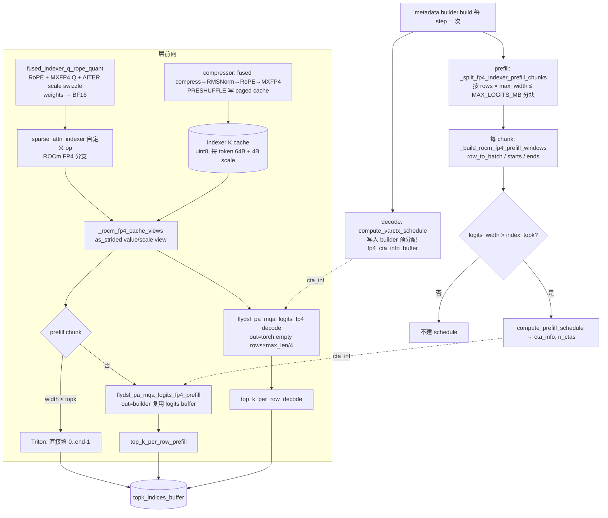
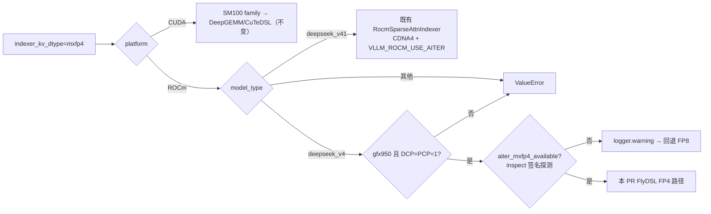

# PR #56834: [ROCm][Perf] Fuse DeepSeek V4 MXFP4 indexer K production and cache insertion (gfx950)

> **Author**: @LiuYinfeng01 | **State**: OPEN | **Date**: 2026-09-14（最新 commit `ee8d74b5d0`，2026-10-19）
> **Branch**: `rocm-dsv4-agentx-fp4-draft` → `main` | **Labels**: documentation, performance, rocm, ci/build, deepseek, DSv4
> **Changes**: +1759 -99 lines across 13 files | **ROCm 相关性**: 完全相关（gfx950 专属 DSv4 稀疏 indexer MXFP4 路径，触及共享的 `indexer.py` / `sparse_attn_indexer.py` / `fused_indexer_q.py`）
> 本报告分两部分：§1–6 为 PR 详细总结，§7–8 为 ROCm review 意见，§9 为可直接粘贴的英文 review 评论。
> Review 日期：2026-10-22；对照 vLLM `upstream/main`（merge-base `642c18d64c`）与 aiter main / ROCm/aiter#5518 源码核对。

---

## 1. 总结 (Summary)

本 PR 为 DeepSeek-V4 在 ROCm gfx950（MI350/MI355）上新增一条 opt-in 的 **MXFP4 Lightning Indexer** 路径（`--attention-config '{"indexer_kv_dtype":"mxfp4"}'`）。indexer 的 Q 与 K cache 改为 MXFP4（E2M1 + UE8M0 block scale），并按 AITER 的 preshuffle/swizzle 布局直接写入 paged cache。prefill 与 decode 都改为调用 AITER FlyDSL 的 direct-paged FP4 scorer（`flydsl_pa_mqa_logits_fp4{,_prefill}`），再接 vLLM 的 per-row top-k。FP8 仍是默认，NVIDIA 路径不变。另外，CTA schedule 与 prefill 窗口改在 metadata builder 中每 step 计算一次，供所有 indexer 层复用。

## 2. 背景与动机 (Background & Motivation)

- DeepSeek-V4 的 C4 稀疏 attention 靠 Lightning Indexer 为每个 query 选 top-k 压缩 token。长上下文 agentic 负载（AgentX，ISL p50 ≈ 57K）里，indexer 的 scorer 和 top-k 是不可忽略的开销，indexer K cache 也占用 KV pool。
- 在 main 上，ROCm 的 MXFP4 indexer 只接给了 DeepSeek-V4.1（`RocmSparseAttnIndexer` / `rocm_paged_mxfp4_indexer`，aiter op）。DSv4 在 ROCm 上请求 mxfp4 会直接报错。
- 本 PR 把 DSv4 接到 AITER 的 FlyDSL FP4 kernel 上。作者称它和 #60834 的区别在于：#60834 先把 pooled K 写到 BF16 scratch，再调 `k_norm_rope_mxfp4_cache`；本 PR 宣称把 pooling→RMSNorm→RoPE→MXFP4 量化→cache 插入"融合进单 kernel"。
- **依赖**：shared-pool page stride 与 64-bit 寻址依赖 ROCm/aiter#5518（截至 review 时仍为 **OPEN**）。benchmark 的两个 arm 都叠加了 ROCm/aiter#5603（已合并）。
- 作者曾在 2026-09-18 评论"Superseded by … #57517"，但本 PR 之后继续更新，目前仍 open。

## 3. 代码修改分析 (Code Change Analysis)

### 3.1 修改的模块

| 模块 | 改动 |
|------|------|
| `vllm/v1/attention/backends/mla/indexer.py` (+357/-17) | `aiter_mxfp4_available()` 用 `inspect.signature` 探测 AITER ABI；`dsa_indexer_uses_fp4` 新增 DSv4/ROCm 分支（gfx950、DCP=PCP=1；ABI 缺失时 **warning 并回退 FP8**）；新增 `rocm_flydsl_indexer_uses_fp4`；prefill 窗口 Triton kernel；FP4 prefill 分块规划器；builder 中预分配 decode `cta_info` buffer、按需增长的 prefill logits buffer、decode/prefill schedule 计算 |
| `vllm/models/deepseek_v4/amd/ops/sparse_attn_indexer.py`（新增 176 行） | `_rocm_fp4_cache_views`（对共享分配做零拷贝 value/scale as_strided view）、`_rocm_fp4_sparse_attn_indexer`（prefill 分块 scorer + `top_k_per_row_prefill`；decode scorer + `top_k_per_row_decode`；`logits_width <= topk` 时直接填全索引的快捷路径） |
| `vllm/model_executor/layers/sparse_attn_indexer.py` (+32/-1) | 自定义 op 中新增 ROCm FP4 早返回分支；`__init__` 校验 D=128/C4/fused-K/无 candidate；`forward_hip` 在 FP4 时转到 `forward_cuda`（通用自定义 op） |
| `vllm/models/deepseek_v4/common/ops/fused_indexer_q.py` (+103/-69) | 新增 `_fp32x2_to_fp4x2_rocm`（gfx950 `v_cvt_scalef32_pk_fp4_f32` inline asm）；Q kernel 从 per-block 循环改为整 head 向量化；ROCm 下 `PRESHUFFLE_FP4` 输出 `(T,1,4,16,4)` AITER scale swizzle，`USE_EXPLICIT_FMA` 走显式 fma；ROCm FP4 要求 gfx950 且 H=64、D=128 |
| `vllm/models/deepseek_v4/common/ops/fused_compress_quant_cache.py` (+35/-12) | **已存在的** fused K kernel `_fused_kv_compress_norm_rope_insert_indexer_mxfp4_attn` 新增 `PRESHUFFLE` 存储布局（value 按 16B 子块分组，scale 按 `(pos%16)*4+pos//16` swizzle）；launch 侧加 gfx950/D=128/page=64 guard |
| `vllm/models/deepseek_v4/attention.py` (+5) | ROCm FP4 时 indexer weights 输出 BF16（AITER scorer 契约） |
| `docs/design/attention_backends.md` (+26) | 新增 "Experimental gfx950 MXFP4 indexer" 一节 |
| `.buildkite/test-amd.yaml`、`test_areas/kernels.yaml` (+3) | 把 `test_fused_indexer_q_dispatch.py` 加入 kernels 测试列表（另有一处多余空行） |
| `tests/…`（+1020） | `test_indexer_fp4_dispatch.py`（716 行，host 侧 mock AITER 的 dispatch/schedule 契约）、`test_fused_indexer_q_dispatch.py`（191 行）、`test_fused_indexer_q_rope_quant.py` 新增 ROCm 逐字节对比参考实现的 Q 测试 |

### 3.2 架构 / 流程图

DSv4 MXFP4 indexer 在 ROCm 上的执行流（单层，一个 step）：



平台/模型分流（gating）：



### 3.3 关键实现细节

- **Cache 布局**：每页 64 token，每 token 64B packed E2M1 + 4B UE8M0（`shape[2]==68`）。value 区按 `(4 个 32-elem block, 64 token, 16B)` 排列，scale 区在页尾，token 维做 `(pos%16)*4 + pos//16` swizzle。`_rocm_fp4_cache_views` 用 `page_stride = kv_cache.stride(0)` 支持共享分配中的非紧凑页步长，前提是 AITER 接受 page stride（来自 #5518）。
- **Q 量化**：Triton kernel 一次处理整 head（64 对），NoPE 部分以 cos=1/sin=0 统一进 RoPE 公式。scale 计算改为 `exp2(-log2_ratio)`，对 2 的幂与原 `1/scale` 等价。CUDA（非 preshuffle）的存储偏移与原实现逐字节一致，因此 NVIDIA 行为不变 `[已验证]`。
- **FP4 转换指令**：ROCm 用 `v_cvt_scalef32_pk_fp4_f32`（CDNA4 专属 ISA），CUDA 保留原软件实现 `_fp32x2_to_fp4x2`。只在 `PRESHUFFLE` 为 constexpr 真时编译进 kernel，gfx942 不会遇到。
- **Schedule**：decode 用 AITER 的 `default_varctx_parallel_unit_num(rows, max_len/4)`，只依赖 host 侧形状，无 D2H 同步。full cudagraph 下 builder 拿到的是 padded token 数（`gpu_model_runner` 的 `pad_attn`），所以 capture 和 replay 的 `total_ctas` 一致 `[已验证]`。prefill 每 chunk 单独建 schedule（eager）。
- **Prefill 规划**：按 `Σq × max(width)` 而非 FP8 路径的 `Σq × Σwidth` 分块。单请求超预算时按 query 行切分。
- **MTP**：ROCm FP4 强制 `_use_flattening=True`，先把 speculative 行展开，再做 C4 长度换算，AITER 侧只看到 `next_n=1`。
- **回退**：AITER ABI 不满足时 `dsa_indexer_uses_fp4` 返回 False，全局一致回退 FP8（`aiter_mxfp4_available` 有 `lru_cache`）。

## 4. 涉及的技术原理 (Technical Principles)

- **DeepSeek Sparse Attention / Lightning Indexer**：每个 query token 用一个轻量的多头 indexer（DSv4：H=64、D=128）对压缩后的 KV（C4，每 4 token 压缩成 1 个）打分 `Σ_h w_h · ReLU(q_h·k)`，取 top-k（`index_topk`）作为主 MLA 稀疏 attention 的候选集。scorer（MQA logits）+ top-k 的开销随上下文线性增长。
- **MXFP4（OCP MX）**：每 32 个元素共享一个 UE8M0（纯 2 的幂）scale，元素为 E2M1（±{0,0.5,1,1.5,2,3,4,6}）。相比 FP8 per-token scale，存储约减半（每 token 68B vs 132B）。gfx950 有原生 `v_cvt_scalef32_pk_fp4_f32` 转换指令和 FP4 MFMA。
- **Preshuffle / swizzle 布局**：AITER kernel 要求 value/scale 以特定交错布局放在 LDS/寄存器友好的位置。写入端（vLLM Triton kernel）和读取端（AITER FlyDSL kernel）对布局的约定是**隐式契约**，任何一边改动都会造成静默数值错误。
- **Persistent-grid + 预计算 CTA schedule**：varlen 上下文下，按 `block_k=256` 把每行切成 chunk 分给固定数量的 CTA（`cta_info[P, 4|6]`）。schedule 在 metadata 阶段算好，所有层复用；kernel 侧的 `block_k` 必须和 schedule 一致。
- **CUDA/HIP graph 与 builder 持有的 buffer**：graph replay 读的是 capture 时的指针，所以 `cta_info` 必须是 builder 持有的稳定 buffer，在 replay 前原地刷新；`total_ctas` 是 capture 时固化的 Python int。

## 5. 评论区讨论亮点 (Discussion Highlights)

- **@simondanielsson**（indexer.py ABI 探测处）：建议删掉 `aiter_mxfp4_available` 这类签名探测，等 pin 的 AITER 版本包含所需 kernel 后再提交本 PR，代码直接假定 aiter 具备能力。**作者未回应，探测逻辑仍在**（见 §7 ⚠️ 依赖）。
- **@jiacao-amd**：① decode 硬编码 512-CTA 下限绕过了 AITER 的调优 grid 选择，建议改用 AITER 默认选择器；② decode logits buffer 不应按最坏配置分配（可能占数 GB）。作者 10-12 回复带 3 runs 的 A/B，表示"plan to keep the fixed max(512, rows) floor"。但随后 10-16 的 commit `8e982c8` 实际改成了 AITER 的形状选择器，decode logits 也改为每次按 batch 行数临时分配。**PR 描述没有同步更新**（见 §7 ⚠️ 数字溯源）。
- **@simondanielsson**：问为什么 `cta_info` buffer 要按 `max(512, max_decode_tokens)` 分配，并同意 logits 应按 capture size 限界。当前代码已改为 `default_varctx_parallel_unit_num(max_decode_tokens, max_len/4)`。
- **@simondanielsson**：问本 PR 是否和 #60834 重复。作者解释区别在 K 生产的融合程度，标题/描述已按要求更新。
- **@jiacao-amd**：要求补 FP4 Q 值与 scale 对参考实现的比较测试。作者在 `ee8d74b5d0` 补了逐字节测试，但说明"CPU-only validation: 68 passed, **6 GPU cases skipped locally**"，即新增 GPU 测试本身未在 gfx950 上实际跑过。

## 6. 风险与潜在问题 (Risk Analysis)

| 风险 | 严重程度 | 说明 |
|------|---------|------|
| 依赖未合并的 ROCm/aiter#5518，官方镜像上功能不可用 | High | 见 §7 ⚠️【兼容性】；用户显式请求 mxfp4 也只得到 FP8 + 一条 warning |
| 性能数字对应的代码不是当前 head | High | 见 §7 ⚠️【性能】；CTA 选择逻辑在测完之后被改了 |
| K cache 写入端与 AITER 读取端布局契约无 vLLM 侧测试 | Medium | 见 §7 ⚠️【测试】；布局错位 = 静默 top-k 错误 |
| prefill logits buffer 常驻（最多 512MB/rank）超出 profiler 建模 | Medium | 见 §7 ⚠️【正确性】OOM 风险 `[推测]` |
| AMD CI 未跑、pre-commit 失败、DCO 未通过 | Medium | 合并前置条件未满足 |
| 与 #60834 功能重叠，作者自己曾声明被 #57517 取代 | Medium | 见 §7 📝【注释/文档】；需要 maintainer 决定走哪条 |
| 共享文件（`indexer.py`、`fused_indexer_q.py`）改动影响 CUDA | Low | 已核对：CUDA 非 preshuffle 存储与原实现逐字节一致；ROCm 分支均有 `is_rocm()` 守卫 |
| MXFP4 改变 top-k 选择 → 精度 | Low | GSM8K 3 runs 持平（0.9469 vs 0.9477）；长上下文检索类评测（NIAH 等）未在 PR 中给出 |

---

## 7. Review 意见 (Findings)

| 类型 | 🔴 | ⚠️ | 📝 |
|------|----|----|----|
| 兼容性 | — | 1 | — |
| 性能 | — | 1 | — |
| 测试 | — | 1 | — |
| 正确性 | — | 1 | 1 |
| 可维护性 | — | — | 2 |
| 注释/文档 | — | — | 1 |

---

**⚠️【兼容性】功能依赖未合并的 ROCm/aiter#5518；在任何官方镜像上，显式请求 mxfp4 都会被静默降级为 FP8** `[已验证]`

- **问题**: `indexer.py:62-111` 的 `aiter_mxfp4_available()` 用 `inspect.signature` 探测私有 helper `pa_mqa_logits_fp4_common._i32_buffer(byte_offset=…)`、`build_/compile_*` 的 `kv_page_stride` 等参数，以及 `default_varctx_parallel_unit_num`。已核对：这些在 **aiter main 上都不存在**，只出现在 ROCm/aiter#5518 中，而该 PR 仍为 OPEN。vLLM 的 `docker/Dockerfile.rocm_base` 仍 pin `AITER_BRANCH="v0.1.25"`。探测失败时，`dsa_indexer_uses_fp4` 在 `indexer.py:160-166` 只打 `logger.warning` 并返回 False。
- **影响**: 在当前任何 vLLM ROCm 镜像（包括 PR 自己 benchmark 用的 nightly，除非额外 overlay aiter）上执行 `--attention-config '{"indexer_kv_dtype":"mxfp4"}'`，都会静默走 FP8。新增的 ~550 行 vLLM 代码在 AMD CI 中是死代码。同一函数对 gfx950、DCP/PCP 不满足时却抛 `ValueError`，错误处理语义不一致。签名探测绑定 AITER 私有符号，AITER 重构参数名就会再次静默回退。另外 `dsa_indexer_uses_fp4` 没有缓存，每个 DSv4 attention 层、compressor 和 builder 都会调用一次，回退 warning 会重复几十次（应改为 `warning_once`）。
- **行动**: 作者应当等 ROCm/aiter#5518 合并并 bump vLLM 的 AITER pin 后再合入本 PR，届时删除签名探测（与 @simondanielsson 的建议一致）。如果要保留运行时检查，建议改为按 AITER 版本判断，并且在用户**显式**请求 mxfp4 时抛出明确错误，而不是 warning 回退。

**⚠️【性能】PR 描述中的全部性能数字都是在当前 head 之前的代码上测得；之后 CTA 调度逻辑已改变，描述与 docs 互相矛盾** `[已验证]`

- **问题**: Results 一节称"re-measured on 2026-09-23 with the current PR head"，vLLM overlay 为 `db7aa888e3`。该 SHA 不在当前分支历史中（分支经过 rebase/merge）。之后还有 5 个 commit，其中 `8e982c8`（10-16，"use shape-based CTA schedules"）把 decode/prefill 的 CTA 数从 `max(512, rows)` 下限改为 AITER 的 `default_varctx_parallel_unit_num` 形状选择器。描述的 "Decode schedule reuse" 一节仍写 "The 512-CTA floor is unchanged"，而 `docs/design/attention_backends.md:261-262` 写的是 "rather than a vLLM-specific CTA floor"。此外，benchmark 的 MXFP4 arm 只 "mounts this PR's five vLLM indexer files"，而 PR 改了 7 个非测试源文件。头条数字 +9.65%（AgentX）是每 arm 单次运行，作者自己也承认方差未表征。
- **影响**: 无法判断当前 head 的真实收益。作者 10-12 自己的 A/B 显示，tuned grid 与 512 下限在 8K/C64 的 TPOT 有 ±1–2ms 波动，量级接近 dtype-only A/B 的 +0.75%/+2.53% 增益。"Whole-PR A/B" 的 +5.79%/+6.90% 还混入了 schedule 复用、prefill 规划、Q kernel 重写等对 FP8 同样有益的改动，因此不全是 MXFP4 本身的贡献。
- **行动**: 作者应当在当前 head（完整 PR，而不是 5 个文件 overlay）上至少重跑 dtype-only A/B（同代码 fp8 vs mxfp4）和 AgentX 主结果，每 arm ≥2 次，并修正描述中关于 512-CTA 的过时表述。建议 review 时以 dtype-only A/B 作为 MXFP4 的真实增益来评估。

**⚠️【测试】K cache 写入端（PRESHUFFLE）与 AITER 读取端的布局契约没有 vLLM 侧测试；新增的 GPU 测试也未在 gfx950 上跑过** `[已验证]`

- **问题**: `fused_compress_quant_cache.py:1086-1105` 新增的 PRESHUFFLE 存储（value 按 `(packed_idx//16)*page*16 + pos*16 + packed_idx%16`，scale 按 `scale_idx*page + (pos%16)*4 + pos//16`）与 `amd/ops/sparse_attn_indexer.py` 中 `_rocm_fp4_cache_views` 的 as_strided view，再加上 AITER kernel 的 scale 反 swizzle，三者构成隐式契约。`test_indexer_fp4_dispatch.py` 全部用 Mock 替代 AITER，只验证调用参数，没有任何测试把 K 写进 cache、经 view 读回并与参考量化比较。Q 侧新增的逐字节测试，按作者自述 "6 GPU cases skipped locally"，从未在 gfx950 上执行。CI 状态方面：pre-commit **failure**，DCO **action_required**，也没有 Buildkite AMD job 运行记录。
- **影响**: 写入端和读取端任何一侧的布局变动（例如 AITER 调整 scale swizzle 或 page 内排列）都会让 scorer 读到错位的 scale/value。logits 仍是有限值，top-k 只是悄悄选错 token，GSM8K 这类短上下文评测很可能察觉不到。
- **行动**: 建议作者补一个 gfx950 GPU 测试：用 PRESHUFFLE kernel 写入若干随机 slot（包括非零 page stride、乱序 block table），再通过 `_rocm_fp4_cache_views` 按 AITER 约定反 swizzle 回逻辑布局，逐字节对比 `quantize_to_mxfp4` 参考。同时修复 pre-commit 与 DCO，并申请 MI355 AMD CI 实跑 `test_fused_indexer_q_rope_quant.py` 的 ROCm 用例。

**⚠️【正确性】prefill logits buffer 由 builder 常驻持有（最多 `VLLM_SPARSE_INDEXER_MAX_LOGITS_MB`=512MB/rank），而 profiling 只把它建模为瞬时峰值** `[推测]`

- **问题**: `indexer.py:1836-1850` 在 `build()` 中按需 `torch.empty` 并把 `self.fp4_prefill_logits_buffer` 一直挂在 builder 上，只增不减，上限受 `max_logits_bytes` 约束。profiling run（`sparse_attn_indexer.py` 的 dummy 分支）只做一次 512MB 的**临时**分配来模拟峰值；FP8 路径的 logits 也是 op 内临时张量，用完即释放。
- **影响**: 第一个长 prefill chunk 之后，这 512MB 会常驻。profiler 计算 KV cache 时，假设 indexer logits 与其他层（如 MoE workspace）的瞬时峰值不同时存在；常驻之后两者叠加，在高 `gpu_memory_utilization`（≥0.9）加长上下文 prefill 的组合下，可能在服务运行中途 OOM。PR 的 benchmark 用的是 0.86，覆盖不到这一场景。
- **行动**: 建议作者改用 `current_workspace_manager()` 申请这块 logits 空间（与 FP8 路径的 gather workspace 一样参与 profiling），或者改回 op 内临时分配。建议 review 时追问是否在 `gpu_memory_utilization=0.9x` 加 128K prefill 下验证过稳定性。

**📝【正确性】scorer 输出没有 -inf 预填充，正确性依赖 top-k 只读 `[start, end)` 范围** `[已验证]`（风险 `[推测]`）

- **问题**: 已核对 aiter main 源码：`flydsl_pa_mqa_logits_fp4` 只有在内部自建 schedule 时才对 `out` 执行 `fill_(-inf)`。本 PR 显式传入 `cta_info`，同时 `out` 是 `torch.empty`（decode）或跨 step 复用的 buffer（prefill），超出每行上下文的列是垃圾值。目前的正确性依赖两点：`top_k_per_row_{prefill,decode}` 严格只读 `[starts, ends)` / `[0, seq_len)`；scorer 写满每行范围内的所有列。
- **行动**: 建议作者在 `_rocm_fp4_sparse_attn_indexer` 加注释写明这一契约，并在测试中用 NaN 预填 logits，验证 top-k 不受影响，防止将来某个 top-k 后端读整行时出现静默错误。

**📝【可维护性】`block_k=256` 魔法常量分散在 3 处，schedule 与 kernel 必须一致** `[已验证]`

- **问题**: `amd/ops/sparse_attn_indexer.py:77`（scorer 调用）、`indexer.py:2047`（decode schedule）、`indexer.py:2283`（prefill schedule）各自写死 `256`。schedule 按 block_k 切 chunk，kernel 按 block_k 解释 `cta_info`；只改其中一处就会导致覆盖不全或越界，而且没有任何断言。
- **行动**: 建议作者提取一个模块级常量（例如 `ROCM_FP4_INDEXER_BLOCK_K`），三处共用。

**📝【可维护性】`_use_flattening` 用的是 `dsa_indexer_uses_fp4` 而非 `rocm_flydsl_indexer_uses_fp4`，gating 不一致** `[已验证]`

- **问题**: `indexer.py:1132` 对所有 ROCm MXFP4（包括 DeepSeek-V4.1）强制 flattening，而 PR 其余地方都用 `rocm_flydsl_indexer_uses_fp4` 把新逻辑限定在 DSv4。目前 V4.1 的 `RocmMxfp4IndexerMetadataBuilder` 本身就设置 `use_flattening=True` 并覆盖 `get_cudagraph_support`，所以**当前没有运行时差异**。但 commit `7790c28`（"Keep the FlyDSL MXFP4 indexer path off DeepSeek-V4.1"）的意图在这里没有贯彻。
- **行动**: 建议作者改为 `rocm_flydsl_indexer_uses_fp4(vllm_config)`，并保留注释说明 C4 先展开再除的原因。

**📝【注释/文档】标题宣称的 "fused K production" 在 main 上已存在；与 #60834、#57517 的关系需要 maintainer 统一** `[已验证]`

- **问题**: `_fused_kv_compress_norm_rope_insert_indexer_mxfp4_attn`（compress→RMSNorm→RoPE→MXFP4→store 的单 kernel）在 `upstream/main` 的 `fused_compress_quant_cache.py:902` 就已存在。本 PR 对它的改动只是新增 PRESHUFFLE 存储布局和 ROCm 转换指令（+35/-12）。真正的新增量在 FlyDSL paged scorer 集成、metadata 规划和 Q 侧 swizzle。另外，作者 9-18 曾评论 "Superseded by … #57517"，与 #60834 也有功能重叠。PR 描述中还有大段 `<details>` 历史数据，篇幅很长。
- **行动**: 建议作者修正标题与 Scope，准确描述本 PR 相对 main 的增量（"wire DSv4 ROCm MXFP4 indexer to AITER FlyDSL paged scorers + preshuffled cache layout"），说明 #57517 的状态，并删掉已被取代的历史数据。建议 review 时请 maintainer 决定 #60834 与本 PR 的合并顺序，避免两套 ROCm DSv4 MXFP4 K 路径并存。

> AI 代码诊断：PR 描述声明使用了 AI 辅助；机制解释（WHY）充分，数字精确不取整；新增 AITER 符号均已在 aiter main 或 #5518 中核对存在，没有发现幻觉符号；孪生代码（Q/K 两侧 swizzle、decode/prefill schedule）逐字段对照一致。主要风险集中在"测试只验证 mock 调用参数"和"描述滞后于代码"两点，已在上面列出。

## 8. 结论 (Verdict)

**⚠️ NEEDS WORK**

代码质量总体较高：平台隔离做得干净，CUDA 路径逐字节不变；graph 稳定性已核对（padded 元数据 + 只依赖形状的 CTA 选择器，无 D2H 同步）；各类 guard 都能写出触发条件，没有发现可以写出具体触发输入的 🔴 问题。但本 PR 目前不具备合入条件：依赖的 ROCm/aiter#5518 仍未合并，vLLM 的 aiter pin 不含所需 API，新路径在任何官方镜像上都会静默回退；性能数字测于 CTA 调度改动之前；K cache 布局契约没有 vLLM 侧 GPU 测试，AMD CI、pre-commit、DCO 也都未通过。建议等 #5518 合并并 bump pin，在当前 head 上重测，补 K 布局往返测试后再进入正式 review。

## 9. 英文 Review 评论 (Copy-Paste English Comments)

以下评论可直接复制到 GitHub PR review 中对应文件和行（行号为新文件行号，由 `files[].patch` 的 hunk 头推算）：

**C1** `vllm/v1/attention/backends/mla/indexer.py:160-166` — ⚠️ comment

```text
This path depends on ROCm/aiter#5518, which is still open: `_i32_buffer(byte_offset=...)`, the `kv_page_stride` parameters and `default_varctx_parallel_unit_num` do not exist on aiter main, and Dockerfile.rocm_base still pins AITER v0.1.25. As a result, an explicit `indexer_kv_dtype="mxfp4"` request on any current ROCm image silently falls back to FP8 with only a warning (logged once per layer, since `dsa_indexer_uses_fp4` is not cached), while the gfx950/DCP checks a few lines above raise. I agree with @simondanielsson's earlier suggestion: could we land this after #5518 is merged and the AITER pin is bumped, drop the `inspect.signature` probing of private helpers, and raise a clear error when mxfp4 is explicitly requested but unsupported?
```

**C2** `docs/design/attention_backends.md:261-262` — ⚠️ comment

```text
The docs say both prefill and decode use AITER's host-shape persistent-grid selector rather than a vLLM-specific CTA floor, but the PR description still says "The 512-CTA floor is unchanged". The Results section was measured on 2026-09-23 (overlay db7aa888e3, which is no longer in the branch history, with only five of the seven source files mounted), before 8e982c8 switched the CTA selection. Could you re-run at least the dtype-only A/B (same code, fp8 vs mxfp4) and the AgentX headline on the current head, ideally with 2+ runs per arm, and update the description so the numbers match the code being merged?
```

**C3** `vllm/models/deepseek_v4/common/ops/fused_compress_quant_cache.py:1086-1105` — ⚠️ comment

```text
The PRESHUFFLE value/scale layout written here, the as_strided views in `_rocm_fp4_cache_views`, and the AITER kernel's scale de-swizzle form an implicit contract, but nothing in vLLM tests it end to end: `test_indexer_fp4_dispatch.py` mocks AITER, and the new byte-exact Q test was only run with the GPU cases skipped. A mismatch here would not crash; it would just pick the wrong top-k tokens, which GSM8K is unlikely to catch. Could you add a gfx950 GPU test that writes K through this kernel into random slots (non-trivial page stride, shuffled block table), reads it back through `_rocm_fp4_cache_views`, un-swizzles it per AITER's convention, and compares byte-for-byte against `quantize_to_mxfp4`? Getting the MI355 AMD CI job plus pre-commit/DCO green would also help.
```

**C4** `vllm/v1/attention/backends/mla/indexer.py:1836-1850` — ⚠️ comment

```text
`fp4_prefill_logits_buffer` is grown lazily in `build()` and then kept on the builder for the lifetime of the engine, up to VLLM_SPARSE_INDEXER_MAX_LOGITS_MB (512 MB by default) per rank. The profiling run only models indexer logits as a transient peak, and the FP8 path frees its logits after each call. Once this buffer is resident it can stack with other transient peaks (e.g. MoE workspaces) that the profiler assumed would not overlap, which could OOM at high gpu_memory_utilization with long prefills. Could you allocate it through `current_workspace_manager()` so it is accounted for in profiling, or keep it as a per-call temporary like the FP8 path?
```
