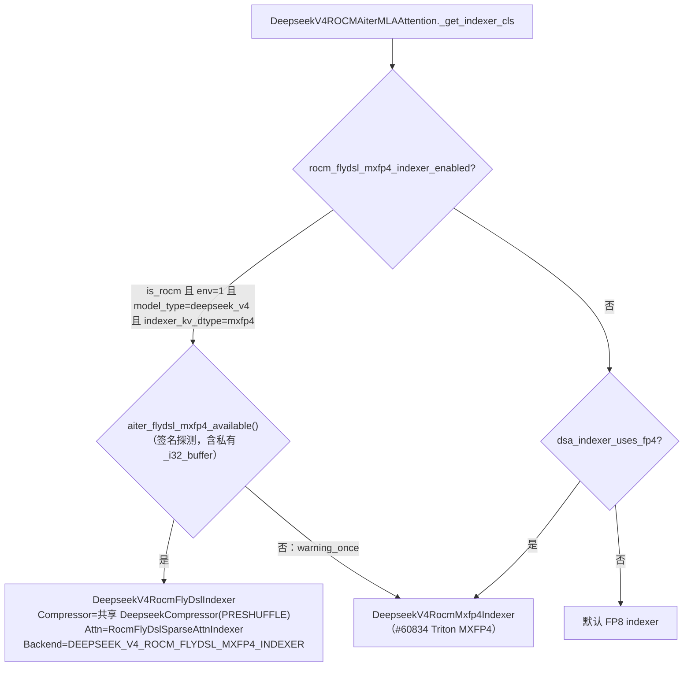
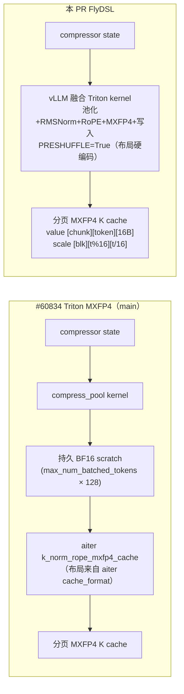
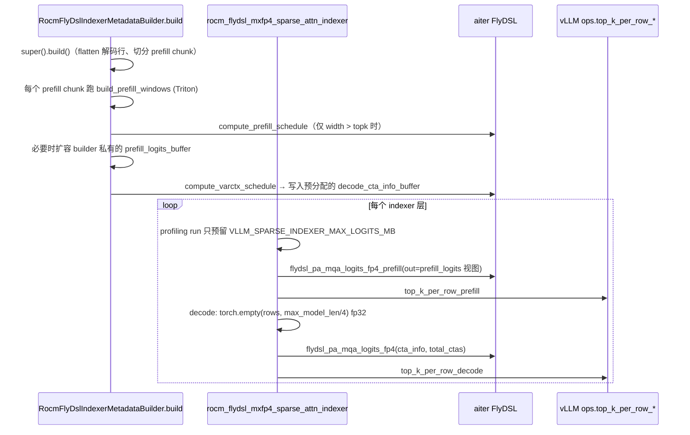

# PR #56834: [ROCm][Perf] Fuse DeepSeek V4 MXFP4 indexer K production and cache insertion (gfx950)

> **Author**: @LiuYinfeng01 | **State**: OPEN | **Date**: 2026-09-14（最新 head 测量于 2026-10-23 ~ 10-25）
> **Branch**: `rocm-dsv4-agentx-fp4-draft` → `main`（base `83c078d955`，已包含 #60834） | **Labels**: documentation, performance, rocm, ci/build, deepseek, DSv4
> **Changes**: +1830 -83 lines across 13 files | **ROCm 相关性**: 完全相关（gfx950 专属 opt-in 路径，另改动 1 个 CUDA/ROCm 共享 Triton kernel）
> 本报告分两部分：§1–6 为 PR 详细总结，§7–8 为 ROCm review 意见。本报告针对新 head `b9d84319`，取代此前针对 `ee8d74b5d0` 的旧版 review。

---

## 1. 总结 (Summary)

本 PR 为 DeepSeek V4 的 MXFP4 Lightning Indexer 在 ROCm gfx950 上新增一条 **opt-in** 路径（`VLLM_ROCM_USE_AITER_FLYDSL_MXFP4_INDEXER=1` + `indexer_kv_dtype="mxfp4"`）。K 侧把「压缩池化 → RMSNorm → RoPE → MXFP4 量化 → 写入分页 cache」合并进 vLLM 已有的 Triton 融合 compressor kernel，直接按 aiter FlyDSL scorer 需要的预 shuffle 页布局写入。Q 侧让共享的 `fused_indexer_q_rope_quant` MXFP4 Triton kernel 在 ROCm 上用 gfx950 指令 `v_cvt_scalef32_pk_fp4_f32` 打包，并输出 aiter 的 `[T,1,4,16,4]` swizzle scale。打分侧调用 aiter FlyDSL `pa_mqa_logits_fp4(_prefill)` 原地读取分页 cache，由 metadata builder 每个 step 预先规划 prefill 窗口与 CTA schedule。#60834 已合入的 Triton MXFP4 路径是两段式（pooled BF16 scratch + aiter `k_norm_rope_mxfp4_cache`），本 PR 让 K 生产的 launch 数减半。作者在描述中明确承认，**端到端吞吐并未优于 #60834**。

## 2. 背景与动机 (Background & Motivation)

- DeepSeek V4 的 C4 压缩层带有 Lightning Indexer：每个 query token 用 64 头 × 128 维的 index Q，对压缩后的 K（每 4 个 token 池化成 1 个条目）打分，选出 top-1024 交给 sparse MLA。默认 indexer cache 为 FP8，每条目 132 B；MXFP4 为 68 B（64 B e2m1 + 4 B ue8m0），容量近乎翻倍。
- #60834 已在 main 上提供 ROCm 的 Triton paged MXFP4 indexer。它的 K 写入分两步：先由 `compress_pool` 池化到持久 BF16 scratch，再由 aiter `k_norm_rope_mxfp4_cache` 写入；页布局由 aiter `cache_format()` 描述。
- 本 PR 最早（2026-09）是一个独立的 MXFP4 indexer 方案，后来 #60834 先合入了。@simondanielsson 质疑两者是否重复，作者解释差异在于 **K 生产融合**（去掉 BF16 中间 buffer 和一次 launch），并据此修改了标题与描述。打分 kernel 换成了 aiter FlyDSL 版本，它依赖尚未合入的 [ROCm/aiter#5518](https://github.com/ROCm/aiter/pull/5518)（显式 page stride、64 位 page rebase、tuned CTA 选择器）。
- PR 描述的 Validation 很详尽：5 个 arm，覆盖 AgentX、固定 8K/1K、GSM8K、kernel trace 和 aiter 微基准。作者也主动披露了不利结果：AgentX 上 FlyDSL 比同源 Triton MXFP4 **低 3.25%**；固定 8K/1K 基本持平或略低；trace 中 K 生产的节省被 scorer、选择和规划的开销抵消。

## 3. 代码修改分析 (Code Change Analysis)

### 3.1 修改的模块

| 模块 | 改动 |
|------|------|
| `vllm/v1/attention/backends/mla/rocm_flydsl_mxfp4_indexer.py`（新增 391 行） | aiter ABI 探测 `aiter_flydsl_mxfp4_available()`、启用判定 `rocm_flydsl_mxfp4_indexer_enabled()`、prefill 窗口 Triton kernel，以及 `RocmFlyDslIndexerMetadata` / `RocmFlyDslIndexerMetadataBuilder`（prefill 窗口 + CTA schedule、预分配的 decode CTA schedule buffer） |
| `vllm/models/deepseek_v4/amd/ops/sparse_attn_indexer.py`（新增 231 行） | `rocm_flydsl_mxfp4_sparse_attn_indexer`（`@eager_break_during_capture`）：用 `as_strided` 构造 cache 视图，prefill/decode 调 FlyDSL scorer + vLLM `top_k_per_row_*`；`RocmFlyDslSparseAttnIndexer.forward_hip` |
| `vllm/models/deepseek_v4/amd/rocm.py` (+48) | `_get_indexer_cls` 优先返回 `DeepseekV4RocmFlyDslIndexer`；新增 Indexer/IndexerCache 子类，Q 量化输出 bf16 weights |
| `vllm/models/deepseek_v4/common/ops/fused_compress_quant_cache.py` (+45/-15) | MXFP4 indexer K kernel 新增 `PRESHUFFLE` constexpr：ROCm 上用 gfx950 asm 打包，按 FlyDSL 页布局写 value/scale；ROCm 非 gfx950、D≠128 或 page≠64 时 launcher 直接 raise；warmup 仅在 FlyDSL 启用时为 ROCm 编译 |
| `vllm/models/deepseek_v4/common/ops/fused_indexer_q.py` (+108/-68) | **共享的** MXFP4 Q Triton kernel 改为整头向量化；新增 `PRESHUFFLE_FP4` / `USE_EXPLICIT_FMA`；ROCm 输出 `[T,1,4,16,4]` scale；删除 `_quantize_mxfp4_pair`；新增 `_fp32x2_to_fp4x2_rocm` |
| `vllm/envs.py` (+9) | 注册 `VLLM_ROCM_USE_AITER_FLYDSL_MXFP4_INDEXER`（默认 False） |
| `tests/v1/attention/test_rocm_flydsl_mxfp4_indexer.py`（新增 664 行） | 覆盖选择逻辑、ABI 探测、builder 规划、scorer 调用契约；aiter 全部 mock，只有窗口 kernel 一项在 GPU 上跑 |
| `tests/kernels/test_fused_indexer_q_dispatch.py`（新增 191 行） | Q 分发与布局的 host-only 测试 |
| `tests/kernels/test_fused_indexer_q_rope_quant.py` (+113) | E2M1 参考实现锚定测试；gfx950 上 Q packed 值与 swizzle scale 逐字节比对 |
| `.buildkite/test-amd.yaml`、`.buildkite/test_areas/kernels.yaml` | 把 `test_fused_indexer_q_dispatch.py` 加入 kernels 列表（另有一处多余空行） |
| `docs/design/attention_backends.md` (+25) | 新增 "Experimental gfx950 FlyDSL MXFP4 indexer" 小节 |

### 3.2 架构 / 流程图

**后端选择（模型构建期）**：



**K 生产路径对比（每个 C4 indexer 层）**：



**打分与 top-k（每 step / 每层）**：



### 3.3 关键实现细节

- **选择门控**：`rocm_flydsl_mxfp4_indexer_enabled()` 要求同时满足 ROCm、env flag、`model_type == "deepseek_v4"`、`indexer_kv_dtype=mxfp4`，且 aiter ABI 探测通过；探测失败时打印 warning 并回落到 #60834 的 Triton MXFP4（不是 FP8）。Q kernel 的 weights dtype warmup 和 compressor kernel 的 warmup 也复用这个函数，因此编译集合一致。
- **ABI 探测**：用 `inspect.signature` 检查三件事：`pa_mqa_logits_fp4_common._i32_buffer` 是否有 `byte_offset`；`build_*/compile_*` 是否有 `kv_page_stride/kv_scale_page_stride/block_table_stride`；各 schedule 函数的参数是否齐全。
- **K 写入布局**（`fused_compress_quant_cache.py:1086-1105`）：`value_offset = chunk*64*16 + pos*16 + byte`，`scale_offset = 64*64 + scale_idx*64 + (pos%16)*4 + pos//16`。这与 `_rocm_fp4_cache_views` 的 `as_strided` 一致（value `(nb,1,4,64,16)`；scale `(nb,1,4,64)`，偏移 4096）。我对照了 aiter FlyDSL kernel 的 scale 地址 `lane_div_16*kv_block_size + lane_mod_16*N_TILES_PER_WARP + nt`（kernel 内有 `assert N_TILES_PER_WARP == 4`），两边匹配。
- **Q 量化**：ROCm 上 scale 写到 `block*64 + (head%16)*4 + head//16`，即 `[T,1,4(block),16(head%16),4(head//16)]`。只支持 H=64、D=128、gfx950，其他情况抛 `ValueError`。kernel 从「逐 32 元素块循环」改成「整头 64 对向量化」，NoPE 部分以 cos=1、sin=0 的掩码加载，并入 RoPE 公式。
- **Builder**：prefill 复用 #60834 的 `split_prefill_chunks`（按 rows × 最宽压缩上下文限额）。`width <= topk` 的 chunk 不打分，直接填 `[0, local_end)`。decode CTA buffer 按 `default_varctx_parallel_unit_num(max_decode_rows, max_ctx)` 预分配；aiter#5518 中该函数是 `max(rows, bucket_target)`，随 rows 单调，所以这个上界成立。`get_cudagraph_support` 返回 `ALWAYS`。
- **CUDA graph**：scorer 函数加了 `@eager_break_during_capture`。FULL 模式下整个函数被捕获；`total_ctas` 只取决于 capture size 和常量最大上下文，`cta_info` 在 build 时原地刷新，所以 replay 时 schedule 稳定。这部分设计是对的。

## 4. 涉及的技术原理 (Technical Principles)

- **DeepSeek V4 Lightning Indexer（DSA）**：对 C4 压缩后的 KV 做轻量 MQA 打分（64 头 × 128 维，加权求和），每行取 top-k（Pro 为 1024）个压缩条目送入 sparse MLA。prefill 是 ragged 的「行 × 请求上下文」打分，decode 是「行 × 最大上下文」打分。两者的 logits 都是 fp32，尺寸随 `max_model_len/4` 线性增长。
- **MXFP4（OCP MX）**：每 32 个元素共享一个 ue8m0 指数 scale，元素为 e2m1（4 bit，取值 ±{0,0.5,1,1.5,2,3,4,6}），scale 取 `2^ceil(log2(amax/6))`。gfx950 原生支持 `v_cvt_scalef32_pk_fp4_f32` 打包和 MFMA scaled FP4 指令，gfx942 不支持，所以这条路径只能用在 gfx950。
- **预 shuffle 页布局**：FlyDSL scorer 的每个 wave 以 MFMA 16×16 tile 读取 KV，scale 一次以 dword 取 4 个 N-tile 的字节。因此 cache 写入时必须按 `[chunk][token][16B]` / `[blk][t%16][t/16]` 排列。这个布局与 kernel 的 `num_warps`、`block_k`、`kv_block_size` 强耦合。
- **持久化网格（persistent grid）调度**：FlyDSL scorer 用 `cta_info[P,4]` 描述每个 CTA 处理的 (row, start chunk, count, ctx)。P 只由 host 已知的 rows 与 max_seq_len 决定，所以不需要 D2H 同步，可以被 CUDA/HIP graph 捕获。
- **vLLM 显存 profiling**：启动时跑一次 dummy forward 测峰值，KV cache 占用剩余的全部显存。之后运行期出现、但 profile 中没有的临时或持久分配，都没有余量可用。main 上的 #62860 就是为 decode indexer logits 补这份预留。

## 5. 评论区讨论亮点 (Discussion Highlights)

- **@simondanielsson**：
  - 要求删除 aiter 能力探测，等 vLLM pin 的 aiter 版本包含所需 kernel 后再提交（"the code should assume aiter already ships what we need"）。作者在描述中承认这个问题尚未解决，探测仍保留在代码里。
  - 质疑本 PR 与 #60834 重复。作者解释差异在于 K 生产融合，并更新了标题和描述。
  - 追问 CTA buffer 为什么按 `max(512, max_decode_tokens)` 分配。
- **@jiacao-amd**：
  - 指出固定 512 CTA 下限绕过了 aiter 的 tuned grid 选择。作者先给出 A/B 数据坚持保留，后续版本改成 `default_varctx_parallel_unit_num`，并按上界预分配。
  - 指出按最坏配置分配 decode logits buffer 可能占用数 GB。最新版改为按当前 batch/capture size 临时分配，但 profiling 预留仍有问题，见 §7。
  - 要求补 FP4 Q 值与 scale 对参考实现的测试。作者已在 `ee8d74b5d0` 补上逐字节测试。
- 目前没有任何 approve，mergify 多次提示冲突。base 之后 main 又改了 `amd/rocm.py`（2 次）和 `envs.py`（7 次）；其中 #61628 删除了 `VLLM_ROCM_AITER_MLA_DCP_VERIFY`，而本 PR 的 envs hunk 正好以它为上下文，所以还需要再 rebase 一次。

## 6. 风险与潜在问题 (Risk Analysis)

| 风险 | 严重程度 | 说明 |
|------|---------|------|
| 收益抵不上复杂度：FlyDSL 端到端不优于已合入的 Triton MXFP4 | High | 见 §7 ⚠️【性能】 |
| 依赖未合入的 aiter#5518，在任何已发布 aiter 上都是死代码 | High | 见 §7 ⚠️【兼容性】；CI 无法真实覆盖 |
| decode logits 未在 profile 中预留，prefill logits 用 builder 私有持久 buffer | Medium | 见 §7 ⚠️【正确性】；长上下文 + 混合 batch 下有 OOM 风险 |
| 新 K 写入布局在 vLLM 中硬编码，与 aiter kernel 实现细节耦合 | Medium | 见 §7 ⚠️【可维护性】 |
| 核心 K 写入 kernel 没有 GPU 数值测试，新增测试大多是 mock | Medium | 见 §7 ⚠️【测试】 |
| 共享 Q Triton kernel 的重写影响 CUDA 的非 CuTeDSL 回退路径 | Low | 我核对过布局等价，仍需 CUDA CI 兜底，见 §7 📝 |
| 新增 env var 作为长期 feature flag | Low | 见 §7 📝【设计】 |
| CI 状态未知 | Low | fetch 得到的 `checks` 字段只有键名，没拿到 check run；需要在 PR 页确认 AMD MI355 kernels / v1 attention 队列的结果 |

---

## 7. Review 意见 (Findings)

| 类型 | 🔴 | ⚠️ | 📝 |
|------|----|----|----|
| 性能 | — | 1 | — |
| 兼容性 | — | 1 | 1 |
| 正确性 | — | 1 | — |
| 可维护性 | — | 1 | — |
| 测试 | — | 1 | — |
| 设计 | — | — | 1 |

---

**⚠️【性能】标为 [Perf] 的 PR，按作者自己的数据，FlyDSL 路径不优于已合入的 Triton MXFP4 路径** `[已验证]`（数据本身 `[unverified]`：来自作者本地归档，不是公开的 CI 产物）

- **问题**: PR 描述中的同源对比（PR Triton vs PR FlyDSL）：
  - AgentX C128 总吞吐 186,866.65 → 180,787.37 tok/s（**−3.25%**，单次运行）。
  - 固定 8K/1K 输出吞吐：C16 781.18 → 778.63（−0.33%），C64 1,517.81 → 1,514.79（−0.20%）。
  - kernel trace 中，K 生产+写入确实从 2,416.4 µs 降到 1,908.9 µs（−21%，launch 240 → 120）。但「选择+定位」从 5,537.4 µs 升到 7,773.5 µs（+40%），窗口/CTA 规划从 18.0 µs 升到 287.9 µs，选定 kernel 小计从 16,795.0 µs 升到 18,968.6 µs（+13%）。作者也承认 trace 的 step 组成不匹配（decode 44–47 行 vs 57–60 行），无法归因。
- **影响**: 合入后 main 要多出约 1,830 行代码：新 backend、新 builder、新 scorer 封装、共享 kernel 改造和一个新 env var。换来的是一条按现有数据比默认 MXFP4 路径更慢、而且只能在未发布 aiter 上运行的 opt-in 路径。标题宣称的唯一明确收益（K 生产融合）和回退的来源（FlyDSL scorer + vLLM `top_k_per_row_*` + 每 step 规划）被打包在一起，reviewer 没法只接受收益那部分。
- **行动**: 建议作者把「K 生产融合」和「FlyDSL scorer 后端」拆开评估。
  - (a) 如果融合 K 写入能直接写出 #60834 Triton scorer 读取的布局（`RocmPagedMxfp4CacheLayout`），可以单独提交这部分融合，不需要新后端就能拿到 −21% 的 K 生产时间。
  - (b) FlyDSL scorer 部分等 aiter#5518 合入、并在组成匹配的 trace 和多次运行中证明优于 Triton MXFP4 之后再提。
  - 建议 review 时追问「选择+定位」+40% 的来源。我推测与改用 vLLM `top_k_per_row_decode` 扫描 `(rows, max_model_len/4)` 全宽 logits 有关 `[推测]`。

**⚠️【兼容性】整条路径依赖未合入的 ROCm/aiter#5518，并靠探测私有函数签名做运行期门控** `[已验证]`

- **问题**: `rocm_flydsl_mxfp4_indexer.py:44-93` 的 `aiter_flydsl_mxfp4_available()` 检查私有 helper `pa_mqa_logits_fp4_common._i32_buffer` 的 `byte_offset` 参数，以及 `kv_page_stride`、`default_varctx_parallel_unit_num` 等符号。我核对了本机 nightly 镜像里的 aiter 0.1.26，探测必然返回 False：
  - `_i32_buffer(ptr, width=1)` 没有 `byte_offset`；
  - `build_pa_mqa_logits_fp4_module` 没有 stride 参数；
  - `default_varctx_parallel_unit_num` 不存在。

  aiter#5518 截至本次 review 仍为 OPEN（head `4bfc5992`，在作者本人的 fork 上）。PR 描述也承认 "The measured nightly does not provide all required FlyDSL stride/address/schedule interfaces"。
- **影响**: 在任何已发布 aiter 上，设置这个 env var 只会打印 warning，然后回落到 Triton MXFP4。AMD CI 跑不到真实的 FlyDSL 路径，新增测试只能 mock aiter。如果 aiter#5518 合入前改了参数名或语义（例如 `cta_info` 宽度、`n_ctas` 的含义），签名探测要么静默关闭功能，要么放行语义不匹配的版本；探测私有 `_i32_buffer` 尤其脆弱。这与 @simondanielsson 的意见一致，至今没有解决。
- **行动**: 建议作者先推动 aiter#5518 合入，并在 `requirements/rocm.txt` / ROCm Dockerfile 中 pin 到包含它的版本，然后删除签名探测（或至少改为检查公开 API 或 aiter 版本号），并在 PR 描述中写明所需的 aiter 最低版本。在此之前建议保持 draft。

**⚠️【正确性】decode logits 未在 profiling 中预留，prefill logits 用 builder 私有持久 buffer 绕过 workspace manager；做法与 #60834 及 main 的 #62860 不一致** `[已验证]`（OOM 后果 `[推测]`）

- **问题**:
  - `amd/ops/sparse_attn_indexer.py:81-86` 的 profiling 分支只用 `torch.empty(VLLM_SPARSE_INDEXER_MAX_LOGITS_MB)` 预留 prefill 预算。
  - 同文件 `:162-166` 的 decode 路径每层都 `torch.empty((rows, max_model_len), fp32)`；这里的 `max_model_len` 已经是除以 4 后的压缩长度。
  - `rocm_flydsl_mxfp4_indexer.py:344-352` 在 builder 中按需扩容一块**持久**的 `prefill_logits_buffer`，上限就是同一份 512 MiB 预算。它在 KV cache 分配之后才出现，会永久占掉 profile 时那份临时预留。
  - 对比之下，#60834 的孪生实现 `reserve_rocm_mxfp4_indexer_workspace()` 在 profiling 时通过 `current_workspace_manager().get_simultaneous` 同时预留 `(_max_decode_logits_rows, logits_width)` 的 decode logits 和 prefill 预算；main 上的 #62860（"Reserve the decode indexer logits in the memory profile"）也专门为 CUDA 路径补了这份预留。
- **影响**: 具体触发场景：DeepSeek-V4-Pro，`max_model_len=1,048,576`（压缩后 262,144），`max_num_seqs=128`，MTP 3 个 draft，decode 行数最多 512。单次 decode logits = 512 × 262,144 × 4 B = **512 MiB**，完全不在 profile 中。混合 prefill+decode 的 step 走 eager-break（不在 FULL graph pool 里），这时持久 prefill buffer（≤512 MiB）和 decode 临时 logits 同时存活，而 profile 只留了 512 MiB 余量。`gpu_memory_utilization` 较高时可能在运行期 OOM。作者的固定负载测试用的是 `max_model_len=10240`、`gpu_memory_utilization=0.86`，AgentX 也没有覆盖 1M 上下文，所以测不出来。
- **行动**: 作者应当在 profiling 分支按 `_max_decode_logits_rows(...) × max_model_len` 预留 decode logits，并把 prefill/decode logits 都改为从 `current_workspace_manager()` 获取，与 #60834 保持一致（profile 后锁定，超预算时显式报错，而不是静默 OOM）。或者给出 1M 上下文、高并发下的显存实测数据。

**⚠️【可维护性】FlyDSL K 页布局在 vLLM Triton kernel 中硬编码，丢掉了 #60834 以 aiter `cache_format()` 为唯一事实来源的保护** `[已验证]`

- **问题**: `fused_compress_quant_cache.py:1086-1105` 用常量公式写 value（`[chunk][token][16B]`）和 scale（`[scale_idx][pos%16][pos//16]`），只靠 `tl.static_assert(HEAD_SIZE == 128 and QUANT_BLOCK == 32)` 和 launcher 的 page=64 检查兜底；`_rocm_fp4_cache_views`（`sparse_attn_indexer.py:20-41`）再按同一假设构造 `as_strided` 视图。这些公式对应的是 aiter FlyDSL kernel 的实现细节：scale 地址 `lane_mod_16 * N_TILES_PER_WARP + nt` 依赖 `N_TILES_PER_WARP == 4`，而这个值由 `block_k=256`、`num_warps=4` 推出（aiter kernel 内有断言）。相比之下，#60834 的 Triton 路径通过 `rocm_paged_mxfp4_cache_layout()` 从 aiter `cache_format()` 读取布局，遇到无法表达的布局会在启动期报错。
- **影响**: 如果 aiter 侧调整 `num_warps`/`block_k` 的默认值或 scale 打包方式，ABI 探测（只看参数名）照样通过，vLLM 继续按旧布局写 K，scorer 读到的 scale/value 就会错位。不会崩溃也不会报错，indexer top-k 静默变差，最终表现为长上下文质量下降。
- **行动**: 建议作者请 aiter 为 FlyDSL scorer 暴露布局描述（类似 `cache_format()`），并在 builder 初始化时校验。至少在 vLLM 侧加一个启动期自检（写入几个已知 token，再用 aiter 的参考 dequant 读回比对），并在 kernel 注释中写明这个布局对应的 aiter 版本以及 `block_k/num_warps` 前提。

**⚠️【测试】PR 的核心改动（PRESHUFFLE 融合 K 写入）没有任何 GPU 数值测试，新增的 664 行后端测试把 aiter 全部 mock 掉了** `[已验证]`

- **问题**: 新增的 GPU 数值覆盖只有 Q 侧的 `test_rocm_mxfp4_fused_indexer_q_matches_reference`（gfx950 上逐字节比对 packed 值和 swizzle scale，这一项很好）。K 侧 `_fused_kv_compress_norm_rope_insert_indexer_mxfp4_attn` 的 `PRESHUFFLE=True` 分支（`v_cvt_scalef32_pk_fp4_f32` 打包 + 新的 value/scale 偏移）没有任何测试：
  - `tests/kernels/test_compressor_kv_cache.py` 中相关用例全部 `skipif(not is_cuda())`；
  - `test_rocm_flydsl_mxfp4_indexer.py` 的 docstring 自己写明 "aiter kernels are mocked … host contract tests, not GPU validation"；
  - PR 描述中的 "91 passed, 92 skipped" 也说明大部分用例被跳过了。
- **影响**: 如果写入布局或 RNE 打包有 off-by-one（例如 `pos%16` 和 `pos//16` 写反），GSM8K 这类短上下文评测几乎察觉不到：top-k=1024 已覆盖短上下文的大部分条目，`width <= topk` 时根本不打分。问题只会在长上下文的 top-k 选择上静默出现。aiter 侧的 40 个 stride 用例用的是 aiter 自己的写入器，覆盖不到 vLLM 的写入 kernel。
- **行动**: 建议作者补一个 gfx950 用例：用融合 compressor kernel 写入若干随机 token，按 `_rocm_fp4_cache_views` 读回，与经过同样 swizzle 的 `quantize_to_mxfp4` 参考结果逐字节比较。如果环境中的 aiter 具备 FlyDSL API，再加一个端到端用例：vLLM 写入 → FlyDSL scorer → 与 BF16 参考 logits 比较余弦相似度和 top-k 重合率（缺 API 时 skip）。另外请确认该测试文件被加入 MI355 kernels 队列。

**📝【兼容性】共享的 MXFP4 Q Triton kernel 被重写，影响 CUDA 的非 CuTeDSL 回退路径** `[已验证]`（等价性是我人工推导的）

- **问题**: `fused_indexer_q.py` 的 MXFP4 kernel 从逐块循环改成整头向量化，CUDA 侧 `PRESHUFFLE_FP4=False`、`USE_EXPLICIT_FMA=False`。我逐项核对了 packed 字节位置（pair p → 字节 p）、scale 位置和 RoPE 对索引，与旧实现等价。唯一可见差异是 NoPE 部分现在也要经过 `to(bf16).to(fp32)` 往返（`:411-412`）：对 bf16 输入是 no-op，对 fp16 输入会多损失 3 位尾数。作者说明没有在 NVIDIA GPU 上跑数值测试。
- **行动**: 建议作者在 PR 中贴出 CUDA kernels 队列（`test_fused_indexer_q_rope_quant_matches_unfused[use_cutedsl=False]`）的通过记录，并在注释中说明 NoPE 的 bf16 往返是有意为之；或者只对 RoPE 对做往返，保持旧行为。

**📝【设计】新增 env var 作为长期的后端选择开关，且不受 `VLLM_ROCM_USE_AITER` 总开关约束** `[已验证]`

- **问题**: `envs.py:1360-1367` 新增了 `VLLM_ROCM_USE_AITER_FLYDSL_MXFP4_INDEXER`。它已注册、有文档，满足卫生要求。但它本质上是在 `indexer_kv_dtype=mxfp4` 之下再选第二个 scorer 后端，与已有的 `--attention-config` 配置面并列。另外 `rocm_flydsl_mxfp4_indexer_enabled()` 不检查 `VLLM_ROCM_USE_AITER`，语义和其他 `VLLM_ROCM_USE_AITER_*` 子开关不一致。
- **行动**: 建议作者考虑把它改成 `attention_config` 字段（例如 indexer backend 选择），或者在 docstring 中注明这是验证期的临时开关、FlyDSL 证明更优后会删除。顺手删掉 `.buildkite/test-amd.yaml:4432` 的多余空行，并 rebase 到最新 main（`envs.py` hunk 的上下文 `VLLM_ROCM_AITER_MLA_DCP_VERIFY` 已被 #61628 删除）。

> AI 代码诊断：PR 描述明确说明使用了 AI 辅助，但描述解释了机制（WHY），数字也附带了配置和局限说明，不属于"只讲 WHAT"的高风险形态。主要的风险信号有三个：测试以 mock 为主、探测私有符号、显存预留与孪生实现（#60834）不一致，已分别列在上文。我核对了新增符号：`eager_break_during_capture`、`ops.top_k_per_row_prefill/decode`、`split_prefill_chunks`、`on_gfx950`、`_ON_GFX950` 在 base 中都存在且签名匹配；aiter 侧的 `default_varctx_parallel_unit_num`、`compute_varctx_schedule(cta_info_out=)`、`flydsl_pa_mqa_logits_fp4(_prefill)(cta_info, total_ctas/n_ctas)` 只存在于 aiter#5518 中。

## 8. 结论 (Verdict)

**⚠️ NEEDS WORK**

实现本身比较严谨：CUDA graph 下的 schedule 是稳定的，规划过程没有 D2H 同步，Q 侧有逐字节测试，性能披露也很透明；我没有找到能写出具体触发输入的静默数值错误。但有三个问题需要先解决：
1. 按作者自己的数据，这条 opt-in 路径比已合入的 Triton MXFP4 更慢，标题中 "[Perf]" 的收益（K 生产融合）应当与 FlyDSL scorer 拆开评估；
2. 整条路径依赖未合入的 aiter#5518，在任何已发布 aiter 上都是死代码；
3. decode logits 的显存预留与 #60834、#62860 不一致，长上下文下有 OOM 风险。

另外建议补上 K 写入的 GPU 数值测试，并在 aiter 依赖落地前保持 draft。

## 9. 英文 Review 评论 (Copy-Paste English Comments)

**C1** `vllm/models/deepseek_v4/amd/ops/sparse_attn_indexer.py:81-86` — ⚠️ comment

```text
The profiling branch only reserves VLLM_SPARSE_INDEXER_MAX_LOGITS_MB for prefill logits. The decode path below (lines 162-166) allocates a new (rows, max_model_len // 4) fp32 tensor per layer, and the builder later grows a persistent prefill_logits_buffer outside the profile (rocm_flydsl_mxfp4_indexer.py:344-352). For DeepSeek-V4-Pro at max_model_len=1M with 128 seqs and 3 MTP drafts, that is 512 rows x 262144 x 4 B = 512 MiB of decode logits the memory profile never sees. In mixed steps this sits on top of the persistent prefill buffer, because those steps run in the eager-break segment rather than the graph pool. The Triton MXFP4 path from #60834 reserves both via reserve_rocm_mxfp4_indexer_workspace(), and #62860 added the same reservation for the CUDA path. Could you reserve (_max_decode_logits_rows, max_model_len) in the profile and take both logits buffers from current_workspace_manager()? Then going over budget fails loudly instead of OOMing at runtime.
```

**C2** `vllm/v1/attention/backends/mla/rocm_flydsl_mxfp4_indexer.py:44-93` — ⚠️ comment

```text
This probe can only pass with ROCm/aiter#5518, which is still open. In the aiter shipped with the current ROCm nightly (0.1.26), _i32_buffer has no byte_offset, the build/compile functions have no page-stride parameters, and default_varctx_parallel_unit_num does not exist. So the flag always falls back to Triton MXFP4, and CI can only test this backend with mocks. Probing the private _i32_buffer signature is also fragile: a rename silently turns the feature off, and a semantic change that keeps the same parameter names still passes. +1 to the earlier suggestion: could we land aiter#5518, pin requirements/rocm.txt to a release that includes it, drop the signature probe, and keep this PR in draft until then?
```

**C3** `vllm/models/deepseek_v4/common/ops/fused_compress_quant_cache.py:1086-1105` — ⚠️ comment

```text
This hard-codes the FlyDSL page layout in vLLM: values as [chunk][token][16B] and scales as [blk][t%16][t//16]. The scale order comes from the FlyDSL kernel reading lane_mod_16 * N_TILES_PER_WARP + nt with N_TILES_PER_WARP == 4, so it depends on aiter's block_k/num_warps choice. The #60834 path reads its layout from aiter's cache_format() and rejects layouts it cannot express at startup. Here, an aiter-side change would still pass the ABI probe and silently corrupt indexer top-k. I also could not find a GPU test for the PRESHUFFLE=True branch of this kernel: test_compressor_kv_cache.py is CUDA-only, and the new backend tests mock aiter. Could you add a gfx950 test that writes K through this kernel and byte-compares it with quantize_to_mxfp4 under the same swizzle? Ideally the layout would also be checked against a descriptor provided by aiter.
```

**C4** `vllm/models/deepseek_v4/amd/rocm.py:843-844` — ⚠️ comment

```text
Thanks for the very transparent measurements. Taken together, though, they show the FlyDSL arm below the already-merged Triton MXFP4 path: -3.25% AgentX throughput on the same source, about -0.2% to -0.35% at fixed 8K/1K, and a +13% selected-kernel subtotal in the trace. The fused K writer itself cuts K-production time by about 21% and halves its launches, but the FlyDSL scorer, selection (+40%) and planning costs more than cancel that out. Could the K-production fusion be split out so it writes the layout the #60834 Triton scorer reads? That would land the clear win without a second scorer backend, a new env var, or an unreleased aiter dependency. The FlyDSL scorer could follow once it beats Triton MXFP4 in composition-matched, repeated runs.
```
