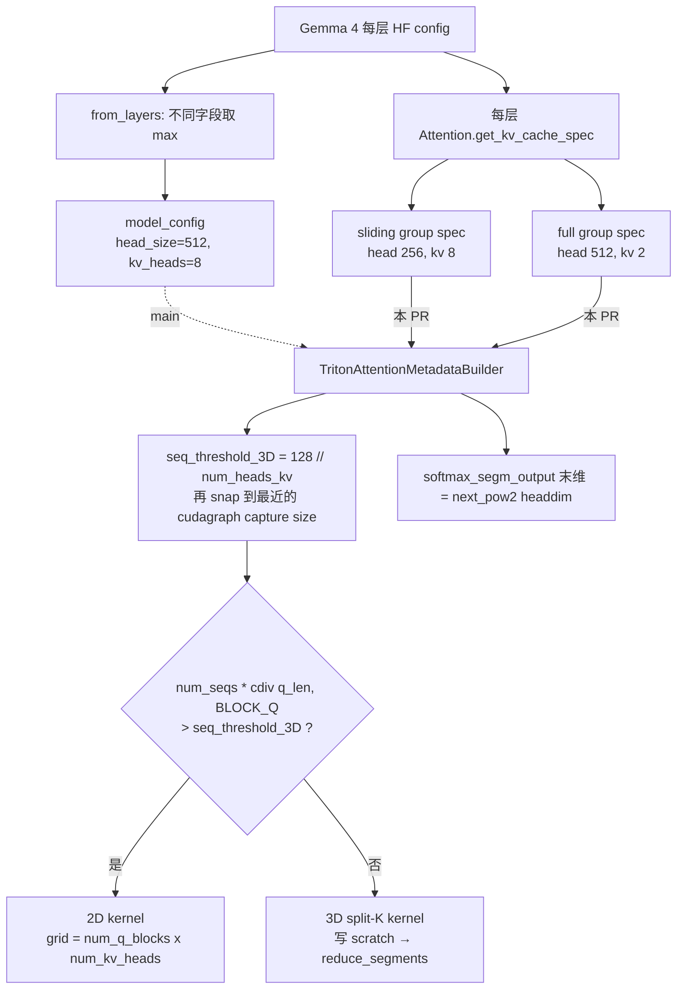
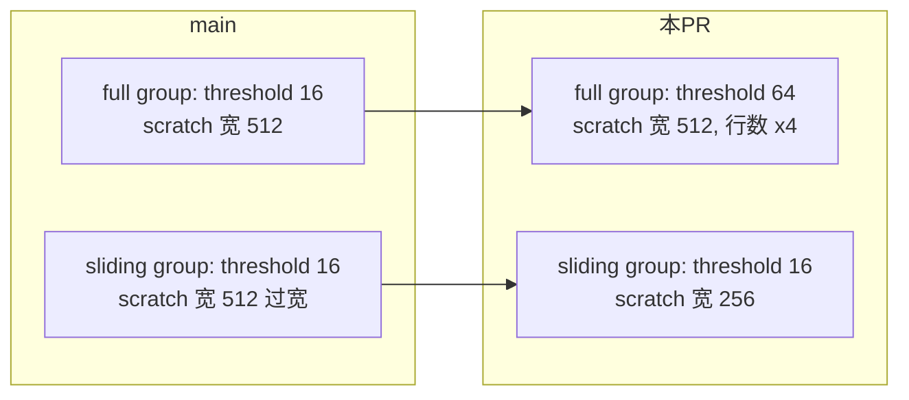

# PR #56996: [Perf][Attention] Source Triton metadata builder geometry from kv_cache_spec

> **Author**: @ZhengGong-amd | **State**: OPEN | **Date**: 2026-09-15（2026-09-21 转为 ready for review）
> **Branch**: `ZhengGong-amd:triton-attn-kv-spec-heads` → `main` | **Labels**: bug
> **Changes**: +92 -2 lines across 2 files | **ROCm 相关性**: 部分相关（`triton_attn.py` 为 CUDA/ROCm 共享后端；Gemma 4 在 ROCm 上被强制走 `TRITON_ATTN`，且全部性能数据来自 MI325X / MI355X）
> 本报告分两部分：§1–6 为 PR 详细总结，§7–8 为 ROCm review 意见。
>
> 数据来源说明：本次 GitHub REST API 未认证配额耗尽，PR 元数据/描述取自 github.com 页面与 `.patch`，diff 取自 `.diff`；CI 状态未知（页面未显示 checks）。交叉验证基于今日同步的本地 main（`387c1975ac`），PR diff 的上下文行与 main 一致，可直接应用。

---

## 1. 总结 (Summary)

`TritonAttentionMetadataBuilder` 是按 KV-cache group（更准确地说是 attention group）实例化的，但它的 `num_heads_kv` 和 `headdim` 却取自模型全局的 `ModelConfig` getter。对于 Gemma 4 这类各层几何不同的模型，全局值是各层的 `max`，因此 full-attention group 的 3D/2D 切换阈值 `seq_threshold_3D` 被低估（16 而非 64），batch 17–64 的 decode 被留在 grid 不足的 2D kernel 上；sliding group 的 split-K scratch 则按 512 而非 256 的 head dim 过量分配。本 PR 两行改动，改为读取 group 自己的 `kv_cache_spec.num_kv_heads` / `kv_cache_spec.head_size`，与 `FlashAttentionMetadataBuilder` 的做法对齐，并补了 3 个 builder 级单测。

## 2. 背景与动机 (Background & Motivation)

- vLLM 已支持“逐层异构”的模型架构配置：`ModelArchitectureConfig.from_layers`（`vllm/config/model_arch.py:95`）把各层不同的数值字段按 `max` 折叠为全模型值，并把差异保存在 `per_layer_overrides` 里。Gemma 4 正是这种模型：sliding 层 `head_dim=256`、KV heads 8；full-attention 层 `global_head_dim=512`、KV heads 2（以 `gemma-4-26B-A4B-it` 为例）。
- 因此 `model_config.get_head_size()` 返回 512、`get_num_kv_heads()` 返回 8 —— 对任意一个 group 来说都只是**上界**，不是它自己的几何。
- #42650 已经让 Triton builder 的 `num_heads_q` 从 layer 读取；FlashAttention builder（`flash_attn.py:702-704`）早已从 `kv_cache_spec` 读取 KV heads / head size。本 PR 补齐 Triton builder 剩下的两个字段。
- ROCm 视角：`Gemma4Config.verify_and_update_config` 在非 FA4 平台上把 backend 强制设为 `TRITON_ATTN`（`vllm/model_executor/models/config.py:384-390`），所以 ROCm 上 Gemma 4 的**所有**注意力层都走这个 builder —— 这是 AMD 作者提这个 PR 的直接原因。
- Commit 尾注标明 `Generated-by: Hyperloom` / `Co-authored-by: Claude` / `Cursor`，属 AI 辅助生成；但描述把机制讲得很清楚（WHY 而不只是 WHAT），AI 代码风险偏低。

## 3. 代码修改分析 (Code Change Analysis)

### 3.1 修改的模块

| 模块 | 改动 |
|------|------|
| `vllm/v1/attention/backends/triton_attn.py` (+4 -2) | `num_heads_kv ← kv_cache_spec.num_kv_heads`；`headdim ← kv_cache_spec.head_size`（附注释说明为何不用 `head_size_v`） |
| `tests/v1/attention/test_group_head_counts.py` (+88) | 新增 `_triton_builder` 辅助函数（mock 的全局值与 spec 故意不一致）+ 3 个测试：几何来自 group、CUDA graph 下阈值先 snap 再被 `max_num_seqs` 截断、scratch 末维等于 `next_power_of_2(head_size)` |

### 3.2 架构 / 流程图

**几何来源变化与 3D/2D 选择：**



**Gemma 4 两个 group 在 main 与 PR 上的取值对比：**



### 3.3 关键实现细节

- `seq_threshold_3D = MIN_LAUNCH_GRID_SIZE_2D(128) // num_heads_kv`：2D grid 为 `(num_q_blocks, num_kv_heads)`，而 kernel 实际使用的 `num_kv_heads` 来自 `k.shape[2]`（group 自己的值）。全局 8 vs group 2 → 阈值 16 vs 64。batch 24 时 2D grid 只有 48 个 block，远低于 128。
- CUDA graph 模式下阈值会 snap 到最近的 capture size，随后 `max_num_seqs_3d = min(threshold, max_num_seqs)` 决定 scratch 行数 —— 新测试 `test_triton_threshold_snaps_before_the_max_num_seqs_cap` 锁定了这个顺序。
- 用 `head_size` 而非 `head_size_v`：`unified_attention` 以 `HEAD_SIZE_PADDED = next_power_of_2(q.shape[2])` 为 scratch 步长（`triton_unified_attention.py:614-635`、`:1038`）。DiffKV 子类 `TritonAttentionDiffKVMetadataBuilder` 会按 `head_size_v` 重新分配 `softmax_segm_output`（`triton_attn_diffkv.py:36-61`），不受影响。
- attention group 以 `(backend, 每层 spec, num_heads_q)` 为 key 划分（`gpu_model_runner.py:6672-6686`），`UniformTypeKVCacheSpecs` 也会拆到每层 spec，因此同一 builder 内的几何是同质的，读 spec 是安全的。
- spec 中的 `num_kv_heads` 是 per-rank 值（`max(1, total // tp)`），与 `get_num_kv_heads(parallel_config)` 语义相同，TP 下无差异。

## 4. 涉及的技术原理 (Technical Principles)

- **2D vs 3D (split-K) unified attention**：2D kernel 每个 program 处理一个 (q block, kv head)，序列长度方向串行；batch 小时 program 数不足以填满 CU。3D kernel 额外沿序列维切 `NUM_PAR_SOFTMAX_SEGMENTS=16` 段并行，每段写出部分 `acc`、`max`、`expsum` 到 scratch，再由 `reduce_segments` 做 log-sum-exp 合并。阈值决定“grid 够大就用 2D，否则用 3D”。
- **Split-K 的数值性质**：3D 与 2D 的数学结果等价，但浮点累加顺序不同（分段 online softmax + 二次合并），bf16 输出会有末位差异；greedy decoding 下这种差异会在长生成里放大为不同文本，但不应系统性改变准确率。
- **异构层架构配置**：`from_layers` 把各层差异折叠为 `max` 供“全模型 buffer”使用；任何按 group 工作的组件都应读取 group 级的 `kv_cache_spec`，否则只能得到上界。
- **CUDA/HIP graph 与阈值**：decode graph 按 capture size 捕获；阈值必须落在某个 capture size 上，才能保证每张图内部 2D/3D 路径一致。
- **Scratch 分配时机**：metadata builder 在 `initialize_kv_cache` → `initialize_metadata_builders`（`gpu_model_runner.py:7031`）中创建，晚于 `determine_available_memory` 的 profile run，因此 scratch 不计入 KV cache 显存预算。

## 5. 评论区讨论亮点 (Discussion Highlights)

- 目前没有实质性人工 review。仅有 Claude bot 的两条自动评论（9/15、9/21），提示 fork PR 不跑自动 review。
- Code owner @tdoublep 已被请求 review，尚无批准或修改意见。
- PR 已开放约 6 周、仅 1 个 commit，未见 rebase 记录（本次核对 diff 仍可干净应用到今日 main）。

## 6. 风险与潜在问题 (Risk Analysis)

| 风险 | 严重程度 | 说明 |
|------|---------|------|
| 正确性：几何改动本身 | Low | 已核对 attention group 划分与 spec 构造，group 内几何同质；DiffKV 子类覆盖不受影响 |
| 正确性：GSM8K 变化无解释 | Medium | 声称“correctness unaffected”却有 +3.6 pt 与 87% 文本不同，见 §7 第 1 条 |
| 性能数据可追溯性 | Medium | kernel 表在 MI325X、serve 在 v0.29.0 + MI355X，均无命令/原始输出，见 §7 第 2 条 |
| 显存：full group scratch 行数 ×4 | Low | 不计入 KV 预算；MTP 下放大，见 §7 第 3 条 |
| 兼容性：CUDA 侧 | Low | 同一改动对 CUDA 上的 Gemma 4 (非 FA4) 同样生效；方向与 FA builder 一致 |
| 测试覆盖 | Low | 新测试在 main 上会失败（有效回归测试），但缺少 spec-decode 行数与 e2e 用例 |
| 可维护性：ROCm 兄弟 builder 未同步 | Low | `rocm_attn.py` / `rocm_aiter_fa.py` 仍用全局几何，见 §7 第 5 条 |

---

## 7. Review 意见 (Findings)

| 意见类型 | 数量 |
|---------|------|
| 【正确性】 | 1 |
| 【性能】 | 1 |
| 【设计】（显存） | 1 |
| 【测试】 | 1 |
| 【可维护性】 | 1 |

无 🔴。改动本身经交叉验证是正确的；问题集中在“数据与声明是否自洽”。

**⚠️【正确性】GSM8K 结果与“correctness unaffected”的说法相矛盾，需要解释** `[已验证]`
- **问题**: commit message 明确写 “Correctness is unaffected either way”（全局值是上界，scratch 只是偏宽、阈值只是偏低）。但 PR 描述中 base vs PR 的 GSM8K 只有 **12.7%** 文本完全一致，strict-match 从 **0.4155 → 0.4511**（+3.6 pt，1319 题，约 2.6 个标准误）。对照组 Qwen3-8B 是同构模型，本 PR 对它是 no-op（99.9% 一致），并不能说明 Gemma 4 上的变化来源。另外 `gemma-4-26B-A4B-it` 在 GSM8K 5-shot 上 0.4155 的基线本身明显偏低。
- **影响**: 若差异只是 2D→3D 的浮点累加顺序变化，准确率不应系统性上升；若确实上升，说明 main 的 2D 路径（或该几何下的 3D 路径）可能存在尚未识别的数值问题，或评测设置有问题（如未套 chat template）。不弄清楚，这个 PR 的“纯性能”定性就不可靠，后续 ROCm 上 Gemma 4 的精度问题也可能被掩盖。
- **行动**: 建议作者 ① 说明 GSM8K 的完整命令（lm_eval 参数、是否 `--apply_chat_template`、backend、TP、平台）；② 给出参考分数（如 CUDA FA4 或 HF transformers）以判断 0.4155 是否正常；③ 在 main 上把 `seq_threshold_3D` 强制设为 64（或 0）跑一次，确认 87% 的文本差异来自 2D/3D 切换而非其它因素。

**⚠️【性能】性能数据无法追溯，且 serve 数据不是在 main 上测的** `[已验证]`
- **问题**: kernel 表（+66% @ batch 24、506 µs → 172 µs）来自 MI325X（gfx942），但没有 benchmark 脚本或命令；serve 数据（+6.7% tok/s、−11.5% TPOT）是在 **v0.29.0 + MI355X** 上测的，不是在本 PR 的 base（main）上测的，也没给 `vllm bench serve` 的完整命令和模型 TP 配置。MI355X（gfx950，256 CU）上没有 kernel 级数据，而 `MIN_LAUNCH_GRID_SIZE_2D=128` 是与架构无关的常数。
- **影响**: 读者无法复现，也无法判断 gfx950 上 3D 在 batch 48–64 区间是否仍然更快（CU 更多时 2D 的 48–128 个 block 欠填充更严重，方向大概率一致，但幅度未知）。按规则这些数字应视为 `[unverified]`。
- **行动**: 建议作者补上 kernel benchmark 脚本/命令、serve 命令，并在 rebase 后的 main 上于 MI355X 至少重跑一组 serve（或 kernel 表），把平台、TP、`max_num_seqs`、cudagraph capture sizes 写清楚。

**📝【设计】full-attention group 的 split-K scratch 行数 ×4，且不计入 KV 显存预算** `[推测]`
- **问题**: 阈值从 16 → 64 后，`max_num_seqs_3d = min(64, max_num_seqs)`，scratch 行数 ×4（main 上 `triton_attn.py:177-212` 的分配逻辑）。以 `gemma-4-26B-A4B-it`、TP1、16 个 q heads 估算：full group `softmax_segm_output` 由 16×16×16×512×4B = 8 MiB 增到 32 MiB；开启 MTP 时行数再 ×query_len（k=3 → 128 MiB，k≥7 → `MAX_3D_QUERY_LEN=8` → 256 MiB）；DBO 下每个 ubatch 各有一份 builder。sliding group 宽度 512 → 256 会省回一部分（每个 sliding group 8 → 4 MiB），净变化取决于 hybrid allocator 切出的 group 数。
- **影响**: builder 创建晚于 profile run，scratch 不计入 KV cache 预算；在 `gpu_memory_utilization` 接近 1 且开启 MTP 时可能多出数百 MiB 未预留显存。属于既有设计，本 PR 只是放大，不太可能单独导致 OOM。
- **行动**: 建议作者在描述里给出 Gemma 4（含 MTP）下 scratch 前后大小，确认可接受；长期可考虑在 profile run 中预留该 scratch（非本 PR 范围）。

**📝【测试】新测试是有效的回归测试，但缺 spec-decode 行数与端到端覆盖** `[已验证]`
- **问题**: `_triton_builder` 故意让 mock 的全局值（head 128、KV 8）与 spec 不一致，3 个新测试在 main 上都会失败，是合格的回归测试。但：① 没有覆盖 `speculative_config` 非空时 `max_query_len_3d` 对 scratch 行数的放大（本 PR 恰好让这部分 ×4）；② `(128, 192)` 组合（`head_size_v > head_size`）对基础 Triton backend 并非真实配置，仅验证了“末维跟随 `head_size`”；③ 没有 Gemma 4 e2e / 小模型数值用例证明 3D 路径在 head 512 + 2 KV heads 下与 2D 一致。
- **影响**: 后续若有人改动 spec-decode 行数逻辑或 3D kernel 对大 head 的处理，本 PR 的收益场景缺少保护。
- **行动**: 建议作者补一个 `speculative_config.num_speculative_tokens=3` 的 builder 用例断言 `softmax_segm_max.shape[0] == min(64, max_num_seqs) * 4`，并考虑在 `test_triton_attn_segments.py` 中加一个 head 512 / 2 KV heads 的 2D vs 3D 数值对比。

**📝【可维护性】ROCm 兄弟 builder 仍使用模型全局几何** `[已验证]`
- **问题**: `rocm_attn.py:91-92` 与 `rocm_aiter_fa.py:478-479` 仍是 `model_config.get_num_kv_heads()` / `get_head_size()`。前者这两个字段在文件内无其它引用（死字段）；后者用于 workspace 形状（`rocm_aiter_fa.py:530, 743`），在异构模型上会按上界分配。`rocm_segmented_attn.py:62-63` 已经从 spec 读取。
- **影响**: Gemma 4 在 ROCm 上被强制走 Triton，目前不受影响；但若未来异构模型选到 `ROCM_AITER_FA`，workspace 形状与 group 实际几何不一致，容易成为下一个同类 bug。
- **行动**: 建议作者在 PR 描述中注明这些 builder 不在本 PR 范围，或顺手开一个 follow-up 统一改为读 `kv_cache_spec`（`rocm_attn.py` 的死字段可直接删除）。

## 8. 结论 (Verdict)

⚠️ **NEEDS WORK** — 代码改动正确、范围小、方向与 FlashAttention builder 一致，合入价值明确；但在合入前，作者应解释 GSM8K 准确率上升与 87% 文本差异（这与“correctness unaffected”的说法相矛盾），并补齐可复现、基于 main 的 ROCm 性能数据（最好包含 MI355X）。

## 9. 英文 Review 评论 (Copy-Paste English Comments)

**C1** `vllm/v1/attention/backends/triton_attn.py:117-120` — ⚠️ comment（锚定在改动行上，内容针对 PR 描述）

```text
The change itself looks right to me: attention groups are keyed by the per-layer spec, so reading num_kv_heads/head_size from kv_cache_spec matches what unified_attention actually launches with, and it mirrors FlashAttentionMetadataBuilder. One thing I'd like to understand before merging: the commit message says correctness is unaffected, but the GSM8K table shows only 12.7% identical outputs and strict-match moving from 0.4155 to 0.4511. 2D vs 3D should only change accumulation order, which I wouldn't expect to shift accuracy systematically, and 0.4155 looks low for gemma-4-26B-A4B-it on 5-shot GSM8K. Could you share the exact lm_eval command (chat template, backend, TP), a reference score from another backend, and ideally a run on main with seq_threshold_3D forced to 64 to confirm the divergence comes purely from the 2D->3D switch?
```

**C2** `vllm/v1/attention/backends/triton_attn.py:117` — ⚠️ comment

```text
Could you add the commands behind the performance numbers? The kernel table is from MI325X without a script, and the serve benchmark was run on v0.29.0 on MI355X rather than on current main. Since MIN_LAUNCH_GRID_SIZE_2D is arch-independent and gfx950 has more CUs, it would be good to see at least one serve (or kernel) run on MI355X with this PR rebased on main, including TP, max_num_seqs and the cudagraph capture sizes, so the gains can be reproduced.
```

**C3** `tests/v1/attention/test_group_head_counts.py:296-309` — ⚠️ comment

```text
Nice that these tests fail on main and pin the snap-then-cap ordering. Since raising the threshold from 16 to 64 also scales the split-K scratch rows by max_query_len_3d under spec decode, consider adding a case with speculative_config.num_speculative_tokens=3 that asserts softmax_segm_max.shape[0] == min(64, max_num_seqs) * 4. It would also help to state in the description how much scratch the Gemma 4 full-attention group allocates with MTP enabled, since builders are created after the memory profiling run and this memory is not reserved from the KV cache budget.
```

**C4** `vllm/v1/attention/backends/triton_attn.py:117-120` — 📝 comment

```text
For follow-up rather than this PR: rocm_attn.py (lines 91-92) and rocm_aiter_fa.py (lines 478-479) still take num_kv_heads/head_size from the model-wide config, while rocm_segmented_attn.py already reads them from kv_cache_spec. In rocm_attn.py these fields appear unused, and in rocm_aiter_fa.py they size workspace buffers, so a heterogeneous model routed to ROCM_AITER_FA would get the upper-bound geometry. Might be worth a small follow-up to align them with this change.
```
