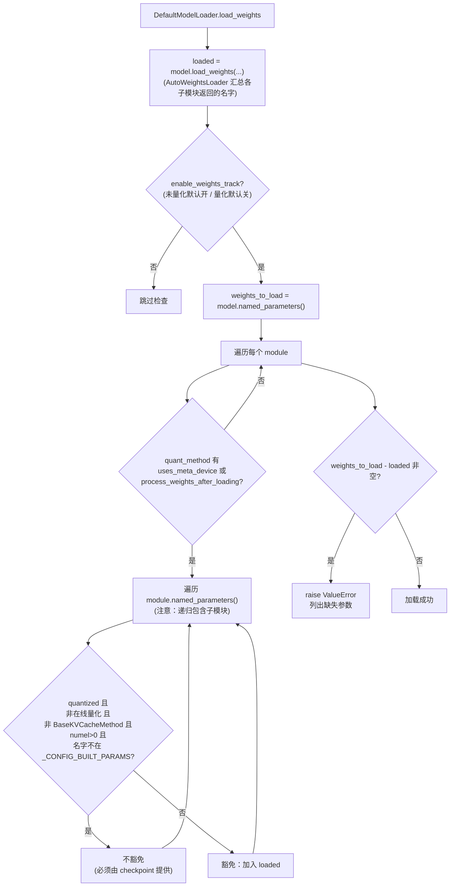
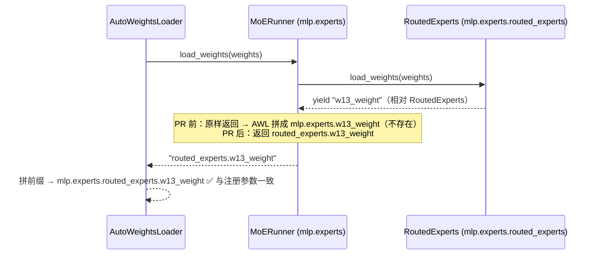

# PR #57108: [Bugfix][ModelLoader] Make enable_weights_track check quantized layers

> **Author**: @siliangchen-amd | **State**: OPEN | **Date**: 2026-09-16（最新提交 2026-10-09，head `9277769`）
> **Branch**: `siliangchen-amd:bugfix/weights-track-quantized-layers` → `main` | **Labels**: bug, quantization, verified
> **Changes**: +110 -4 lines across 3 files | **ROCm 相关性**: 部分相关（AMD 作者、在 MI300X/MI325X 上发现并验证；改动本身位于 CUDA/ROCm 共享的模型加载器与 fused MoE runner，无 ROCm 专属代码路径）
> 本报告分两部分：§1–6 为 PR 详细总结，§7–8 为 ROCm review 意见。

---

## 1. 总结 (Summary)

`--model-loader-extra-config '{"enable_weights_track": true}'` 本应检查 checkpoint 中缺失的权重，但 `DefaultModelLoader.track_weights_loading` 对任何 `quant_method` 定义了 `process_weights_after_loading` 的模块整体豁免——而 `QuantizeMethodBase` 基类就定义了该方法，等于所有 Linear / MoE / Embedding 层都被豁免，对量化模型这个 opt-in 检查形同虚设。本 PR 对**量化模型**收窄豁免范围：只放过 KV-cache 量化参数、空占位参数、fbgemm_fp8 由配置构造的 `input_scale_ub` 以及在线量化参数；同时修正 `MoERunner.load_weights` 返回的参数名缺少 `routed_experts.` 前缀的问题，否则开启检查后所有专家权重都会被误报缺失。非量化模型（默认开启检查）行为保持不变。

## 2. 背景与动机 (Background & Motivation)

作者在用 Hyperloom 优化 DeepSeek-V4-Flash-FP8 时，遇到一个重新打包（repack）的 checkpoint：43 层 `attn.wo_a` 的 block scale（`weight_scale_inv`）全部缺失。在 main 上该模型**正常启动、正常服务，但 gsm8k 得分 0.00**——缺失的 scale 参数保留初始化时的随机/空值，输出全是垃圾，且没有任何报错。开启 `enable_weights_track` 也无济于事，因为豁免逻辑把这些层整体跳过了。

相关历史（据 PR 描述）：

- #41086 引入 `enable_weights_track` 及本 PR 收窄的模块级豁免。
- #35074 曾尝试对量化模型默认开启追踪，当天被 #35309 revert；当时的误报（#35299、#35305）来自 GPTQ/AWQ MoE 的 `g_idx` 参数——经核实，vLLM 现已不再注册 `g_idx` 参数（`git grep` 在 PR head 上无 `g_idx` Parameter 注册）。
- #34930（open）改的是"何时运行检查"（量化模型默认开启 + 只告警），本 PR 改的是"检查什么"，两者都改 `track_weights_loading`，后合入者需要 rebase。

本 PR 选择保守路线：**量化模型仍为 opt-in**，只让 opt-in 时的检查真正生效。

## 3. 代码修改分析 (Code Change Analysis)

### 3.1 修改的模块

| 模块 | 改动 |
|------|------|
| `vllm/model_executor/model_loader/default_loader.py` (+24 -3) | `track_weights_loading` 新增 `quantized` 参数；量化模型下收窄豁免条件；新增模块级常量 `_CONFIG_BUILT_PARAMS = ("input_scale_ub",)`；导入 `BaseKVCacheMethod` |
| `vllm/model_executor/layers/fused_moe/runner/moe_runner.py` (+4 -1) | `MoERunner.load_weights` 改为生成器，给 `routed_experts.load_weights` 返回的名字加 `routed_experts.` 前缀 |
| `tests/model_executor/model_loader/test_registry.py` (+82) | 三个新单测：量化模型缺参检测、非量化模型行为不变、MoERunner 返回名字与注册参数一致 |

### 3.2 架构 / 流程图

`track_weights_loading` 的豁免决策（PR 后）：



MoE 参数名修正（AutoWeightsLoader 递归加前缀）：



### 3.3 关键实现细节

- **`quantized` 判定**：`model_config.quantization is not None`，在 `load_weights` 中传入；默认 `False` 保持旧签名兼容。
- **量化模型下仍豁免的四类参数**：
  1. 在线量化层（`uses_meta_device=True`：`OnlineLinearBase`、`OnlineMoEMethodBase`，含 `experts_int8` / `int8_per_channel` 等）——这些参数在加载过程中重建，名字与 checkpoint 不对应；
  2. `BaseKVCacheMethod` 层的参数（`k_scale` / `v_scale` / `q_scale` 等，checkpoint 可以没有）；
  3. `numel()==0` 的空占位（如 compressed-tensors W4A8 MoE 的 `torch.empty(0)` 占位）；
  4. 名字后缀在 `_CONFIG_BUILT_PARAMS` 中的参数（目前仅 fbgemm_fp8 的 `input_scale_ub`）。
- **重量化路径**（`set_requantization_source`，将 `uses_meta_device` 置 False）：经核实 `OnlineLinearBase.create_weights` 在该路径下只注册源 checkpoint 格式的参数并提前 return，不调用 `initialize_online_processing`，所以追踪时层上只有 checkpoint 应当提供的参数——严格检查是正确的。
- **`MoERunner.load_weights`**：原先 `return self.routed_experts.load_weights(weights)`，后者本身就是生成器，改成 `for ... yield f"routed_experts.{name}"` 不改变惰性语义；`TransformersMoERunner`、`ROCmLatentMoERunner`、`LatentMoERunner` 都不覆写该方法，统一受益。

## 4. 涉及的技术原理 (Technical Principles)

- **vLLM 权重加载的"已加载名字集合"契约**：`model.load_weights()` 返回实际写入的参数全名集合；`AutoWeightsLoader._load_module` 对子模块调用其 `load_weights` 并用 `base_prefix` 拼接返回值。子模块返回的名字**必须相对于自身**，否则拼出的全名与 `named_parameters()` 对不上——这正是 MoERunner 的 bug：`RoutedExperts` 返回相对 `routed_experts` 的名字，而 MoERunner 原样透传，丢了一层前缀。
- **`process_weights_after_loading` 与"非 checkpoint 参数"**：量化方法常在加载后把 checkpoint 参数转换为 kernel 格式（fp8 fnuz 转换、aiter shuffle、Marlin repack 等），因此最初的实现假设"有后处理的层，其参数可能不来自 checkpoint"，整体豁免。但这个假设只对少数参数成立（KV scale、在线量化重建参数、配置构造的参数），对 `weight` / `weight_scale_inv` / `qweight` 等不成立。
- **Block-FP8 的 `weight_scale_inv`**：DeepSeek 风格的 128×128 block 量化，每个 block 一个反量化 scale。缺失时参数保留 `torch.empty` 的未初始化内存，GEMM 结果被任意缩放——不会崩溃，只会静默输出垃圾（gsm8k 0.00）。
- **`named_parameters()` 的去重与递归**：`nn.Module.named_parameters()` 默认递归遍历子模块，且对同一 Parameter 对象只返回第一次遇到的名字（`remove_duplicate=True`）。共享子模块（如 MLA 中 `kv_b_proj` 同时挂在父 attention 和 `MLAAttention` 上）的规范名由注册顺序决定，这会影响下文 §7 关于 KV-cache 豁免递归范围的分析。

## 5. 评论区讨论亮点 (Discussion Highlights)

- 目前**没有任何人工 code review**（无 inline review comment；`claude[bot]` 因来自 fork 跳过了自动 review；作者手动请求 `@claude review` 也未产生 review）。作者两次 @22quinn 请求 review 与 ready label，尚无回应。
- **@shen-shanshan** 触发 `/ci run`，因分支落后 main 两次被拒，第三次触发 Buildkite #91821（commit `b7836010`）。
- **作者对 CI 失败的归因**（2026-09-29）：3 个失败由本 PR 引起——`models/transformers/test_backend.py::test_mla`（MI355、H200）与 `lora/test_sequence_classification.py::test_batched_loras_tp`（L4）加载的是**非量化**模型（默认开启检查），收窄后的豁免波及了 `UnquantizedLinearMethod` / `UnquantizedFusedMoEMethod` 层：Transformers 后端的别名 gate / shared-expert 参数、以及 checkpoint 中不存在的分类头 `score.weight`。修复方式：收窄只对量化模型生效（commit `04598f3`）。另 2 个失败（anthropic 转换测试、`test_gptoss_tp.py`）作者归因为与本 PR 无关（main 同样失败 / gpt-oss MXFP4 默认不开检查）。这一归因逻辑合理。
- 作者主动提出可改为在 quant method 上声明 `optional_param_names` 的声明式方案——与本报告 §7 的设计建议一致，值得 maintainer 表态。
- PR 描述声明 "AI-assisted (Claude); I reviewed the change and ran the tests above"，且描述对机制（WHY）的解释充分、测试矩阵详尽，AI 代码风险不高。

## 6. 风险与潜在问题 (Risk Analysis)

| 风险 | 严重程度 | 说明 |
|------|---------|------|
| 最新 head 未跑完整 CI；MoERunner 改动作用于**所有** MoE 模型的默认加载路径 | Medium | 见 §7 ⚠️【测试】 |
| 已 opt-in 的量化模型用户可能在升级后被拒绝加载 | Medium | 这是预期效果，但自定义 `load_weights` 返回名字不准确的模型（类似 MoERunner 的 bug）会从"静默通过"变为误报；见 §7 📝【兼容性】 |
| `_CONFIG_BUILT_PARAMS` 以名字后缀全局豁免，与具体 quant method 解耦 | Low-Medium | 见 §7 ⚠️【设计】 |
| KV-cache 豁免递归覆盖子模块参数 | Low | 当前已核实的模型均无影响；见 §7 📝【正确性】 |
| 非量化模型（默认开启）的检查仍不覆盖任何 Linear/MoE/Embedding 权重 | Low（既有问题） | 见 §7 📝【设计】 |
| 与 #34930 冲突 | Low | 二者都改 `track_weights_loading`，后合者需 rebase 并重新确认语义组合 |
| fused 参数缺一个分片（q/k/v 之一、某个 expert）仍检测不到 | Low（已声明的限制） | fused 参数被整体报告为已加载 |

---

## 7. Review 意见 (Findings)

非 ROCm 专属代码；按"部分相关"处理：对共享加载路径做跨后端回归检查，aiter/mori/kernel 类规则不适用。

| 类型 | 🔴 | ⚠️ | 📝 |
|------|----|----|----|
| 测试 | — | 1 | 1 |
| 设计 | — | 1 | 1 |
| 正确性 | — | — | 1 |
| 兼容性 | — | — | 1 |
| 可维护性 | — | — | 1 |

---

**⚠️【测试】最新 head 未经过完整 CI，而 MoERunner 改动作用于所有 MoE 模型的默认加载路径** `[已验证]`

- **问题**: 唯一一次完整 Buildkite 运行（#91821）是在 commit `b7836010` 上，当时 3 个 job 因本 PR 失败；之后又有 `04598f3`（只对量化模型收窄）、`f83cdaf`（fbgemm `input_scale_ub` 豁免）、`9277769`（KV-cache 参数与空占位豁免）三个改变行为的提交。当前 head `9277769` 的 check 只有 pre-commit / DCO / docs / pre-run-check，没有任何模型测试，也没有 AMD CI。PR 描述中的端到端数据（DeepSeek-V4-Flash-FP8、gsm8k 0.00→1.00 等）注明是"measured on earlier revisions of this PR"，部分在 vLLM 0.27.1 上，不能直接代表当前 head。
- **影响**: `default_loader.py` 的改动只在 opt-in 时生效，风险可控；但 `MoERunner.load_weights` 的改动对**每个**走 `AutoWeightsLoader` 的 MoE 模型（包括默认开启检查的 bf16 MoE 模型、`reload_weights`、`load_checkpoint_weight_patches` 的稀疏权重同步路径）都生效。经核实，这些调用方只把返回名字与 `named_parameters()` 做集合比较，前缀修正后匹配更准确（`gpu_model_runner.reload_weights` 对非量化 MoE 模型的"weights not loaded"误告警反而会消失），未发现依赖旧名字的代码——但这是静态分析结论，缺少 CI 兜底。
- **行动**: 建议作者 rebase 后请 maintainer 重新触发 `/ci run` 与 `/amd-ci run`，重点关注 Model Executor、`models/transformers`、`lora`、MoE 相关模型测试；并在描述中注明哪些端到端结果是在当前 head 上复测的。

**⚠️【设计】`_CONFIG_BUILT_PARAMS` 是与 quant method 无关的全局名字后缀豁免** `[已验证]`

- **问题**: `default_loader.py:51-52` 定义 `_CONFIG_BUILT_PARAMS = ("input_scale_ub",)`，`default_loader.py:539-546` 的条件对**任何**量化方法下名字以 `input_scale_ub` 结尾的参数一律豁免。fbgemm_fp8 专属知识被写进了通用加载器，`numel() > 0` 也是一个隐式启发式规则（"空 tensor 一定是占位"）。
- **影响**: ① 今后若有其他量化方法的真实 checkpoint 张量恰好叫 `input_scale_ub`，缺失时会被静默豁免——正好是本 PR 要消灭的那类 bug；② 每新增一种"配置构造参数"都要回来改加载器，量化方法的作者不容易发现这里需要同步；③ 豁免判断集中在一个五重条件的 `if` 里，可读性差。
- **行动**: 建议作者采用自己在评论中提出的声明式方案：在 `QuantizeMethodBase` 上增加类属性（如 `optional_checkpoint_params: tuple[str, ...] = ()`），由 `FBGEMMFp8LinearMethod` 声明 `("input_scale_ub",)`，`BaseKVCacheMethod` 声明为"全部可选"，加载器只读这个属性。若 maintainer 倾向于保持本 PR 体量，至少把条件提取为一个具名辅助函数（如 `_must_come_from_checkpoint(...)`），并把常量注释写明"仅 fbgemm_fp8"。

**📝【正确性】KV-cache 豁免通过 `module.named_parameters()` 递归覆盖了子模块参数** `[已验证]`（实际影响 `[推测]`）

- **问题**: `default_loader.py:535` 的 `module.named_parameters()` 是递归的。`MLAAttention` 在 checkpoint 带 KV scale 时，`_init_kv_cache_quant` 会设置 `layer.quant_method = <BaseKVCacheMethod>`（`attention.py:202-225`），同时它又把 `kv_b_proj` 和 `indexer` 注册为子模块（`mla_attention.py:476/481`）。因此 `mla_attn.kv_b_proj.weight`、`mla_attn.kv_b_proj.weight_scale_inv`、`mla_attn.indexer.*` 都会被加入"已加载"集合。
- **影响**: 目前已核实**没有实际漏检**：`DeepseekV2MLAAttention` 和 `MultiHeadLatentAttentionWrapper` 都在构造 `MLAAttention` 之前把 `kv_b_proj` / `indexer` 注册到父模块，`model.named_parameters()` 去重后规范名是父模块路径，别名路径加进集合不影响差集；DeepSeek-V4（含 ROCm 的 `DeepseekV4ROCMAiterMLAAttention`）的 attention 不调用 `_init_kv_cache_quant`，`wo_a` 等仍被检查（与作者实测 43 个 `wo_a.weight_scale_inv` 被检出一致）。但这依赖注册顺序：任何先构造 `MLAAttention`、再挂到父模块的模型（或将来的重构）会让 FP8 MLA 的 `kv_b_proj` scale 缺失再次静默通过。
- **行动**: 建议作者在量化分支对 KV-cache 豁免使用 `module.named_parameters(recurse=False)`（或只豁免 `BaseKVCacheMethod` 实际创建的那几个 scale 名），并补一条单测：带 BaseKVCacheMethod 的模块下挂一个子 Linear，断言子 Linear 缺失的 scale 仍被报出。

**📝【设计】非量化模型（默认开启检查）仍然不检查任何 Linear / MoE / Embedding 权重** `[已验证]`

- **问题**: 非量化模型的 Linear 层使用 `UnquantizedLinearMethod`，它同样继承了 `process_weights_after_loading`，因此 `quantized=False` 时 `default_loader.py:534-549` 依旧把这些层的全部参数豁免。也就是说，默认开启的严格检查对 bf16 模型只覆盖 norm、bias 之外的少量无 quant_method 参数——bf16 checkpoint 缺一个 `o_proj.weight` 同样不会报错。
- **影响**: 这是 main 上就存在的问题，本 PR 出于兼容性（Transformers 后端别名参数、LoRA 分类头 `score.weight`）有意保持不变，合理；但 PR 标题 "check quantized layers" 容易让读者以为严格检查已经全覆盖。
- **行动**: 建议作者在描述或代码注释中明确这一剩余缺口，并开一个 follow-up issue（例如：给 Transformers 后端别名参数和 `score.weight` 补上正确的 loaded 名字后，再对非量化模型也收窄豁免）。

**📝【兼容性】已 opt-in 的量化模型用户升级后可能被拒绝加载** `[推测]`

- **问题**: 以前对量化模型设置 `enable_weights_track: true` 实际上几乎什么都不检查；合入后，任何自定义 `load_weights` 返回名字不准确的量化模型（与 MoERunner 同类的前缀 bug 在其他模型的自定义加载函数中未必只有一处）都会从"静默通过"变成 `ValueError`。作者的测试矩阵覆盖了 fp8 / compressed-tensors / AWQ / GPTQ / ModelOpt / Quark / fbgemm / VLM / MTP，但没有覆盖自定义 `load_weights` 的大型 MoE 模型（如 Kimi K3 AMD 的 `KimiLinear*` 显式专家映射路径）。
- **影响**: 只影响显式 opt-in 的用户，且报错会列出参数名，可诊断；不会造成静默错误。
- **行动**: 建议作者在 PR 描述 / release note 中说明这一行为变化，并在 `enable_weights_track` 的文档（`load_config` 相关说明）里注明量化模型下的豁免范围。

**📝【测试】单测全部基于 fake quant method，未用真实量化层** `[已验证]`

- **问题**: `test_registry.py:98-140` 用 `_QuantMethod`（只有 `uses_meta_device` 和空 `process_weights_after_loading`）和手工注册的参数模拟各类层；`test_moe_runner_reports_registered_expert_names` 把 `MoERunner.load_weights` 绑定到 fake `Runner` 上，只验证 `w13_weight` 一个名字。
- **影响**: 测试能锁住豁免条件的逻辑分支（作者说明三个测试在回退对应改动时都会失败，结构合理），但无法发现真实量化方法参数命名漂移（例如某个方法新增配置构造参数、或 MoE scale 名 `w13_weight_scale_inv` 的前缀处理）。
- **行动**: 建议作者补一条用真实 `Fp8LinearMethod.create_weights`（block 量化）构造层的用例，断言缺失 `weight_scale_inv` 会被报出；MoE 用例可增加一个 scale 参数名，作为对前缀修正的回归保护。

## 8. 结论 (Verdict)

**⚠️ NEEDS WORK**（轻度）

根因分析清楚、修复方向正确、作者对 CI 失败的归因和后续收窄处理得当，并已核实 #35074 被 revert 的误报来源（`g_idx`）在当前代码中已不存在。主要阻碍是最新 head 没有经过完整 CI（MoERunner 前缀修正作用于所有 MoE 模型的默认路径）；`_CONFIG_BUILT_PARAMS` 建议改为 quant method 上的声明式属性。完成 rebase、CUDA 与 AMD CI 全绿后可以合入，其余 📝 项可作为 follow-up。

## 9. 英文 Review 评论 (Copy-Paste English Comments)

以下评论可直接复制到 GitHub PR review 的对应文件/行位置（行号为 PR head `9277769` 的新文件行号）：

**C1** `vllm/model_executor/layers/fused_moe/runner/moe_runner.py:304-307` — ⚠️ comment

```text
The prefix fix looks correct to me: RoutedExperts yields names relative to itself, and every registered expert param is `*.experts.routed_experts.w13_*`. Note that, unlike the loader change, this one is not opt-in. It affects every MoE model loaded through AutoWeightsLoader, including the default-on check for bf16 MoE models, `reload_weights`, and `load_checkpoint_weight_patches`. I couldn't find any caller that relies on the old names, but the only full CI run (#91821) was on b7836010, before the last three behavioral commits. Could you rebase and get a fresh `/ci run` plus `/amd-ci run` on the current head? Could you also say in the description which of the end-to-end results were re-measured on this revision?
```

**C2** `vllm/model_executor/model_loader/default_loader.py:51-52` — ⚠️ comment

```text
`_CONFIG_BUILT_PARAMS` exempts any parameter whose name ends with `input_scale_ub`, regardless of the quant method. That puts fbgemm_fp8-specific knowledge into the generic loader. If another method ever ships a real checkpoint tensor with that name, a missing one would be silently accepted, which is the class of bug this PR is fixing. I'd prefer the declarative option you mentioned: a class attribute on QuantizeMethodBase (e.g. `optional_checkpoint_params: tuple[str, ...] = ()`), set to ("input_scale_ub",) by the fbgemm method and covering all params for BaseKVCacheMethod. The loader would then just consult it. That would also make the five-way condition at L539-546 much easier to read.
```

**C3** `vllm/model_executor/model_loader/default_loader.py:535-549` — 📝 comment

```text
`module.named_parameters()` recurses into submodules, so the BaseKVCacheMethod exemption also covers child modules. MLAAttention gets a BaseKVCacheMethod when the checkpoint has KV scales, and it registers `kv_b_proj` and `indexer` as submodules (mla_attention.py L476/L481). Today this is harmless: DeepseekV2MLAAttention and MultiHeadLatentAttentionWrapper register those modules on the parent first, so the canonical names survive dedup. But it depends on registration order. Could you use `named_parameters(recurse=False)` in the quantized branch, and add a small test where a KV-cache module owns a child linear whose scale is missing?
```

**C4** `vllm/model_executor/model_loader/default_loader.py:532-534` — 📝 comment (anchored on the unchanged comment line inside the hunk)

```text
Not blocking, but worth spelling out: for unquantized models (where the check is on by default), every Linear/MoE/Embedding layer still has a quant method (UnquantizedLinearMethod etc.) that defines `process_weights_after_loading`, so their params remain fully exempt. A bf16 checkpoint missing `o_proj.weight` would still pass. I understand why you kept that path unchanged (Transformers aliases, LoRA `score.weight`). Could you update the comment here to describe the current exemption scope, and maybe open a follow-up issue for the unquantized gap?
```
