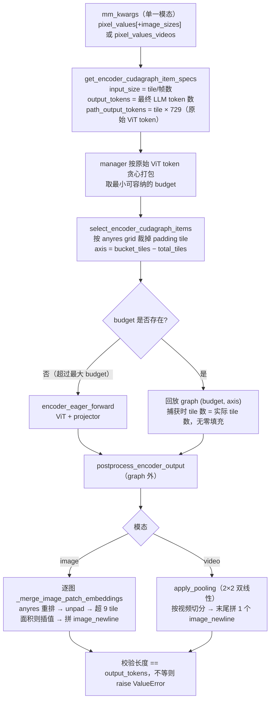
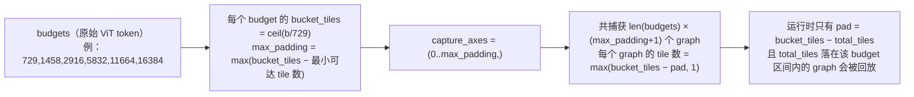

# PR #57379: [Model][Perf] Add LLaVA-OneVision encoder CUDA graph support

> **Author**: @trueoneplusone | **State**: OPEN | **Date**: 2026-09-17（2026-10-08 rebase 到 `ba77c4c1`）
> **Branch**: fork → `main` | **Labels**: documentation, multi-modality, nvidia
> **Changes**: +701 -3 lines across 4 files | **ROCm 相关性**: 部分相关。PR 本身不含 ROCm 专属代码，但改动的是 CUDA/ROCm 共用的模型文件；encoder CUDA graph 在 ROCm 上以 HIP graph 运行，SigLIP ViT 在 ROCm 上会选 `ROCM_AITER_FA` / `FLASH_ATTN` / `TRITON_ATTN`；新增的 E2E 用例标了 `core_model`，会进入 AMD MI355 的 "Multimodal Models (Standard) 4" 任务
> 本报告分两部分：§1–6 为 PR 详细总结，§7–8 为 ROCm review 意见。

---

## 1. 总结 (Summary)

本 PR 让 `LlavaOnevisionForConditionalGeneration` 实现 `SupportsEncoderCudaGraph` 协议，图片和视频都支持。只把固定形状的部分（SigLIP vision tower + multimodal projector）放进 CUDA graph；依赖数据的部分（anyres 拼接、unpad、按比例插值、`image_newline`、视频 2×2 pooling）都放在 graph 外的 `postprocess_encoder_output` 中执行。为避免大 budget 档位的 graph 总是按最大 tile 数回放，PR 额外引入了一个 capture axis（"padding tile 数"），使每次回放的 tile 数与实际输入完全相等。

## 2. 背景与动机 (Background & Motivation)

- 对应 issue #38175（为更多 VLM 补齐 encoder CUDA graph）。LLaVA-OneVision 的 ViT 是 SigLIP-so400m（384px、patch 14，每个 tile 729 token），在小 batch 下 eager 执行主要受 kernel launch 开销限制。
- PR 描述给出的数据（RTX 5090、BF16、FlashAttention，9 月测量）：1/2/4/8 tile 的 encoder 延迟加速比为 5.92x / 3.77x / 1.99x / 1.59x，CG 与 eager 输出 `max_abs=0.0`，首 token 代理延迟从 134.03 ms 降到 78.48 ms。作者明确说明：10 月 8 日只做了 rebase，**rebase 后只跑过 CPU 单测（17 passed），GPU 数据都是 9 月的历史结果**。
- PR 描述声明使用 ChatGPT 辅助实现、测试和调试。
- 评审时 `upstream/main` 已比该 PR 的 merge-base（`ba77c4c130`）新约 4 周。经核对：`SupportsEncoderCudaGraph` 协议与 `encoder_cudagraph_defs.py` 在此期间**没有变化**；`encoder_cudagraph.py` 只新增了"modalities 为空时跳过 capture"的早退；`llava_onevision.py` 在 main 上只删除了未使用的 `LlavaOnevisionMultiInputs` 别名。三方合并没有冲突，协议层面不存在过时问题，但 GPU 验证需要在当前 main 上重新跑。

## 3. 代码修改分析 (Code Change Analysis)

### 3.1 修改的模块

| 文件 | 改动 |
|------|------|
| `vllm/model_executor/models/llava_onevision.py` (+394 -3) | 类加上 `SupportsEncoderCudaGraph`；新增 token 计数（`_get_image_output_tokens` / `_get_video_output_tokens`）、tile 计数与选取、budget 推导副本（`_encoder_cudagraph_token_budgets`）、padding capture axis、capture/replay buffer、graph forward、eager forward、后处理（unpad/newline/pooling）；`__init__` 中保存 `self.vllm_config` |
| `tests/models/multimodal/test_llava_onevision_cudagraph.py` (+287，新文件) | 基于 `object.__new__` stub 的 CPU 单测：item spec、后处理与 eager merge 逐元素一致、token 计数、budget/axis 推导 |
| `tests/models/multimodal/generation/test_vit_cudagraph.py` (+19) | `MODEL_CONFIGS` 新增 `llava_onevision`（0.5B，`encoder_cudagraph_token_budgets=[8192]`，4 帧视频，`core_model`） |
| `docs/design/cuda_graphs_multimodal.md` (+1) | 支持矩阵新增 LLaVA-OneVision 一行（图片 ✅、视频 ✅） |

### 3.2 架构 / 流程图

运行时一次 encoder batch 的执行路径（`EncoderCudaGraphManager._execute_local` + 本 PR 的模型钩子）：



捕获期 graph 的组织方式（budget × padding axis 的笛卡尔积）：



### 3.3 关键实现细节

- **两套 token 计数**：`path_output_tokens["default"] = tile 数 × 729` 是 manager 用来打包、选 budget 的"原始 ViT token"；`output_tokens` 是 unpad/pooling 之后进入 LLM 的 token 数，用于 scatter 和长度校验。这是 PR 描述中"把原始 ViT budget 与最终 LLM token 数分开"的具体做法。
- **anyres tile 裁剪**：`_get_image_tile_counts` 根据 `image_sizes` 与 `image_grid_pinpoints` 算出 `1 + grid_h × grid_w`，`select_encoder_cudagraph_items` 把 batch 内补齐的 padding tile 切掉（eager 路径会把 padding tile 也过一遍 ViT，graph 路径不会）。`image_sizes=None` 时退回"全部 tile + 默认 384×384 尺寸"，与 eager 行为一致（作者自查修复项之一）。
- **padding capture axis**：`prepare_encoder_cudagraph_capture_inputs` 按 `num_tiles = max(ceil(budget/729) − pad, 1)` 生成 `torch.randn` 输入；回放时 axis 恰好使捕获的 tile 数等于实际 tile 数，`_copy_padded_buffer` 不会引入零 tile，因此不会碰到 FA 对零填充序列产生 NaN 的已知问题。
- **budget 推导副本**：`_encoder_cudagraph_token_budgets()` 在模型侧复制了 `EncoderCudaGraphManager.__init__` 的 budget 生成逻辑（用户 budgets / `max_vision_items` / 自动 2 的幂），供 `capture_axes` 和 `select` 计算 axis。作者自查修复的第二项就是这里与 manager 的不一致。
- **graph 外的数据依赖逻辑**：`unpad_image`（依赖原图尺寸）、`interpolate`（依赖 ratio）、`image_newline` 拼接、视频 pooling 都在 `postprocess_encoder_output` 中逐 item 执行；`image_sizes` 是 `keep_on_cpu=True` 字段，`.tolist()` 不会触发 D2H 同步。
- **视频**：`_get_video_output_tokens = 帧数 × ceil(27/stride)² + 1`；后处理先对整批帧做 `apply_pooling`，再按视频切分并拼一个 newline，顺序与 eager `_video_pixels_to_features`（ViT → projector → pooling）一致。

## 4. 涉及的技术原理 (Technical Principles)

- **Encoder CUDA graph 协议**：`EncoderCudaGraphManager` 按"token budget"预先捕获若干 graph，运行时贪心打包 item，选最小可容纳的 budget，把真实输入 slice-copy 到捕获 buffer（其余清零）后回放。模型通过 `SupportsEncoderCudaGraph` 提供 item spec、选取、capture/replay buffer 和后处理；`capture_axes` 是较新的扩展，按额外维度（这里是 padding tile 数）对每个 budget 再做笛卡尔积捕获。
- **LLaVA-OneVision anyres**：图片被切成 1 个全局 tile + `grid_h × grid_w` 个局部 tile（每个 384×384），各自过 SigLIP；局部 tile 的特征重排成大网格，去掉 letterbox padding（unpad）。如果面积超过 9 个 tile，就双线性下采样，并在每行末尾加 `image_newline`。因此最终 token 数取决于原图尺寸，这类逻辑无法放进静态 graph。
- **视频路径**：每帧一个 tile，ViT + projector 之后做 2×2 双线性 pooling（27×27 → 14×14 = 196 token/帧），整段视频末尾加 1 个 newline。
- **ROCm 上的 HIP graph 与 ViT attention**：`torch.cuda.graph` 在 ROCm 上映射为 HIP graph。SigLIP 调用 `MMEncoderAttention` 时不传 `cu_seqlens`，wrapper 在设备上用 `torch.arange` 生成，`max_seqlen` 是 Python int，没有 `.item()` 同步，可以被 graph 捕获。ROCm 的 ViT backend 选择顺序是：aiter MHA 开启且 CDNA → `ROCM_AITER_FA`；否则有 `flash_attn` → `FLASH_ATTN`；再否则 Triton / SDPA。SigLIP-so400m 的 head_size 为 72。

## 5. 评论区讨论亮点 (Discussion Highlights)

- 目前没有人工 review。评论只有 mergify 文档预览、github-actions 欢迎语（说明需要 maintainer `/ci run` 或 `/amd-ci run` 才会触发 CI），以及 `claude[bot]` 的说明（PR 来自 fork，自动 review 被禁用）。
- 作者自查评论（9/18）修复了两处边界：`image_sizes=None` 的多 tile 图片 token 数与 eager 对齐；只指定 `encoder_cudagraph_max_vision_items_per_batch` 时，模型侧 budget 推导与 manager 对齐。第二处修复恰好说明"模型侧复制 manager budget 逻辑"这一设计容易漂移（见 §7）。
- 本次 fetch 的 `checks` 只有 key 名，CI 状态未知。作者自述"No CI label requested"。

## 6. 风险与潜在问题 (Risk Analysis)

| 风险 | 严重程度 | 说明 |
|------|---------|------|
| graph 数量随 budget 区间宽度膨胀 | Medium | 见 §7 ⚠️【性能】：16384 budget（MI300X/MI355X 上 API server 的默认值）下捕获 48 个 graph，其中 26 个永远不会被回放 |
| 模型侧复制 manager 的 budget 推导 | Medium | 见 §7 ⚠️【设计】：两边不一致时，manager 中的 `assert graph_output is not None` 会让引擎直接崩溃，没有 eager 兜底 |
| 新单测不在任何 CI 任务里 | Medium | 见 §7 ⚠️【测试】：文件没有 `core_model` 标记，被 `-m core_model` 过滤掉 |
| ROCm 未验证 + GPU 结果早于 rebase | Medium | 见 §7 ⚠️【测试】：新 E2E 会进入 AMD MI355 任务，但作者只在 RTX 5090 上验证过 |
| 视频 / 大图大多走 eager | Low | 见 §7 📝【性能】：budget 按原始 ViT token 计算，视频帧数一多就超出 |
| token 计数逻辑重复 | Low | 见 §7 📝【可维护性】 |
| 性能数字可复现性 | Low | 见 §7 📝【性能证据】 |
| 与 main 的合并 | Low | 无文本冲突，协议未变；只是 head 落后约 4 周 |

---

## 7. Review 意见 (Findings)

ROCm 相关性为"部分相关"：本节对共用的模型文件做跨后端（CUDA/ROCm）检查。PR 没有触及 aiter/mori/ROCm 平台代码，相应的专项规则不适用。

| 类型 | 🔴 | ⚠️ | 📝 |
|------|----|----|----|
| 性能 | — | 1 | 2 |
| 设计 | — | 1 | — |
| 测试 | — | 2 | — |
| 正确性 | — | — | 1 |
| 可维护性 | — | — | 1 |

---

**⚠️【性能】padding capture axis 与 budget 做笛卡尔积，graph 数随 budget 区间宽度增长，大量 graph 永远不会被回放** `[已验证]`（graph 数量已复现；内存为估算）

- **问题**: `llava_onevision.py:612-625` 用所有 budget 中最大的 `bucket_tiles − 最小可达 tile 数` 作为统一的 axis 范围，manager 再对每个 budget 捕获 `max_padding+1` 个 graph（`prepare_encoder_cudagraph_capture_inputs`，`llava_onevision.py:767-772`）。按 PR 自己的公式复现（每 tile 729 token、自动 2 的幂 budget）：
  - `max_num_batched_tokens=8192`：5 个 budget × 4 = 20 个 graph，可被回放的只有 11 个；
  - `16384`（MI300X/MI355X 显存 ≥160 GiB 时 `OPENAI_API_SERVER` 的默认值）：6 × 8 = 48 个，可回放 22 个；
  - `32768`：7 × 16 = 112 个，可回放 44 个，超过 manager 的 64 个告警阈值。
  
  不可回放的 graph 有两类：一是小 budget 下 `max(bucket − pad, 1)` 被钳到 1 的重复 graph；二是 tile 数落在更小 budget 区间里、永远选不到这个 budget 的 graph。每个 graph 的输入 buffer（`torch.randn`）和输出 buffer（manager 中的 `torch.empty_like`）都在 graph pool 之外长期持有。16384 时，这部分估算为 0.66 / 1.84 / 3.86 GiB（hidden=896 / 3584 / 8192，对应 0.5B / 7B / 72B）；同目录 InternVL 用"每 budget 一个 graph + 零填充 tile"，同等配置约 0.11 / 0.30 / 0.63 GiB。
- **影响**: 在大显存卡（包括 MI300X/MI355X）上用默认参数启动，encoder graph 数量和常驻 buffer 都成倍增加，挤占 KV cache 并拉长启动时的 capture 时间；其中约一半是死 graph。
- **行动**: 建议作者按 budget 分别计算可达的 padding 范围，跳过不可达的 (budget, pad) 组合（例如让 `prepare_encoder_cudagraph_capture_inputs` 只对可达组合生成输入，或请 manager 支持每个 budget 独立的 axis key 集合）；或者在 PR 描述中给出 16384/32768 下的 graph 数与显存开销，和 InternVL 式零填充方案做对比后再决定。

**⚠️【设计】模型侧复制了 manager 的 budget 推导，两者一旦不一致就会触发 manager 中的断言崩溃** `[已验证]`（当前未找到具体触发输入）

- **问题**: `llava_onevision.py:584-610` 的 `_encoder_cudagraph_token_budgets()` 逐分支复制了 `EncoderCudaGraphManager.__init__` 的 budget 生成逻辑，`_encoder_padding_axis()`（627-637）据此算出 axis key。manager 用自己的 budget 列表选 budget，再用模型给的 axis key 拼 `(budget, axis)` 查 graph；查不到时 `_run_budget_graph` 返回 None，`_execute_local` 中的 `assert graph_output is not None` 直接失败，不会退回 eager。在 main 上，只有本 PR 的模型会直接读取 `encoder_cudagraph_token_budgets` / `encoder_cudagraph_max_vision_items_per_batch`（Gemma4、MiniCPM-V 的 capture_axes 都只依赖模型自身的几何参数）。作者 9/18 的自查修复，修的正是这两份逻辑之间的一次不一致。另外，`get_encoder_cudagraph_config`/`select_encoder_cudagraph_items` 中的 `hasattr(self, "vllm_config")` 分支（648、714、729 行）只在测试 stub 中才会为假，生产环境里 `__init__`（886 行）总会设置这个属性。
- **影响**: 只要 manager 的 budget 生成以后有任何调整（例如按 path 设置最小 budget、去重、对齐到 tile），这个模型就会在运行时断言崩溃，而 manager 侧的改动者很难意识到模型里还有一份副本。
- **行动**: 建议作者不要在模型里复制 budget 逻辑：可以让 axis key 只依赖 `token_budget` 与 tile 数（例如直接以"实际 tile 数"为 axis key、capture 时按 budget 过滤），或在 manager 侧把最终 budget 列表传给模型（这需要协议改动，需要与 maintainer 讨论）。至少应加一个启动期一致性断言，并去掉只服务测试的 `hasattr` 分支。

**⚠️【测试】新增的 287 行单测不会在任何 CI 任务中运行；E2E 只检查有非空输出** `[已验证]`

- **问题**: `tests/models/multimodal/test_llava_onevision_cudagraph.py` 放在 `tests/models/multimodal/` 根目录，所有用例都没有 `core_model` 标记。覆盖这个目录的 "Multimodal Models (Standard) 4" 任务（NVIDIA 与 AMD mirror）用 `-m core_model` 选择用例，Extended 任务只跑 `generation/` 子目录，所以这个文件会被整体跳过。`test_vit_cudagraph.py` 的 image/video 用例只断言输出非空，PR 描述中的"CG vs eager `max_abs=0.0`"没有落成测试。main 上已有 `test_eonly_vit_cudagraph_outputs` 这类真实 GPU 上 CG 与 eager 逐元素比较的框架（目前只参数化了 qwen3_vl / qwen3_5）。
- **影响**: 后处理与 eager merge 的一致性、axis 推导、`image_sizes=None` 等边界都没有回归保护；以后 manager 或 `_merge_image_patch_embeddings` 改动时，CI 不会报错。
- **行动**: 建议作者给单测文件加上 `pytestmark = pytest.mark.core_model`（或移到会被 CI 收集的位置），并考虑在真实 GPU 上补一个 CG 与 eager 的数值对比（可以复用 E-only 测试的写法，覆盖多 tile 图片和视频）。

**⚠️【测试】共用路径在 ROCm 上未经验证，且 GPU 验证早于当前 head** `[已验证]`

- **问题**: 新的 `llava_onevision` E2E 配置（`test_vit_cudagraph.py:232-250`）带 `core_model` 标记，`test_vit_cudagraph.py -m core_model` 同时在 `:amd: (MI355 DPX) Multimodal Models (Standard) 4` 中运行（`test-amd.yaml` / `models_multimodal.yaml` 的 AMD mirror）。在 MI355X 上，SigLIP（head_size 72）默认走 `ROCM_AITER_FA` 或 `FLASH_ATTN`，并在 HIP graph 内被捕获。作者只在 RTX 5090 + FlashAttention 上验证过，而且那是 9 月 rebase 之前的结果；当前 head 只跑过 CPU 单测，与 main 相差约 4 周（协议未变，三方合并无冲突）。
- **影响**: 如果 aiter/CK FA 在 head_size 72、batch = tile 数的形状下有捕获或数值问题，第一次暴露的地方会是 AMD CI 的 optional 任务或用户部署，而不是这个 PR。
- **行动**: 建议作者 rebase 到最新 main 后，请 maintainer 同时触发 `/ci run` 与 `/amd-ci run`，并在 PR 描述中补一次当前 head 上的 GPU 结果（最好包含一台 MI300X/MI355X，或说明 ROCm 未测试）。

**📝【性能】budget 按原始 ViT token 计算，视频和较大图片在默认配置下大多直接走 eager** `[已验证]`

- **问题**: `get_encoder_cudagraph_budget_range`（652 行）的上限是 `min(max_num_batched_tokens, max_model_len)`，但 item 占用的是原始 ViT token（每帧/每 tile 729）。因此，帧数大于 `floor(max_budget/729)` 的视频（8192 → 11 帧，16384 → 22 帧；`_MAX_FRAMES_PER_VIDEO=16`）整段走 eager；在 70 GiB 以下的卡（包括 RTX 5090）上 API server 默认 `max_num_batched_tokens=2048`，超过 2 个 tile 的图片也都走 eager。PR 的 benchmark 与 E2E 都显式设置了 `encoder_cudagraph_token_budgets=[8192]` 和 4 帧视频。
- **行动**: 建议作者在文档或 PR 描述中说明这一点，并给出推荐的 `encoder_cudagraph_token_budgets` 配置，避免用户默认开启后看不到收益。

**📝【可维护性】`_get_image_output_tokens` 与 `LlavaOnevisionProcessingInfo._get_num_unpadded_features` 是重复实现，不一致时会直接 raise** `[已验证]`

- **问题**: `llava_onevision.py:499-526` 重写了 processing info（149-187 行）中的 unpad/9-tile 插值 token 计数，硬编码 `9 * patch_grid**2`（对应 merge 函数的默认值 `anyres_max_9`），浮点表达式也略有不同（`h*w/ow` 与 `h*(w/ow)`，有 `round(…,7)` 兜底）。后处理在长度不一致时 `raise ValueError`（854、876 行），这会让整个 encoder step 失败，而不是退回 eager。
- **行动**: 建议作者复用 `self.info`/processing info 中已有的计数函数（或抽成模块级 helper，让两处共用），避免以后只改一处。

**📝【正确性】启用 `cudagraph_mm_encoder` 时 `image_embeds` 输入可能在 `_get_pixel_items` 处 KeyError** `[推测]`

- **问题**: `get_input_modality` 在没有 `pixel_values_videos` 时一律返回 "image"，`_get_pixel_items` 直接取 `mm_kwargs["pixel_values"]`。eager 路径支持 `LlavaOnevisionImageEmbeddingInputs`。如果 `--enable-mm-embeds` 传入的 `image_embeds` item 以 "image" 模态进入 manager，就会在这里抛 KeyError。Qwen2.5-VL / Qwen3-VL 的 CG 实现也有同样的模式，所以这更可能是框架层面的共性问题；本次没有实际跑通去确认。
- **行动**: 建议 review 时追问：作者能否确认 embeds 输入不会进入 encoder CG manager？如果会进入，可以在 `get_input_modality`/item spec 中遇到 `image_embeds` 时让 manager 退回 eager。

**📝【性能证据】加速数字缺少可复现信息** `[unverified]`

- **问题**: 延迟表与首 token 数据没有给出 benchmark 脚本或命令。eager 列从 1 tile 到 4 tile 几乎不变（32.01 → 32.64 ms），说明测量主要受 CPU/launch 开销限制，5.92x 主要来自去掉 launch，只适用于 0.5B 小模型、小 batch 的场景。没有 ROCm 数据。
- **行动**: 建议作者附上计时脚本（或 gist）和完整的 `vllm serve`/bench 命令，并注明这些数字是 9 月旧 head 上的结果。

> AI 代码诊断：描述对机制（WHY）解释得比较清楚，作者声明了 ChatGPT 辅助并做过自查。新增符号（`ENCODER_CUDAGRAPH_AXIS_KEYS_KWARG`、`get_vision_encoder_info`、`get_num_selected_vision_tokens`、`get_anyres_image_grid_shape`、`unpad_image`）在 main 上都存在，签名也一致，没有发现幻觉符号。主要信号是：单测全部基于 `object.__new__` stub 和 monkeypatch，而且不在 CI 中；`hasattr(self, "vllm_config")` 守卫只服务于测试；模型侧复制 manager 逻辑属于典型的孪生分歧风险。graph 外的 unpad/newline/pooling 与 eager 逐步核对过，顺序和切片都一致（包括视频"ViT → projector → pooling → newline"，以及图片在 graph 路径中跳过 padding tile）。

## 8. 结论 (Verdict)

**⚠️ NEEDS WORK**

整体方向正确：数据依赖的 unpad/newline/pooling 都放在 graph 外，回放时 tile 数精确匹配、没有零填充，与 eager 的数值路径一致。没有找到能给出具体触发输入的阻塞性缺陷。但 capture axis 会在大显存卡（包括 MI300X/MI355X 的默认配置）上产生约一半永远不会被回放的 graph；模型侧复制 manager 的 budget 逻辑，一旦漂移会直接断言崩溃；新单测不在 CI 中；当前 head 也没有在 GPU（尤其是 ROCm）上重新验证。

## 9. 英文 Review 评论 (Copy-Paste English Comments)

**C1** `vllm/model_executor/models/llava_onevision.py:612-625` — ⚠️ comment

```text
The padding axis is computed as a single global range (max over all budgets) and the manager captures the full cartesian product, so the graph count grows with the widest budget interval. Reproducing this formula with 729 tokens per tile: auto budgets up to 16384 (the default max_num_batched_tokens for the API server on >=160 GiB GPUs such as MI300X/MI355X) give 6 x 8 = 48 graphs, of which only 22 can ever be selected at replay; 32768 gives 112 graphs (44 reachable), above the manager's 64-graph warning. Unreachable entries are either clamped to 1 tile at small budgets or have tile counts that always fall into a smaller budget, but each still keeps its own input/output buffers outside the graph pool. Could you skip unreachable (budget, pad) combinations, or report the graph count and memory overhead at 16384/32768 against a zero-padded one-graph-per-budget variant like InternVL's?
```

**C2** `vllm/model_executor/models/llava_onevision.py:584-610` — ⚠️ comment

```text
This duplicates the budget generation in `EncoderCudaGraphManager.__init__`, and the axis key returned from `select_encoder_cudagraph_items` is only valid if both copies agree. If they drift, `_run_budget_graph` misses the (budget, axis) key and `_execute_local` fails on `assert graph_output is not None` with no eager fallback; your 9/18 self-review fix was already one such divergence. No other model on main reads `encoder_cudagraph_token_budgets` directly. Could you derive the axis key from `token_budget` and the actual tile count only (for example, key on the exact tile count and filter at capture time), or at least add a startup consistency check? The `hasattr(self, "vllm_config")` branches also only matter for the test stubs, since `__init__` always sets it.
```

**C3** `tests/models/multimodal/test_llava_onevision_cudagraph.py:1-14` — ⚠️ comment

```text
None of the tests in this file are marked `core_model`, and the only CI job that collects the root of `tests/models/multimodal` ("Multimodal Models (Standard) 4", NVIDIA and AMD mirror) runs it with `-m core_model`, so this file is deselected everywhere. Could you add `pytestmark = pytest.mark.core_model` (or move the file somewhere CI collects it)? Separately, the E2E entry only asserts non-empty text; the `max_abs=0.0` CUDA graph vs eager parity in the description isn't covered by a test. Extending the existing E-only parity harness (`test_eonly_vit_cudagraph_outputs`) to a multi-tile image and a short video would lock it in.
```

**C4** `tests/models/multimodal/generation/test_vit_cudagraph.py:232-250` — ⚠️ comment

```text
Because this entry is `core_model`, it will also run in the AMD MI355 "Multimodal Models (Standard) 4" job, where SigLIP (head_size 72) is captured into a HIP graph with ROCM_AITER_FA or FLASH_ATTN. The only GPU validation in the description is from September on an RTX 5090, before the rebase, and the head is now about four weeks behind main (the encoder CUDA graph protocol is unchanged and the merge is clean). Could you rebase, ask a maintainer to trigger both `/ci run` and `/amd-ci run`, and post fresh results from the current head, ideally including one ROCm GPU or noting that ROCm is untested?
```
