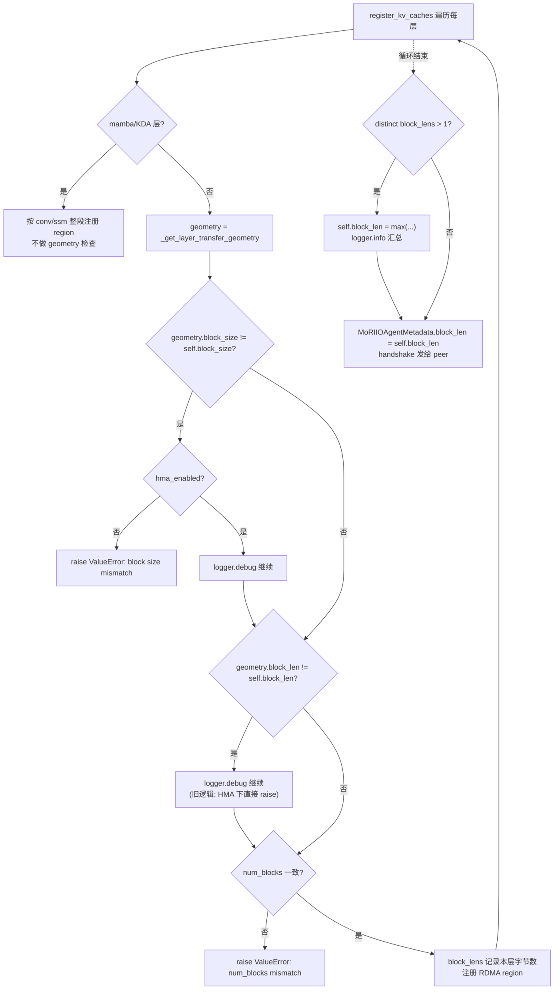
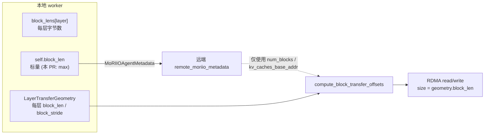

# PR #58585: [Bugfix][ROCm][Disagg] Allow MoRIIO HMA per-layer block_len

> **Author**: @avininjamay8 | **State**: OPEN | **Date**: 2026-09-24
> **Branch**: `avininjamay8:fix/moriio-hma-dual-block-len` → `main` | **Labels**: bug, rocm, ready, kv-connector
> **Changes**: +137 -9 lines across 2 files | **ROCm 相关性**: 完全相关（MoRIIO 是基于 AMD mori-IO 的 PD 分离 KV connector，仅在 ROCm 上使用）
> 本报告分两部分：§1–6 为 PR 详细总结，§7–8 为 ROCm review 意见。
> Review 基于 head commit `0da96dc8dd81`；源码交叉验证读取了该 commit 下的 `moriio_connector.py` / `moriio_layout.py` / `moriio_engine.py` / `moriio_common.py`。

---

## 1. 总结 (Summary)

在开启 hybrid KV cache manager（HMA）的情况下，MoRIIO 在 `register_kv_caches()` 里要求所有 attention 层的 `block_len`（每个 block 的字节数）一致，不一致就抛 `ValueError`。GLM-5.2（DSA：MLA latent cache + indexer K cache）、MiniMax 等 hybrid 模型的各层天然有不同的 `block_len`，导致 PD 分离部署在 health-gate 阶段就起不来。本 PR 去掉 HMA 下 `block_len` 必须一致的限制，同时保留"非 HMA 时 `block_size`（每页 token 数）必须一致"的检查。跨层不一致时，向 peer 公布的 `block_len` 改为 `max(block_lens)`。另外补了 4 个注册路径的单元测试。

## 2. 背景与动机 (Background & Motivation)

- **故障现象**：GLM-5.2-FP8 用 MoRIIO 1P1D（WideEP EP8/DP8）时，worker 注册 KV cache 报 `MoRIIO KV cache block length mismatch`，PD 起不来。作者在评论里也说 MiniMax DP8 有同样的问题。
- **根因**：main 上的检查对 HMA 和非 HMA 不对称：
  - HMA 开启：只检查 `block_len`（字节）是否一致，不检查 `block_size`。
  - HMA 关闭：只检查 `block_size`（token）是否一致，不检查 `block_len`。

  但真正的传输路径（`compute_block_transfer_offsets`，`moriio_layout.py:470`）一直按**每层自己的 geometry** 计算 RDMA 的 size 和 stride，所以 HMA 下的 `block_len` 一致性检查比传输路径本身的要求更严。
- **迭代过程**：PR 改过三版：
  1. 第一版的检查逻辑写反了，被 @ChuanLi1101 指出（只有 `block_len` 恰好等于第一层时才会因 `block_size` 不同而报错）。
  2. 第二版改成"永远对 `block_size` 不一致报错"。@okorzh-amd 指出这会让 #53721 刚支持的 Gemma4 + HMA（SWA 和 full-attn 两组的 `block_size` 不同）回退。
  3. 最终版：`block_size` 只在非 HMA 时强制一致，`block_len` 始终允许不一致。
- **相对 main 的净变化其实很小**：HMA 路径只是去掉了 `block_len` 检查；非 HMA 路径不变；另外 `self.block_len` 在多值时取 max。

## 3. 代码修改分析 (Code Change Analysis)

### 3.1 修改的模块

| 模块 | 文件 | 改动 |
|------|------|------|
| MoRIIO worker 注册 | `vllm/distributed/kv_transfer/kv_connector/v1/moriio/moriio_connector.py` (+26 -9) | 重写 `register_kv_caches()` 中每层的一致性检查：`block_size` 不一致时只在非 HMA 下报错；`block_len` 不一致只打 debug 日志；循环结束后 `self.block_len = max(distinct_block_lens)` |
| 单元测试 | `tests/v1/kv_connector/unit/test_moriio_hma_scheduler.py` (+111) | 新增 `_make_register_worker` 测试工厂（fake worker、mock geometry、mock moriio_wrapper），以及 4 个注册测试 |

### 3.2 架构 / 流程图

**每层注册检查逻辑（新旧对比）**



**注册 → handshake → 按层传输的数据关系**



### 3.3 关键实现细节

- **`hma_enabled` 的判定**是 `not scheduler_config.disable_hybrid_kv_cache_manager`（`moriio_connector.py:2443-2445`）。它看的是用户配置，不看实际有几个 KV cache group。`MoRIIOConnector` 实现了 `SupportsHMA`，所以默认配置下 HMA 是开着的，"非 HMA 时 `block_size` 必须一致"这条检查只有显式传 `--disable-hybrid-kv-cache-manager` 才会生效。
- **`self.block_size` / `self.block_len` 的基准**是"第一个标准 5-D K/V 层"（`first_geometry`，`:2402-2428`）。每层都跟这个基准比较；循环结束后，`block_len` 有多个取值时改成 max。这样公布的值不再依赖层的遍历顺序。
- **`num_blocks` 仍然必须一致**（`:2485-2489`）：它作为标量 `remote_num_blocks` 公布给 peer，peer 用它校验 block id 越界，所以这条约束保留是对的。
- **日志**：每层的不一致日志从 info 降为 debug（@okorzh-amd 的建议），循环结束后保留一条 info 汇总。
- **测试工厂** `_make_register_worker` 默认 `disable_hma=True`。几何参数采用 DSA 的真实取值：2112 = 16 × 132（indexer：128 B fp8 + 4 B scale），9216 = 16 × 576（MLA latent 512 + rope 64，fp8）。

## 4. 涉及的技术原理 (Technical Principles)

**Hybrid KV Cache Manager（HMA）**：vLLM v1 把规格不同的层分到不同的 KV cache group（例如 full-attn、sliding-window、mamba），每个 group 有自己的 block table 和 `block_size`，物理页大小通过 page-size 对齐来统一。对 connector 来说，`block_ids` 是每个 group 一份的 tuple，按层传输时必须用 `layer_to_group[layer]` 取出该层所属 group 的 block id。同类型但每层字节数不同的层（例如 DSA 的 MLA cache 和 indexer cache）可以放在同一个 group 里，它们的 `block_size` 相同、`block_len` 不同，GLM-5.2 就是这种情况。

**MoRIIO READ / WRITE 模式**：MoRIIO 基于 mori-IO 的 RDMA 单边操作。READ 模式下 decode 端按层从 prefill 端 pull KV；WRITE 模式下 prefill 端主动 push。两种模式的每层传输都调用 `compute_block_transfer_offsets`，按 `geometry.block_stride` 计算偏移、按 `geometry.block_len` 设定传输大小，**跟 handshake 里公布的 `block_len` 标量无关**。WRITE 模式目前不支持 HMA：`_write_blocks_for_req` 只取 `local_block_ids[0]`（`:3262-3265`），scheduler 侧会在 `_is_hma_required` 时拒绝 WRITE（`:570-576`）。

**Handshake 元数据**：`MoRIIOAgentMetadata` 包含 `num_blocks`、`block_len`、`kv_caches_base_addr` 等字段。经源码 grep 确认，peer 端只使用 `num_blocks` 和 `kv_caches_base_addr`，`block_len` 没有任何消费方。

**DSA（DeepSeek Sparse Attention）**：GLM-5.2 / DeepSeek-V3.2 系列在 MLA 之外，还有一个 lightning indexer，它有自己的 K cache（每 token 132 B）。所以同一个 block 里，MLA 层和 indexer 层的字节数相差很大（2112 vs 9216），这正是本 PR 要放开的"`block_len` 不一致"场景。

## 5. 评论区讨论亮点 (Discussion Highlights)

- **@lcskrishna**：要求补 hybrid 模型的单测，作者随后加上。
- **@ChuanLi1101（关键 bug 发现）**：指出中间版本的 `block_size` 检查写反了：只有 `block_len` 恰好等于第一层时才会报错；两者都不同时会静默继续，而且结果依赖层顺序。他要求"`block_size` 不一致始终报错，只放开 `block_len`"。作者修复后补了 `..._even_if_block_len_differs` 回归测试。
- **@okorzh-amd（两条 inline）**：
  1. 循环内的 per-layer `logger.info` 太吵，应改为 debug。已采纳。
  2. "`block_size` 不一致一律报错"会让 #53721 的 Gemma4 + HMA（SWA 和 full-attn 的 `block_size` 不同）回退。作者改成"仅非 HMA 报错"，补了 `test_register_kv_caches_allows_hma_divergent_block_size`。注意 main 的 HMA 路径本来就不检查 `block_size`，最终版在这一点上等于恢复了 main 的行为。
- **流程**：分支一度落后 main 853 个 commit，`/ci run` 被拒；之后 Buildkite #93809 在 head `0da96dc8dd81` 上触发，所有已报告的 check 都是 success（包括 `amd-mi355-dpx-v1-kv-connectors-shard-3`、`amd-mi355-mori-ep-healthy-baseline`）。

## 6. 风险与潜在问题 (Risk Analysis)

| 风险 | 严重程度 | 说明 |
|------|---------|------|
| 正确性：放开检查后的传输正确性 | 低 | 传输按层使用 geometry；READ 路径按 `layer_to_group` 取 block id，已核实 |
| 正确性：WRITE 模式 + 多 full-attn group | 中（推测） | 见 §7「WRITE 模式下放开的约束缺少 group 数守卫」 |
| 测试覆盖：GLM-5.2 场景的测试没开 HMA | 中 | 见 §7「名为 HMA 的回归测试实际关闭了 HMA」 |
| 测试覆盖：e2e 数据来源 | 中 | GSM8K 0.94 没有命令、日志和对应 commit；Gemma4、MiniMax 没有 e2e 结果 |
| 可维护性：`block_len = max` 语义 | 低 | 公布的值没有消费方，注释和描述都把它当成"公布给 peer 的页大小"，容易误导后续开发 |
| 兼容性：非 HMA 路径 | 低 | 行为与 main 一致；只有多个 `block_len` 时公布值改为 max，不影响传输 |
| 性能 | 无 | 只是注册阶段的一次性检查 |

---

## 7. Review 意见 (Findings)

| 意见类型 | 数量 |
|---------|------|
| 【测试】 | 2 |
| 【正确性】 | 1 |
| 【注释/文档】 | 2 |

### ⚠️ 建议修复

**⚠️【测试】名为 HMA 的 GLM-5.2 回归测试实际关闭了 HMA** `[已验证]`
- **问题**：`test_register_kv_caches_allows_hybrid_divergent_block_len`（`tests/v1/kv_connector/unit/test_moriio_hma_scheduler.py:802-818`）的 docstring 写的是 "GLM-5.2 / MiniMax HMA"，但它调用 `_make_register_worker(caches, geoms)`，工厂默认 `disable_hma=True`（`:760`）。main 的非 HMA 分支本来就不检查 `block_len`，所以这个用例在 main 上只会因为最后一行 `block_len == 9216`（max 语义）失败，**并不会复现 PR 修复的 `block length mismatch` 错误**。真实故障场景是：HMA 开启（默认）、`block_size` 相同、`block_len` 不同。这个组合目前没有测试；`..._allows_hma_divergent_block_size` 同时改了 `block_size` 和 `block_len`，只是间接覆盖。
- **影响**：如果以后有人把 HMA 下的 `block_len` 检查加回去，这个以 GLM-5.2 命名的回归测试仍然会通过，起不到保护作用。
- **行动**：建议作者把该用例改为 `disable_hma=False`，或参数化 `disable_hma ∈ {True, False}`，让 GLM-5.2 的几何参数（16/2112 vs 16/9216）在 HMA 开启时也被覆盖。

**⚠️【测试】e2e 结果来源不清，最后一轮策略改动没有 e2e 验证** `[已验证]`
- **问题**：PR 描述里 "GLM-5.2-FP8 MoRIIO 1P1D WideEP EP8/DP8: GSM8K EM 0.94" 没有给出启动命令、READ/WRITE 模式、对应 commit 和日志，记为 `[unverified]`。最后一轮（`ba353298c5` 之后）把"HMA 下 `block_size` 可以不一致"的策略改回来了，这是 okorzh 提的 Gemma4 场景，但只有 mock 单测，没有 Gemma4 + HMA + READ 的 PD e2e；标题和描述提到的 MiniMax 也没有任何结果。
- **影响**：无法确认最终代码在 GLM-5.2 / Gemma4 / MiniMax 上真的能端到端正确传输。
- **行动**：建议作者补充：(1) GSM8K 结果对应的 commit 和 `read_mode` 配置；(2) Gemma4 + HMA 的 1P1D lm_eval 或至少 health-gate 结果；(3) MiniMax 的具体型号和结果，或者从描述里删掉 MiniMax。

### 📝 建议 / 备注

**📝【正确性】WRITE 模式下放开的约束缺少 group 数守卫** `[推测]`
- **问题**：WRITE 模式的 `_write_blocks_for_req` 会把 HMA block id 展平，只取 group 0（`moriio_connector.py:3262-3265`，注释写着 "WRITE does not support HMA"）。scheduler 侧只有在 `_is_hma_required`（存在非 full-attention 的 group）时才拒绝 WRITE（`:544-576`）。本 PR 放开检查后，如果出现 "HMA 开启 + WRITE + 两个以上 full-attention transfer group 且 block 布局不同" 的配置，第 2 个 group 的层会用 group 0 的 block id 写，结果是 KV 被静默写错。GLM-5.2 DSA 的 MLA 和 indexer 大概率在同一个 group 里（`block_size` 相同），不会触发；但我没能确定真实模型里是否存在会触发的配置。
- **影响**：如果存在这种配置，结果是静默数值错误，而不是报错。
- **行动**：建议 review 时追问作者：GLM-5.2 测试用的是 READ 还是 WRITE？WRITE + HMA 时 transfer group 数是否保证为 1？必要时在 `register_kv_caches` 里加一个 `mode == WRITE and len(set(layer_to_group.values())) > 1` 的 fail-closed 检查。

**📝【注释/文档】`self.block_len = max(...)` 被描述为"公布给 peer 的页大小"，但 peer 并不使用它** `[已验证]`
- **问题**：`moriio_connector.py:2511` 在多值时把 `self.block_len` 设为 max。随后的 info 日志写 "%d is the page advertised to the peer"，PR 描述也写 "advertise `max(block_lens)` to the peer"。但 `MoRIIOAgentMetadata.block_len` 只在 `moriio_common.py:127` 声明、在 `:2607` 赋值，connector、engine、layout 里都没有读取它的地方；传输完全按每层 geometry 计算。
- **影响**：目前对行为没有影响。但后续开发者可能误以为 peer 会依赖这个值，例如用它来校验或分配 buffer。如果真有人这样用，hybrid 模型的较小层会被按 max 计算。
- **行动**：建议作者在注释里说明这个字段仅供参考，传输按每层 geometry 计算；或者直接删掉 max 赋值，同时修改测试里的 `block_len == max` 断言。

**📝【注释/文档】debug 日志文案写死 "HMA"** `[已验证]`
- **问题**：`:2475-2482` 中 `block_len` 不一致的 debug 日志写的是 "MoRIIO HMA per-layer block_len ..."，但非 HMA 路径同样会走到这里；括号里的 "page/default %d" 是第一层的值，不是最终的 max。
- **影响**：排查问题时容易误判当前是否开启了 HMA。
- **行动**：建议去掉 "HMA" 字样，例如改为 "MoRIIO per-layer block_len for %s: %d (first-layer %d)"。

## 8. 结论 (Verdict)

⚠️ **NEEDS WORK（小问题，接近可合入）**

核心修复是正确且必要的：传输路径本来就按每层 geometry 计算，去掉 HMA 下的 `block_len` 一致性检查不会引入新的数值风险。READ 路径已核实按 `layer_to_group` 取 block id，CI 全绿。建议合入前做三件事：把 GLM-5.2 回归测试改为真正开启 HMA；说明 e2e 数据的来源和使用的模式；澄清或修改 `max(block_len)`"公布给 peer"的描述。

## 9. 英文 Review 评论 (Copy-Paste English Comments)

**C1** `tests/v1/kv_connector/unit/test_moriio_hma_scheduler.py:802-818` — ⚠️ comment

```text
This test is labelled "GLM-5.2 / MiniMax HMA" but `_make_register_worker` defaults to `disable_hma=True`, so it runs the non-HMA branch. On main that branch never checked `block_len`, so this test would only fail on main because of the final `block_len == 9216` (max) assertion. It does not reproduce the `block length mismatch` error this PR fixes. The real failing configuration is HMA enabled (the default for MoRIIO), same `block_size`, different `block_len`. Could you pass `disable_hma=False` here (or parametrize over both) so the GLM-5.2 geometry is actually covered on the HMA path?
```

**C2** `vllm/distributed/kv_transfer/kv_connector/v1/moriio/moriio_connector.py:2508-2520` — ⚠️ comment

```text
As far as I can tell, `MoRIIOAgentMetadata.block_len` has no consumer on the peer side. It is declared in moriio_common.py and set here, but connector/engine/layout only use the remote `num_blocks` and `kv_caches_base_addr`, and transfer sizes come from the per-layer geometry. So `max(block_lens)` does not affect behavior, while the log message ("is the page advertised to the peer") and the PR description suggest the peer relies on it. Could you either add a comment saying this field is informational only (transfers are sized per layer), or drop the reassignment? That way nobody later starts using it to size buffers for the smaller layers.
```

**C3** `vllm/distributed/kv_transfer/kv_connector/v1/moriio/moriio_connector.py:2475-2482` — ⚠️ comment

```text
Nit: this debug message says "MoRIIO HMA per-layer block_len", but this branch also runs when HMA is disabled, since `block_len` divergence is allowed in both modes now. Also, "page/default" here is the first-layer value, not the max that is advertised later. Consider wording like "MoRIIO per-layer block_len for %s: %d (first-layer %d)" to avoid confusion when debugging.
```

**C4** PR 描述 / 整体评论（非 inline） — ⚠️ comment

```text
Thanks for the fix. The per-layer transfer path already sizes RDMA from each layer's geometry, so relaxing the `block_len` check looks right to me. Could you add a bit more provenance for the e2e result: which commit the GLM-5.2 GSM8K 0.94 run used, whether it ran in READ or WRITE mode, and the launch command? The last revision also re-allowed divergent `block_size` under HMA for Gemma4 (#53721). A quick Gemma4 + HMA 1P1D (READ) health-gate or lm_eval run would confirm that path end to end. MiniMax is mentioned in the title and description but has no results. Could you add them or drop the mention?
```
