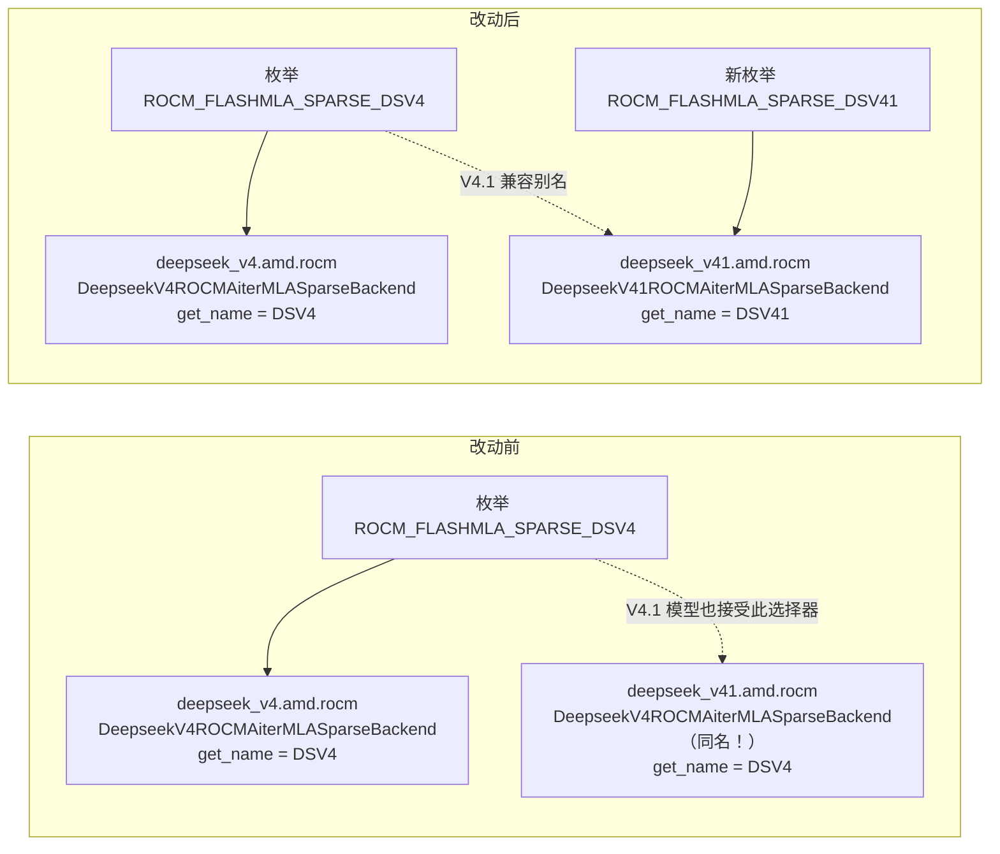
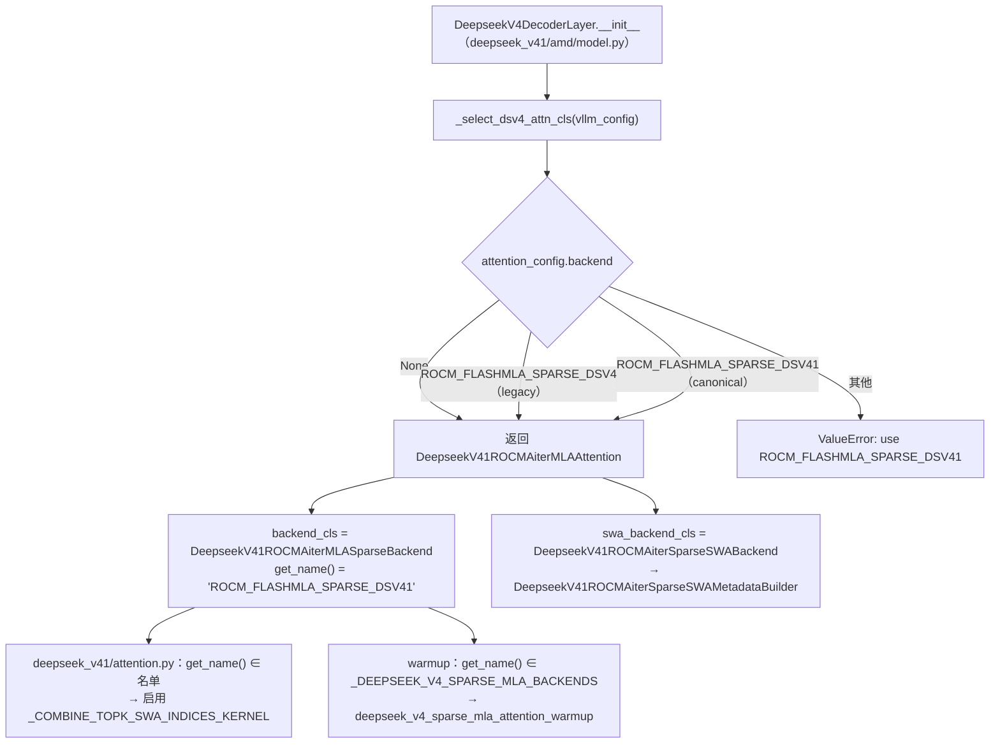

# PR #58689: [ROCm][DSv4.1] Disambiguate ROCm attention class names

> **Author**: @tuukkjs | **State**: OPEN | **Date**: 2026-09-25（最近更新 2026-10-14）
> **Branch**: `tuukkjs:fix/dsv41-rocm-naming` → `main` | **Labels**: rocm, multi-modality, deepseek, nvidia, DSv4.1
> **Changes**: +62 -22 lines across 8 files | **ROCm 相关性**: 完全相关（DeepSeek V4.1 ROCm sparse-MLA 后端命名 + attention backend 选择器）
> **Head SHA**: `bfc417d9a8` | **Review 基线**: vllm main @ `561e3b7`（2026-10-14）
> 本报告分两部分：§1–6 为 PR 详细总结，§7–8 为 ROCm review 意见，§9 为可直接粘贴的英文评论。

---

## 1. 总结 (Summary)

DeepSeek V4.1 的 ROCm attention 实现（`vllm/models/deepseek_v41/amd/rocm.py`）中有三个类与 DeepSeek V4 的 ROCm 实现（`vllm/models/deepseek_v4/amd/rocm.py`）**同名但不同实现**：SWA metadata、SWA metadata builder、sparse-MLA backend。本 PR 将这三个 V4.1 本地类加上 `V41` 前缀以消除歧义，新增 attention backend 枚举 `ROCM_FLASHMLA_SPARSE_DSV41` 作为 V4.1 在 ROCm 上的规范选择器，同时保留 `ROCM_FLASHMLA_SPARSE_DSV4` 作为 V4.1 的兼容别名。作者声明运行时行为不变，DeepSeek V4 路径不受影响。

## 2. 背景与动机 (Background & Motivation)

DSv4 与 DSv4.1 在 vLLM 里各自拥有独立的模型目录（`deepseek_v4/` 与 `deepseek_v41/`），各自的 `amd/rocm.py` 中定义了 ROCm 专属的 sparse MLA attention 层。历史原因导致 V4.1 的 ROCm 实现直接沿用了 V4 的类名：

- `DeepseekV4ROCMAiterSparseSWAMetadata` —— V4 与 V4.1 各有一个，字段不同（V4.1 版多了 `prefill_swa_ragged_*`，供 aiter prefill 原地读 SWA cache）；
- `DeepseekV4ROCMAiterSparseSWAMetadataBuilder` —— V4.1 版继承自 `DeepseekV41SparseSWAMetadataBuilder`（处理 V4.1 的 0/1/2 压缩拓扑），而 V4 版继承 `DeepseekSparseSWAMetadataBuilder`；
- `DeepseekV4ROCMAiterMLASparseBackend` —— 两个都 `get_name() == "ROCM_FLASHMLA_SPARSE_DSV4"`，但 registry 的枚举只指向 V4 版。

这导致：(1) 阅读代码 / 排查 stack trace 时无法区分是哪个模型的类；(2) 名为 `*_DSV4` 的选择器实际被 V4.1 也拿来用，语义误导。PR 的动机是**纯代码质量清理**（作者在评论中强调 "no perf effect"），据 @simondanielsson 评论，此事已在 AMD SIG 上与 @tjtanaa 讨论并希望合入。

PR 初版只改类名、保留 DSV4 选择器；在 @simondanielsson 指出"类名与选择器名不再一致反而更混乱"后，作者追加了 `ROCM_FLASHMLA_SPARSE_DSV41` 规范选择器 + 旧名兼容。

## 3. 代码修改分析 (Code Change Analysis)

### 3.1 修改的模块

| 模块 | 文件 | 改动 |
|------|------|------|
| V4.1 ROCm attention 实现 | `vllm/models/deepseek_v41/amd/rocm.py` (+15 −15) | 三个类改名（`DeepseekV41ROCMAiterSparseSWAMetadata` / `…MetadataBuilder` / `DeepseekV41ROCMAiterMLASparseBackend`）；`get_name()` 由 `ROCM_FLASHMLA_SPARSE_DSV4` 改为 `ROCM_FLASHMLA_SPARSE_DSV41`；所有类型注解 / cast 同步更新 |
| V4.1 ROCm 模型选择器 | `vllm/models/deepseek_v41/amd/model.py` (+4 −3) | `_select_dsv4_attn_cls` 同时接受 `ROCM_FLASHMLA_SPARSE_DSV4` 与 `…_DSV41`；报错提示改为推荐 DSV41 |
| V4.1 mono decode | `vllm/models/deepseek_v41/amd/mono_decode.py` (+2 −2) | `TYPE_CHECKING` import 与字符串 cast 跟随改名 |
| V4.1 通用 attention | `vllm/models/deepseek_v41/attention.py` (+1 −1) | 判断是否启用 `_COMBINE_TOPK_SWA_INDICES_KERNEL` 的 backend 名单里 DSV4 → DSV41 |
| Backend registry | `vllm/v1/attention/backends/registry.py` (+3) | 新增枚举 `ROCM_FLASHMLA_SPARSE_DSV41` → `vllm.models.deepseek_v41.amd.rocm.DeepseekV41ROCMAiterMLASparseBackend` |
| Kernel warmup | `vllm/model_executor/warmup/flashinfer_sparse_mla_warmup.py` (+1) | `_DEEPSEEK_V4_SPARSE_MLA_BACKENDS` 加入 `ROCM_FLASHMLA_SPARSE_DSV41`，使 V4.1 ROCm 仍走 sparse-MLA warmup |
| 测试 | `tests/v1/attention/test_rocm_attention_backends_selection.py` (+35) | 新增 registry 路径断言 + legacy/canonical 两个选择器都能选到 V4.1 实现的参数化测试 |
| 测试 | `tests/models/multimodal/generation/test_vit_cudagraph.py` (+1 −1) | DSv4.1 VL cudagraph 测试在 ROCm 上改用 `ROCM_FLASHMLA_SPARSE_DSV41` |

### 3.2 架构 / 流程图

**改名前后的类 / 枚举映射关系**：



**DSv4.1 在 ROCm 上的 attention 类选择流程（改动后）**：



### 3.3 关键实现细节

- **改名范围**：只改 `deepseek_v41/amd/rocm.py` 中的三个 V4.1 本地类；V4.1 已带 `V41` 前缀的 `DeepseekV41ROCMAiterSparseSWABackend`、`DeepseekV41ROCMAiterMLAAttention` 不变；`deepseek_v4/amd/rocm.py` 完全不动。
- **`get_name()` 字符串改变**：V4.1 backend 现在报告 `ROCM_FLASHMLA_SPARSE_DSV41`。所有基于名字的 dispatch 点都要同步——PR 改了 `deepseek_v41/attention.py:651`（combine-topk kernel 开关）和 warmup 白名单两处。我在 main 上 grep 了 `ROCM_FLASHMLA_SPARSE_DSV4` 的所有字符串引用，没有发现其他需要同步的名字比较点。
- **兼容别名**：没有在 registry 里做"别名"；兼容性是在 `_select_dsv4_attn_cls` 里实现的——V4.1 模型无论传 DSV4 还是 DSV41，都会被选成 `DeepseekV41ROCMAiterMLAAttention`。V4 模型（`deepseek_v4/amd/model.py:812`）硬编码 `DeepseekV4ROCMAiterMLAAttention`，不读 `attention_config.backend`。
- **新测试**：`test_deepseek_rocm_backend_registry_paths_are_model_specific` 断言两个枚举的 `get_path()`；`test_deepseek_v41_rocm_accepts_legacy_backend_alias` 用 `SimpleNamespace(attention_config=AttentionConfig(backend=...))` 驱动 `_select_dsv4_attn_cls`。整个测试文件仅在 ROCm 上运行（`pytestmark skipif not is_rocm`）。

## 4. 涉及的技术原理 (Technical Principles)

- **vLLM attention backend 注册与选择**：`AttentionBackendEnum`（`vllm/v1/attention/backends/registry.py`）把字符串选择器映射到 backend 类路径，用户通过 `--attention-backend` / `attention_config.backend` 指定。对于 DeepSeek V4/V4.1 这类自带 attention 层的模型，模型代码自己根据 `attention_config.backend` 选择层实现（`_select_dsv4_attn_cls`），层上的 `backend_cls` 才是真正生效的 backend，因此 `backend_cls.get_name()` 是下游名字 dispatch（kernel 开关、warmup）的事实来源。
- **DeepSeek V4/V4.1 sparse MLA + SWA 双缓存**：每层 attention 有两类 KV：滑窗（SWA）cache 与压缩（compressed）cache，分别由 `swa_backend_cls` 和 `backend_cls` 的 metadata builder 构建 metadata。V4.1 引入 0/1/2 三种压缩比拓扑（`DeepseekV41SparseSWAMetadataBuilder`），因此其 ROCm SWA builder 与 V4 版本继承链不同——这正是"同名不同类"会误导人的地方。
- **ROCm ragged SWA metadata**：ROCm builder 在通用 metadata 基础上额外构造 `decode_swa_ragged_indices/indptr`（decode 用）和 `prefill_swa_ragged_indices/indptr`（仅 aiter triton sparse-MLA prefill 用，直接从 paged cache 读，免去 bf16 gather）。`supports_draft_decode_metadata_update = False` 是因为多步 draft 更新还不会刷新这些 ragged 索引。
- **Python 名字解析 vs. 类型身份**：改名不改变类型身份，但所有通过 `module.ClassName` 访问（包括 `importlib.import_module(...)` + 属性访问这种动态写法）的地方都会因改名而 `AttributeError`——静态 grep 只按完整模块路径搜索时容易漏掉这种按模型名参数化的动态访问。

## 5. 评论区讨论亮点 (Discussion Highlights)

- **@simondanielsson**（初版 review）：类名带 `V41` 但 `get_name()` 仍是 `ROCM_FLASHMLA_SPARSE_DSV4`，"arguably more confusing"。作者随后新增 `ROCM_FLASHMLA_SPARSE_DSV41` 作为规范选择器、DSV4 作为兼容别名，并用 TP=4 MI355X 分别验证了两个选择器。
- **@ChuanLi1101**：PR 描述仍写"公共选择器保持 DSV4"，与代码不符——作者已更新描述。
- **@amd-mghanimi**：指出 `flashinfer_sparse_mla_warmup.py` 承载了 AMD/NVIDIA 共享的 DeepSeek sparse-MLA warmup，建议拆出 `common_sparse_mla_warmup.py`。作者同意，但认为这是既有问题、需双平台验证，计划另起 follow-up PR。合理的范围控制。
- **@simondanielsson**（2026-10-14）：SIG 上已与 @tjtanaa 讨论，希望合入；"LGTM but I'd like maintainers to have a proper look"。
- mergify 曾报 merge conflict（09-29），当前 `mergeable = true`。

## 6. 风险与潜在问题 (Risk Analysis)

| 风险 | 严重程度 | 说明 |
|------|---------|------|
| 改名漏改动态引用，ROCm CI 中既有测试 AttributeError | High | 见 §7 🔴【测试】 |
| AMD Buildkite 未跑（无 `ready` label），上一条无法被 CI 拦截 | Medium | 只跑了 pre-commit / DCO / docs；作者自测仅限"focused tests" |
| 公开符号改名无兼容 alias，外部 import 断裂 | Medium | 见 §7 ⚠️【兼容性】 |
| `get_name()` 字符串变化，名字 dispatch 点漏改 → 静默关闭 combine-topk kernel 或 warmup | Low | 已 grep 全仓，PR 已覆盖全部 2 处；后续新增代码需注意 |
| legacy 选择器无弃用提示、无下线计划 | Low | 见 §7 📝 |
| 运行时数值行为 | Low | 纯改名 + 选择器扩展，kernel / metadata 内容零改动 |

---

## 7. Review 意见 (Findings)

| 类型 | 🔴 | ⚠️ | 📝 |
|------|----|----|----|
| 测试 | 1 | — | 1 |
| 兼容性 | — | 1 | 1 |
| 设计 | — | — | 1 |

---

**🔴【测试】`DeepseekV4ROCMAiterSparseSWAMetadataBuilder` 改名后，`test_rocm_aiter_triton_sparse_mla.py` 的 V4.1 参数化用例会 AttributeError** `[已验证]`

- **问题**: `tests/v1/attention/test_rocm_aiter_triton_sparse_mla.py::test_paged_prefill_indices_match_gathered_prefill` 以 `("deepseek_v41", 1), ("deepseek_v41", 2), ("deepseek_v4", 4)` 参数化，通过 `rocm = importlib.import_module(f"vllm.models.{model}.amd.rocm")`（PR head 第 171 行）动态加载模块，再在第 234 行访问 `rocm.DeepseekV4ROCMAiterSparseSWAMetadataBuilder(...)`。本 PR 把 `vllm.models.deepseek_v41.amd.rocm` 中的该类改名为 `DeepseekV41ROCMAiterSparseSWAMetadataBuilder` 且未留 alias，而这个测试文件不在 PR 的改动列表中（已对照 PR head `bfc417d9a8` 的文件内容确认）。由于是 `importlib` + 属性访问，按完整模块路径 grep 搜不到它。
- **影响**: 在任何 ROCm runner 上（该文件仅 `skipif not is_rocm`，该用例无 gfx950 gate），`[deepseek_v41-1]` 与 `[deepseek_v41-2]` 两个用例在 `build()` 时直接抛 `AttributeError: module 'vllm.models.deepseek_v41.amd.rocm' has no attribute 'DeepseekV4ROCMAiterSparseSWAMetadataBuilder'`。AMD CI 的 `pytest -v -s v1/attention`（`.buildkite/test-amd.yaml:2715`）覆盖该文件，合入后 main 上的 AMD attention 队列会变红。当前 PR 没有跑 Buildkite（只有 pre-commit/DCO/docs），所以 CI 不会拦截。作者报告的"focused registry and backend-selection tests"没有包含这个文件。
- **行动**: 作者应当在测试中按模型解析 builder 名（例如把参数扩成 `(model, builder_name, compress_ratio)` 再 `getattr(rocm, builder_name)`，或用 `{"deepseek_v4": "DeepseekV4…", "deepseek_v41": "DeepseekV41…"}` 映射），并在 ROCm 机器上跑一遍 `pytest tests/v1/attention/test_rocm_aiter_triton_sparse_mla.py tests/v1/attention/test_deepseek_v4_rocm_adaptive.py tests/kernels/attention/test_rocm_triton_attn_dsv4.py`。建议 review 时要求加 `ready` label 跑一次 AMD attention 队列。

**⚠️【兼容性】三个公开类改名没有保留旧名 alias** `[已验证]`（外部使用者存在与否 `[推测]`）

- **问题**: `vllm/models/deepseek_v41/amd/rocm.py:280/288/501` 直接改名，没有 `DeepseekV4ROCMAiterSparseSWAMetadata = DeepseekV41ROCMAiterSparseSWAMetadata` 之类的兼容名。PR 对**选择器字符串**做了向后兼容，但对 **Python 符号**没有。
- **影响**: 仓内既有引用除上一条测试外均已同步（我 grep 了全仓，`llm_base_proposer.py`、`sparse_swa.py`、`test_deepseek_v4_rocm_adaptive.py`、`test_rocm_triton_attn_dsv4.py` 引用的都是 `deepseek_v4.amd.rocm` 中的同名类，不受影响）。但凡是 `from vllm.models.deepseek_v41.amd.rocm import DeepseekV4ROCMAiter…` 的仓外代码（ATOM 插件桥、内部 benchmark / profiling 脚本、未合入的 V4.1 ROCm PR 分支）都会在 import 时失败。本地 ATOM checkout 中未发现引用。
- **行动**: 建议作者要么在 PR 描述里明确"V4.1 ROCm 类名为内部符号，不提供兼容"，要么保留一个版本周期的模块级 alias。另外建议 review 时追问是否有 open PR 仍在使用旧名（V4.1 ROCm 目录近期改动很活跃），需要在合入顺序上协调。

**📝【兼容性】legacy 选择器 `ROCM_FLASHMLA_SPARSE_DSV4` 用于 V4.1 时没有弃用提示，`get_name()` 与用户所选不一致** `[已验证]`

- **问题**: `vllm/models/deepseek_v41/amd/model.py:144-151` 静默接受 legacy 选择器；但层上 `backend_cls.get_name()` 恒为 `ROCM_FLASHMLA_SPARSE_DSV41`，而 `vllm/v1/utils.py:711` 等处上报的是 `attention_config.backend.name`（即用户传的 DSV4）。
- **影响**: 无正确性影响；但日志 / 使用统计里同一部署会出现两个不同的 backend 名，且 legacy 名永远不会被清理。
- **行动**: 建议作者在 `backend is AttentionBackendEnum.ROCM_FLASHMLA_SPARSE_DSV4` 时加一行 `logger.warning_once("... is deprecated for DeepSeek V4.1; use ROCM_FLASHMLA_SPARSE_DSV41")`，并在描述中写明计划在哪个版本移除该别名。

**📝【设计】DSv4 ROCm 模型不校验 `attention_config.backend`，传入新的 `…_DSV41` 会被静默接受** `[已验证]`（影响 `[推测]`）

- **问题**: V4.1 的 `_select_dsv4_attn_cls` 会拒绝不匹配的选择器，但 `vllm/models/deepseek_v4/amd/model.py:812` 硬编码 `DeepseekV4ROCMAiterMLAAttention`，不读 `attention_config.backend`。PR 引入 `ROCM_FLASHMLA_SPARSE_DSV41` 后，"给 V4 模型传 V4.1 选择器"成了一种新的可能误配置。
- **影响**: 运行时会用 V4 的正确实现，因此不会算错；但用户会以为自己在用 DSV41 backend，问题排查时容易误导。这是既有的不对称，不是本 PR 引入的 bug。
- **行动**: 非阻塞。建议作者在 follow-up 中给 V4 ROCm 模型加一个对称的校验（只接受 None / `ROCM_FLASHMLA_SPARSE_DSV4`）。

**📝【测试】新增的 registry 测试偏同义反复；V4.1 ROCm SWA metadata 不在 spec-decode ROCm 白名单内（既有问题，顺带提醒）** `[推测]`

- **问题**: ① `test_deepseek_rocm_backend_registry_paths_are_model_specific` 只是把 registry 字符串再写一遍，更有价值的断言是 `AttentionBackendEnum.ROCM_FLASHMLA_SPARSE_DSV41.get_class() is DeepseekV41ROCMAiterMLASparseBackend`（会真正 import 并校验路径可解析）。② 改名把 V4 / V4.1 两个 ROCm SWA metadata 类型的差异摆上了台面：`vllm/v1/spec_decode/llm_base_proposer.py:271-295` 的 ROCm `allowed_attn_types` 只登记了 `deepseek_v4.amd.rocm.DeepseekV4ROCMAiterSparseSWAMetadata`，而 V4.1 的 SWA metadata 是 `DeepseekSparseSWAMetadata` 的兄弟子类，不会通过 `isinstance` 检查。V4.1 在 ROCm 上走 V1 proposer、`num_speculative_tokens > 1` 时可能在第 656–664 行报 `Unsupported attention metadata type`。
- **行动**: ① 建议作者把路径字符串断言换成（或补充）`get_class()` 身份断言。② 不属本 PR 范围；建议 review 时顺带追问 V4.1 ROCm 多步 MTP 是否只走 V2 runner 的 speculator，如果否，需要另开 PR 把 `DeepseekV41ROCMAiterSparseSWAMetadata` 加入白名单。

> 已检查、未发现问题的项：`get_name()` 名字 dispatch 点同步完整（`deepseek_v41/attention.py`、warmup 白名单）；新增枚举路径与类名一致；`mono_decode.py` 的 `TYPE_CHECKING` import 与字符串 cast 同步；DSpark drafter 透传 target backend（`dspark/utils.py:16-33`），而 V4.1 选择器两个名字都接受，因此 drafter 不受影响；无新 env var、无新 aiter/mori 符号、无性能声明。AI 代码诊断：描述讲清了 WHY（类型同名但继承链不同），测试计划含真实 MI355X TP=4 serve 验证，未见风险信号。

## 8. 结论 (Verdict)

**🔴 BLOCK（修复成本很低）**

改名方向正确，讨论也充分，canonical + legacy 选择器的兼容方案合理，运行时数值零改动。但 PR 漏改了 `test_rocm_aiter_triton_sparse_mla.py` 中通过 `importlib` 动态访问旧类名的地方，在 ROCm CI 的 `v1/attention` 队列中会稳定产生 2 个 `AttributeError` 失败，而当前 PR 没有跑 AMD Buildkite，CI 拦不住。修好这个测试并跑一次 AMD attention 队列后即可转为 ✅；alias / 弃用提示属于建议项。

## 9. 英文 Review 评论 (Copy-Paste English Comments)

行号为 PR head 的新文件行号（由 `files[].patch` hunk 头推算）。C1 指向的测试文件不在 diff 里，因此锚定在同一改名的行上。

**C1** `vllm/models/deepseek_v41/amd/rocm.py:288` — 🔴 blocking

```text
This rename breaks an existing ROCm test that isn't touched by the PR. `tests/v1/attention/test_rocm_aiter_triton_sparse_mla.py::test_paged_prefill_indices_match_gathered_prefill` is parametrized over `deepseek_v41` / `deepseek_v4`, loads `vllm.models.{model}.amd.rocm` via `importlib`, and then calls `rocm.DeepseekV4ROCMAiterSparseSWAMetadataBuilder(...)` (around line 234 at this PR's head). For the `[deepseek_v41-1]` and `[deepseek_v41-2]` cases this now raises AttributeError, and the file runs in the AMD `pytest v1/attention` job. A path-based grep won't find it because the module is resolved dynamically. Could you resolve the builder per model in that test (e.g. add a `builder_name` parameter and use `getattr(rocm, builder_name)`) and run the AMD attention queue once (the PR doesn't have the `ready` label yet)?
```

**C2** `vllm/models/deepseek_v41/amd/rocm.py:280-288` — ⚠️ comment

```text
The selector string keeps a backward-compatible alias, but the three renamed Python symbols (`DeepseekV4ROCMAiterSparseSWAMetadata`, `...MetadataBuilder`, `DeepseekV4ROCMAiterMLASparseBackend` in the `deepseek_v41` module) don't. Any out-of-tree code or in-flight PR that imports them from `vllm.models.deepseek_v41.amd.rocm` will fail at import time. Consider either keeping module-level aliases for one release, or stating in the description that these are internal symbols with no compatibility guarantee. It might also help to check whether any open V4.1 ROCm PRs still use the old names, so the merge order can be coordinated.
```

**C3** `vllm/models/deepseek_v41/amd/model.py:144-151` — ⚠️ comment

```text
Accepting `ROCM_FLASHMLA_SPARSE_DSV4` as a legacy alias makes sense. Could we add a `logger.warning_once(...)` when the legacy value is used for V4.1, pointing users to `ROCM_FLASHMLA_SPARSE_DSV41`? Right now the alias is silent, and the layer reports `get_name() == "ROCM_FLASHMLA_SPARSE_DSV41"` while `attention_config.backend.name` (which feeds usage stats) still says `..._DSV4`, so the same deployment can show up under two backend names. A short note in the description about when the alias will be removed would also help.
```

**C4** `tests/v1/attention/test_rocm_attention_backends_selection.py:48-54` — ⚠️ comment (nit)

```text
nit: this test mostly restates the registry strings. Asserting `AttentionBackendEnum.ROCM_FLASHMLA_SPARSE_DSV41.get_class() is DeepseekV41ROCMAiterMLASparseBackend` (and the V4 equivalent) would also check that the path actually resolves to the intended class, which is the property this PR is trying to guarantee.
```
