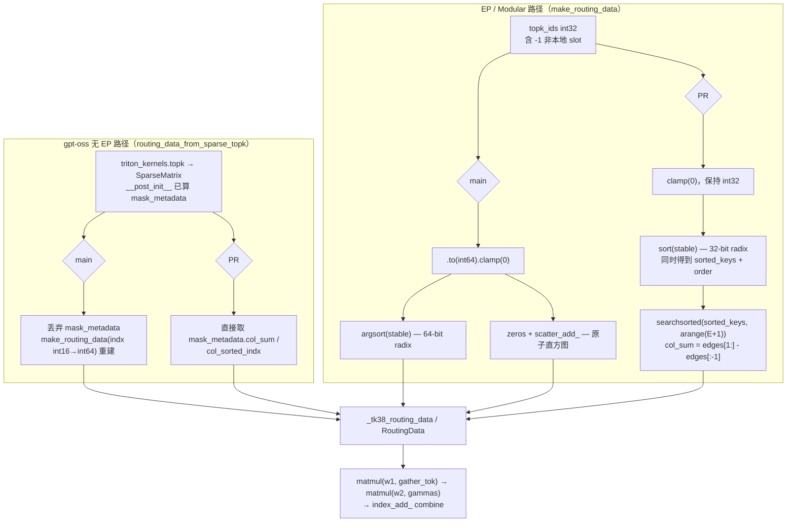
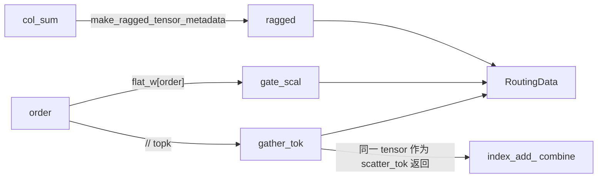

# PR #58897: [Perf][MoE] Cheaper triton_kernels 3.8 routing build in the OAI Triton MoE

> **Author**: @ZhengGong-amd | **State**: OPEN | **Date**: 2026-09-27
> **Branch**: `ZhengGong-amd:tk38-routing-build` → `main` | **Labels**: gpt-oss
> **Changes**: +79 -21 lines across 2 files | **ROCm 相关性**: 完全相关（triton_kernels 3.8 分支只在 ROCm 构建中出现）
> 本报告分两部分：§1–6 为 PR 详细总结，§7–8 为 ROCm review 意见。

---

## 1. 总结 (Summary)

ROCm 构建自 #50605 起使用 triton_kernels 3.8（`matmul_ogs` 被 `matmul` 取代）。在这个分支里，OAI Triton MoE 的 routing 元数据由 torch 现场重建：int64 稳定 `argsort` 加 `scatter_add_` 直方图。在 MI355X / MI325X 上，每个 MoE 层每个 step 要多花 31–178 µs。本 PR 做两处改动：(1) `make_routing_data` 直接按 id 的原始 dtype（int32/int16）排序，再用 `searchsorted` 从已排序的 key 上算出每个专家的计数，不再走原子直方图；(2) `routing_data_from_sparse_topk`（gpt-oss 无 EP 路径）直接复用 `triton_kernels.topk` 返回的 `SparseMatrix.mask_metadata` 中已算好的 `col_sum` / `col_sorted_indx`，不再从 raw id 重算一遍。PR 声称 routing 元数据与 main 逐位一致，gpt-oss-120b decode 吞吐 +6~10%，DeepSeek-V4-Flash +1.4~2.2%。

## 2. 背景与动机 (Background & Motivation)

- triton_kernels 3.8 去掉了 `matmul_ogs` 内置的 scatter + topk-reduce 以及 `routing()` / `RoutingData` 这一套 API。vLLM 因此在 `gpt_oss_triton_kernels_moe.py` 里自定义了一个轻量 `RoutingData`（`__slots__`：`ragged / gate_scal / gather_tok / n_expts_act / n_valid`），combine 改为在外部用 `index_add_` 完成。
- main 上的 3.8 routing 构建是"能跑通"的直译版本：
  - 把 `topk_ids` 转成 int64 后 `torch.argsort(stable=True)`，64-bit radix sort 的 pass 数是 32-bit 的两倍；
  - `col_sum.scatter_add_` 是原子直方图，热点专家上会有 atomic 竞争；
  - gpt-oss 无 EP 路径中，`triton_kernels.topk` 返回的 `SparseMatrix` 在 `__post_init__` 里**已经**算过一遍 `make_bitmatrix_metadata`（col_sum / col_sorted_indx / row_sorted_indx），main 却丢弃它，再调 `make_routing_data` 从头重建，相当于做了两遍。
- 3.6 路径在 #45457 里已经做过同样的 SparseMatrix 复用，本 PR 把这项优化补到 3.8 分支。
- 受益面：gpt-oss（ROCm 默认 OAI Triton MoE）；DeepSeek-V4 在 AITER MXFP4 MoE 不适用时会退到 `UnfusedOAITritonExperts`（包括 gfx942 上 `VLLM_ROCM_USE_AITER=1` 的情形）；以及所有 EP 路径。
- CUDA 默认构建 pin `v3.5.1`（`cmake/external_projects/triton_kernels.cmake:19`），ROCm pin commit `669b31acc1`（同文件 :16），所以只有 ROCm 走到改动分支。

## 3. 代码修改分析 (Code Change Analysis)

### 3.1 修改的模块

| 模块 | 改动 |
|------|------|
| `vllm/model_executor/layers/fused_moe/experts/gpt_oss_triton_kernels_moe.py` (+33 -16) | 新增 `_tk38_routing_data()` 共用构建器；`make_routing_data` 3.8 分支改为同 dtype 稳定 `torch.sort` + `searchsorted` 计数；`routing_data_from_sparse_topk` 3.8 分支改为复用 `sparse_topk.mask_metadata` |
| `tests/kernels/moe/test_gpt_oss_triton_kernels.py` (+46 -5) | 去掉 3.8 下 `test_routing_data_from_sparse_topk_parity` 的 skip；`assert_equivalent` 支持 `__slots__` 对象和 Tensor 形式的 gather/scatter；新增 `test_make_routing_data_tk38_matches_reference`（与 int64 stable argsort + bincount 参考实现逐位比较，含 -1 slot） |

### 3.2 架构 / 流程图

3.8 routing 构建前后对比：



`_tk38_routing_data` 的数据关系：



### 3.3 关键实现细节

- **`_tk38_routing_data(col_sum, order, flat_w, topk)`**（L814-825）：两条路径共用的构建器。`nrows = order.shape[0]`，`gather_tok = (order // topk).int()`，`gate_scal = flat_w[order]`，返回值 `(routing, gather_tok, gather_tok)` 与 main 一致。
- **`make_routing_data` 3.8 分支**（L833-846）：
  - `keys = flat_ids.clamp(min=0)`，**不再转 int64**；-1 slot 归到 expert 0、权重置 0，语义不变；
  - `torch.sort(keys, stable=True)` 一次得到 `sorted_keys` 和 `order`（int64 索引）；
  - `edges = searchsorted(sorted_keys, arange(E+1, dtype=keys.dtype), out_int32=True)`，`col_sum = edges[1:] - edges[:-1]`。前提是 key ∈ [0, E)，此时结果等价于 bincount；
  - `boundaries` 和 `values` dtype 一致（`searchsorted` 要求两者同 dtype），`out_int32=True` 让 `col_sum` 保持 int32，满足 `make_ragged_tensor_metadata` 的要求。
- **`routing_data_from_sparse_topk` 3.8 分支**（L913-921）：
  - 使用 `mask_metadata.col_sum`（长度 = bitmatrix 列数 = 专家数，int32）和 `mask_metadata.col_sorted_indx`（int32，按专家分组的 flat 索引）；
  - `vals` 不再乘 valid mask，依据是"topk 输出没有 -1 slot"；
  - 形参 `n_expts` 在 3.8 分支里不再被使用。
- **测试**：`assert_equivalent` 新增 `__slots__` 分支。旧的 3.8 `RoutingData` 没有 `__dict__`，以前只会比较 `type(new) is type(ref)`，所以 3.8 下的 parity 比较其实是空转的。本 PR 顺手修正了这一点。

## 4. 涉及的技术原理 (Technical Principles)

**Ragged MoE routing 元数据**：triton_kernels 3.8 的 `matmul` 以"按专家分组的 ragged batch"方式执行 grouped GEMM。它需要三样东西：每个专家的行数（`col_sum` → `RaggedTensorMetadata.slice_sizes/offs`）、按专家排序后每一行对应的源 token（`gather_tok = order // topk`），以及对应的 router 权重（`gate_scal`）。只要"按专家升序分组"成立，组内行顺序不影响数值。组内行顺序只影响第二个 matmul 的写出位置，以及后续 `index_add_` 的累加顺序；而 `index_add_` 本身就是原子累加，结果非确定。

**int32 vs int64 radix sort**：`torch.sort` 在 GPU 上对整型 key 使用 (hip)cub `DeviceRadixSort`，pass 数与 key 位宽成正比，所以 int32 的 sort 大约是 int64 的一半工作量。`searchsorted` 只做 E+1 次二分查找（E ≤ 384，O(E·log N)），完全没有原子竞争。相比之下，`scatter_add_` 直方图在 topk 集中到少数专家时会遇到原子冲突。

**triton_kernels `make_bitmatrix_metadata` 的稳定性**：在 3.8（`tensor_details/bitmatrix.py`）中，stage2 以 32 个 token 为一个 block，在 block 内用 `(col << 16) | local_offset` 的 kv pair 做 `tl.sort`。全局位置 = `ColOffs[col] + ColPartialSum[block, col] + exclusive_run_length`，因此 `col_sorted_indx` 在每个专家内部按 flat 索引递增，与 `argsort(stable=True)` 完全一致。这正是 PR 所说"元数据与 main 逐位一致"的依据，parity 测试也直接断言了这一点。（注：该文件 docstring 示例中写的 `[9 1 10]` 与实现不符，以实现为准。）

**CUDA graph 兼容**：新增的 `torch.sort / torch.arange / searchsorted / 切片相减` 都是纯 device 运算，没有 `.item()`，也没有 host 同步或数据相关的 Python 分支，在 FULL_DECODE_ONLY 捕获下是安全的。PR 的微基准本身就是在 CUDA-graph replay 下测得的。

## 5. 评论区讨论亮点 (Discussion Highlights)

目前还没有人工 review。只有 `claude[bot]` 留言说明 fork PR 默认不跑自动 review，需要 maintainer 评论 `@claude review` 触发。PR 描述的实验方法比较严谨：每个 arm 一个独立 server，按 main/PR/PR/main 分块排序，丢弃每块首轮，剔除高 host 负载的轮次，并给出区间是否重叠的说明。另外，描述里声明了改动由 Hyperloom 自动发现，再经人工复核和测量。

## 6. 风险与潜在问题 (Risk Analysis)

| 风险 | 严重程度 | 说明 |
|------|---------|------|
| 正确性：routing 元数据偏离 main | Low | 合法输入下数学等价，有逐位比较测试（新测试 + 去掉 skip 的 parity 测试）兜底，且 MI300 MoE Kernels CI mirror 会实际执行 |
| 正确性：越界 expert id 的失败模式变化 | Low | 原来 `scatter_add_` 越界会触发 device assert，现在会被 `searchsorted` 静默丢弃，见 §7「越界 expert id 由报错变为静默丢弃」 |
| 兼容性：依赖 triton_kernels `mask_metadata` 内部字段语义 | Low | "3.8" 是按能力探测得到的（只要没有 `matmul_ogs` 就算 3.8），未来 triton_kernels 若改动字段名或长度会直接受影响，见 §7「`n_expts` 在 3.8 分支被静默忽略」 |
| 性能：微基准数字溯源 | Low | e2e 命令完整；routing 微基准（104→61 µs 等）没有给出脚本，记为 `[unverified]` |
| 测试覆盖 | Low | 新测试只覆盖 int32 id；gfx950 不在 CI 中（作者已在 MI355X 上手动验证） |
| 可维护性 | Low | 抽出 `_tk38_routing_data` 后两条路径共用一个构建器，比 main 更清晰 |

---

## 7. Review 意见 (Findings)

| 意见类型 | 🔴 | ⚠️ | 📝 |
|---------|----|----|----|
| 兼容性 / 正确性 | 0 | 0 | 2 |
| 测试 | 0 | 0 | 2 |
| 性能（证据） | 0 | 0 | 1 |

整体评估：改动小、机制清楚（PR 描述解释的是 WHY 而不只是 WHAT），与 main 数学等价，且有独立参考实现做逐位断言。没有发现需要阻塞或必须修复的问题，下面全部是 📝 级建议。

已核对的点（无问题）：
- 新增符号 `make_ragged_tensor_metadata`、`SparseMatrix.mask_metadata.{col_sum,col_sorted_indx}` 在 triton_kernels 3.8 中都存在：`mask_metadata` 在 `SparseMatrix.__post_init__` 中计算，`col_sum` 长度等于 bitmatrix 列数，dtype 为 int32。
- `col_sorted_indx` 是按专家分组的稳定顺序（见 §4），与 `argsort(stable=True)` 一致。
- vLLM 调用 `topk_fn(logits, topk, apply_softmax=...)` 时没有传 `n_rows`，所以 `col_sorted_indx` 中不会出现 sentinel `-1`，"topk ids 无 -1 slot"的前提成立。
- CUDA graph 安全：无 host 同步，无数据相关分支。
- AMD CI：`.buildkite/test_areas/kernels.yaml` 的 `kernels-moe-test` 带有 `:amd: (MI300) MoE Kernels` mirror，`source_file_dependencies` 覆盖 `fused_moe/` 和 `tests/kernels/moe`，因此 gfx942 上会实际执行两个 3.8 测试。抓取到的 PR checks 数据为空，无法确认这些 job 已经跑过。

---

**📝【兼容性】`routing_data_from_sparse_topk` 的 3.8 分支静默忽略 `n_expts`，并依赖 `mask_metadata` 的内部语义** `[已验证]`
- **问题**: `gpt_oss_triton_kernels_moe.py:913-921` 不再使用形参 `n_expts`，专家数完全由 `mask_metadata.col_sum.shape[0]`（即 bitmatrix 列数，也就是 logits 列数）决定。现有唯一的生产调用方传入的是 `gating_output.shape[-1]`，两者相等，所以当前没有错误。但 `get_triton_kernels_version()` 是按能力探测的：只要没有 `matmul_ogs` 就判为 "3.8"。将来 triton_kernels 若改动 `BitmatrixMetadata` 字段（例如 `col_sum` 按 128 padding 后不再切片），或者调用方给 `topk` 传了 `n_rows`（`col_sorted_indx` 尾部会出现 `-1` sentinel，`gather_tok = -1 // topk = -1`），这里都会在没有任何诊断的情况下产生错误路由。
- **影响**: 目前不会触发。这个风险属于"未来依赖漂移时静默错结果"，而不是当前 bug。
- **行动**: 建议作者加一个 host 侧形状断言，例如 `assert mask_metadata.col_sum.shape[0] == n_expts`。它只检查 shape，不引入 device 同步，不影响 CUDA graph。同时在注释中注明前提："topk must be called without `n_rows` so `col_sorted_indx` has no sentinel"。

**📝【正确性】越界 expert id 由 device assert 变为静默丢弃** `[已验证]`
- **问题**: `gpt_oss_triton_kernels_moe.py:842-843` 中，`searchsorted` 计数只统计 [0, E) 内的 key。若有 id ≥ `num_local_experts`，它会被排到 `order` 末尾，但不计入任何 `col_sum`，于是 `sum(col_sum) < nrows`。main 上的 `scatter_add_` 在这种情况下会越界，CUDA 上会触发 device assert。ROCm release 构建中 device assert 是否生效取决于编译选项。
- **影响**: 只有在上游违反契约时才会出现（例如 expert_map 或 router bug）。这时末尾那些行不属于任何 ragged slice，matmul 是否写这些行取决于 triton_kernels 实现，`index_add_` 可能会把未初始化的数据累加进输出 `[推测]`。正常输入不受影响，而且 main 在 ROCm 上的行为本身也不一定更安全。
- **行动**: 不要求修改。建议作者在注释中写明"ids must lie in [-1, num_local_experts)"这个不变式，方便以后排查。如果希望保留 fail-fast，可以只在测试或 debug 模式下断言 `edges[-1] == nrows`。

**📝【测试】新测试只覆盖 int32 id，而本 PR 的核心变化正是"按原 dtype 排序"** `[已验证]`
- **问题**: `tests/kernels/moe/test_gpt_oss_triton_kernels.py:459-461` 固定用 `.to(torch.int32)`。parity 测试间接覆盖了 int16（`topk` 的 `y_indx`）。但 `make_routing_data` 的调用方可能传入 int64，例如 router 的 `indices_type` 为 int64，或者 `expert_map` 本身是 int64 时 `expert_map[...]` 的结果。PR 正好把"统一转 int64"改成了"保持原 dtype"，`arange(..., dtype=keys.dtype)` 与 `searchsorted` 的 dtype 配对需要在每种 dtype 下都成立。
- **影响**: 按代码推断 int64 应该是正确的（与 main 等价），但没有测试锁住这一点。将来如果有人改动 `experts` 的 dtype，int64 调用方会直接报错。
- **行动**: 建议作者把 `id_dtype` 参数化为 `[torch.int16, torch.int32, torch.int64]`，成本很低。

**📝【测试】参考数据构造使用 Python 循环** `[已验证]`
- **问题**: `test_gpt_oss_triton_kernels.py:459-461` 用列表推导对每个 token 调一次 `torch.randperm(...)`。`n_tokens=4099` 共有 8 个参数组合，累计约 3.3 万次小 kernel launch。
- **影响**: 只会拖慢测试（在 MI300 MoE Kernels shard 上可能多出几秒到十几秒），不影响正确性。
- **行动**: 建议作者改成向量化写法，例如 `torch.rand(n_tokens, n_experts, device="cuda").argsort(dim=1)[:, :topk]`，一样能保证每行无重复。

**📝【性能】routing 微基准数字缺少可复现脚本** `[已验证]`
- **问题**: PR 描述中 "Routing call under CUDA-graph replay, 1000 rows" 的表格（DeepSeek-V4-Flash 104/142 → 61/80 µs，gpt-oss 132/176 → 32/44 µs）没有给出脚本或命令。e2e 和 GSM8K 部分则给出了完整命令和镜像版本。
- **影响**: 微基准数字目前记为 `[unverified]`。不过 e2e 收益（gpt-oss TPOT −5.8%~−11.1%，TTFT 基本不变）与"只省 decode 侧 routing 开销"的机制自洽，可信度较高。
- **行动**: 建议作者把微基准脚本附在 PR 描述的 `<details>` 中（或贴 gist 链接），方便 reviewer 在 gfx942/gfx950 上复现。

## 8. 结论 (Verdict)

✅ **LGTM**：改动范围只在 ROCm 独有的 triton_kernels 3.8 分支内。机制清楚：32-bit sort 代替 64-bit sort，`searchsorted` 代替原子直方图，并去掉 gpt-oss 路径上重复计算的 bitmatrix 元数据。新实现与 main 数学等价，有独立参考实现做逐位断言，在 MI355X 和 MI325X 上都有 e2e 与 GSM8K 证据，而且 MI300 CI mirror 会执行新增测试。上面的 📝 项（`n_expts` 形状断言、int64 测试参数化、附上微基准脚本）是低成本的加固建议，不阻塞合入。建议 maintainer 合入前确认 `:amd: (MI300) MoE Kernels` shard 为绿。

## 9. 英文 Review 评论 (Copy-Paste English Comments)

以下评论可以直接复制到 GitHub PR review 的对应文件和行位置（新文件行号，由 diff hunk 头推算）：

**C1** `vllm/model_executor/layers/fused_moe/experts/gpt_oss_triton_kernels_moe.py:913-921` — ⚠️ comment

```text
Nice reuse of the topk metadata. One small hardening suggestion: in the 3.8 branch `n_expts` is now unused, and the expert count is implicitly taken from `mask_metadata.col_sum.shape[0]`. That is equal to `gating_output.shape[-1]` for the current caller, but since "3.8" is detected by capability (anything without `matmul_ogs`), a future triton_kernels change to `BitmatrixMetadata` — or a caller passing `n_rows` to `topk`, which leaves `-1` sentinels in `col_sorted_indx` — would silently mis-route. Could you add a host-side `assert mask_metadata.col_sum.shape[0] == n_expts` (shape-only, no sync, CUDA-graph safe) and note in the comment that `topk` must be called without `n_rows`?
```

**C2** `tests/kernels/moe/test_gpt_oss_triton_kernels.py:459-461` — ⚠️ comment

```text
Since the core change is to sort the ids in their own dtype instead of upcasting to int64, it would be good to lock that in for every id dtype that reaches `make_routing_data` (int16 from `topk`, int32 from the router, int64 from `expert_map[...]` / int64 routers). Could you parametrize the id dtype over `[torch.int16, torch.int32, torch.int64]`? While here, `torch.rand(n_tokens, n_experts, device="cuda").argsort(dim=1)[:, :topk]` would replace the per-token `randperm` loop (~33k tiny launches across the n_tokens=4099 cases) with a single call.
```

**C3** `vllm/model_executor/layers/fused_moe/experts/gpt_oss_triton_kernels_moe.py:842-843` — ⚠️ comment

```text
Minor: the `searchsorted` count only covers keys in [0, num_local_experts), so an out-of-range id (an upstream contract violation) is now silently dropped from `col_sum` instead of tripping the out-of-bounds check that `scatter_add_` had on main. No change is needed for valid inputs, but could you add a short comment stating the invariant (ids in [-1, num_local_experts)) so it is easy to spot if an expert_map/router bug ever shows up here?
```
