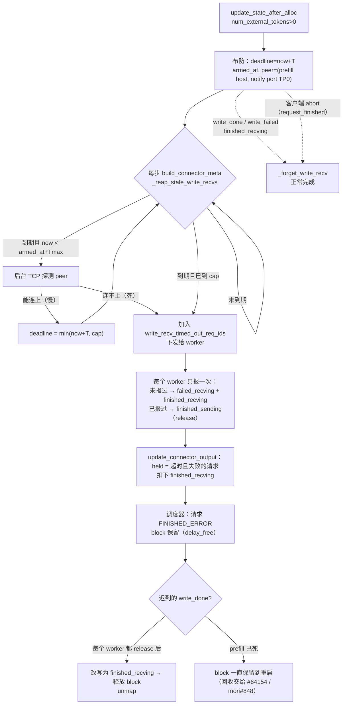

# PR #58962: [ROCM][KVConnector][MoRIIO] Add WRITE-mode consumer timeout

> **Author**: @amirakb89 | **State**: OPEN | **Date**: 2026-09-28（最后更新 2026-11-20）
> **Branch**: `feat/moriio-consumer-timeout` → `main` | **Labels**: documentation, rocm, needs-rebase, kv-connector
> **Changes**: +766 -16 lines across 9 files（相对 merge base `53582885`）| **ROCm 相关性**: 完全相关（MoRIIO KV connector，ROCm 专属 PD 分离传输）
> 本报告分两部分：§1–6 为 PR 详细总结，§7–8 为 ROCm review 意见。

---

## 1. 总结 (Summary)

MoRIIO WRITE 模式下，decode（consumer）在收到 prefill 的 `write_done` 之前会把请求一直挂在 `WAITING_FOR_REMOTE_KVS`。如果 prefill 死掉，请求会无限期挂起，没有日志，`/health` 仍返回 200。本 PR 在 decode 调度器上为每个请求加一个接收计时器（`write_recv_timeout`，默认 540 s），到期时先用 TCP 探测 prefill 的 notify 端口：能连上就视为"慢"，最多延长到 `write_recv_max_timeout`（默认 3 倍）；连不上则让该请求以 `failed_recving` 失败。PR **只让请求失败，不释放 block**：因为单边 RDMA 写可能仍在途，block 一直保留到真正的 `write_done` 到达（或由 #64154 的 fence 回收）。改动完全限定在 MoRIIO 内部，没有修改 connector 接口、`KVOutputAggregator` 和调度器。

## 2. 背景与动机 (Background & Motivation)

- 修复 ROCm/mori#655 的 consumer 一半和 #59114 的 hang。前提是 `write_recv_timeout` 小于客户端超时；如果用默认 540 s，而客户端约 400 s 就放弃，abort 会先发生并停掉计时器。
- 与 ROCm/mori#670（producer 侧遇到 QP 错误时让传输失败，已合入）互补；与 prefill 侧超时（#51301、#56465）和握手超时（#63856）不重复。
- 设计经过多轮演进：最初版本是"超时后用 invalid_block_ids 回收 block"；之后按 #59382 的生命周期拆分改为"失败但不回收"；再在 simondanielsson 的建议下改用 `failed_recving`；曾经给聚合器加过一个 opt-in hook，后来按"不改 connector 接口"的要求撤回，改成纯 MoRIIO 实现（`finished_sending` 充当 release 通道）；最后加入 TCP 活性探测，区分"慢"与"死"。
- 设计依赖：较早结束的请求需要 #59058 才能取回 block（#59058 已于 2026-11-20 合入 main）。DP>1 且 TP>1 时探测端口需要 #64574 的端口公式（#64574 也已合入 main，见 §7）。PR 声明使用了 Claude 辅助。

## 3. 代码修改分析 (Code Change Analysis)

### 3.1 修改的模块

| 文件 | 改动 |
|------|------|
| `moriio/moriio_connector.py` (+275 -6) | 调度器：读取并校验 `write_recv_timeout` 和 `write_recv_max_timeout`；只在纯 `kv_consumer`、WRITE 模式且 `kv_load_failure_policy=="fail"` 时启用计时器；在 `update_state_after_alloc` 中布防，并记录 prefill TP0 的 notify 地址；`build_connector_meta` 调用 `_reap_stale_write_recvs`，后者在后台线程池（4 个线程）做 TCP 探测；超时的 id 经 `write_recv_timed_out_req_ids` 下发给 worker；`update_connector_output` 扣下已超时请求的 `finished_recving`，等迟到的 `write_done`（以 `finished_sending` 形式回来）再放行；`request_finished` 对已超时的请求保留映射。worker：新增 `_report_write_recv_timeouts`，每个 worker 只报告一次 |
| `moriio/moriio_common.py` (+8) | `DEFAULT_WRITE_RECV_TIMEOUT = 540.0`；新增 metadata 字段 |
| `docs/features/moriio_connector_usage.md` (+2) | 两个新配置项的文档 |
| `tests/.../unit/moriio/test_moriio_write_recv_timeout.py` (+459) | 驱动真实的 `Scheduler`、`KVOutputAggregator.from_connector` 和 worker 的 `start_load_kv`/`get_transfer_results`，在 TP=1、2、4 以及 attention、MLA、hybrid 布局下运行 |
| 其他测试 (+22 -10) | 给用 `__new__` 构造的对象补上 `_write_recv_timer_enabled` 等属性 |

### 3.2 架构 / 流程图

decode 侧一个 WRITE receive 的计时生命周期：



### 3.3 关键实现细节

- **只用 `failed_recving`，不用 invalid_block_ids**：在 `kv_load_failure_policy="fail"` 下，调度器的 `_handle_failed_recving` 让仍处于 `WAITING_FOR_REMOTE_KVS` 的请求失败，`finish_requests` 对这类请求 `delay_free_blocks=True`（main `scheduler.py:3166-3176`），所以 block 会保留到 `finished_recving`。我已核对这一路径与 PR 描述一致。
- **`recompute` 策略下不布防**：该策略会把失败接收的 block 释放后重算到同一批 block 里，而迟到的写可能落进去，所以启动时打 warning 并禁用计时器。
- **聚合器计数**：worker 对超时请求同时放进 `failed_recving` 和 `finished_recving`。已经报告过 `write_done` 的 rank 不再报，改为在 `finished_sending` 中报 release，于是 `KVOutputAggregator` 在任意 TP 下都恰好凑齐 N 票。
- **探测**：`_peer_listening` 对 prefill notify 端口做 `socket.create_connection`（超时 2 s，任何异常都视为连不上）。同一 prefill 的多个请求共享一个 Future；随最后一个计时请求一起删除（c9bb6ca3 修了泄漏）。
- **async scheduling**：`_reap_stale_write_recvs` 返回到期集合，不在调度器侧保留"待报告"状态；worker 侧的 `_write_recv_timed_out` 在 `start_load_kv` 接收、在 `get_transfer_results` 报告。两次 `schedule()` 之后才 `update_from_output` 的情形有单测覆盖。

## 4. 涉及的技术原理 (Technical Principles)

- **单边 RDMA 写与超时的关系**：decode 侧超时只能说明"没收到通知"，不能证明 prefill NIC 已停止写入。所以超时后释放 block 会导致"迟到写覆盖已复用 block"的静默损坏（Z.AI "scaling pain" 博文中的事故模式，simondanielsson 在 review 中引用过）。本 PR 只解决"请求不再挂起"，block 回收需要接收端 fence（#64154 / ROCm/mori#848）。
- **`finished_recving` 与 `failed_recving` 的语义**：`finished_recving` 表示该请求下一步可以调度，或者已结束的请求可以释放 block；`failed_recving` 表示让请求失败。两者可以拆开上报：失败但不释放，再用一次独立的 `finished_recving` 释放。
- **KVOutputAggregator**：按报告次数凑满 `expected_finished_count`（默认是 world size）之后才转发，不区分是哪个 worker 报的。所以每个 worker 必须恰好报一次，否则会提前或永远凑不齐。
- **活性探测 ≠ 传输进度**：TCP 能连上只能说明进程还在 accept，挂起或已重启的 prefill 同样能连上，这类请求只能等到 `write_recv_max_timeout`。

## 5. 评论区讨论亮点 (Discussion Highlights)

- **ErliCai（09-29）**：计时器应该在"接收完成"时清除，而不是"请求结束"时：abort 时清得太早（就是 #59114），已收到 KV 仍在 decode 的请求又清得太晚（会被误判为 invalid block 并回滚）。作者在硬件上复现了两种情况并修复。
- **simondanielsson（10-21）**：建议改用 `failed_recving`；测试精简为"P 死"和"P 慢"两个场景；强调超时后释放 block 不可行。之后作者给聚合器加的 opt-in 接口被他要求撤回（"Since we only observed this bug in MoRI ideally we should only have to change the mori code"），作者照做，改为纯 MoRIIO 实现。
- **okorzh-amd**：指出测试里的 `_step` 绕过了 worker feed（删掉 feed 后 29 个测试仍全部通过），要求补"两次 `schedule()` 后才 `update_from_output`"的用例；要求补全描述，并确认当前版本是否上过硬件。作者均已处理。
- **ChuanLi1101（11-14）**：方向正确；条件是在 #59058 之后合入，并补 TP>1 部分 rank 先完成的用例。作者回复已有 `test_blocks_freed_once_every_rank_has_its_write_done`，并顺带修了 `write_failed` 与超时同一步到达时 block 不释放的竞争（123412eab5）。okorzh-amd 10-21 的 APPROVE 在 MoRIIO-only 重写之后已经过期，尚无新的 approve。

## 6. 风险与潜在问题 (Risk Analysis)

| 风险 | 严重程度 | 说明 |
|------|---------|------|
| rebase 后探测端口调用 `get_port_offset` 会抛 TypeError，且 git 不会报冲突 | High | 见 §7 ⚠️【兼容性】；在默认配置下 decode 收到第一个 WRITE 请求就会出错 |
| 与 #59058（已合入）在 `request_finished`/`update_connector_output` 上的冲突与重复机制 | Medium | 见 §7 ⚠️【兼容性】 |
| MultiConnector 下清空兄弟 connector 的 `finished_sending` | Medium | 见 §7 ⚠️【正确性】 |
| 与 #60852 / #64154 的重复去重集合，#64154 建在本 PR 的旧版本上 | Medium | 见 §7 ⚠️【设计】 |
| 默认开启的行为变化；prefill 已死时 block 永久占用 | Low | 见 §7 📝【设计】 |
| 硬件数字不可溯源，且早于最近的 commit | Low | 见 §7 ⚠️【测试】 |

---

## 7. Review 意见 (Findings)

| 类型 | 🔴 | ⚠️ | 📝 |
|------|----|----|----|
| 兼容性 | — | 1 | — |
| 正确性 | — | 1 | — |
| 设计 | — | 1 | 1 |
| 测试 | — | 1 | — |

整体看：在当前 head 的 base 上，计时器的状态机（布防 → 探测 → 超时 → 扣下 `finished_recving` → 迟到 release → 放行）逻辑自洽，我核对了它与 main 调度器 `_handle_failed_recving`、`finish_requests` 中 delay_free 路径的配合。"失败但不释放"的立场也正确。问题主要来自 rebase 到当前 main，以及与同批 PR 的协调。

---

**⚠️【兼容性】rebase 到当前 main 后，`_write_notify_peer` 中的 `get_port_offset(..., 0)` 会抛 TypeError，git 不会把它标为冲突** `[已验证]`

- **问题**: `_write_notify_peer`（`moriio_connector.py:1727-1728`）调用 `get_port_offset(fold_local_rank(remote_dp_rank, dp_local), 0)`。在本 PR 的 base 上 `get_port_offset(dp_rank, tp_rank, tp_size=1)` 有默认值；当前 main 合入 #64574 后，签名变为 `get_port_offset(dp_rank, tp_rank, tp_size, ...)`，`tp_size` 为必填（main `moriio_common.py:242-251`）。我用 `git merge-tree` 模拟了合并：这一行在合并结果中原样保留，**没有冲突标记**。此外，#59058 已合入 main，与本 PR 在 `request_finished` 的 consumer 分支以及 `update_connector_output` 上各有一处冲突。两边都在解决同一个问题（`_write_recvs_in_flight` 与 `_write_recv_finished` 都保证"结束时仍在接收的请求保留映射"），合并时必须统一为一套。
- **影响**: 计时器在纯 WRITE consumer 上默认开启（默认 `kv_load_failure_policy="fail"`，`write_recv_timeout=540`），而 `_write_notify_peer` 在每个 `num_external_tokens>0` 的请求布防时调用。按 git 自动合并的结果 rebase 后，decode 调度器在 `update_state_after_alloc` 中处理第一个 WRITE 请求就会抛 `TypeError`，engine core 退出。即使手动补上参数，也必须传 **prefill** 的 TP size（`get_moriio_peer_tp_size(params, self.tp_size)`），否则在 DP>1、TP>1 时会探测到错误的端口（可能是另一个仍然存活的 rank），把死的 prefill 误判为"慢"。
- **行动**: 作者应当 rebase 到当前 main：把探测端口改为 `get_port_offset(fold_local_rank(...), 0, peer_tp_size)`，与 main 的 allocation notify 循环共用同一个 helper；把 `_write_recv_finished` 并入 #59058 的 `_write_recvs_in_flight`；同时更新 PR 描述中 "needs #59058" 和 "once #64574 merges" 两处已过时的说法。

**⚠️【正确性】`update_connector_output` 无条件清空 `finished_sending` 并改写 `finished_recving`，在 MultiConnector 下会吞掉兄弟 connector 的完成事件** `[已验证]`

- **问题**: consumer 分支最后执行 `connector_output.finished_recving = (recving - held) | released` 和 `connector_output.finished_sending = set()`（`moriio_connector.py:2002-2003`）。main 的 `MultiConnector.update_connector_output`（`multi_connector.py:570-589`）把**同一个** `KVConnectorOutput` 对象依次交给每个子 connector。PR 描述说 "MultiConnector ... unchanged"，但没有考虑这种共享。
- **影响**: 触发条件是 decode 侧使用 `MultiConnector[MoRIIOConnector(kv_consumer, WRITE), X]`，其中 X 会上报 `finished_sending`（例如 CPU offloading 类 connector 的 store 完成），且启用了默认的计时器。X 上报的、本该释放 delay-free block 的请求会被清掉，这些 block 永久泄漏；如果 X 排在 MoRIIO 之后，它自己的 `update_connector_output` 也看不到这些完成事件。main 的 producer 分支已有原地改写 `finished_sending` 的先例，但只针对 MoRIIO 自己的 ACK；consumer 侧整体清空是本 PR 新引入的。
- **行动**: 建议作者只移除 MoRIIO 自己认领的 id（例如 `finished_sending - (consumer 已知的 WRITE receive 集合)`），不要整体清空；`finished_recving` 也只对 `held`/`released` 做差量修改。并补一个 MultiConnector 下兄弟 connector 的 `finished_sending` 仍能送达的单测。

**⚠️【设计】与 #60852 / #64154 在同一函数里加入重复的"每个 worker 只报一次"集合，#64154 还建在本 PR 的旧版本上** `[已验证]`

- **问题**: 本 PR 在 WRITE consumer 的 `get_transfer_results` 中新增按 request id 的 `_write_recv_reported`/`_write_recv_unreleased`（`:2165, 3307-3330`）。#60852 在同一位置新增按 transfer id 的 `_reported_write_transfers`；#64154 又新增 `_reported_recv_req_ids`。三者目的相同。trial merge 显示本 PR 与 #60852 在 `moriio_connector.py` 上有 6 处冲突。#64154 叠在本 PR 的旧 commit `d29185d` 上（那时是 `write_load_failed_block_ids`/invalid_block_ids 设计），与当前 head 有 9 处冲突。语义上本 PR 与 #60852 是互补的：#60852 在零提交 abort 时发 `write_failed`，本 PR 把它当作一次已完成的接收，停止计时；#60852 在可能已提交时不通知 decode，正好由本 PR 的超时兜底。
- **影响**: 不先协调的话，后合入者要重写同一段计数逻辑，而计数一旦出错就会让聚合器提前或永远凑不齐票（前者在 block 仍被写时释放，后者导致 block 泄漏）。
- **行动**: 建议作者与 #60852、#64154 的作者约定只保留一个按 request id 的"已上报"集合（本 PR 的版本覆盖了 `write_failed` 和超时两种来源，可以作为基础），并明确合入顺序（建议 #60852 → 本 PR → #64154），由 #64154 rebase 到最终设计上。

**⚠️【测试】CI 未运行，硬件结果早于最近的修复 commit，数字不可溯源** `[已验证]`

- **问题**: CI 未运行（无 `ready` label，pre-run-check 失败，pre-commit 与 Buildkite 均被跳过）。PR 描述中的单测结果（本分支 1157 passed / 2 skipped，main 1130 passed）和硬件结果（kill -9 后 8 个请求都在 30.0 s 结束；过载场景 128/128 成功，去掉探测后只有 10/128 成功）都没有附日志或命令输出，属于 `[unverified]`。作者也承认 "The hardware runs predate the review-fix commit (1103aa101b) and the later ones"，`write_failed` 竞争修复（123412eab5）和探测清理（c9bb6ca3）都没有上过硬件。
- **影响**: 最后几个 commit 改的正是并发时序（同一步到达的 `write_failed`、探测 Future 的生命周期），单测按设定的步序驱动，不能完全代表真实的 RDMA 和 ZMQ 时序。
- **行动**: 建议作者 rebase 后在 AMD CI 上跑 MoRIIO 单测（`/amd-ci run`），并在最终 head 上重跑一次 kill -9 场景，附上 decode 日志片段和 KV 使用率曲线。

**📝【设计】默认开启的行为变化，以及 prefill 已死时 block 永久占用，建议加可观测性** `[已验证]`

- **问题**: 只要是纯 `kv_consumer` 且使用默认的 `fail` 策略，计时器默认开启（`:837`），默认 540 s，上限 1620 s。之前"永远等待"的请求现在会在 1620 s 后失败，即使 prefill 还活着。prefill 已死时，超时请求的 block 会一直保留，并计入 `--max-num-inflight-kv-loads`。另外，探测只覆盖 prefill TP0 的 notify 端口，且是一次裸 TCP connect（对端 ZMQ ROUTER 会丢弃这次非 ZMTP 连接）。
- **影响**: 多个 prefill 先后死掉后，decode 能接收的远端 KV 容量会被逐步吃掉，直到重启。目前只有逐请求的 error 日志，没有聚合指标。
- **行动**: 建议作者在发布说明中写明默认行为的变化，并给"因超时而保留的 block 数 / 请求数"加一个 gauge 或周期日志（可以与 #64785 的 MoRIIO 指标合并），方便运维判断是否需要重启或启用 #64154 的 fence。

## 8. 结论 (Verdict)

**⚠️ NEEDS WORK**

"让请求失败但不释放 block"是正确的立场。基于 `failed_recving` 的实现与调度器现有的 delay-free 路径配合正确，测试也走了真实的 Scheduler 和聚合器。但当前 head 落后于已合入的 #59058 和 #64574：按 git 自动合并 rebase 后，探测端口调用会在默认配置下让 decode 调度器抛 TypeError。consumer 分支清空 `finished_sending` 在 MultiConnector 下会吞掉兄弟 connector 的事件。此外，需要和 #60852、#64154 统一去重机制。修复这些并在最终 head 上补一次 AMD CI 和硬件验证后可以合入。

## 9. 英文 Review 评论 (Copy-Paste English Comments)

**C1** `vllm/distributed/kv_transfer/kv_connector/v1/moriio/moriio_connector.py:1727-1728` — ⚠️ comment

```text
After #64574, `get_port_offset` on main takes `tp_size` as a required argument. A trial merge keeps this two-argument call with no conflict marker. Since the timer is on by default for WRITE consumers with the default `fail` policy, a rebased decode would raise TypeError in `update_state_after_alloc` on its first WRITE request. The probe also needs the prefill TP size (e.g. `get_moriio_peer_tp_size(params, self.tp_size)`) to dial the right port when DP>1 and TP>1. Could you pass it here, ideally through the same helper the allocation notify loop uses?
```

**C2** `vllm/distributed/kv_transfer/kv_connector/v1/moriio/moriio_connector.py:2002-2003` — ⚠️ comment

```text
`MultiConnector.update_connector_output` passes the same `KVConnectorOutput` object to every child connector. Clearing `finished_sending` and reassigning `finished_recving` here therefore drops completions reported by a sibling connector on the decode, for example an offloading connector's store completions, and the blocks those requests hold for delayed free would never be released. Could you remove only the request ids MoRIIO owns, adjust `finished_recving` by the held and released sets rather than replacing it, and add a MultiConnector test?
```

**C3** `vllm/distributed/kv_transfer/kv_connector/v1/moriio/moriio_connector.py:1835` — ⚠️ comment

```text
#59058 has merged and keeps the mapping of a WRITE receive that finishes mid-receive through `_write_recvs_in_flight`, which conflicts with this branch here and in `update_connector_output`. `_write_recv_finished` now duplicates that mechanism, and #60852 and #64154 each add their own per-worker reported set in `get_transfer_results`. Could you rebase onto main, fold the timed-out case into `_write_recvs_in_flight`, and agree with the authors of #60852 and #64154 on one shared reported set keyed by request id? The description's notes about needing #59058 and waiting for #64574 can be updated too.
```

**C4** `tests/v1/kv_connector/unit/moriio/test_moriio_write_recv_timeout.py:1` — ⚠️ comment

```text
CI has not run on this PR. The hardware results in the description predate 1103aa101b, 123412eab5 and c9bb6ca3c7, which change the write_failed race and the probe lifetime. Could you get the AMD MoRIIO unit-test step triggered after the rebase, and rerun the kill -9 scenario on the final head? Please attach the decode log lines and the KV usage numbers so the results can be traced.
```

## 10. 英文总结评论 (Overall Review Summary)

```text
Failing the request without freeing its blocks is the right call for one-sided RDMA, and reporting through failed_recving fits the scheduler's existing delayed-free path. The tests drive the real Scheduler and aggregator. Before merge: rebase onto main, where #59058 and #64574 have landed, since the probe's get_port_offset call would raise TypeError on the first WRITE request; avoid clearing finished_sending wholesale, which drops sibling connectors' completions under MultiConnector; agree with #60852 and #64154 on a single per-worker reported set; and rerun AMD CI plus the kill -9 test on the final head.
```
