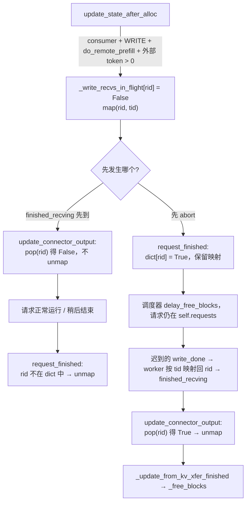
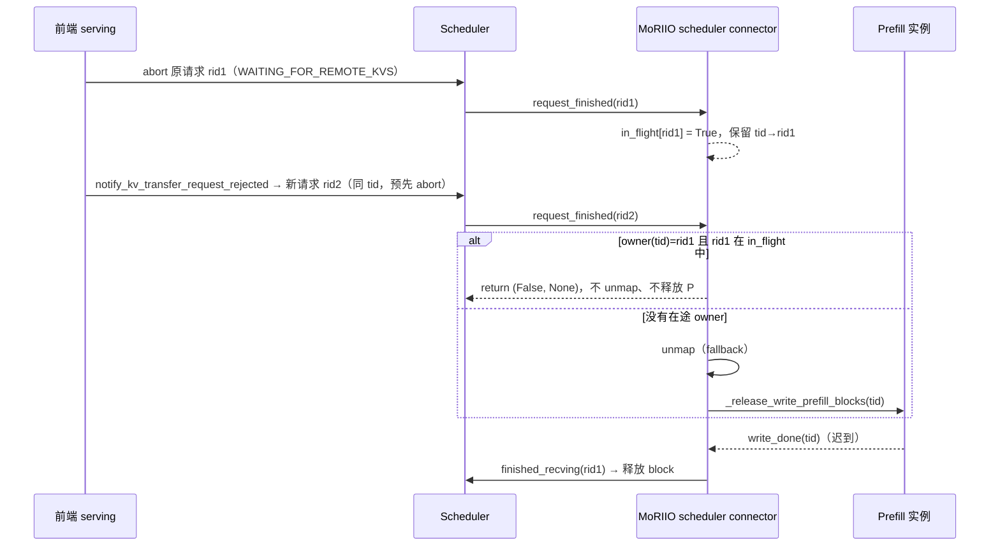

# PR #59058: [Bugfix][MoRIIO] Preserve WRITE receive mappings after consumer abort

> **Author**: @yuzhouo7 | **State**: OPEN | **Date**: 2026-09-28
> **Branch**: `yuzhouo7:codex/moriio-write-abort-cleanup` → `main` | **Labels**: bug, kv-connector
> **Changes**: +204 -8 lines across 5 files | **ROCm 相关性**: 完全相关（只改 MoRIIO KV connector，即 AMD mori-io 的 P/D 分离传输路径，以及它的 CPU 单测）
> 本报告分两部分：§1–6 为 PR 详细总结，§7–8 为 ROCm review 意见。
>
> 说明：
> - 代码来自本地 ref `pr/59058`（head `a2aa2c9bfc`）。merge-base 是 `f5d93296`（2026-11-11），比当前 main 落后 483 个 commit，其中 8 个改了 MoRIIO connector。`git merge-tree` 显示与当前 main 没有文本冲突。
> - CI：`pre-run-check` 失败，`pre-commit` / `Check format` 为 skipped，说明 Buildkite 还没跑（通常是缺 `ready` label）。PR 的测试结果目前只有作者本地数据。
> - 本次为静态 review，没有运行 PR 代码。调度器侧行为对照 PR head 的 `vllm/v1/core/sched/scheduler.py` 核对。

---

## 1. 总结 (Summary)

MoRIIO WRITE 模式下，D（consumer）上的请求在 `WAITING_FOR_REMOTE_KVS` 状态被 abort 时，调度器会延迟释放它的 KV block，等 `finished_recving` 到来再释放。但 connector 在 `request_finished` 里立即删除了 `transfer_id ↔ request_id` 映射，worker 收到迟到的 `write_done` 后找不到对应请求，`finished_recving` 永远不会上报，block 就泄漏了。

本 PR 做了两件事：
1. 在 scheduler 侧引入 `_write_recvs_in_flight: dict[ReqId, bool]`，跟踪"已发出 notify、还没收到 `finished_recving`"的 WRITE 接收。这类请求被 abort 时保留映射，等 `update_connector_output` 看到它的 `finished_recving` 后再 unmap。
2. 非流式请求被 abort 时，前端还会以**新的 request id、相同的 `transfer_id`** 提交一个预先 abort 的"拒绝通知"请求。如果该 `transfer_id` 仍被一个在途接收占有，就忽略这个通知：既不 unmap，也不向 P 发送释放消息。

## 2. 背景与动机 (Background & Motivation)

- 相关 PR #56089 修复的是调度器侧的传输计数。本 PR 修的是 connector 侧映射过早删除，两者互补。
- 当前调度器的行为（已核对 `finish_requests`）：处于 `WAITING_FOR_REMOTE_KVS` 的请求被 abort 时，只要 load 不是 deferred 且尚未 `finished_recving`，就设置 `delay_free_blocks=True`，并放进 `_aborted_kv_loads`。之后 `_update_from_kv_xfer_finished` 收到该请求的 `finished_recving` 时才会 `_free_blocks`。所以 connector 必须让 worker 能把迟到的 `write_done`（按 `transfer_id` 上报）翻译回 request id，否则释放条件永远不满足。
- 评审过程（见 §5）：
  - tjtanaa 在 MI355X 上复现了非流式 abort 仍然泄漏的问题，原因是拒绝通知请求通过 `unmap_request_id` 的 `transfer_id` fallback 删掉了被保留的映射。作者据此加了 owner guard。
  - 之后作者两次 rebase，补齐了 main 新增测试 fixture 中缺的状态。
- PR 描述中的验证：
  - CPU：新增 6 个用例；红/绿对照为修复前失败、修复后通过；MoRIIO + KV lifecycle 共 808 passed，另有 5 个失败，main 上同样失败。
  - GPU：MI308X、Qwen3-32B、RDMA loopback、真实 HTTP。非流式 abort 修复前 D 停留在 11.25% KV 占用，修复后回到 0%。注意 GPU 测试用的是 **v0.33.0 镜像 + 本 PR 的 connector 改动**，不是本分支的构建。
- 已知限制（作者自述）：如果 P 也被取消、永远不发 `write_done`，D 仍然一直持有请求和 block。本 PR 不加 consumer 侧超时；超时由 #58962 处理。

## 3. 代码修改分析 (Code Change Analysis)

### 3.1 修改的模块

| 文件 | 改动 |
|------|------|
| `vllm/distributed/kv_transfer/kv_connector/v1/moriio/moriio_connector.py` | 新增 `_write_recvs_in_flight`；在 `update_state_after_alloc` 中登记在途接收；`request_finished` 加 owner guard 和延迟 unmap；consumer 的 `update_connector_output` 在 `finished_recving` 时补做 unmap（+35 -5） |
| `tests/v1/kv_connector/unit/moriio/test_moriio_unmap.py` | 新增 3 组共 6 个用例：abort 后迟到完成、拒绝通知 + 迟到完成、无 owner 的拒绝仍释放 P、无 remote prefill 时不登记（+164 -3） |
| `tests/.../test_moriio_connector.py`、`test_moriio_hma_scheduler.py`、`test_moriio_pipeline_parallel.py` | 手工构造的 scheduler / fake 对象补上 `_write_recvs_in_flight`、`transfer_id_to_request_id`、`is_producer` 等新依赖的属性（+5） |

### 3.2 架构 / 流程图

在途 WRITE 接收的生命周期（D 侧 scheduler connector）：



非流式 abort 时的拒绝通知（owner guard）：



### 3.3 关键实现细节

- **登记条件**（`update_state_after_alloc`）：`not is_producer and mode == WRITE and do_remote_prefill and num_external_tokens > 0`。使用 `setdefault`，所以重复调用不会把已置为 True 的状态覆盖回 False。deferred load（`deferred_loads`）在 `_drain_deferred_loads` 之前不会调用该钩子；如果在此之前 abort，调度器不会延迟释放，connector 也没有登记，两边一致（已核对）。
- **owner guard**（`request_finished`）：`owner != request_id and owner in _write_recvs_in_flight` 时直接 `return False, None`，同时跳过后面 `do_remote_prefill` 分支里的 `_release_write_prefill_blocks`。这样不会让 P 提前释放仍在写的 prefill block。owner 为 None 时 `None in dict` 为 False，guard 不会误触发。
- **延迟 unmap**（`update_connector_output`）：consumer 分支遍历 `finished_recving`，`pop(req_id, False)` 为 True（已结束）时 unmap。正常请求 pop 出 False，留给后续的 `request_finished` 去 unmap。该钩子在 `_update_from_kv_xfer_finished` 开头、调度器释放 block 之前调用。
- **失败路径**：worker 的 `get_transfer_results` 会把 WRITE 失败的 `transfer_id` 同时放进 `failed_recving` 和 `finished_recving`（已核对），所以失败的接收也会走到 pop 路径，in-flight 表不会因失败而残留。
- 数据结构按 tjtanaa 的建议，从两个 set 合并成一个 `dict[ReqId, bool]`，"已结束"必然是"在途"的子集。

## 4. 涉及的技术原理 (Technical Principles)

- **MoRIIO WRITE 模式 P/D 分离**：D 先分配 KV block，然后通过 ZMQ notify P"block 已就绪"。P 用 RDMA Write 把 KV 直接推进 D 的 block，完成后发送 `write_done`（以 `transfer_id` 为键）。D 的 worker 把 `transfer_id` 翻译成 request id，上报 `finished_recving`。`transfer_id` 是两侧共享的稳定标识；request id 在前端可能被改写，因此需要 `transfer_id ↔ request_id` 双向映射。
- **调度器的异步 KV 接收**：`WAITING_FOR_REMOTE_KVS` 的请求持有已分配的 block。被 abort 后不能立即释放，因为 RDMA 可能仍在往这些 block 写，提前复用会造成数据损坏。所以必须等 `finished_recving` 才能释放，这依赖 connector 能上报这个信号。
- **拒绝清理**（`_with_kv_transfer_rejection_cleanup`）：非流式请求出错时，前端用原始 `kv_transfer_params` 提交一个预先 abort 的请求，以触发 connector 的 `request_finished`，让 P 释放 prefill block（针对请求从未进入调度的情况）。但如果原请求已经在途，这个通知就成了重复清理，需要被识别并忽略。
- **scheduler connector 与 worker 的映射同步**：scheduler 在 `build_connector_meta` 中把 `transfer_id_to_request_id` 放进 metadata，worker 在 `start_load_kv` 中直接采用它。所以 scheduler 侧保留映射，就等于 worker 侧也保留了映射。

## 5. 评论区讨论亮点 (Discussion Highlights)

- **tjtanaa（2026-11-02）**：
  - 在 MI355X / xGMI 上复现：流式 abort 修好了，非流式 abort 仍然泄漏。原因是拒绝通知走到了 `unmap_request_id` 的 `transfer_id` fallback（日志 `MoRI-IO unmap via transfer_id`）。
  - 建议用 owner guard 忽略这类通知，并指出 guard 同时能阻止 `_release_write_prefill_blocks` 释放仍在写的 prefill。
  - 要求补一个回归用例，并在当前 main 上重新跑红/绿对照（当时证据基于旧 base 和 v0.30 backport）。
  - 作者全部采纳。
- **tjtanaa**：两个 set 有子集不变式，建议合并为 `dict[ReqId, bool]`。作者已改。
- **okorzh-amd（2026-11-11）**：
  - 列出相关 PR：
    - #58962（watchdog 超时）：文本冲突，但逻辑互补。超时后迟到的 `write_done` 依赖本 PR 保留的映射。
    - #60852：堆叠在本 PR 之上，但仍按 set 声明 `_write_recvs_in_flight`，需要改成 dict。
    - #56468：替代方案，并与本 PR 冲突。
  - 指出 #66480 移动了测试目录，#64693 / #65822 新增的 12 个用例因 fake scheduler 缺少新状态而失败。作者 rebase 后补齐，22/22 通过。
- 目前没有 approve；amirakb89 请 tjtanaa review。

## 6. 风险与潜在问题 (Risk Analysis)

| 风险 | 严重程度 | 说明 |
|------|---------|------|
| P 侧永不发送 `write_done` 时 D 仍然持有 block | Medium | 作者已声明，属于已有问题，本 PR 没有让它变差；需要 #58962 的超时配合 |
| 相关 PR 的合入顺序 | Low | #60852 仍按 set 使用该字段，#58962 有文本冲突，见 §7 |
| owner guard 静默返回 | Low | 见 §7 |
| 验证与 head 不一致 | Low | GPU 数据来自 v0.33.0 镜像 + 补丁；base 比 main 落后 483 个 commit，其中有 8 个 MoRIIO 改动；CI 未跑 |
| 对 CUDA / 其他 connector 的影响 | 无 | 只改 MoRIIO connector |
| 测试覆盖 | Low | 新用例在真实 CPU scheduler + block pool 上跑完整生命周期，覆盖了 abort 早于/晚于完成、拒绝通知、无 owner 三种情形，质量较好；没有覆盖 TP>1 的聚合路径 |

---

## 7. Review 意见 (Findings)

| 意见类型 | 数量 |
|---------|------|
| 【可维护性】 | 1 |
| 【测试】 | 1 |
| 【兼容性】 | 1 |

没有 🔴 或 ⚠️ 问题。核心修复与调度器的 `delay_free_blocks` / `_update_from_kv_xfer_finished` 语义一致，以下检查都已核对，没有发现问题：
- 登记条件
- deferred load
- 失败路径（`failed_recving` 也会进入 `finished_recving`）
- 先完成后 abort 的路径

**📝【可维护性】owner guard 静默返回，排查时看不到被忽略的拒绝通知** `[已验证]`
- **问题**：`moriio_connector.py:1652-1654` 命中 guard 后直接 `return False, None`，跳过了后面的 `logger.debug("MoriioConnector request_finished ...")`。这条路径是专门为非流式 abort 加的，而这类泄漏恰恰是靠日志（`MoRI-IO unmap via transfer_id`）才定位到的。
- **影响**：以后如果出现"拒绝通知被忽略、但 owner 的 `write_done` 也一直没来"的情况，日志里看不到这个通知曾到达过，难以区分"P 没写完"和"通知被吞掉"。
- **行动**：建议作者在 return 前加一条 debug 日志，包含 request_id、transfer_id 和 owner。

**📝【兼容性】相关 PR 的合入顺序需要协调** `[已验证]`
- **问题**：
  - 根据 okorzh-amd 的梳理，#60852 堆叠在本 PR 上，但仍按 set 使用 `_write_recvs_in_flight`。
  - #58962 与本 PR 在 `update_connector_output` / `update_state_after_alloc` 有文本冲突，而它的超时语义（报告失败但不结束请求）依赖本 PR 保留的映射。
- **影响**：如果 #60852 先按旧形态合入或 rebase 不完整，会出现 `set` 与 `dict` 的 API 不匹配（`.add` 与下标赋值）。
- **行动**：建议在 PR 描述中写明合入顺序（本 PR → #58962 / #60852），并请 #60852 作者在本 PR 合入后改为 dict 形式。

**📝【测试】GPU 验证不是在本分支上做的，CI 也还没跑** `[已验证]`
- **问题**：
  - GPU 结果来自"v0.33.0 镜像 + 本 PR 的 connector 改动"。
  - PR 的 base（`f5d93296`）比当前 main 落后 483 个 commit，期间 MoRIIO connector 有 8 个改动，例如 #64574（TP>1 且 DP>1 时的端口冲突）、#62474（WRITE 按层切 head）。
  - CI 只有 `pre-run-check` 失败，Buildkite 没有触发。
  - 本地 `git merge-tree` 显示没有文本冲突，但语义交互没有在当前 head 上验证过。
- **影响**：风险较低，因为改动只涉及 scheduler 侧簿记，与上述 8 个改动的触点不重叠。但目前还没有 CI 结果作为合入依据。
- **行动**：建议 review 时请维护者加 `ready` label 跑 CI，并请作者在 rebase 后的 head 上至少重跑一次 MI3xx 非流式 abort 场景（TP2）。

## 8. 结论 (Verdict)

✅ **LGTM**：修复方向正确，与调度器的延迟释放语义一致；owner guard 同时堵住了映射被删和 P 被提前释放两个问题，新增 CPU 用例在真实 scheduler 上覆盖了完整生命周期。剩下的都是备注：补一条日志、协调相关 PR 的合入顺序、在 rebase 后的 head 上跑 CI。

## 9. 英文 Review 评论 (Copy-Paste English Comments)

**C1** `vllm/distributed/kv_transfer/kv_connector/v1/moriio/moriio_connector.py:1652-1654` — 📝 comment

```text
Nit: this early return skips the `request_finished` debug log below, so an ignored rejection notice leaves no trace. This leak was found through the `MoRI-IO unmap via transfer_id` log line, and if the owner's `write_done` never arrives, we will want to tell "P never finished" apart from "the notice was ignored". Could you add a `logger.debug` here with `request_id`, `transfer_id` and `owner` before returning?
```

**C2** `vllm/distributed/kv_transfer/kv_connector/v1/moriio/moriio_connector.py:1095-1101` — 📝 comment

```text
#60852 is stacked on this PR but still treats `_write_recvs_in_flight` as a set, and #58962 conflicts here and in `update_connector_output` while relying on the kept mapping for a late `write_done` after its timeout. Could you note the intended merge order (this PR first) in the description, so #60852 is updated to the dict form before it lands?
```

**C3** `tests/v1/kv_connector/unit/moriio/test_moriio_unmap.py:121-127` — 📝 comment

```text
The CPU cases cover the full lifecycle on a real scheduler, which is great. The GPU evidence, though, is from a v0.33.0 image with the connector change applied, and the base is about 480 commits behind main, with 8 MoRIIO changes since (e.g. #64574, #62474). Buildkite has not run yet either. After the next rebase, could you re-run the non-streaming abort case at TP2 on MI3xx on this branch, and could a maintainer add `ready` so CI runs?
```

## 10. 英文总结评论 (Overall Review Summary)

```text
The fix matches the scheduler's delayed-free contract: an aborted WRITE receive keeps its transfer_id mapping until finished_recving arrives, and the owner guard stops a rejection notice from unmapping the receive or releasing the prefill early. The new CPU tests run the whole lifecycle on a real scheduler. Small asks: log the ignored rejection, state the merge order with #58962 and #60852, and re-run CI plus the MI3xx non-streaming abort case on the rebased head. Approve once CI is green.
```
