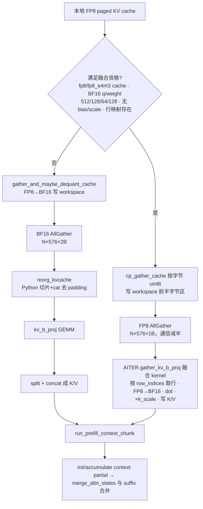
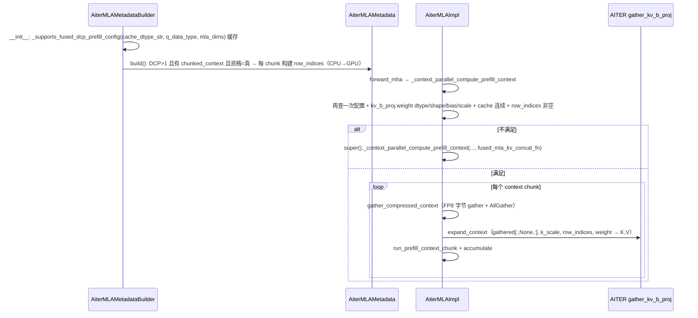

# PR #59070: [ROCm][MLA] Keep DCP prefill context in FP8 through AllGather

> **Author**: @whx-sjtu | **State**: OPEN | **Date**: 2026-09-28（最新 head `f08aeb80`，2026-10-08）
> **Branch**: `whx/k3-dcp-fp8-prefill` → `main` | **Labels**: performance, rocm, ready, ci/build
> **Changes**: +847 -17 lines across 9 files | **ROCm 相关性**: 完全相关（ROCm AITER MLA 后端 DCP prefill 路径 + aiter 新算子注册）
> 本报告分两部分：§1–6 为 PR 详细总结，§7–8 为 ROCm review 意见。

---

## 1. 总结 (Summary)

在 ROCm AITER MLA 后端开启 DCP（Decode Context Parallel，DCP>1）且 KV cache 为 FP8 时，本 PR 让 chunked-prefill 的历史上下文以 **FP8 原始字节** 经过 AllGather（原路径是先 gather+反量化为 BF16 再 AllGather），随后用 AITER 的 Triton 融合算子 `gather_kv_b_proj` 一步完成"行重排 + 反量化 + `kv_b_proj` 投影 + K/V 打包"。不满足条件的配置（非 FP8 cache、维度不符、量化的 `kv_b_proj` 等）回退到父类原路径。目标是把 AllGather 通信量减半，并消除 4 个独立 kernel/拷贝。

## 2. 背景与动机 (Background & Motivation)

- DCP 下每个 rank 只持有 1/DCP 的历史 KV。prefill 时若请求有缓存的前缀（prefix cache 命中、chunked prefill 续算），需要把所有 rank 的局部 KV 拼回完整上下文才能做 context attention。
- 现有通用实现（`MLACommonImpl._context_parallel_compute_prefill_context`）：`gather_and_maybe_dequant_cache` 把 FP8 cache 反量化成 BF16 → BF16 AllGather → `reorg_kvcache`（Python 切片 + `torch.cat` 去 padding）→ `kv_b_proj` GEMM → split/concat 成 K/V。BF16 通信是 FP8 的 2 倍，且 reorg/cat/concat 都是额外的 HBM 往返。
- 作者场景是 Kimi-K3（8×MI355X，TP8/DCP8，1M context）的长前缀 TTFT。PR 与 #59069 一起测过端到端数据，本 PR 单独负责"上下文 FP8 通信 + 融合展开"这一段。
- 去重说明：#53166 仅在 DCP=1 启用 AITER gather；#56881 是 NVIDIA 路径的 K/V 打包；#52239 用 NVIDIA 对称内存 multicast。本 PR 补的是 ROCm 在 DCP>1 下的压缩 AllGather + 融合展开。
- 依赖：`aiter.ops.triton.gather_kv_b_proj` 在 AITER `v0.1.23` 已存在（当前 main 的 `docker/Dockerfile.rocm_base` 已 pin `v0.1.24.post1`），无需 bump。

## 3. 代码修改分析 (Code Change Analysis)

### 3.1 修改的模块

| 模块 | 改动 |
|------|------|
| `vllm/v1/attention/backends/mla/rocm_aiter_mla.py` (+150 -2) | 新增 `_supports_fused_dcp_prefill_config()` 资格检查；builder 在 `__init__` 缓存资格，在 `build()` 为每个 context chunk 预计算行映射 `dcp_context_row_indices`；impl 重写 `_context_parallel_compute_prefill_context`，满足条件走融合路径，否则 `super()` 回退并透传 `fused_mla_kv_concat_fn` |
| `vllm/v1/attention/ops/rocm_aiter_mla_prefill.py`（新增 105 行） | `context_row_indices()`：构建"紧凑 request-major 行 → 带 padding 的 rank-major AllGather 行"映射；`gather_compressed_context()`：在 BF16 workspace 的字节视图上做 FP8 本地 gather + AllGather；`expand_context()`：分配 K/V 并调用融合算子 |
| `vllm/_aiter_ops.py` (+52) | 注册 `torch.ops.vllm.rocm_aiter_gather_kv_b_proj`（`mutates_args=["k","v"]`、fake 实现），暴露 `rocm_aiter_ops.gather_kv_b_proj` |
| `tests/v1/attention/test_rocm_mla_dcp_context.py`（新增 445 行） | 行映射单测、字节 gather/workspace 分区单测、13 种不支持配置的回退测试、2-GPU 真实 DCP 端到端对比 FP32 SDPA |
| `tests/kernels/attention/test_rocm_aiter_mla_op_registration.py` (+20) | 新算子 `opcheck` |
| `tests/v1/attention/test_rocm_aiter_mla_mtp_split.py` / `..._dcp_cprr.py` | 适配 builder 新读取的 `q_data_type`/`mla_dims`；新增 builder 资格缓存与 e5m2/bf16 group 过滤测试 |
| `.buildkite/test-amd.yaml`、`.buildkite/test_areas/distributed.yaml` (+3/+3) | 把新测试加入 distributed step（AMD 镜像与 NVIDIA 各一处） |

### 3.2 架构 / 流程图

新旧数据流对比：



资格检查分布在 builder 与 impl 两处：



### 3.3 关键实现细节

- **workspace 复用**：DCP workspace 是 BF16 `[(N + N/DCP), 576]`。融合路径把它 `view(fp8).view(-1, 576)[:rows]`，即只用前一半字节，**行数容量与 offset 计算保持不变**（`offset = rows // (DCP+1)`），chunk 规划、workspace 大小都不用改。
- **行映射**：`context_row_indices` 的逐 request、逐 rank 遍历与父类 `reorg_kvcache` 完全一致（`count = min(max(0, len - local_start), padded)`，源偏移 `rank * num_local_context_tokens + offset`），只是把"切片 + cat"换成索引向量交给 kernel。末尾 `assert rows.numel() == chunk.num_context_tokens`。
- **融合算子调用**：`gathered.unsqueeze(1)` 把它当成 `block_size=1` 的 paged buffer。AITER v0.1.23 对 `block_size==1` 走 `_triton_gather_kv_b_proj_flat` 扁平 token grid（`grid = heads × min(chunks, 6·SMs/heads)`），此时 `kv_indptr`/`cu_seq_lens` 不被读取（PR 两处都传 `chunk.cu_seq_lens`，无害）。`kv_proj_scale=None` 走 `NO_SCALE` 分支，FP8 数据先转为 BF16 做 `tl.dot`（FP32 累加），最后统一乘 `k_scale`，`k_pe` 也乘 `k_scale` 后写回。
- **算子注册**：`direct_register_custom_op(..., mutates_args=["k","v"], fake_impl=...)`，返回 `None`，fake 为空操作，与 mutating 语义一致；`opcheck` 覆盖。
- **资格条件**（impl 侧）：`kv_cache_dtype ∈ {fp8, fp8_e4m3}`、`q_data_type == q.dtype == bf16`、`kv_lora_rank=512, qk_nope=128, rope=64, v=128`、`is_aiter_found_and_supported()`、`kv_b_proj.weight` 为 BF16、形状 `(num_heads*256, 512)`、连续、无 `bias`、无 `weight_scale`、cache 连续、builder 已生成行映射。
- **E5M2 处理**：builder 用 KV group 的原始 `cache_dtype_str`（decode 侧会把 e5m2 规整成 `"fp8"`），确保 `fp8_e5m2` 不会误入 e4m3 解码。
- **回退签名修复**：上游给基类方法加了 `fused_mla_kv_concat_fn`，本 PR 的 override 接受并在回退时透传（CI #93496 pre-commit 失败的原因）。

## 4. 涉及的技术原理 (Technical Principles)

- **MLA（Multi-head Latent Attention）**：KV cache 只存 512 维压缩 latent `kv_c` + 64 维 RoPE key `k_pe`（共 576 维/token）。prefill 的 MHA 形式需要用 `kv_b_proj`（`[H·(128+128), 512]`）把 latent 展开成每头的 `k_nope`/`v`，再拼上共享 `k_pe` 得到 192 维 K。这一步是 latent → 多头的"上投影"，对长上下文是主要计算之一。
- **DCP（Decode Context Parallel）**：KV 按 `cp_kv_cache_interleave_size` 交错分片到 DCP 组各 rank。prefill 的 context 段需要 AllGather 还原，每 rank 的局部片按 interleave 块 padding 对齐，所以 AllGather 结果是"rank-major + padding"，需要重排/去 padding 才能变回 request-major 连续序列。由于 context attention 对 key 顺序不敏感（非 causal，RoPE 已存入 cache），只要行集合正确、request 边界正确即可。
- **Chunked context + LSE 合并**：长上下文被切成多个 workspace 大小的 chunk，每个 chunk 独立算 attention 输出 + LSE，再与 suffix（新 token 的 causal attention）通过 `merge_attn_states` 按 log-sum-exp 合并。融合路径只替换"K/V 怎么来"，chunk 循环与合并逻辑原样复用。
- **FP8 KV 与 fnuz**：gfx942 默认 `float8_e4m3fnuz`，gfx950 为 OCP `float8_e4m3fn`。PR 统一用 `current_platform.fp8_dtype()` 解释 gather 回来的字节，kernel 按 tensor dtype 做转换，不依赖 arch 名。数值上，原路径是"逐元素 x·scale 舍入到 BF16 后 GEMM"，融合路径是"FP8→BF16 精确转换后 GEMM，FP32 结果再乘 scale"，后者舍入误差更小但非逐位一致（作者 DeepSeek 冒烟中 8/8 答案正确、0/8 全文一致即源于此）。
- **通信量与融合收益**：AllGather 字节数 ∝ 元素字节宽，FP8 比 BF16 减半；融合 kernel 省掉反量化写回、`torch.cat` 重排、GEMM 输出写回再 split/concat 这几次 HBM 往返和 kernel launch。

## 5. 评论区讨论亮点 (Discussion Highlights)

- **@simondanielsson**：① 询问算子随哪个 aiter 版本发布，建议不要在函数内做 import 探测、直接依赖 aiter 可用性检查，并通过 `_aiter_ops.py` 注册（作者已全部采纳：v0.1.23 起可用，改为注册算子 + fake + opcheck）；② 要求补端到端正确性测试（作者新增 2-GPU 真实 DCP 测试，对比 FP32 SDPA）；③ 建议把 builder 与 impl 两处资格检查合并（作者抽出 `_supports_fused_dcp_prefill_config` 共享配置判断，但权重相关条件仍只在 impl，见 §7）。
- **@Fangzhou-Ai**（加 ready label 解锁 CI）：要求补 **完整 1319 题、并发 64 的 GSM8K** 以及端到端性能测试，均需与 baseline 对比。PR 描述目前仍是 128 题子集 + 与 #59069 合并的历史数据，该请求尚未闭环。
- **CI 过程**：#93496 因基类签名变更 pre-commit 失败 → 已修；#93548 暴露 `test_rocm_aiter_mla_dcp_cprr.py` 9 个 CPU 路由测试失败（mock builder 缺 `q_data_type`/`mla_dims`）→ 已修；#93564 以 `--allow-stale`（落后 main 4 个 commit）运行，bot 提示合并前需 rebase 并重跑。
- PR 描述自述使用 OpenAI Codex 辅助实现与验证。

## 6. 风险与潜在问题 (Risk Analysis)

| 风险 | 严重程度 | 说明 |
|------|---------|------|
| 性能/精度证据未隔离本 PR、非当前 head | Medium | 见 §7 ⚠️【测试】性能证据 |
| 融合路径静默回退、builder 为必回退配置做无用功 | Medium | 见 §7 ⚠️【设计】资格检查分裂 |
| 旧 aiter 环境运行时崩溃或退化到慢 grid | Medium | 见 §7 ⚠️【兼容性】 |
| metadata build 中 Python 循环 + 小 tensor 分配 | Medium | 见 §7 ⚠️【性能】 |
| 数值非逐位一致（舍入顺序不同） | Low | 理论上更精确；GSM8K 子集准确率持平，但输出文本有差异 |
| 字节视图与 DCP gather 实现的隐式耦合 | Low | 见 §7 📝 |
| 影响范围 | Low | 仅 ROCm AITER MLA + DCP>1 + FP8 e4m3 KV + BF16 `kv_b_proj`；CUDA 与 DCP=1 不受影响，回滚无格式变更 |

---

## 7. Review 意见 (Findings)

| 类型 | 🔴 | ⚠️ | 📝 |
|------|----|----|----|
| 设计 | — | 1 | — |
| 性能 | — | 1 | — |
| 兼容性 | — | 1 | — |
| 测试 | — | 1 | 1 |
| 可维护性 | — | — | 2 |

---

**⚠️【设计】资格检查仍分裂在 builder 与 impl 两处：builder 会为必然回退的配置每步构建行映射，且回退完全静默** `[已验证]`

- **问题**: builder（`rocm_aiter_mla.py:684-695`、`1608-1619`）只用 `_supports_fused_dcp_prefill_config` 判断 cache dtype / q dtype / 维度 / aiter 可用。`kv_b_proj.weight` 的 dtype、形状、连续性、`bias`、`weight_scale` 只在 impl 的 `_context_parallel_compute_prefill_context`（`2034-2051`）里检查。另外 impl 不满足条件时直接 `return super()...`（`2053-2062`），没有任何日志。
- **影响**: 例如 DeepSeek-V3/R1 原生 FP8 checkpoint（`kv_b_proj` 为 FP8 block 量化权重）+ `--kv-cache-dtype fp8` + DCP>1。builder 判定"支持"，每个带 context 的 prefill step 都会为每个 chunk 跑 `context_row_indices`（CPU 循环 + H2D），但 impl 因 `weight.dtype != bf16` 永远回退，这是纯开销。用户也无从得知融合路径是否生效：性能没有改善时，只能靠 profiler 排查。reviewer 曾要求合并两处检查，目前只合并了配置部分。
- **行动**: 建议作者把权重相关条件也前移到一次性判定。例如在 impl `process_weights_after_loading` 后计算 `self._fused_dcp_prefill_ok`，builder 通过 layer/impl 读取，或至少在 builder 只构建一次后由 impl 反馈。并在首次回退时 `logger.info_once` 输出具体原因（哪个条件不满足）。

**⚠️【性能】`context_row_indices` 在 metadata build 热路径上做 O(请求数 × DCP) 次小 tensor 分配，且 H2D 来自 pageable 内存** `[已验证]`（开销量级 `[推测]`）

- **问题**: `rocm_aiter_mla_prefill.py:14-36` 对每个 chunk 的每个 request、每个 rank 调用一次 `torch.arange(...)`，再 `torch.cat`，最后 `.to(device, non_blocking=True)`。CPU tensor 未 pin，这个 `non_blocking` 实际退化为同步 staging 拷贝。父类 `_build_chunked_context_metadata` 的做法则是 numpy 拼好全部 chunk 字段后，用 `async_tensor_h2d`（pinned）一次传输。
- **影响**: 以 PR 的 K3 配置为例（`max_num_seqs=80`、DCP8），一次批量前缀命中可达约 640 个 `torch.arange` + cat + 多次 H2D，每个 prefill step 都要付。这在调度/metadata 构建的 CPU 关键路径上，会侵蚀 PR 想节省的 TTFT（短 append 场景本身只有约 0–2% 收益）。
- **行动**: 建议作者改用 numpy 一次性生成（如 `np.concatenate([np.arange(...)])` 或基于 `np.repeat` + cumsum 向量化），并把所有 chunk 的行映射拼成一个 buffer，用 `async_tensor_h2d` 单次传输后按 chunk 切片，与父类风格一致。

**⚠️【兼容性】融合路径对 aiter 版本的依赖没有运行时约束：旧版 aiter 会在首个 context prefill 时崩溃或退化到慢 grid** `[已验证]`（崩溃场景 `[推测]`）

- **问题**: 资格判断只看 `is_aiter_found_and_supported()`（平台 + 库存在）。`_aiter_ops.py:656` 在算子执行时才 `from aiter.ops.triton.gather_kv_b_proj import gather_kv_b_proj`，且依赖 `kv_proj_scale=None`（`NO_SCALE`）语义。核对两份源码：aiter `v0.1.23` 对 `block_size==1` 有专门的 `_triton_gather_kv_b_proj_flat` 扁平 grid；本地较早的 aiter（`v0.1.19-24`）有该模块与 `NO_SCALE`，但没有 flat 路径，`grid = batch × heads`，每个 program 串行遍历整个请求的上下文。
- **影响**: 用 pip/源码自装旧 aiter 的用户（非官方镜像）：若缺该模块或缺 `NO_SCALE`，首个带前缀的 DCP prefill 在 forward 中抛 `ImportError`/`AttributeError`，**直接崩溃而非回退**；若是"有模块无 flat grid"的版本，结果正确，但 196K 级上下文单请求只有 `heads` 个 program 在跑，可能比原路径更慢。
- **行动**: 建议作者在 `_supports_fused_dcp_prefill_config` 中加入一次性、缓存的能力探测（导入模块并检查 flat kernel 符号，或比较 aiter 版本 ≥ 0.1.23），不满足则回退。这与 reviewer 反对"每次调用都探测"不冲突，只探测一次即可。并在 PR 描述写明最低 aiter 版本。

**⚠️【测试】性能与精度证据未隔离本 PR、也不是当前 head；maintainer 要求的完整评测尚未提供** `[已验证]`

- **问题**: 端到端 TTFT 表（−7~−9% 命中场景）和 K3 GSM8K 128/128 都是 **#59069 + #59070 合并** 的 2026-09-28 历史数据。段级 benchmark（196K 上下文 2397→1356 µs）的脚本已从 PR 移除，只在作者 fork 的旧 revision 中。隔离的 DeepSeek 冒烟只有 8 题、eager 模式，作者自述"不作为性能证据"。@Fangzhou-Ai 要求的 full-1319 conc64 GSM8K + 对 baseline 的 e2e 性能仍未提供。
- **影响**: 无法判断本 PR 单独的收益与回归风险，尤其是上条 CPU 开销是否抵消了收益（append 场景 +0.22%）。数值路径改变了舍入顺序（0/8 输出全文一致），小样本无法排除长生成上的漂移。
- **行动**: 作者应当在当前 rebase 后的 head 上补充：① 仅本 PR vs main 的 A/B（同配置 TTFT，至少一个 DeepSeek 系与 K3）；② full 1319 题、conc64 的 GSM8K 对比 baseline；③ 把段级 benchmark 的命令与原始输出贴回 PR 描述，便于溯源。

**📝【测试】CI 覆盖范围偏小，且本次抓取未拿到 AMD CI 的结果** `[已验证]`

- **问题**: 新测试同时加入了 NVIDIA 的 `test_areas/distributed.yaml`，那里只能跑 CPU 单测，ROCm 用例全部 skip。AMD 镜像 step 不设 `VLLM_ROCM_USE_AITER=1`；这没有问题，因为算子注册不依赖该 env，且不设反而避开了作者本地遇到的 AITER custom AR + FileStore 冲突。但端到端用例只有 DCP=2、12 头、上下文 ≤545。本次 fetch 的 `checks` 字段为空，CI #93564 的最终状态未知。
- **行动**: 建议作者确认 AMD distributed step 在 #93564 中实际执行并通过该文件（rebase 后需重跑）。建议在 kernel 级测试补一个"大行数 + TP8 头数（如 8/16 头）+ 上下文 >64K"的 `expand_context` vs 参考实现对比，覆盖 flat grid 的 `GRID_STRIDE` 分支。NVIDIA step 中的条目可以考虑移除，减少噪音。

**📝【可维护性】FP8 字节视图被传给按 BF16 workspace 选择实现的 `dcp_manager.kv_gather`，安全性依赖隐式前提** `[已验证]`

- **问题**: `rocm_aiter_mla_prefill.py:68` 把 uint8 视图交给 `kv_gather`，但 `MLADCPManager.init_kv_gather` 是按 BF16 workspace 的 dtype/宽度选择实现的。若选中对称内存直连实现（`DirectDCPKVGatherWorkspace`，按 BF16 宽度预分配接收缓冲），传入 uint8 视图会不匹配。当前在 ROCm 上不会发生：直连路径要求 `current_platform.is_cuda()`，强制开启时还要通过 multicast 探测，所以 ROCm 实际总是 `all_gather_into_tensor`，对 dtype 无关。
- **行动**: 建议作者加一行断言或注释说明"本路径依赖 dtype 无关的 NCCL/RCCL AllGather"，防止将来 ROCm 引入直连 gather 时静默出错。

**📝【可维护性】硬编码常量与冗余参数** `[已验证]`

- **问题**: `rocm_aiter_mla.py:2046` 的 `weight.shape == (self.num_heads * 256, 512)` 与上方维度检查重复，可写为 `(num_heads * (qk_nope_head_dim + v_head_dim), kv_lora_rank)`。`kv_lora_rank == 512` 的真正来由是 aiter flat kernel 的 `assert KV_CDim == 4 * 128`，代码没有注明。`expand_context` 把 `cu_seq_lens` 同时当作 `kv_indptr` 与 prefix-sum 传入，flat 路径两者都不读，读者容易误解。
- **行动**: 建议作者用维度变量替换字面量，并加注释说明 512/128/64/128 对应 aiter kernel 的约束，以及 flat 路径忽略 indptr。

## 8. 结论 (Verdict)

**⚠️ NEEDS WORK**

核心实现是正确的，已核对以下几点：行映射与 `reorg_kvcache` 逐项等价；workspace 字节视图不改变容量与分区；FP8 fn/fnuz 走 `current_platform.fp8_dtype()`；aiter v0.1.23 的 flat kernel 与调用约定匹配；fake/mutates 注册规范；回退路径透传了回调。测试质量也较高。没有找到能写出具体触发输入的阻塞性问题。主要欠缺有三点：资格检查分裂导致的静默回退与无用 CPU 开销；行映射构建的 CPU 热路径实现；旧 aiter 的运行时保护。此外 maintainer 要求的、只隔离本 PR 且基于当前 head 的完整精度/性能证据尚未提供。

## 9. 英文 Review 评论 (Copy-Paste English Comments)

以下评论可直接复制到 GitHub PR review 的对应文件/行位置（行号为新文件行号，按 diff hunk 头推算）：

**C1** `vllm/v1/attention/backends/mla/rocm_aiter_mla.py:2034-2054` — ⚠️ comment

```text
The weight-related eligibility conditions (dtype, shape, contiguity, bias, weight_scale) are only checked here in the impl, while the builder decides to build `dcp_context_row_indices` from the config-only check. For example, a DeepSeek-V3/R1 FP8 checkpoint (block-quantized `kv_b_proj`) with `--kv-cache-dtype fp8` and DCP>1 would build the row maps on every prefill step and then always fall back here, silently. Could you compute the full eligibility once (e.g. after `process_weights_after_loading`) and let the builder consult it, so the maps are only built when they will be used? A `logger.info_once` stating which condition caused the fallback would also make it much easier for users to tell whether the fused path is active.
```

**C2** `vllm/v1/attention/ops/rocm_aiter_mla_prefill.py:14-36` — ⚠️ comment

```text
`context_row_indices` runs in the metadata build path and allocates one `torch.arange` per (request, rank) pair, then concatenates them and copies to the device from pageable memory (so `non_blocking=True` does not really apply). With 80 sequences and DCP8 that can be hundreds of small tensor ops per prefill step on the CPU critical path, which may eat into the TTFT gains for short appends. Consider building the indices with numpy (vectorized or a single `np.concatenate`) for all chunks at once and transferring them with `async_tensor_h2d` in one copy, like `_build_chunked_context_metadata` does for the other per-chunk fields.
```

**C3** `vllm/_aiter_ops.py:656` — ⚠️ comment

```text
The fused path is gated only on `is_aiter_found_and_supported()`, but it relies on `aiter.ops.triton.gather_kv_b_proj` with `kv_proj_scale=None`, and on the `block_size == 1` flat-token grid that landed around v0.1.23. With an older, self-built aiter the first DCP prefill with cached context would either raise at this import (a crash instead of a fallback), or run the older per-(request, head) grid, which may be slower than the original path for long contexts. Could you add a one-time cached capability check (module plus flat-kernel symbol, or an aiter version >= 0.1.23 check) to `_supports_fused_dcp_prefill_config`, and state the minimum aiter version in the PR description?
```

**C4** PR-level comment（无行锚点，作为 review 总评）— ⚠️ comment

```text
Thanks for the detailed validation write-up. The end-to-end TTFT and K3 GSM8K numbers are from a historical integration of #59069 + #59070, and the segment benchmark script is no longer part of the PR, so the isolated effect of this change on the current head is still unclear. Since this also changes the rounding order (dequant after the GEMM, 0/8 identical outputs in the DeepSeek smoke test), could you add an A/B of this PR alone against main on the rebased head, including the full 1319-sample conc64 GSM8K and serving TTFT that @Fangzhou-Ai asked for, and paste the segment benchmark command and raw output back into the description?
```
