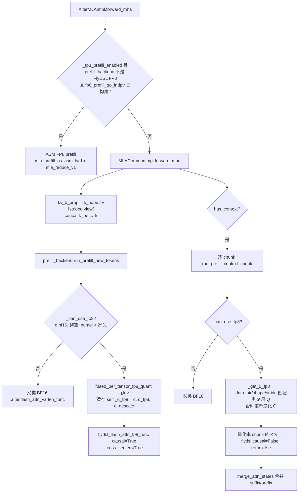
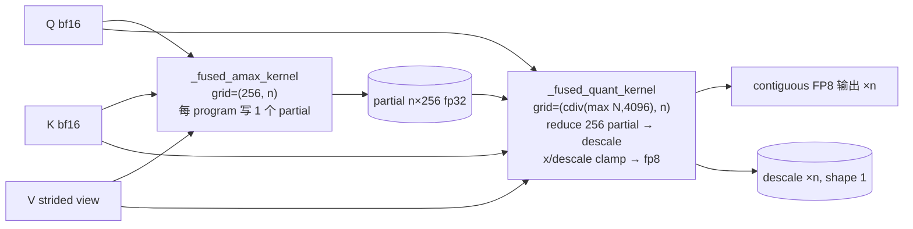

# PR #59124: [ROCm][Perf][MLA] Add opt-in FlyDSL FP8 prefill attention for AITER MLA

> **Author**: @gbyu-amd | **State**: OPEN | **Date**: 2026-09-29（Round 3 rebase 于 2026-11-02）
> **Branch**: `gbyu-amd:rocm-k3-flydsl-fp8-prefill` → `main` | **Labels**: rocm, verified
> **Changes**: +824 -7 lines across 8 files | **ROCm 相关性**: 完全相关（ROCm gfx950 专属 MLA prefill 后端，触及 Tier-1 文件 `mla/rocm_aiter_mla.py`）
> 本报告分两部分：§1–6 为 PR 详细总结，§7–8 为 ROCm review 意见，§9 为可直接粘贴的英文评论。

---

## 1. 总结 (Summary)

本 PR 新增一个 **opt-in** 的 MLA prefill 后端 `ROCM_AITER_FLYDSL_FP8`：在 MI355X（gfx950）上把 BF16 的 Q/K/V 用一个新的 Triton 融合算子做**动态 per-tensor FP8 量化**，再调用 AITER 的 FlyDSL FP8 flash attention（`flydsl_flash_attn_fp8_func`）计算 new-token 与 context-chunk 两类 prefill attention；不能处理的输入（空张量、元素数 ≥ 2^31）回退到父类 BF16 `ROCM_AITER_FA`。选中该后端时，`ROCM_AITER_MLA` 原本对“无 context 的 prefill”走的 ASM FP8 prefill（`mla_prefill_ps_asm_fwd`）被显式关闭，PS workspace 也不再分配。只能通过 `--attention-config '{"mla_prefill_backend":"ROCM_AITER_FLYDSL_FP8"}'` 选中，不进入自动选择。

## 2. 背景与动机 (Background & Motivation)

- 目标场景是 Kimi-K3 在 MI355X 上 TP8/DCP8 的 agentic 长上下文服务：prefill（尤其带长 cached prefix 的 context chunk）是 TTFT 的主要来源。BF16 AITER FA 在长 context 下较慢；而现有 ASM FP8 prefill 只覆盖“无 context”的批次。
- 方案移植自 ROCm/ATOM#2191（ATOM 中的 fused QKV quantizer + FlyDSL FP8 FMHA），并取代了已关闭的 #62447（同思路但塞在 `ROCM_AITER_FA` 内部）。
- 依赖 AITER 侧 `flydsl_flash_attn_fp8_supported`（ROCm/aiter#5718）、`softmax_scale`、短 query split-K、以及 `kimi_k3_tp8` 的 AOT `varlen_cross` kernel（ROCm/aiter#5796、#5901）；main 当前 pin 的 AITER v0.1.27 已包含（本容器 amd-aiter 0.1.27 中已核实上述符号存在）。
- 作者自报的收益（见 §7 关于数字溯源的备注）：Kimi-K3 agentic replay c48 总吞吐 +4.5%、TTFT p90 −15.8%、ITL p90 −8.7%；8K fresh prefill TTFT mean −2.5%、p90 −9.1%；精度（GPQA Diamond / RULER NIAH 32K·128K / GSM8K / DSpark 接受长度）两臂持平。

## 3. 代码修改分析 (Code Change Analysis)

### 3.1 修改的模块

| 模块 | 改动 |
|------|------|
| `vllm/v1/attention/backends/mla/prefill/aiter_flydsl_fp8.py`（新增 236 行） | `AiterFlyDSLFP8PrefillBackend(AiterFlashAttnPrefillBackend)`：gfx950 门控、AITER FlyDSL 可用性检查、head dim 校验、Q 跨 context chunk 复用、FP8 new-token / context-chunk 调用与 BF16 回退 |
| `vllm/v1/attention/ops/triton_per_tensor_fp8_quant.py`（新增 250 行） | `fused_per_tensor_fp8_quant`：1–3 个任意 stride 的 `[T,H,D]` 张量，两次 launch（partial amax → reduce+quant），无 atomic、无零初始化 |
| `vllm/v1/attention/backends/mla/prefill/registry.py` (+4) | 注册枚举 `ROCM_AITER_FLYDSL_FP8` |
| `vllm/v1/attention/backends/mla/rocm_aiter_mla.py` (+21/−3，Tier-1) | 新增 `_asm_fp8_prefill_superseded()`；builder 的 `_fp8_prefill_enabled` 与 `forward_mha` 的 ASM 分支都以它为门控 |
| `vllm/config/attention.py` (+4/−1) | `mla_prefill_backend` docstring 列出 ROCm 后端（会渲染进 CLI 文档） |
| `tests/kernels/attention/test_rocm_aiter_mla_flydsl_fp8_prefill.py`（新增 204 行） | quantizer 对 torch 参考、全元素覆盖、全零输入；后端 FP8 vs BF16（含 64K 长 context、Q 复用计数） |
| `tests/v1/attention/test_mla_backends.py` (+27/−2) | 把新后端加入 `PREFILL_BACKENDS_TO_TEST`；新增 `context_free_prefill` batch spec；为新后端放宽容差到 `rtol=2^-4, atol=0.3` |
| `tests/v1/attention/test_mla_prefill_selector.py` (+77) | gfx950 门控、`is_available`、head dim 拒绝三个选择器单测 |

### 3.2 架构 / 流程图

**prefill 调度（选中 `ROCM_AITER_FLYDSL_FP8` 时）**：



**FP8 quantizer 两阶段结构**：



### 3.3 关键实现细节

- **门控**：`supported_dtypes=[bf16]`；`supports_compute_capability` 要求 `is_rocm() and on_gfx950()`；`is_available` 要求 `rocm_aiter_ops.is_enabled()` 且能 import `aiter.ops.flydsl.{flydsl_flash_attn_fp8_func, flydsl_flash_attn_fp8_supported}`；`validate_configuration` 以 `(num_heads=1, num_kv_heads=1, qk_head_dim, v_head_dim, dtype=fp8_dtype())` 调 AITER 的能力检查。已核实 AITER 的 `_fp8_config_reason` 只对 MHA 的 head 数做整除检查，head dim 才是实质约束（`head_dim % 64 == 0`、`64 ≤ head_dim_v ≤ 192`），用 1/1 探测是正确的。显式选择但不满足 → selector 抛 `ValueError`（启动期失败，不会静默跑 BF16）。
- **Q 复用**：`run_prefill_new_tokens` 量化 (q,k,v) 后把 `(q, q_fp8, q_descale)` 存到实例属性 `_q_fp8`；`run_prefill_context_chunk` 通过 `q_src[chunk.token_slice]` 与传入 q 的 `data_ptr/shape/stride` 比较决定是否复用（per-tensor 量化下切片 + 全局 descale 数学上等价）。`prepare_metadata` 时清空。
- **ASM FP8 prefill 让位**：builder `_fp8_prefill_enabled` 增加 `not _asm_fp8_prefill_superseded(self._prefill_backend)`，因此不构建 `fp8_prefill_*` metadata、不分配 PS workspace；`forward_mha` 再按 `prefill_metadata.prefill_backend` 实例做一次显式检查（同时把原 `assert attn_metadata.prefill is not None` 改为条件分支）。Impl 侧 `_fp8_prefill_enabled` 未改，仍会 import ASM kernel（无害）。
- **Quantizer**：`SHAPE`/`STRIDE` 作为 `tl.constexpr`（与 token 数无关），偏移在 `_load` 内转 int64；`_partial_amax` 每 program 的循环次数为 `cdiv(N - start, PARTS*BLOCK)`（start ≥ N 时为 0 但仍写 0 partial）；`_quant` 用 `start < N or start == 0` 早退，program 0 保证空输入也写 descale；FP8 上限取 `torch.finfo(fp8_dtype).max`（非硬编码）；全零/空输入 descale=1e-6。
- **AITER 调用**：new-token 用 `cross_seqlen=True`（等长时与 False 位等价，目的是命中 AITER 的 AOT `varlen_cross` kernel）；context chunk `causal=False, return_lse=True`；LSE 布局为 varlen `[H, total_q]`，与 AITER FA 一致，可直接复用 `merge_attn_states`。
- **无新 env var**：早期版本的 env flag 已移除，改用标准 `--attention-config`。

## 4. 涉及的技术原理 (Technical Principles)

- **MLA prefill = MHA**：DeepSeek/Kimi 的 MLA 在 prefill 阶段把 latent `kv_c` 经 `kv_b_proj` 展开成每头的 `k_nope|v`，再与共享 `k_pe` 拼成 qk_head_dim=192、v_head_dim=128 的普通多头注意力；带 prefix cache 时还要对已缓存的 context 分块（chunk）重新展开并计算 attention，最后用 LSE 合并 suffix/prefix 两部分（`merge_attn_states`）。
- **动态 per-tensor FP8 量化**：每个张量一个 scale（descale = amax / 448），量化误差约为 2^-4 量级的相对误差（e4m3 3 位尾数）。per-tensor 意味着整个 batch、所有 head 共用一个 scale：某个 token/head 的离群值会压低其他所有元素的有效精度，且输出依赖同批次的其他请求（批次不变性被打破，父类已拒绝 `VLLM_BATCH_INVARIANT`）。
- **FlyDSL**：AITER 的 Python DSL kernel 体系，gfx950 FP8 FMHA 在调用时按 (rescale_threshold, block_m, num_kv_splits, interleave group) 选择变体并 **JIT 编译**，`_build_fp8` 用 `lru_cache(128)` 缓存；AITER 提供 `aiter.aot.flydsl.fmha_fp8` 预编译，但 `DEFAULT_SHAPES` 当前只含 `kimi_k3_tp8: (12, 12, 192, 128, varlen_cross)`。
- **两阶段无 atomic 归约**：先每个 program 写独立 partial，再由第二个 kernel 归约，kernel 边界即全局 barrier，因此不需要 `torch.zeros` 初始化 amax，避免了 “atomic_fmax 读未初始化缓冲” 这一类常见 FP8 descale 错误。

## 5. 评论区讨论亮点 (Discussion Highlights)

- **@simondanielsson**：要求做成独立的 MLA prefill 后端并接入现有正确性测试（已落实：独立后端 + `PREFILL_BACKENDS_TO_TEST` + selector/registry 单测）；建议若要默认启用需更广泛的 benchmark sweep（作者同意保持 opt-in，并指出与 #44544 `ROCM_AITER_ASM` 可共存）；质疑自写 Triton quantizer 的必要性——作者给出理由：`ops.scaled_fp8_quant` 对 strided V 走 per-row 路径（65K tokens 10.2 ms vs 0.35 ms），`rocm_aiter_ops.per_tensor_quant` 对 strided V 结果错误（后者未在本 review 中复现）。
- **@ChuanLi1101**：① 共享 grid 下小张量的越界指针（已修：per-program trip count + `_quant` 早退，并加全元素覆盖测试）；② 每次调用的临时 buffer 分配（作者实测仅 ~2–4 µs 收益并指出复用 `scales` 会与仍存活的 `q_descale` 冲突，维持现状——论证合理）；③ 不应依赖“缺 metadata”间接关闭 ASM FP8 prefill（已改为显式谓词 `_asm_fp8_prefill_superseded`）。
- **@whx-sjtu**：确认本 PR 取代 #62447；要求 rebase、更新 AITER 版本说明、补 DSpark MTP 接受长度（3.819 vs 3.823）；关键追问是“接管 context-free prefill 后，相比 fused ASM 路径 8K fresh prefill 是否变慢”——作者补了 8K A/B（TTFT mean −2.5%，p90 −9.1%），据网页摘要为“以 fresh-prefill A/B 为条件的认可”。
- 作者在 PR 描述中坦承：`context_free_prefill` spec 在强制 `_asm_fp8_prefill_superseded=False` 时也能通过，因此不能证明实际跑的是哪个 kernel；FlyDSL kernel 测试和 head-dim selector 测试在 CI 中被跳过（kernels 步骤跑在 MI300/gfx942，selector 步骤未开 AITER）。
- CI 状态未抓取；评论区显示曾有 pre-commit 失败与多次 merge conflict，最新 head 已 rebase。尚无 code owner（tjtanaa / LucasWilkinson / MatthewBonanni 等）approve。

## 6. 风险与潜在问题 (Risk Analysis)

| 风险 | 严重程度 | 说明 |
|------|---------|------|
| `_q_fp8` 缓存生命周期过长 + 仅靠 data_ptr 判定复用 | Medium | 见 §7 ⚠️【正确性】Q 缓存生命周期 |
| 非 Kimi-K3-TP8 形状在服务路径上 JIT 编译 FlyDSL kernel | Medium | 见 §7 ⚠️【性能】AOT 覆盖范围 |
| 精度只在 Kimi-K3 上验证，门控对所有满足 head dim 的 MLA 模型开放 | Medium | 见 §7 ⚠️【兼容性】精度验证范围 |
| ASM 让位逻辑没有测试能证明哪个 kernel 实际执行 | Medium | 见 §7 ⚠️【测试】 |
| 对默认路径的影响 | Low | 仅新增 `isinstance` 判断；未选中新后端时 builder/forward 行为与 main 一致（已核实） |
| gfx942 / 非 AITER 环境 | Low | `supports_compute_capability`/`is_available` 前置返回，显式选择启动即报错；自动选择不包含该后端 |
| 性能数字可复现性 | Low | 单次运行、部分数据来自第一版代码与 AITER 0.1.22，见 §7 📝 |
| 可维护性：Tier-1 文件 import 具体 prefill 后端类 | Low | 见 §7 📝【设计】 |

---

## 7. Review 意见 (Findings)

| 类型 | 🔴 | ⚠️ | 📝 |
|------|----|----|----|
| 正确性 | — | 1 | — |
| 性能 | — | 1 | 1 |
| 兼容性 | — | 1 | — |
| 测试 | — | 1 | — |
| 设计 | — | — | 1 |

未发现可给出具体触发输入的阻塞级问题。已核实的正面项：AITER 符号（`flydsl_flash_attn_fp8_func`、`flydsl_flash_attn_fp8_supported`、`cross_seqlen`/`softmax_scale`/`q_descale` 等 kwarg）在 amd-aiter 0.1.27 中真实存在且签名一致；FP8 上限取 `torch.finfo(fp8_dtype).max`，无 240/448 硬编码；quantizer 无 atomic、无未初始化缓冲读取；gfx942 与 AITER 缺失时启动期明确报错而非静默回退；无新增未注册 env var；未选中该后端时 Tier-1 文件行为不变。

---

**⚠️【正确性】`_q_fp8` 缓存跨层/跨 step 存活，且在 new-token 走 BF16 回退时不会被清掉** `[已验证]`（触发条件很窄）

- **问题**: `aiter_flydsl_fp8.py:128-182`。prefill backend 实例由 metadata builder `clone()` 一次（`mla_attention.py:2501`），被同一 KV-cache group 的**所有 MLA 层共享**；`_q_fp8 = (q, q_fp8, q_descale)` 只在 `prepare_metadata`（每 step 一次）和 FP8 new-token 路径中被重置/覆盖。因此：① 第 N 层的 q（bf16）与 q_fp8 一直存活到第 N+1 层覆盖它，最后一层的会一直存活到下一个含 prefill 的 step（中间的纯 decode step 也不释放）；且 q 往往是更大张量的 view，会钉住整块存储；② `run_prefill_new_tokens` 走 `_can_use_fp8 == False` 回退时（line 172）不会清空 `_q_fp8`，随后该层的 context chunk 若满足 `_can_use_fp8`，`_get_q_fp8` 只靠 `data_ptr/shape/stride` 判断是否复用上一层的 FP8 Q。
- **影响**: ① 额外显存 ≈ `T·H·192·3` 字节（DeepSeek-R1 TP1、8192 tokens 约 600 MB；Kimi-K3 TP8 约 56 MB），会被 profile run 计入峰值而挤占 KV cache，不会 OOM。② 回退触发需要 new-token 的 q/k/v 元素数 ≥ 2^31 而 chunk 的 q 切片 < 2^31（如 TP1 128 头 + `max_num_batched_tokens` ≳ 87K），同时上一层的 q 地址恰好与本层相同（piecewise cudagraph 的 graph pool 地址复用会让这种情况成为可能）——此时 context attention 会静默使用上一层的 Q。概率极低，但属于“靠指针相等推断数据身份”的脆弱不变式。
- **行动**: 建议作者在 `run_prefill_new_tokens` 入口先 `self._q_fp8 = None`，并且只在 `return_softmax_lse=True`（即确有 context chunk）时缓存；可在 context 循环后（或下一次 new-token 调用时）释放。这样既去掉跨层持有，也使复用只可能发生在同一层内。

**⚠️【性能】FlyDSL FP8 kernel 只对 Kimi-K3 TP8 形状有 AOT 预编译，其他模型/TP 会在服务路径上 JIT 编译** `[已验证]`（AOT 范围）/ `[推测]`（实际 stall 时长）

- **问题**: 本容器 AITER 0.1.27 的 `aiter/aot/flydsl/fmha_fp8.py` 中 `DEFAULT_SHAPES = {"kimi_k3_tp8": [(12, 12, 192, 128, "varlen_cross")]}`，其文档明确写“each new combination is a JIT compile on the serving path”。`flydsl_flash_attn_fp8_func` 每次调用按 `(rescale_threshold, block_m, num_kv_splits, interleave_group, causal, cross, return_lse)` 选变体，`_build_fp8` 以 `lru_cache(maxsize=128)` 缓存。PR 中 new-token 用 `cross_seqlen=True` 的注释（line 191-194）也说明了性能依赖于 AOT 覆盖。DeepSeek-V3/R1 TP8（16 头/rank）、Kimi-K3 其他 TP 等形状均不在 AOT 列表中；vLLM ROCm Dockerfile 也未运行 `python -m aiter.aot.flydsl.fmha_fp8`（PR head 中 `docker/` 无相关步骤，AITER wheel 是否自带预编译产物未核实）。
- **影响**: 用户对非 Kimi-K3-TP8 模型启用此后端时，最初若干个不同形状的 prefill 会各自付出一次 kernel 编译开销（多个变体、多 rank 并发编译），表现为 TTFT 尖峰；warmup/profile run 只会命中少数变体。PR 描述“No model or shape is hard-coded”在功能上成立，但性能结论只对 AOT 覆盖的形状成立。
- **行动**: 建议作者在 docstring/文档中注明 AOT 覆盖范围以及对其他形状运行 `python -m aiter.aot.flydsl.fmha_fp8 --shape H:H:192:128@varlen_cross`（以及 causal `varlen` 布局）的方法，或在 backend 初始化时对当前 `(num_heads, dims)` 做一次性预热；建议 review 时追问一组非 Kimi 形状（如 DeepSeek-R1 TP8）的首请求 TTFT。

**⚠️【兼容性】精度只在 Kimi-K3 上验证，但后端对所有满足 head dim 的 MLA 模型开放** `[推测]`

- **问题**: `validate_configuration` 只检查 gfx950 + bf16 + AITER head dim（192/128 等），因此 DeepSeek-V3/R1/V3.2-dense-prefill、Kimi-K2 等都可选中此后端。PR 中所有模型级精度证据（GSM8K、GPQA、RULER NIAH、tool-call、DSpark 接受长度）都来自 Kimi-K3（每 rank 12 头、TP8/DCP8）。per-tensor scale 覆盖全 batch、所有 head 以及 `k_pe`（与 `k_nope` 量级不同）部分；单测容差为此放宽到 `rtol=2^-4, atol=0.3`（`test_mla_backends.py:2103-2106`），只能证明误差有界，不能证明下游任务精度不变。
- **影响**: 在激活值分布更“尖”（离群值更大）的模型上，per-tensor FP8 的有效精度可能明显低于 Kimi-K3，且误差与同批次其他请求相关（某个请求的离群值会降低整个 batch 的精度），这类回归不会在单测中暴露。
- **行动**: 建议作者至少在 DeepSeek-R1/V3（TP8）上补一组 GSM8K（或在 docstring/`attention.py` 的说明中写明“validated on Kimi-K3”），使 opt-in 用户知道验证边界。

**⚠️【测试】没有测试能证明选中 FlyDSL 后 ASM FP8 prefill 确实未执行；kernel 级测试在 CI 中被跳过** `[已验证]`

- **问题**: `context_free_prefill` spec（`test_mla_backends.py:528-532`）只比较输出，作者在 PR 描述中确认把 `_asm_fp8_prefill_superseded` 强制为 `False` 时它也能通过——所以 Tier-1 文件 `rocm_aiter_mla.py` 中两处新门控（builder line 1129、`forward_mha` line 2897）在 CI 中没有任何断言覆盖。另外 `tests/kernels/attention/test_rocm_aiter_mla_flydsl_fp8_prefill.py` 中的 FP8-vs-BF16 后端测试在 MI300 的 kernels 步骤会 skip，selector 的 head-dim 测试在未开 AITER 的步骤会 skip，唯一真正跑该后端的 CI job 是 MI355 上的 `test_mla_backends.py`。
- **影响**: 未来若有人重构 `_fp8_prefill_enabled` 或 `forward_mha` 的分支顺序，导致 ASM FP8 prefill 重新接管 context-free 批次（或反过来 FlyDSL 后端被绕过），所有测试仍会通过——这正是 dispatch 类改动最需要覆盖的“错 dispatch = 静默绕过”。
- **行动**: 建议作者加一个轻量断言：在 `context_free_prefill` 用例中检查 builder 的 `_fp8_prefill_enabled is False` 且 `attn_metadata.fp8_prefill_qo_indptr is None`，或 monkeypatch `AiterMLAImpl._mla_fp8_prefill_attn` 使其被调用即失败；并在 PR 描述中说明 MI355 CI 步骤是否会执行 kernels 目录下的这个文件。

**📝【性能】性能数字可追溯到命令，但样本量小且部分来自旧版本** `[已验证]`

- **问题**: agentic replay（+4.5% 吞吐、TTFT p90 −15.8%）与第一组 GSM8K 是“first revision + AITER 0.1.22 + AITER main 的 FlyDSL 源码”上各跑一次；8K fresh prefill 两次运行；精度表每臂一次。PR 给出了完整命令，但没有原始日志/结果文件。
- **行动**: 这些数字应视为作者自报、未独立验证；建议 review 时请作者在当前 head + AITER v0.1.27 上至少重跑一次 agentic replay，或附上原始结果文件链接。

**📝【设计】Tier-1 后端通过 `isinstance` 识别具体 prefill 后端类** `[已验证]`

- **问题**: `rocm_aiter_mla.py:41-43, 167-173` 在模块顶层 import `AiterFlyDSLFP8PrefillBackend` 并用 `isinstance` 判断是否让出 ASM FP8 prefill；Impl 侧 `_fp8_prefill_enabled` 仍为 True 并 import ASM kernel，只在 forward 时被绕过。
- **行动**: 建议作者考虑在 `MLAPrefillBackend` 上加一个类属性（如 `handles_context_free_fp8_prefill: ClassVar[bool] = False`），由 FlyDSL 后端置 True，`rocm_aiter_mla.py` 只读这个属性——既去掉 Tier-1 文件对具体后端的耦合，也便于 #44544 的 `ROCM_AITER_ASM` 等后续后端复用同一机制。非阻塞。

## 8. 结论 (Verdict)

**⚠️ NEEDS WORK**

整体设计干净：opt-in、标准 selector 门控、gfx942/无 AITER 时启动期明确失败、无新 env var、quantizer 无 atomic/未初始化缓冲问题、AITER 符号与签名均已核实存在，且未选中时对 Tier-1 默认路径零影响。合入前建议：收紧 `_q_fp8` 缓存的生命周期（入口清空、仅在有 context 时缓存）、为 ASM 让位门控补一个能区分 kernel 的断言、并在文档中说明 AOT 覆盖范围与精度验证边界（目前只覆盖 Kimi-K3 TP8）。

## 9. 英文 Review 评论 (Copy-Paste English Comments)

**C1** `vllm/v1/attention/backends/mla/prefill/aiter_flydsl_fp8.py:172-182` — ⚠️ comment

```text
`_q_fp8` lives on a backend instance that the metadata builder shares across all MLA layers, and it is only reset in `prepare_metadata` (once per step). So layer N's bf16 `q` (often a view that pins a larger buffer) plus its FP8 copy stay alive until layer N+1 overwrites them, and the last layer's copy stays alive through subsequent decode-only steps. Also, when this call takes the BF16 fallback (`_can_use_fp8` is False), `_q_fp8` is not cleared, so a following context chunk that can use FP8 decides reuse purely on `data_ptr/shape/stride` against the previous layer's Q. The trigger is narrow (>= 2**31-element new-token inputs with a smaller chunk slice), but could you set `self._q_fp8 = None` at the top of `run_prefill_new_tokens` and only cache it when `return_softmax_lse` is True (i.e. there are context chunks)? That keeps reuse strictly within one layer and drops the extra memory held across layers.
```

**C2** `tests/v1/attention/test_mla_backends.py:528-532` — ⚠️ comment

```text
As noted in the description, `context_free_prefill` still passes with `_asm_fp8_prefill_superseded` forced to False, so nothing in CI asserts the new gates in `rocm_aiter_mla.py` (builder `_fp8_prefill_enabled` and the `forward_mha` check). Since a dispatch regression here would be silent, could you add a cheap assertion for this spec, e.g. check that the builder's `_fp8_prefill_enabled` is False and `fp8_prefill_qo_indptr` is None when ROCM_AITER_FLYDSL_FP8 is selected, or monkeypatch `AiterMLAImpl._mla_fp8_prefill_attn` to raise if called?
```

**C3** `vllm/v1/attention/backends/mla/prefill/aiter_flydsl_fp8.py:191-194` — ⚠️ comment

```text
In AITER v0.1.27, `aiter.aot.flydsl.fmha_fp8.DEFAULT_SHAPES` only contains `kimi_k3_tp8: (12, 12, 192, 128, varlen_cross)`, and that module states every other (threshold, block_m, splits, interleave) combination is a JIT compile on the serving path. So for other models/TP sizes (e.g. DeepSeek-R1 TP8 with 16 heads per rank) the first prefills of each shape class will pay FlyDSL compile time, and the vLLM ROCm image does not run the AOT step. Could you document the AOT coverage (and the `python -m aiter.aot.flydsl.fmha_fp8 --shape ...` command for other shapes) in the module docstring, or warm up the variants for the current head shape at init?
```

**C4** `vllm/config/attention.py:84-87` — ⚠️ comment

```text
The selector accepts any bf16 MLA model whose head dims pass AITER's check (DeepSeek-V3/R1, Kimi-K2, ...), but all model-level accuracy evidence in the PR is from Kimi-K3 at TP8/DCP8. Per-tensor FP8 shares one scale across the whole batch, all heads and the k_pe part, so models with larger activation outliers could lose more precision than Kimi-K3 does. Could you either add one GSM8K run on DeepSeek-R1/V3 (TP8) or state in this docstring that the backend has been validated on Kimi-K3 only?
```
