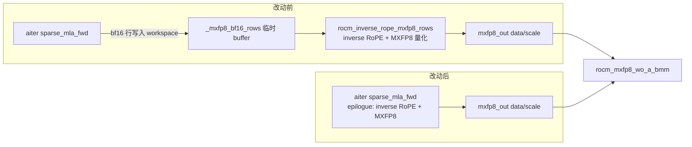
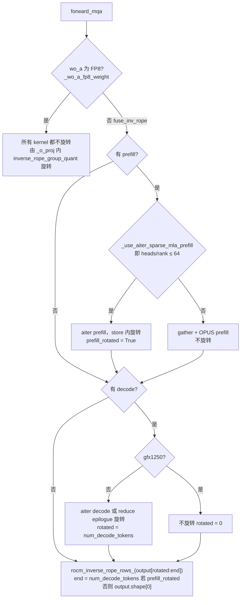
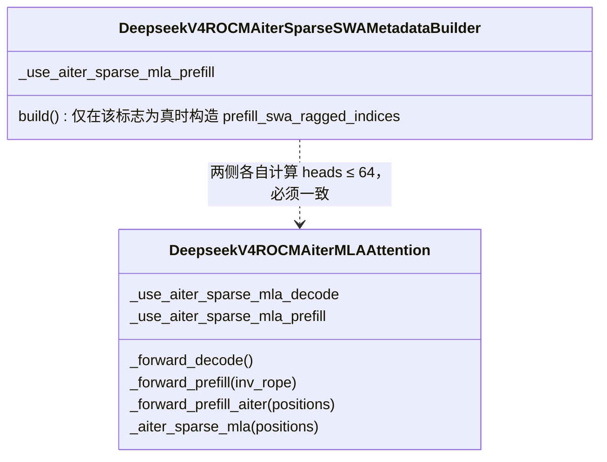

# PR #60154: [ROCm][DSv4/4.1] Fuse inverse RoPE and MXFP8 quant into the aiter sparse MLA and sparse MLA gating changes

> **Author**: @cagrikymk | **State**: OPEN | **Date**: 2026-10-06（最后推送 2026-10-16）
> **Branch**: `cagrikymk:mekaymak/dsv41_aiter_sparse_mla_epilogue` → `main` | **Labels**: rocm, deepseek, quantization, DSv4, DSv4.1
> **Changes**: +112 -88 lines across 3 files | **ROCm 相关性**: 完全相关（gfx950 aiter sparse MLA 路径，DeepSeek-V4 / V4.1 AMD 专属模型目录）
> 本报告分两部分：§1–6 为 PR 详细总结，§7–8 为 ROCm review 意见，§9 为可直接粘贴的英文 review 评论。

---

## 1. 总结 (Summary)

在 ROCm + aiter Triton/Gluon sparse MLA 后端（`VLLM_ROCM_USE_AITER_TRITON_SPARSE_MLA=1`，仅 gfx950）上，DeepSeek-V4/V4.1 原本在 attention 之后额外跑一遍独立的 inverse RoPE（`rocm_inverse_rope_rows_`），V4.1 还要再跑一遍 MXFP8 量化（`rocm_inverse_rope_mxfp8_rows`）。aiter v0.1.25 的 `sparse_mla_fwd` 已能在输出 store 的 epilogue 里同时完成这两件事，本 PR 把 positions / cos-sin cache（以及 MXFP8 输出 buffer）传给 kernel，删除多余的 pass 和 bf16 中间 buffer。另外，DSv4 的 aiter sparse MLA **prefill** 被限制为每 rank head 数 ≤ 64（128 heads/rank 时 gather + OPUS 更快），decode 不受限制。

## 2. 背景与动机 (Background & Motivation)

- DeepSeek-V4 系列的 attention 输出在进入 `wo_a` 之前需要对每行的最后 64 个 lane（RoPE 部分）做 inverse GPT-J RoPE。ROCm 上原来的流程是：attention kernel 写 bf16 → 独立 kernel 原地旋转 → （V4.1 gfx950）再量化成 MXFP8 喂给 `rocm_mxfp8_wo_a_bmm`。每多一个 pass 就多一次 `[T, H, 512]` bf16 的 HBM 读写，再加一次 kernel launch。
- 非 aiter 的 decode 路径（`rocm_sparse_attn_decode`）早就把 inverse RoPE / MXFP8 融进了 reduce epilogue；aiter sparse MLA 路径是唯一还需要"补课"的路径（base 代码注释："The aiter kernel leaves the inverse RoPE to the caller" / "The aiter kernel has no MXFP8 epilogue"）。
- aiter 侧的支持（`inv_rope_positions`、`inv_rope_cos_sin_cache`、`out_mxfp8`）已随 aiter **v0.1.25** 发布，vLLM 的 `docker/Dockerfile.rocm_base` 已 pin `AITER_BRANCH="v0.1.25"`，所以本 PR 可以直接用。
- 第三个 commit（`5edfd8b840`，10-15）额外加入 prefill head 数门控：作者观察到 128 heads/rank（如 DSv4-Pro DEP8）时，aiter gluon prefill 比 "gather KV + OPUS" 慢。

## 3. 代码修改分析 (Code Change Analysis)

### 3.1 修改的模块

| 文件 | 改动 |
|------|------|
| `vllm/_aiter_ops.py` (+10 -2) | `triton_sparse_mla_fwd` 包装新增 `inv_rope_positions` / `inv_rope_cos_sin_cache` / `out_mxfp8` 三个 kwarg 并原样转发给 `aiter.ops.triton.attention.sparse_mla.sparse_mla_fwd`；`o` 变为 `Optional`（MXFP8 输出时为 `None`） |
| `vllm/models/deepseek_v4/amd/rocm.py` (+58 -22) | ① 新增 `_AITER_SPARSE_MLA_PREFILL_MAX_HEADS = 64` 与 `_aiter_sparse_mla_prefill_enabled()`；② `_use_aiter_sparse_mla` 拆成 `_use_aiter_sparse_mla_decode` / `_use_aiter_sparse_mla_prefill`（metadata builder 与 attention layer 各算一次）；③ decode 与 prefill 在 BF16 `wo_a` 路径下把 positions 交给 kernel，在 store 里旋转；④ standalone 旋转只覆盖 `[rotated, end)` |
| `vllm/models/deepseek_v41/amd/rocm.py` (+44 -64) | ① aiter decode / prefill 直接写 MXFP8（`out_mxfp8`）并在 store 中旋转，删除 `_mxfp8_bf16_rows()` 与随后的 `rocm_inverse_rope_mxfp8_rows` 调用；② `_prefill_workspace_shapes` 去掉 `gather` 参数，warmup 在 aiter 路径下不再预留任何 workspace；③ standalone 旋转同样改为 `[rotated, end)` |

### 3.2 架构 / 流程图

**改动前后数据流对比（V4.1，gfx950，MXFP8 `wo_a` 输入）**：



**DSv4 `forward_mqa` 的旋转责任划分（改动后）**：



**门控拆分（DSv4）**：



### 3.3 关键实现细节

- **`_aiter_ops.triton_sparse_mla_fwd`**：新增的三个 kwarg 无条件透传给 aiter（即使值为 `None`）。aiter 侧在 `pa_decode_sparse._pa_decode_sparse_gfx950_gluon` 中校验：`positions.shape == (C,)` 且连续，`cos_sin_cache` 为 `[P, 64]` f32，`out_mxfp8 = (data [C, H*D] e4m3, scale [C, H*D/32] uint8)`，并与 `out` 互斥；epilogue 只在 gfx950 gluon 路径实现，非 gluon 路径会 assert。
- **DSv4 decode**：`_forward_decode` 在 aiter 分支把 `positions` 交给 kernel，返回 `0 if positions is None else q.shape[0]`（之前恒为 0）。FP8 `wo_a` 或 gfx1250 时 `positions=None`，保持不旋转，避免与 `inverse_rope_group_quant` 二次旋转。
- **DSv4 prefill**：新增 `inv_rope` 参数；`prefill_rotated = fuse_inv_rope and _use_aiter_sparse_mla_prefill`；非 aiter prefill 路径加 `assert not inv_rope`。
- **DSv4 prefill head 门控**：builder 用 `model_config.get_num_attention_heads(parallel_config)`，layer 用 `self.n_local_heads`；warmup 只在 prefill 走 gather 路径时预留 bf16 gather workspace（修正了"aiter 开启但 prefill 走 gather"时预留不足的问题）。
- **V4.1**：在 gfx950 上 `_alloc_attn_out` 总是返回 `QuantizedActivation`，因此 aiter 路径实际总是 `out_mxfp8`；`_forward_prefill_aiter` 新增 `assert (output is None) != (mxfp8_out is None)`；`_prefill_workspace_shapes` 的 `gather` 参数和 `_mxfp8_bf16_rows()` 被删除（只剩非 aiter prefill 一个调用方）。
- **standalone 旋转**：两个模型都改成只处理 `[rotated, end)`；`rocm_inverse_rope_rows_` 对 0 行直接 return（已核对 `vllm/v1/attention/ops/rocm_aiter_mla_sparse.py:1568`），因此常见的"全部已旋转"情况不会产生空 launch。

## 4. 涉及的技术原理 (Technical Principles)

**DeepSeek-V4 MLA 的 inverse RoPE**：V4 的 attention 输出（latent V，head_dim=512 = 448 NoPE + 64 RoPE）中，RoPE 部分在进入 `wo_a` 之前需要按 token 位置反向旋转（GPT-J 交错风格，`cos | sin` 布局的 `[P, 64]` cache）。这是逐行、逐 head 的逐元素运算，适合作为 attention kernel store 前的 epilogue：数据已在寄存器里，融合后能省掉一次完整的 `[T, H, 512]` HBM 读写。

**MXFP8（OCP Microscaling FP8）**：每 32 个元素共享一个 E8M0（纯指数）scale，数据为 e4m3。V4.1 在 gfx950 上用 `rocm_mxfp8_wo_a_bmm` 消费 MXFP8 的 attention 输出。把量化放进 epilogue 后，bf16 中间结果根本不需要落到 HBM——对 decode（memory-bound）收益最明显。aiter 文档声称结果与 vLLM 的 inverse-RoPE + MXFP8 pass "up to rounding" 一致。

**Prefill / Decode 行切分与"谁负责旋转"**：vLLM 的 batch 中 decode token 在前、prefill token 在后。旋转责任按行切分：融合的 kernel 旋转自己那部分，剩下的行由 `rocm_inverse_rope_rows_` 补。这个切分依赖每步 batch 的组成，因此放在 eager 的 attention 段（`forward_mqa`）完成，而不是放在会被 `torch.compile` 冻结 trace 时取值的 `_o_proj` 中（代码注释已说明）。

**aiter gluon 稀疏 MLA 的 prefill 退化**：gluon kernel 的 `BLOCK_M=16` 对应 MFMA M 维度，以 head 为 M-tile。heads/rank 很大（128）且 prefill token 很多时，"一次 gather 成 bf16 KV + OPUS 稠密化 attention"的算术效率更高；因此作者按 head 数给 prefill 加了门控，decode 不受影响。

## 5. 评论区讨论亮点 (Discussion Highlights)

截至抓取时（2026-10-16），PR 没有人工 review 评论；只有 `claude[bot]` 提示"fork PR 自动 review 被禁用，需要 maintainer 评论 `@claude review`"。PR 尚未打 `ready` label，也没有人 approve。

---

## 6. 风险与潜在问题 (Risk Analysis)

| 风险 | 严重程度 | 说明 |
|------|---------|------|
| aiter 版本耦合 | Medium | 包装函数无条件传新 kwarg，aiter < 0.1.25 时开关一打开就会 `TypeError`（见 §7 第一条） |
| prefill 门控两处独立计算 | Medium | builder 和 layer 对 head 数的来源不同，一旦不一致会在 prefill 触发 assert（见 §7） |
| 数值正确性 | Medium | 旋转/量化的职责从 vLLM 移到了 aiter epilogue，vLLM 侧没有对应的单测；GSM8K 结果在噪声范围内 |
| 性能证据与改动不对应 | Medium | DSv4 的表格测的是"sparse MLA 开 vs 关"，不是融合本身的增量；head 门控没有数据支撑（见 §7） |
| 兼容性（DSv4 FP8 `wo_a`） | Low | 已正确避开二次旋转（`fuse_inv_rope=False` ⇒ `positions=None`） |
| CUDA graph | Low | 新增的只有 kwarg 转发和固定 tensor 切片，没有 host sync 或新的分配 |
| 可维护性 | Low | V4 与 V4.1 门控不一致；V4.1 有两处注释已过时 |

---

## 7. Review 意见 (Findings)

| 意见类型 | 数量 |
|---------|------|
| 🔴 必须修复 | 0 |
| ⚠️ 建议修复 | 4（兼容性 1、正确性 1、测试 1、性能 1） |
| 📝 建议/备注 | 2（设计 1、注释 1） |

已核对、**确认没有问题**的点（不计入 findings）：aiter v0.1.25 的 `sparse_mla_fwd` 确实有三个新 kwarg，并转发到 gluon epilogue；epilogue 只支持 gfx950，而 `is_triton_sparse_mla_enabled()` 已强制要求 `on_gfx950()`；DSv4 FP8 `wo_a` 路径不会二次旋转；ROCm 的 `get_padded_num_q_heads` 返回 `num_heads`（不 padding），所以 `out_mxfp8` 的 `[C, H*D]` shape 断言成立；空行切片已有提前返回；warmup workspace 预留与运行时实际需求一致。

**⚠️【兼容性】`triton_sparse_mla_fwd` 无条件转发新 kwarg，aiter < 0.1.25 时 sparse MLA 路径直接 `TypeError`** `[已验证]`

- **问题**: `vllm/_aiter_ops.py:3667-3669` 总是传 `inv_rope_positions=…, inv_rope_cos_sin_cache=…, out_mxfp8=…`，值为 `None` 时也照传。aiter v0.1.24.post1 / v0.1.23 的 `sparse_mla_fwd` 已有 `extra_kv`，但没有这三个参数（已对照 aiter tag 源码）。`requirements/rocm.txt` 不 pin aiter，只有 `Dockerfile.rocm_base` pin 了 v0.1.25。
- **影响**: 只要用户自建环境的 aiter 是 v0.1.24.x，并设置 `VLLM_ROCM_USE_AITER_TRITON_SPARSE_MLA=1`（gfx950 + DSv4/V4.1），第一次 forward 就会报 `TypeError: unexpected keyword argument`。在 base 上这个组合可以正常工作，所以这是回归。连不需要 epilogue 的 DSv4 FP8 `wo_a` 路径也会挂。
- **行动**: 建议作者只在参数非 `None` 时转发；或者参照同文件 `_TOPK_SOFTMAX_FUSED_SIGMOID` 的做法，惰性探测一次 aiter 是否支持，不支持就在 `is_triton_sparse_mla_enabled()` 里 warning 并关闭开关（或回退到 standalone pass）。另外，PR 描述里写的 "Requires the aiter change …" 应该补上 aiter 侧 PR 链接和最低版本。

**⚠️【正确性】DSv4 prefill 门控由 builder 和 layer 各自计算 head 数，不一致时 prefill 会 assert 崩溃** `[推测]`

- **问题**: `vllm/models/deepseek_v4/amd/rocm.py:610-616` 的 metadata builder 用 `vllm_config.model_config.get_num_attention_heads(parallel_config)`，`:724-726` 的 attention layer 用 `self.n_local_heads`。只有 builder 判定开启时才会构造 `prefill_swa_ragged_indices`，而 layer 一旦判定开启，`_forward_prefill_aiter` 就 `assert swa_metadata.prefill_swa_ragged_indices is not None`。改动前两者共用 `_aiter_sparse_mla_enabled()`，与 head 数无关，所以天然一致。
- **影响**: 只要两处 head 数不同，并跨过 64 这条线——例如 builder 拿到的是 target 模型的 `model_config`（128 heads/rank，DEP），而 drafter 层是 ≤ 64 heads/rank 的另一个 V4 模型，或者将来某种 attention 并行方式让 `n_local_heads ≠ num_attention_heads // TP`——首个 prefill 步就会 AssertionError。目前常见的 TP / DEP 配置下两者相等，所以标为推测。
- **行动**: 建议作者让两侧共用同一个 head 数来源；或者恢复 builder 的旧条件（`_aiter_sparse_mla_enabled()` 为真就构造 ragged prefill 索引，成本很低）。这样不一致时最多浪费一次构造，不会崩溃。至少应把 assert 的报错信息改得能说明是门控不一致。

**⚠️【测试】融合 epilogue 没有 vLLM 侧测试，AMD CI 也没有跑** `[已验证]`

- **问题**: PR 没有新增或修改任何测试。CI 只跑了 pre-commit / DCO / docs，没有 Buildkite AMD 队列（PR 也没有 `ready` label）。inverse RoPE 和 MXFP8 量化的数值正确性原来由 vLLM 自己的 `rocm_inverse_rope_rows_` / `rocm_inverse_rope_mxfp8_rows` 保证，现在完全交给了 aiter epilogue。
- **影响**: 混合 batch 的行切分（`[rotated, end)`）、MTP/DSpark 多 token decode、`compress_ratio ∈ {0/1, 4, 128}` 三类层、128 heads/rank 下 prefill 回退时的旋转补偿——这些组合里任何一个漏旋转或重复旋转，结果都是静默的精度下降。GSM8K 这种粗粒度指标不一定能看出来（V4.1 no-spec 从 97.50 降到 97.27，在噪声范围内，但也说明这个指标分辨不出这类问题）。
- **行动**: 建议作者补一个 gfx950 kernel 级单测：同一组输入，比较 `sparse_mla_fwd(inv_rope_positions=…, out_mxfp8=…)` 与"bf16 输出 + `rocm_inverse_rope_mxfp8_rows`"（以及 `rocm_inverse_rope_rows_`）的结果，覆盖 decode/prefill 和三种 compress_ratio。合并前请 maintainer 触发 AMD CI。

**⚠️【性能】性能数据大多不是在测本 PR 的增量，head 门控没有数据支撑** `[已验证]`

- **问题**: ① DSv4-Pro 的吞吐表、DSv4-Pro 准确率表和两组 Agent-X 表，测的都是 `VLLM_ROCM_USE_AITER_TRITON_SPARSE_MLA` 0 vs 1（DSv4-Pro 注明 branch `611e84f485`，不在本 PR 的 commit 列表里）。只有 DSV41-Flash 的第一张表是"融合 vs 不融合"（+0.9%~+1.75% 吞吐）。② head 门控 commit `5edfd8b840`（10-15）的说法"gather + OPUS 在 128 heads/rank 更快"没有任何数字。另外 DSv4-Pro TP8 是 16 heads/rank，根本不会触发门控，只有 DEP8 那一行会。③ 描述里还留着 "Perf. and accuracy runs to be added."。④ 没有说明测试时 `VLLM_ROCM_USE_AITER_FP8BMM` 的取值；它为 1 时 DSv4 走 FP8 `wo_a`，本 PR 的 DSv4 融合根本不生效。
- **影响**: reviewer 没法判断 DSv4 融合本身的收益；门控阈值 64 也只在 128 这一个点上有定性依据。不过按 128/TP 计算，实际可能的取值只有 {128, 64, 32, 16}，所以阈值本身问题不大。
- **行动**: 建议作者补：DSv4（BF16 `wo_a`，即 FP8BMM=0）融合 vs 不融合的 A/B；DEP8（128 heads/rank）prefill-heavy 负载下门控前后的 TTFT 对比；并删掉过时的 "to be added" 句子，写明 FP8BMM 的设置。

**📝【设计】DSv4 与 V4.1 的 prefill head 门控不一致** `[推测]`

- **问题**: 门控只加在 `deepseek_v4/amd/rocm.py`；`deepseek_v41/amd/rocm.py` 仍用单一的 `_use_aiter_sparse_mla` 同时控制 decode 和 prefill。两个文件的 aiter sparse MLA 代码结构几乎一样（`_aiter_sparse_mla`、`_forward_prefill_aiter`、warmup 预留逻辑），这是典型的孪生代码分叉。
- **影响**: 如果 V4.1 也会跑 128 heads/rank 的配置（例如更大的变体走 DEP），就会遇到同样的 prefill 退化；如果 V4.1 只有 Flash（heads/rank ≤ 64），那就没有影响。
- **行动**: 建议 review 时追问 V4.1 是否存在 >64 heads/rank 的部署形态。如果有，就同步门控；如果没有，在代码里加一行注释说明为什么 V4.1 不需要。

**📝【注释/文档】V4.1 有两处注释在 aiter 路径下已经过时** `[已验证]`

- **问题**: `deepseek_v41/amd/rocm.py:918-919`（`_alloc_attn_out`）写着 "prefill rows are rotated and quantized after their bf16 attention"；`:1224-1227`（`_forward_prefill` docstring）写着 "With `mxfp8_out` the rows go to a bf16 workspace first…"。aiter 路径现在已经在 store 里一步完成。
- **行动**: 建议作者把这两处注释改成"非 aiter 路径如此；aiter 路径由 kernel store 完成旋转和量化"。

## 8. 结论 (Verdict)

**⚠️ NEEDS WORK**

改动方向正确，实现也干净：旋转责任按行切分，FP8 `wo_a` 不会二次旋转，aiter 侧的 shape/dtype 断言都已对照 v0.1.25 源码核实，没有发现有具体触发输入的阻塞问题。合并前建议：去掉对 aiter ≥ 0.1.25 的硬依赖（或加版本探测）；让 prefill 门控两侧共用同一个来源；补 vLLM 侧的 epilogue 数值单测并跑 AMD CI；补 DSv4 融合增量和 head 门控的性能数据。

## 9. 英文 Review 评论 (Copy-Paste English Comments)

**C1** `vllm/_aiter_ops.py:3667-3669` — ⚠️ comment

```text
These three kwargs are now forwarded unconditionally, even when they are None. aiter v0.1.24.x already has `sparse_mla_fwd` (with `extra_kv`) but not `inv_rope_positions` / `inv_rope_cos_sin_cache` / `out_mxfp8`, so anyone running VLLM_ROCM_USE_AITER_TRITON_SPARSE_MLA=1 with a pre-0.1.25 aiter now gets a TypeError on the first forward. That includes the DSv4 FP8 wo_a path, which doesn't use the epilogue at all, and this combination works on main today. Could you forward them only when they're not None, or probe once for support (like `_TOPK_SOFTMAX_FUSED_SIGMOID` does) and disable the flag with a warning? Please also link the aiter PR and state the minimum aiter version in the description.
```

**C2** `vllm/models/deepseek_v4/amd/rocm.py:610-616` — ⚠️ comment

```text
The prefill gate is now computed twice from different head-count sources: the builder uses `model_config.get_num_attention_heads(parallel_config)` and the layer uses `self.n_local_heads` (L724-726). If they ever disagree across the 64 threshold, the layer takes the aiter prefill but the builder never built `prefill_swa_ragged_indices`, so `_forward_prefill_aiter` asserts on the first prefill step. One example is a drafter whose head count differs from the target model whose `model_config` the builder sees. Before this change both sides used `_aiter_sparse_mla_enabled()`, so they couldn't diverge. Could the builder keep building the ragged prefill indices whenever aiter sparse MLA is enabled (it's cheap), or could both sides share a single helper or source for the head count?
```

**C3** `vllm/models/deepseek_v4/amd/rocm.py:123-131` — ⚠️ comment

```text
Could you add numbers for this gate? The claim that gather + OPUS beats the aiter prefill at 128 heads/rank isn't backed by data in the description. Also, the DSv4-Pro TP8 runs are 16 heads/rank, so they never hit this branch; only the DEP8 row does. Relatedly, the DSv4 perf and accuracy tables compare sparse MLA on vs off (branch 611e84f485) rather than fusion vs no fusion, so the DSv4 gain from this PR itself isn't measured. It would help to have a DSv4 (VLLM_ROCM_USE_AITER_FP8BMM=0, i.e. the BF16 wo_a path where the fusion is active) fused-vs-unfused A/B, plus a prefill-heavy DEP8 TTFT comparison with and without this gate.
```

**C4** `vllm/models/deepseek_v41/amd/rocm.py:1092` — ⚠️ comment

```text
With this change, the inverse RoPE and MXFP8 quant for the aiter path rely entirely on the aiter epilogue, and the PR adds no tests on the vLLM side (AMD CI hasn't run yet either). A missed or double rotation in the [rotated, end) split would only show up as a small accuracy drop, and GSM8K is too coarse to catch that. Could you add a gfx950 kernel-level test that compares `sparse_mla_fwd(inv_rope_positions=..., out_mxfp8=...)` against bf16 output + `rocm_inverse_rope_mxfp8_rows` / `rocm_inverse_rope_rows_` on the same inputs, covering decode/prefill and the compress_ratio 0/4/128 layer types?
```
