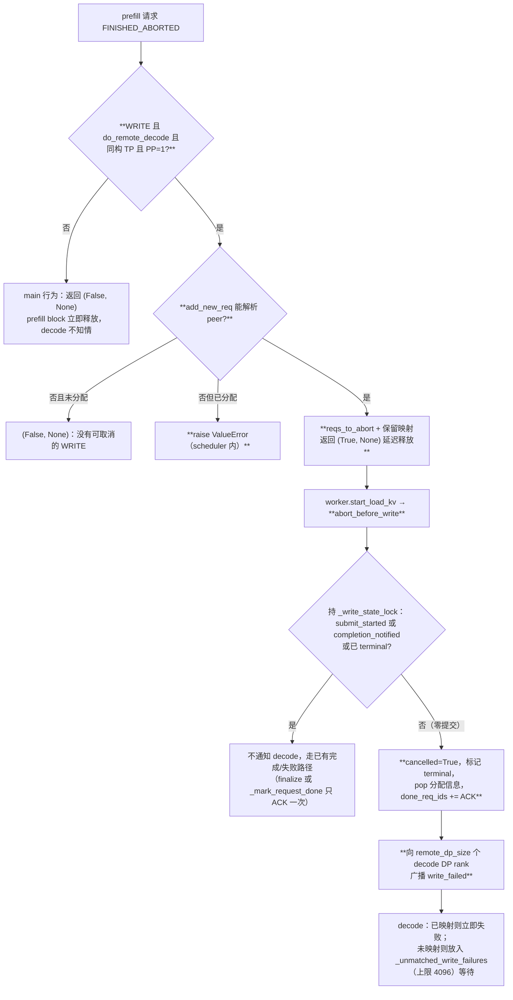
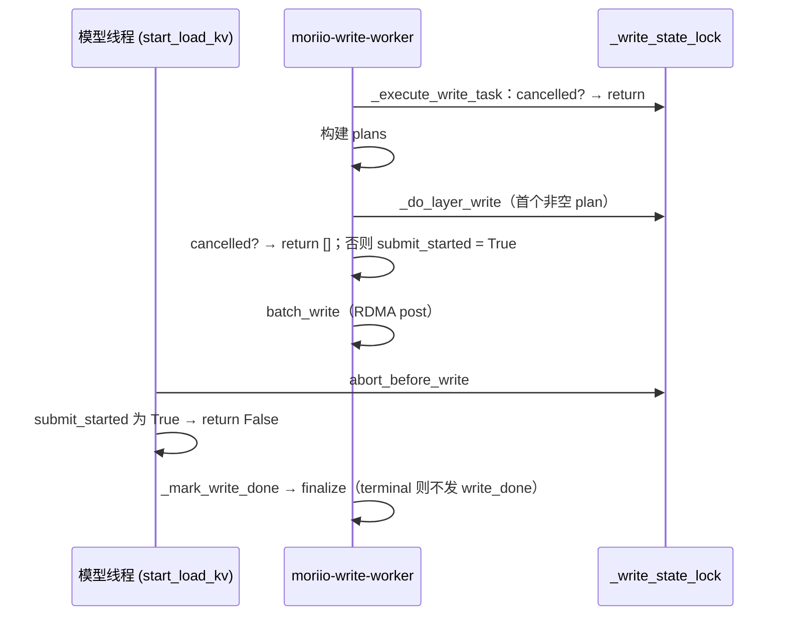

# PR #60852: [Bugfix][MoRIIO] Handle WRITE cancellation before submission

> **Author**: @yuzhouo7 | **State**: OPEN | **Date**: 2026-10-09（最后更新 2026-11-22）
> **Branch**: `fix/moriio-zero-submit-cancel-20261009` → `main` | **Labels**: bug, kv-connector（`needs-rebase` 已于 11-21 移除）
> **Changes**: +536 -42 lines across 11 files（merge base `c2fb5c5aba`，2026-11-21；与当前 main 无冲突）| **ROCm 相关性**: 完全相关（MoRIIO KV connector，ROCm 专属 PD 分离传输）
> 本报告分两部分：§1–6 为 PR 详细总结，§7–8 为 ROCm review 意见。

> **复审说明**：本报告是复审。上一版 review 针对旧 head `92740a0`（2026-11-20，结论 needs-work）。之后作者 force-push 了两个 commit：`ba44da7`（原修复 rebase 到含 #59058 正式版和 #64574 的 main）和 `16aaf7c`（"Narrow pre-submit WRITE cancellation"）。收窄提交删掉了 consumer 侧新增的三套去重状态（`_reported_write_transfers`、`_completed_write_transfers`、late-allocation 补发 `write_failed` 的 `_aborted_write_endpoints`）和 `_fail_deferred_task`，把提交闸门从"每个 task 一次"移到 `_do_layer_write`（空 plan 不再关闭闸门），并让 abort 在 decode 尚未分配时按配置的 peer 路由广播 `write_failed`。PR 描述新增了一次 GPU smoke（Qwen3-32B，TP1→TP1，单机 RDMA loopback）。
> **上一轮问题处理情况**：已解决：① rebase 后 `_resolve_notify_endpoint(ReqMeta)` 的 AttributeError（现在按 `isinstance(ReqMeta)` 读 `tp_size`/`remote_host`）；② 与 #58962/#64154 的去重集合重复，以及 #65712 改成 OrderedDict 后的 `TypeError`（本 PR 已不再修改 consumer 的 `get_transfer_results`）。部分解决：③ 测试（新增 GPU smoke，新测试标了 `cpu_test`，但 CI 仍未运行，未覆盖 TP>1/DP>1）；④ 与 #64154 的 `_mark_request_done` 契约冲突（去重部分已消失，契约分歧仍在，降为 📝）。仍然存在：⑤ 异构 TP/PP 回退无日志（📝）；⑥ 按线程缓存 ZMQ socket 未在描述中说明（📝）。本轮新增 2 条 📝。

---

## 1. 总结 (Summary)

在 MoRIIO WRITE 模式下，prefill（producer）请求被 abort 后，main 直接释放 prefill block，decode 侧收不到任何消息，会一直卡在 `WAITING_FOR_REMOTE_KVS`（#59114 类 hang）；已排队的 WRITE 任务还可能读取已释放的 prefill block。本 PR 给每个 transfer 引入一个共享的提交闸门 `WriteTransferState(submit_started, cancelled)`。如果 abort 抢在第一次真正的 RDMA 提交之前（零提交），就取消 transfer，向 decode 发 `write_failed`，并由 worker 发一次 release ACK 释放 prefill block。只要可能已经提交过，就不通知 decode，沿用已有的完成/失败路径，只释放一次 prefill block。取消只对同构 TP 且 PP=1 生效。收窄后的版本只改 producer 侧，consumer 侧完全沿用 main 的逻辑。

## 2. 背景与动机 (Background & Motivation)

- WRITE（PUSH）模式中，decode 先分配 block，并通过 ZMQ 把 block id 发给 prefill；prefill 在最后一个 prefill chunk 的 forward 中逐层用单边 RDMA 写入 decode，全部完成后发 `write_done`。decode 在收到 `write_done` 前一直把请求挂在 `WAITING_FOR_REMOTE_KVS`。
- 在 main 上，prefill 请求 abort 时 `request_finished` 走 `status != FINISHED_LENGTH_CAPPED` 分支，返回 `(False, None)`，不会通知 decode。
- #59058（consumer abort 后保留映射）已以 `c3310a8890` 合入，#64574（DP×TP 端口偏移）也已合入，本 PR 现在基于包含这两者的 main（`c2fb5c5aba`）。相关 PR 包括 #58962（decode 超时）和 #64154（fence 卡住的 producer），PR 描述明确把超时和 fence 留给这两个 PR。
- 收窄提交的动机（来自 commit message）：decode 尚未分配时按配置的 peer 路由取消；空 WRITE plan 不关闭闸门；取消与正常完成串行化，保证 prefill 只 ACK 一次；复用 main 已有的 terminal 通知去重，不再自建 consumer 侧状态。
- PR 声明使用了 Claude 和 Codex 辅助。

## 3. 代码修改分析 (Code Change Analysis)

### 3.1 修改的模块

| 文件 | 改动 |
|------|------|
| `moriio/moriio_common.py` (+25) | 新增 `WriteTransferState`、`supports_zero_submit_abort(local_tp, remote_tp, pp)`；`WriteTask`/`ReqMeta` 新增 `transfer_state` 字段；`MoRIIOConnectorMetadata.reqs_to_abort` |
| `moriio/moriio_connector.py` (+73) | 调度器 `request_finished`：producer WRITE 请求在 `FINISHED_ABORTED` 且被准入时，优先取 `_req_kv_params` 快照，调用 `fill_remote_pod_from_config` 后生成 abort meta，清理 save/pending/send 状态，保留映射并写入 `_deferred_send_deadlines`，返回 `(True, None)`；peer 地址无法解析且未分配时退回 `(False, None)`。worker：`start_load_kv` 对 `reqs_to_abort` 调用 `abort_before_write`；`save_kv_layer` 对被准入的 meta 先 `bind_transfer`；`_write_blocks_for_req` 跳过已取消的请求 |
| `moriio/moriio_engine.py` (+154 -42) | `MoRIIOWriter`：新增 `_transfer_states`、`bind_transfer`、`abort_before_write`；`schedule_write`、写线程主循环、deferred 循环和 `_execute_write_task` 都检查 `cancelled`；`_do_layer_write` 在第一个非空 plan 提交前、在 `_write_state_lock` 下把 `submit_started` 置为 True；`_mark_request_done` 改为"只释放一次"并会置 `cancelled`；`_finalize_if_complete` 对已 terminal 的 transfer 不再发 `write_done`；`_resolve_notify_endpoint` 支持 `ReqMeta`。`MoRIIOWrapper`：`send_notify` 的 socket 缓存 key 改为 `(thread_id, path)`；`_handle_remote_blocks_message` 对 terminal transfer 直接 return |
| tests (+284) | 新增 `test_moriio_write_abort.py`（297 行，`cpu_test` 标记，12 个用例）；其余测试改用真实的 `MoRIIOWrapper()` 构造，并补上 `pp_size`/`_transfer_states` |

### 3.2 架构 / 流程图

prefill 侧 abort 判定（本 PR 新增部分加粗）：



写线程与 abort 的串行化（收窄后闸门位于 `_do_layer_write`）：



### 3.3 关键实现细节

- **闸门位置**：收窄前，闸门在 `_execute_write_task` 中构建完 plans 后统一置位；现在下沉到 `_do_layer_write`，空 plan（如 decode prefix cache 已全部命中、`num_skip_blocks` 覆盖整层）直接返回 `[]`，不关闭闸门。`test_empty_plan_does_not_close_submission_gate` 覆盖了这一点。
- **只 ACK 一次**：`abort_before_write`、`_mark_request_done`、`fail_unallocated_write` 和 `_finalize_if_complete` 都在 `wrapper.lock` 下"检查 terminal + 标记 terminal + 追加 ACK"，所以无论谁先到，prefill 只收到一个 ACK。`abort_before_write` 额外检查 `completion_notified`，避免和正在等待 RDMA 完成的 finalize 抢 ACK。
- **删除 `_fail_deferred_task` 是安全的**：deferred 任务表示分配信息尚未到达；而任何一次提交都需要分配信息，所以 `fail_unallocated_write` 成功（分配不存在且未 terminal）就意味着不可能有提交。
- **锁序**：`_write_state_lock → wrapper.lock` 保持一致，没有找到反向加锁的路径。
- **同构 TP 1:1 推理成立**：`_producer_targets` 在 `consumer_tp == producer_tp` 时 ratio=1，每个 prefill rank 只写同号 decode rank（MLA 也一样），所以"本 rank 零提交"足以证明对应的 decode rank 安全。
- **`_resolve_notify_endpoint`**：现在接受 `WriteTask | ReqMeta`，用 `isinstance` 选择 `remote_host`/`remote_ip` 和 `tp_size`/`remote_tp_size`，端口仍按 #64574 的 `get_port_offset(dp, tp_rank, remote_tp)` 计算。

## 4. 涉及的技术原理 (Technical Principles)

- **单边 RDMA 写的安全回收**：RDMA WRITE 由发起方 NIC 直接写入远端注册内存，接收方 CPU 不参与。只有在 (a) 根本没有 post 过（本 PR 的零提交）、(b) 所有 WR 都已完成（`write_done`）、或 (c) 接收方撤销了对端访问权（fence，#64154）时，decode block 才能安全复用。MoRI 的 `ibv_post_send` 中途失败时，已 post 的 WR 仍在队列中，所以"提交抛异常"也必须当作"可能已提交"。
- **WRITE 模式只在最后一个 chunk 写**：`build_connector_meta` 只在 `_is_final_prefill_chunk` 时把请求放进 `reqs_to_save`，所以一个 transfer 的全部 layer 写都发生在同一个 step。abort 落在最后一个 chunk 之前，一定是零提交；落在之后，则取决于写线程是否已经 post。
- **调度器延迟释放**：WRITE 模式的 `update_connector_output` 不会按超时回收（只有 READ 会），prefill block 完全依赖 worker 的 ACK。所以每条被准入的 abort 路径都必须保证 worker 最终会发出 ACK。本 PR 的四条 terminal 路径共用同一个 terminal 检查，可以保证这一点。
- **decode 侧的早到失败缓冲**：main 的 consumer 把尚未映射的 `write_failed` 放进 `_unmatched_write_failures`（OrderedDict，上限 4096），等 transfer 映射建立后再报失败。收窄版本依赖这一机制处理"abort 早于 decode 分配"的情况。

## 5. 评论区讨论亮点 (Discussion Highlights)

- **okorzh-amd（11-11）**：指出早期版本在 `submit_started` 后抛异常会漏发 release ACK。作者改为"可能已提交后的失败仍释放一次 prefill block，只是不通知 decode"，并补了回归测试（当前 `test_possible_submit_failure_releases_source_only`）。
- **okorzh-amd 的冲突清单**：#59058 STACKED（现已合入，本 PR 已 rebase）；#64154 CONFLICT（其 fence 路径依赖 `_mark_request_done` 返回 bool）；#62552 CONFLICT；#58962 ALTERNATIVE；#65822 需保留 `num_skip_blocks`（已保留）。
- **11-20 之后**：没有新的人工 review 评论或作者回复。只有作者 11-21 的 rebase force-push（`92740a0 → ba44da7`）和 11-22 的收窄提交；mergify 移除了 `needs-rebase`。PR 描述更新为：CPU 12 个聚焦用例通过，其中 3 个在 `ba44da7` 上失败、在 `16aaf7c` 上通过；另有一次 GPU smoke（Qwen3-32B，TP1/TP1，单机 RDMA loopback，排队时和分配后取消均为 0 次 WRITE、两侧各 1 次 ACK/释放；正常传输和提交后对照组各 64 次提交）。作者自己注明这只是候选版本的 smoke，不是 A/B，也不覆盖跨机和 DMA fence。

## 6. 风险与潜在问题 (Risk Analysis)

| 风险 | 严重程度 | 说明 |
|------|---------|------|
| CI 未运行，硬件验证只有 TP1/TP1 单机 | Medium | 见 §7 ⚠️【测试】 |
| abort 广播 `write_failed` 污染其他 decode DP rank 的早到失败缓冲 | Low | 见 §7 📝【设计】；大 DP、abort 风暴下有理论上的淘汰风险 |
| 与 #64154 的 `_mark_request_done` 契约分歧 | Low | 见 §7 📝【设计】；去重集合冲突已随收窄消失 |
| 已分配但 peer 无法解析的请求在 abort 时让 scheduler 抛异常 | Low | 见 §7 📝【正确性】 |
| 异构 TP / PP>1 abort 仍沿用 main 行为 | Low | 见 §7 📝【设计】 |
| 并发与锁序 | Low | 已核对：只 ACK 一次，锁序一致，闸门不可逆，删除 `_fail_deferred_task` 不引入新竞态 |
| 可维护性 | Low | 收窄后状态面明显缩小（consumer 侧零新增状态）；`isinstance` 分派、按线程缓存 socket 未在描述中说明 |

---

## 7. Review 意见 (Findings)

| 类型 | 🔴 | ⚠️ | 📝 |
|------|----|----|----|
| 测试 | — | 1 | — |
| 设计 | — | — | 3 |
| 正确性 | — | — | 1 |
| 可维护性 | — | — | 1 |

整体看：收窄后的实现比上一版简洁很多，producer 侧的四条 terminal 路径共用一个"检查 terminal + 标记 + ACK"的临界区，consumer 侧完全复用 main 的逻辑。我逐行核对了 abort 与首次提交、abort 与正常 finalize、abort 与 deferred 超时三组竞态，都只有一个赢家，prefill 也只收到一次 ACK。上一轮的两条主要问题（rebase 后的 AttributeError、去重集合重复与 #65712 的类型冲突）都已解决。剩下的主要是验证范围问题，以及几处可以顺手改进的细节。

---

**⚠️【测试】CI 仍未运行，硬件验证只覆盖 TP1→TP1 单机 loopback，没有覆盖 DP>1/TP>1 的 abort 路由** `[已验证]`

- **问题**: 当前 head 的 pre-run-check 失败（没有 `ready` label），pre-commit 和 Buildkite（包括 `.buildkite/test-amd.yaml` 中的 MoRIIO 单测 step）都被跳过。PR 描述中的 GPU smoke（Qwen3-32B，TP1/TP1，单机 RDMA loopback）和"12 个用例通过"来自作者本地，没有附日志，属于 `[unverified]`。用例数与 `test_moriio_write_abort.py` 的参数化展开结果（12 个）一致。新的 abort 路由在 decode 尚未分配时会向 `remote_dp_size` 个 rank 广播，并按 `(dp, tp_rank, remote_tp)` 计算端口（`moriio_engine.py:202-205, 814-827`），但硬件上只跑了 DP=1、TP=1，正好是端口偏移为 0 的情况。CPU 用例 `test_abort_before_alloc_uses_configured_peer_pods` 用 mock 校验了 DP=16、TP=2 的端口，但没有真实的 ZMQ/RDMA。
- **影响**: 端口或 host 计算一旦出错，`write_failed` 会发到错误的 decode rank，原本的 decode hang 依然存在，而且没有任何报错（`send_notify` 只在连接失败时记日志）。
- **行动**: 建议请 maintainer 加 `ready` 并触发 AMD MoRIIO 单测（`/amd-ci run`）。至少做一次 TP≥2（最好再加 DP≥2）的 1P1D WRITE abort 压测，覆盖排队时 abort 和分配后 abort 两种情况，并附上 decode KV 使用率回落、无 `WAITING_FOR_REMOTE_KVS` 残留的日志。

**📝【设计】分配信息已到时仍向所有 decode DP rank 广播 `write_failed`，会占用其他 rank 的早到失败缓冲** `[已验证]`（影响部分为 `[推测]`）

- **问题**: `abort_before_write`（`moriio_engine.py:202-205`）总是对 `range(max(meta.remote_dp_size, 1))` 中的每个 rank 解析端点并发送 `write_failed`，即使 `done_remote_allocate_req_dict` 里已经有该 transfer 的 `decode_dp_rank`（第 222 行把它 pop 掉了，但没有使用）。收窄提交还删除了上一版"分配迟到时补发 `write_failed`"的逻辑，所以"abort 早于 decode 分配"的情况现在完全依赖 decode 侧 `_unmatched_write_failures`（上限 4096，FIFO 淘汰）来暂存这条失败。
- **影响**: 每次 abort 都会在另外 DP-1 个 decode rank 上留下一条永远匹配不上的记录。在大 DP（例如 DP=16）加上集中 abort（客户端批量断开）的场景下，某个真正属于该 rank、但 decode 还没建立映射的失败，可能先被淘汰，对应的 decode 请求就会重新卡住。这需要短时间内出现约 4096 条未匹配失败，正常负载下不太会触发。
- **行动**: 建议作者在已有分配信息时只通知 `info.decode_dp_rank`，只有未分配时才广播；或者在 docstring 中写明对 decode 侧缓冲上限的依赖。

**📝【设计】`_mark_request_done` 的新契约仍与 #64154 冲突，合入顺序需要约定** `[已验证]`

- **问题**: 本 PR 把 `_mark_request_done`（`moriio_engine.py:377-394`）定为"只释放一次、不通知 decode、返回 None"，并在其中置 `cancelled`。#64154（draft）把同一函数改为返回 `bool`，并在 `_fail_transfer`、fence 路径中依赖这个返回值（`refs/pr-review/64154` 中 `moriio_engine.py:313, 338, 394, 759`）。trial merge 在 `moriio_engine.py`/`moriio_connector.py`/`moriio_common.py` 上都有冲突。上一轮提到的去重集合重复（#58962、#64154）以及 #65712 的 `OrderedDict - set` 问题，随收窄提交已经不存在。
- **影响**: 后合入的一方需要手工合并这个函数；如果合并时选错了一边，要么漏 ACK，要么在可能仍有写入时通知 decode 复用 block。
- **行动**: 建议作者在 PR 描述中写明"可能已提交 → 不通知 decode"是 #64154 需要遵循的基线，并和 #64154 作者约定由谁适配返回值。

**📝【正确性】已分配但 peer 地址无法解析的请求，abort 时会在 scheduler 的 `request_finished` 中抛出 `ValueError`** `[已验证]`

- **问题**: `moriio_connector.py:1721-1723` 在 `add_new_req` 抛 `ValueError` 时，如果 `request_id in self._req_kv_params`（即已经 `update_state_after_alloc`），会原样 re-raise。`request_finished` 运行在 EngineCore 的调度循环中。
- **影响**: 触发条件是：request_id 没有内嵌 peer zmq 地址，`kv_transfer_params` 又缺少 `remote_host`/`remote_handshake_port`/`remote_notify_port`，而且请求在最后一个 chunk 之前被 abort。在 main 上，这类请求只有走到最后一个 chunk 的 `build_connector_meta` 时才会抛异常；abort 时则直接释放。本 PR 把 abort 也变成了让 EngineCore 崩溃的路径。这需要配置错误才会触发，所以只记为备注。
- **行动**: 建议作者改为记录 warning 并回退到 `(False, None)`（即 main 的行为），不要在 abort 清理路径上抛异常。

**📝【设计】异构 TP 和 PP>1 的 abort 仍沿用 main 行为，回退时没有日志**（上一轮遗留）`[已验证]`

- **问题**: `supports_zero_submit_abort` 对 `remote_tp != local_tp` 或 `pp_size > 1` 返回 False，这些请求在 `request_finished` 中仍走到 `moriio_connector.py:1784` 的 `(False, None)`，不打任何日志。
- **影响**: 在这些拓扑下，abort 仍会让 decode 卡住（只能靠 #58962 的超时兜底），已排队的写任务也仍可能读取已释放的 prefill block。这不是本 PR 引入的回归，但现在从日志上无法区分两种行为。
- **行动**: 建议在准入失败时加一条 debug 日志，并在 PR 描述或 issue 中跟踪异构 TP / PP 的后续方案。

**📝【可维护性】按线程缓存 ZMQ socket 是一个独立的修复，描述中仍未说明**（上一轮遗留）`[已验证]`

- **问题**: `send_notify` 的缓存 key 改为 `(threading.get_ident(), path)`（`moriio_engine.py:1364`）。在 main 上，写线程和模型线程（`seal_pending_transfers → _finalize_if_complete`）本来就可能共用同一个 DEALER socket，所以这修的是一个早已存在的线程安全问题。现在的 PR 描述没有提到这一点。
- **行动**: 建议在描述的 Behavior 部分单独列出这一点，方便 #64154、#66008 复用和审阅。

## 8. 结论 (Verdict)

**⚠️ NEEDS WORK**

收窄后的零提交取消实现正确，范围也合适：同一把锁串行化取消与首次提交，闸门不可逆，四条 terminal 路径保证 prefill 只 ACK 一次，可能已提交时绝不让 decode 复用 block；consumer 侧不再新增状态。上一轮的 rebase AttributeError 和去重集合冲突都已解决。剩下的阻碍是验证：CI 没有跑过，硬件上只验证了 TP1/TP1 单机。触发 AMD MoRIIO 单测并补一次 TP≥2（最好 DP≥2）的 abort 压测后，可以合入。几条 📝 可以顺手处理。

## 9. 英文 Review 评论 (Copy-Paste English Comments)

**C1** `tests/v1/kv_connector/unit/moriio/test_moriio_write_abort.py:1` — ⚠️ comment

```text
The narrowed version reads well, and the rebase fixed the ReqMeta port lookup. CI has not run on this head yet (pre-run-check, so the AMD MoRIIO unit step was skipped), and the GPU smoke covers only TP1 -> TP1 on one host, where the DP/TP port offset is zero. The new abort routing broadcasts write_failed to every decode DP rank using get_port_offset(dp, tp_rank, remote_tp), so a wrong port would silently leave decode hanging. Could a maintainer add `ready` and run the AMD MoRIIO tests? Could you also run one TP>=2 (ideally DP>=2) 1P1D WRITE abort test, with aborts both while queued and after allocation, and attach logs showing decode KV usage returning to baseline?
```

**C2** `vllm/distributed/kv_transfer/kv_connector/v1/moriio/moriio_engine.py:202-205` — ⚠️ comment

```text
When the allocation has already arrived, `done_remote_allocate_req_dict` holds the decode DP rank, but this still sends write_failed to all `remote_dp_size` ranks. Every abort then leaves an entry that will never match in the other ranks' `_unmatched_write_failures`, which holds at most 4096 entries. The late-allocation re-send was removed in this revision, so a pre-allocation abort now relies entirely on that buffer. With a large decode DP and a burst of aborts, a real pending failure could be evicted. Could you notify only `info.decode_dp_rank` when the allocation is known, and broadcast only when it is not?
```

**C3** `vllm/distributed/kv_transfer/kv_connector/v1/moriio/moriio_connector.py:1721-1723` — ⚠️ comment

```text
For an allocated request whose peer address cannot be resolved, this re-raises the ValueError from `request_finished`, which runs in the EngineCore scheduler loop. On main the same request is simply freed when it is aborted before its final chunk, so this turns a misconfigured-but-aborted request into an engine crash. Could you log a warning and fall back to `(False, None)` instead? That matches the previous abort behavior and keeps cleanup from raising.
```

**C4** `vllm/distributed/kv_transfer/kv_connector/v1/moriio/moriio_engine.py:377-394` — ⚠️ comment

```text
I agree with this contract: after a possible submit, release the source once and never tell decode to reuse its blocks. #64154 (draft) changes this helper to return a bool, and its `_fail_transfer` and fence paths rely on that return value, so the two PRs conflict here. Could you state this contract in the PR description as the baseline #64154 should follow, and agree with its author on who adapts the return type?
```

## 10. 英文总结评论 (Overall Review Summary)

```text
The narrowed zero-submit cancellation looks correct. Cancellation and the first post are serialized under one lock, every terminal path ACKs prefill exactly once, decode is never told to reuse blocks after a possible submit, and the consumer side now reuses main's logic. The rebase also fixed the earlier ReqMeta port lookup. Before merge: run the AMD MoRIIO tests and one TP>=2 (ideally DP>=2) hardware abort test. Also consider notifying only the known decode DP rank instead of broadcasting, and not raising from request_finished on unresolvable peers. Approve after the validation.
```
