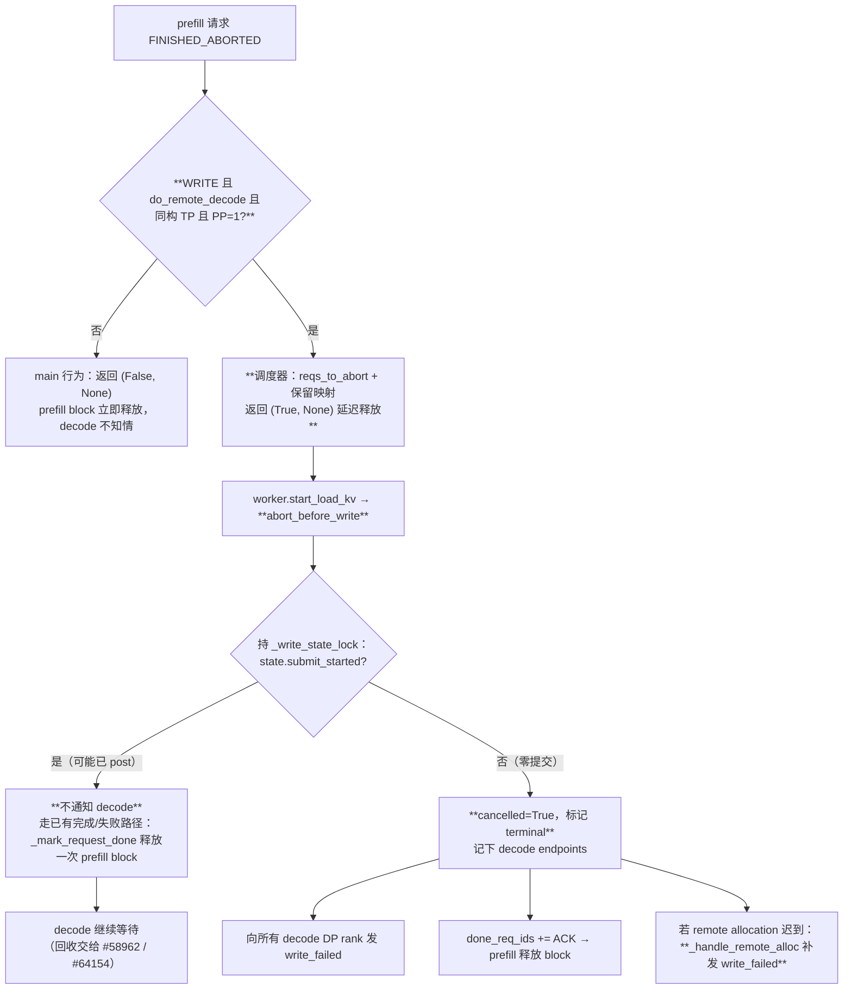
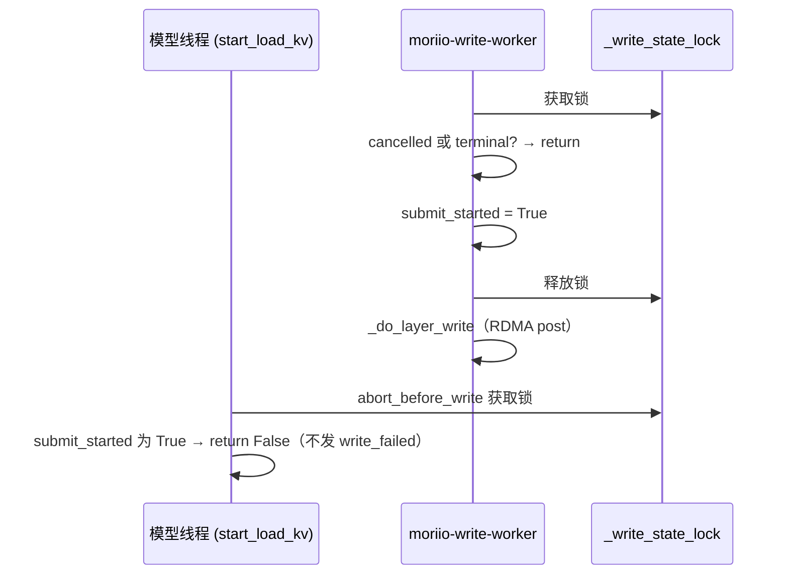

# PR #60852: [Bugfix][MoRIIO] Handle WRITE cancellation before submission

> **Author**: @yuzhouo7 | **State**: OPEN | **Date**: 2026-10-09（最后更新 2026-11-14）
> **Branch**: `fix/moriio-zero-submit-cancel-20261009` → `main` | **Labels**: bug, needs-rebase, kv-connector
> **Changes**: +1016 -53 lines across 12 files（相对旧 merge base `f5d93296`，其中包含一份旧版 #59058）| **ROCm 相关性**: 完全相关（MoRIIO KV connector，ROCm 专属 PD 分离传输）
> 本报告分两部分：§1–6 为 PR 详细总结，§7–8 为 ROCm review 意见。

---

## 1. 总结 (Summary)

MoRIIO WRITE 模式下，prefill（producer）请求被 abort 时，main 直接释放 prefill block，排队中的 WRITE 任务和 decode 侧都得不到明确结果，decode 请求会一直停在 `WAITING_FOR_REMOTE_KVS`（#59114 一类的 hang）。本 PR 给每个 transfer 加了一个跨 target、跨 layer 共享的"提交闸门" `WriteTransferState(submit_started, cancelled)`。abort 时如果还没有任何 RDMA 提交（zero-submit），就零写入地取消 transfer，给 decode 发 `write_failed`，并给 prefill 发一次 release ACK。一旦可能已经提交过，就绝不通知 decode 复用 block，只按 main 的老路径释放一次 prefill block，decode 侧的回收留给 #58962 / #64154。取消只对同构 TP 且 PP=1 生效，其他拓扑保持 main 行为。

## 2. 背景与动机 (Background & Motivation)

- WRITE（PUSH）模式中，decode 先分配 block 并通过 ZMQ 把 block id 发给 prefill，prefill 每层 forward 后用单边 RDMA 把 KV 写入 decode，最后发 `write_done`。decode 在收到 `write_done` 之前一直把请求挂在 `WAITING_FOR_REMOTE_KVS`。
- 在 main 上，prefill 请求 abort 时 `request_finished` 走 `status != FINISHED_LENGTH_CAPPED` 分支，返回 `(False, None)`，prefill block 立即释放。decode 不会收到任何消息。此外，如果此时 WRITE 任务已经排队，它们仍可能从已释放（可能已被复用）的 prefill block 读数据。
- PR 依赖 #59058（consumer abort 后保留 transfer 映射）。#59058 已于 2026-11-20 以 `c3310a8890` 合入 main，但本 PR 捆绑的是它更早的版本（`a2aa2c9b`）。相关 PR 包括 #59382（生命周期拆分）、#58962（decode 超时）、#64154（fence 卡住的 producer）。
- PR 描述把"未验证"的范围写得很清楚：GPU/serving、DMA fence、部分提交后的 decode 复用、异构 TP/PP 取消、transfer id 复用都没有验证。PR 声明使用了 Claude 和 Codex 辅助。

## 3. 代码修改分析 (Code Change Analysis)

### 3.1 修改的模块

下表只列本 PR 自身的 3 个 commit（`a2aa2c9b..92740a08`），不含捆绑的 #59058。

| 文件 | 改动 |
|------|------|
| `moriio/moriio_common.py` (+28 -1) | 新增 `WriteTransferState`、`supports_zero_submit_abort(local_tp, remote_tp, pp)`；`WriteTask`/`ReqMeta` 增加 `transfer_state` 字段；`MoRIIOConnectorMetadata.reqs_to_abort`；`add_new_req(..., abort_write=)` |
| `moriio/moriio_connector.py` (+91 -3) | 调度器：producer WRITE 请求 `FINISHED_ABORTED` 且被准入时，生成 abort meta，保留映射并返回 `(True, None)`，即延迟释放、等 worker 的 ACK。worker：`start_load_kv` 中对 `reqs_to_abort` 调 `abort_before_write`；`reqs_to_save` 先 `bind_transfer`；consumer 侧新增 `_reported_write_transfers`（每个 worker 对同一 transfer 只投一票）和 `_completed_write_transfers`（上限 4096，丢弃迟到的重复 `write_failed`） |
| `moriio/moriio_engine.py` (+164 -41) | `MoRIIOWriter`：`schedule_write`/`_execute_write_task`/deferred 路径都检查 `cancelled`；每个 target 第一次 post 前，在 `_write_state_lock` 下置 `submit_started=True`；新增 `abort_before_write`、`bind_transfer`、`_fail_deferred_task`；`_mark_request_done` 对已 terminal 的 transfer 不再重复 ACK。`MoRIIOWrapper`：remote allocation 迟到时，对已 abort 的 transfer 补发 `write_failed`；`send_notify` 的 DEALER socket 改为按 `(thread_id, path)` 缓存 |
| tests (+531 -2) | 新增 `unit/moriio/test_moriio_write_abort.py`（348 行，14 个用例），`test_moriio_unmap.py` +174，其余为给 `__new__` 构造的对象补属性 |

### 3.2 架构 / 流程图

prefill 侧 abort 判定（本 PR 新增部分加粗）：



写线程与 abort 的串行化：



### 3.3 关键实现细节

- **闸门不可逆**：`submit_started` 只会被置为 True，从不复位；所有 target 和 layer 共用 `_transfer_states[transfer_id]` 这一个对象。注释明确写了 "A submit attempt is irreversible here: even an exception can leave partially posted writes"。
- **锁序**：`abort_before_write`、`_mark_request_done`、`_fail_deferred_task` 都按 `_write_state_lock → wrapper.lock` 的顺序加锁；`schedule_write`/`_execute_write_task` 在 `_write_state_lock` 内调用 `_is_transfer_terminal`，后者再取 `wrapper.lock`。我没有找到反向加锁的路径。
- **准入一致**：调度器用 `supports_zero_submit_abort(self.tp_size, remote_tp, pp_size)`，worker 用 `supports_zero_submit_abort(world_size, meta.tp_size)`（`world_size` 即 TP world size）。两边都把 `remote_tp_size or tp_size or 0` 解析为对端 TP，0 视为同构。
- **为什么只允许同构 TP**：同构 TP 下 prefill rank i 只写 decode rank i。即使不同 rank 一个已提交、一个被取消，decode 各 rank 的 block 也只会被各自对端写入，所以"rank 级零提交"足以证明该 decode rank 的 block 安全。异构 TP 时一个 decode rank 有多个写者，这一推理不成立。
- **consumer 去重**：`done_recving = _unmatched_write_completions - _reported_write_transfers`；同一次 poll 中 failure 优先于 success；`_reported_write_transfers` 在每次 `start_load_kv` 时与 live 映射求交集。
- **`send_notify` 按线程分 socket**：abort 回复可能来自模型线程（`start_load_kv`）、notify 监听线程（迟到的 allocation）和写线程，而 ZMQ socket 不是线程安全的。这其实是一个独立的修复。

## 4. 涉及的技术原理 (Technical Principles)

- **单边 RDMA 写的安全回收**：RDMA WRITE 由发起方 NIC 直接写入远端注册内存，接收方 CPU 不参与。因此 decode 侧"超时"不能证明不会再有写入。只有 (a) 根本没有 post 过（本 PR 的 zero-submit），(b) 所有 WR 都已完成（`write_done`），或 (c) 接收方撤销对端访问权（fence，#64154 / ROCm/mori#848）三种情况下，decode block 才能安全复用。
- **WRITE 模式的 block 生命周期**：decode 在 `update_state_after_alloc` 分配 block 并通知 prefill；scheduler 对仍处于 `WAITING_FOR_REMOTE_KVS` 的已结束请求延迟释放 block，直到 `finished_recving`（#59058/#59382）。prefill 侧通过 `request_finished` 返回 `delay_free_blocks=True`，并等 worker 的 release ACK（`finished_sending`）。
- **KVOutputAggregator 计数语义**：聚合器按"报告次数"递减 `expected_finished_count`，不区分来源 worker。同一 worker 对同一请求重复上报，会被当成另一个 worker 的一票，所以本 PR 以及 #58962、#64154 都在 worker 侧做"每个 worker 只报一次"的去重。
- **ZMQ socket 线程安全**：同一个 DEALER socket 不能被多个线程同时使用。按线程缓存 socket 是最简单的隔离方式。

## 5. 评论区讨论亮点 (Discussion Highlights)

- **okorzh-amd（11-11）指出了一个回归**：早期版本中，`submit_started` 置位后再抛异常会直接 return，不再发 release ACK，导致 prefill block 泄漏（`has_pending_push_work` 一直为真）。作者修正为"可能已提交后的失败仍按 main 释放一次 prefill block，只是不通知 decode"，并补了 submit 出错以及后续 target/layer 失败的回归测试。
- **okorzh-amd 指出旧测试用 `__new__` 构造对象**：8 个用例因缺 `_reqs_need_abort` 或 `.mode` 失败。作者已修，但说明只在 CPU 上直接调用了这些函数，**没有在 ROCm 上用 pytest 重跑**。
- **okorzh-amd 的冲突清单**：#59058 STACKED（捆绑的是旧版）；#64154 CONFLICT（它的 fence 路径依赖 `_mark_request_done` 的"释放"语义，其 `_fail_transfer` 是通知 decode 的模型）；#62552 CONFLICT；#58962 ALTERNATIVE；#65822 冲突时需要保留 `num_skip_blocks`。作者在 11-11 合了当时的 main 和 #59058 head，并把取消限制在 PP=1（因为 #64693 已合入）。
- 之后 #59058 以另一个修订版本合入了 main（`c3310a8890`），#64574 也已合入，当前 head 与 main 重新冲突（见 §7）。

## 6. 风险与潜在问题 (Risk Analysis)

| 风险 | 严重程度 | 说明 |
|------|---------|------|
| rebase 到当前 main 后 abort 路径会抛 AttributeError | Medium | 见 §7 ⚠️【兼容性】`_resolve_notify_endpoint` 读取 `ReqMeta` 上不存在的 `remote_tp_size` |
| 与 #58962 / #64154 / #65712 / #64785 / #66008 改同一批函数 | Medium | 见 §7 ⚠️【设计】三套"每个 worker 只报一次"集合，以及两种对立的"何时可以通知 decode"策略 |
| 无 GPU / serving 验证，CI 未运行 | Medium | 见 §7 ⚠️【测试】 |
| 异构 TP / PP>1 abort 保持 main 行为 | Low | 见 §7 📝【设计】；这些拓扑下 abort 仍可能导致 decode hang，以及排队写读取已释放的 prefill block |
| 并发与锁序 | Low | 已核对：锁序一致，`submit_started` 不可逆，零提交判定与首次 post 在同一把锁下串行 |
| 可维护性 | Low | 新增 4 个 OrderedDict/set 以及上限常量，状态面继续扩大 |

---

## 7. Review 意见 (Findings)

| 类型 | 🔴 | ⚠️ | 📝 |
|------|----|----|----|
| 兼容性 | — | 1 | — |
| 设计 | — | 1 | 1 |
| 测试 | — | 1 | — |
| 可维护性 | — | — | 1 |

整体看：零提交闸门的核心逻辑我逐行核对过，是对的。`submit_started` 与 `cancelled` 在同一把 `_write_state_lock` 下判定，首次 post 前置位且不可逆；"可能已提交就不通知 decode"的策略与 MoRI 的部分 post 语义一致（MoRI `src/io/rdma/common.cpp` 中 `ibv_post_send` 中途失败时，已 post 的 WR 仍在队列里）。同构 TP 1:1 写入的推理也成立。主要问题在 rebase 以及与同批 PR 的协调上。

---

**⚠️【兼容性】rebase 到当前 main 后，`abort_before_write` 会在 `_resolve_notify_endpoint(ReqMeta)` 处抛 AttributeError** `[已验证]`

- **问题**: 本 PR 把 `_resolve_notify_endpoint` 的参数放宽为 `WriteTask | ReqMeta`（`moriio_engine.py:782`），由 `abort_before_write`（`:197`）传入 `ReqMeta`。当前 main 已合入 #64574，同一函数改成了 `get_port_offset(..., tp_rank, task.remote_tp_size or self.worker.world_size)`（main `moriio_engine.py:718-722`）。但 `ReqMeta` 是 `@dataclass(slots=True)`，只有 `tp_size` 字段，没有 `remote_tp_size`。如果按 main 解决这处冲突，abort 路径会抛 `AttributeError`。此外，捆绑的 #59058 是 `a2aa2c9b` 版，与 main 的 `c3310a8890` 不同。trial merge 显示本 PR 与 main 在 `test_moriio_unmap.py`（8 处）、`moriio_connector.py`（2 处）、`moriio_common.py`、`moriio_engine.py` 各有冲突。
- **影响**: `abort_before_write` 运行在 producer 的 `start_load_kv`（模型 runner 线程）。任何被准入的 WRITE abort 都会让这一步抛异常，后果比修复前的 hang 更重。
- **行动**: 作者应当 rebase 到包含 #59058 和 #64574 的 main，并让 `abort_before_write` 显式传入 decode TP（例如给 `_resolve_notify_endpoint` 增加 `remote_tp_size` 参数，从 `meta.tp_size or world_size` 取值），不要依赖 duck typing。另外建议补一个 DP>1、TP>1 的 abort 端口单测。

**⚠️【设计】与 #58962 / #64154 / #65712 / #64785 / #66008 改同一批函数：重复的去重机制和对立的 decode 通知策略需要先协调** `[已验证]`

- **问题**（均已用 `git diff` / `git merge-tree` 在各 PR ref 间核对）:
  1. **去重机制重复三份**：本 PR 在 WRITE consumer 的 `get_transfer_results` 中加入按 transfer id 的 `_reported_write_transfers`（`moriio_connector.py:1996, 3080, 3125-3130`）；#58962 在同一位置加入按 request id 的 `_write_recv_reported`；#64154 又加入 `_reported_recv_req_ids`。三者都是"每个 worker 对一个 receive 只报一次"，避免 `KVOutputAggregator` 把同一 worker 的重复报告当成另一票。本 PR 与 #58962 在 `moriio_connector.py` 上有 6 处冲突。
  2. **策略对立**：本 PR 的 `_mark_request_done`（`moriio_engine.py:378-383`）明确规定可能已提交后不通知 decode。#64154 则新增 `_fail_transfer`，在所有已记录的 status 都为 `Succeeded()` 或 `Failed()` 时发送 `write_failed`，让 decode 释放 block。#64154 的 `_finalize_if_complete` 还依赖 `_mark_request_done` 返回 bool，而本 PR 让它返回 None。两者在 `moriio_engine.py` 上有 6 处冲突，#64785 也重写了同样的两个 `except Exception:` 分支。
  3. **类型冲突**：#65712 把 `_unmatched_write_completions` 从 `set` 改成 `OrderedDict[TransferId, float]`。如果它先合入，本 PR 第 3080 行的 `self._unmatched_write_completions - self._reported_write_transfers` 会变成 `OrderedDict - set`，运行时抛 `TypeError`，而且这处很可能不会被 git 标为冲突。#66008 也改了 `send_notify` 的 socket 缓存，与本 PR 的 `(thread_id, path)` key 冲突。
- **影响**: 按任意顺序合入都需要人工重写这些函数；如果合并时取错一方，要么丢掉 `write_done`，要么让 decode 在仍可能有写入时释放 block。
- **行动**: 建议作者与 #58962、#64154 的作者先约定：(a) 只保留一个按 request id 的"已上报"集合，放在 `get_transfer_results` 中，供三个 PR 共用；(b) 以本 PR 的"可能已提交就不通知 decode"作为基线（#64154 的 reviewer 也基于 MoRI 部分 post 语义提出了同样意见）；(c) 合入顺序建议为 #60852 → #58962 → #64154，后合者在 rebase 时适配 `_mark_request_done` 的契约。

**⚠️【测试】没有 GPU / serving 验证，CI 未运行，ROCm 专属用例只在 CPU 上被直接调用过** `[已验证]`

- **问题**: CI 未运行（无 `ready` label，pre-run-check 失败，pre-commit 与 Buildkite 均被跳过）。PR 描述中的数字（`test_moriio_write_abort.py` 14 passed；MoRIIO 目录 845 passed / 44 skipped / 5 failed）来自作者本地 CPU venv，没有附日志，属于 `[unverified]`。作者回复 okorzh-amd 时说明：被 ROCm 门控的 connector 测试在 CPU 上会 skip，修复后只是直接调用了测试函数，**没有在 ROCm 上用 pytest 重跑**。描述中还把 "GPU/serving at this head" 列为未验证。
- **影响**: abort 路径涉及模型线程、写线程、notify 线程三方的时序，以及真实 MoRI session 上的 `write_failed` 投递，CPU 单测覆盖不到真实 RDMA 提交与 ZMQ 跨线程的行为。
- **行动**: 建议作者 rebase 后请 maintainer 触发 AMD MoRIIO 单测 step（`/amd-ci run`），并至少做一次 1P1D WRITE 的 abort 压测（例如客户端在 prefill 排队时断开），附上 decode 侧 KV 使用率回落和无 hang 的日志。

**📝【设计】异构 TP 和 PP>1 的 abort 仍沿用 main 行为，建议在回退时打日志并跟踪后续** `[已验证]`

- **问题**: `supports_zero_submit_abort` 对 `remote_tp != local_tp` 或 `pp_size > 1` 返回 False，于是这些请求在 `request_finished` 中仍走 main 路径：`status != FINISHED_LENGTH_CAPPED` 时返回 `(False, None)`，prefill block 立即释放。
- **影响**: 在这些拓扑下，abort 仍会让 decode 停在 `WAITING_FOR_REMOTE_KVS`（只能靠 #58962 的超时兜底）；如果写任务已经排队，它们仍会从已释放的 prefill block 读数据。这不是本 PR 引入的回归，但当前没有任何日志能区分这两种行为。
- **行动**: 建议作者在回退分支加一条 debug/warning 日志（说明拓扑不支持零提交取消），并在 PR 描述或 issue 中跟踪异构 TP / PP 的后续方案。

**📝【可维护性】按线程缓存 ZMQ socket 是一个独立的修复，建议在描述中单独说明** `[已验证]`

- **问题**: `send_notify` 的缓存 key 从 `path` 改为 `(threading.get_ident(), path)`（`moriio_engine.py:1345`）。在 main 上，`write_done` 可能由写线程（`_mark_write_done`）和模型线程（`seal_pending_transfers → _finalize_if_complete`）同时发送，共用同一个 DEALER socket，所以这次改动修的是一个早已存在的线程安全问题，不只是为 abort 服务。#64154 新增的 `fence_abort`/`fence_ack` 发送路径同样需要它。
- **行动**: 建议作者在 PR 描述的 Details 里单独列出这一点（或拆成单独的小 PR，方便 #64154 / #66008 复用）。

## 8. 结论 (Verdict)

**⚠️ NEEDS WORK**

零提交取消的设计是三个相关 PR 中最保守、也最符合单边 RDMA 语义的：同一把锁串行化，闸门不可逆，可能已提交时绝不让 decode 复用 block。代码逻辑没有发现阻塞性的正确性问题。但当前 head 落后于 main（#59058 已以另一版本合入，#64574 改了端口计算），直接 rebase 会让 abort 路径抛 AttributeError；同时需要和 #58962、#64154 统一去重集合和 decode 通知策略。完成 rebase 和协调、并在 ROCm 上跑过 MoRIIO 单测和一次 abort 压测后，可以合入。

## 9. 英文 Review 评论 (Copy-Paste English Comments)

**C1** `vllm/distributed/kv_transfer/kv_connector/v1/moriio/moriio_engine.py:782` — ⚠️ comment

```text
This branch needs a rebase. #59058 merged as a different revision (c3310a8890), and #64574 changed this helper on main to compute the port with `task.remote_tp_size or self.worker.world_size`. `ReqMeta` is a slots dataclass that only has `tp_size`, so if the conflict is resolved toward main, `abort_before_write` will raise AttributeError in the producer's `start_load_kv`, and every admitted WRITE abort will fail the step. Could you rebase onto current main and pass the decode TP size explicitly (e.g. a `remote_tp_size` argument filled from `meta.tp_size`) rather than relying on duck typing? An abort test with DP>1 and TP>1 would pin the port math.
```

**C2** `vllm/distributed/kv_transfer/kv_connector/v1/moriio/moriio_connector.py:3080` — ⚠️ comment

```text
#58962 (`_write_recv_reported`) and #64154 (`_reported_recv_req_ids`) each add their own "report each receive once per worker" set to this same block, so after merging there would be three sets with the same purpose. Separately, #65712 changes `_unmatched_write_completions` to an OrderedDict, and this set difference would then raise TypeError at runtime, which git may not flag as a conflict. Could you agree with the authors of #58962 and #64154 on a single per-worker reported set keyed by request id, and on a merge order, before either lands?
```

**C3** `vllm/distributed/kv_transfer/kv_connector/v1/moriio/moriio_engine.py:378-383` — ⚠️ comment

```text
I agree with the policy here: once a submit may have started, decode must not be told it can reuse its blocks, because MoRI can leave posted WRs queued when ibv_post_send fails partway. #64154 takes the opposite approach. Its `_fail_transfer` sends `write_failed` once every recorded status is Succeeded or Failed, and its finalize path relies on `_mark_request_done` returning a bool. Merging both as they are would either drop `write_done` or let decode free blocks that are still being written. Could you document this contract in the docstring as the baseline that #64154 must follow, and coordinate the order with its author?
```

**C4** `tests/v1/kv_connector/unit/moriio/test_moriio_write_abort.py:1` — ⚠️ comment

```text
CI has not run on this PR, and the description lists GPU/serving at this head as unverified. The MoRIIO connector tests are skipped off ROCm, and the fix for the `__new__`-built tests was checked by calling the test functions directly on CPU. Could you get the AMD MoRIIO unit-test step triggered after the rebase, and run one 1P1D WRITE abort test on hardware (for example a client disconnect while the request is queued on prefill)? Please attach logs showing decode KV usage returning to baseline with no stuck requests.
```

## 10. 英文总结评论 (Overall Review Summary)

```text
The zero-submit gate is sound. Cancellation and the first post are serialized under one lock, the gate is irreversible, and decode is never told to reuse blocks once a submit may have started, which matches MoRI's partial-post behaviour. Before merge: rebase onto current main, where #59058 landed as a different revision and the #64574 port change would make the abort path raise on ReqMeta; agree with #58962 and #64154 on a single per-worker reported set and on when decode may be told write_failed; and run the AMD MoRIIO tests plus one hardware abort test. Approve after that.
```
