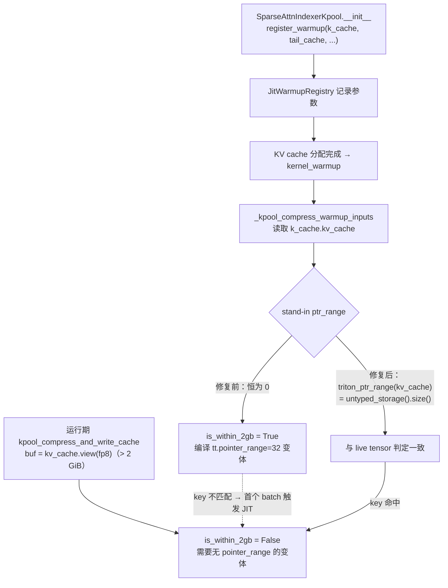
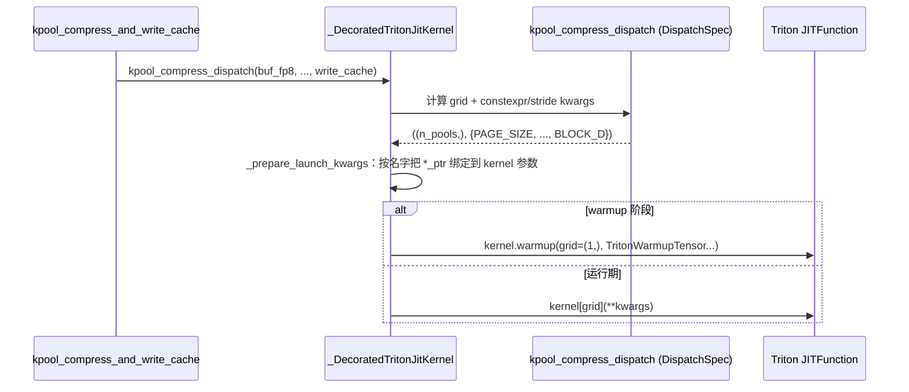

# PR #60919: [JIT][ROCm] Fully warmup GLM-5.3-Flash

> **Author**: @simondanielsson | **State**: OPEN | **Date**: 2026-10-09
> **Branch**: `simondanielsson:feature/warmup-glm5next` → `main` | **Labels**: glm, rocm, warmup, needs-rebase
> **Changes**: +268 -41 lines across 7 files | **ROCm 相关性**: 完全相关（核心是 ROCm Triton 的 `tt.pointer_range` 特化；`l2norm.py` 与 `kda.py` 是 CUDA/ROCm 共享路径）
> 本报告分两部分：§1–6 为 PR 详细总结，§7–8 为 ROCm review 意见。
>
> 数据来源说明：GitHub REST API 在抓取时被限流，diff 取自 `github.com/.../pull/60919.diff`，PR 描述与评论取自 PR 页面；上下文代码对照本地 vLLM checkout（2026-10-22）以及 upstream `main` 的 raw 文件（2026-10-23）。CI check 状态未知。

---

## 1. 总结 (Summary)

在 ROCm 上跑 GLM-5.3-Flash（`ROCM_AITER_MLA_SPARSE`）时，JIT warmup 结束后仍然有大量 Triton kernel 在第一个真实 batch 上重新编译。PR 修了两类问题：(1) 有几个 kernel 根本没注册 warmup：GLM-5 Next 的 kpool 压缩写 cache kernel、tail-seed kernel、FLA 的 `l2norm_fwd_kernel2`，以及 `ROCM_AITER_MLA_SPARSE` 下的三个 indexer 元数据 kernel；(2) ROCm Triton 会按指针背后 storage 是否 ≤ 2 GiB 做特化（`tt.pointer_range = 32`，用来生成 buffer load/store）。warmup 用的 stand-in `TritonWarmupTensor.ptr_range()` 固定返回 0，被当成"小 buffer"；而真实的 KV cache 远大于 2 GiB，所以 warmup 编出来的变体在运行时永远用不上。PR 给 `TritonWarmupTensor` 加了 `storage_bytes` 字段和一个 `triton_ptr_range()` 辅助函数，让 kpool 两个 kernel 的 warmup 读取真实 KV cache 的 storage 大小。作者给出的数据：compile key 从 53 增加到 167，运行期 JIT 事件为 0。

## 2. 背景与动机 (Background & Motivation)

- vLLM 的 JIT warmup 框架（`JitWarmupRegistry` + `triton_kernel_dispatcher_with_warmup`）的工作方式是：模型构造期各层调用 `register_warmup(...)` 登记参数；KV cache 分配完成后，`kernel_warmup()` 统一展开 warmup case，推导 Triton 的 compile key，再调用 `kernel.warmup(...)` 预编译。`--jit-monitor-mode warn/error` 会把运行期发生的 JIT 编译报出来，或者直接报错。
- 漏掉的 key 主要有两类来源：
  - **未注册**：kpool 两个 kernel 和 l2norm 原来是直接用 `kernel[grid](...)` 启动的，没有经过 dispatcher，也就没有 warmup 入口。
  - **特化不一致**：Triton AMD 后端在 `get_tensor_specialization` 里，当 `knobs.amd.use_buffer_ops` 打开且 `HIPBackend.is_within_2gb(arg)` 为真时，给指针参数加上 32-bit pointer range 特化。`is_within_2gb` 的逻辑是先看 `arg.ptr_range()`，没有这个方法再看 `untyped_storage().size()`（本地 Triton 3.8.0 已核对）。warmup stub 返回 0，被判为"在 2 GiB 内"；真实的 `kv_cache.view(fp8)` 背后是整个 KV pool，超过 2 GiB，被判为"不在"。两边的 compile key 因此不同。
- PR 的验证配置：GLM-5.3-Flash TP=8，`--max-num-seqs 512 --attention-backend ROCM_AITER_MLA_SPARSE --jit-monitor-mode warn`。作者说用 `--jit-monitor-mode error` 也能正常 serve。
- **重要时间线**：PR 发出后，upstream main 在 2026-10-23 合入了 #60834（"[ROCm][Perf] Apply opt-in paged MXFP4 sparse indexer dense path for DeepSeek-V4"）。#60834 给 `TritonWarmupTensor` 加了语义相同的字段 **`ptr_range_bytes`**，并在 `deepseek_v4/amd/rocm.py` 中使用。这和本 PR 的 `storage_bytes` 直接冲突，也很可能是 `needs-rebase` 标签的来源之一（见 §7 第一条）。

## 3. 代码修改分析 (Code Change Analysis)

### 3.1 修改的模块

| 模块 | 改动 |
|------|------|
| `vllm/model_executor/warmup/jit_warmup_triton_helper.py` (+21 -1) | 新增 `triton_ptr_range(tensor)`，镜像 `HIPBackend.is_within_2gb` 的取值逻辑；`TritonWarmupTensor` 新增 `storage_bytes: int = 0`，`ptr_range()` 返回它；FakeTensor 物化 / 回转路径通过 `_vllm_warmup_storage_bytes` 属性传递该值 |
| `vllm/models/glm5next/amd/ops/kpool_compress.py` (+148 -26) | 新增 `kpool_compress_dispatch`、`kpool_tail_seed_dispatch` 两个 dispatcher 及其 warmup 输入函数；`buf_fp8/buf_fp32/tail_ptr` 的 stand-in 使用真实 KV cache 的 `triton_ptr_range`；原来的 `kernel[grid](...)` 调用改为走 dispatcher |
| `vllm/models/glm5next/amd/sparse_indexer.py` (+15) | `SparseAttnIndexerKpool.__init__` 从 `hf_text_config.index_kpool` 读 pool 大小，在 `> 1` 时注册上面两个 kernel 的 warmup |
| `vllm/third_party/flash_linear_attention/ops/l2norm.py` (+41 -13) | 新增 `l2norm_fwd_block` dispatcher，包装 `l2norm_fwd_kernel2`；抽出 `_l2norm_block_dim`；`l2norm_fwd` 在非 `USE_DEFAULT_FLA_NORM` 分支改为调用 dispatcher（**所有平台、所有使用者都会经过这条路径**） |
| `vllm/models/glm5next/common/kda.py` (+6) | 当 `kda_prefill_backend != "flashkda"` 时注册 `l2norm_fwd_block` 的 warmup（CUDA/ROCm 共享） |
| `vllm/model_executor/layers/attention/mla_attention.py` (+5 -1) | 把 `ROCM_AITER_MLA_SPARSE` 加入注册 indexer 元数据 kernel warmup 的 backend 白名单，并排除 `sparse_swa` 的 `_COMPUTE_PREFILL_METADATA_KERNEL` |
| `tests/model_executor/test_jit_warmup_triton_launcher.py` (+32) | 新增参数化测试：stub 与 live tensor（≤2 GiB / 4 GiB）在 `is_within_2gb` 上判定一致；如果 Triton 删除了该 API，测试会给出明确提示 |

### 3.2 架构 / 流程图

**Warmup 与运行期 compile key 的一致性（修复前后）**



**Dispatcher 调用链（以 kpool 为例）**



### 3.3 关键实现细节

- **`triton_ptr_range`**：如果对象有 `ptr_range()` 就用它，否则返回 `untyped_storage().size()`。这和 Triton 3.8 的 `HIPBackend.is_within_2gb` 取值顺序完全一致（已核对源码）。它返回的是**整个 storage** 的字节数，不是 view 的大小。因此 `kv_cache.view(fp8)` 和 `kv_cache` 得到的值相同，跨层共享的 KV pool 也会如实反映出来。
- **warmup 时机**：`register_warmup` 只登记 `k_cache` / `tail_cache` 模块对象。真正读取 `.kv_cache` 的 `_kpool_compress_warmup_inputs` 在 `kernel_warmup()` 中执行，那时 KV cache 已经绑定，所以读到的是真实大小，不是构造期的 `torch.tensor([])`。每层传入的模块对象不同，`_same_registration` 不会去重；但 `TritonCompileKey` 只按 `jit_keys` 比较，最终编译的 key 仍然会被去重。
- **kpool warmup 覆盖面**：只覆盖 `has_write_mask=True / return_compressed=False / write_cache=True`，这是 `_kpool_compress_insert` 唯一的调用组合（已核对）。`loc_ptr` / `tslot_ptr` 用 `WarmupChoices(True, False)` 覆盖 16B 对齐和非对齐两种情况：`tail_meta.slot_mapping[prefill_slice]` 的偏移是 `num_decode_tokens * 8` 字节，可能不对齐。`n_tokens` 用 `WarmupChoices(1, 16, 2)` 覆盖整数特化的三类（==1、%16==0、其他）。
- **l2norm**：`x` 的 shape 是 `(num_rows, dim)`，`num_rows` ∈ {1,16,2} 对应 `M` 的三类特化，`N/BD/MBLOCK` 是 constexpr。`y` 是新分配的，所以默认对齐。`eps` 是 float 参数，Triton 不对它特化。
- `mla_attention.py` 的白名单改动对**所有**使用 `ROCM_AITER_MLA_SPARSE` 的模型生效（DeepSeek V3.2/V4 on ROCm），不只影响 GLM。这三个 indexer kernel 来自平台无关的 `DeepseekV32IndexerMetadataBuilder`，在 ROCm 上同样会被调用，所以注册它们是对的。

## 4. 涉及的技术原理 (Technical Principles)

**ROCm buffer ops 与 `tt.pointer_range`**：AMD CDNA 的 buffer load/store 指令用"资源描述符 + 32-bit offset"寻址，越界会自动返回 0，也更容易合并访存。Triton AMD 后端只有在能证明指针所指 storage ≤ 2 GiB（int32 可表示）时，才在参数上加 `tt.pointer_range = 32` 特化，并把访存 lower 成 buffer 指令。这个特化是 JIT cache key 的一部分，所以同一个 kernel 遇到"小 buffer"和"大 buffer"会编译成两个二进制。

**Triton JIT 特化维度**：除了 constexpr，Triton 还会对运行期参数做隐式特化：整数按 ==1 / %16==0 / 其他分类，指针按 16B 对齐与否分类，ROCm 上还加上上面的 pointer range。warmup stand-in 必须落在和 live 参数**同一类**，否则就是"预热了一个永远用不到的变体"。

**vLLM JIT warmup 框架**：`triton_kernel_dispatcher_with_warmup` 把"计算 grid 和 kwargs"的 dispatch 函数和 kernel 绑在一起，运行期与 warmup 共用同一份 dispatch 逻辑，减少两者分叉。warmup case 可以只是 metadata（`TritonWarmupTensor`）；如果 dispatch 需要 shape 信息，会退化成 FakeTensor 物化；autotune kernel 则物化成真实 tensor 去跑 autotune。三条路径都需要正确传递 pointer range 信息，这也是 §7 一条 finding 的来源。

**GLM-5 Next 的 kpool indexer**：indexer 的 K cache 每 `index_kpool` 个 token 存一个 pool 条目（softmax 加权求和 → Hadamard-128 旋转 → fp8 量化）。还没凑满一个 pool 的尾部 token 存在 paged tail ring 里，由 decode 阶段补齐。两个 kernel 都直接写 KV cache，所以指针背后是大 KV pool。

## 5. 评论区讨论亮点 (Discussion Highlights)

- @GodRishUniverse 指出 #60084 与本 PR 有关。作者回应两者正交：#60084 不处理 2 GiB pointer-range 特化问题。
- claude[bot] 的自动 review 因 PR 来自 fork，需要 maintainer 批准才能运行，目前没有实质内容。
- code owners（tjtanaa、dllehr-amd、hongxiayang、ZJY0516、vadiklyutiy、LucasWilkinson、MatthewBonanni）都还没有 review。
- 讨论里**没有人提到** #60834 已经在 main 上引入了同义字段 `ptr_range_bytes`。rebase 时需要正面处理（见 §7）。

## 6. 风险与潜在问题 (Risk Analysis)

| 风险 | 严重程度 | 说明 |
|------|---------|------|
| 与 main 上 `ptr_range_bytes` 重复 / 冲突 | High | rebase 后如果保留两个字段，API 会分裂；测试按 `storage_bytes=` 构造会失败。见 §7「与已合入的 `ptr_range_bytes` 重复」 |
| 启动时间增加 | Medium | compile key 53 → 167，ROCm 上 Triton warmup 串行编译（`supports_parallel_compile` 只对 CUDA 为真），PR 没有给出 warmup 耗时 |
| 共享 l2norm 路径的行为变化 | Low | Qwen3-Next GDN、Kimi K3、GLM (NVIDIA) 的 `l2norm_fwd` 都改走 dispatcher。kernel 参数和 grid 等价（已核对绑定规则），只多了少量 Python 开销 |
| autotune 路径不认 `storage_bytes` | Low（当前）| 本 PR 涉及的 kernel 都不是 autotune 的，但文档承诺的语义对 autotune kernel 不成立。见 §7 |
| 测试覆盖 | Medium | 新测试只验证辅助函数，没有端到端验证"warmup key == live launch key"，也没有验证 FakeTensor 回转 |
| 数值正确性 | Low | dispatcher 重构没有改变 kernel 参数（S_OFFSET、PRESHUFFLE 等逐项对过）。PR 只给了一条推理样例，没有精度评测 |

---

## 7. Review 意见 (Findings)

| 意见类型 | 🔴 | ⚠️ | 📝 |
|---------|----|----|----|
| 【兼容性】 | 0 | 1 | 0 |
| 【设计】 | 0 | 1 | 2 |
| 【性能】 | 0 | 1 | 1 |
| 【测试】 | 0 | 1 | 0 |
| 【可维护性】 | 0 | 0 | 1 |

**⚠️【兼容性】与已合入 main 的 `TritonWarmupTensor.ptr_range_bytes` 重复：rebase 后必须统一成一个字段** `[已验证]`
- **问题**：upstream main（#60834，2026-10-23 合入）已经给 `TritonWarmupTensor` 加了 `ptr_range_bytes: int = 0`，并让 `ptr_range()` 返回它，docstring 讲的也是同一个 2 GB / `tt.pointer_range` 问题。`deepseek_v4/amd/rocm.py:492-496` 已经在用它。本 PR 在同一位置新增 `storage_bytes`（`jit_warmup_triton_helper.py:201-207`）。两者语义完全重叠，这里会产生文本冲突。不过 main 的版本**没有**本 PR 的两个增量：(a) `triton_ptr_range()` 辅助函数；(b) FakeTensor 物化 / 回转时传递该值（`:518`、`:558`）。main 的 `_triton_metadata_arg` 重建 `TritonWarmupTensor` 时会把 `ptr_range_bytes` 丢掉，变回 0。
- **影响**：如果 rebase 时两个字段都保留，同一个概念会有两个名字，`ptr_range()` 只会读其中一个，另一个就成了静默无效的参数。如果只保留 main 的字段而丢掉本 PR 的传递逻辑，那么任何 dispatch 时触发 FakeTensor 回退的 kernel（`get_warmup_keys` 里 `AssertionError/AttributeError/TypeError` 分支），其 pointer range 都会被重置为 0，对 >2 GiB 的 KV cache 又会出现 key 不匹配。另外，DSV4 选的策略是"两个变体都预热"，本 PR 选的是"读取真实 storage 大小"，两种策略并存但没有文档说明各自的适用场景。
- **行动**：建议作者 rebase 时 (1) 删掉 `storage_bytes`，统一使用 main 的 `ptr_range_bytes`，`kpool_compress.py` 和新测试同步改名；(2) 保留 `triton_ptr_range()`，并把 `_vllm_warmup_storage_bytes` 的传递逻辑改为传递 `ptr_range_bytes`，这是对 main 的真实补强；(3) 在 `ptr_range_bytes` 的 docstring 里写明两种用法：能拿到 live tensor 时用 `triton_ptr_range(live)`；拿不到时像 DSV4 那样两个变体都预热。

**⚠️【设计】autotune（真实物化）路径完全忽略 `storage_bytes`，与 docstring 的承诺不一致** `[已验证]`
- **问题**：`_materialize_warmup_case` 在 `real=True`（autotune kernel）分支用 `torch.empty_strided(value.shape, ...)` 分配一个小的真实 tensor，`storage_bytes` 不会传进去（`jit_warmup_triton_helper.py:551-558`，只有 `else` 分支写了属性，而且那个属性只给 FakeTensor 回转用）。Triton 在真实 tensor 上读的是 `untyped_storage().size()`，结果一定 ≤ 2 GiB。
- **影响**：本 PR 的三个 kernel 都不是 autotune 的，所以目前不会出问题。但新 docstring 写的是"`storage_bytes` should be set ... whenever the runtime tensor's storage can exceed 2 GiB"。以后有人给 autotune kernel 的 KV cache stand-in 设置了这个字段，会以为生效了，实际上仍然编出错误的变体，并在 ROCm 上产生运行期 JIT。
- **行动**：建议作者在 `real` 分支里给物化出来的 tensor 挂上 `tensor.ptr_range = lambda: value.storage_bytes`。Triton 会先检查 `ptr_range`，本 PR 的测试也用了同样的手法。或者至少在 docstring 里注明"autotune kernel 不支持"。

**⚠️【性能】warmup key 数量约增加到 3 倍，但 ROCm 上是串行编译，PR 没有给出启动时间数据** `[已验证]`（机制）/ `[推测]`（幅度）
- **问题**：PR 描述的 compile key 数从 53 增加到 167 `[unverified：没有附日志]`。`VllmTritonJitKernel.supports_parallel_compile` 只在 `current_platform.is_cuda()` 时为真（注释写的是 AMD LLVM 并发编译会 abort），所以 ROCm 上这 114 个新增 key 全部串行编译。`mla_attention.py:670,686` 的白名单改动还会让 DSV3.2/V4 on ROCm 也多编几个 indexer kernel；`kda.py:353` 的注册在 `USE_DEFAULT_FLA_NORM=1`（运行期不走 kernel2）时也会编译用不到的变体。
- **影响**：TP=8 的每个 rank 都要付这部分冷启动时间（Triton cache 命中时会便宜很多）。这是用启动时间换首个 batch 的延迟，方向是对的，但需要量化。
- **行动**：建议作者在 PR 描述里补充 main 和本分支的 "JIT kernel warmup finished in X s" 日志（冷 cache / 热 cache 各一组），并把 compile key 的统计日志附上。可以考虑在 `kda.py` 的注册条件里加上 `not USE_DEFAULT_FLA_NORM`。

**⚠️【测试】新测试只验证了辅助函数，没有覆盖真正出问题的环节：warmup key 与 live launch key 是否一致** `[已验证]`
- **问题**：`test_warmup_pointer_specializes_like_the_live_tensor`（`tests/model_executor/test_jit_warmup_triton_launcher.py:484-511`）只断言 `is_within_2gb(stub) == is_within_2gb(live)`，验证的是 `triton_ptr_range` 和 `ptr_range()` 的取值。以下几点都没有测试：(a) `kpool_compress_dispatch.get_warmup_keys(k_cache=<4 GiB ptr_range>)` 推导出的 `TritonJitKey` 是否等于用 live 参数推导出的 key；(b) FakeTensor 回转（`_triton_metadata_arg`）能否保留该值，这恰好是 rebase 后最容易丢掉的部分；(c) l2norm / kpool 改走 dispatcher 后，kernel 参数绑定是否与原来的直接调用等价。另外，这个测试设置 `live.ptr_range` 后，实际测的是 `ptr_range` 分支，`untyped_storage()` 分支只在 `None` 参数下被覆盖。
- **影响**：这个 bug 的本质是"两条路径对同一个 key 的推导不一致"。只测辅助函数，防不住以后有人改 dispatch / 物化逻辑时再次出现分叉。
- **行动**：建议作者补一个 key 层面的回归测试：用 `_triton_key_deriver(kernel)` 分别对 live kwargs（tensor 上挂 `ptr_range = lambda: 1 << 32`）和 `get_warmup_keys` 的结果求 key，断言后者包含前者。再参数化一个强制走 FakeTensor 回退的 dispatch，覆盖 `_vllm_warmup_storage_bytes` 的传递。这类测试可以在 CPU 上做 key 推导，不依赖 MI 硬件。

**📝【设计】`index_kpool` 有两个来源：`__init__` 读 `hf_text_config`，`forward` 用调用方传入的值** `[已验证]`
- **问题**：`sparse_indexer.py:757-758` 用 `getattr(hf_config, "index_kpool", None) or 1` 决定是否注册 warmup 和 pool 大小，而运行期 `forward_hip(..., index_kpool=...)` 用的是 `common/attention.py:215` 里的 `config.index_kpool`，`SparseAttnIndexerKpool` 本身就是从那里构造的。
- **影响**：目前两处读的是同一个 config，值一致。以后如果 attention 层改为从 `hf_overrides` 或其他字段派生 kpool，warmup 会静默编出不同的 `POOL_SIZE` 变体。
- **行动**：建议作者把 `index_kpool` 作为构造参数传给 `SparseAttnIndexerKpool`（调用方 `self.index_kpool` 已经可以拿到），去掉 `or 1` 的隐式回退。

**📝【性能】`l2norm_fwd` 是多个模型共享的热路径，现在所有平台都多了一层 Python dispatcher** `[推测]`
- **问题**：`l2norm.py:158` 的改动对 Qwen3-Next GDN（`qwen_gdn_linear_attn.py:316,469`）、Kimi K3、GLM (NVIDIA) 都生效。每次调用都要额外执行 dispatch 函数、`_prepare_launch_kwargs`、dict 构造。但只有 GLM-5 Next 的 `kda.py` 注册了 warmup，其他使用者付出了开销，却得不到预热收益。
- **影响**：prefill 阶段每层两次调用，开销大约在 μs 级，相对 prefill 可以忽略，不阻塞合入。
- **行动**：建议 review 时追问：是否计划给 Qwen3-Next / Kimi K3 也注册 `l2norm_fwd_block.register_warmup`（ROCm 上同样会在首个 prefill 时 JIT）？

**📝【设计】`mla_attention.py` 的白名单改动影响 DSV3.2/V4 on ROCm，PR 只在 GLM 上验证过** `[推测]`
- **问题**：`mla_attention.py:670,686` 让所有使用 `ROCM_AITER_MLA_SPARSE` 的模型都注册三个 indexer kernel 的 warmup。这些 kernel 对 DSV3.2（compress ratio 为 1）可能用不到，只会增加编译时间；`get_compressed_slot_mapping` 只在需要 compress 的模型上调用。
- **影响**：不影响正确性，只增加 warmup 时间。
- **行动**：建议作者在 PR 描述中注明对 DeepSeek V3.2 / V4 on ROCm 的影响，最好附一组 DSV3.2 `--jit-monitor-mode warn` 的结果。

**📝【可维护性】NVIDIA 侧的孪生文件 `glm5next/nvidia/ops/kpool_compress.py` 没有同步迁移到 dispatcher** `[推测]`
- **问题**：`glm5next/nvidia/sparse_indexer.py` 导入的是自己的 `nvidia/ops/kpool_compress.py`，本 PR 只迁移了 AMD 版本。CUDA 没有 pointer-range 特化，但"kpool kernel 未注册 warmup"这个问题在 CUDA 上同样存在。
- **影响**：GLM-5.3-Flash 在 CUDA 上运行 `--jit-monitor-mode error` 很可能仍会失败。不属于本 PR 的 ROCm 范围。
- **行动**：建议作者开一个 follow-up issue 或 PR，或在描述中说明这一点。

**AI 代码诊断**：PR 描述把机制讲得清楚（WHY：2 GiB 特化 + stub 返回 0），测试 docstring 说明了动机，并且有"Triton 改 API 时给出明确失败"的防护。新增符号（`triton_ptr_range`、`WarmupChoices`、`DispatchSpec`、`HIPBackend.is_within_2gb`）都已核对，确实存在。没有发现 AI 生成代码的高风险信号。

**盲点检查**：(1) `triton_ptr_range` 读的是整个 storage。如果 KV cache 是多层共享的 raw buffer，各层的 storage 大小都等于整个 pool，与运行期一致，没有问题。(2) 如果部署配置让 KV pool ≤ 2 GiB（例如很小的 `--gpu-memory-utilization`），warmup 会正确地选 `pointer_range=32` 变体，这正是"读真实大小"相对于"写死 >2 GiB"的优势。(3) 没有发现其他资源或同步方面的风险。

## 8. 结论 (Verdict)

⚠️ **NEEDS WORK**：修复方向正确，机制也已核对（stub 与 Triton 3.8 的 `is_within_2gb` 判定一致，kpool warmup 与唯一调用点的参数组合一致）。合入前必须先 rebase，与 #60834 引入的 `ptr_range_bytes` 合并成一个字段，同时保留本 PR 的 FakeTensor 传递逻辑和 `triton_ptr_range` 辅助函数。建议同时补充 key 层面的回归测试和 ROCm warmup 耗时数据。

## 9. 英文 Review 评论 (Copy-Paste English Comments)

**C1** `vllm/model_executor/warmup/jit_warmup_triton_helper.py:201-207` — ⚠️ comment

```text
Heads-up for the rebase: #60834 (merged into main on Oct 23) already added an equivalent field, `TritonWarmupTensor.ptr_range_bytes`, with `ptr_range()` returning it, and `deepseek_v4/amd/rocm.py` already uses it. Keeping both `storage_bytes` and `ptr_range_bytes` would leave two names for the same concept, and only one of them would actually be read. Could you drop `storage_bytes` and switch `kpool_compress.py` and the new test to `ptr_range_bytes`? Please keep `triton_ptr_range()` and the FakeTensor round-trip propagation (`_triton_metadata_arg` / `materialize`), though: main's version currently drops the value back to 0 when a dispatch falls back to FakeTensor, so that part of this PR is still a real fix. It would also help to note in the docstring when to use `triton_ptr_range(live)` and when to warm both variants, as DSV4 does.
```

**C2** `vllm/model_executor/warmup/jit_warmup_triton_helper.py:555-558` — ⚠️ comment

```text
Only the FakeTensor branch carries the pointer range. In the `real=True` branch (autotuned kernels), the stand-in is materialized as a small real tensor, and Triton reads `untyped_storage().size()` from it, so `storage_bytes` is silently ignored and the <=2 GiB variant gets compiled. None of the kernels in this PR are autotuned, so nothing breaks today, but the new docstring suggests the field works everywhere. Could you attach `tensor.ptr_range = lambda: value.storage_bytes` to the real tensor when the field is non-zero (the same trick your test uses), or document that autotuned kernels are not supported?
```

**C3** `tests/model_executor/test_jit_warmup_triton_launcher.py:484-511` — ⚠️ comment

```text
This test checks that `triton_ptr_range` mirrors `is_within_2gb`, which is useful. The actual bug, though, was that the warmup compile key differed from the live launch key, and that isn't covered here. Could you add a key-level regression test? For example, derive keys with `_triton_key_deriver(kernel)` from live kwargs (with a tensor whose `ptr_range` returns `1 << 32`) and assert they are contained in `kpool_compress_dispatch.get_warmup_keys(...)`. A second case that forces the FakeTensor fallback in `get_warmup_keys` would also cover the `_vllm_warmup_storage_bytes` propagation, which is the part most likely to be lost in the rebase. Both can run without MI hardware.
```

**C4** `vllm/models/glm5next/amd/sparse_indexer.py:757-771` — ⚠️ comment

```text
Two small things here. First, could you share the "JIT kernel warmup finished in X s" numbers for main vs. this branch, with both a cold and a warm Triton cache? On ROCm, `supports_parallel_compile` is False, so the extra ~114 keys compile serially on every rank. That tradeoff is probably worth it, but it should be quantified in the PR description. Second, `index_kpool` is read from `hf_text_config` here, with an implicit `or 1` fallback, while `forward_hip` receives it from the attention layer (`self.index_kpool`). Consider passing it as a constructor argument so warmup and runtime can't drift apart.
```
