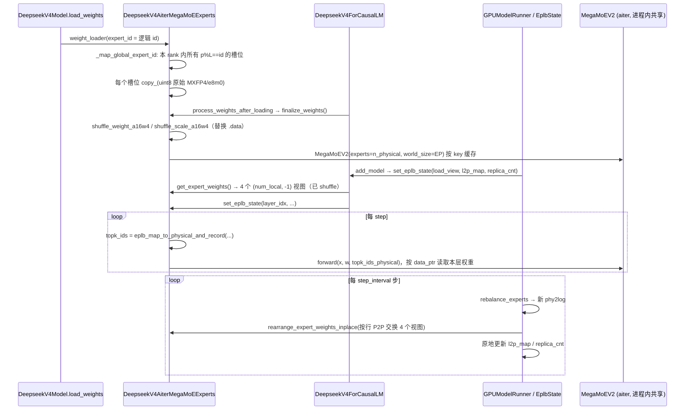
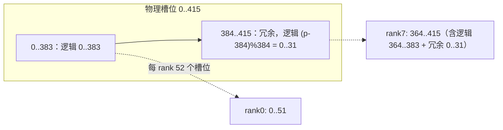

# PR #61176: [ROCm][DSv4] Enable EPLB on AITER MegaMoE

> **Author**: @ChuanLi1101 | **State**: OPEN（needs-rebase，有合并冲突） | **Date**: 2026-10-12
> **Branch**: `ChuanLi1101:<fork>` → `main`（head `e2b95d2e42`） | **Labels**: rocm, needs-rebase, deepseek, DSv4
> **Changes**: +270 -14 lines across 3 files | **ROCm 相关性**: 完全相关（AMD 专属 `vllm/models/deepseek_v4/amd/`，AITER MegaMoEV2 + MoRI shmem）
> 本报告分两部分：§1–6 为 PR 详细总结，§7–8 为 ROCm review 意见。

---

## 1. 总结 (Summary)

本 PR 去掉了 DeepSeek-V4 在 AMD 上 `--moe-backend aiter_mega_moe` 对 `--enable-eplb` 的硬拒绝，为 AITER MegaMoE 接入 vLLM 的 EPLB（Expert Parallel Load Balancer）。做法与 NVIDIA DeepGEMM MegaMoE 路径对齐：物理 expert 槽位按 `[routed experts, redundant copies]` 排布，加载时把逻辑 expert 复制到所有对应的本地槽位；forward 前用 `eplb_map_to_physical_and_record` 把逻辑 top-k id 映射成物理 id 并记录负载；rebalance 时 EPLB 直接原地交换已 shuffle 的 MXFP4 权重行。作者在 8×MI355X 上的实测显示功能可跑通，但 **吞吐 −2.2%、rank 均衡度只有 ~0.69，并且发生 11 次 rearrange 后 GSM8K 从 0.970 降到 0.9475**。

## 2. 背景与动机 (Background & Motivation)

- DSv4（Pro: 384 routed experts，Flash: 256，top-6，前 3 层为 hash routing）在大 EP 下的专家负载不均衡很明显：高并发时最热 rank 决定整层 MoE 的耗时。EPLB 通过冗余复制热门专家并周期性重排，来提高 `avg/max` 的 rank 均衡度。
- NVIDIA 侧的 DSv4 DeepGEMM MegaMoE 已经支持 EPLB（`vllm/models/deepseek_v4/nvidia/model.py` 中的 `DeepseekV4MixtureOfExperts`、`get_expert_weights`、`eplb_map_to_physical_and_record`）。AMD 侧的 `_validate_aiter_mega_moe_config` 之前直接 `raise NotImplementedError("AITER MegaMoE does not support EPLB.")`。
- PR 描述的预期是 load 均衡度 "from about 0.71 to about 0.97 after the first rebalance"（参照 SGLang 在 agentic trace 上的数据）。作者后续的评论承认 vLLM 上实测达不到这个值，并特意说明"不要与 SGLang 的绝对 tok/s 比较"。
- PR 描述中的 test plan：只勾选了 `py_compile`；后来作者在评论中补充 `pytest tests/models/test_deepseek_v4_aiter_mega_moe.py` 9 passed，并贴了 8 卡 A/B 数据（见 §5）。

## 3. 代码修改分析 (Code Change Analysis)

### 3.1 修改的模块

| 文件 | 改动 | 说明 |
|------|------|------|
| `vllm/models/deepseek_v4/amd/mega_moe.py` | +110 −10 | `DeepseekV4AiterMegaMoEExperts`：区分 physical/logical expert 数；`weight_loader` 一个逻辑 expert 可写入多个本地槽位；新增 `set_eplb_state` / `get_expert_weights` / `update_expert_map` / `_maybe_map_eplb_ids`；forward 前做 logical→physical 映射 |
| `vllm/models/deepseek_v4/amd/model.py` | +80 −4 | 删除 EPLB 拒绝；`DeepseekV4MoE` mega 路径按 `n_routed + num_redundant_experts` 构造 experts，并校验能否被 EP 整除；新增 `DeepseekV4MixtureOfExperts` mixin（与 nvidia 版逐字相同）；`DeepseekV4ForCausalLM` 实现 `MixtureOfExperts` 协议，`set_moe_parameters()` 只在 `use_mega_moe` 时收集 MoE 层 |
| `tests/models/test_deepseek_v4_aiter_mega_moe.py` | +80 | 4 个 CPU 测试：冗余副本落槽、`get_expert_weights` 行视图与参数共享存储、物理 expert 数不整除 EP 时报错、forward 前调用 EPLB 映射 |

### 3.2 架构 / 流程图

**生命周期：加载 → finalize → 注册 EPLB → 运行 / 重排**



**MegaMoE forward 的数据流（本 PR 新增的部分以橙色标出）**

```mermaid
flowchart TD
    A[hidden_states] --> B[gate → fused_topk_bias<br/>含 hash 层 tid2eid]
    B --> C{eplb_state.logical_to_physical_map<br/>是否已设置?}
    C -- 否：EPLB 关闭 / MTP drafter --> E[topk_ids 逻辑 id == 主副本物理槽位]
    C -- 是 --> D[eplb_map_to_physical_and_record<br/>triton：选择副本 + 记录 expert_load_view]
    D --> E2[topk_ids 物理 id ∈ 0..n_routed+n_redundant)]
    E --> F[MegaMoEV2.forward<br/>dispatch → stage1 a8w4 GEMM → stage2 → combine]
    E2 --> F
    F --> G[+ shared_experts]
    style D fill:#fde2c8
    style E2 fill:#fde2c8
```

**物理槽位排布（EP=8，DSv4-Pro，num_redundant_experts=32）**



### 3.3 关键实现细节

- **物理/逻辑 expert 拆分**：`DeepseekV4MoE` 的 mega 分支新增 `n_routed_experts / n_logical_experts / n_physical_experts / n_local_physical_experts / n_redundant_experts`，传给 experts 的 `num_experts` 改成物理数 `n_routed + num_redundant_experts`，并在 `model.py:686-699` 和 `mega_moe.py:49-53` 两处分别校验能否被 EP 整除。
- **加载映射**：`_map_global_expert_id(expert_id)` 遍历本 rank 的物理槽位，`physical % num_logical_experts == expert_id` 的槽位都写入。它依赖 `EplbState.build_initial_global_physical_to_logical_map` 的初始排布 `list(range(R)) + [i % R for i in range(redundant)]`（已核对，二者一致）。checkpoint 的 expert mapping 仍然只枚举逻辑 id（`num_experts = n_routed`），由 loader 负责扇出到副本。
- **EPLB 权重视图**：`get_expert_weights()` 返回 `w13_weight / w13_weight_scale / w2_weight / w2_weight_scale` 各自 `view(num_local, -1)` 的视图，并要求张量 contiguous。由于 `finalize_weights` 在 `process_weights_after_loading` 中执行，早于 runner 调用 `add_model → set_eplb_state`，所以拿到的是 **shuffle 之后**的存储（已核对调用顺序）。
- **forward 映射**：`_maybe_map_eplb_ids` 只有在 `logical_to_physical_map` 已设置时才映射；`num_unpadded_tokens` 按 `dbo_current_ubatch_id()` 取。triton 映射核的输出 dtype 与输入相同（int32），满足 `MegaMoEV2.forward` 对 `topk_ids` 为 contiguous int32 的要求。
- **`update_expert_map()` 是空操作**；`update_physical_experts_metadata` 断言每 rank 的本地槽位数不变，只更新 python 侧的计数字段，不会重建 `MegaMoEV2` runtime，也不更新 experts 的 `num_experts / experts_start_idx`。
- **`set_moe_parameters()`** 只在 `self.model.use_mega_moe` 为真时收集层。非 mega 后端时 `num_moe_layers=0`，`is_mixture_of_experts()` 返回 False，EPLB 不会注册到该模型。这与改动前的行为一致，非 mega 后端仍然不支持 EPLB。

## 4. 涉及的技术原理 (Technical Principles)

**EPLB（Expert Parallel Load Balancer）**：vLLM 维护 `physical_to_logical_map / logical_to_physical_map / logical_replica_count` 三张表，并在滑动窗口内记录每个物理槽位的 token 负载。每隔 `step_interval` 步，`DefaultEplbPolicy.rebalance_experts` 按负载重新计算副本分配（`num_groups % num_nodes == 0` 时走分层策略。DSv4 配置里没有 `n_group`，因此取 1，单节点即全局策略），然后 `rearrange_expert_weights_inplace` 通过 EP group 的 P2P 按"行"（每个本地槽位一行）交换权重，最后原地更新映射表。模型侧只需要提供 `(num_local, -1)` 形状的 contiguous 视图，以及 forward 中的 logical→physical 映射。

**MXFP4 a16w4 shuffle**：AITER 的 `shuffle_weight_a16w4` 用 `is_guinterleave=True` 把 `(E, N, K/2)` 重排为 `[E, N0, (2), K0, KLane, NLane, KPack]`；`shuffle_scale_a16w4` 把 e8m0 scale 视为 `(E·N, K/32)`，再 reshape 为 `[E, ...]` 后 permute。**两者都保持 expert 维为最外层**，每个 expert 的数据是一段连续区间（已在 aiter `aiter/ops/shuffle.py` 中核对）。因此"交换已 shuffle 的行"在数学上等价于"先交换再 shuffle"，这是本 PR 不需要 re-shuffle 的前提。注意：当 `K/32` 不是 8 的倍数时，scale 会被 pad，输出形状也会改变。DSv4-Pro（224/96）和 Flash（128/64）都不会触发这一点。

**AITER MegaMoEV2**：这是一个把 dispatch、a8w4 stage1/stage2 GEMM 和 combine 融合在一起、运行在 MoRI shmem 上的 MoE kernel。构造时就固定了 `world_size / experts / epr / max_tok_per_rank` 并分配对称堆 buffer，所以 vLLM 在所有层之间共享同一个实例，每次调用前重新绑定 `_s1_w1 / _s1_w1_scale / w2 / w2_scale`。kernel 启动时按 `data_ptr()` 读取权重，因此原地交换行能被它看到；但 **`experts` 和 `world_size` 无法在运行时改变**。

**Hash routing 层**：DSv4 前 3 层由 `tid2eid` 查表得到 top-k，其余层用 `sqrtsoftplus` 打分加 noaux bias。两类层的 top-k 都是逻辑 id，都经过同一个 EPLB 映射。

## 5. 评论区讨论亮点 (Discussion Highlights)

- **作者在 8×MI355X 上的 A/B 数据**（`vllm/vllm-openai-rocm:nightly` @ `fe4df3df0` 挂载 3 个文件；DP8/EP8，`mori_high_throughput`，random 8k/1k，并发 512，2048 prompts）：

  | | EPLB off | EPLB on |
  |---|--:|--:|
  | output tok/s | 4354 | 4256（−2.2%） |
  | median TPOT | 112.2 ms | 115.1 ms |
  | median TTFT | 5120 ms | 4877 ms |

  rank 均衡度：EPLB on 但不重排时约 0.55，每 200 步重排时约 0.69，**远低于 PR 描述中的 0.97**。

- **作者报告的 GSM8K 精度回退**（5-shot greedy，前 400 题，先跑 1024 条 random 请求预热）：EPLB off 0.970 / EPLB on 不重排 0.965 / **EPLB on 重排 11 次后 0.9475**。"off 对、重排后错"的题有 11 道，反过来只有 2 道，作者描述为"错误答案是连贯的解题过程，不是乱码"。不一致对的符号检验（13 对，11:2）**双侧 p ≈ 0.022**。
- 机器人 review（claude[bot]）因为是 fork PR 未执行；没有人工 reviewer 评论。mergify 提示有合并冲突，需要 rebase。

## 6. 风险与潜在问题 (Risk Analysis)

| 风险 | 严重程度 | 说明 |
|------|---------|------|
| 正确性：重排后精度回退 | High | 见 §7「重排后 GSM8K 显著下降，根因未定位」 |
| 兼容性：隐式放开 Elastic EP | Medium | 见 §7「去掉 EPLB 拒绝后 Elastic EP 被隐式放开」 |
| 性能：负收益加显存开销 | Medium | 见 §7「EPLB 在实测负载下净负收益」，32 个冗余专家约占每 rank 8 GiB |
| 测试覆盖 | Medium | 只有 CPU 单测，没有覆盖"shuffle 后行交换"这一关键不变量，也没有 GPU 端到端重排对比 |
| 可维护性：与 NVIDIA 实现重复 | Low | `DeepseekV4MixtureOfExperts` 与 nvidia 版逐字相同 |
| 兼容性：MTP/dspark drafter | Low | drafter 的 MoE 层同样分配了冗余槽位，但不参与 EPLB，功能正确，只是浪费显存 |
| 流程：needs-rebase / CI 状态未知 | Low | 存在合并冲突；本次没有拿到 check run 数据 |

---

## 7. Review 意见 (Findings)

| 类型 | 🔴 | ⚠️ | 📝 |
|------|----|----|----|
| 正确性 | 1 | — | — |
| 兼容性 | — | 1 | 1 |
| 性能 | — | 1 | — |
| 测试 | — | 1 | — |
| 可维护性 | — | — | 2 |

---

**🔴【正确性】重排后 GSM8K 显著下降（0.970 → 0.9475），根因未定位就放开了 EPLB** `[已验证]`（数据来自作者，根因 `[推测]`）

- **问题**: 作者在 PR 评论中给出的数据显示：EPLB 开启但不重排时精度与基线相当（0.965 vs 0.970），**经过 11 次 rearrange 后降到 0.9475**，不一致题目 11:2 明显偏向一侧（双侧符号检验 p≈0.022）。冗余副本与原专家的权重逐字节相同，EPLB 应当是数值中性的：除了 batch 组成变化带来的累加顺序抖动，不应出现有方向性的退化。PR 中没有解释这一现象。
  我核对后排除了以下可能：① aiter `shuffle_weight_a16w4 / shuffle_scale_a16w4` 都以 expert 为最外层维度，行交换与 shuffle 可交换；② `finalize_weights`（`process_weights_after_loading`）早于 `add_model → set_eplb_state`，EPLB 拿到的是 shuffle 后存储的视图；③ `MegaMoEV2` 每次启动按 `data_ptr()` 读取 `_s1_w1 / w2`，能看到原地交换；④ 映射核输出为 int32 contiguous；⑤ 初始 `phy2log` 与 `_map_global_expert_id` 一致。
  仍然无法排除的可能：(a) 没有测"EPLB off 跑两次"的噪声基线；(b) `--async-scheduling` 下，权重交换与仍在途的 MegaMoE 跨 rank kernel（MoRI shmem 上的 dispatch/combine）之间的流序问题；(c) MegaMoEV2 内部按 expert/rank 缓存的状态（fanout masks、bundle plan、group-major 元数据）在 expert 身份变化后可能失效；(d) EPLB 的 P2P 交换对 uint8 视图做了不完整的搬运。
- **触发条件**: DeepSeek-V4-Pro，8×MI355X（gfx950），`--data-parallel-size 8 --enable-expert-parallel --all2all-backend mori_high_throughput --moe-backend aiter_mega_moe --async-scheduling --enable-eplb --eplb-config '{"num_redundant_experts":32,"step_interval":200}'`，运行约 1024 条请求（触发 11 次 rearrange）之后。
- **影响**: 如果是权重搬运或流序错误，就是**静默的数值损坏**：输出看起来通顺但答案出错，线上很难察觉，而且重排次数越多可能越严重。
- **行动**: 作者应当在合入前定位根因。建议：① 在每次 `rearrange_expert_weights_inplace` 之后加一个调试校验，对每个本地槽位，把 4 个视图的字节与"`physical_to_logical_map[slot]` 对应专家的参考 shuffle 权重"（从 checkpoint 重新加载并 shuffle）逐字节比较；② 跑一次 EPLB off vs EPLB off，给出 GSM8K 不一致率作为噪声基线；③ 关闭 `--async-scheduling`，并在 rearrange 前后 `torch.cuda.synchronize()` + `shmem_barrier_all()` 各跑一次，判断是否与流序有关。

**⚠️【兼容性】去掉 EPLB 拒绝后 Elastic EP 被隐式放开，但 MegaMoEV2 的 runtime 无法随 EP 规模变化** `[已验证]`（运行时表现 `[推测]`）

- **问题**: `ParallelConfig` 要求 `enable_elastic_ep` 必须同时开启 `enable_eplb`，所以以前 `model.py` 中的 EPLB 拒绝**顺带挡住了 Elastic EP**。本 PR 删除了这条拒绝（`model.py:562-566`），但 `update_physical_experts_metadata` 只更新 python 侧的计数，`experts.update_expert_map()` 是空操作（`mega_moe.py:159-160`）。`num_experts / experts_start_idx / experts_end_idx` 以及 `_runtime_cache` 中的 `MegaMoEV2(world_size, experts)` 都是构造时固定的。
- **触发条件**: `--enable-elastic-ep --enable-eplb --moe-backend aiter_mega_moe` 然后执行一次扩缩容（每 rank 槽位数不变，总物理数和 world_size 变化，断言能通过）。
- **影响**: 扩缩容后 runtime 仍按旧 `world_size/experts` dispatch，物理 id 越界或被路由到错误的 rank，MoRI 对称堆的大小也不匹配，结果可能是 hang 或静默错误。
- **行动**: 建议作者在 `_validate_aiter_mega_moe_config` 中显式加上 `if parallel_config.enable_elastic_ep: raise NotImplementedError("AITER MegaMoE does not support elastic EP.")`。如果 `eplb_config.use_async` 也没测过，同样建议显式拒绝，或者补充测试说明。

**⚠️【性能】EPLB 在作者的实测负载下是净负收益，同时占用约 8 GiB/rank 显存，PR 描述与实测不符** `[已验证]`

- **问题**: 实测 output tok/s −2.2%，TPOT +2.6%，均衡度只到约 0.69；PR 描述里"0.71 → 0.97"的预期没有达成（这个数字来自 SGLang 的 agentic trace，在 vLLM 上属于 `[unverified]`）。另外，32 个冗余专家对 DSv4-Pro 意味着每 rank 多出 4 个槽位：每个专家约 33.5 MiB（w13 + scale + w2 + scale），× 4 × 61 层 ≈ **8 GiB/rank**，这部分直接从 KV cache 预算中扣除。
- **影响**: 用户按 PR 描述开启 EPLB 后可能得到更低的吞吐和更少的 KV 空间；random 8k/1k 负载本身也不适合体现 EPLB 的收益。
- **行动**: 建议作者更新 PR 描述，删除或标注 0.97 的预期，把本 PR 定位为"功能使能"；补一组 EPLB 能带来收益的负载数据（偏斜负载 / agentic trace / 更大的 EP），或者至少给出 `num_redundant_experts` 与显存、吞吐之间的权衡说明。

**⚠️【测试】单测没有覆盖关键不变量：在已 shuffle 的张量上做行交换等价于先交换再 shuffle** `[已验证]`

- **问题**: 新增的 4 个测试都在 CPU 上、`finalize_weights` 之前运行（`test_expert_weight_rows_match_local_slots` 只验证全零张量的视图共享存储，`tests/...:224-231`）。没有测试覆盖 shuffle 之后的 `get_expert_weights` 布局，也没有在 GPU 上做"重排后 forward 输出不变"的端到端对比。考虑到上面那条 🔴，这正是最需要测试的地方。
- **影响**: 只要 aiter 的 shuffle 布局改变（例如给 scale 加 pad，或在其他架构上换成 `shuffle_scale_n32k4`，后者输出形状变为 `(E, N//32, …)`），EPLB 就会静默搬错数据，而现有测试全部仍会通过。
- **行动**: 建议作者补充：① 纯 torch 的布局测试：`shuffle(w)[perm] == shuffle(w[perm])`（a16w4 的 weight 和 scale 都覆盖，gate_up 取 True/False）；② 一个 ROCm GPU 测试：EP=1、num_redundant>0，finalize 之后人为交换两个槽位的行并同步修改 `logical_to_physical_map`，forward 输出应与交换前一致。

**📝【兼容性】MTP / DSpark drafter 也会分配冗余槽位，但不参与 EPLB** `[已验证]`

- **问题**: `mtp.py` 和 `dspark.py` 复用了 `DeepseekV4MoE`，mega 分支同样读取 `eplb_config.num_redundant_experts` 并按物理数构造 experts。但 drafter 模型不是 `MixtureOfExperts`，runner 不会为它注册 EPLB。
- **影响**: 功能正确：未映射时逻辑 id 等于主副本槽位，冗余槽位里的副本也加载了正确权重。只是每个 drafter MoE 层浪费 4 个槽位（约 134 MiB/rank）。
- **行动**: 建议作者在注释中说明这一点，或者让 drafter 路径只在 EPLB 生效时才分配冗余槽位。

**📝【可维护性】`DeepseekV4MixtureOfExperts` 与 nvidia 版逐字重复，整除校验也写了两遍** `[已验证]`

- **问题**: `model.py:1470-1504` 与 `vllm/models/deepseek_v4/nvidia/model.py` 中的同名 mixin 完全相同；`n_physical % ep_size` 在 `model.py:693-698` 和 `mega_moe.py:49-53` 各校验了一次。另外，NVIDIA 版在 EPLB 映射前会把 padding token 置为 -1（`VLLM_MOE_SKIP_PADDING`），并在 `get_expert_weights` 开头防御性地调用 `finalize_weights()`，AMD 版这两点都没有，两个实现已经开始分叉。
- **影响**: 以后修复一侧的 bug 时，另一侧很容易漏掉。
- **行动**: 建议作者把 mixin 移到 `vllm/models/deepseek_v4/common/`，两边共用；`get_expert_weights` 也可以先调用 `self.finalize_weights()`（该函数是幂等的），不再依赖调用顺序。另外 PR 有合并冲突，需要 rebase；本次没有拿到 CI check 数据，rebase 后需要确认 ROCm CI 的结果。

## 8. 结论 (Verdict)

🔴 **BLOCK**：作者自己的数据显示，在确定的配置（DSv4-Pro / 8×MI355X / EP8 / 32 个冗余专家 / 11 次 rearrange）下精度出现有方向性的下降（0.970 → 0.9475，p≈0.02），而 EPLB 本应是数值中性的。在根因被定位或排除之前（逐字节校验重排后的权重、给出噪声基线），不宜放开这个默认会被用户尝试的组合；同时建议显式拒绝 Elastic EP，并修正 PR 描述中的性能预期。

## 9. 英文 Review 评论 (Copy-Paste English Comments)

**C1** `vllm/models/deepseek_v4/amd/mega_moe.py:136-157` — 🔴 blocking

```text
Your own GSM8K numbers show accuracy dropping from 0.970 to 0.9475 after 11 rearranges (11 off-right/on-wrong vs 2 the other way, p≈0.02 two-sided), while "EPLB on, no rearrange" stays at 0.965. Redundant replicas are byte-identical, so EPLB should be numerically neutral. A directional drop like this points at the rearrange path rather than noise. I checked a few things and they look fine: the a16w4 weight/scale shuffles keep the expert dim outermost, finalize_weights runs before set_eplb_state, and MegaMoEV2 reads weights by data_ptr per launch. That still leaves async-scheduling stream ordering vs in-flight MoRI kernels, and possible per-expert state cached inside MegaMoEV2. Could you add a debug check after each rearrange_expert_weights_inplace that compares every local slot's four blobs byte-for-byte against the freshly shuffled checkpoint weights of physical_to_logical_map[slot], and also report an EPLB-off vs EPLB-off GSM8K run as the noise floor? I don't think we should enable this path until that's explained.
```

**C2** `vllm/models/deepseek_v4/amd/model.py:562-566` — ⚠️ comment

```text
Removing the EPLB rejection also implicitly allows --enable-elastic-ep, because elastic EP requires enable_eplb. The MegaMoE path can't follow a scale event: update_expert_map() is a no-op, the experts' num_experts/experts_start_idx are never updated, and the cached MegaMoEV2 runtime is built with a fixed world_size/experts on the MoRI symmetric heap. update_physical_experts_metadata's assert would pass, since the per-rank slot count stays constant, so the failure would surface as wrong routing or a hang. Could you add an explicit NotImplementedError for enable_elastic_ep in _validate_aiter_mega_moe_config, and the same for eplb_config.use_async if that mode hasn't been exercised?
```

**C3** `vllm/models/deepseek_v4/amd/model.py:686-699` — ⚠️ comment

```text
The measured results don't match the PR description yet: with EPLB on, output tok/s is -2.2% and TPOT +2.6%, and balancedness only reaches ~0.69, not the ~0.97 quoted (that figure comes from SGLang on an agentic trace). Each redundant expert also costs real memory: for DSv4-Pro, 32 redundant experts on EP8 means 4 extra slots per rank, i.e. roughly 33.5 MiB x 4 x 61 layers ≈ 8 GiB per rank taken from the KV cache budget. Could you update the description to frame this as functional enablement, drop or caveat the 0.97 expectation, and ideally add one workload where EPLB actually helps, or a note on choosing num_redundant_experts?
```

**C4** `tests/models/test_deepseek_v4_aiter_mega_moe.py:224-231` — ⚠️ comment

```text
These tests run before finalize_weights, so they never exercise the invariant this PR depends on: swapping rows of the already-shuffled tensors is equivalent to shuffling the swapped rows. If the aiter scale shuffle ever pads K/32, or switches to the n32k4 layout on another arch, EPLB would silently move the wrong bytes and every test here would still pass. Could you add a pure-torch check that shuffle(w)[perm] == shuffle(w[perm]) for both shuffle_weight_a16w4 and shuffle_scale_a16w4 (gate_up True/False)? A small ROCm GPU test would also help: EP=1 with redundant slots, swap two slots after finalize while updating logical_to_physical_map, and assert the forward output is unchanged.
```
