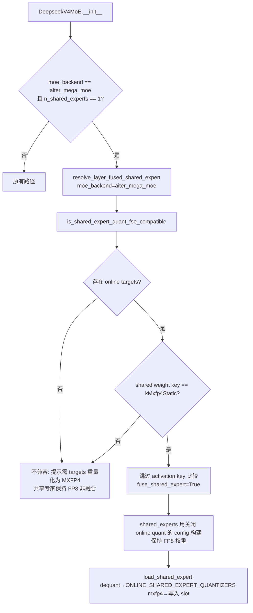

# PR #61345: [ROCm][DSv4] Require explicit MXFP4 opt-in for MegaMoE shared-expert fusion

> **Author**: @AMD-yanfeiwang | **State**: OPEN | **Date**: 2026-10-13
> **Branch**: `AMD-yanfeiwang/vllm:rocm-dsv4-megamoe-fse-precision` → `vllm-project/vllm:main` | **Labels**: deepseek, DSv4, quantization, rocm, verified
> **Changes**: 2 个 commit，约 +120 / -40 行，共 9 个文件（来自 diff 统计，未取到 API 精确数字） | **ROCm 相关性**: 完全相关
> 本报告分两部分：§1–6 为 PR 详细总结，§7–8 为 ROCm review 意见，§9 为可直接粘贴的英文评论。
>
> ⚠️ **数据来源说明**：GitHub REST API 未认证限流（403，且本机无 `gh`），因此 `fetch_pr_data.py` 失败。本报告基于 PR 页面（WebFetch 摘要）与 `.diff` 全文。**CI 状态与逐条 review 评论未能逐条核对**，§5 仅为摘要级别。

---

## 1. 总结 (Summary)

本 PR 是 #61004 的后续：去掉 DeepSeek-V4 AITER MegaMoE 专用环境变量 `VLLM_ROCM_AITER_MEGA_MOE_FUSE_SHARED_EXPERTS`，改为复用 #55686 的通用 online-quant / shared-expert-fusion（FSE）机制。只有用户显式传入 `--quantization-config.targets '{"*shared_experts*": "mxfp4"}'` 时，共享专家才会从 FP8 重量化为 MXFP4 并融合进 MegaMoE；否则保持非融合的 FP8 路径并给出 warning。

## 2. 背景与动机 (Background & Motivation)

- #61004 引入 MegaMoE 共享专家融合，由模型专属 env var 控制，且在加载时静默把 block-FP8 的 shared expert 重量化成 MXFP4（精度有损）。
- 重量化改变数值精度，应由用户明确同意（opt-in），而不是一个隐藏的 DSv4 专属开关。
- reviewer 反馈：避免 DSv4 专属逻辑，复用已有量化抽象；完整的 MegaMoE oracle 集成留待后续。
- 精度数据（作者提供，DeepSeek-V4-Pro / MI355X / GSM8K 5-shot lm-eval）：融合(MXFP4) 0.9469 ± 0.006，非融合(FP8) 0.9545 ± 0.006。

## 3. 代码修改分析 (Code Change Analysis)

### 3.1 修改的模块

| 模块 | 文件 | 说明 |
|---|---|---|
| 融合兼容性判定 | `layers/quantization/utils/config_utils.py` | `is_shared_expert_quant_fse_compatible` 新增 `moe_backend` 参数；新增 DSv4 FP8 + fp4 expert + `aiter_mega_moe` 分支；MegaMoE 下跳过 activation key 比较；无 target 时直接返回不兼容 |
| FSE 解析 | `layers/fused_moe/utils.py` | `resolve_layer_fused_shared_expert` 透传 `moe_backend` |
| 模型 | `models/deepseek_v4/amd/model.py` | MegaMoE 的 `fuse_shared_expert` 改由 `resolve_layer_fused_shared_expert` 决定；融合时对 shared expert 使用关闭了 online quant 的 `copy.copy(quant_config)` |
| MegaMoE 权重加载 | `models/deepseek_v4/amd/mega_moe.py` | 手写 FP8 dequant→`mxfp4_quantize` 改为 `ONLINE_SHARED_EXPERT_QUANTIZERS[kMxfp4Static]` + `get_and_maybe_dequant_weights` |
| 通信 | `distributed/device_communicators/all2all.py` | `MORI_SHMEM_HEAP_SIZE` 的 16G/8G 选择由旧 env 改为 `VLLM_ROCM_USE_AITER_FUSION_SHARED_EXPERTS and online_targets` |
| env | `vllm/envs.py` | 删除 `VLLM_ROCM_AITER_MEGA_MOE_FUSE_SHARED_EXPERTS` |
| 测试 | `test_fused_shared_expert.py`, `test_deepseek_v4_aiter_mega_moe.py` | 新增 4 参数化 CPU 测试 + Quark weight-only 回归测试 |

### 3.2 架构 / 流程图



### 3.3 关键实现细节

- 新增 DSv4 分支把 routed 权重 key 设为 `kMxfp4Static`、activation key 设为 `None`，理由是 MegaMoE 自行量化每个 slot 的激活。
- 通过 `moe_backend` 字符串（`"aiter_mega_moe"`）在通用 helper 内分支，而非传入能力对象，是妥协方案。
- 同时导入 `deepseek_v4` 与 `deepseek_v41` 两份 `DeepseekV4FP8Config`（同名类）。
- 删除 env var 无弃用过渡。

## 4. 涉及的技术原理 (Technical Principles)

- **Shared-expert fusion (FSE)**：把共享专家当作一个额外 routed expert slot 放入同一个 MoE kernel，省去独立 GEMM launch；要求共享专家与 routed 专家的量化格式一致。
- **MegaMoE (AITER/MoRI)**：dispatch/combine 的 workspace 放在 MoRI symmetric heap（默认 2GB），融合共享专家需要更大 heap，所以才有 8G/16G 逻辑。
- **MXFP4 online 重量化**：FP8 block-scale → BF16 → MXFP4（packed uint8 + e8m0 scale）。FP8→FP4 是有损转换，故需显式 opt-in。

## 5. 评论区讨论亮点 (Discussion Highlights)

（基于 PR 页面摘要，未逐条核对）
- fxmarty-amd 已 approve；其余 ROCm/量化 code owner（tjtanaa、dllehr-amd、hongxiayang、zyongye 等）待 review。
- 设计共识：不要在模型文件里写 DSv4 专属逻辑，应走通用 FSE helper；完整的 MegaMoE oracle 集成延后。

## 6. 风险与潜在问题 (Risk Analysis)

| 风险 | 严重程度 | 说明 |
|---|---|---|
| 兼容性：env var 被直接删除 | Medium | 见 §7「旧 env 静默失效」 |
| 正确性：activation 检查被整体绕过 | Medium | 见 §7「activation 比较绕过过宽」 |
| 正确性：两条 FSE 路径可能同时生效 | Medium | 见 §7（推测） |
| 性能/资源：heap 大小启发式 | Low | 见 §7 |
| 精度：FP4 融合 GSM8K −0.76pt | Low | 在噪声范围内（合并 σ≈0.0085），单次运行 |
| 测试覆盖 | Medium | 无 ROCm 硬件上的端到端测试；新增测试均为 CPU 级 |

---

## 7. Review 意见 (Findings)

| 类型 | 数量 |
|---|---|
| 🔴 必须修复 | 0 |
| ⚠️ 建议修复 | 3 |
| 📝 建议/备注 | 2 |

**⚠️【正确性】MegaMoE 下 activation key 比较被整体跳过，范围过宽** `[已验证]`
- **问题**: `config_utils.py` 中 `moe_backend != "aiter_mega_moe"` 对所有 quant_config 类型跳过 `activation_quant_key` 比较，而不仅是新增的 DSv4 分支（该分支才有「MegaMoE 自行量化激活」的前提）。
- **影响**: 若 MegaMoE 后端搭配 Quark 等 routed activation key 非 `None` 的配置（例如 weight-only vs 带激活量化），共享专家的激活精度不一致将不再被拒绝；新增的 Quark weight-only 回归测试没有传 `moe_backend`，不覆盖这条路径。
- **行动**: 建议作者把跳过条件收窄为 `routed_activation_key is None and moe_backend == "aiter_mega_moe"`（或只在 DSv4 分支内设置标志），并补一个带 `moe_backend="aiter_mega_moe"` 的 Quark 用例。

**⚠️【兼容性】旧 env var 被删除且无任何提示**
- **问题**: `VLLM_ROCM_AITER_MEGA_MOE_FUSE_SHARED_EXPERTS` 直接移除。vLLM 的 env 读取不会对未知变量报错。
- **影响**: 已在脚本/recipe 中设置该变量的用户会静默回到非融合路径，性能下降却无明确原因。
- **行动**: 建议作者在 MegaMoE 初始化处检测 `os.environ` 中的旧变量并 `logger.warning_once` 指向新用法，同时 grep 仓库内 docs / recipes / benchmark 脚本中的引用。

**⚠️【设计】MegaMoE 融合现在同时依赖通用 env 与 targets，heap 启发式易与实际决策不一致** `[推测]`
- **问题**: `all2all.py` 用 `envs.VLLM_ROCM_USE_AITER_FUSION_SHARED_EXPERTS and online_targets`（任意非空 targets）判断是否分配 16G；实际融合决策由 `resolve_layer_fused_shared_expert` 逐层给出（且要求 targets 对应 mxfp4）。且 `model_config.quantization_config` 若是 dict 而非带 `.targets` 的对象，`getattr` 会得到 `None`。
- **影响**: 若 `quantization_config` 的形态与假设不符，融合开启但 heap 只有 8G，MegaMoEV2 在 >8GB 需求时可能分配失败。反方向（targets 为 mxfp8）只会多占 16G，属浪费。
- **行动**: 建议 review 时追问 `quantization_config` 的实际类型；更稳妥的做法是用与模型一致的决策（例如 targets 中含 mxfp4）判断，或让各层决策结果汇总后再设置 heap。

**📝【正确性】两条 FSE 路径同时生效的可能性** `[推测]`
- **问题**: `model.py` 里原有的 `is_fused_shared_expert_enabled`（通用 AITER FSE，`moe_backend=None`）与新的 `fuse_mega_moe_shared_expert` 是独立计算的。
- **影响**: 若前者也为 True，则 `self.shared_experts = None`，之后 MegaMoE 的 `load_shared_expert(self.shared_experts)` 会拿到 `None`。
- **行动**: 建议 review 时追问：MegaMoE 分支下通用 FSE 是否一定为 False？可加一个断言或互斥保护。

**📝【测试】缺少 ROCm 端到端与精度证据的可复现性**
- **问题**: 新增测试均为 CPU 级逻辑判断；`ONLINE_SHARED_EXPERT_QUANTIZERS[kMxfp4Static]` 的注册与 `get_and_maybe_dequant_weights` 对 block-FP8 的行为未在测试中覆盖（本次也未能核对 #55686 中的实现）。精度对比为单次运行，差值（−0.0076）在噪声范围内，不能说明融合无损。
- **行动**: 建议作者补充 `load_shared_expert` 与旧实现数值等价的单测（FP8 block → MXFP4 输出一致），并附上命令行与 commit。

---

## 8. 结论 (Verdict)

⚠️ **NEEDS WORK**：方向正确（去掉模型专属 env、改为显式 opt-in、复用通用抽象），无阻塞性问题；建议收窄 activation 检查的绕过范围、为删除的 env var 提供迁移提示，并确认 heap 启发式与 FSE 路径互斥假设。

## 9. 英文 Review 评论 (Copy-Paste English Comments)

**C1** `vllm/model_executor/layers/quantization/utils/config_utils.py:171-175` — ⚠️ comment

```text
The `moe_backend != "aiter_mega_moe"` guard skips the activation-key comparison for every quant config type, not only for the new DeepSeek-V4 branch where MegaMoE quantizes activations itself. With a Quark routed-expert config that has a non-None activation key, a mismatched shared expert would now be accepted under MegaMoE. Could you narrow this, e.g. skip the comparison only when `routed_activation_key is None`, and add a test that passes `moe_backend="aiter_mega_moe"` with the Quark weight-only config? The new Quark regression test currently does not pass `moe_backend`, so it does not cover this path.
```

**C2** `vllm/envs.py:153-157` — ⚠️ comment

```text
Removing `VLLM_ROCM_AITER_MEGA_MOE_FUSE_SHARED_EXPERTS` outright means anyone who still sets it silently falls back to the unfused path. Could you log a one-time warning in the MegaMoE init when this variable is present in `os.environ`, pointing to `--quantization-config.targets '{"*shared_experts*": "mxfp4"}'`? Please also check that no docs, recipes or benchmark scripts still reference it.
```

**C3** `vllm/distributed/device_communicators/all2all.py:1017-1024` — ⚠️ comment

```text
I think this heuristic can disagree with the per-layer fusion decision: any non-empty `targets` (e.g. mxfp8) gives 16G, while fusion actually needs an MXFP4 target. Also, is `model_config.quantization_config` guaranteed to be an object with `.targets` here rather than a dict? If it is a dict, `getattr(..., "targets", None)` returns None and the heap stays at 8G while fusion is enabled. Could you confirm the type, or derive the heap size from the same check used by `resolve_layer_fused_shared_expert`?
```
