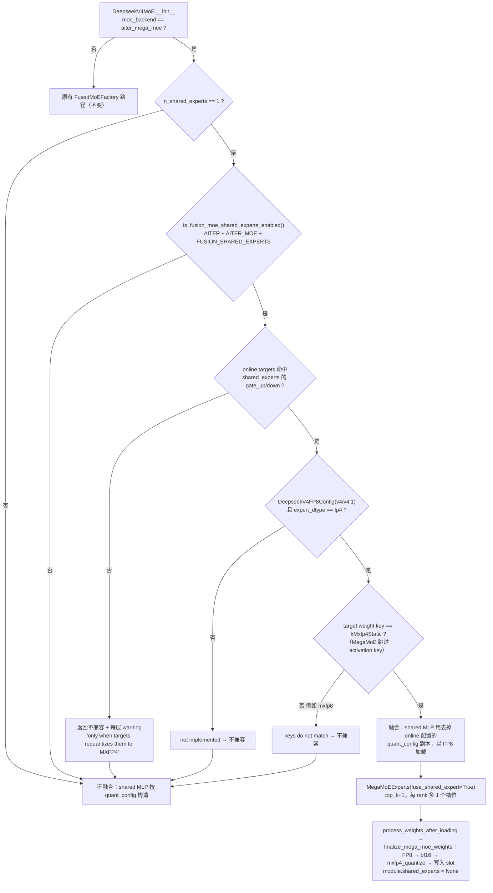
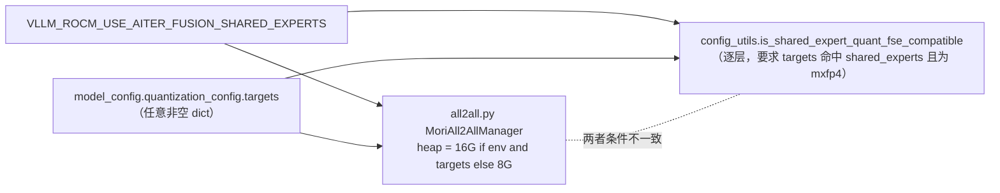

# PR #61345: [ROCm][DSv4] Require explicit MXFP4 opt-in for MegaMoE shared-expert fusion

> **Author**: @AMD-yanfeiwang | **State**: OPEN | **Date**: 2026-10-13
> **Branch**: `AMD-yanfeiwang:rocm-dsv4-megamoe-fse-precision` → `main`（head `57a9f9081e`，base `e8e1e96196`） | **Labels**: deepseek, DSv4, quantization, rocm, verified
> **Changes**: +126 -33 lines across 8 files | **ROCm 相关性**: 完全相关（AMD 专属 `vllm/models/deepseek_v4/amd/`、AITER MegaMoE、MoRI shmem heap、ROCm env var）
> 本报告分两部分：§1–6 为 PR 详细总结，§7–8 为 ROCm review 意见。
>
> 数据来源说明：GitHub REST API 本次被限流，PR diff 通过 `git fetch upstream pull/61345/head` 获取并在本地 checkout 上做了跨文件核对；PR 描述/评论来自 PR 网页。**CI 状态未知**（未能拉取 checks）。

---

## 1. 总结 (Summary)

#61004 在 AMD 上把 DeepSeek-V4 的 shared expert 融合进 AITER MegaMoE（作为每个 rank 的一个额外本地 expert 槽位），代价是把 checkpoint 中的 block-FP8 shared expert **有损地重量化为 MXFP4**，由一个专用 env var `VLLM_ROCM_AITER_MEGA_MOE_FUSE_SHARED_EXPERTS` 开启。本 PR 删除这个专用 env var，把 MegaMoE 的 shared-expert 融合并入通用的 FSE（fused shared expert）判定流程：仍用 `VLLM_ROCM_USE_AITER_FUSION_SHARED_EXPERTS=1` 请求融合，但**只有用户通过 `--quantization-config.targets '{"*shared_experts*": "mxfp4"}'` 显式声明把 shared expert 量化为 MXFP4 时才融合**；否则打 warning，shared expert 以 checkpoint 精度（FP8）不融合运行。重量化逻辑改为复用 #55686 引入的 `get_and_maybe_dequant_weights` + `ONLINE_SHARED_EXPERT_QUANTIZERS`。

## 2. 背景与动机 (Background & Motivation)

- **精度是显式选择**：MegaMoE 的 routed experts 是 MXFP4 权重；融合 shared expert 必须把它的 FP8 block 权重 dequant→MXFP4 requant，这是一次有损精度变化。原实现用一个 ROCm 专用开关静默地做这件事，用户未必意识到 shared expert 精度被降低。本 PR 的立场是：精度降低必须通过 vLLM 已有的在线量化 API（`quantization_config.targets`）显式表达。
- **去掉 DSv4 专属 gate**：reviewer @fxmarty-amd 要求不要为 MegaMoE 单独加 DSv4 特化分支，而是给 `is_shared_expert_quant_fse_compatible` / `resolve_layer_fused_shared_expert` 增加 `moe_backend` 参数，并删除与 #55686 重复的重量化代码。作者照此修改。
- **作者实测**（DeepSeek-V4-Pro，MI355X，DEP4，GSM8K strict）：

  | targets | shared expert | GSM8K |
  |---|---|---|
  | `{"*shared_experts*": "mxfp4"}` | 融合，MXFP4 | 0.9469 ± 0.006 |
  | 无 | 不融合，FP8 + warning | 0.9545 ± 0.006 |

  `[unverified]`：PR 中未附 lm_eval 命令/日志；也**没有给出融合 vs 不融合的吞吐/延迟数据**。
- 将 MegaMoE 做成 oracle 中的通用 backend 被明确推迟到后续 PR。
- 删除 env var 不留 deprecation 期——该 env var 由 #61004（几天前）引入，影响面小；且 `vllm/platforms/interface.py:1463` 会对未知的 `VLLM_*` env var 打 warning。

## 3. 代码修改分析 (Code Change Analysis)

### 3.1 修改的模块

| 文件 | 改动 | 说明 |
|------|------|------|
| `vllm/envs.py` | -7 | 删除 `VLLM_ROCM_AITER_MEGA_MOE_FUSE_SHARED_EXPERTS` 的声明与注册 |
| `vllm/model_executor/layers/quantization/utils/config_utils.py` | +23 -3 | `is_shared_expert_quant_fse_compatible` 新增 `moe_backend`：① 在线 targets 分支新增 DSv4/DSv4.1 `DeepseekV4FP8Config` + `expert_dtype=="fp4"` + MegaMoE 的 routed key（`kMxfp4Static`, act=None）；② MegaMoE 下只比较 weight key、跳过 activation key；③ 无 targets 时 MegaMoE 直接返回不兼容 |
| `vllm/model_executor/layers/fused_moe/utils.py` | +3 | `resolve_layer_fused_shared_expert` 透传 `moe_backend` |
| `vllm/models/deepseek_v4/amd/model.py` | +18 -7 | `DeepseekV4MoE.__init__`：用 `resolve_layer_fused_shared_expert(..., moe_backend="aiter_mega_moe")` 决定是否融合；融合时给 shared MLP 一个 `copy.copy(quant_config)` 并去掉 `online_quantization_config`，让 shared MLP 以 checkpoint FP8 加载 |
| `vllm/models/deepseek_v4/amd/mega_moe.py` | +6 -12 | `load_shared_expert` 改为 `get_and_maybe_dequant_weights(linear, bf16)` → `ONLINE_SHARED_EXPERT_QUANTIZERS[kMxfp4Static]`（即 `mxfp4_quantize`）；去掉 "must be block-FP8" 断言 |
| `vllm/distributed/device_communicators/all2all.py` | +10 -4 | MoRI shmem heap 默认值：`VLLM_ROCM_USE_AITER_FUSION_SHARED_EXPERTS` 且 `model_config.quantization_config.targets` 非空 → 16G，否则 8G |
| `tests/models/test_deepseek_v4_aiter_mega_moe.py` | +37 | CPU 参数化测试：MegaMoE 只在 targets=mxfp4 时兼容；mxfp8 / 无 targets / 非 MegaMoE backend 均不兼容 |
| `tests/model_executor/layers/test_fused_shared_expert.py` | +27 | Quark weight-only MXFP4 routed experts（BF16 激活）+ shared `mxfp4` target 仍判为不兼容（确认非 MegaMoE 路径的 activation key 比较未被放松） |

### 3.2 架构 / 流程图

**FSE 判定流程（MegaMoE 路径，PR 之后）**



**MoRI heap 大小决策与 FSE 决策是两处独立的判定**



### 3.3 关键实现细节

- **兼容性判定新分支**（`config_utils.py:129-135`）：对 `DeepseekV4FP8Config` 两个类（`vllm.models.deepseek_v4` 与 `vllm.models.deepseek_v41`）都接受。这一点是必要的：在 CUDA/ROCm 上 `get_quantization_config("deepseek_v4_fp8")` 注册的是 **v4.1 的类**（`quantization/__init__.py:120-129`），即使跑的是 DSv4 checkpoint。
- **activation key 豁免**（`config_utils.py:174-177`）：`moe_backend == "aiter_mega_moe"` 时只比较 weight key。原因：MegaMoE 内部对所有 slot 的激活统一做 MXFP8 量化，与 target 所隐含的 activation 方案无关。非 MegaMoE 路径保持原比较（新测试 `test_online_mxfp4_shared_expert_rejects_quark_weight_only_mxfp4_fse` 守住这一点）。
- **shared MLP 用去 online 的配置副本**（`model.py:680-683`）：否则在线量化 overlay（`base_config.py` 的 online 分支）会把 shared MLP 先量化成 MXFP4 linear，MegaMoE 再 dequant/requant 就成了二次量化。去掉 online 配置后 shared MLP 以 checkpoint 的 `Fp8LinearMethod`（block-FP8）加载，MegaMoE 在 `finalize_mega_moe_weights` 里一次性 FP8→bf16→MXFP4。
- **重量化实现**（`mega_moe.py:135-146`）：`get_and_maybe_dequant_weights` 对 `Fp8LinearMethod`（非 marlin、非 DeepGEMM）走 `scaled_dequantize(weight, weight_scale[_inv], layer.weight_block_size)` 快路径，与旧代码的 `scaled_dequantize(... GroupShape 由形状推导 ...)` 数学等价；其它 quant method 走"喂单位阵"的通用 O(N³) 路径。旧的 `assert block_scale is not None, "shared expert must be block-FP8"` 被去掉。
- **调用时序**：`finalize_mega_moe_weights` 在 `DeepseekV4ForCausalLM.process_weights_after_loading` 开头执行，即各层 `quant_method.process_weights_after_loading` 之后；读取的是 Fp8LinearMethod 处理后的权重/scale（与旧实现相同的前提）。
- **legacy FSE 路径不受影响**：DSv4 的旧 FSE 判定 `_fuse_shared_experts_enabled` 要求 `not enable_expert_parallel`，而 MegaMoE 强制 EP，因此两条 FSE 路径在 MegaMoE 下互斥，不会出现"旧路径置 `shared_experts=None` 而 MegaMoE 未融合"导致 shared expert 被丢弃的情况（已核对 `model.py:517-540, 650-668, 685`）。
- **DSv4.1**：`deepseek_v41/amd/model.py` 中 `use_mega_moe = False` 写死，因此 v4.1 类在本 PR 中的价值只是"DSv4 在 GPU 平台上解析出的类就是 v4.1 类"，而不是让 DSv4.1 模型可以用 MegaMoE。

## 4. 涉及的技术原理 (Technical Principles)

- **Fused Shared Expert (FSE)**：DeepSeek 系 MoE 中每个 token 都要经过 shared expert。FSE 把 shared expert 当作一个"每个 token 都必选、权重 1.0"的额外 expert，拼进 routed experts 的 grouped GEMM，从而省掉一次独立 MLP（两次 GEMM + 激活 + kernel launch）并与 routed 计算重叠。前提是 shared expert 的权重格式必须与 routed experts 一致——这正是本 PR 关心的"量化 key 兼容性"。
- **AITER MegaMoE（MegaMoEV2）**：gfx950 上把 dispatch → grouped GEMM（a8w4：MXFP8 激活 × MXFP4 权重）→ combine 融为一个 persistent kernel，dispatch/combine 的 workspace 放在 MoRI 的对称堆（symmetric heap）上。融合 shared expert 时每 rank 多一个本地 expert、每 token 多一条路由（路由到本 rank 的 shared slot），因此 workspace 变大（PR 注释：>8 GB）。
- **MXFP4 / MXFP8（OCP Microscaling）**：每 32 个元素共享一个 E8M0 scale，元素分别为 FP4 E2M1 / FP8 E4M3。FP8 block(128×128) → MXFP4(1×32) 是有损的：元素从 3 位尾数降到 1 位尾数，故 GSM8K 有约 −0.8pt 的观测差（在两倍标准误内，不显著，但方向符合预期）。
- **vLLM 在线量化 overlay**：`quantization_config.targets` 以 fnmatch 模式把某些层"在线"量化到指定格式；对已量化的 checkpoint 层，online method 会 `set_requantization_source(base_quant_method)` 先 dequant 再 requant。`ONLINE_SHARED_EXPERT_QUANTIZERS` 是 #55686 引入的、按 routed weight key 索引的 shared-expert 量化函数表，目前仅 `kMxfp4Static → mxfp4_quantize`。
- **MoRI shmem heap**：MoRI 在初始化时按 `MORI_SHMEM_HEAP_SIZE` 预留每 rank 的对称显存，进程生命周期内不可扩容；设小了 MegaMoE 初始化/运行会失败，设大了直接吃掉 KV cache 可用显存。

## 5. 评论区讨论亮点 (Discussion Highlights)

- **@fxmarty-amd（第一轮）**：质疑 MegaMoE 是否应保持 DSv4 专属，建议进 oracle；建议给 `is_shared_expert_quant_fse_compatible` 加 `moe_backend` 参数以避免 DSv4 特化 gate；要求删除与 #55686 重复的重量化代码。→ 作者全部采纳（oracle 化推迟到后续 PR）。
- **作者提出的设计问题**："MegaMoE quantizes activations to MXFP8 itself, so for this backend I compare only the weight key. A `"mxfp4"` target implies MXFP4 activations. Is that OK?" → @fxmarty-amd 以 "LGTM (just skimming through)" 认可，作为在 MegaMoE 架构改进前的过渡方案。这意味着 `"mxfp4"` 这个 target 在 MegaMoE 下的语义是"W4 + MegaMoE 自带的 MXFP8 激活"，与它在普通 linear 上的语义不同（见 §7）。
- **@tpopp**：在 `all2all.py` 上留了评论，已标记 outdated（对应 heap 判定的早期版本）。
- 自动 claude[bot] review 在 fork 上被禁用。

## 6. 风险与潜在问题 (Risk Analysis)

| 风险 | 严重程度 | 说明 |
|------|---------|------|
| MoRI heap 判定与 FSE 判定不一致 | Medium | 任意非空 targets + env 即 16G，可能白占每 rank 8 GB 显存；见 §7「MoRI heap 判定过宽」 |
| 精度 | Low | 融合即 MXFP4 重量化，已改为显式 opt-in；GSM8K −0.8pt 不显著 |
| 性能收益缺乏数据 | Low | PR 未给融合 vs 不融合的吞吐/TPOT，无法评估 opt-in 的价值 |
| 兼容性：删除 env var | Low | 仅存活数天；未知 env 有 warning；使用旧 env 的用户会静默回到"不融合" |
| 测试覆盖 | Medium | 只测了纯函数判定；模型装配、heap 选择、新 dequant 路径都没有测试；见 §7 |
| 日志噪音 | Low | 无 targets 时每个 MoE 层都打一次 warning |
| 可维护性 | Low | `"mxfp4"` target 在 MegaMoE 下语义被重载；同文件 v4/v4.1 类判断不一致 |

---

## 7. Review 意见 (Findings)

| 意见类型 | 🔴 | ⚠️ | 📝 |
|---------|----|----|----|
| 【性能】/【设计】 | 0 | 1 | 1 |
| 【测试】 | 0 | 1 | 0 |
| 【可维护性】 | 0 | 0 | 3 |
| 【注释/文档】 | 0 | 0 | 1 |

整体判断：核心逻辑正确。已跨文件核对 legacy FSE 与 MegaMoE FSE 在 EP 下互斥，不存在 shared expert 被静默丢弃的路径；新 dequant 路径对 `Fp8LinearMethod` 与旧实现数学等价；两个 `DeepseekV4FP8Config` 类都被接受（ROCm 上实际注册的是 v4.1 类）。未发现需阻塞的问题。

### ⚠️ 建议修复

**⚠️【性能】MoRI heap 判定过宽：任意非空 `targets` 都会把 heap 提到 16G** `[已验证]`
- **问题**: `vllm/distributed/device_communicators/all2all.py:1017-1025` 用 `envs.VLLM_ROCM_USE_AITER_FUSION_SHARED_EXPERTS and online_targets` 选 16G，`online_targets` 只要是非空 dict 就为真。而实际是否融合由 `is_shared_expert_quant_fse_compatible` 逐层判定，要求 targets 命中 `shared_experts` 的 gate_up/down 且 weight key 为 `kMxfp4Static`。
- **影响**: 触发输入：`--moe-backend aiter_mega_moe` + `VLLM_ROCM_USE_AITER_FUSION_SHARED_EXPERTS=1` + `--quantization-config.targets '{"*shared_experts*": "mxfp8"}'`（或 `{"*attn*": "fp8"}` 之类不涉及 shared expert 的 targets）。此时没有任何层融合，但每个 rank 仍预留 16G 对称堆，比必要的 8G 多占 8 GB HBM，直接压缩 KV cache 容量。且同一个决策在两处用不同条件实现（twin divergence），后续任何一边改动都容易不同步。
- **行动**: 建议作者让 heap 判定复用同一个谓词，例如用 `OnlineQuantizationConfig(...).resolve_quant_method_cls(LinearBase, "<...>.shared_experts.gate_up_proj")` 检查 target 是否解析为 MXFP4，或至少检查 `targets` 中是否有值为 `"mxfp4"` 且能匹配 `shared_experts` 的 pattern；并在注释里说明这是保守上界。用户显式设置的 `MORI_SHMEM_HEAP_SIZE` 仍会被 `setdefault` 尊重，这一点保持不变即可。

**⚠️【测试】新增测试只覆盖纯函数判定，模型装配与重量化路径没有测试** `[已验证]`
- **问题**: 两个新测试都只调用 `is_shared_expert_quant_fse_compatible`。未覆盖：(a) `DeepseekV4MoE.__init__` 中 `fuse_mega_moe_shared_expert` → `shared_quant_config` 去 online 副本 → `DeepseekV4AiterMegaMoEExperts(fuse_shared_expert=True)` 的装配（`vllm/models/deepseek_v4/amd/model.py:670-683`）；(b) `load_shared_expert` 从 `scaled_dequantize + get_fp8_block_weight_scale` 换成 `get_and_maybe_dequant_weights` 后的数值等价性（`mega_moe.py:135-146`）；(c) all2all heap 选择。另外 `test_mega_moe_shared_expert_fusion_requires_mxfp4_target` 只构造了 v4.1 的 `DeepseekV4FP8Config`，v4 类分支没有用例。
- **影响**: (a) 是本 PR 最关键的行为——若将来有人移除 `online_quantization_config = None` 这一行，shared MLP 会被在线量化为 MXFP4 linear，再被 MegaMoE dequant/requant 一次，带来二次量化，而现有测试全部仍能通过。(b) 旧代码对非 block-FP8 显式 assert；新代码会静默落入 `get_and_maybe_dequant_weights` 的单位阵通用路径（O(N³)，且依赖 `quant_method.apply` 对单位阵输入的行为），回归不可见。
- **行动**: 建议作者补充：一个 CPU 用例，对一个 block-FP8 `Fp8LinearMethod` 线性层断言新旧两种 dequant 结果 bitwise 相同（或断言 `load_shared_expert` 写入 slot 的 uint8 与旧实现一致）；一个用例断言 MegaMoE 融合时 shared MLP 的 `quant_method` 不是 online 方法；把 `DeepseekV4FP8Config` v4 类加入参数化。若认为 (b) 的通用路径不应被使用，建议恢复一个显式检查（例如 `assert isinstance(linear.quant_method, Fp8LinearMethod)`）以保留 fail-fast。

### 📝 建议 / 备注

**📝【设计】请补充融合带来的性能收益数据** `[已验证]`
- **问题**: PR 描述只有 GSM8K（0.9469 融合 vs 0.9545 不融合，差 0.0076，两个 stderr 0.006 合成约 0.0085，不显著）。没有吞吐 / TPOT / TTFT 对比，也没有 lm_eval 命令和日志（数字 `[unverified]`）。
- **影响**: opt-in 的前提是"用户在精度和性能间做取舍"，但当前 PR 和 #61004 都没告诉用户换来了多少性能；融合还多占 8 GB heap（16G vs 8G）。
- **行动**: 建议作者在 PR 描述中补充相同配置下融合/不融合的 serving benchmark（含并发、ISL/OSL），以及 lm_eval 命令，便于用户判断是否值得开启。

**📝【可维护性】`"mxfp4"` target 在 MegaMoE 下的语义被重载** `[已验证]`
- **问题**: `config_utils.py:174-177` 在 MegaMoE 下跳过 activation key 比较。`"mxfp4"` 这个 shorthand 在普通 linear 上意味着 MXFP4 激活，但在 MegaMoE 融合下实际是"MXFP4 权重 + MegaMoE 内部 MXFP8 激活"，且 online 量化方法本身根本不会被实例化（shared MLP 的 online 配置被移除）。reviewer 已接受此过渡方案。
- **行动**: 建议作者在 `is_shared_expert_quant_fse_compatible` 的注释或 MegaMoE 文档中写明：MegaMoE 下 target 只决定权重格式，激活格式由 kernel 决定；后续 oracle 化时再引入显式的 activation key（例如 `kMxfp8Dynamic`）来比较。

**📝【可维护性】无 targets 时每个 MoE 层都打一次相同 warning** `[已验证]`
- **问题**: 用户按新文档只设 `VLLM_ROCM_USE_AITER_FUSION_SHARED_EXPERTS=1` 而未设 targets 时，`resolve_layer_fused_shared_expert`（`fused_moe/utils.py:124-129`，`logger.warning` 而非 `warning_once`）会对 DSv4-Pro 的每个 MoE 层（约 60 层 + MTP 层）打印同一条 "AITER MegaMoE fuses the shared experts only when ..." 警告，且每个 DP rank 都打。
- **行动**: 建议改为 `logger.warning_once`（MegaMoE 下 reason 对所有层相同），或在 `DeepseekV4Model` 层面汇总后打印一次。

**📝【可维护性】同一函数中 v4 / v4.1 `DeepseekV4FP8Config` 的判断不一致** `[推测]`
- **问题**: 新分支 `config_utils.py:130` 同时接受 v4 和 v4.1 两个类，但紧随其后的既有分支 `config_utils.py:192` `isinstance(quant_config, DeepseekV4FP8Config)` 只认 v4 类。而 CUDA/ROCm 上 `get_quantization_config` 返回的是 v4.1 类（`quantization/__init__.py:120-129`），所以该 Quark-MXFP4 专用分支在 GPU 平台上不可达，v4.1 实例会落到后面通用的 `Fp8Config` 分支。这是既有问题，不是本 PR 引入的；具体后果（非 MegaMoE 的 DSv4 Quark MXFP4 checkpoint 是否会被误判兼容）未在本地 HW 上验证。
- **行动**: 建议 review 时追问作者：既然本 PR 已经意识到两个类并存，是否顺手把 `:192` 也改成元组判断，或开一个 follow-up issue。

**📝【注释/文档】在线量化日志会把融合的 shared expert 计为 "online quantized"** `[已验证]`
- **问题**: `resolve_layer_fused_shared_expert` 在融合时把 shared expert 的投影注册进原始 `online_quantization_config.quantized_layers`，但实际做重量化的是 `finalize_mega_moe_weights`，不是 online 方法；`online_quantization_time` 也不包含这部分耗时。
- **影响**: 仅日志层面：`Quantizing N layers of types: ...shared_experts.gate_up_proj (from targets: *shared_experts*, mxfp4)` 是对的，耗时统计略偏低。
- **行动**: 可以接受；建议在 `model.py:680-683` 的注释中提一句，避免后人以为 online 方法真的被调用了。

## 8. 结论 (Verdict)

⚠️ **NEEDS WORK（小改动）** —— 设计方向正确（把有损精度变化交给显式的在线量化 API 表达），核心判定逻辑和 legacy/MegaMoE 两条 FSE 路径的互斥关系都已核对无误，没有阻塞问题。建议合入前收紧 MoRI heap 的 16G 判定，使其与逐层 FSE 判定一致，并补上模型装配和重量化等价性的测试；性能数据、warning_once 等为非阻塞建议。CI 状态未能获取，合入前请确认 ROCm CI 通过。

## 9. 英文 Review 评论 (Copy-Paste English Comments)

**C1** `vllm/distributed/device_communicators/all2all.py:1017-1025` — ⚠️ comment

```text
This heap-size predicate is looser than the actual fusion decision. Any non-empty `targets` dict plus `VLLM_ROCM_USE_AITER_FUSION_SHARED_EXPERTS=1` selects 16G, but `is_shared_expert_quant_fse_compatible` only fuses when the target resolves the shared_experts projections to `mxfp4`. For example, `{"*shared_experts*": "mxfp8"}` or `{"*attn*": "fp8"}` fuses nothing, yet every rank still reserves an extra 8 GB of symmetric heap, which comes straight out of KV cache. Could you derive this from the same predicate (e.g. resolve the shared_experts gate_up_proj prefix through `OnlineQuantizationConfig.resolve_quant_method_cls` and check for MXFP4), or at least require an `mxfp4` value whose pattern matches `shared_experts`? That would also keep the two decisions from drifting apart later.
```

**C2** `vllm/models/deepseek_v4/amd/model.py:670-683` — ⚠️ comment

```text
This is the most important behavioral piece of the PR, but none of the new tests cover it: they only call `is_shared_expert_quant_fse_compatible`. If someone later drops `shared_quant_config.online_quantization_config = None`, the shared MLP would be online-quantized to an MXFP4 linear first and then dequantized and requantized again by MegaMoE (double quantization), and all current tests would still pass. Could you add a CPU test that builds `DeepseekV4MoE` (or a minimal equivalent) with `moe_backend="aiter_mega_moe"` and an `mxfp4` shared-expert target, and asserts that the shared MLP keeps the checkpoint FP8 method? Adding the v4 `DeepseekV4FP8Config` class to the parametrization in `test_mega_moe_shared_expert_fusion_requires_mxfp4_target` would also help, since it only exercises the v4.1 class right now.
```

**C3** `vllm/models/deepseek_v4/amd/mega_moe.py:135-146` — ⚠️ comment

```text
Reusing `get_and_maybe_dequant_weights` is nice, but it removes the old `"shared expert must be block-FP8"` fail-fast. For a non-`Fp8LinearMethod` layer, this now silently falls back to the identity-matrix path, which is O(N^3) and depends on `quant_method.apply` behaving well on an identity input. I think it's worth either keeping an explicit check here (e.g. that `linear.quant_method` is `Fp8LinearMethod` with block quant), or adding a small CPU test that checks the bytes written to the shared slot are identical to the previous `scaled_dequantize(weight, weight_scale_inv, group)` + `mxfp4_quantize` path for a block-FP8 layer.
```

**C4** `vllm/model_executor/layers/fused_moe/utils.py:84` — ⚠️ comment (the warning itself is at L124-129, which is outside the diff)

```text
Minor: with this change, users who set only `VLLM_ROCM_USE_AITER_FUSION_SHARED_EXPERTS=1` under `--moe-backend aiter_mega_moe` without targets will see the "cannot be enabled - skipping for this layer" warning once per MoE layer per rank (around 60+ layers for DSv4-Pro, plus MTP). Under MegaMoE the reason is the same for every layer, so `logger.warning_once` (or one model-level summary) would be much less noisy.
```
