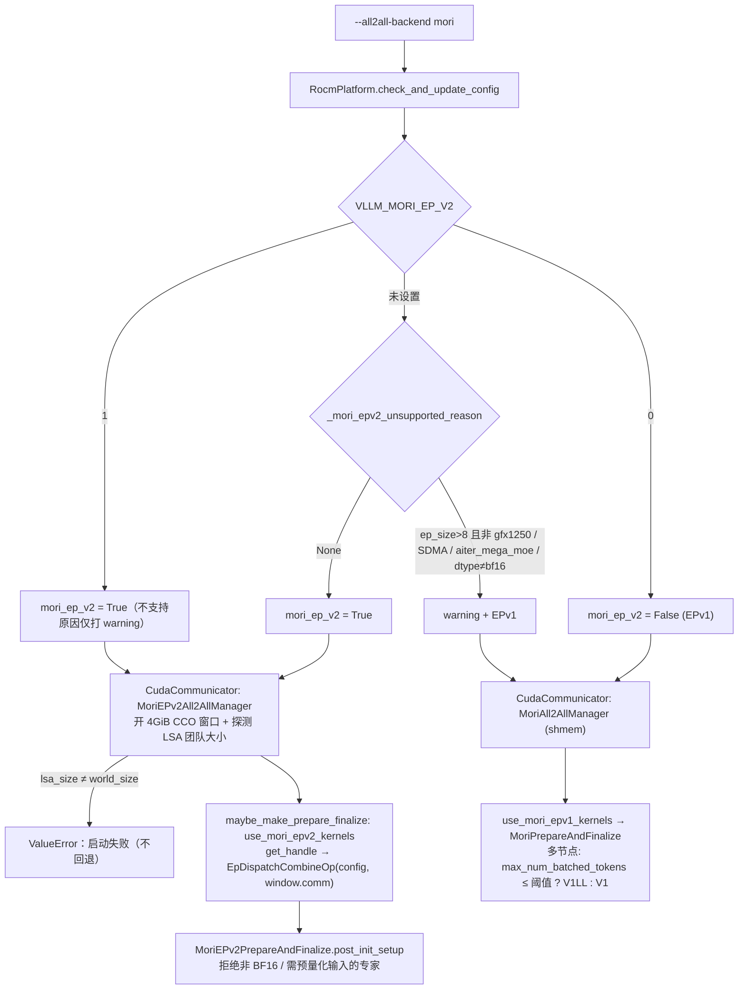
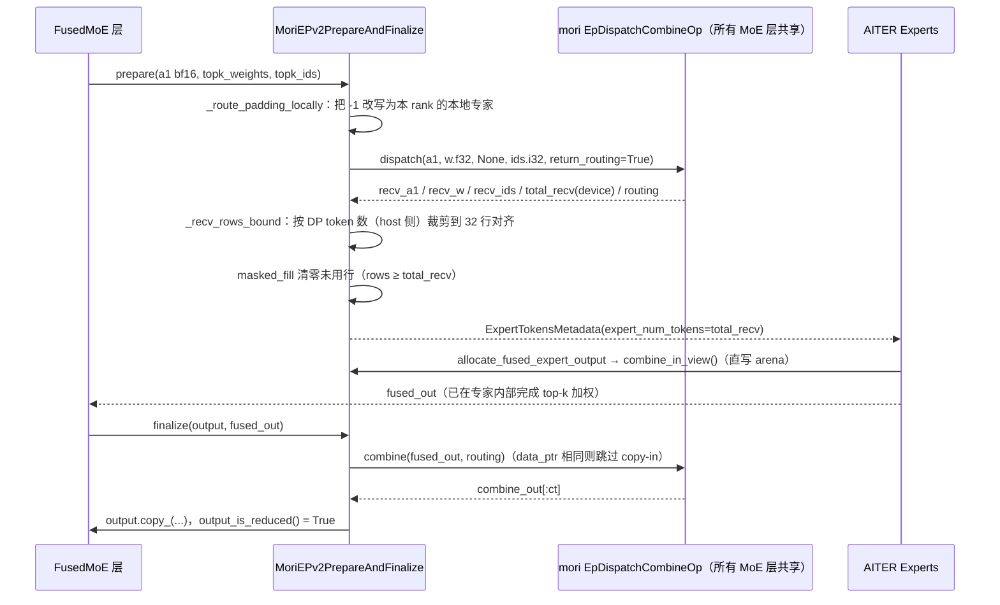

# PR #61361: [MORI] Add MORI EP V2 support

> **Author**: @ChengYM5685 | **State**: OPEN | **Date**: 2026-10-13
> **Branch**: `feat/mori-epv2` → `main` | **Labels**: documentation, rocm, deepseek, gpt-oss, nvidia, DSv4, minimax
> **Changes**: +1006 -25 lines across 21 files | **ROCm 相关性**: 完全相关（MoRI EP all2all 后端，ROCm 专属）
> 本报告分两部分：§1–6 为 PR 详细总结，§7–8 为 ROCm review 意见。
> Review 基于 head `d2387119`；交叉验证读取了 PR head 的完整源码（含调用方）以及本地 MoRI 源码（`e6ddd2a`）和 Docker 镜像 pin 的 `v1.2.3.post1`。

---

## 1. 总结 (Summary)

本 PR 新增 `--all2all-backend mori`，这是一个统一的 MoRI 专家并行 all2all 后端：支持的场景下运行 MoRI EPv2（`mori.ops.dispatch_combine_v2`，通过 MoRI CCO 对称内存窗口直接读写对端 GPU 显存），其余场景回退到 MoRI EPv1。EPv2/EPv1 的选择在 ROCm 平台 `check_and_update_config` 中一次性完成（`resolve_mori_all2all`），可用 `VLLM_MORI_EP_V2` 强制覆盖。在 8×MI355X 单节点 DeepSeek-V4-Pro DP8+EP8 场景下，作者报告输出吞吐比 `mori_high_throughput` 高约 13%，TPOT 低约 11%，GSM8K 精度持平。

## 2. 背景与动机 (Background & Motivation)

- 现有 MoRI 后端（`mori_high_throughput`、`mori_low_latency`）都运行 MoRI EPv1（基于 shmem 的 `EpDispatchCombineOp`）；两者在单节点上跑同一个 IntraNode kernel，只在多节点时区分 InterNodeV1 和 InterNodeV1LL。
- MoRI 上游新增了 EPv2（`dispatch_combine_v2`）：基于 `mori.cco` 的 LSA（load/store-accessible）团队和对称 arena，gather 模式 combine，并支持“专家直接写入 combine staging”。所以单节点上有降低 dispatch/combine 开销的空间，低并发 decode 下尤其明显。
- 作者的长期目标（Follow-ups）是让 `mori` 成为唯一的 MoRI 后端：先 deprecate 再移除 `mori_high_throughput`/`mori_low_latency`，后续补 EPv2 跨节点（RDMA）和量化（FP8/FP4）dispatch。
- 同时，EPv1 的标志 `use_mori_kernels` 改名为 `use_mori_epv1_kernels`，与新的 `use_mori_epv2_kernels` 并列。改名让遗漏的 EPv1 调用方显式报错，而不是在 EPv2 下静默运行。

## 3. 代码修改分析 (Code Change Analysis)

### 3.1 修改的模块

| 模块 | 改动 |
|------|------|
| `vllm/config/parallel.py` (+93) | 新增 `"mori"` 后端字面量、`ParallelConfig.mori_ep_v2` 字段、`resolve_mori_all2all` / `_resolve_mori_ep_v2` / `_mori_epv2_unsupported_reason`（EPv2 适用性判定）；`use_sequence_parallel_moe` 加入 `mori` |
| `vllm/platforms/rocm.py` (+11) | 在 `check_and_update_config` 中调用 `resolve_mori_all2all`，传入 gfx1250 相关的 `lsa_spans_hosts` / `sdma_picks_epv1` |
| `vllm/envs.py` (+10) | 注册 `VLLM_MORI_EP_V2`（三态 bool）和 `VLLM_MORI_DISPATCH_INTER_KERNEL_SWITCH_THRESHOLD`（默认 256） |
| `vllm/distributed/device_communicators/all2all.py` (+122) | `MoriAll2AllManager` 接受 `"mori"`，多节点按 token 预算选择 V1LL/V1；新增 `MoriEPv2All2AllManager`（CCO 窗口管理、LSA 团队探测、arena 大小估算 `_mori_epv2_arena_bytes`、op 缓存与销毁） |
| `vllm/distributed/device_communicators/cuda_communicator.py` (+10) | `mori` + `mori_ep_v2` 时实例化 EPv2 manager，否则用 EPv1 manager |
| `vllm/model_executor/layers/fused_moe/prepare_finalize/mori_epv2.py`（新增 235 行） | `MoriEPv2PrepareAndFinalize`：BF16 dispatch、DP padding token 本地路由、接收行数上界裁剪、未用行清零、专家直写 combine staging、gather combine |
| `fused_moe/config.py` / `all2all_utils.py` | `use_mori_kernels` 改名为 `use_mori_epv1_kernels`，新增 `use_mori_epv2_kernels`；构造 EPv2 prepare/finalize，并检查专家数能被 EP 均分 |
| `fused_moe/experts/rocm_aiter_moe.py`、`models/deepseek_v32/amd/model.py`、`models/deepseek_v4/amd/model.py` | 跟进改名；DSV4 MegaMoE 校验改为只允许 EPv1 |
| `experts/gpt_oss_triton_kernels_moe.py`、`models/deepseek_v4/amd/rocm.py` + 测试 | **与 MoRI 无关**的 gfx1250 改动（Triton MoE 设备支持、跳过 attn preshuffle） |
| `docs/serving/expert_parallel_deployment.md` (+43) | 新增 “MoRI EP (ROCm)” 一节，说明版本选择表、EPv2 限制和后端选择建议 |
| 测试 | 新增 `test_mori_epv2_prepare_finalize.py`（377 行，基于 FakeOp/Mock），`test_moe_layer.py` 增加 `mori`（固定 EPv2）参数，modular kernel 工具注册 EPv2 P/F |

### 3.2 架构 / 流程图

**EPv2/EPv1 选择与组件装配：**



**EPv2 单层前向（prepare → experts → finalize）：**



### 3.3 关键实现细节

- **版本解析** `resolve_mori_all2all`：`VLLM_MORI_EP_V2` 为三态值（`maybe_convert_bool`）。未设置时按 4 条规则自动选择（EP>8 且非 gfx1250、`MORI_ENABLE_SDMA=1` 且非 gfx1250、`aiter_mega_moe`、`model_config.dtype != bf16`），只在引擎进程的平台钩子里执行一次，结果随 `ParallelConfig.mori_ep_v2` 序列化到 worker。
- **CCO 窗口**：`MoriEPv2All2AllManager.__init__` 先开一个 4 GiB（仅保留 VA）的窗口，用 `create_dev_comm(GDA_CONNECTION_NONE)` 读 `lsa_size`，要求它等于 EP world size（拓扑错误在加载权重前失败）。UID 用 `broadcast_object_list(group_src=0)` 在 EP 组内广播（已按 review 修复）。
- **arena 预算**：`_mori_epv2_arena_bytes` 在 vLLM 侧复刻了 MoRI 的 arena 布局上界（每接收行 token+combine+scale(128B 对齐)+topk*8+4，加 12 个 256B 对齐 region），再按 1 GiB 取整，从窗口的 `free_bytes` 中扣除；不够时新开一个窗口（`_open_window` 是集合操作）。
- **op 共享**：`handle_cache` 以 `(hidden_dim, max_num_inp_token_per_rank, num_experts_per_rank, num_experts_per_token)` 为 key，所以同构的所有 MoE 层共用一个 op。routing handle 引用 op 自有的缓冲，只在下一次 `dispatch(return_routing=True)` 之前有效；层是串行执行的，所以安全。`supports_async()=False`，再加上 modular kernel 中的 `assert not dbo_enabled() or supports_dbo()`，DBO 被排除。
- **DP padding**：EPv2 没有 invalid-expert 槽位，FlyDSL dispatch 遇到 `-1` 会 fault。因此 padding token 被路由到本 rank 的专家（`rank_expert_offset + k % num_local_experts`），其输出只回到 padding 位置。
- **接收行裁剪** `_recv_rows_bound`：用 `dp_metadata.num_tokens_across_dp_cpu`（host 侧）计算接收上界 `num_dispatchers/n_dp × Σtokens`，按 32 行对齐，减少行清零、专家计算和 copy-in 的工作量。CUDA graph 捕获时 DP 各 rank pad 到同一尺寸，上界仍然成立。
- **专家直写 combine staging**：仅当专家使用 `TopKWeightAndReduceNoOP`（自己做 top-k 规约）且 dtype/shape 匹配时，`allocate_fused_expert_output` 返回 `combine_in_view()` 切片，combine 发现 `data_ptr` 相同即跳过拷贝。
- **EPv1 多节点 kernel**：`mori` 在 EPv1 下用 `max_num_tokens_per_dp_rank`（即 `--max-num-batched-tokens`）与阈值 256 比较，决定用 V1LL 还是 V1；这是一个**静态**选择。

## 4. 涉及的技术原理 (Technical Principles)

- **MoE 专家并行 all2all（dispatch/combine）**：EP 下每个 rank 持有 `num_experts/EP` 个专家。dispatch 按 top-k 路由把 token 发往目标 rank，combine 把专家输出按原 token 顺序收回并聚合。gather 模式下同一 token 对每个目标 rank 只发送一次（rank 内去重），所以接收行数上界是“所有源 token 数之和”。
- **MoRI EPv1 与 EPv2**：EPv1 基于 MoRI shmem（对称堆，默认 2 GB，多节点走 RDMA，有 IntraNode/InterNodeV1/InterNodeV1LL 三种 kernel）。EPv2 基于 `mori.cco`：Communicator 为每个 rank 保留一段 VMM 地址空间（per_rank_vmm），op 在其中分配对称 arena，同一 LSA 团队内的 GPU 可直接 load/store 对端显存（XGMI 单节点或 gfx1250 UALink），省去中间 staging 和 shmem 屏障开销。
- **modular kernel 的 reduced 语义**：`output_is_reduced()=True` 表示 finalize 输出已经在 TP/EP 上规约。MoE runner 据此跳过最终 all-reduce，并对 shared expert 输出单独做 all-reduce。模型侧若设置 `skip_final_all_reduce=True`，前提是 fused 输出**未**规约，runner 中有对应断言（见 §7 🔴）。
- **CUDA graph 与 host 侧形状**：`_recv_rows_bound` 中的 host 计算在捕获时被“烘焙”进图。只要 DP 各 rank 在 replay 时 pad 到同一图尺寸，上界不变就安全。设备侧的 `total_recv` 用 `torch.arange >= total_recv` 做掩码，不需要 host 同步，可以捕获。
- **对称 arena 与 VMM 窗口**：CCO 窗口只保留地址空间，arena 才真正占用 HBM。arena 大小必须与 MoRI 内部 region 布局一致，否则越界或分配失败。这也是 vLLM 复刻 MoRI 布局公式带来的耦合风险所在。

## 5. 评论区讨论亮点 (Discussion Highlights)

- **@Duyi-Wang**：指出 UID 广播用了全局 `src=0`，在 PP=2/DP=2 时 EP 组 `[1,3]` 不含全局 rank 0，会导致启动失败（作者给出了 Gloo 多进程复现）。**已修复**：改为 `group_src=0`，并新增 `test_unique_id_comes_from_the_ep_groups_first_rank`（4 进程真实 Gloo 广播）。
- **@simondanielsson**：① 建议 `mori` 在 EPv2 不支持时直接报错（并改名 `mori-epv2`），以去掉新 env var，也避免出现两种运行 EPv1 的方式。作者**不同意**，计划反过来让 `mori` 成为唯一后端，旧的两个后端保留兼容、之后 deprecate。② 要求文档说明如何选择后端：**已补充** “Choosing a MoRI backend” 一节。③ 指出 `triton_moe.py` 的无关改动：**已移除**（7dbe5a3916）。④ 要求在两个模型上补 GPQA/NIAH/AIME25（带重复）和 1k/8k/64k 多并发 benchmark：**已补充**两轮验证（Qwen3.5-35B-A3B 和 DeepSeek-V4-Pro）。
- **@Fangzhou-Ai**：认为选择规则既然清晰，就应该在初始化时自动选择，而不是依赖手动 env；同时指出 `use_mori_epv2_kernels` 为 True 时语义上 `use_mori_kernels` 也应为 True，命名容易混淆。作者回复：自动选择已经是默认行为，env 仅作覆盖。对于需要 dispatch 前量化的专家（只有构建 communicator 之后才能知道），EPv2 会在启动时拒绝并提示 `VLLM_MORI_EP_V2=0`。命名方面，将旧名改为 `use_mori_epv1_kernels`，而不是改成超集，理由是现有调用方依赖 EPv1 专有行为。**本报告注意到这次改名恰好导致 DSV3.2 AMD 路径在 EPv2 下落入错误分支（§7 🔴）**。
- **验证补充**（作者 10-21、10-26 的评论）：Qwen3.5 上吞吐 1.10–1.56x，DSV4-Pro 上 1.19–2.04x；GPQA/AIME25/NIAH 在一个标准误内一致。但 Qwen3.5 有多个点的 TTFT 明显变差（§7 ⚠️【性能】）。
- 尚无 maintainer approve，`claude[bot]` 因 fork PR 未执行自动 review；mergify 曾提示冲突，作者已 rebase。

## 6. 风险与潜在问题 (Risk Analysis)

| 风险 | 严重程度 | 说明 |
|------|---------|------|
| DSV3.2/GLM AMD 模型在默认 `mori`（EPv2）下断言失败 | High | 见 §7 🔴【正确性】 |
| 自动选择启发式无法识别“EP≤8 但跨节点”，启动直接失败 | Medium | 见 §7 ⚠️【兼容性】 |
| `mori` 的 EPv1 多节点 kernel 选择是静态的，实际几乎总是 V1 | Medium | 见 §7 ⚠️【设计】；会影响将来 `mori_low_latency` 用户迁移 |
| arena 公式复刻 MoRI 私有布局 | Medium | 见 §7 ⚠️【可维护性】；后续接入 FP8/FP4 或跨节点时会失配 |
| TTFT 在部分点退化、性能数字来自旧版本 | Medium | 见 §7 ⚠️【性能】 |
| 测试大量依赖 Mock，AMD CI 状态未知 | Medium | 见 §7 ⚠️【测试】 |
| 混入无关的 gfx1250 改动 | Low | 见 §7 ⚠️【可维护性】 |
| padding 路由在 local experts < topk 时产生重复 id | Low | 见 §7 📝 |
| 共享 op 与弱引用缓存的生命周期 | Low | 见 §7 📝 |
| 兼容性：旧的两个后端行为保持不变 | Low | 已核对：`mori_high_throughput`/`mori_low_latency` 仍走 EPv1，kernel 选择逻辑不变 |

---

## 7. Review 意见 (Findings)

| 类型 | 🔴 | ⚠️ | 📝 |
|------|----|----|----|
| 正确性 | 1 | — | 1 |
| 兼容性 | — | 1 | — |
| 设计 | — | 1 | — |
| 性能 | — | 1 | — |
| 测试 | — | 1 | — |
| 可维护性 | — | 2 | 1 |

---

**🔴【正确性】DeepSeek-V3.2 AMD 模型在 `mori` EPv2 下落入 `skip_final_all_reduce` 分支，触发 runner 断言** `[已验证]`（代码路径已追踪，未上机运行）

- **问题**: `vllm/models/deepseek_v32/amd/model.py:90` 把 `pc.use_mori_kernels` 改名为 `pc.use_mori_epv1_kernels`，于是 EPv2 落入 `else` 分支执行 `moe_cfg.skip_final_all_reduce = True`。但 `MoriEPv2PrepareAndFinalize.output_is_reduced()` 返回 `True`（`mori_epv2.py`），而 `fused_moe/runner/moe_runner.py:498-501` 在 `skip_final_all_reduce` 为真时断言 `not self._fused_output_is_reduced`（"skip_final_all_reduce requires an un-reduced fused output"）。#58589 引入这个分支，正是因为 MoRI 的 combine 已经做过规约（EPv1 的 `output_is_reduced()` 同样为 True）；EPv2 的规约语义与之相同，应该走同一分支。
- **影响**: 触发输入：使用 `deepseek_v32/amd` 实现的模型（DeepSeek-V3.2 / GLM-5.x DSA），BF16 激活（FP8 checkpoint 的默认 dtype），8×MI355X 单节点 `--data-parallel-size 8 --enable-expert-parallel --all2all-backend mori`，`VLLM_MORI_EP_V2` 未设置。此时自动选择 EPv2，第一次 MoE 前向（profile run）就会 AssertionError，导致启动失败。如果在 `python -O` 下断言被去掉，TP>1 时后续 `fused_allreduce_rms_norm` 会把已规约的 MoE 输出再按 TP 求和一次，产生 TP 倍的数值错误。本 PR 恰好把 `mori` 定位为“首选默认后端”，所以这是默认配置下的回归。
- **行动**: 作者应当把条件改为 `if pc.use_mori_epv1_kernels or pc.use_mori_epv2_kernels:`（或在 parallel config 上提供一个“任意 MoRI”属性），并在 DSV3.2/GLM 模型上用 EPv2 跑一次 TP=1 和 TP>1（DP×TP EP）的启动和精度验证。建议同时 grep 其他依赖 `output_is_reduced` 语义并设置 `skip_final_all_reduce` 的 AMD 模型（例如 `models/inkling/amd/moe.py:476` 无条件设置，是否支持 MoRI 需作者确认）。

**⚠️【兼容性】EPv2 自动选择用 `ep_size > 8` 估计“是否跨节点”，EP≤8 的多节点部署会在启动时直接失败而不是回退** `[已验证]`

- **问题**: `vllm/config/parallel.py:1275-1283` 用 `TP×DP×PCP > 8` 判断 EPv2 是否不可用（注释自承“A rough guess”）。真正的约束（所有 EP rank 在同一个 LSA 团队里）要到 `MoriEPv2All2AllManager.__init__`（`all2all.py:1086`）才检查，不满足时 `raise ValueError`，**不回退**。`ParallelConfig` 已经有 `nnodes` 和 `data_parallel_size_local`，可以准确判断是否跨节点。另外，文档自己列出的两个已知失败模式也不会触发回退，`mori` 在默认配置下会直接启动失败：NIC 单个 MR 限制 2 GiB 时，DSV4-Pro EP8 在默认 16k batched tokens 下的窗口注册失败；旧版 MoRI 的 stale HIP error。
- **影响**: 触发输入：两台节点各用 4 张 GPU，`--data-parallel-size 8 --data-parallel-size-local 4 --enable-expert-parallel --all2all-backend mori`（ep_size=8）。启发式判定 EPv2 可用，worker 启动时因 LSA 团队大小 4≠8 报错退出。用户必须知道去设 `VLLM_MORI_EP_V2=0`，这与 PR“默认自动选择”的定位以及表格中“EP across nodes → falls back to EPv1”的说法不符。
- **行动**: 建议作者在 `_mori_epv2_unsupported_reason` 中改用 `nnodes > 1` 或 `data_parallel_size_local * tp * pcp < ep_size` 判断跨节点，并修正文档表述。或者在 manager 探测 LSA 失败时，以集合一致的方式回退到 EPv1（各 rank 的 LSA 探测结果一致）。

**⚠️【设计】`mori` 的 EPv1 多节点 kernel 选择是静态的，默认配置下几乎总是 InterNodeV1，并不是“按负载选择”** `[已验证]`

- **问题**: `all2all.py:989-997` 用 `max_num_tokens_per_dp_rank <= VLLM_MORI_DISPATCH_INTER_KERNEL_SWITCH_THRESHOLD(256)` 选择 V1LL。追溯可知，这个值来自 `FusedMoEConfig.max_num_tokens`，即 `scheduler_config.max_num_batched_tokens`（`fused_moe/layer.py:286,373`），是部署时确定的常量，不是每步的实际 token 数。默认的 `max_num_batched_tokens` 通常是 2048–16384，所以多节点 `mori` 实际上总是 InterNodeV1。作者在 review 回复中说 “mori picks by load”，与实现不符。相比之下，MoRI EPv2 自身的 `internode_kernel="auto"` 是按调用动态选择的（`internode_auto_ll_max_tokens=512`）。
- **影响**: 按 Follow-ups 计划 deprecate `mori_low_latency` 后，原来的 LL 用户（典型场景是 PD 分离中的 decode 节点）迁移到 `mori` 会静默换成高吞吐 kernel，decode 延迟可能退化，除非他们把 `max_num_batched_tokens` 调到 ≤256 或改阈值，而这两种做法都不直观。
- **行动**: 建议作者在文档和回复中明确这是“按配置预算的静态选择”，并说明 deprecate 前的迁移方式（例如 `mori_low_latency` 等价于 `mori` + 阈值≥预算）。或者考虑按 decode-only 角色或每步 token 数动态选择。建议 review 时追问：阈值 256 的依据是什么，有没有多节点数据？

**⚠️【性能】Qwen3.5 的 TTFT 在多个点显著变差，而总结写着 “no regression at any point”；描述中的吞吐数字来自旧版本** `[已验证]`（数据来自作者评论，原因 `[推测]`）

- **问题**: 作者 10-21 的 sweep（每点只跑一次）中，Qwen3.5-35B-A3B 的 EPv2 TTFT 明显高于 EPv1：1k/1k c4 为 799 vs 462 ms（+73%），c16 为 304 vs 243 ms（+25%），8k/1k c64 为 1796 vs 1616 ms，64k/1k c16 为 9984 vs 9530 ms。总结只看吞吐和 TPOT。PR 描述中的 InferenceX 吞吐表（+13%/-11%，算术与表格一致）来自“backend 还叫 `mori_epv2` 的早期版本”，此后实现已经变动（改名、UID 广播修复、清理 Triton 遗留代码）。
- **影响**: 如果 TTFT 退化是真实的（例如 prefill 阶段每层 `_recv_rows_bound` 产生的多种 32 行对齐形状导致 AITER 配置查找或 JIT 未命中，或 EPv2 在大 token 数 prefill 下的 kernel 调度不如 EPv1），把 EPv2 设为默认会让 TTFT 敏感的在线服务受影响。单次运行也无法排除噪声。
- **行动**: 建议作者对 Qwen3.5 的低并发点重复 3 次以上，报告 TTFT 的均值和方差，并解释 c4 下 +73% 的来源（可以用 profiler 对比 prefill 步的 dispatch/combine 时间）。同时在当前 head 上重跑描述中的 InferenceX 表，或在描述中注明对应 commit 和原始日志位置。

**⚠️【测试】EPv2 单测基本基于 Mock，AMD CI 运行状态不明** `[已验证]`

- **问题**: `test_mori_epv2_prepare_finalize.py` 用 `FakeOp`、`Mock` communicator 和 monkeypatch 的 forward context 验证 P/F 逻辑和选择规则，真实 MoRI 只在 `test_moe_layer.py` 的 `mori` 参数（多 GPU 加安装 MoRI）中覆盖到，而且固定为 `mori_ep_v2=True`。fetch 到的 CI 数据中没有可用的 check 结果；bot 提示 AMD CI 需要 maintainer 评论 `/amd-ci run`，评论区没有看到触发或结果。模型级路径（例如上面的 DSV3.2 分支）没有任何测试覆盖。
- **影响**: Mock 测试无法发现 arena 布局、LSA 拓扑、模型级规约语义等集成问题（§7 🔴 就漏掉了）。合入后，AMD 用户会成为默认路径的实际测试者。
- **行动**: 建议作者请 maintainer 触发 `/amd-ci run`，确认 `test_moe_layer.py[mori]` 在 MI300/MI355 队列上真正运行（而不是被 skip）。最好再补一个 DSV3.2 或其他 MoRI 模型的小规模 EPv2 e2e 启动用例。

**⚠️【可维护性】`_mori_epv2_arena_bytes` 在 vLLM 中复刻了 MoRI 私有的 arena 布局** `[已验证]`（失配后果 `[推测]`）

- **问题**: `all2all.py:1049-1057` 硬编码了“hip 后端 scale 行 128B 对齐”“最多 12 个 region、每个 256B 对齐”“`topk*8+4`”等常量。我对照 MoRI `hip_backend._regions`（本地 `e6ddd2a`）核对过：对当前 intranode、gather、无量化的配置，它确实是上界（`recv_num 8·ws` 加 `cross_device_barrier 8·ws` 被 `12·ws + 3072` 覆盖）。但这只是对 MoRI 私有实现的转录：push-quant 类型会额外增加 landing rows，跨节点会改用 `internode_regions`（17 个 region），FlyDSL 后端也不同。另外，PR 的验证基于 MoRI main `324d1058`，而 `docker/Dockerfile.rocm_base` 固定的是 `MORI_BRANCH=v1.2.3.post1`。我已核实该 tag 包含 `dispatch_combine_v2`、`cco`、`return_routing` 和后端的 `combine_in_view`，但 PR 没有说明最低 MoRI 版本。
- **影响**: Follow-ups 计划中的 FP8/FP4 dispatch 或跨节点 EPv2 一旦启用，arena 估算会偏小。最好的情况是启动时窗口分配报错；如果 MoRI 内部没有越界检查，后果更难诊断。MoRI 升级改动布局时，vLLM 侧也无从得知。
- **行动**: 建议作者推动 MoRI 暴露公开的 arena 大小 API（例如 `EpDispatchCombineOp.arena_bytes(cfg)`，或公开 `_regions` 的总和），vLLM 直接调用。在此之前，在注释中注明公式只对 intranode、gather、无量化成立，并在 PR 描述中写明最低 MoRI 版本或 commit。

**⚠️【可维护性】PR 混入与 MoRI EPv2 无关的 gfx1250 改动** `[已验证]`

- **问题**: `experts/gpt_oss_triton_kernels_moe.py:55-61` 新增 `on_gfx1250()` 设备支持，`models/deepseek_v4/amd/rocm.py:1071` 在 gfx1250 上跳过 `prepare_attn_preshuffle`，并配套新增 `test_prepare_attn_preshuffle_skips_gfx1250`。作者在评论中称之为 “a gfx1250-only change”，但它与本 PR 的 all2all 功能无关。（`triton_moe.py` 的无关改动已按 review 移除，这两处是之后新加的。）
- **影响**: 无关改动夹带进一个大 PR，会稀释 review 注意力。gfx1250 上 Triton MoE 是否真的可用、跳过 preshuffle 对 DSV4 精度和性能的影响，都没有在本 PR 中验证。出问题时 bisect/revert 也会连带回滚 MoRI 功能。
- **行动**: 建议作者把 gfx1250 的两处改动拆成独立 PR，附带 gfx1250 上的验证结果。

**📝【正确性】`_route_padding_locally` 在 `num_local_experts < topk` 时给 padding token 分配重复的专家 id** `[推测]`

- **问题**: `mori_epv2.py` 中 `rank_expert_offset + slots % num_local_experts`，当每个 rank 的本地专家数小于 topk 时，同一 padding token 的 top-k 中会出现重复 id。目前 EPv2 限制 EP≤8（gfx1250 除外），DSV4（48 个/rank）和 Qwen3.5（32 个/rank）都不会触发。但 gfx1250 的 UALink 允许跨主机的大 EP（例如 256 个专家、EP=64 时每 rank 4 个，而 topk=8）。
- **行动**: 建议作者确认 AITER fused MoE 能处理同一行内的重复专家 id，或加断言 `num_local_experts >= topk` 或改用其他填充方式；建议 review 时追问 gfx1250 大 EP 的验证情况。

**📝【可维护性】弱引用 handle 缓存与手动窗口预算的生命周期不一致** `[推测]`

- **问题**: `Cache` 基于 `WeakValueDictionary`，而 MoRI v2 op 没有 `__del__`（我核对了 `dispatch_combine_op.py`，只有显式的 `close()`）。如果某个 op 因为没有强引用被回收，它的 arena 不会释放，`window.free_bytes` 也不会归还。之后重新创建同 key 的 op 时，可能触发新窗口的 `_open_window`，这是一个集合操作。目前每个 op 都被各层的 `MoriEPv2PrepareAndFinalize.mori_op` 强引用，在模型生命周期内不会出现问题。
- **行动**: 建议作者在 manager 中对 op 保持强引用（或在注释中说明这个不变式），并确认 EPLB 或 elastic EP 重配置时 P/F 被重建的路径不会让各 rank 走出不一致的集合调用序列。

## 8. 结论 (Verdict)

**🔴 BLOCK**

EPv2 后端的实现质量总体不错：对 padding、未用行清零、CUDA graph 捕获、DBO 排除、UID 子组广播等细节都做了认真处理，作者对 review 的响应也很及时，补充的精度和性能验证相当充分。但改名 `use_mori_kernels → use_mori_epv1_kernels` 后，DeepSeek-V3.2/GLM AMD 模型在默认 `mori`（EPv2）下会落入 `skip_final_all_reduce` 分支，导致 runner 断言失败（有明确的触发配置）。由于本 PR 把 `mori` 定位为默认首选后端，这个问题需要在合入前修复并上机验证。此外建议一并修正跨节点启发式、澄清 EPv1 静态 kernel 选择、解释 TTFT 退化，并拆出无关的 gfx1250 改动。

## 9. 英文 Review 评论 (Copy-Paste English Comments)

以下评论可直接复制到 GitHub PR review 的对应文件/行（新文件行号，基于 head `d2387119`）：

**C1** `vllm/models/deepseek_v32/amd/model.py:90-93` — 🔴 blocking

```text
With the rename, MORI EPv2 now falls into the `else` branch here and sets `skip_final_all_reduce = True`. But `MoriEPv2PrepareAndFinalize.output_is_reduced()` returns True, and `MoERunner._maybe_reduce_final_output` asserts `not self._fused_output_is_reduced` whenever `skip_final_all_reduce` is set ("skip_final_all_reduce requires an un-reduced fused output"). So DeepSeek-V3.2 / GLM (deepseek_v32/amd path) with `--data-parallel-size 8 --enable-expert-parallel --all2all-backend mori` and `VLLM_MORI_EP_V2` unset (EPv2 auto-selected for BF16) should fail on the first MoE forward; with asserts stripped and TP>1, the next fused all-reduce norm would sum an already-reduced output TP times. Since EPv2 combine is already reduced just like EPv1, I think this should be `if pc.use_mori_epv1_kernels or pc.use_mori_epv2_kernels:`. Could you also run a quick DSV3.2/GLM startup + accuracy check on EPv2?
```

**C2** `vllm/config/parallel.py:1275-1283` — ⚠️ comment

```text
`ep_size > 8` is used as a proxy for "EP spans hosts", but an EP group of <= 8 ranks can still span nodes (e.g. 2 nodes x 4 GPUs with `--data-parallel-size 8 --data-parallel-size-local 4`). In that case EPv2 is auto-selected and `MoriEPv2All2AllManager.__init__` raises on the LSA-size check instead of falling back, which contradicts the doc table ("EP across nodes -> falls back to EPv1"). Could you use `parallel_config.nnodes > 1` (or `data_parallel_size_local * tp * pcp < ep_size`) here, or fall back to EPv1 collectively when the LSA probe does not cover the whole EP group?
```

**C3** `vllm/distributed/device_communicators/all2all.py:989-997` — ⚠️ comment

```text
`max_num_tokens_per_dp_rank` here is `FusedMoEConfig.max_num_tokens`, i.e. `--max-num-batched-tokens`, so this is a static per-deployment choice rather than a per-step "by load" choice. With the usual defaults (2048-16384) multi-node `mori` will always pick InterNodeV1, so `mori_low_latency` users migrating to `mori` (e.g. decode nodes in PD disaggregation) would silently switch to the high-throughput kernel. Could you clarify this in the docs/deprecation plan and share how the 256 threshold was chosen (any multi-node data)?
```

**C4** `vllm/distributed/device_communicators/all2all.py:1049-1057` — ⚠️ comment

```text
This mirrors MoRI's private arena layout (128 B scale-row padding, <= 12 regions aligned to 256 B, `topk * 8 + 4` per recv row). I checked it against `hip_backend._regions` and it is an upper bound for today's intranode / gather / unquantized config, but it will silently drift once FP8/FP4 dispatch (push-quant landing rows) or internode EPv2 (`internode_regions`) is enabled, or when MoRI changes its layout. Could MoRI expose a public sizing API (e.g. `EpDispatchCombineOp.arena_bytes(cfg)`) that we call here instead? In the meantime, please note the scope of the formula in the comment and state the minimum MoRI version/commit this PR requires (validation used main 324d1058 while the ROCm base image pins v1.2.3.post1).
```

**C5** `vllm/model_executor/layers/fused_moe/experts/gpt_oss_triton_kernels_moe.py:55-61` — ⚠️ comment

```text
This gfx1250 Triton MoE support change (and the `prepare_attn_preshuffle` skip in `models/deepseek_v4/amd/rocm.py` plus its test) is unrelated to MoRI EPv2. Could you split them into a separate PR with gfx1250 validation? Keeping them here makes the PR harder to review and would force a revert of the MoRI backend if either gfx1250 change needs to be backed out.
```
