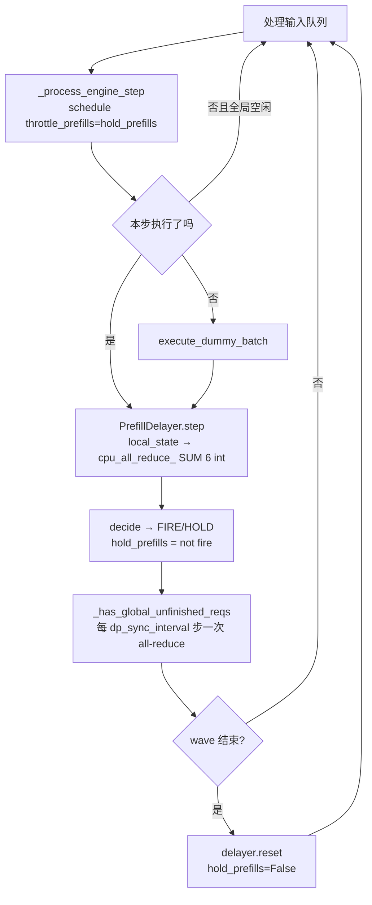
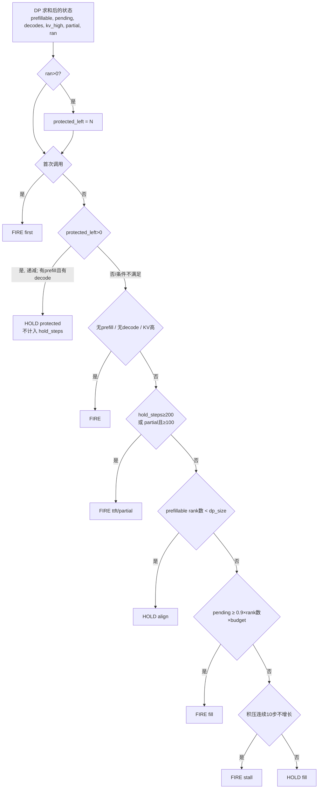

# PR #61834: [DARFT][Core][DP] Add an opt-in cross-DP prefill delayer (--dp-prefill-delayer)

> **Author**: @benenzhu | **State**: OPEN（Draft） | **Date**: 2026-10-15
> **Branch**: `benenzhu:dp-prefill-delayer` → `main` | **Labels**: scheduler
> **Changes**: +368 -4 lines across 6 files | **ROCm 相关性**: 部分相关（纯通用调度/引擎代码，无 ROCm 专属路径；动机、规则来源（ATOM PrefillDelayer）与全部性能数据均来自 MI355X 上的 DSv4/DSv4.1 DP+EP 部署）
> 本报告分两部分：§1–6 为 PR 详细总结，§7–8 为 ROCm review 意见。

---

## 1. 总结 (Summary)

MoE 模型在 DP attention + EP 部署下，各 DP rank 以 lockstep 方式推进 engine step：任意一个 rank 有 prefill，这一步对所有 rank 都变成长的混合步，decode 被频繁打断。本 PR 新增 opt-in 的 `--dp-prefill-delayer`：每个 engine step 各 rank 通过一次 6 个 int 的 CPU SUM all-reduce 交换 prefill 状态，所有 rank 据此做出相同的 FIRE / HOLD 决策——尽量让各 rank 的 prefill 对齐在同一步执行，并在 prefill 之后保护若干个纯 decode 步（`--dp-prefill-delayer-protected-steps`，默认 10）。规则移植自 ATOM 的 PrefillDelayer，与 `--prefill-schedule-interval` 互斥。

## 2. 背景与动机 (Background & Motivation)

- Agentic 多轮流量下 prefill 非常频繁，DP8 + EP8 的 DeepSeek-V4-Pro 在 MI355X 上 decode 的 ITL 被反复拉长（P90 interactivity 低）。
- 现有 `--prefill-schedule-interval N` 只协调"何时允许 prefill"（共享 step counter，非对齐步全部 rank 都 defer），不协调"是否值得 prefill"——各 rank 仍按本地队列独立决定，导致对齐步上仍是部分 rank prefill、其余 rank 被拖慢。
- 本 PR 引入跨 rank 的状态汇总：等所有 rank 都有 prefill（或 token 积压达到 0.9×预算、或积压停止增长）再统一 FIRE，并在 prefill 后保护 N 步纯 decode。
- 与 #51199（DP coordinator 异步释放方案）对比：作者用 8-rank CPU 模拟称本方案混合步少 2–4×、decode 平均延迟约减半，但 #51199 TTFT 约低 3×，二者可互补。
- 评论区补充：c128 下吞吐 +85%、E2EL −41%；c64 下 TTFT +406%、E2EL +20%、吞吐 −8%（作者承认当前只优化了 throughput vs P90 interactivity）。

## 3. 代码修改分析 (Code Change Analysis)

### 3.1 修改的模块

| 模块 | 改动 |
|------|------|
| `vllm/v1/core/sched/prefill_delayer.py`（新增，143 行） | `local_state()` 采集本 rank 6 元组；`PrefillDelayer.step()` 做 `cpu_all_reduce_` 并调用 `decide()` 规则链 |
| `vllm/v1/engine/core.py` (+41) | `DPEngineCoreProc` 构造 delayer（拒绝 elastic EP / fault tolerance / 自定义 scheduler）；busy loop 中在 `_has_global_unfinished_reqs` 前调用 `step()`；wave 结束时 `reset()`；`_should_throttle_prefills` 改为返回 `hold_prefills` |
| `vllm/v1/core/sched/scheduler.py` (+20 -4) | `defer_prefills` 在 delayer 模式下忽略 `prefill_capacity_bound`，且只在本 rank 有 decode 时才 hold；schedule 末尾检测本步是否跑了 prefill 并置 `ran_prefill` |
| `vllm/config/scheduler.py` (+16) | 新增 `dp_prefill_delayer`、`dp_prefill_delayer_protected_steps`；与 `prefill_schedule_interval>1` 互斥校验 |
| `vllm/engine/arg_utils.py` (+13) | 两个 CLI 参数 |
| `tests/v1/core/test_prefill_delayer.py`（新增，139 行） | `decide()` 每条规则、`local_state()`、scheduler hold 行为与配置互斥的 CPU 单测 |

### 3.2 架构 / 流程图

DP busy loop 中的位置：



`decide()` 规则链（按顺序，第一个命中即返回）：



### 3.3 关键实现细节

- **状态 6 元组**：`[prefillable, min(pending, budget), decodes, kv_high, partial, ran]`。`pending` 统计 running 中的 prefill chunk 剩余 token + `waiting` 队列（跳过 `deferred_waiting`）中的 prompt token，按 `max_num_batched_tokens` 截断。`ran` 由 scheduler 在 `schedule()` 末尾根据 "调度 token 数 > 1 + spec token 数" 置位，`local_state()` 读取后清零。
- **集合通信位置**：紧挨 `_has_global_unfinished_reqs()`，每个非 idle 迭代（真实步、dummy 步、pause 步）每个 rank 都会到达；使用 #61767 的 `cpu_all_reduce_`（gloo 上 recursive doubling，作者报 8 rank p50 114 µs），带 `cpu_distributed_timeout`。
- **HOLD 语义**：复用已有 `defer_prefills` 机制——推迟 running 中的 prefill chunk 与 waiting 新请求的本地 prefill 计算；但只对"本 rank 有 decode 要跑"的 rank 生效（合入 benenzhu/vllm#6，修复 V2 runner + 投机解码下某 rank 空调度导致的 hang）。
- **互斥/拒绝**：与 `prefill_schedule_interval>1` 互斥；elastic EP、fault tolerance（会在运行时改变 DP size）和非内置 Scheduler 子类均直接报错。
- **常量**：`FILL_TARGET=0.9`、`TTFT_MAX_HOLD_STEPS=200`、`PARTIAL_MAX_HOLD_STEPS=100`、`STALL_STEPS=10`、`KV_HIGH_USAGE=0.9` 均为模块级硬编码。

## 4. 涉及的技术原理 (Technical Principles)

- **DP attention + EP 的 lockstep**：MoE 层的 all2all（或 all-gather/reduce-scatter）要求所有 DP rank 在同一时刻进入同一层，因此一个 rank 的长 prefill 会让其他只做 decode 的 rank 一起等待；无请求的 rank 也必须跑 dummy batch 参与集合通信。
- **混合步代价**：decode 步通常可以走 CUDA/HIP graph 且很短，混入 prefill 后整步变长（某些后端还会退化为 eager），表现为 decode ITL 尖刺、P90 interactivity 下降。
- **Prefill 对齐/延迟调度**：通过推迟 prefill，使多个 rank 的 prefill 在同一步执行（一次混合步摊给所有 rank），并在其后留出纯 decode 窗口——用 TTFT 换 ITL 与吞吐，这是 ATOM / SGLang 类调度器常见的权衡。
- **跨 rank 一致决策**：所有 rank 对同一份 SUM 结果运行确定性的 `decide()`，决策天然一致；关键约束是每个 rank 必须在相同的迭代调用该集合通信，否则 gloo 集合通信错位导致 hang。

## 5. 评论区讨论亮点 (Discussion Highlights)

- **@functionstackx**：质疑是否真有 throughput vs E2EL 提升、`--prefill-schedule-interval` 是否已解决问题。作者补充同节点对比：c128 收益显著，c64 TTFT +406%、E2EL +20%、E2E-normalized interactivity p90 由 9.5 降到 3.3，承认当前方案"overfitting 到 throughput vs P90 interactivity"。
- **@maslan-coop26**：在 DSv4.1-Flash DEP8（MI355X、V2 runner、DSpark）上实测发现 hang——HOLD 让无 decode 的 rank 空调度，而 DP peers 在推进；提交 benenzhu/vllm#6 改为只 hold 有 decode 的 rank，并建议改用 `cpu_all_reduce_`（695 µs → 114 µs）。作者均已合入，并新增对 fault tolerance 的拒绝。
- maslan-coop26 另提出两个 opt-in 增强（每 2000 步的 FIRE/HOLD 决策日志、ATOM 风格的等待时间上限 + 跨 rank prefill 负载均衡）；作者表示等待上限是本 PR 缺失的 TTFT 边界，应纳入本 PR。
- 尚无 maintainer 的实质 review；CI 状态未知（仅作者自报 CPU 测试通过）。

## 6. 风险与潜在问题 (Risk Analysis)

| 风险 | 严重程度 | 说明 |
|------|---------|------|
| TTFT 大幅恶化（低并发） | High | c64 TTFT +406%；见 §7 保护窗口重复续期、HOLD 上限按步计等 finding |
| 新增每步集合通信的错位/hang 风险 | Medium | 依赖"每个 rank 每次迭代都到达同一点"的不变式；目前仅 CPU 单测，无多 rank 测试 |
| 部分 waiting 请求未计入状态 | Medium | 见 §7【正确性】`kv_holding_waiting` 未统计 |
| 性能数据来自旧版分支、单次运行 | Medium | 见 §7【测试】 |
| 常量硬编码、以步数而非时间为单位 | Low | 不同模型/step 时长下行为差异大 |
| 默认关闭，对未开启用户无影响 | Low | 仅 `defer_prefills` 表达式重排，关闭时逻辑等价（已核对） |

---

## 7. Review 意见 (Findings)

本 PR 不触及任何 ROCm 专属文件（aiter / mori / `platforms/rocm.py` / ROCm attention 后端），aiter/mori/HIP 专项规则不适用，已跳过；以下按"在 MI355X DP+EP 部署上会被直接使用的共享调度路径"进行 review。

| 类型 | 🔴 | ⚠️ | 📝 |
|------|----|----|----|
| 设计 | — | 1 | 1 |
| 正确性 | — | 1 | — |
| 测试 | — | 1 | — |
| 可维护性 | — | — | 2 |

---

**⚠️【设计】无 decode 的 rank 在 HOLD 步照常 prefill，会不断续期保护窗口，且这类 HOLD 不计入 200 步上限** `[已验证]`（影响程度 `[推测]`）

- **问题**: 合入 benenzhu/vllm#6 后，HOLD 只作用于"本 rank 有 decode"的 rank（`scheduler.py:755-759`）；没有 decode 的 rank 在 HOLD 步仍然跑 prefill，并在 `scheduler.py:1789-1793` 置 `ran_prefill=True`。下一次 `decide()` 中 `ran>0` 会把 `_protected_left` 重置为 `protected_steps`（`prefill_delayer.py:103-104`），而 "protected" 分支直接 `return False, "protected"`，不经过 `_hold()`，`_hold_steps` 不增加（`prefill_delayer.py:108-111`）。
- **影响**: 例如 DP8 中 rank0 刚接到一个 128K prompt 且暂无 decode（wave 开始、低并发或请求刚完成的 rank），按 8K budget 需要 16 个 chunk：这 16 步本身已经是所有 rank 都要等的长混合步，但其余 7 个有 decode + waiting prefill 的 rank 在这 16 步 + 之后 10 步内都被 HOLD——既没减少混合步，又白白增加 TTFT；且这段时间不计入 `TTFT_MAX_HOLD_STEPS`，200 步上限并不是真正的 HOLD 上限。这与 c64 下 TTFT +406% 的现象方向一致（是否为主因未验证）。
- **行动**: 建议作者在状态中增加"有 prefill 且无 decode 的 rank 数"（第 7 个 int）：只要存在这种 rank，本步必然是混合步，应直接 FIRE 让所有 rank 搭车；或至少让 protected HOLD 也计入 `_hold_steps`，使 200 步上限对所有 HOLD 生效。

**⚠️【正确性】`local_state()` 未统计 `kv_holding_waiting` 队列，但 scheduler 在 HOLD 下同样会推迟这些请求** `[已验证]`

- **问题**: `prefill_delayer.py:44-50` 只遍历 `scheduler.waiting`；而 `Scheduler.schedule()` 在 waiting 阶段优先从 `self.kv_holding_waiting` 取请求（`scheduler.py:1071`），其后的 `defer_prefills and num_computed_tokens < request.num_tokens - 1` 分支同样会把它们推迟。`kv_holding_waiting` 收的是持有 KV block 的 waiting 请求（`_holds_kv_blocks`：`num_computed_tokens > 0` 或 `WAITING_FOR_REMOTE_KVS`），例如 streaming-input 会话追加的新输入、远端 KV 只部分命中后需要本地补算的请求。
- **影响**: 若某 rank 的待 prefill 工作全部在 `kv_holding_waiting`，它上报 `prefillable=0`：其他 rank 有 prefill 时 "align" 规则（`num_prefillable < dp_size`）永远不满足，只能等到 200 步上限才 FIRE，而该 rank 自己的请求也被持续推迟；若其他 rank 都没有 prefill，则判为 `no_prefill` FIRE，行为正确。即在 streaming input / PD 部分命中场景下 TTFT 额外增加上百个 decode 步。
- **行动**: 建议作者在 `local_state()` 中同时遍历 `kv_holding_waiting`（与 scheduler 的出队顺序一致，先 kv_holding 后 waiting），并对 `WAITING_FOR_REMOTE_KVS` 这类本地无需计算的请求按 `num_tokens - num_computed_tokens` 正确计数；补一条对应单测。

**⚠️【测试】协议级正确性与性能声明缺乏可追溯的验证** `[已验证]`

- **问题**: ① 测试只覆盖 `decide()` 纯函数、`local_state()` 的 mock 对象和单 rank scheduler；"每个 rank 每次迭代都到达 `step()`" 这一 hang 相关的核心不变式（dummy 步、pause 步、wave 边界、`START_DP_WAVE` 到达时序不同）没有多进程测试。② PR 自述 "GPU: no run of this branch yet"、"Validation on this upstream branch is still to be added"；Claims 表来自"更早版本的开发分支"、单次运行、c128 两行使用不同 recipe 且不同节点。③ 已知回归：c64 TTFT +406%、E2EL +20%、吞吐 −8%。
- **影响**: Claims 数字 `[unverified]`，无法确认合入版本（含 #6 改动后语义已变）的收益；集合通信错位一旦出现即整个 DP 组 hang，只有生产环境能暴露。
- **行动**: 建议作者 ① 加一个 2-rank CPU（gloo）多进程测试，覆盖空闲→wave 启动、一个 rank 跑 dummy 步、wave 结束 reset 的路径；② 在本分支 head 上补 MI355X DSv4-Pro/DSv4.1-Flash DEP8 的 AgentX 结果（附命令与原始输出），至少覆盖 c64 与 c128，且同节点对比；③ 在 PR 描述中明确推荐的并发区间。

**📝【设计】HOLD 上限、填充阈值等常量硬编码且以 step 数为单位** `[已验证]`

- **问题**: `prefill_delayer.py:25-31` 的 `TTFT_MAX_HOLD_STEPS=200`、`PARTIAL_MAX_HOLD_STEPS=100`、`STALL_STEPS=10`、`FILL_TARGET=0.9`、`KV_HIGH_USAGE=0.9` 均不可配置；200 步在 decode 步 30–50 ms 时约为 6–10 s 的额外 TTFT，在 MTP/DSpark 下步长不同则差异更大。
- **行动**: 建议作者将等待上限改为基于时间（作者已计划引入 maslan-coop26 的 wait limit），或至少暴露为 `SchedulerConfig` 字段并在文档中说明默认值来源（ATOM）。

**📝【可维护性】在非 DP MoE 引擎上开启该 flag 会被静默忽略** `[已验证]`

- **问题**: delayer 只在 `DPEngineCoreProc` 中构造；DP=1 或 dense 模型的 DP（每个 rank 被重配置为独立引擎）走 `EngineCoreProc`，`_should_throttle_prefills()` 恒为 False，`--dp-prefill-delayer` 不生效也不报错，而 scheduler 仍在每步置 `ran_prefill`（无人清零，无害）。
- **行动**: 建议作者在 config 校验中对 `data_parallel_size == 1` 给出 warning（或报错），避免用户误以为已开启。

**📝【可维护性】`local_state()` 带副作用（清零 `scheduler.ran_prefill`）** `[已验证]`

- **问题**: 名为"读取状态"的函数在 `prefill_delayer.py:55-56` 修改 scheduler 字段，且 delayer 通过 `cast(Any, self.scheduler)` 直接访问 `running/waiting/deferred_waiting/kv_cache_manager.usage` 等内部属性。
- **行动**: 建议作者在 `Scheduler` 上提供一个 `consume_ran_prefill()` / `prefill_delayer_state()` 方法封装读取与清零，降低与 scheduler 内部结构的耦合。

## 8. 结论 (Verdict)

**⚠️ NEEDS WORK**

方案对高并发 agentic 负载下的 DP+EP 部署（正是 MI355X 上 DSv4 系列的主要场景）有明确价值，默认关闭、关闭时对现有逻辑等价，集合通信放置位置的推理也成立。但 #6 引入的"只 hold 有 decode 的 rank"让保护窗口可以被不断续期且不计入 HOLD 上限，`kv_holding_waiting` 未统计，加上本分支尚无 GPU 验证、c64 存在明显回归，建议在补齐等待上限、修正状态统计并给出本分支的同节点数据后再推进。

## 9. 英文 Review 评论 (Copy-Paste English Comments)

**C1** `vllm/v1/core/sched/prefill_delayer.py:103-111` — ⚠️ comment

```text
Since benenzhu/vllm#6, a rank without decodes keeps prefilling during HOLD, sets `ran_prefill`, and the next `decide()` re-arms `_protected_left` to `protected_steps`. The "protected" branch returns without going through `_hold()`, so these holds never count toward `TTFT_MAX_HOLD_STEPS`. Example: one DP rank prefilling a 128K prompt with no decode of its own makes every step a long mixed step anyway, but the other ranks' prefills stay held for all of its chunks plus 10 steps. Could you add the number of "prefill-only" ranks to the reduced state and FIRE whenever it is non-zero (the step is mixed regardless), or at least count protected holds toward the 200-step bound?
```

**C2** `vllm/v1/core/sched/prefill_delayer.py:44-50` — ⚠️ comment

```text
`local_state()` only walks `scheduler.waiting`, but the scheduler drains `kv_holding_waiting` first and defers those requests under HOLD too (the `defer_prefills and num_computed_tokens < num_tokens - 1` branch). A rank whose only pending prefill is in `kv_holding_waiting` (e.g. a resumed streaming-input session, or a partial remote-KV hit) reports `prefillable=0`, so the "align" rule can never be satisfied and its request waits for the 200-step bound. Could you include `kv_holding_waiting` (in the same order the scheduler drains it) and add a test for it?
```

**C3** `vllm/v1/engine/core.py:2650-2655` — ⚠️ comment

```text
This adds a per-step collective whose correctness depends on every DP rank reaching this point in exactly the same iterations (real, dummy and pause steps, wave start/end). The tests only cover `decide()` and a single-rank scheduler. Could you add a small 2-process gloo test that drives the busy-loop path through an idle -> wave start -> dummy step -> wave end sequence? Also, the Claims table comes from an earlier dev branch with single runs; numbers from this branch head (same node, c64 and c128) would make the trade-off, especially the c64 TTFT regression, much easier to evaluate.
```
