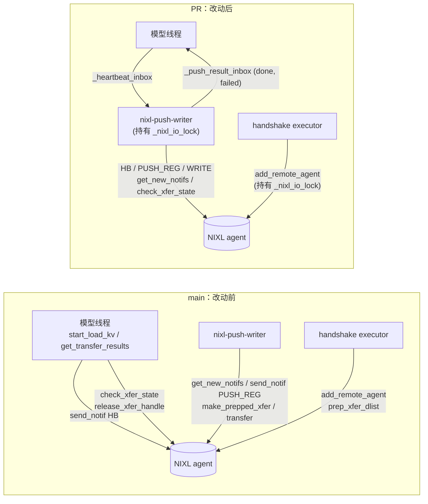
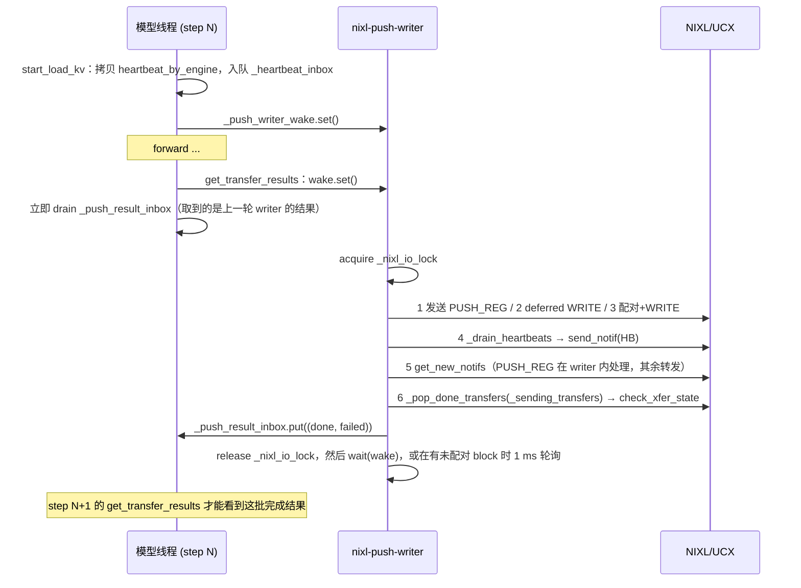

# PR #62055: [Bugfix][NIXL] Keep push progress off model thread

> **Author**: @avininjamay8 | **State**: OPEN | **Date**: 2026-10-16
> **Branch**: `fix/nixl-push-worker-ownership` → `main` | **Labels**: bug, kv-connector
> **Changes**: +157 -32 lines across 2 files | **ROCm 相关性**: 部分相关（代码与平台无关，但 bug 在 ROCm 上发现并验证，用的是 MI 系列 GPU + AMD Pollara `ionic` 网卡 + UCX `rocm` 传输 + `mori` all2all）
> 本报告分两部分：§1–6 为 PR 详细总结，§7–8 为 ROCm review 意见。

---

## 1. 总结 (Summary)

本 PR 修复 `NixlPushConnector`（NIXL PUSH/WRITE 模式）在 2P2D EP16 部署下的 hang。作者认为根因是：模型线程（engine main thread）在每个 step 里直接调用 NIXL，一是发 heartbeat（`send_notif`），二是轮询出站 WRITE 的完成状态（`check_xfer_state`）。只要某个 rank 卡在这两个调用里，它就会错过下一次 EP collective，请求最终超时。修复办法是把这两类 NIXL 调用都挪到已有的 `nixl-push-writer` 后台线程：完成和失败的请求 ID 通过新增的 `_push_result_inbox` 队列交回模型线程；另加一把 `_nixl_io_lock`，让 writer 的整轮迭代和 handshake 线程里的 agent 注册（`add_remote_agent` / `_add_notif_only_remote_agent`）互斥执行。

## 2. 背景与动机 (Background & Motivation)

- NIXL PUSH 模式的分工：P（prefill）算完 KV 后，由 P 侧主动 WRITE 到 D（decode）的 block。D 侧通过 NIXL notif 知道写完了，P 侧通过 WRITE handle 的状态知道写完了。之前已经有一个 `nixl-push-writer` 线程负责 PUSH_REG 收发、P/D 配对和提交 WRITE，但 **heartbeat 发送** 和 **出站 WRITE 完成轮询** 还留在模型线程上。
- 作者的场景是 PR #62007（2P2D EP16 的 write step）：DP16 + EP + `mori_high_throughput` / `mori_low_latency` all2all，每个 DP rank 必须与其它 rank 步调一致地进入 EP collective。如果某个 rank 在 NIXL 调用里多停留一段时间，整个 EP group 都会被拖住。
- 评论区里 @YannikHinteregger 提出了**另一种根因解释**：NIXL UCX 后端对分块传输的完成 notif，只有在 initiator（这里是 P）调用 `getXferStatus` 时才会发出。所以 D 侧收到完成通知的延迟取决于 P 的轮询频率（每个 engine step 一次）。他据此在上游开了 [ai-dynamo/nixl#2441](https://github.com/ai-dynamo/nixl/pull/2441)（截至 2026-10-26 仍 open；该 PR 自报的 notif 延迟从 5.8–54.2 ms 降到约 6 ms），并建议本 PR 去掉 1 ms 轮询、等上游修复合入。
- 作者在 head `cebf114` 上回应：1 ms 自轮询只在存在未配对的 PUSH_REG 时才会触发（和 main 现有行为一致）；`check_xfer_state` 不持有 transfer 锁；handshake 锁只覆盖两个 agent 注册调用；heartbeat map 入队前做了拷贝；删除了 @snadampal 质疑的 receive 侧 `_pop_done_transfers` override。

## 3. 代码修改分析 (Code Change Analysis)

### 3.1 修改的模块

| 模块 | 改动 |
|------|------|
| `vllm/distributed/kv_transfer/kv_connector/v1/nixl/push_worker.py` (+72/-21) | heartbeat 改为入队后由 writer 发送；出站 WRITE 完成轮询移到 writer（`_poll_sending_transfers`），结果经 `_push_result_inbox` 交回模型线程；新增 `_nixl_io_lock`，writer 每轮迭代都持锁，并通过 override 让 `add_remote_agent` / `_add_notif_only_remote_agent` 也加锁；`get_transfer_results` 不再调用 NIXL |
| `tests/v1/kv_connector/unit/test_nixl_push_connector.py` (+85/-11) | stub 增加新字段；新增 heartbeat 延迟到 writer 的测试、"模型线程不轮询 WRITE handle"的测试、"模型线程不被 writer 的 `check_xfer_state` 阻塞"的测试；已有 WRITE 完成计数测试改为先 `_poll_sending_transfers()` 再 `get_transfer_results()` |

### 3.2 架构 / 流程图

线程所有权，改动前后对比：



writer 单轮迭代与模型线程的时序：



### 3.3 关键实现细节

- **heartbeat**（`push_worker.py:251-266`）：如果 `metadata.heartbeat_by_engine` 非空，就逐个 `HeartbeatInfo` 拷贝（`req_ids` 做成新 set，其余 5 个字段逐一复制），**原地替换** metadata 上的这个属性，再把整个 `metadata` 放进 `_heartbeat_inbox`。拷贝的原因是 uni executor 下 scheduler 直接把活的 `_heartbeat_by_engine` 赋给了 metadata（`base_scheduler.py:514-518`）。
- **WRITE 完成轮询**（`push_worker.py:278-283`）：`_poll_sending_transfers` 调用 `super()._pop_done_transfers(self._sending_transfers)`，**有意不持 `_sending_transfers_lock`**，非空结果放进 `_push_result_inbox`。
- **writer 循环**（`push_worker.py:285-355`）：每轮迭代开头 `acquire(_nixl_io_lock)`，`finally` 里释放。新增第 4 步 heartbeat、第 6 步 WRITE 轮询。休眠策略不变：有 `_push_finished_blocks` 时 1 ms，否则阻塞在 wake 事件上。
- **NIXL 串行化**（`push_worker.py:138-139, 357-363`）：override `add_remote_agent` 和 `_add_notif_only_remote_agent`，在 handshake executor 线程里也持 `_nixl_io_lock`。
- **模型线程侧**（`push_worker.py:857-898`）：`get_transfer_results` 先 `wake.set()`，再 drain `_push_result_inbox`，汇总出 `done_pushing` / `failed_pushing`；之后在 `_sending_transfers_lock` 下更新 `_send_failures`、算出 `successful`，这部分逻辑与原来一致。
- 经核对，改动后 PUSH 模式的模型线程在稳态下**不再调用任何 NIXL API**：base `get_transfer_results` 对 `_recving_transfers` 的 `_pop_done_transfers` 在 push 下只有空 handle 列表；`_cleanup_remote_engines` 对 push 直接 return；`_send_pending_recv_notifs` 只在 pull 下用到。唯一的例外是 `shutdown()`。

## 4. 涉及的技术原理 (Technical Principles)

- **PD 分离 + NIXL PUSH 模式**：P 侧发起 RDMA WRITE，把 KV 写进 D 预先登记（PUSH_REG）的 block。P 要靠轮询 WRITE handle 判断何时能释放本地 block；D 要靠 NIXL notif 判断 KV 何时到齐。在 UCX 后端里，P 的 `getXferStatus` 同时也在推进传输进度、发出完成通知（见 nixl#2441），所以 P 的轮询频率会直接影响 D 侧的延迟。
- **lease / heartbeat**：P 给每个待发送请求设置 lease（本 PR 测试配置是 `kv_lease_duration=180`）。D 定期发 `HB:<req_ids>` 来续约，lease 到期后 P 会把请求当作已完成，回收 block。heartbeat 迟到会导致 P 提前回收 block。
- **EP/DP lockstep**：DP>1 + EP 时，各 DP rank 每个 step 都要一起进入 all2all（本 PR 的场景是 mori），空闲 rank 也要跑 dummy batch。任何一个 rank 的 host 侧出现长时间停顿，都会拖住整个 EP group。这也是作者认为"模型线程上的阻塞 NIXL 调用会导致 hang"的理由。
- **GIL 与后台线程**：只有当阻塞调用**释放 GIL** 时，把它挪到后台线程才真正能让模型线程继续前进。已核对 NIXL 当前 main 的 pybind 绑定：`getXferStatus` / `getNotifs` / `genNotif` / `postXferReq` / `loadRemoteMD` 都带 `gil_scoped_release`，所以这个前提成立。
- **ROCm 暴露面**：UCX 的 `rocm` 传输（`rocm_copy` / `rocm_ipc`）加上 Pollara `ionic` 网卡 GPU-direct 的 `rc_verbs`。作者所有验证都是跨节点 `rc_verbs`，同节点 `rocm_ipc` 路径没有覆盖。

## 5. 评论区讨论亮点 (Discussion Highlights)

- **@YannikHinteregger（CHANGES_REQUESTED，2026-10-22）**：他复测了该分支，轮询在中等负载下能减少延迟，但高负载下延迟仍然明显，推测是轮询线程和 engine 抢 CPU。他把根因定位到 NIXL（nixl#2441：完成 notif 只在 P 查询状态时才发出），建议**去掉轮询、等 NIXL 修复**，同时要求修复**坏掉的测试**并补一个**针对 hang 本身的测试**。他还要过"卡住的 rank 的 profile"，作者至今没有提供。
- **@YannikHinteregger（行内）**：(1) 模型线程也拿这把锁，writer 里的阻塞 NIXL 调用是否仍会导致 hang？作者改为模型线程不再拿 `_nixl_io_lock`。(2) 锁能否只覆盖 NIXL 调用，而不是整个 handshake？作者改为只 override 两个 add-agent 调用。(3) uni executor 下把 scheduler 的活 dict 交给 writer，能否入队一份拷贝？已做拷贝。
- **@snadampal（CHANGES_REQUESTED）**：质疑 receive 侧 `_pop_done_transfers` override 是否必要，因为 base 已经覆盖了 push 语义（"P drove the transfer, we own no NIXL handle"）。作者已删除。
- **作者 2026-10-28 回复**：承认 1 ms 轮询无效；在 `cebf114` 上，writer 只在有未配对 PUSH_REG 时自轮询，in-flight WRITE 只随 engine step 唤醒。
- 两个 CHANGES_REQUESTED 状态尚未解除。"broken tests" 是在 `cebf114` 推送之后提出的，作者没有说明是否已修。

## 6. 风险与潜在问题 (Risk Analysis)

| 风险 | 严重程度 | 说明 |
|------|---------|------|
| `_sending_transfers` 锁纪律被打破，与 `shutdown()` 竞争 | Medium | 见 §7「`_sending_transfers` 在 writer 上无锁修改…」 |
| writer 单个 try 覆盖整轮迭代，一步出错会饿死完成轮询和 heartbeat | Medium | 见 §7「writer 一处异常…」 |
| P 侧 WRITE 完成上报固定晚一个 engine step | Medium | 见 §7「完成上报延迟一个 step」 |
| 根因未经证实，修复可能只是巧合生效 | Medium | 见 §7「根因证据不足」；nixl#2441 给出了另一种解释 |
| 测试：reviewer 报告测试损坏，没有 hang 的复现测试，CI 状态未知 | Medium | 见 §7【测试】 |
| `_nixl_io_lock` 让 writer 和新 peer 的 handshake 互斥 | Low | 每次新 peer 握手时（`prep_xfer_dlist` 可能很慢）writer 都会停顿 |
| 同节点 `rocm_ipc` 路径未验证 | Low | 所有验证都是跨节点 `rc_verbs/ionic_0` |
| 可维护性：手工复制 `HeartbeatInfo`、docstring 过时、多余的 `super()` | Low | 见 §7 📝 |

---

## 7. Review 意见 (Findings)

ROCm 暴露面：只有 `vllm/distributed/kv_transfer/kv_connector/v1/nixl/push_worker.py`（平台无关代码，ROCm + UCX `rocm` 传输 + Pollara 是作者唯一验证过的平台）。本 PR 不涉及 aiter / mori 符号，不涉及 HIP stream，也不涉及 dtype/arch 分支，所以 aiter 相关规则和 kernel/数值类规则不适用。本次按 kv_transfer/comm 类别、HK 类别以及跨线程同步来审查。

| 类型 | 🔴 | ⚠️ | 📝 |
|------|----|----|----|
| 正确性 | — | 2 | — |
| 性能 | — | 1 | 1 |
| 设计 | — | 1 | — |
| 测试 | — | 1 | — |
| 可维护性 | — | — | 1 |
| 注释/文档 | — | — | 1 |
| 兼容性 | — | — | 1 |

---

**⚠️【正确性】`_sending_transfers` 在 writer 上无锁修改，`shutdown()` 在 writer 未退出时并发遍历和 release** `[已验证]`（触发频率 `[推测]`）

- **问题**：`push_worker.py:278-283` 的 `_poll_sending_transfers` 在**不持** `_sending_transfers_lock` 的情况下调用 `_pop_done_transfers(self._sending_transfers)`。这个函数会 `release_xfer_handle`、`del transfers[req_id]`、`transfers[req_id] = in_progress`（`base_worker.py:3434-3484`）。但同一个 dict 的追加（`push_worker.py:696-697`）仍然持锁；`shutdown()`（`push_worker.py:177-190`）也是在持锁的前提下遍历 `_sending_transfers` 并逐个 `release_xfer_handle`，而它前面只做了 `join(timeout=2)`。改动前，pop 发生在模型线程上，与 `shutdown()` 同线程，不会竞争；这个竞争是本 PR 新引入的。
- **影响**：触发条件是 shutdown 时 writer 2 秒内没有退出，比如正卡在 NIXL 调用里，而这恰恰是本 PR 针对的场景。此时 `shutdown()` 和 writer 会同时操作同一批 handle：可能出现 `RuntimeError: dictionary changed size during iteration`，也可能对同一个 handle 调用两次 `release_xfer_handle`，即 writer 刚 release 了 DONE 的 handle，但还没把它从列表里移除。另外，锁注释（`push_worker.py:101-105`）现在与真实的所有权不一致，后续维护者很容易误以为这个锁保护着整个 dict。
- **行动**：建议作者明确 `_sending_transfers` 归 writer 独占：去掉 `_xfer_blocks_for_req` 里多余的加锁，把 `_sending_transfers_lock` 改名或缩小为只保护 `_send_failures`；`shutdown()` 在 `join` 之后检查 `self._push_writer_thread.is_alive()`，如果 writer 仍在运行就跳过 handle release（记日志），不要并发 release。

**⚠️【正确性】writer 一处异常会让本轮的 WRITE 完成轮询和 heartbeat 全部跳过** `[已验证]`（持续性故障下的影响 `[推测]`）

- **问题**：`push_worker.py:289-347` 用**一个** `try/except Exception` 包住第 1–6 步。只要第 1–5 步任意一步抛异常（`_do_start_push_kv` 里的 `assert` / `NotImplementedError`、`get_new_notifs` 的 NIXL 异常、`_send_heartbeats` → `_ensure_handshake` → `_evict_stale_engines` 里的跨线程 dict 迭代等），第 4 步 heartbeat 和第 6 步 `_poll_sending_transfers` 在本轮都不会执行。改动前，WRITE 完成轮询和 heartbeat 都在模型线程上，不受 writer 异常影响。
- **影响**：偶发异常只会多延迟一轮。如果是每轮都会出现的异常（比如 NIXL 后端进入错误状态，`get_new_notifs` 持续抛错），P 侧就永远收不到 WRITE 完成，block 一直被占到 lease 到期（作者配置为 180 s）才回收；D 侧 heartbeat 也停发，P 端 lease 不再续约。表现是吞吐断崖下跌，但日志里只有重复的 "nixl-push-writer error; continuing"。
- **行动**：建议作者给每一步单独做异常隔离（至少把第 4 步和第 6 步各自放进独立的 try），确保一步失败不会饿死完成上报和 heartbeat；并补一个测试：`get_new_notifs` 抛异常时，`_poll_sending_transfers` 仍能把完成结果交回。

**⚠️【性能】P 侧 WRITE 完成上报固定晚一个 engine step** `[已验证]`（延迟量级 `[推测]`）

- **问题**：`push_worker.py:858-872` 先 `wake.set()`，**紧接着**就 drain `_push_result_inbox`。writer 被唤醒后才开始 `check_xfer_state`，所以本 step 只能拿到上一轮 writer 的结果。在 `kv_connector_model_runner_mixin.py:83-94` 里，当没有同步 load 时，`start_load_kv` 在 forward 之后、`get_transfer_results` 之前调用，因此 `start_load_kv` 的唤醒也提供不了有效的提前量。改动前，模型线程在同一个 step 内同步轮询，WRITE 一完成，当前 step 就会上报。
- **影响**：P 侧 `finished_sending` 和 block 释放统一推迟一个 step。P 在 EP16、`--enforce-eager` 下跑长 prompt prefill 时，一个 step 可能是几十到几百 ms，KV 占用和 block 回收会相应变慢；高负载下 P 的可用 KV 容量会下降。D 侧完成 notif 的频率（nixl#2441 关注的那条路径）基本不变，也就是说这个改动没有改善 reviewer 观察到的延迟。
- **行动**：建议作者用 P 侧"WRITE 提交 → `finished_sending` 上报"的延迟和 KV 使用率，量化这一个 step 的代价，并在 PR 中说明是否接受这个代价。如果不能接受，可以考虑让 writer 在 step 内的更早时间点被唤醒（例如在 `bind_connector_metadata` / forward 前的 hook 里），使结果在本 step 的 `get_transfer_results` 时已经就绪，而不是恢复 1 ms 的忙轮询。

**⚠️【设计】根因证据不足：PR 声称"模型线程阻塞在 NIXL 调用里"，但没有给出栈或 profile** `[推测]`

- **问题**：PR 描述把 hang 归因于"某个 rank 阻塞在 `send_notif` 或 `check_xfer_state` 里"，但 reviewer 要的卡住 rank 的 profile 至今没有提供。@YannikHinteregger 给出了另一种可复现的解释（nixl#2441：完成 notif 依赖 P 侧调用 `getXferStatus`，导致 D 侧延迟随 P 的 step 间隔放大），并指出 `check_xfer_state` 在 NIXL 内部没有阻塞等待。在 head `cebf114` 上，writer 调用 `check_xfer_state` 的频率和 main 基本相同（每个 step 一次，只有存在未配对 block 时才是 1 ms），所以如果真正根因是 nixl#2441，本 PR 在 2P2D 上"修好了"可能只是负载或时序上的巧合。注：已核对 NIXL 绑定会释放 GIL，所以"挪线程有用"这个前提成立，只是没有证据表明问题确实出在这里。
- **影响**：如果根因判断错了，hang 可能在其它负载下复现（reviewer 已经观察到高负载下延迟仍在），而本 PR 引入的线程所有权变化（见上面三条）会作为长期复杂度留在代码里。
- **行动**：建议作者提供卡住 rank 的 `py-spy dump --native`（或等价的栈），证明模型线程确实停在 NIXL 调用里；并在 nixl#2441 合入后复测：不带本 PR 时 2P2D EP16 是否仍然 hang。建议 review 时追问这两点。

**⚠️【测试】reviewer 报告的测试损坏未确认已修复，缺少 hang 的复现测试，CI 状态未知** `[已验证]`（测试是否仍失败 `[推测]`）

- **问题**：@YannikHinteregger 在 2026-10-22 的 review（`cebf114` 推送之后）要求修复 "broken tests"，作者 10-28 的回复没有提到测试。本次抓取的 `checks` 数据缺失，CI 状态未知；本地运行 PR 代码的测试被环境权限拒绝，未能验证。新增测试都是 mock 级别的单线程或双线程测试：`test_model_thread_does_not_block_on_write_poll`（`test_nixl_push_connector.py:1052-1076`）验证的是"模型线程不拿 `_sending_transfers_lock`"，没有覆盖真实 `_push_writer_loop`（持 `_nixl_io_lock`、异常路径、wake 语义）和模型线程之间的交互。
- **影响**：上面两条正确性问题（shutdown 竞争、异常饿死）都不会被现有测试发现；如果测试仍然是红的，合入会打破 kv_connector unit 队列。
- **行动**：作者应当贴出当前 head 上 `pytest tests/v1/kv_connector/unit/test_nixl_push_connector.py` 的通过结果，并补一个驱动真实 `_push_writer_loop` 的测试：mock 一个阻塞的 `get_new_notifs` / `check_xfer_state`，断言模型线程的 `get_transfer_results` 能在限定时间内返回，且解除阻塞后完成结果能被上报。

**📝【性能】`_nixl_io_lock` 让 writer 与新 peer 的 handshake 完全互斥** `[已验证]`

- **问题**：writer 每轮迭代都持锁（`push_worker.py:289`），handshake executor 在 `add_remote_agent`（内部有 `prep_xfer_dlist`，KV 很大时可能很慢）期间也持锁（`push_worker.py:357-363`）。另外，WRITE 完成的 `xfer_stats.record_transfer`（一次 append 4 个并行 list）现在在 writer 上执行，而模型线程的 `clone_and_reset` 是浅拷贝后再 reset（`stats.py:76-79`），同一条记录可能被拆到两次快照里，导致指标出现轻微偏差。
- **行动**：建议作者在 PR 中说明新 peer 握手期间 writer 的最长停顿时间（日志里已有 "add agent took" 计时）；对于 stats，可以在 writer 侧攒批后通过队列交给模型线程记录，或者接受这点偏差并加注释说明。

**📝【可维护性】heartbeat 拷贝是逐字段手写的，而且原地改写了 metadata、把整个 metadata 入队** `[已验证]`

- **问题**：`push_worker.py:254-264` 逐一列出 `HeartbeatInfo` 的 6 个字段来构造新对象。以后 `HeartbeatInfo`（`metadata.py:220-228`）新增字段时，这里会**静默丢弃**新字段，并回落到默认值。另外，这里改写的是传入的 `metadata.heartbeat_by_engine`，而且把整个 `NixlConnectorMetadata`（含 `reqs_to_recv` 等）放进了队列，但 writer 只读 `heartbeat_by_engine`。`_drain_heartbeats` / `_poll_sending_transfers` 里的 `super()._send_heartbeats` / `super()._pop_done_transfers` 是删除 override 之后遗留的写法，会绕过实例或子类层面的覆盖（例如测试第 662 行设置的实例级 `_send_heartbeats` mock 现在已不会被调用）。
- **行动**：建议作者改为 `dataclasses.replace(info, req_ids=set(info.req_ids))`，只把拷贝后的 dict 入队（`_heartbeat_inbox: Queue[dict[EngineId, HeartbeatInfo]]`），不改写传入的 metadata；并去掉多余的 `super()`。

**📝【注释/文档】模块 docstring 和若干字段注释没有反映新的线程所有权** `[已验证]`

- **问题**：模块 docstring（`push_worker.py:5-9`）列出的 writer 职责里没有 heartbeat 和 `check_xfer_state`；19-31 行描述 wake 语义时也没有提到"完成结果要到下一个 step 才能拿到"。`_push_writer_wake` 的注释（131-133 行）写的是"while it has active in-flight state 时自轮询"，与 75-76 行的新注释矛盾。`_nixl_io_lock` 的注释（138 行）说的是 "NIXL is not thread-safe"，但 `shutdown()` 在模型线程上调用 NIXL 时并没有加这把锁。
- **行动**：建议作者同步更新 docstring 和注释，写明"push 模式下模型线程不调用 NIXL（shutdown 除外）"这一不变式，以及完成结果上报晚一个 step 的语义。

**📝【兼容性】ROCm 同节点 `rocm_ipc` 路径未验证** `[推测]`

- **问题**：作者的 3 组验证（2P2D EP16、1P1D TP8、1P1D EP8）全部是跨节点 GPU-direct `rc_verbs/ionic_0`。本 PR 把 UCX 进度推进（`check_xfer_state`）完全交给了 writer 线程，而该线程从未调用 `current_platform.set_device`。base 的 handshake 线程专门为 UCX 设置了 device，注释说明缺少 GPU 上下文会导致 UCX 禁用 IPC。
- **行动**：建议作者在 ROCm 上补一组同节点 1P1D 验证（UCX_TLS 包含 `rocm`，走 `rocm_ipc`），确认 writer 负责 progress 之后同节点 WRITE 的完成检测正常；或者在 writer 线程启动时显式调用 `set_device`。

## 8. 结论 (Verdict)

**⚠️ NEEDS WORK**

方向本身合理：让 PUSH 模式的模型线程不再调用任何 NIXL API，可以消除 EP lockstep 下 host 侧被 NIXL 拖住的风险，并且已核对 NIXL 绑定会释放 GIL，挪线程确实有效。但当前实现有三个问题：`_sending_transfers` 的锁纪律被打破，与 `shutdown()` 存在新的竞争；writer 的单一 try 会让一步出错就饿死完成上报和 heartbeat；P 侧完成上报固定晚一个 step。根因证据（卡住 rank 的栈）至今缺失，与 reviewer 指出的 nixl#2441 解释存在冲突；两位 reviewer 的 CHANGES_REQUESTED 和"测试损坏"也没有正面回应。建议先补根因证据和测试结果，修复上述两处正确性问题后再合入。

## 9. 英文 Review 评论 (Copy-Paste English Comments)

以下行号均为 PR head `cebf114` 新文件中的行号，取自 `files[].patch` 的 hunk 头。

**C1** `vllm/distributed/kv_transfer/kv_connector/v1/nixl/push_worker.py:278-283` — ⚠️ comment

```text
`_poll_sending_transfers` now mutates `_sending_transfers` (release + del/reassign inside `_pop_done_transfers`) without `_sending_transfers_lock`, while `_xfer_blocks_for_req` still appends under the lock and `shutdown()` iterates and releases the same handles under the lock after only `join(timeout=2)`. Before this PR the pop ran on the model thread, the same thread as `shutdown()`, so this race is new: if the writer is stuck in a NIXL call for more than 2s at shutdown (the scenario this PR targets), we can get "dictionary changed size during iteration" or a double `release_xfer_handle`. Could you make `_sending_transfers` explicitly writer-owned (narrow the lock to `_send_failures`) and have `shutdown()` skip releasing handles when the writer thread is still alive after the join?
```

**C2** `vllm/distributed/kv_transfer/kv_connector/v1/nixl/push_worker.py:331-347` — ⚠️ comment

```text
Heartbeats (step 4) and WRITE completion polling (step 6) now share the single try/except with steps 1-5, so any exception earlier in the iteration (an assert in `_do_start_push_kv`, a NIXL error from `get_new_notifs`, etc.) skips both for that round. Before this change both ran on the model thread and were isolated from writer errors. If the error repeats every round, P never sees WRITE completions until the lease expires and D stops sending heartbeats, and the only symptom is "nixl-push-writer error; continuing" in the logs. Could you isolate each step (at least heartbeats and `_poll_sending_transfers`) in its own try, and add a test where `get_new_notifs` raises but completions are still reported?
```

**C3** `vllm/distributed/kv_transfer/kv_connector/v1/nixl/push_worker.py:858-872` — ⚠️ comment

```text
`get_transfer_results` sets the wake event and then immediately drains `_push_result_inbox`, so it only sees results from the writer's previous round. P-side `finished_sending` (and block release) is therefore always reported one engine step later than before, when the poll was synchronous. Since `start_load_kv` runs after the forward when there are no sync loads, the wake there doesn't give the writer a head start either. Could you quantify the extra step (WRITE submit to finished_sending latency, P KV usage) on the 2P2D run, and consider waking the writer earlier in the step instead of reintroducing a busy poll?
```

**C4** `tests/v1/kv_connector/unit/test_nixl_push_connector.py:1052-1076` — ⚠️ comment

```text
This test checks that the model thread doesn't take `_sending_transfers_lock` while a poll is in flight, but it calls `_poll_sending_transfers` directly. It doesn't exercise `_push_writer_loop` (with `_nixl_io_lock`, the wake semantics, and the exception path), so it doesn't really reproduce the hang. Could you add a test that runs the real writer loop with a blocking mocked `get_new_notifs`/`check_xfer_state` and asserts that `get_transfer_results` returns promptly and that completions are reported after unblocking? Also, could you confirm this file passes on the current head? @YannikHinteregger mentioned broken tests after cebf114, and I couldn't see CI status.
```
