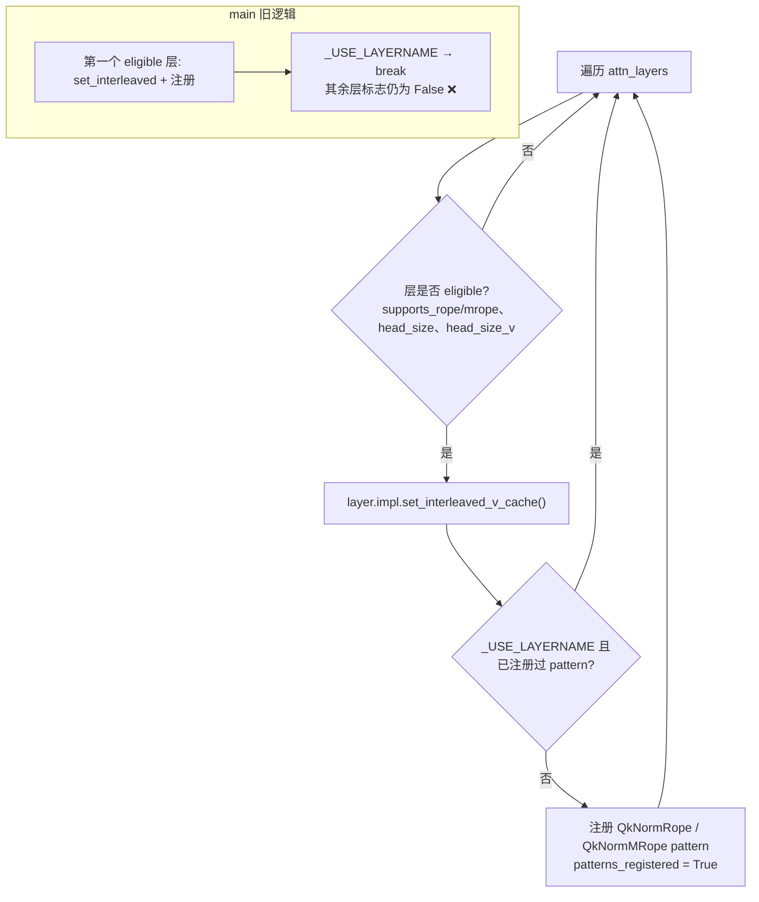
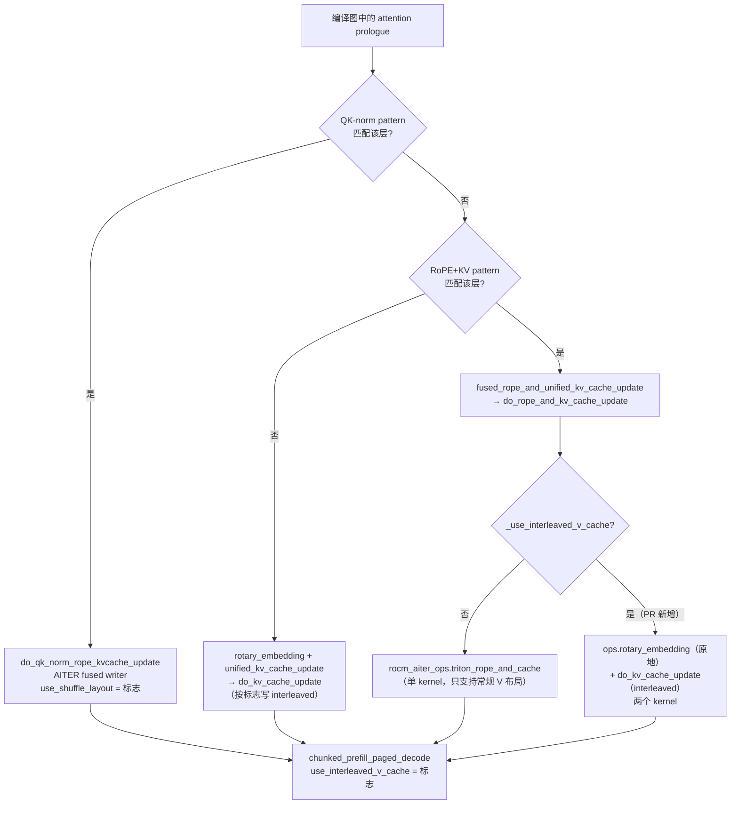

# PR #62403: [ROCm][Bugfix] Fix wrong output of the QK-norm + RoPE + KV-cache fusion on ROCM_ATTN

> **Author**: @jiaqiang-dot-liu | **State**: OPEN | **Date**: 2026-10-19
> **Branch**: `jiaqiang-dot-liu:fix/rocm-qk-norm-fusion-interleave-all-layers` → `main` | **Labels**: bug, rocm, torch.compile, verified
> **Changes**: +86 -7 lines across 4 files | **ROCm 相关性**: 完全相关（仅影响 `ROCM_ATTN` 上的 opt-in fusion 路径）
> 本报告分两部分：§1–6 为 PR 详细总结，§7–8 为 ROCm review 意见。

---

## 1. 总结 (Summary)

在 `ROCM_ATTN` 后端上，QK-norm + RoPE + KV-cache fusion（`fuse_qk_norm_rope_kvcache`）用的 AITER fused writer 把 V 写成 **interleaved（shuffle）布局**，读侧要靠每层的 `_use_interleaved_v_cache` 标志来正确读取它。main 上有两处破坏了这条读写约定：(1) torch ≥ 2.11（`_USE_LAYERNAME`）下，pass 在第一个 eligible 层就 `break`，其余层的标志没被设置，导致 Qwen3 decode 输出乱码；(2) 同时打开 `fuse_rope_kvcache` 时，没被 QK-norm pattern 匹配到的层改走 Triton RoPE+cache writer，而它只会写常规 V 布局，导致 Llama 类模型的 V cache 损坏。PR 的做法是让 pass 对**所有** eligible 层打开 interleaved 标志，只跳过重复的 pattern 注册；同时在 `RocmAttentionImpl.do_rope_and_kv_cache_update` 里，对 interleaved 层改走"`ops.rotary_embedding` 原地 RoPE + `do_kv_cache_update` 非融合写"。

## 2. 背景与动机 (Background & Motivation)

- `QkNormRopeKvCacheFusionPass` 把 `q/k RMSNorm → RoPE → unified_kv_cache_update` 融合成 AITER kernel `fused_qk_norm_rope_cache_pts_quant_shuffle`。该 kernel 在 `use_shuffle_layout=True` 时写 interleaved V，`ROCM_ATTN` 的 decode/prefill kernel（`chunked_prefill_paged_decode`）与非融合写入路径 `do_kv_cache_update` 都通过 `_use_interleaved_v_cache` 适配这一布局。
- torch ≥ 2.11 引入 opaque `LayerName`，它在 pattern 中是通配符，所以同构层只需注册一次 pattern；为避免 "Duplicate pattern" 报错，main 在第一层注册后直接 `break`，但 `set_interleaved_v_cache()` 也放在同一个循环体里，于是其他层的标志一起被跳过了。基类 `AttentionImpl.set_interleaved_v_cache` 的 docstring 写着 "QkNormRopeKvCacheFusionPass calls this for every eligible layer"，main 的实现并不满足这句话。
- 作者的实测数字：Qwen3-8B GSM8K 从 0.87 掉到 0.005；Llama-3.1-8B 两个 fusion 都开时从 0.766 掉到 0.71。如果只修第一处，第二处 bug 会从影响一层扩大到影响全部层（Llama 降到 0.012），所以两处必须一起修。
- 两个 fusion 默认都是关闭的，默认路径不受影响。

## 3. 代码修改分析 (Code Change Analysis)

### 3.1 修改的模块

| 模块 | 改动 |
|------|------|
| `vllm/compilation/passes/fusion/qk_norm_rope_kvcache_fusion.py` (+11 -7) | 去掉 `if _USE_LAYERNAME: break`，改用 `patterns_registered` 标志：每个 eligible 层都调用 `set_interleaved_v_cache()`，只有 pattern 注册限制为一次 |
| `vllm/v1/attention/backends/rocm_attn.py` (+16) | `do_rope_and_kv_cache_update` 新增 interleaved 分支：先 `ops.rotary_embedding` 原地处理 q/k，再调 `do_kv_cache_update`（该路径本来就支持写 interleaved V）；新增 `from vllm import _custom_ops as ops` |
| `tests/compile/passes/test_rocm_aiter_qk_norm_rope_kvcache_fusion.py` (+51) | 新增 `test_qk_norm_rope_kvcache_fusion_interleaves_every_layer`：构建 3 个 `ROCM_ATTN` 层，断言每层 `_use_interleaved_v_cache` 都为 True |
| `tests/compile/passes/test_rope_kvcache_fusion.py` (+8) | 新增参数 `interleaved_v`：对 `ROCM_ATTN` 层手动打开 interleaved 后，比较融合与非融合路径写出的整个 KV cache |

### 3.2 架构 / 流程图

**Pass 构造期：interleaved 标志的设置（前后对比）**



**运行期：ROCM_ATTN 层 V cache 写入路径分发（PR 之后）**



### 3.3 关键实现细节

- **标志与 pattern 注册解耦**：`set_interleaved_v_cache()` 被移到 `continue` 判断之前，所有 eligible 层都会执行；`patterns_registered` 只控制 `_USE_LAYERNAME` 下的去重。`_USE_LAYERNAME=False`（torch < 2.11）时每层仍各自注册 pattern，行为与原来一致。
- **运行期分发而不是注册期排除**：作者说明了为什么不能在 RoPE+KV pass 注册时把 interleaved 层排除掉：hoist 了 `layer_name` 之后，一个 pattern 服务所有层；而且从 compile cache 加载的图会跳过 pass。所以把判断放到 `do_rope_and_kv_cache_update` 内部按 `_use_interleaved_v_cache` 在运行期分发。这样不论 pass 是否运行、pattern 是否匹配，各个写入路径都只看同一个运行期标志，读写布局保持一致。
- **语义等价性**：`triton_rope_and_cache` 用 `q_out=query, k_out=key` 原地写回 q/k，与 `ops.rotary_embedding` 的原地语义一致，自定义 op 也声明了 `mutates_args=["query", "key"]`。`RopeStaticQQuantKVCachePattern` 和 `RopeReshapeKVCachePattern` 两个 pattern 的 replacement 都调用同一个 `FUSED_ROPE_KV_OP`，所以这一处修复同时覆盖了带静态 Q-FP8 量化的变体。
- **C++ rotary 兼容性**：`csrc/pos_encoding_kernels.cu` 对 query 和 cos_sin_cache 分别做 dtype dispatch，支持 strided q/k（split 视图），也支持 `rot_dim = cos_sin_cache.size(1)`。matcher 只匹配 `rotary_dim == head_size` 的 RoPE，因此传 `layer.head_size` 是正确的。
- **兄弟后端**：`RocmAiterUnifiedAttentionImpl` 继承自 `RocmAttentionImpl`，但把 `set_interleaved_v_cache` 覆写为 no-op，并且有自己的 `do_rope_and_kv_cache_update`，不受影响；`AiterFlashAttentionImpl`、`TritonAttentionImpl` 用基类的 no-op，也不受影响。

## 4. 涉及的技术原理 (Technical Principles)

- **Paged KV cache 的 V 布局**：`ROCM_ATTN` 默认的 paged V 布局是 `[num_blocks, num_kv_heads, head_size, block_size]`。interleaved（shuffle）布局按 `16 // element_size` 个元素打包（bf16 是 8，fp8 是 16），让 decode kernel 能按 16B 向量读取 V。读写两侧必须按同一布局，否则数据不会报错，只会被静默读错，所以只有 decode 出错，模型不会 crash。PR 描述也提到，fp8 cache 在 `block_size=16` 时两种布局恰好重合，因此 fp8 用例无法暴露这个 bug。
- **为什么 prefill 看起来正常**：融合路径中，prefill 的 attention 直接用 fused kernel 输出的 `k_out`/当前 token 的 K/V，不会回读 cache 里的历史 token；decode 每一步都要从 cache 读历史 V，布局错误只在这时暴露。
- **torch.compile pattern matcher 与 opaque LayerName**：torch ≥ 2.11 时，`layer_name` 作为 opaque 输入进入图，在 pattern 中是通配符。同构层产生的搜索 pattern 完全相同，重复注册会报 "Duplicate pattern"，所以各 LayerName-aware 的 pass 都只"注册一次"。本 bug 是把"注册一次"误写成了"只处理一层"。
- **Fusion pass 顺序**：`pass_manager.py` 中 `QkNormRopeKvCacheFusionPass` 排在 `RopeKVCacheFusionPass` 之前，所以 Qwen3 这类有 QK-norm 的层会先被 QK-norm pattern 吃掉；RoPE+KV pattern 只会命中没有 QK-norm 的层（例如 Llama），或 QK-norm pattern 因 shape/eps 等原因没匹配上的层。

## 5. 评论区讨论亮点 (Discussion Highlights)

- 目前**没有人工 code review**。`claude[bot]` 的 review 因为 PR 来自 fork 被禁用；作者先后 @shen-shanshan、@tjtanaa、@dllehr-amd 请求 review。
- @AndreasKaratzas 触发了 `/ci run`（Buildkite #95875，CI 自动 merge 了最新 main，commit `4b110fe2d2`）。作者称 CI 全绿，包括 MI300/MI355 上的 attention 和 fusion 测试。本次抓取的 `checks` 字段解析异常，没有独立核实这一点，标为 `[unverified]`。
- PR 描述声明使用了 AI 辅助，作者称逐行审阅过改动并亲自跑了测试/benchmark。描述对两个根因都给出了机制层面的解释（WHY），并做了运行时验证（Qwen3-0.6B 的 28 层中只有 1 层 `use_shuffle_layout=True`），AI 代码风险不高。

## 6. 风险与潜在问题 (Risk Analysis)

| 风险 | 严重程度 | 说明 |
|------|---------|------|
| 正确性：修复本身 | Low | 读写路径都由同一个运行期标志驱动；所有 V cache 写入方（AITER fused、Triton fused、非融合）都已遵守该标志 |
| 性能：interleaved 层上 RoPE+KV fusion 退化为两个 kernel | Medium | 两个 fusion 都开、但模型没有 QK-norm 时（如 Llama），所有层都会退化。见 §7「两个 fusion 同时开启时 RoPE+KV fusion 被静默取消」 |
| 测试覆盖：缺少多层端到端回归 | Medium | 原 bug 能逃过 CI，就是因为测试只有单层；新测试只断言了标志。见 §7「缺少多层 decode 正确性回归」 |
| 兼容性：KV 布局契约扩大到所有层 | Low | P/D 分离、KV offload 等按原始字节搬运 cache 的场景，要求两端 fusion 配置一致。见 §7 备注 |
| 可维护性 | Low | 改动小，注释清楚；基类 docstring 的描述现在与实现一致 |

---

## 7. Review 意见 (Findings)

| 意见类型 | 🔴 | ⚠️ | 📝 |
|---------|----|----|----|
| 【性能】 | 0 | 1 | 0 |
| 【测试】 | 0 | 1 | 1 |
| 【兼容性】 | 0 | 0 | 1 |
| 【正确性】 | 0 | 0 | 1 |

**⚠️【性能】两个 fusion 同时开启时，interleaved 层上的 RoPE+KV fusion 被静默取消，且无日志、无性能数据** `[已验证]`（机制）/ `[推测]`（性能幅度）
- **问题**：`vllm/v1/attention/backends/rocm_attn.py:587-601` 中，只要 `_use_interleaved_v_cache=True`，融合 op 就会在运行期退化为 `ops.rotary_embedding` + `do_kv_cache_update` 两个 kernel。`QkNormRopeKvCacheFusionPass` 会在构造期把**所有** eligible 层设为 interleaved，不管 QK-norm pattern 最终有没有匹配。所以对 Llama 这类没有 QK-norm 的模型，`fuse_qk_norm_rope_kvcache=true` + `fuse_rope_kvcache=true` 的组合会让 RoPE+KV fusion 在全部层上失效。图里仍然能看到 `fused_rope_and_unified_kv_cache_update`，日志里的 matched_count 也照常，但实际上并没有融合。
- **影响**：正确性没有问题，但用户以为开了 RoPE+KV fusion，其实拿不到收益。这些层还会改用 interleaved V 的 decode 读取路径，在 Llama 上的性能影响没有被测量过。PR 的 speed 表只有 Qwen3（QK-norm 匹配的情况），没有 Llama 两个 fusion 都开的 arm。
- **行动**：建议作者 (a) 在 interleaved 分支首次进入时打 `logger.info_once`/`warning_once`，说明 RoPE+KV fusion 在该层已退化为非融合路径，并给出原因（需要 AITER 的 Triton writer 支持 interleaved V）；(b) 在 PR 描述里补一组 Llama-3.1-8B 的 TPOT 对比：`fuse_rope_kvcache` 单开 vs 两个 fusion 同开；(c) 如果有 tracking issue 或 AITER 侧的 feature request（让 `fused_qk_rope_reshape_and_cache` 支持 interleaved V），在代码注释里链接过去。

**⚠️【测试】缺少多层 decode 正确性回归，新单测只验证了标志** `[已验证]`
- **问题**：bug 1 逃过 CI 的根因是 fusion 测试都只构建单个 attention 层。新增的 `test_qk_norm_rope_kvcache_fusion_interleaves_every_layer`（`tests/compile/passes/test_rocm_aiter_qk_norm_rope_kvcache_fusion.py:908-952`）只断言 3 层的 `_use_interleaved_v_cache` 都为 True，没有覆盖"多层 + decode 回读 cache"这条真正出错的数据通路。`test_rope_kvcache_fusion` 新增的 `interleaved_v` 用例中，融合侧和参考侧最终都走 `do_kv_cache_update`，能防止 bug 2 回归，但不能验证 decode kernel 的读取。融合 writer 与非融合 interleaved writer 之间的一致性，目前由已有的 `test_qk_norm_rope_kvcache_fusion` 整 cache 比较覆盖，这部分是充分的。
- **影响**：以后如果再有改动破坏"标志 ↔ 写入方 ↔ 读取方"的约定（例如新增一个 V cache 写入方却忘了检查标志），单层单测仍会全绿，GSM8K 却可能掉到接近 0，与这次的情况一样。
- **行动**：建议作者在 AMD CI 中补一个轻量的端到端正确性用例：例如 Qwen3-0.6B，`ROCM_ATTN` + `VLLM_ROCM_USE_AITER=1` + `fuse_qk_norm_rope_kvcache=true`（另加一组同时开 `fuse_rope_kvcache` 的 Llama 小模型），比较开/关 fusion 的 greedy 输出或小规模 GSM8K。至少应在 PR 里说明为什么不加。

**📝【正确性】Llama 两个 fusion 同开时 GSM8K 仍比 fusion 关闭时低约 0.6–0.9 个百分点** `[推测]`
- **问题**：PR 表格中 Llama-3.1-8B 两个 fusion 同开为 0.757，fusion 关闭为 0.766 / 0.763，只有一次 run。1319 题的标准误约 ±1.2pt，差值在噪声范围内。但修复后该配置理论上应与非融合路径逐位等价（同样的 `ops.rotary_embedding` + 同一个 writer，除非原图中 RoPE 走的是 AITER Triton rope，与 C++ rope 存在数值差异）。
- **影响**：如果差值并非噪声，说明还有一个未发现的路径差异。
- **行动**：建议 review 时追问：这一项能否再跑一轮？另外，原图里的 RoPE 用的是 `VLLM_ROCM_USE_AITER_TRITON_ROPE` 还是 C++ rope？如果是前者，interleaved 分支换成 C++ rope 会引入轻微数值差异，值得在注释中说明。

**📝【兼容性】interleaved V 布局现在覆盖所有 eligible 层，跨实例 KV 搬运需要两端配置一致** `[推测]`
- **问题**：修复前，即使开了 fusion，实际也只有一层是 interleaved；修复后，开 `fuse_qk_norm_rope_kvcache` 的实例全部 `ROCM_ATTN` 层都写 interleaved V。按原始字节搬运 KV block 的组件（P/D 分离 connector、KV offload/LMCache 等）没有布局元数据。
- **影响**：如果 producer 开了该 fusion、consumer 没开（或反过来），decode 侧会静默读错 V。这是已有设计的问题，但这个 PR 让暴露面从 1 层变成了全部层。
- **行动**：建议作者在 `set_interleaved_v_cache` 或 fusion 的文档/注释中注明：PD/KV transfer 的两端必须使用相同的 `fuse_qk_norm_rope_kvcache` 配置。不阻塞本 PR。

**📝【测试】新单测的环境状态没有恢复** `[已验证]`
- **问题**：新测试在函数级调用 `monkeypatch.setenv("VLLM_ROCM_USE_AITER", "1")` + `rocm_aiter_ops.refresh_env_variables()`，测试结束时 monkeypatch 会恢复 env，但 `rocm_aiter_ops` 的缓存状态没有再 refresh；`torch.set_default_device/dtype` 也没有恢复。这和同文件已有测试的写法一致（例如 `:369-371`），属于既有风格。
- **影响**：同一进程中后续测试可能继承 AITER-enabled 的缓存状态，出现顺序相关的现象。
- **行动**：建议作者（可选）改用 `with monkeypatch.context()`，并在退出前再调一次 `refresh_env_variables()`；或者顺手在文件里加一个 autouse fixture 统一处理。

## 8. 结论 (Verdict)

⚠️ **NEEDS WORK（轻量）**：两个根因的诊断准确，修复思路（标志与注册解耦、运行期按标志分发写入方）正确，也比较稳健，没有发现阻塞问题。建议补充 RoPE+KV fusion 退化的日志与 Llama 性能数据，并在 AMD CI 中加一个多层 decode 端到端回归，之后即可合入。

## 9. 英文 Review 评论 (Copy-Paste English Comments)

**C1** `vllm/v1/attention/backends/rocm_attn.py:587-601` — ⚠️ comment

```text
The fix looks correct to me, but it means that with both fuse_qk_norm_rope_kvcache and fuse_rope_kvcache enabled, the RoPE + KV-cache fusion is silently undone on every interleaved-V layer. Since QkNormRopeKvCacheFusionPass switches every eligible layer at construction time regardless of whether its pattern ever matches, a model without QK-norm (e.g. Llama) ends up running two kernels on all layers while the graph and logs still report the fused op. Could you add a one-time info/warning log on this branch explaining that the RoPE + KV-cache fusion falls back to the unfused path here (and why), and ideally link an AITER issue for interleaved-V support in fused_qk_rope_reshape_and_cache? It would also help to add a Llama-3.1-8B TPOT comparison (fuse_rope_kvcache alone vs. both fusions) to the description, since the current speed table only covers Qwen3.
```

**C2** `tests/compile/passes/test_rocm_aiter_qk_norm_rope_kvcache_fusion.py:948-952` — ⚠️ comment

```text
Thanks for adding the multi-layer test. It does pin down the flag, but the original bug escaped because nothing exercised multiple layers plus a decode step that reads the cache back, and this test still only asserts _use_interleaved_v_cache. If some future V-cache writer forgets to honor the flag, this test and the single-layer fusion tests would stay green while accuracy collapses again. Could you consider adding a small end-to-end correctness check to the AMD CI (e.g. Qwen3-0.6B on ROCM_ATTN with fuse_qk_norm_rope_kvcache=true, plus a small Llama with both fusions on, comparing greedy outputs with the fusion off)? If that is out of scope for this PR, a follow-up issue would be good.
```
