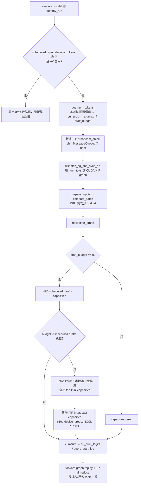
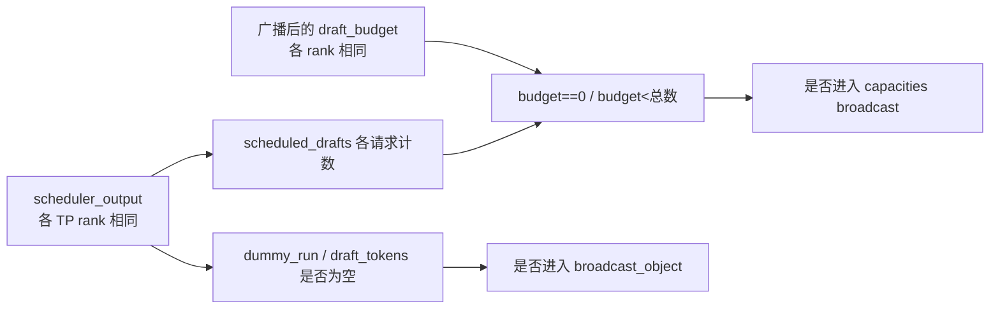

# PR #62769: [Bugfix][Spec Decode] Synchronize adaptive DSpark decisions across TP ranks

> **Author**: @okorzh-amd（承接 @CedricHwong 的 #56831） | **State**: OPEN | **Date**: 2026-10-20
> **Branch**: `okorzh/av-tp-consensus` → `main` | **Labels**: bug, intel-gpu, speculative-decoding, ready, nvidia, mrv2, dflash
> **Changes**: +96 -0 lines across 2 files | **ROCm 相关性**: 部分相关（改动在 CUDA/ROCm/XPU 共享的 MRv2 spec-decode 路径；作者为 AMD，复现与 e2e 验证全部在 MI355X，hang 的已知触发点之一是 ROCm 专属的 QuickReduce all-reduce）
> 本报告分两部分：§1–6 为 PR 详细总结，§7–8 为 ROCm review 意见。

---

## 1. 总结 (Summary)

Adaptive verification（DSpark 的自适应草稿验证，下称 AV）每步在 host 上用各 rank 本地的"陈旧"置信度选出 draft budget，再在 device 上用本地"实时"置信度决定每个请求保留几个 draft slot。若 TP 各 rank 的置信度哪怕只差 1 个 fp32 ULP，就可能选出不同的 token 总数或不同的请求边界，导致后续 TP 集合通信尺寸不一致而 hang（#54011）。本 PR 以 TP rank 0 为权威：在 `get_num_tokens` 中用 `broadcast_object` 广播 `draft_budget`，在 `reallocate_drafts` 的裁剪分支中用 `GroupCoordinator.broadcast` 广播每请求的 `capacities`，代码改动仅 4 行，另加一个 gloo 多进程真实 TP 组测试。

## 2. 背景与动机 (Background & Motivation)

- **问题来源**：#54011 报告 H20 TP8 DeepSeek-V4-Flash + AV 在高并发下 hang。原修复 #56831（@CedricHwong）自 09-14 起停滞且 rebase 后 CI 不过，本 PR 保留其原始 commit 并在其上处理 review 意见。
- **AMD 侧动机**（来自评论区）：@olka-amd 称该问题"随处可复现"，阻塞了 MiniMax（#56451）与 Kimi K3 varlen 的 AV 工作；作者在 DSv4 扫测中 6 次有 1 次在运行 28 分钟后失败（`ConnectionRefusedError`，无稳定复现）。@olka-amd 提供了一个 model-free 复现脚本 `ar_size_mismatch.py`：TP 各 rank 给 **QuickReduce** 传入不同 token 数（如 1345 vs 1344 × 6144 bf16 → 505 vs 504 个 32 KB tile）时 all-reduce 直接 hang。
- **为什么是"保险"而非根因修复**：作者在 MI355X 上用插桩的 main 跑了 8434（TP2）+ 7886（TP4）步，以及约 478k 步的 DSv4.1 TP4 trace，**均未观察到自然发散**；作者解释 custom all-reduce 按固定 rank 顺序求和，所以置信度跨 rank 位级一致，发散需要"rank 不对称的数值"（顺序相关归约、非确定性 kernel 等）。PR 的定位因此是"廉价保险 / WAR"。
- **范围**：覆盖 TP，以及 PCP=1 时的 DCP；PCP>1 时每个 PCP 切片的 TP 组各有自己的 leader，不在本 PR 范围（DeepSeek-V4.1 在 NVIDIA 上已拒绝 AV+PCP，通用 `PCPManager` 路径仍放行，作者列为 follow-up）。

## 3. 代码修改分析 (Code Change Analysis)

### 3.1 修改的模块

| 模块 | 改动 |
|------|------|
| `vllm/v1/worker/gpu/spec_decode/adaptive_verification.py` (+4) | `get_num_tokens`：`argmax` 后 `draft_budget = get_tp_group().broadcast_object(draft_budget, src=0)`；`reallocate_drafts`：Triton 预算 kernel 之后 `get_tp_group().broadcast(capacities, src=0)` |
| `tests/v1/spec_decode/test_adaptive_verification.py` (+92) | autouse fixture 把单进程测试的 `get_tp_group` 替换为恒等广播；新增 `test_tp_ranks_agree_on_batch_layout[2,4]`：`mp.spawn` 起 gloo 进程，构造真实 `GroupCoordinator`（无 device communicator、带 MessageQueue 广播器），驱动真实 `get_num_tokens`/`reallocate_drafts`，覆盖"预算平局"与"等总数不同边界"两个 case |

`get_tp_group` 在 main 上已经被该模块 import 并用于 `set_cost_curves`（`adaptive_verification.py:14`、`:355`），因此本 PR 无新增 import。

### 3.2 架构 / 流程图

单步执行中两处决策点与新增同步（PR 后）：



分支条件与集合通信的关系（为什么不会"部分 rank 进入集合"）：



### 3.3 关键实现细节

- **预算广播** `adaptive_verification.py:462-463`：在 `_batch_budget` 写入之前覆盖本地 `draft_budget`，因此 `compact_batch`（CPU 均分）和 `reallocate_drafts` 都使用 leader 的预算；`get_num_tokens` 的返回值 `num_toks` 进入 `dispatch_cg_and_sync_dp`（`model_runner.py:1376-1379`、`:1847`），所以 graph 尺寸选择和 DP 同步也跟着一致。
- **capacities 广播** `adaptive_verification.py:549-550`：仅在 `0 < budget < scheduled drafts 总数`（即真正裁剪）时发生；非 leader rank 仍会先跑一次本地 Triton kernel，随后被 leader 结果覆盖。`_draft_survival` 只是 kernel 的 scratch，不被下游消费（已 grep 确认），所以非 leader 的本地中间结果不会泄漏。
- **传输选择**：`GroupCoordinator.broadcast` 走 `torch.distributed.broadcast(group=device_group)`（`parallel_state.py:841-854`），在 ROCm 上即 c10d 的 RCCL 通信器，而不是 vLLM 自己的 PyNCCL / custom AR / QuickReduce；`broadcast_object` 在 TP 组有 `mq_broadcaster` 时走 shm MessageQueue（`parallel_state.py:856-866`）。早期版本曾把 `GroupCoordinator.broadcast` 改为走 device communicator（PyNCCL），因爆炸半径和 XPU 验证问题被撤出，留作后续 PR。
- **测试**：子进程内直接替换模块全局 `assign_draft_token_budget` 与 `async_tensor_h2d` 为 CPU 实现（参考实现 `global_topk_budget` 在测试文件 main 版本第 313 行已有）；`test_adaptive_verification.py` 已在 `.buildkite/hardware_tests/cpu.yaml:102` 的 CPU 作业中，也被 AMD CI 的 `v1/spec_decode` 作业（`.buildkite/test-amd.yaml:2084-2098`，mi300_1，optional）覆盖。

## 4. 涉及的技术原理 (Technical Principles)

- **SPMD 与 TP 形状一致性**：vLLM 的 TP worker 各自跑同一份 Python 控制流，只靠"相同输入 → 相同决策"保持同步。任何由浮点数据驱动的形状决策（token 数、请求边界）一旦跨 rank 不一致，后续 all-reduce/all-gather 的尺寸或语义就会错位：NCCL/RCCL 尺寸不匹配常表现为 hang 或越界，ROCm 的 QuickReduce 按 32 KB tile 分块，tile 数不同直接 hang（评论区复现）。"leader 决策 + 广播"是这类问题的标准解法；`PCPManager.sync_drafts`（`pcp_manager.py:883-900`）对 PCP 组的 draft token/logits 也采用相同模式，注释明言"Replicated drafts are not bitwise identical across PCP ranks"。
- **DSpark adaptive verification**：每个请求有 `num_speculative_steps` 个 draft slot，存活概率为置信度的累乘；host 侧用上一步拷回的陈旧置信度与 profile 得到的 draft/verify 代价曲线算出"期望接受 token 数 / 代价"最大的总 budget，device 侧 Triton kernel 用本步实时置信度对全部 slot 做全局 top-k（二分阈值 + 平局按请求顺序分配），写出每请求的 `capacities`。平局与 1-ULP 差异正是两处决策跨 rank 分叉的入口。
- **CUDA/HIP Graph 与集合通信位置**：AV 要求 FULL cudagraph（`config/vllm.py:3183`）。新增的两处广播都在 `gather_batch_req_state` / `prepare_inputs` 的 host 侧输入准备阶段，位于 graph replay 之前；graph capture 走 `_dummy_run`，其 `SchedulerOutput.make_empty()` 没有 `scheduled_spec_decode_tokens`，而 kernel warmup 期间 `adaptive_verification` 被临时置 None（`warmup.py:230-249`），所以广播不会被录进 HIP graph。
- **c10d 与 stream 顺序**：c10d `broadcast(async_op=False)` 在内部通信流上执行并让当前流等待其完成，因此 leader 的 Triton kernel → broadcast → 后续 `cumsum` 在流上是有序的，无需额外同步；batch-sharded sampling 的 D2H 拷贝也在 `_copy_stream.wait_stream(current_stream)` 之后，读到的是广播后的值。

## 5. 评论区讨论亮点 (Discussion Highlights)

- **证据强度之争（@tuukkjs ↔ @olka-amd / 作者）**：@tuukkjs 指出修复只在"注入漂移"下得到证明，PR 自身所有运行都未自然发散，唯一自然复现是旧 nightly 上的 #54011，要求在当前 main 复现并给出插桩证据，并提到自己在 DSv4.1 AV PR 中随 main 前进后也无法再复现。@olka-amd 回应 MiniMax/Kimi K3 varlen 被阻塞，并贴出 QuickReduce 尺寸不匹配的 model-free 复现脚本（但它只能展示失败模式，不能展示本 PR 修复）。作者补充：问题间歇性、可能运行数小时后才出现，6 次 DSv4 扫测有 1 次失败且重跑通过，"注入测试是能做到的最好证据"。
- **传输层设计（@tuukkjs / @simondanielsson）**：早期版本在 AV 模块里直接访问 `device_communicator.pynccl_comm`，@tuukkjs 认为这会是 `vllm/distributed/` 之外唯一直接伸手进 PyNCCL 的代码，建议放到 `CudaCommunicator.broadcast`；随后改成修改 `GroupCoordinator.broadcast` 委托给 device communicator，@simondanielsson 追问爆炸半径和 XPU 验证（作者顺带发现 `XPUCommunicator.broadcast` 传 group-local `src` 的潜在 bug）。最终作者把所有 distributed 层改动撤出，回到普通 c10d broadcast，PyNCCL 路由留作独立 PR。
- **测试精简（@simondanielsson）**："99% 的 diff 是测试"，要求聚焦"各 rank 置信度略有差异时仍一致"这一核心断言，并要求贴出在 main 上失败的原始日志（"agents 有现编结果的风险"）；作者贴出 repro 脚本与日志，精简后称"main 上 2 个测试失败（未借助 agent 检查）"。@simondanielsson 最终表示 LGTM，但希望有其他人再看。
- **根因 vs WAR（@olka-amd / @benchislett / 作者）**：@olka-amd 转述与 @benchislett 的讨论——正确做法应是找出各 rank 不一致的原因；作者主张先作为 WAR 合入以解锁 DCP，同时继续排查根因。该分歧在 head SHA 时尚未收敛，PR 仍无 maintainer approve。
- **CI**：mergify 在 10-28 三次报告 pre-commit 失败（之后修复，当前 `mergeable_state=clean`）；作者先后触发 Buildkite #97998、#98185、#98444、#98525（最后一次对应 head `a3ef8eff`）；评论区未见 `/amd-ci run`。

## 6. 风险与潜在问题 (Risk Analysis)

| 风险 | 严重程度 | 说明 |
|------|---------|------|
| 只修症状，rank 不一致的根因未定位 | Medium | 见 §7 ⚠️【设计】；若置信度跨 rank 不一致，draft token 本身也可能不一致 |
| PR 描述与 head 代码/测试不一致，e2e 数据不对应当前传输 | Medium | 见 §7 ⚠️【注释/文档】 |
| 每个裁剪步多一次 RCCL broadcast + 每步一次 shm 广播 | Low | 作者在 MI355X 报 ~7 us + ~57 us/裁剪步；见 §7 ⚠️【性能】（数字无脚本出处） |
| 未跑 AMD CI；新测试只走 gloo/CPU | Medium | 见 §7 ⚠️【测试】 |
| 集合通信不均匀进入导致新的死锁 | Low | 已验证两处分支条件只依赖 scheduler 输出与广播后的 budget，见 §3.2 |
| PCP>1 + AV 仍可能分叉 | Low | 作者已声明范围外；见 §7 📝【兼容性】 |
| 多节点 TP 下 `broadcast_object` 走 ZMQ 远端读者，延迟高于单节点测量 | Low | 见 §7 📝【性能】 |

---

## 7. Review 意见 (Findings)

ROCm 暴露面说明：唯一的功能改动文件 `vllm/v1/worker/gpu/spec_decode/adaptive_verification.py` 在 ROCm 上是活跃路径——`rocm_attn.py:74` 的 builder 为 `AttentionCGSupport.ALWAYS`（满足 AV 的 varlen 全图要求），`mla/rocm_aiter_mla.py:516` 有专门的 `_adaptive_varlen_verify_enabled`（含 DCP 支持判断）；新增的 `capacities` 广播在 ROCm 上走 c10d RCCL。改动不触及任何 aiter/mori 符号、env var 或 Tier-1/2 backbone 文件。

| 类型 | 🔴 | ⚠️ | 📝 |
|------|----|----|----|
| 设计 | — | 1 | — |
| 注释/文档 | — | 1 | — |
| 测试 | — | 1 | — |
| 性能 | — | 1 | 1 |
| 兼容性 | — | — | 1 |

未发现可给出具体触发输入的阻塞级问题。已逐项核对：两处集合通信不会被部分 rank 进入（分支只依赖 scheduler 输出和广播后的 budget）；不在 HIP/CUDA graph capture 内（capture 用的 dummy run 没有 draft token，warmup 时 AV 被临时置 None）；PP 已被 `_validate_adaptive_verification` 拒绝，因此不存在 PP stage 之间的分叉。

---

**⚠️【注释/文档】PR 描述与 head 不一致，且 e2e 数据测的是已撤出的 PyNCCL 版本** `[已验证]`

- **问题**: PR 描述中的测试是 `test_tp_ranks_agree_on_verification_layout`，"三种 case，含 64 个随机步"，Test Result 中还有"31 passed / 7 skipped"、"36/64 与 53/64 随机步发散"以及单进程测试 `test_tp_reallocation_agrees_on_request_boundaries`；而 head `a3ef8eff` 的测试叫 `test_tp_ranks_agree_on_batch_layout`（`test_adaptive_verification.py:123-131`），只有"预算平局"和"边界分裂"两个 case，没有随机步，也没有单进程边界测试（该测试已按 @simondanielsson 的意见精简）。e2e 表（TP2，conc 1/16/64）由作者自述是在"使用 PyNCCL 做 capacities 同步的早期版本"上测得，当前 c10d 路径"仍需要 e2e 运行"。
- **影响**: 后续 maintainer 会依据描述判断覆盖面和性能，但描述里的覆盖面比实际测试更大，"无可测回退"的结论也不对应要合入的传输实现。
- **行动**: 建议作者把描述更新到 head 状态（测试名、case 数、main/PR 的失败与通过计数），并在 MI355X TP2/TP4 上用当前 c10d 路径补一次 e2e A/B（至少 conc 64，因为该并发下约 97% 的步会触发 capacities 广播）。

**⚠️【设计】只做 leader 同步，未定位或约束 rank 不一致的根因；draft token 本身可能也跨 rank 不一致** `[推测]`

- **问题**: PR 的前提是各 TP rank 的 `draft_token_confidence_probs` 可能不一致，但作者在 MI355X 上的插桩运行（约 1.6 万步 + 约 47.8 万步）中从未观察到不一致，根因不明（@benchislett/@olka-amd 也认为应先查根因）。置信度来自 draft logits，如果它们跨 rank 有 ULP 级差异，同一份 logits 的 argmax/采样得到的 **draft token** 在平局附近同样可能不同；而 TP 路径没有类似 `PCPManager.sync_drafts`（`pcp_manager.py:883-900`，该函数注释明言 PCP 下"drafts are not bitwise identical"）的 token 广播。本 PR 只对齐了形状（budget / capacities），没有对齐内容。
- **影响**: 如果真实环境存在跨 rank 数值不对称，本 PR 能消除 hang，但各 rank 可能用不同的 draft token 做 verify，造成静默的 KV/输出不一致，症状从"hang"变成"难以察觉的错结果"。ROCm 上值得排查的方向：AITER custom all-reduce 和 QuickReduce 被注释为"没有固定归约顺序"（`cuda_communicator.py:77`），如果有 one-shot 变体按 rank 起始顺序求和，就会产生跨 rank ULP 差异。
- **行动**: 建议作者在代码注释里链接 #54011 和一个跟踪根因的 issue，明确这是 WAR；建议 review 时追问：在出现发散的配置（H20 TP8 DSv4-Flash，或 MI355X 上使用 AITER AR/QuickReduce 的配置）下，各 rank 的 draft token 是否一致，以及 TP 是否也需要像 PCP 那样同步 draft。

**⚠️【测试】AMD CI 未见运行；新测试只走 gloo/CPU，未覆盖 RCCL broadcast** `[已验证]`（CI 结果本身未知）

- **问题**: 评论区只有 `/ci run`（Buildkite #98525 对应 head），没有 `/amd-ci run`；本次抓取的 checks 数据为空（只有 key 名），无法确认任何作业的结果。新增的多 rank 测试用 `use_device_communicator=False` 加 gloo，`GroupCoordinator.broadcast` 走的是 gloo `device_group`，没有覆盖生产中实际使用的 c10d RCCL 路径，也没有覆盖 HIP stream 上"Triton kernel → broadcast → cumsum"的顺序。
- **影响**: 改动本身是共享代码，而 PR 的主要动机与验证都在 ROCm 上（MI355X、QuickReduce hang）。若 RCCL broadcast 在某些 ROCm/RCCL 版本或首次使用时有问题（例如通信器延迟创建带来的显存占用），CUDA CI 全绿也发现不了。
- **行动**: 建议作者运行 `/amd-ci run`（`test-amd.yaml:2084-2098` 的 `v1/spec_decode` 作业会执行该测试文件），并在 PR 中附上 MI355X 上 TP≥2、AV 开启的一次真实服务 smoke 日志（c10d 路径）。

**⚠️【性能】每个裁剪步多一次 RCCL broadcast，开销数字缺少可复现出处** `[已验证]`（代码路径）/ 数字 `[unverified]`

- **问题**: `adaptive_verification.py:550` 在每个裁剪步都发起一次 c10d broadcast（作者统计 conc 16/64 下约 97% 的步、conc 1 下约 7% 的步），`:463` 在每个有 draft 的步发起一次 shm 广播。描述中的 MI355X 微基准（TP2：6.7 us 加约 32+25 us；TP4：7.9 us 加约 33+26 us；最坏约 64–68 us/步，占 decode 步 0.4–1.4%）没有附脚本或原始输出。
- **影响**: 在小模型、高并发的短 decode 步里（作者自己的 Qwen3-4B conc 64 TPOT 约 5.6 ms），约 60 us 的串行开销处在可测边缘；当前 c10d 版本的 e2e 尚未测量。
- **行动**: 建议作者附上微基准脚本与原始输出，并在 c10d 版本上补测 TPOT；如果开销可测，可以在后续 PR 中切到 PyNCCL（作者估计约 25–29 us）。

**📝【兼容性】PCP>1 + AV 仍未被同步覆盖，配置层也没有拒绝** `[已验证]`

- **问题**: `_validate_adaptive_verification`（`config/vllm.py:3171-3197`）拒绝 LoRA、非 FULL cudagraph 和 PP，但不拒绝 PCP>1；PCP>1 时各 PCP 切片的 TP leader 各自决策，跨切片仍可能选出不同的 budget。作者已在描述中声明这是范围外的 follow-up。
- **行动**: 建议作者在 PR 描述里链接跟踪 issue；在 follow-up 落地之前，可考虑在通用路径上对 AV + PCP>1 给出明确报错或警告。

**📝【性能】多节点 TP 下 `broadcast_object` 走 ZMQ 远端读者** `[已验证]`（实现）/ 影响 `[推测]`

- **问题**: TP 组的 MessageQueue 对跨节点读者使用 `n_local_reader=0` 的远端（ZMQ）通道（`shm_broadcast.py` `create_from_process_group`）。作者的 7 us 数字只覆盖单节点 TP2/TP4；DSv4 一类多节点 TP 部署中，每个有 draft 的步都会在关键路径上多一次网络往返。
- **行动**: 建议作者说明多节点 TP 的预期开销，或在描述中注明测量只覆盖单节点。

非阻塞的观察（无需动作）：非 leader rank 仍会执行一次本地 Triton 预算 kernel，结果随即被覆盖。由于 leader 也必须执行该 kernel，其他 rank 本来就要在 broadcast 处等待，跳过它不会缩短关键路径，因此不单独作为问题提出。

## 8. 结论 (Verdict)

**⚠️ NEEDS WORK**

代码改动只有 4 行，思路正确（以 TP leader 为权威、与 PCP 现有做法一致）。已核实集合通信不会被不均匀进入、不在 graph capture 内，对 ROCm 路径没有功能性风险，可以作为 WAR 合入。合入前建议做到：描述与 head 对齐、在当前 c10d 传输上补 MI355X e2e、跑一次 AMD CI，并在代码或 issue 中明确这是 WAR、根因（以及 draft token 是否跨 rank 一致）另行追踪。

## 9. 英文 Review 评论 (Copy-Paste English Comments)

**C1** `vllm/v1/worker/gpu/spec_decode/adaptive_verification.py:549-550` — ⚠️ comment

```text
The PR description no longer matches the head commit, and the e2e numbers were measured on a different transport. The description refers to `test_tp_ranks_agree_on_verification_layout` with three cases (including 64 randomized steps) and a single-process boundary test. The head has `test_tp_ranks_agree_on_batch_layout` with only the budget-tie and boundary cases. The e2e A/B table was measured on the earlier PyNCCL capacities sync, and the description says the c10d path still needs an e2e run. At conc 64, this broadcast fires on roughly 97% of steps, so that is the configuration that matters. Could you update the description to the current tests and pass/fail counts, and add an MI355X TP2/TP4 TPOT A/B using this c10d broadcast? Please also attach the script and raw output behind the microbenchmark numbers.
```

**C2** `tests/v1/spec_decode/test_adaptive_verification.py:123-131` — ⚠️ comment

```text
This test is a good regression guard for the consensus logic. Because it builds the group with `use_device_communicator=False` on gloo, the capacities broadcast goes through a gloo device group. It does not cover the c10d NCCL/RCCL path used in production, or the ordering on the GPU stream between the Triton budget kernel, the broadcast and the following cumsum. The motivation and validation are mostly on ROCm (MI355X, the QuickReduce size-mismatch hang), but I only see `/ci run` in the thread. Could you trigger `/amd-ci run` (the `v1/spec_decode` AMD job runs this file) and link a short MI355X TP>=2 serving smoke log with AV enabled on the current head?
```

**C3** `vllm/v1/worker/gpu/spec_decode/adaptive_verification.py:462-463` — ⚠️ comment

```text
Making TP rank 0 authoritative fixes the shape divergence, and it matches what `PCPManager.sync_drafts` already does for PCP. However, the root cause of the rank-divergent confidences is still unknown: the instrumented MI355X runs never diverged naturally. Could you link #54011 and a tracking issue for the root cause in this comment, so it is clear that this is a workaround? Could you also add a scope note that PCP > 1 is not covered here? Today `_validate_adaptive_verification` does not reject AV with PCP > 1, so that combination can still diverge across PCP slices.
```
